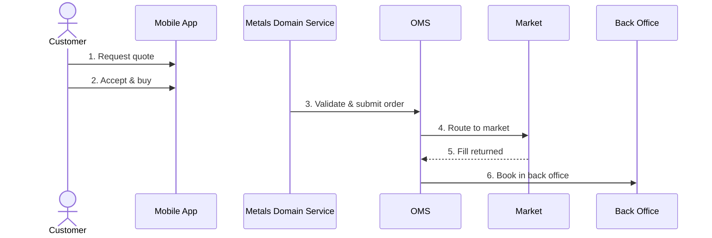

# 11 - Storyboards (Process Journeys)

> **Status:** Draft proposal · **Date:** 2026-10-21 · **Group:** Knowledge

A storyboard documents an **end-to-end business process** as an ordered sequence of steps. Each
step has a page of prose and one or more sketch-style illustrations. Requirements engineers and
business analysts write storyboards; developers, testers and stakeholders read them.

A storyboard is **not** a UI prototyping tool. Illustrations are deliberately rough so that nobody
mistakes them for a design. A step showing "user taps *Buy* on the quote screen" needs a phone
outline with a price and a button, not a pixel-accurate mock-up.

---

## 1. Why not just a sequence diagram?

A sequence diagram answers *who talks to whom, in what order*. It leaves out what reviewers ask
about most:

| Question | Sequence diagram | Storyboard |
|---|---|---|
| Who does what, in what order? | Yes | Yes (overview strip / swimlanes) |
| What does the user see and decide at this moment? | No | Yes (sketch + prose) |
| What business rules apply in this step? | Only as notes | Yes (prose, half to one page) |
| What can go wrong here, and what happens then? | `alt` blocks get unreadable fast | Yes ("Exceptions" section per step) |
| Which API, event, state transition or requirement is involved? | Partially | Yes (typed links into the cockpit) |
| Can a non-technical stakeholder follow it in a workshop? | Rarely | Yes (presentation mode) |

The storyboard keeps the sequence diagram's benefit: a sequence diagram can be **generated** from
the storyboard (see §8), so it does not have to be maintained separately.

---

## 2. Running example

Throughout this spec: *Retail customer buys precious metals via the mobile app.*

| # | Step | Actor / lane | Kind |
|---|---|---|---|
| 1 | Customer requests a quote for 100 g gold | Customer → Mobile App | user |
| 2 | Customer accepts the quote and buys | Customer → Mobile App | user |
| 3 | Domain service validates the order and submits it to the OMS | Metals Domain Service → OMS | system |
| 4 | OMS routes the order to the market | OMS → Market | system |
| 5 | Market returns a fill | Market → OMS | external |
| 6 | OMS sends a booking request to the back office | OMS → Back Office | system |

---

## 3. Research: libraries for React/TypeScript

The cockpit is already Electron 34, React 19, Tailwind 4 and Radix, and it already uses
`react-markdown`, `remark-gfm`, `gray-matter` and Monaco. The candidates below were judged on four
things: (a) a sketch look out of the box, (b) whether they can be embedded as a React component,
(c) whether the file format can be diffed and reviewed in git, and (d) the licence.

### 3.1 Illustrations (drawing the sketches)

| Library | What it is | Sketch look | Embeddable | Licence | Verdict |
|---|---|---|---|---|---|
| **Excalidraw** (`@excalidraw/excalidraw`) | Whiteboard with a hand-drawn look, shipped as a React component | Native (rough strokes, handwritten font) | Yes, `<Excalidraw />` plus `exportToSvg` / `exportToBlob` utilities | MIT | **Recommended** for authoring |
| **tldraw** (`tldraw`) | Infinite-canvas SDK | "Draw" style available | Yes | tldraw SDK licence: free in development, **production needs a license key**, hobby licences show a watermark | Not recommended (licensing overhead for an internal tool) |
| **Rough.js** (`roughjs`) | Low-level library for drawing hand-drawn lines, shapes and paths on SVG or canvas; supports seeding so output is stable | Native | Yes (imperative, wrap in a small React component) | MIT | **Recommended** for *generated* visuals (overview strip, swimlanes, placeholder panels) |
| **wired-elements** | Sketchy web components (buttons, inputs, cards) built on Rough.js and Lit | Native | Yes (web components; React wrapper exists) | MIT | Optional. Useful only if we later generate wireframe widgets from text. Not needed for v1 |
| **Mermaid** | Text-to-diagram (sequence, journey, flowchart) | `look: handDrawn` exists in v11+ (support varies by diagram type) | Yes | MIT | **Recommended for export only** (§8), not as the primary view |

**Why Excalidraw:** it is the only MIT option that gives authors a complete drawing tool with the
right look and no design skills needed. Its **"SVG with embedded scene"** export is what makes the
storage model work (§5.3): one file that renders as an ordinary image everywhere (GitHub, the
knowledge base, PDF export) and still opens again for editing. Excalidraw also supports
**libraries** (`.excalidrawlib`), so we can ship a stencil set (phone frame, desktop window,
server, exchange, document, person) to make sketches quick and consistent.

### 3.2 Journey visualisation (the step sequence)

| Library | Fit | Verdict |
|---|---|---|
| **Custom SVG + Rough.js** | The layout is deterministic (column = step index, row = lane), so no layout engine is needed. Full control over the sketch look | **Recommended** |
| **React Flow** (`@xyflow/react`, MIT) | Node graphs with pan and zoom, custom nodes | Defer. Worth it only once branching flows (§10) need free-form layout |
| **Mermaid `journey` / `sequenceDiagram`** | Text in, static diagram out; no selection or interaction model | Export only |

### 3.3 Markdown authoring

| Library | Notes | Verdict |
|---|---|---|
| **MDXEditor** (`@mdxeditor/editor`, MIT) | WYSIWYG React editor that reads and writes markdown, with a toolbar, tables, images and a raw-source toggle | **Recommended** for business analysts (no markdown knowledge needed) |
| **Milkdown** (MIT) | Plugin-based WYSIWYG markdown editor | Alternative if MDXEditor round-trips poorly |
| **Monaco** (already a dependency) | Code editor with markdown highlighting | Keep as the "Source" tab for power users |
| **react-markdown** (already a dependency) | Rendering | Reuse for read mode, so steps render exactly like knowledge-base documents |

> **Spike before committing (1–2 days):** confirm current versions, make sure Excalidraw's fonts
> load under Electron's CSP, and check that MDXEditor round-trips our front-matter and image
> syntax without rewriting unrelated lines (to keep git diffs clean).

---

## 4. User experience

### 4.1 Placement

- New view **Storyboards** (`ViewId: 'storyboards'`, icon `Clapperboard` from lucide) in the
  **Knowledge** group, between *Requirements* and *File Explorer*.
- Deep links: `/storyboards/<story-id>` and `/storyboards/<story-id>/<step-id>`.
- Command palette: "Open storyboard…", "New storyboard", "Present storyboard".

### 4.2 Storyboard browser (master list)

```
+--------------------------------------------------------------------------------+
| Storyboards                                   [ search...        ] [+ New]     |
| Filter: [All domains v] [All statuses v] [Tag v]                               |
+-------------------------------+------------------------------------------------+
| ▸ Precious Metals             |  ┌────┐┌────┐┌────┐┌────┐┌────┐┌────┐          |
|   ● Buy gold via mobile app   |  │ ✎  ││ ✎  ││ ⚙  ││ ⚙  ││ ⇄  ││ ⚙  │  (thumbs)|
|     6 steps · Approved        |  └────┘└────┘└────┘└────┘└────┘└────┘          |
|   ○ Sell back to bank         |                                                |
|     8 steps · Draft           |  Buy gold via mobile app                       |
| ▸ Equities                    |  Retail customer buys physical gold at a       |
|   ○ Care order via desk       |  quoted price; order is filled and booked.     |
| ▸ FX                          |  Actors: Customer · Systems: Mobile App, Metals|
|                               |  Domain Svc, OMS, Market, Back Office          |
|                               |  Linked: UC-012, FR-044, FR-045                |
|                               |  Owner: a.analyst · Updated 2026-10-18         |
|                               |                          [Open] [Present]      |
+-------------------------------+------------------------------------------------+
```

- Grouped by `domain`. Each card shows the step count, status and a thumbnail strip, so readers
  can recognise a storyboard at a glance.
- Fuzzy search (Fuse.js, already a dependency) over title, summary, step titles and step prose.

### 4.3 Storyboard view (the main screen)

The overview sits at the top and the selected step's detail below it. Both are visible at the same
time so readers never lose their place.

```
+--------------------------------------------------------------------------------+
| ← Storyboards / Precious Metals / Buy gold via mobile app    [Strip|Lanes] [▶] |
+--------------------------------------------------------------------------------+
|  OVERVIEW (Strip mode)                                                         |
|   ①──────────②──────────③──────────④──────────⑤──────────⑥                     |
|  ┌──────┐   ┌──────┐   ┏━━━━━━┓   ┌──────┐   ┌──────┐   ┌──────┐               |
|  │ 📱   │   │ 📱   │   ┃ ⚙ →▣ ┃   │ ▣→🏛 │   │ 🏛→▣ │   │ ▣→🗄 │               |
|  └──────┘   └──────┘   ┗━━━━━━┛   └──────┘   └──────┘   └──────┘               |
|  Request    Accept     Validate   Route to   Fill       Book in                |
|  quote      & buy      & submit   market     returned   back office            |
+--------------------------------------------------------------------------------+
|  STEP 3 of 6 · Validate & submit order               [◀ Prev] [Next ▶] [Edit]  |
|  Metals Domain Service → OMS · system step                                     |
+-----------------------------------------------+--------------------------------+
|  ┌─────────────────────────────────────────┐  |  ## What happens               |
|  │                                         │  |  The domain service receives   |
|  │      (sketch: service box with a        │  |  the buy instruction with the  |
|  │       checklist, arrow to OMS box)      │  |  quote id. It checks that ...  |
|  │                                         │  |                                |
|  └─────────────────────────────────────────┘  |  ## Business rules             |
|   ● ○  (illustration 1 of 2)                  |  - Quote valid for 10 s ...    |
|                                               |                                |
|  Links                                        |  ## Exceptions                 |
|  ⓐ POST /orders (oms-cmd-api)                 |  - Quote expired → step 2b ... |
|  ⓔ OrderMessage (Avro)                        |                                |
|  ⓢ NEW → UNACK                                |                                |
|  ⓡ FR-044                                     |                                |
+-----------------------------------------------+--------------------------------+
```

The detail pane is split: **illustrations on the left, prose on the right**. Below 1280 px the two
stack vertically, with the illustration on top. Long prose scrolls on its own; the overview stays
fixed.

### 4.4 Two overview modes

**Strip (default).** A comic-style filmstrip of panel thumbnails, one per step. This suits
business readers and workshops.

**Lanes.** Swimlanes with one row per actor or system, and steps placed as cards in their lane.
Each card has a sketchy arrow to the next step's lane. This is the "sequence diagram" view for
technical readers, and it shows at a glance which steps cross a system boundary.

```
              ①         ②         ③         ④         ⑤         ⑥
Customer     [Request]→[Accept]
Mobile App      ↓          ↓
Metals Svc                    [Validate]
OMS                               ↓───→[Route]           [Fill]──→[Book]
Market                                    ↓──────────────↑
Back Office                                                         ↓ [ack]
```

Both modes are drawn with Rough.js using a **fixed seed per step id**, so the sketch does not
"wiggle" on every re-render. Selection, hover and keyboard focus behave the same in both modes.

### 4.5 Navigation and interaction

| Input | Effect |
|---|---|
| Click a panel or card | Select that step |
| `←` / `→`, `j` / `k` | Previous / next step |
| `Home` / `End` | First / last step |
| `e` | Edit the current step |
| `p` or the ▶ button | Presentation mode |
| Click a link chip (API / event / state / requirement) | Cross-view navigation to Contracts (Editor, Domain Model tabs) or Requirements |
| `Ctrl+K` → "storyboard: gold" | Jump directly to a storyboard or step |

**Presentation mode** shows the step full screen: illustration large, prose condensed to its first
section ("What happens"), the strip as a thin progress bar at the bottom, and arrow keys to
advance. It is meant for walking stakeholders through a process in a workshop.

### 4.6 Editing

Editing is per step, in place. The layout stays the same, and the panes become editable.

```
+--------------------------------------------------------------------------------+
| Editing step 3 · Validate & submit order                   [Cancel] [Save ⌘S]  |
+--------------------------------------------------------------------------------+
| Title  [Validate & submit order            ]   Kind  [system v]                |
| From   [Metals Domain Service v]  To [OMS v]    + add illustration             |
+-----------------------------------------------+--------------------------------+
|  ┌───────────── Excalidraw canvas ─────────┐  |  [Rich | Source]               |
|  │ Library: 📱 🖥 ▣ 🏛 🗄 👤 📄 ...        │  |  B I H2 • 1. 🔗 ⊞             |
|  │                                         │  |  ## What happens               |
|  │                                         │  |  The domain service ...        |
|  └─────────────────────────────────────────┘  |                                |
|  Links  [+ API] [+ Event] [+ State] [+ Req]   |                                |
+-----------------------------------------------+--------------------------------+
```

Editing rules:

- **New storyboard wizard:** title, domain, lanes (actors and systems), then a list of step
  titles. This scaffolds one file per step from a template (§5.4), so the author starts with
  structure instead of a blank page.
- **Reorder steps** by dragging panels in the strip. Only `story.md` changes; step files keep their
  names.
- **Insert a step** with the "+" that appears on hover between two panels.
- **Placeholder panels:** a step without an illustration shows an auto-generated Rough.js panel
  (lane icon → lane icon, plus the title). The strip never has a hole, and authors can add real
  sketches later.
- **Link pickers** autocomplete from data the cockpit already indexes: OpenAPI operations
  (SpecsService), Avro records, requirement ids (RequirementsService) and order states.
- **Autosave a draft** to `~/.developer-cockpit/drafts/`. Only an explicit **Save** writes into the
  repository.
- **Concurrency:** the cockpit is single-user and files live in git. If the file on disk changed
  since it was opened (detected by the watcher), show a "reload or overwrite" prompt. Reviews and
  collaboration happen through branches and pull requests, using the existing Git Overview and
  Branch Manager views.

---

## 5. Storage model

Everything is stored as files in the repository, in line with the cockpit's filesystem-first
persistence ([05-data-model.md](./05-data-model.md)). Text is markdown with YAML front-matter;
illustrations are SVG files.

### 5.1 Layout

```
<kb-root>/storyboards/
└── precious-metals/                       # domain folder (optional nesting)
    └── buy-gold-mobile/                   # one folder per storyboard
        ├── story.md                       # metadata, lanes, step order, intro prose
        ├── steps/
        │   ├── request-quote.md
        │   ├── accept-quote.md
        │   ├── validate-submit.md
        │   ├── route-to-market.md
        │   ├── fill-returned.md
        │   └── book-back-office.md
        └── assets/
            ├── request-quote.excalidraw.svg
            ├── validate-submit.excalidraw.svg
            └── validate-submit-2.excalidraw.svg
```

**Why one file per step, not one big markdown file:** each step is half a page to a page, so a
story of 10–15 steps would be a 10+ page file. Separate files give smaller diffs, fewer merge
conflicts when two analysts work on the same story, and a natural unit for linking. Step order
lives in `story.md`, so reordering never renames files.

### 5.2 `story.md`

```markdown
---
id: buy-gold-mobile
title: Buy gold via mobile app
domain: precious-metals
status: Draft            # Draft | In Review | Approved | Deprecated
owner: a.analyst
last_updated: 2026-10-18
tags: [retail, mobile, precious-metals]
lanes:
  - { id: customer,    label: Customer,              kind: actor }
  - { id: app,         label: Mobile App,            kind: channel }
  - { id: metals-svc,  label: Metals Domain Service, kind: system }
  - { id: oms,         label: OMS,                   kind: system }
  - { id: market,      label: Market,                kind: external }
  - { id: backoffice,  label: Back Office,           kind: external }
steps:
  - request-quote
  - accept-quote
  - validate-submit
  - route-to-market
  - fill-returned
  - book-back-office
links:
  useCases: [UC-012]
  requirements: [FR-044, FR-045]
---

## Summary
A retail customer buys physical gold at a firm quoted price. The order is validated by the
metals domain service, executed by the OMS on the market, and booked in the back office.

## Scope & assumptions
- Customer is onboarded and has sufficient cash balance.
- Out of scope: delivery / vaulting (see storyboard `vault-gold`).
```

### 5.3 Step file (`steps/validate-submit.md`)

```markdown
---
id: validate-submit
title: Validate & submit order
kind: system              # user | system | external | manual
from: metals-svc
to: oms
illustrations:
  - src: ../assets/validate-submit.excalidraw.svg
    caption: Domain service checks quote validity and limits
  - src: ../assets/validate-submit-2.excalidraw.svg
    caption: Order handed to OMS
links:
  api:    [oms-cmd-api#createOrder]
  events: [OrderMessage]
  states: ["NEW -> UNACK"]
  requirements: [FR-044]
---

## What happens
The domain service receives the customer's buy instruction together with the quote id.
It re-checks that the quote is still valid, that the customer's limit covers the notional
and that the product is tradable, then submits a new order to the OMS ...

## Business rules
- A quote is firm for 10 seconds after it is shown.
- Minimum order size is 1 g; maximum per order is CHF 250 000 notional.

## Exceptions
- **Quote expired** → order is not submitted; the app shows "price changed" and offers a re-quote.
- **OMS rejects** (validation failure) → customer sees a generic error; ops alert raised.

## Open questions
- Do we re-quote automatically or require a second tap?
```

The section headings are a **convention, not a schema**. The template pre-fills them, and the
detail pane uses them for anchors and for the condensed text in presentation mode ("What happens").
Unknown front-matter keys are kept untouched when saving.

### 5.4 Illustration format: `*.excalidraw.svg`

- A normal SVG, rendered with a plain `` everywhere: GitHub, the knowledge base,
  `react-markdown` and PDF export.
- The Excalidraw scene JSON is embedded in the SVG (Excalidraw's `exportEmbedScene` option), so the
  cockpit can reopen the file in the editor with nothing lost.
- The same files can be edited outside the cockpit with the Excalidraw VS Code extension, which
  understands `.excalidraw.svg`.
- Plain `.png`, `.jpg` and `.svg` are accepted as read-only illustrations (for example a screenshot
  from an existing system), shown with a "not editable" badge.
- Size guidance: keep each SVG under 500 KB. The cockpit warns above that, because embedded
  images inflate the scene.

### 5.5 Templates and stencil library

- `<kb-root>/storyboards/_templates/step.md` and `story.md` hold project-specific scaffolds.
- `<kb-root>/storyboards/_library/oms-storyboard.excalidrawlib` is a shared stencil set: phone
  frame, desktop window, generic service box, OMS box, exchange/market, back-office ledger,
  document, person, message envelope. It is loaded into every Excalidraw session, so all sketches
  share one visual vocabulary.

---

## 6. Data model (TypeScript)

Add `src/shared/types/storyboards.ts`:

```typescript
export type LaneKind = 'actor' | 'channel' | 'system' | 'external';
export type StepKind = 'user' | 'system' | 'external' | 'manual';
export type StoryStatus = 'Draft' | 'In Review' | 'Approved' | 'Deprecated';

export interface Lane {
  id: string;
  label: string;
  kind: LaneKind;
}

export interface StepLinks {
  api?: string[];          // "<spec>#<operationId>"
  events?: string[];       // Avro record names
  states?: string[];       // "FROM -> TO"
  requirements?: string[]; // UC-/FR-/NFR- ids
}

export interface Illustration {
  src: string;             // path relative to the step file
  caption?: string;
  editable: boolean;       // derived: true for *.excalidraw.svg
}

export interface StoryStep {
  id: string;
  title: string;
  kind: StepKind;
  from?: string;           // lane id
  to?: string;             // lane id
  illustrations: Illustration[];
  links: StepLinks;
  body: string;            // raw markdown
  headings: { level: number; text: string; anchor: string }[];
  path: string;            // relative to kb-root
}

export interface StoryboardSummary {
  id: string;
  title: string;
  domain: string;
  status: StoryStatus;
  owner: string;
  lastUpdated: string;
  tags: string[];
  stepCount: number;
  thumbnails: string[];    // first illustration of each step, or '' for placeholder
  path: string;
}

export interface Storyboard extends StoryboardSummary {
  lanes: Lane[];
  steps: StoryStep[];      // resolved, in story.md order
  links: { useCases?: string[]; requirements?: string[] };
  body: string;
  problems: ValidationProblem[];
}

export interface ValidationProblem {
  severity: 'error' | 'warning';
  stepId?: string;
  message: string;         // e.g. "step 'fill-returned' references unknown lane 'exchange'"
}
```

---

## 7. Backend (Electron main process)

### 7.1 `StoryboardService`

Built the same way as `KbService` and `RequirementsService`: it reads the filesystem, parses with
`gray-matter`, and refreshes from `WatcherService` events.

| Method | Description |
|---|---|
| `list(): StoryboardSummary[]` | Scan `<kb-root>/storyboards/**/story.md` |
| `get(id): Storyboard` | Load the story and all steps; run validation |
| `createStory(input): Storyboard` | Scaffold the folder from templates |
| `saveStory(id, frontMatter, body)` | Write `story.md` and keep unknown keys |
| `createStep(storyId, afterStepId, title)` | Create the step file and insert it into `steps:` |
| `saveStep(storyId, stepId, frontMatter, body)` | Write the step file |
| `deleteStep(storyId, stepId, deleteAssets)` | Remove the step from the order; optionally delete its files |
| `reorder(storyId, stepIds[])` | Rewrite the `steps:` list only |
| `saveIllustration(storyId, name, svg)` | Write `assets/<name>.excalidraw.svg` |
| `exportMermaid(id): string` | See §8 |
| `exportHtml(id): string` | Self-contained HTML (inlined SVGs and rendered markdown) |

**Validation** reports problems in the view (a warning badge on the affected panel) and never
blocks loading:

- unknown lane ids in `from` / `to`
- `steps:` entries without a file, and step files not listed (orphans)
- missing illustration files
- link targets that do not resolve: unknown operationId, Avro record or requirement id

### 7.2 IPC and events

- `storyboards.ipc.ts` exposes the methods above through `window.cockpit.storyboards.*`, following
  the existing `*.ipc.ts` pattern.
- The watcher emits `storyboards:changed { storyId }`. The renderer store reloads only that story.
- Illustrations are served through the existing file access path (or a `cockpit-asset://`
  protocol), never as `file://` URLs from the renderer.

### 7.3 Renderer

```
src/renderer/
├── stores/storyboards.ts              # zustand: list, current story, selected step, mode
└── views/storyboards/
    ├── StoryboardsView.tsx            # master-detail shell
    ├── StoryboardBrowser.tsx          # grouped list + search + filters
    ├── StoryOverview.tsx              # switches Strip / Lanes
    ├── StripOverview.tsx              # filmstrip (Rough.js frames)
    ├── LanesOverview.tsx              # swimlanes (Rough.js arrows)
    ├── StepDetail.tsx                 # illustrations + prose + link chips
    ├── StepEditor.tsx                 # MDXEditor / Monaco + front-matter form
    ├── IllustrationEditor.tsx         # lazy-loaded Excalidraw modal
    ├── PlaceholderPanel.tsx           # generated sketch for steps w/o illustration
    ├── PresentationMode.tsx
    └── NewStoryWizard.tsx
```

Load Excalidraw and MDXEditor with `React.lazy`, so the browse and read paths stay light.

---

## 8. Export and integration

| Output | Purpose |
|---|---|
| **Mermaid `sequenceDiagram`** | Generated from `lanes` plus each step's `from → to` and title. Paste into the knowledge base or a pull request. Gives you the sequence diagram without maintaining it twice |
| **Self-contained HTML** | Share with stakeholders who don't run the cockpit |
| **PDF** (via Electron `printToPDF` on the HTML export) | Sign-off documents |
| **MCP server** (`oms-mcp-server`) | Expose storyboards as read-only resources, so AI assistants can use them as context when implementing a step |

Example of the generated Mermaid for the running example:



Optional AI assists (later phase; use the existing AI integration in
[07-ai-integration.md](./07-ai-integration.md)):

- Draft the "What happens / Business rules / Exceptions" sections from the step title and its
  linked specs.
- Review a storyboard for missing exception paths, compared against the order state machine.
- Suggest links (API operations, events) based on the prose.

---

## 9. Design principles

1. **Sketches, never mock-ups.** The hand-drawn look is the default, and there is no option to
   switch it off. This keeps discussions on the process and away from pixels.
2. **The overview is always visible.** Readers always know where they are in the journey.
3. **Prose carries the substance.** Illustrations support the text; they don't replace it. A step
   without a sketch is still a complete step (placeholder panel).
4. **Plain files, reviewed in git.** No database. A storyboard reads well on GitHub even without
   the cockpit.
5. **Link, don't duplicate.** Steps reference API operations, events, states and requirements by
   id. They don't copy them.
6. **Structure guides, not enforces.** Templates and section headings help authors; validation
   warns but never blocks.

---

## 10. Out of scope (v1) and future work

- **Branches and alternative flows.** v1 is linear; exceptions are described in prose. v2 could
  add `variants:` in `story.md` (for example `quote-expired: [request-quote, accept-quote,
  requote, ...]`). That would make React Flow worth adopting.
- **Real-time co-editing and comments.** Use pull requests.
- **Linking to live data**, such as replaying a real order's `order_events` against a storyboard to
  show "where is this order in the journey". This is an interesting tie-in with
  `OrderReplayService`, but it is a separate feature.
- **Generating sketches** from text with AI.

---

## 11. Implementation plan

| Phase | Scope | Exit criteria |
|---|---|---|
| **0 · Spike** (1–2 d) | Excalidraw in Electron (fonts, CSP, `exportEmbedScene` round-trip); MDXEditor front-matter round-trip | Decision memo; versions pinned |
| **1 · Read-only** | Types, `StoryboardService.list/get`, watcher, browser, Strip overview, step detail, placeholder panels, the running example written by hand as a fixture | An analyst can browse the example storyboard written in VS Code |
| **2 · Authoring** | New-story wizard, step editor (MDXEditor + Source tab), Excalidraw modal + stencil library, reorder/insert/delete, validation badges | An analyst can create the example storyboard end-to-end in the cockpit |
| **3 · Technical views** | Lanes overview, link pickers + cross-view navigation, Mermaid export | Developer can jump from step 3 to `createOrder` in Contracts → Editor |
| **4 · Sharing** | Presentation mode, HTML/PDF export, MCP resources | Workshop walkthrough without the cockpit installed for viewers |
| **5 · AI assists** | Draft prose, exception review, link suggestions | Opt-in, behind AI provider settings |

### Tests

- Unit tests for the parser and validator, using fixture storyboards (valid, unknown lane, orphan
  step, missing asset).
- Round-trip test: load and save a step without changes, and the file is byte-identical.
- Component tests: keyboard navigation in the overview, and selection staying in sync between
  Strip and Lanes.

---

## 12. Open questions

1. **Location:** under `oms-knowledge-base/storyboards/`, or per module (`<module>/storyboards/`)?
   This proposal assumes the knowledge base, because storyboards cross module boundaries.
2. **Approval workflow:** is `status: Approved` set by the owner, or only through a pull-request
   review with a CODEOWNERS entry for business analysts?
3. **Stencil library ownership:** who maintains `oms-storyboard.excalidrawlib`, and should it
   follow a brand style (colours) or stay monochrome?
4. **Requirements linkage:** should a use case in the Requirements view show "Storyboards
   referencing this UC" (a backlink index)? Recommended, at low cost.
