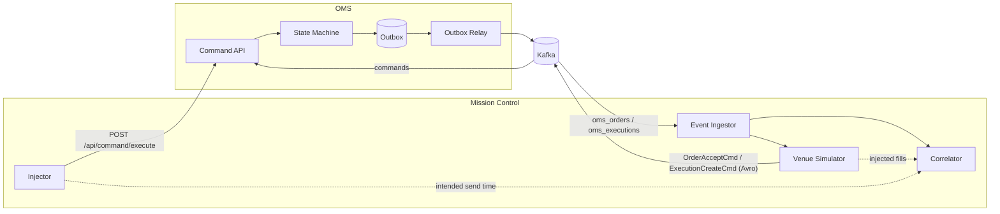
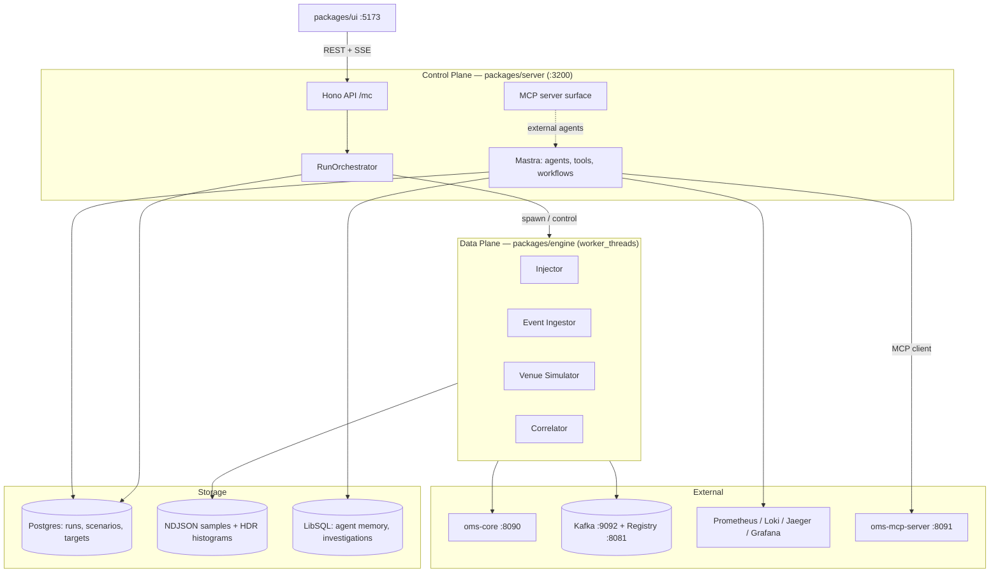
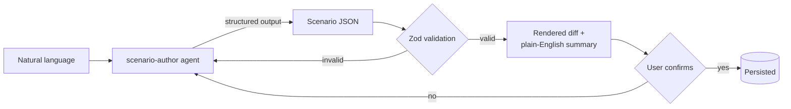

# Mission Control v2 — Design & Architecture Concept

**Version:** 2.0 (draft)
**Date:** 2026-08-20
**Status:** Proposed
**Supersedes:** `docs/superpowers/specs/2026-04-04-mission-control-design.md` (extends, does not replace)

---

## Table of Contents

1. [Vision & Scope](#1-vision--scope)
2. [Reality Check — Verified Findings](#2-reality-check--verified-findings)
3. [Key Decisions](#3-key-decisions)
4. [System Architecture](#4-system-architecture)
5. [The Data Plane](#5-the-data-plane)
6. [The Measurement Model](#6-the-measurement-model)
7. [Correctness & Completeness Oracle](#7-correctness--completeness-oracle)
8. [Scenario DSL & AI-Assisted Authoring](#8-scenario-dsl--ai-assisted-authoring)
9. [Agents, Skills & Investigation](#9-agents-skills--investigation)
10. [Storage & Data Model](#10-storage--data-model)
11. [API Surface](#11-api-surface)
12. [UI](#12-ui)
13. [Safety & Guardrails](#13-safety--guardrails)
14. [OMS-Side Enablers](#14-oms-side-enablers)
15. [Phased Delivery](#15-phased-delivery)
16. [Verification Strategy](#16-verification-strategy)
17. [Risks](#17-risks)
18. [Open Questions](#18-open-questions)

---

## 1. Vision & Scope

Mission Control is the operational companion to OMS: a client/server TypeScript tool for **performance testing**, **lifecycle correctness verification**, and **problem investigation** against an event-sourced order management system.

The defining constraint is asynchrony. A REST command to OMS is only the *beginning* of a workflow. The order is created, routed, acknowledged, and filled over a sequence of Kafka events emitted through a transactional outbox. Any tool that measures OMS by timing the HTTP response is measuring almost nothing. Mission Control must therefore:

- **Initiate** order workflows through the command API
- **Observe** every downstream state change by subscribing to the event stream
- **Correlate** async events back to the originating command
- **Judge** completeness and correctness of the resulting lifecycle
- **Measure** the latency figures the business cares about — time-to-market, time-to-order-accept, time-to-fill
- **Investigate** anomalies by reasoning across logs, traces, metrics, and domain state
- **Do all of this conversationally**, so users need not know the syntax of anything

### What already exists

Mission Control is not greenfield. `mission-control/` is a pnpm + Turborepo monorepo containing:

| Package | Contents |
|---|---|
| `packages/server` | Mastra instance (port 3100) + Hono API under `/mc`, LibSQL storage, 5 agents, 20 tools across Docker/Kubernetes/Postgres/Prometheus adapters, playbook and investigation persistence |
| `packages/ui` | React 19 + Vite 6 + Tailwind 4 + Zustand (port 5173), investigation view, React Flow workflow builder, settings, dashboard |

Last commit 2026-04-07. This document describes an **extension** of that codebase toward performance testing, not a rewrite.

### Non-goals

- Replacing Grafana, Prometheus, or Jaeger. Mission Control queries them; it does not reimplement them.
- Production monitoring. This is a testing and investigation tool.
- Multi-tenant / multi-user operation. Single-user, single-workspace.
- Running against production. See [§13](#13-safety--guardrails) — this is enforced, not merely discouraged.

---

## 2. Reality Check — Verified Findings

Every statement in this section was verified against the repository. They are listed first because they drive most of the design, and because several contradict assumptions that would otherwise seem safe.

### F1 — OMS has no market. Mission Control must be the counterparty.

`OrderStateMachineConfig.standard()` declares the transition table:

```
initial: NEW
NEW    → UNACK
UNACK  → LIVE, REJ
LIVE   → FILLED, CXL, REJ
FILLED → CLOSED
terminal: CLOSED, EXP
```

But nothing inside OMS drives `UNACK → LIVE`, and nothing produces fills. `OrderAcceptCommandProcessor` runs only when an `OrderAcceptCmd` arrives. `ExecutionCommandProcessor` runs only when an `ExecutionCreateCmd` arrives. There is no exchange adapter, no venue connectivity, no simulator, no scheduled job that advances an order.

**Consequence:** *time-to-order-accept and time-to-fill are not observable at all today.* An order submitted to OMS reaches `UNACK` and stops there forever.

Mission Control must therefore ship a **Venue Simulator** — a component that consumes the order event stream and responds as a trading venue would. This is the largest piece of new scope, and it turns out to be the design's greatest strength ([D3](#d3--closed-loop-testing)).

### F2 — Fills cannot be created over REST.

The command API declares `Execution` with only two fields:

```yaml
# oms-contracts/src/main/openapi/oms-cmd-api.yml:216-227
Execution:
  properties:
    execId: { type: string }
    orderId: { type: string }
```

And `OrderMapper.toExecution` ignores everything else:

```java
// oms-core/src/main/java/org/example/oms/mapper/OrderMapper.java:47-65
@Mapping(target = "execID", ignore = true)
@Mapping(target = "lastQty", ignore = true)
@Mapping(target = "lastPx", ignore = true)
@Mapping(target = "transactTime", ignore = true)
```

Only `orderId` survives the mapping — yet `ValidateExecutionTask` requires `execID`, `lastQty`, and `lastPx` to be non-null and positive. The REST path for fills is therefore non-functional. The Avro `ExecutionCreateCmd` on the `commands` topic carries the full field set and works.

**Consequence:** the Venue Simulator must produce fills onto the **`commands` Kafka topic** as Avro, not over REST. Mission Control needs a Kafka *producer* with Schema Registry integration, not just a consumer.

### F3 — No correlation id, and no trace context on Kafka.

`OrderEvent` carries `id`, `orderId`, `version`, `event`, `transaction` (the originating command as JSONB), `resultingState`, `orderSnapshot`, and `timeStamp`. There is **no** `correlationId`, `causationId`, `requestId`, or `traceId` — not on the entity, not on the Avro schemas, not on the outbox.

Distributed tracing exists but is disabled by default (`tracing.enabled: ${TRACING_ENABLED:false}`, 10% sampling) and, critically, `spring.kafka.template.observation-enabled` and `spring.kafka.listener.observation-enabled` are unset — Spring Boot 4.1.0 defaults both to `false`. No `traceparent` header is written to Kafka records. The outbox pattern severs the request trace from the publish trace regardless, since `OutboxRelay` publishes from a `@Scheduled` thread with no memory of the originating request.

**Consequence:** correlation runs on domain keys, not trace context:

```
(sessionId, clOrdId)  →  orderId  →  eventId
   client intent        server id     ordering & dedup
```

Trace-based correlation is a later enabler ([E3/E4](#14-oms-side-enablers)), not a foundation.

### F4 — The LGTM stack is largely aspirational.

`CLAUDE.md` describes Prometheus, OpenTelemetry, Loki, and Promtail. The verified state:

| Component | Reality |
|---|---|
| Prometheus | Running on `:9090`, but `oms-core/prometheus.yml:12` scrapes host `app:8090`, which **does not exist** on `app-net`. The service is named `oms-core`. **Prometheus is collecting nothing but itself.** |
| Loki | Running on `:3100`, but `oms-core/loki-config.yml` is an **empty directory** (Docker created it from a missing bind-mount source). Falls back to baked-in defaults. |
| Promtail | Config is also an **empty directory**. Cannot start with no scrape config. **Nothing ships to Loki.** |
| Loki + Promtail networking | Neither declares `networks:`, so both land on the default compose network and cannot reach the app services. |
| Tempo | **Does not exist.** Traces go to Jaeger (UI `:16686`, OTLP gRPC `:4317`). |
| Mimir | **Does not exist.** |
| OTel Collector | **Does not exist.** Spans export directly from the app to Jaeger. |
| Grafana provisioning | **Does not exist.** No datasources, no dashboards, no JSON, no UIDs. Bare install. |

Additionally, only **two** custom Micrometer metrics exist in the entire codebase — `oms.outbox.pending` and `oms.outbox.stuck`, both gauges in `OutboxRelay`, and both only registered when `KAFKA_ENABLED=true`. Five `@Observed` annotations exist but are inert because `management.observations.annotations.enabled` defaults to `false`.

**Consequence:** "extract logs, traces, and metrics from Grafana for investigation" is a **prerequisite project**, not an integration. Phase 1 must not depend on it. The Docker-logs adapter Mission Control already has is currently the only working log path.

### F5 — Port collision.

Mission Control's server binds **3100**. Loki binds **3100**. They cannot run simultaneously. Mission Control moves to **3200**.

Established house defaults elsewhere in the repo (`developer-cockpit/src/shared/types/config.ts:80-82`) confirm the convention: Prometheus `9090`, Grafana `3000`, Loki `3100`.

### F6 — Reusable assets.

| Asset | Value |
|---|---|
| `oms-core/scripts/order-generator.ipynb` | 30 instruments (`AAPL.OQ`, `MSFT.OQ`, `JPM.N`, …) with price ranges, 10 accounts, and the **exact working `OrderCreateCmd` payload shape**. Achieved ~30 orders/s single-threaded — it measured the client, not OMS. |
| `oms-ui/frontend/src/services/OMSApiService.ts` | The `field__op` filter DSL as static helpers (`__like`, `__gt`, `__gte`, `__lt`, `__lte`, `__between`). Port it. |
| `oms-mcp-server` on `:8091` | Streamable HTTP MCP, already registered in `.mcp.json`. Mount via Mastra's MCP client → every agent gains KB search and `searchOrders` for free. |
| `GET /api/order-events/orderId/{orderId}` | The full ordered event log with `transaction`, `orderSnapshot`, `resultingState`, and server-side `timeStamp`. The authoritative latency source. |
| `tools/shared/correlate-timeline.ts` + the playbook system | Reusable unchanged. |

### F7 — Additional constraints worth recording

- **No authentication anywhere.** No `securitySchemes` in any spec, no Spring Security dependency, no `SecurityConfig`. All OMS endpoints are open.
- **CORS on oms-core defaults to `http://localhost:3000` only** (`WebConfig.java:12`, reading a key absent from `application.yml`). Mission Control's UI is on 5173. Irrelevant for server-to-server calls; it means the UI must never call OMS directly.
- **Silent filter failures.** An unknown query field is logged and dropped; an unparseable value returns `cb.conjunction()` — matching *everything*. A typo returns the unfiltered result set, not a 400.
- **No cancel or replace commands.** `Cmd` reserves `OCXL`/`OREJ`; `CancelState` exists on the entity; nothing sets them.
- **`Quote` and `QuoteRequest` are inert stubs** — 2 and 3 fields respectively, no entity, no processor, no persistence.
- **The outbox relay poll interval is a latency floor.** `@Scheduled(fixedDelayString = "${kafka.outbox.poll-interval-ms:200}")`.

---

## 3. Key Decisions

### D1 — Agent harness: Mastra, with opencode as a peer

Evaluated against the actual requirements: an embedded agent runtime inside a long-lived server application, user-defined durable workflows, typed tools generated from our own schemas, application-owned persistence, a chat surface, and an in-house OpenAI-compatible provider.

| Option | Assessment | Verdict |
|---|---|---|
| **Mastra** | A library for *building* agent applications. Workflows with suspend/resume backed by storage, memory, streaming, structured output, first-party MCP client, model router with `createOpenAICompatible` for self-hosted endpoints, Studio for debugging. Production references (Brex, Docker, Elastic, MongoDB, Salesforce, Replit). Already implemented here — 5 agents, 20 tools, API, UI. | **Recommended** |
| **opencode SDK** | A *client* SDK for driving an opencode **server**. Primitives are sessions, messages, files, shell, TUI, permissions. Custom tools come from plugin files loaded at startup from `.opencode/plugins/` or npm packages named in config — not registered dynamically by a host application. No workflow engine, no application-owned durable state. It is a coding-agent product. | Complementary |
| **Strands harness-sdk (TS)** | Minimal and model-driven; graph/swarm multi-agent, MCP, streaming, structured output. No workflow engine, no persistence layer. Note the repo commonly linked (`strands-agents/sdk-typescript`) was **archived 2026-06-03** and folded into `strands-agents/harness-sdk`. | Not a fit |
| **Vercel AI SDK** | Lowest level. You build orchestration yourself. Mastra is built on it. | Only if owning everything is the goal |

**On opencode specifically.** The genuine benefit is that the in-house AI provider is already wired up there. But that integration is a base URL, an API key, and a model id — a config object, not a framework. Mastra consumes it directly:

```ts
import { createOpenAICompatible } from '@ai-sdk/openai-compatible-v5'

const inhouse = createOpenAICompatible({
  name: 'inhouse',
  baseURL: process.env.MC_AI_BASE_URL,   // same endpoint opencode uses
  apiKey:  process.env.MC_AI_API_KEY,
})
```

Adopting opencode as the runtime would mean spawning and supervising an opencode server process, expressing an ops application in terms of coding-agent sessions, and giving up the workflow engine and durable state that this design depends on. Keep opencode as the coding agent. Keep Mastra as the application runtime.

**The idea that removes the lock-in question entirely:** expose Mission Control's own capabilities as an **MCP server**. Then opencode, Claude Code, and any in-house agent can drive Mission Control — start a run, query results, investigate an order — without Mission Control caring which harness sits on the other end. The harness stops being a one-way door, and the same tool definitions serve both the built-in chat and every external agent.

### D2 — Temporal: no

At the target scale (≤1k orders/s) Temporal does not earn its place.

- **Workflow-per-order** at 1k/s sits at Temporal's practical ceiling (roughly 500–2000 workflows/s for small payloads with tuned shard counts). Worse, it inserts the engine's own scheduling latency into the exact number being measured. You would be benchmarking Temporal.
- **Workflow-per-campaign** is a handful of long-running executions. The durability requirement there is "a run survives a process restart" — a few Postgres rows and a resume routine. Temporal would add a server, its own database, a worker pool, and a second programming model to a docker-compose file that already runs fourteen services.
- Orders reach a terminal state in **seconds**. Durable timers spanning days are not the problem being solved.

**Instead:** a Postgres-backed run store plus an in-process correlation engine with a timing wheel for deadline expiry. Kept behind a `RunOrchestrator` interface so Temporal can be introduced later if multi-day soak tests with mid-campaign human approval, or geographically distributed injectors, become real requirements.

### D3 — Closed-loop testing

Because of [F1](#f1--oms-has-no-market-mission-control-must-be-the-counterparty), Mission Control is both the **client** and the **venue**. This is not a workaround. It is the strongest property of the design.



Three properties follow:

1. **The oracle is exact, not heuristic.** Mission Control knows precisely what it submitted *and* precisely which fills it injected. Every expected value — terminal state, `cumQty`, `leavesQty`, execution count — is known a priori. There is no inference about what a real venue "should" have done.
2. **Venue behaviour becomes a controlled variable.** Acknowledgement latency distributions, partial-fill schedules, reject rates, duplicate deliveries, and out-of-order arrivals can be dialled in deliberately to test how OMS reacts to each.
3. **OMS-internal latency isolates cleanly.** The simulated venue's own delay is a known, measured quantity that subtracts out.

### D4 — Three planes, strictly separated

The single most important structural rule:

> **No LLM call, no workflow engine, and no durable write ever sits in the hot path.**

| Plane | Volume | Latency-sensitive | Runtime |
|---|---|---|---|
| **Control** — campaigns, investigations, chat, agents | Low | No | Mastra + Hono, main thread |
| **Data** — injection, ingestion, venue simulation, correlation | ≤1k/s | **Yes** | Plain TypeScript in `worker_threads`, zero framework |
| **Analysis** — metrics, invariants, LGTM queries, AI reasoning | Post-hoc | No | Mastra agents + tools |

Violating this rule is the most common way performance tools become the thing they are measuring.

---

## 4. System Architecture

```
mission-control/
├─ packages/
│  ├─ server/          # EXISTING — Mastra + Hono control plane
│  ├─ ui/              # EXISTING — React 19 + Vite + Tailwind + Zustand
│  ├─ contracts/       # NEW — Zod schemas: Scenario DSL, OrderSample, RunRecord
│  ├─ oms-client/      # NEW — typed OMS REST + Kafka/Avro client (shared)
│  └─ engine/          # NEW — data plane: injector, venue sim, ingestor, correlator
```



### Endpoint map

| Component | From host | From `app-net` |
|---|---|---|
| Mission Control server | `http://localhost:3200` | — |
| Mission Control UI | `http://localhost:5173` | — |
| oms-core | `http://localhost:8090` | `http://oms-core:8090` |
| Kafka | `localhost:9092` | `broker:29092` |
| Schema Registry | `http://localhost:8081` | `http://schema-registry:8081` |
| Postgres | `localhost:5432` | `postgres:5432` |
| Prometheus | `http://localhost:9090` | `http://prometheus:9090` |
| Loki | `http://localhost:3100` | `http://loki:3100` |
| Jaeger | `http://localhost:16686` / OTLP `:4317` | `http://jaeger:4317` |
| Grafana | `http://localhost:3000` | `http://grafana:3000` |
| oms-mcp-server | `http://localhost:8091/mcp` | `http://mcp-server:8091/mcp` |
| streaming-service | `http://localhost:8092`, `ws://localhost:7000/trade-blotter/stream` | `http://oms-streaming-service:8092` |

---

## 5. The Data Plane

Four workers, message-passed over `worker_threads`, no shared mutable state.

### 5.1 Injector

Generates and submits orders according to the scenario's arrival process.

- **Transport:** `undici` with a tuned connection pool and pipelining against `POST /api/command/execute`.
- **Arrival model:** open-model by default — Poisson, constant-rate, ramp, step, or burst. Closed-model (fixed concurrency) is available but not the default, because it lets a slow system reduce its own offered load and hide the problem.
- **Coordinated omission is corrected.** `intendedSendTime` is recorded when the arrival is *scheduled*, not when the request is actually dispatched. Latency is measured from intent. Without this, a saturated generator reports latencies that flatter the system under test — a classic and very common measurement error.
- **Payload generation:** from the scenario's field distributions, seeded with the instrument universe from `order-generator.ipynb`.
- **Correlation keys:** `sessionId = "MC-<runId>"`, `clOrdId = "<runId>-<workerId>-<seq>"`. The pair is OMS's idempotency key (`uq_orders_session_cl_ord_id`), so this doubles as duplicate-submission protection.
- **Response handling:** `CommandResult.id` yields the server-generated `orderId`, which is forwarded to the Correlator to bind `clOrdId → orderId`.

### 5.2 Event Ingestor

- **Client:** `@confluentinc/kafka-javascript` — a wrapper over librdkafka, materially faster than the pure-JavaScript KafkaJS — with `@confluentinc/schemaregistry` for Avro decoding.
- **Subscriptions:** `oms_orders` (key `orderId`, value `OrderMessage`) and `oms_executions` (key `execId`, value `Execution`).
- **Timestamping:** every record is stamped with a client-clock receive time on arrival, before any decoding, so decode cost is not attributed to OMS.
- **Ordering:** per-order ordering is guaranteed upstream — `OutboxRepository.claimPending` drains in primary-key order under `PESSIMISTIC_WRITE`, and same-key records land on one partition. The Ingestor preserves it and uses `eventId` (the per-order `version`) for dedup.

> **Note on a single fill producing two records.** `OrderEventAppender.appendExecutionEvent` deliberately stages *both* an ORDER row to `oms_orders` and an EXECUTION row to `oms_executions` for the same fill, so that consumers tracking fills and consumers tracking order state need not infer one from the other. The Correlator must expect and reconcile both.

### 5.3 Venue Simulator

Consumes `oms_orders`, applies the configured venue model, produces commands back to OMS as Avro `CommandMessage` on the `commands` topic.

| Behaviour | Configuration |
|---|---|
| Acknowledgement | Delay distribution (constant / uniform / lognormal / pareto), plus a reject rate |
| Fill schedule | `immediate`, `sliced` (N partials at interval), `partial-then-complete`, or `never` (to exercise stuck-order detection) |
| Fault injection | Duplicate `execID`, out-of-order delivery, dropped acknowledgement, oversized fill |

Every emission is recorded with its client-clock send time, so `venue_round_trip` is measurable and subtractable.

> **Sequencing constraint:** `ValidateExecutionTask` requires the order to be in `LIVE` before a fill is accepted. The simulator must send `OrderAcceptCmd` and observe the `LIVE` transition before emitting any `ExecutionCreateCmd`. A fill against an `UNACK` order is rejected.

### 5.4 Correlator

The per-order state machine. Keyed on `orderId`, seeded from the `clOrdId → orderId` binding the Injector supplies.

- An open-addressed map of in-flight orders (avoiding per-order object churn at 1k/s).
- A **timing wheel** for deadline expiry — O(1) insertion and expiry, versus the O(log n) of a heap and the memory overhead of a timer per order.
- On terminal state or deadline expiry, emits a completed `OrderSample` to the sample writer and the histogram recorder.

### 5.5 Self-monitoring — non-negotiable

A load generator that saturates produces latency numbers that are pure fiction. Every run records:

| Signal | Source | Failure condition |
|---|---|---|
| Event-loop delay | `perf_hooks.monitorEventLoopDelay` | p99 above budget |
| Achieved vs target rate | Injector | Sustained drift beyond tolerance |
| Kafka consumer lag | librdkafka statistics | Growing monotonically |
| In-flight map size | Correlator | Growing monotonically |
| GC pause time | `perf_hooks` PerformanceObserver | Excessive share of wall time |

**If any threshold trips, the run is marked `INVALID` and its latency figures are withheld from reports.** This is the difference between a measurement tool and one that merely produces plausible-looking numbers.

---

## 6. The Measurement Model

This is the core intellectual property of the tool and is specified precisely.

### 6.1 Observation points

| | Where | Clock |
|---|---|---|
| **P1** | Injector schedules / sends / receives REST response | Client |
| **P2** | Ingestor receives an `oms_orders` or `oms_executions` record | Client |
| **P3** | `order_events.timeStamp`, via `GET /api/order-events/orderId/{id}` | Server |
| **P4** | Venue Simulator emits an acknowledgement or fill | Client |

### 6.2 Headline SLIs — single-clock, skew-immune

Deliberately computed from **client-clock timestamps only**, so they remain exact regardless of host topology and require no clock synchronisation.

| Metric | Definition |
|---|---|
| `submit_rtt` | P1 response − P1 request |
| `time_to_market` | P2 arrival of the first `oms_orders` record (state `UNACK`) − P1 **intended** send |
| `time_to_order_accept` | P2 arrival of the `oms_orders` record with state `LIVE` − P1 intended send |
| `time_to_fill` | P2 arrival of the terminal `FILLED` record − P1 intended send |
| `venue_round_trip` | P2 acknowledgement observation − P4 acknowledgement emission |

### 6.3 Decomposition — server-clock, skew-flagged

Used to *attribute* latency to a component, never quoted as a headline figure. Cross-clock intervals carry `skew_sensitive: true` in the record. When injector and OMS share a host under docker-compose, skew is nil and these can be trusted directly.

| Segment | Definition | Clock |
|---|---|---|
| `oms_internal_accept` | `ACK` event `timeStamp` − `NEW_ORDER` event `timeStamp` | Server / server — **clean** |
| `oms_internal_fill` | Fill event `timeStamp` − `NEW_ORDER` event `timeStamp` | Server / server — **clean** |
| `outbox_publish_lag` | Kafka record timestamp − `order_events.timeStamp` | Mixed — flagged |
| `event_visibility_lag` | P2 client receive − Kafka record timestamp | Mixed — flagged |

### 6.4 `outbox_publish_lag` deserves top billing

`OutboxRelay` runs on `@Scheduled(fixedDelayString = "${kafka.outbox.poll-interval-ms:200}")`. **Roughly 100 ms on average, 200 ms worst case, is baked into every Kafka-observed latency before OMS performs any work.**

Reporting this as its own segment does two things: it stops the team from misreading a scheduler constant as application slowness, and it quantifies exactly what tuning that interval would buy. A tool that folds this into "time-to-market" and reports 150 ms would send someone on a multi-day investigation into a `fixedDelay` value.

The same reasoning applies to `oms.outbox.pending` and `oms.outbox.stuck` — the two gauges that already exist. Rising `pending` during a run means the relay is falling behind the command rate, which is a genuine finding about OMS throughput and should be surfaced prominently in the run report.

### 6.5 Sampling

At 1k orders/s, calling `/api/order-events/{orderId}` per order would add 1000 REST calls/s and perturb the system under test — the tool would be generating a third of its own load against the API it is measuring.

| Source | Coverage |
|---|---|
| Kafka event stream | **100%** of orders — push-based, no additional load |
| Deep event-log fetch (P3) | **~1%** random sample, plus 100% of failures, invariant violations, and outliers beyond p99.9 |
| Postgres direct read | On demand, during investigation only |

### 6.6 Percentiles

`hdr-histogram-js`, not percentile-from-sorted-array.

Histograms merge losslessly across workers, so per-worker recording stays lock-free while the run-level p99.9 remains exact. Naive reservoir or array sampling silently misrepresents the tail — which is the only part of a latency distribution anyone actually cares about. Serialised histograms are also small enough to store per run indefinitely, enabling exact cross-run comparison months later.

### 6.7 Calibration

Every run report quotes Mission Control's own noise floor, established by running the injector against a trivial echo endpoint under identical settings. **A tool that cannot state its own measurement error is not a measurement tool.** An OMS p99 of 12 ms means something quite different when the floor is 0.4 ms than when it is 9 ms.

---

## 7. Correctness & Completeness Oracle

Invariants are **declarative data**, not code — so the AI can author, explain, and reason about them, and so violations carry structured evidence rather than a stack trace.

### 7.1 Per-order invariants

| Id | Assertion |
|---|---|
| `terminal-state-matches` | Terminal state equals what the venue model injected |
| `qty-conservation` | `cumQty == Σ execution.lastQty` and `leavesQty == orderQty − cumQty` |
| `filled-iff-complete` | `cumQty == orderQty` if and only if state is `FILLED` |
| `legal-transitions` | Observed state sequence is legal under `OrderStateMachineConfig.standard()` |
| `no-event-gaps` | `eventId` strictly increasing from 1 with no gaps |
| `exactly-once-fills` | No duplicate `execID` for the same `orderId`; every injected fill observed exactly once |
| `no-orphan-executions` | Every `oms_executions` record has a matching `oms_orders` record |

> **Known bypass, allowed explicitly:** `DetermineOrderStateTask` deliberately bypasses the state machine for `LIVE → LIVE` on partial fills, since that self-transition is not in the model. The `legal-transitions` invariant must whitelist it, or every partial fill will report a false violation.

> **Contiguity has a server-side counterpart.** `OrderReplayService.isContiguous(orderId)` performs the same check inside OMS but is not exposed over REST — no controller injects it. The `no-event-gaps` invariant is Mission Control's independent implementation of the same property, which makes it a genuine cross-check rather than an echo.

### 7.2 Per-run invariants

- Orders submitted == orders observed == orders reaching a terminal state
- No orphan events — no `orderId` appearing that this run did not submit
- No stuck orders — nothing in a working state past its deadline. This directly exercises the `orders_in_unack` alert condition defined in `oms-knowledge-base/oms-concepts/order-lifecycle.md`
- Sampled deep event-log fetches (P3) agree with the Kafka-derived view (P2)
- `oms.outbox.stuck` remained zero throughout

### 7.3 Scope limitation, stated plainly

`CXL`, `REJ`, `EXP`, and `CLOSED` are **unreachable in OMS today**. There are no cancel or replace commands. `CancelState` exists on the entity and nothing ever sets it.

**The reachable lifecycle under test is `NEW → UNACK → LIVE → FILLED` and nothing else.** Invariants for the other paths will be written and will sit dormant until OMS implements them ([E8](#14-oms-side-enablers)). Any claim that Mission Control provides "full lifecycle coverage" before then would be false.

---

## 8. Scenario DSL & AI-Assisted Authoring

### 8.1 The safety property

> **The model never emits executable code. It emits data, which is schema-validated before it can run.**

This is what makes "AI configures everything" workable rather than alarming. A generated scenario cannot do anything a hand-written scenario could not do, because it passes through the same Zod validation and the same guardrails.

### 8.2 The DSL

```yaml
scenario: equity-limit-ramp
description: Ramped limit-order load with sliced partial fills
target: local                # a NAME from the target registry — never a raw URL

load:
  arrival: { type: ramp, from: 50, to: 800, over: 2m }
  duration: 10m

orders:
  symbol:      { pick: [AAPL.OQ, MSFT.OQ, INTC.OQ, JPM.N] }
  side:        { weighted: { BUY: 0.5, SELL: 0.5 } }
  ordType:     LIMIT
  orderQty:    { choice: [100, 500, 1000, 5000] }
  price:       { relativeTo: symbol, jitterPct: 2 }
  timeInForce: DAY
  account:     { pick: [account-01, account-02, account-03] }

venue:
  ackDelay:    { dist: lognormal, median: 5ms, sigma: 0.4 }
  fill:        { type: sliced, slices: 3, interval: 200ms }
  rejectRate:  0.01

expect:
  terminal: FILLED
  within: 5s
  invariants: [qty-conservation, legal-transitions, exactly-once-fills, no-event-gaps]

slo:
  time_to_order_accept_p99: 250ms
  time_to_fill_p99: 2s
  error_rate_max: 0.001
```

### 8.3 Authoring flow



Validation failures loop back to the **agent** with the structured error, never to the user. The user sees only a diff and a summary in plain language, and confirms or redirects.

### 8.4 The schema encodes the server's rules, not the spec's

`ValidateOrderTask` is stricter than the OpenAPI contract:

- `sessionId` is required, though the spec does not mark it so
- `price` is required for `LIMIT`
- `stopPx` is required for `STOP` and `STOP_LIMIT`

The Zod schema encodes the **server's** rules. An invalid scenario then fails at authoring time with a clear message, rather than as a wall of HTTP 400s three minutes into a ten-minute run.

The same pattern extends to investigation configuration and SLO definitions — anywhere the user would otherwise have to know syntax.

---

## 9. Agents, Skills & Investigation

The supervisor pattern from v1 is retained. The existing playbook system (markdown with YAML front-matter, `services/playbooks.ts`, `search-playbooks`) is generalised into **skills** — same format, same discovery tool, broader subject matter.

### 9.1 Agents

| Agent | Status | Role |
|---|---|---|
| `investigation-supervisor` | Existing | Delegates, correlates, reports |
| `log-analyzer` | Existing — extend to Loki | Error patterns, timestamp correlation |
| `db-querier` | Existing | Read-only SQL, schema, entity search |
| `metrics-analyzer` | Existing | PromQL, anomaly detection |
| `k8s-inspector` | Existing — **deprioritise** | This repo is docker-compose only; no manifests exist anywhere |
| `perf-analyst` | **New** | Run comparison, regression detection, bottleneck attribution |
| `scenario-author` | **New** | Natural language → validated Scenario DSL |
| `lifecycle-detective` | **New** | Per-order forensics across Kafka, event log, and DB |

### 9.2 New tools

| Tool | Purpose |
|---|---|
| `oms-command` | Submit commands — approval-gated for non-local targets |
| `oms-query` | The ported `field__op` filter DSL against `/api/query/search` |
| `order-event-log` | `GET /api/order-events/orderId/{id}` — the authoritative per-order timeline |
| `kafka-inspect` | Topic lag, partition state, and **`commands.DLT` contents** (where poison commands land, computed at runtime as `record.topic() + ".DLT"`) |
| `run-compare` | Diff two runs: histograms, invariant results, SLO outcomes |
| `query-loki` | LogQL — gated on [E5](#14-oms-side-enablers) |
| `query-tempo` | TraceQL — gated on [E7](#14-oms-side-enablers) |

**Mount `oms-mcp-server` over MCP** rather than reimplementing domain knowledge. One config entry gives every agent `searchKnowledgeBase`, `readKnowledgeBase`, `getKnowledgeBaseOverview`, and `searchOrders`.

### 9.3 Mission Control as an MCP server

The counterpart to consuming MCP: Mission Control **exposes** its own tools over MCP, so external harnesses — opencode, Claude Code, in-house agents — can drive it. `startRun`, `getRunReport`, `compareRuns`, `investigateOrder`, `listScenarios`.

This is what makes [D1](#d1--agent-harness-mastra-with-opencode-as-a-peer) reversible. The tool definitions are written once and serve the built-in chat and every external agent equally.

---

## 10. Storage & Data Model

| Data | Store | Rationale |
|---|---|---|
| Run metadata, scenarios, targets, SLO results | Postgres — a `missioncontrol` database in the existing container | Relational, queryable, small |
| Per-order samples (600k+ rows for a 10-minute run) | NDJSON (later Parquet) on disk, keyed by `runId` | Row-by-row inserts at 1k/s would make Mission Control the bottleneck |
| Latency histograms | Serialised HDR histograms, one per metric per run | Mergeable, exact tails, kilobytes |
| Agent memory, investigations, playbooks | LibSQL (existing) | Already working, no reason to move |

### 10.1 Emit Mission Control's own telemetry into the OMS stack

Rather than building a bespoke charting layer, Mission Control exposes `/metrics` for Prometheus to scrape and pushes per-order traces via OTLP.

The payoff: client-observed and server-observed latency land on **one Grafana dashboard**, and the agents query Mission Control's own numbers with the same `queryMetrics` tool they already use for OMS. No second query language, no separate visualisation stack, and cross-referencing a load run against OMS internals becomes a matter of overlaying two series on one time axis.

This depends on [E1](#14-oms-side-enablers) — Prometheus currently scrapes nothing.

---

## 11. API Surface

Existing routes under `/mc` are retained. New:

| Method | Path | Purpose |
|---|---|---|
| `GET` `POST` | `/mc/scenarios` | List, create scenarios |
| `GET` `PUT` `DELETE` | `/mc/scenarios/:id` | Read, update, delete |
| `POST` | `/mc/scenarios/validate` | Validate without persisting (used by the authoring loop) |
| `GET` `POST` | `/mc/targets` | Target registry |
| `POST` | `/mc/runs` | Start a run |
| `GET` | `/mc/runs` | List runs |
| `GET` | `/mc/runs/:id` | Run record and report |
| `POST` | `/mc/runs/:id/abort` | Kill switch |
| `GET` | `/mc/runs/:id/stream` | **SSE** — live telemetry |
| `GET` | `/mc/runs/:id/samples` | Paged per-order samples |
| `POST` | `/mc/runs/compare` | Compare two or more runs |

SSE event types: `run:started`, `run:progress` (rate, in-flight, completed, running percentiles), `run:invariant-violation`, `run:health` (self-monitoring signals), `run:completed`, `run:aborted`, `run:invalid`.

---

## 12. UI

New views alongside the existing dashboard, investigations, workflow builder, and settings:

- **Run Launcher** — pick a scenario and target, preview the resolved plan (arrival curve, expected order count, venue model), confirm.
- **Live Run** — arrival rate vs achieved rate, in-flight count, running percentiles, state-distribution sunburst, invariant violations as they occur, and a **generator health panel** that turns amber before the run is invalidated.
- **Run Report** — latency decomposition waterfall, HDR percentile curves, SLO pass/fail, invariant summary, outlier drill-down, and the calibration floor quoted alongside every figure.
- **Run Comparison** — two or more runs overlaid, with regression highlighting.
- **Chat** — the conversational surface over all of it, with skills and approval prompts inline.

Charting: Recharts, consistent with the v1 stack decision.

The UI never calls OMS directly — all OMS access is proxied through the Mission Control server. This sidesteps the CORS constraint ([F7](#f7--additional-constraints-worth-recording)) and keeps credentials and target guardrails server-side.

---

## 13. Safety & Guardrails

Mission Control submits **real orders into a real system**, and the eventual target is a company-internal environment rather than a laptop.

- **Target registry.** Named targets with an environment class (`local` / `dev` / `uat`). Scenarios reference a target *by name*. A raw URL is never accepted from the chat interface or from a generated scenario.
- **Per-class caps** on rate, duration, and total order count — enforced in the engine, not overridable by the LLM, not expressible in the DSL.
- **Approval gates.** Mastra's `requireApproval` on any run against a non-`local` target, reusing the human-in-the-loop machinery already built for destructive Docker operations.
- **Kill switch.** An abort endpoint, plus a dead-man's switch in the engine that halts injection if the control plane stops responding.
- **No production.** `prod` is not a valid environment class. If it is ever needed, that is a deliberate code change under review — not a config toggle, and not something a user can reach by asking the chat interface nicely.

---

## 14. OMS-Side Enablers

Phase 1 depends on **none** of these; it works on REST, Kafka, and Postgres alone. They are listed because several are one-line changes with disproportionate value, and because the design would otherwise appear to assume capabilities that do not exist.

| # | Change | Effort | Unlocks |
|---|---|---|---|
| **E1** | `oms-core/prometheus.yml:12` — `app:8090` → `oms-core:8090` | 1 line | **All** OMS metrics. Nothing is being scraped today. |
| **E2** | `management.observations.annotations.enabled: true` | 1 line | Activates 5 dormant `@Observed` timers and spans (`oms.order-create-processor.process`, `oms.order-accept-processor.process`, `oms.execution-processor.process`, `oms.message-publisher.publish`, `task.orchestrator.execute`). `aspectjweaver` is already on the classpath. |
| **E3** | `spring.kafka.{template,listener}.observation-enabled: true` | 2 lines | `traceparent` headers on Kafka records |
| **E4** | `traceparent` column on `outbox`, restored in `MessagePublisher.publish()` | Small | Stitches the trace across the outbox break. Without it, E3 delivers only half the picture. |
| **E5** | Real `loki-config.yml` / `promtail-config.yml`; put both services on `app-net` | Small | Any log aggregation at all |
| **E6** | Fix the `OrderMapper.toExecution` field mappings | Small | Fills over REST — removes the Kafka-producer requirement from the Venue Simulator |
| **E7** | Add Tempo; scrape streaming-service; add its tracing dependencies | Medium | Grafana-native trace ↔ log ↔ metric correlation |
| **E8** | Implement cancel and replace | Large | Roughly doubles the testable state space |

**Documentation correction:** `CLAUDE.md` §Monitoring lists port 8080 for the oms-core actuator and Swagger UI. It is **8090**.

---

## 15. Phased Delivery

### Phase 0 — Foundation
Move the server port 3100 → 3200. Create `packages/contracts` (Zod schemas for Scenario, OrderSample, RunRecord, invariant definitions). Create `packages/oms-client` — typed REST client, the ported `field__op` DSL, and an Avro Kafka producer/consumer wired to Schema Registry. Target registry and guardrail enforcement.

### Phase 1 — The perf-test spine
Injector → Venue Simulator → Event Ingestor → Correlator. HDR histograms, the invariant engine, and generator self-monitoring. Postgres run store plus the NDJSON sample store. `POST /mc/runs`, SSE live telemetry, run report. UI: run launcher, live run view, result view.

### Phase 2 — AI-assisted authoring
The `scenario-author` agent, the chat surface, skills, and the diff-and-confirm loop. `perf-analyst` with `run-compare` and regression detection.

### Phase 3 — Investigation, for real
Loki, Tempo, and Kafka adapters. `lifecycle-detective`. The `oms-mcp-server` MCP mount. Per-order trace waterfalls. Gated on E1, E5, and E7.

### Phase 4 — Continuous
Scheduled probe runs at low rate, SLO tracking over time, regression alerting. Mission Control's own metrics into Grafana.

---

## 16. Verification Strategy

**Unit.** Arrival-process distributions validated by χ² against their expected shapes. The invariant engine exercised against hand-built event sequences, including deliberately corrupt ones. HDR merge correctness.

**Component.** The engine against a stub OMS. Assert that injected fills produce exactly the expected `OrderSample`s, and that each seeded fault — a dropped event, a duplicate `execID`, an illegal transition, an `eventId` gap — trips precisely the corresponding invariant and no others.

> **Fault injection is the real test of an oracle.** An oracle that has never fired has never been verified. Every invariant ships with a test that makes it fail.

**End-to-end.** `docker compose up -d`, then a 60-second run at 100 orders/s. Expect 6000 orders, all reaching `FILLED`, zero invariant violations, and a measured `outbox_publish_lag` near 100 ms average — which validates the measurement model against the known 200 ms `fixedDelay` constant.

**Calibration.** The injector against a trivial echo endpoint under identical settings, establishing the noise floor quoted in every report.

**Scale.** Ramp to 1k orders/s and confirm that event-loop delay stays within budget and achieved rate tracks target. If it does not, the ceiling is Mission Control's own — and that must be reported as such, never attributed to OMS.

---

## 17. Risks

| Risk | Mitigation |
|---|---|
| The generator becomes the bottleneck and the numbers become fiction | Mandatory self-monitoring; runs marked `INVALID`; a documented noise floor quoted in every report |
| Venue Simulator latency pollutes measurements | The simulator runs on the client clock; `venue_round_trip` is measured explicitly and subtracts out |
| Clock skew once injector and OMS are on different hosts | Headline SLIs are single-clock by construction; server-clock segments carry `skew_sensitive` |
| Only three order states are reachable, so lifecycle coverage is thin | Stated openly in §7.3; dormant invariants ready for E8 |
| Observability integration blocked on the LGTM gaps | Phase 1 depends on none of it; investigation deferred to Phase 3 behind explicit enablers |
| The Mastra vs opencode decision is revisited later | Mission Control is also exposed as an MCP server, so the harness is not a one-way door |
| Schema evolution in `oms-contracts` breaks the Avro client | Consume schemas from Schema Registry at runtime rather than generating types at build time |

---

## 18. Open Questions

1. **Venue realism.** How faithful should the simulated venue be? A configurable latency-and-fill model covers performance testing. A genuine matching engine with an order book would enable market-microstructure scenarios but is a substantial project in its own right.
2. **Target environment topology.** Once the target is a company-internal system rather than localhost, does Mission Control run co-located (preserving single-clock precision for the P1/P2 measurements) or remotely? This determines how much of §6.3's skew handling actually matters.
3. **Schema Registry compatibility mode.** Mission Control produces to `commands`. If `auto.register.schemas` remains true and Mission Control's writer schema drifts from oms-core's, subject compatibility could break. Worth pinning Mission Control to read-only schema resolution.
4. **Does the streaming-service RSocket stream have a role?** `ws://localhost:7000/trade-blotter/stream` offers a filtered, deduplicated view with snapshot-plus-live semantics. For measurement it adds a hop and a second clock, so Kafka is correct for the data plane — but it may be the better source for the live UI.
5. **How much of E1–E8 is in scope for this team?** Several are one-line changes in the OMS repo with outsized value. Whether Mission Control's authors make them or file them determines Phase 3's timeline.

---

## Appendix A — Correlation Reference

```
Client intent                 Server identity              Event ordering
─────────────                 ───────────────              ──────────────
sessionId = MC-<runId>   ┐
                         ├──> orderId ("ORD-<uuid>") ──> eventId (per-order version)
clOrdId = <runId>-<w>-<n>┘         │
                                   ├──> oms_orders      (key: orderId,  value: OrderMessage)
                                   ├──> oms_executions  (key: execId,   value: Execution)
                                   └──> order_events    (unique on orderId + version)
```

- `(sessionId, clOrdId)` — OMS idempotency key, `uq_orders_session_cl_ord_id`
- `CommandResult.id` — returns the generated `orderId` on 201
- `eventId` — the per-order `version`, used for ordering and deduplication. Per-order, **not** global.

## Appendix B — Topic Reference

| Topic | Direction (from Mission Control) | Key | Value |
|---|---|---|---|
| `oms_orders` | Consume | `orderId` | Avro `OrderMessage` |
| `oms_executions` | Consume | `execId` | Avro `Execution` |
| `commands` | **Produce** | — | Avro `CommandMessage` |
| `commands.DLT` | Consume (investigation) | — | Original record |

Bootstrap: `localhost:9092` from the host, `broker:29092` inside `app-net`. Schema Registry: `localhost:8081` / `schema-registry:8081`.

> `kafka.enabled` (`KAFKA_ENABLED`) gates both `CommandListener` and `OutboxRelay`. With it off, events still land in `order_events` and `outbox` but **nothing reaches Kafka** — and the two outbox gauges do not register. Mission Control should assert it is on before starting a run.
