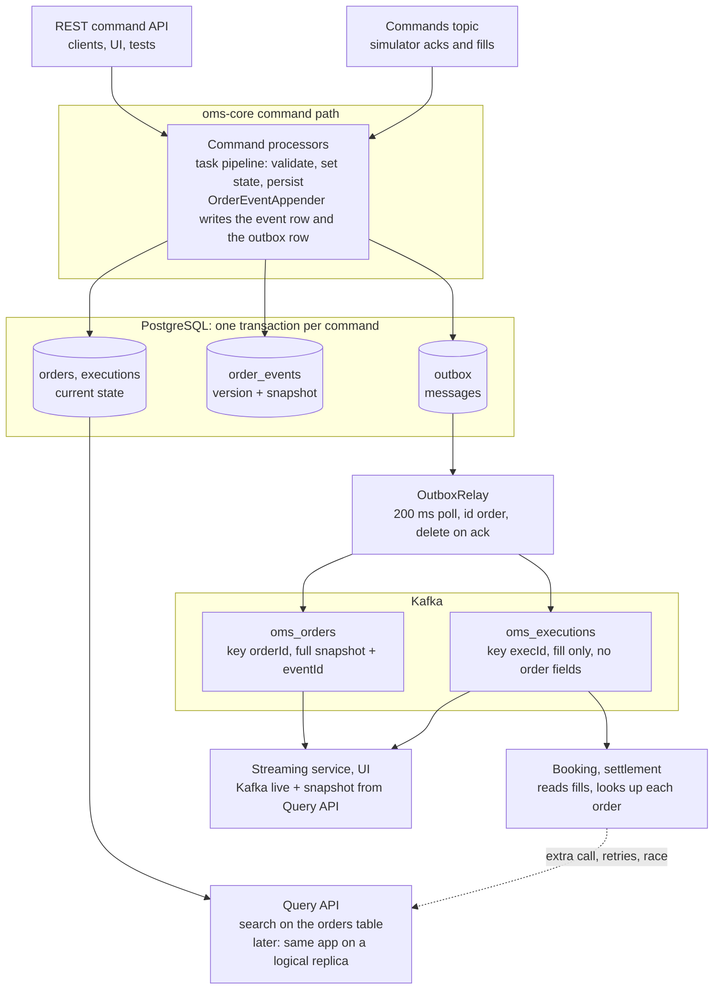
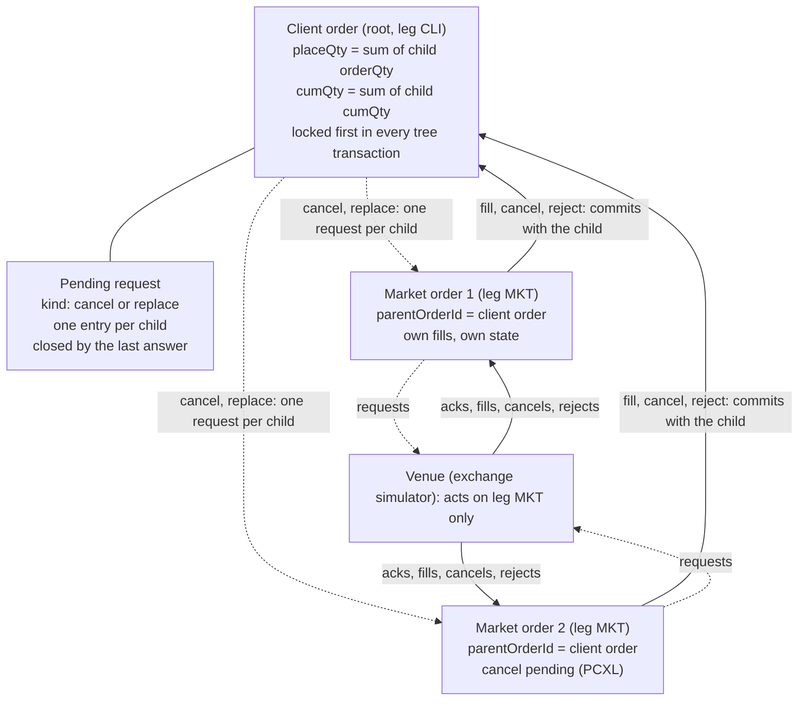
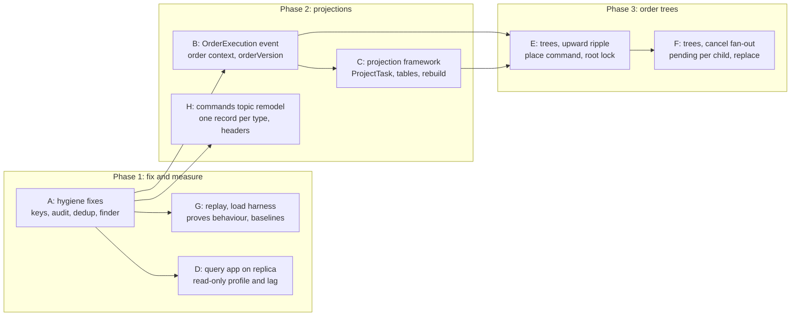

# OMS Core Architecture Review

**Date:** 2026-10-30
**Status:** Draft for discussion
**Author:** Toni Badertscher, with Claude Code
**Scope:** oms-core and its contracts, consumers and knowledge base as on `main` on 2026-10-30

> **How to read this document.** Sections 1–4 describe and assess the architecture as built.
> Sections 5–7 are design sketches for the three gaps the team named: projections, order trees and
> the message wire format. Section 8 lists further findings, section 9 sequences the work as spec
> tickets, and the appendix ties every finding to a file. No load test was run; every throughput
> statement is derived from code and configuration, not measured.

---

## Table of Contents

1. [Executive summary](#1-executive-summary)
2. [Scope and method](#2-scope-and-method)
3. [The architecture as built](#3-the-architecture-as-built)
4. [Assessment against the stated goals](#4-assessment-against-the-stated-goals)
5. [Supporting order and execution projections](#5-supporting-order-and-execution-projections)
6. [Order trees with event rippling](#6-order-trees-with-event-rippling)
7. [Message wire format: Avro, Protobuf and polymorphism](#7-message-wire-format-avro-protobuf-and-polymorphism)
8. [Other areas for improvement](#8-other-areas-for-improvement)
9. [Recommended roadmap](#9-recommended-roadmap)
10. [Appendix: source references](#appendix-source-references)

---

## 1. Executive summary

The architecture is sound for its stated purpose and should be kept. Per-order audit history is
complete and gap-checked, the transactional outbox makes publication reliable, and the query side
can move to a logical replica without touching the domain code. The two gaps the team named are
real, and both have a low-risk path inside the current design.

**Projections.** The missing piece is not an event store or a framework. The command transaction
already holds the order and the execution together, then publishes them on two topics with no
ordering between them, so every downstream consumer has to look the order up again. Build
projections at the source: a projection step in each pipeline writes denormalised read rows and
stages one self-contained `OrderExecution` message, in the same transaction, through the existing
outbox. Booking and settlement then receive one record per fill carrying the order context and the
order version it belongs to, and never call back.

**Order trees.** Model client and market orders as one `orders` row each, linked by `leg`,
`parentOrderId` and `rootOrderId` (the columns exist today and are unused). Ripple upward (fills,
cancels and rejects from a market order to its client order) synchronously, inside the market
order's transaction, with the root row locked. Ripple downward (a client cancel or replace fanning
out to several market orders) asynchronously through a small process manager that tracks one
pending request per child, because each child's outcome arrives separately from the venue. Key
every Kafka message by `rootOrderId` so a consumer sees a whole tree in order.

**Wire format.** Avro is the right format for the event topics and should stay. The polymorphism
limits the team hit come from how the commands topic is modelled, not from Avro: one subject per
command record instead of a closed union envelope, plus a shared header record, remove them without
a second format. Protobuf would add a toolchain, lose the decimal logical types, and solve only the
embedding case, which is better solved by carrying a causation id.

**Fix first.** Five defects would undermine either change and are cheap to fix: executions are
partitioned by `execId` rather than `orderId`; fills received over REST record no command in the
event log; the streaming service deduplicates on two different number spaces; command
deduplication scans and deserialises the whole event history; and `findByRootOrderId` assumes one
order per root.

The roadmap in section 9 sequences this as eight spec tickets. The fixes and the enriched
execution message can ship independently and each pays for itself; the projection framework and
the tree work build on them.

---

## 2. Scope and method

The review covers the code as it stands on `main` on 2026-10-30, judged against five goals the
team stated: audit history, reproducibility of behaviour, CQRS through logical replication, a
platform for performance testing, and the two missing capabilities (projections and order trees).
Textbook event sourcing is used as a reference only where it affects those goals.

**Reviewed.** oms-core main sources: command processors and task pipelines, `OrderEventAppender`,
`OrderReplayService`, `OutboxRelay`, `MessagePublisher`, repositories, entities, Liquibase
changelogs and `application.yml`. oms-contracts Avro schemas and the command and query OpenAPI
specs. The streaming service's Kafka consumer, query client and blotter controller. The knowledge
base: architecture decisions, domain pages, capabilities, the concept papers on order replace,
order grouping, quantity calculations, block allocation and booking integration, and the
convergence assessment. The architecture policies and the integration tests under
`oms-core/src/test`.

**Not reviewed.** oms-ui, oms-mcp-server, the exchange simulator's internals, the Developer
Cockpit, and deployment beyond `docker-compose.yml`. No load test was run; every throughput
statement below is derived from the code and configuration, not measured.

Findings are backed by file references in the appendix. Where the knowledge base and the code
disagree, the code is taken as the fact and the disagreement is listed as a finding.

---

## 3. The architecture as built

Every command runs as one database transaction that updates the aggregate, appends to the event
log and stages the Kafka message. Nothing else writes to Kafka, and nothing reads from anywhere but
the same tables.



Two entry points feed the same four processors; the relay is the only producer; the Query API
reads the tables the commands write. The executions topic carries the fill but none of the order's
fields, so a fill consumer has to call the Query API before it can act, and the call can race the
order event it needs.

- **Command path.** REST (`/api/command`) and the `commands` topic reach four processors: create,
  accept, lifecycle (reject, cancel, cancel request, cancel reject) and execution. Each runs a task
  pipeline inside one transaction. A failed task marks the transaction rollback-only, so a refused
  command leaves no trace.
- **Event log.** `OrderEventAppender` assigns the next per-order version as max(version)+1, stores
  the command, the resulting state and a full JSONB snapshot of the order, under a unique
  constraint on `(order_id, version)`. Replay is a lookup of the snapshot at or below a version,
  not a fold, and a contiguity check detects gaps.
- **Outbox.** The same appender stages an `OrderMessage` for every event and an `Execution`
  message for every fill. `OutboxRelay` polls every 200 ms, claims up to 100 rows with
  `SKIP LOCKED` in id order, sends each one synchronously, deletes it on broker acknowledgement,
  and stops the batch at the first failure to keep per-aggregate order. Rows that fail 10 times
  stay in the table and are counted by `oms.outbox.stuck`.
- **Topics.** `oms_orders` carries the full order after each event with `eventId` equal to the
  event version, keyed by `orderId`. `oms_executions` carries the fill plus the order's `cumQty`
  and `leavesQty`, keyed by `execId`. Nothing orders the two topics against each other.
- **Query path.** `/api/query/search` runs JPA specifications on `orders` in the same instance.
  The compose file already starts PostgreSQL with `wal_level=logical`; no replica and no read-only
  profile exist yet.
- **Streaming service.** Consumes both topics into bounded in-memory caches, serves RSocket
  streams to the UI, and merges a Query API snapshot with the live stream, deduplicating on
  `eventId`.
- **Consumers.** The exchange simulator reads `oms_orders` and answers on the commands topic with
  accept, fill, reject and cancel. Booking and settlement are specified but not built; the booking
  concept paper already names the enrichment lookup as its first problem.

---

## 4. Assessment against the stated goals

The design meets its audit and publication goals, is ready for CQRS by replication without changes
to the domain code, and falls short on reproducing behaviour and on anything that spans more than
one order.

| Goal | Status | Evidence in the code | Gap |
|---|---|---|---|
| Audit history per order | Met | `order_events` holds version, command, resulting state and snapshot; unique `(order_id, version)`; `isContiguous` gap check; `EventSourcingIntegrationTest` proves the accept and fill sequence and the rollback of a failed pipeline | Only state is stored. What changed is derived by diffing two snapshots; there is no causation or correlation across orders |
| Reproduce behaviour | Partly met | Every event stores the command that caused it, so the inputs exist; replay reconstructs the order at any version | Fills received over REST store no command; nothing re-executes stored commands and compares results; stored JSON carries no schema version |
| CQRS by logical replication | Ready, not built | Separate command and query APIs and models (policy P-09); queries are JPA specifications on `orders`; PostgreSQL starts with `wal_level=logical` | No read-only profile; the OpenAPI query spec has no executions-by-order, no event history and no tree view; the streaming snapshot deduplicates on the database id, not the event version |
| Reliable publication | Met for orders | Outbox in the command transaction, relay in id order, idempotent producer, per-order ordering on `oms_orders` | Executions keyed by `execId`; no ordering across topics; the execution message carries no order fields |
| Performance platform | Partly met | SLA timers with percentile histograms; pipeline timing; the simulator as a load source | Relay ceiling of about 500 messages per second per instance (100 rows per 200 ms poll, one synchronous send each); command deduplication loads the whole history; no load-test suite in the repository |
| Projections | Not supported | The streaming service builds one in memory from both topics | No fat events, no projection tables, no rebuild path |
| Order trees | Not supported | `parentOrderId`, `rootOrderId`, `leg`, `placeQty` and `allocQty` exist on the entity and schema; the concept papers define placement, fill and cancel arithmetic | No command creates a child order; nothing propagates; the simulator treats every order as a market order; `findByRootOrderId` returns a single order |

**Where this diverges from textbook event sourcing, and why that is fine.** The aggregate is the
row, not the event stream: the current order is written directly and the event log records what
happened to it. The convergence assessment already names this Approach A. Three consequences
matter for the two gaps.

1. The consistency boundary is the database transaction, not the aggregate. That is wider than
   event-sourced designs allow, and it is exactly what makes synchronous projections and
   synchronous upward rippling cheap: one fill can update the market order, the client order, the
   projection row and the outbox atomically.
2. Events are snapshots with a type, not domain events with a delta. A consumer learns that the
   order changed and what it looks like now; the delta lives on the execution record. Projections
   that need deltas (positions, average price) must be built from executions, not from order
   events.
3. Replay cannot rebuild state after a logic fix, because there is nothing to re-fold.
   Re-executing the stored commands can, and the inputs are already stored for every path except
   REST-sourced fills.

Verdict: keep the design. The price is that write scaling means scaling PostgreSQL, which the team
has accepted. The asset is a transaction that can span several orders, which the tree work needs
and which an aggregate-per-stream design would have to replace with sagas.

---

## 5. Supporting order and execution projections

Build projections where the data already is, inside the command transaction, and publish them
through the outbox. That removes the lookup, the retry and the race for every downstream consumer
at once, and it fits policies P-05 and P-06 without a new runtime.

**What a fill consumer needs.** Booking and settlement need, per fill: the execution (`execId`,
`lastQty`, `lastPx`, `execType`, `lastCapacity`, `lastMkt`, `transactTime`), the order's identity
(`orderId`, `rootOrderId`, `parentOrderId`, `leg`, `clOrdId`, `sessionId`, `account`), its
economics (`side`, `symbol`, `securityId`, `ordType`, `price`, `orderQty`, `settlCurrency`,
`exDestination`), the resulting position (`cumQty`, `leavesQty`, `avgPx`, state) and the order
version the fill produced. All of it is in `OrderTaskContext` when `PublishExecutionEventTask`
runs; the pipeline simply does not publish it.

**Why the gap exists.** `Execution.avsc` was kept minimal, `oms_executions` is keyed by `execId`,
and the two topics are not ordered against each other. A consumer sees a fill, calls
`/api/query/search`, and may get the order before its latest event, or with a replica, not yet at
all. The booking concept paper lists this as its problems P1 and P8.

**Options compared.**

| Option | Where it runs | Consistency | Cost | Verdict |
|---|---|---|---|---|
| A. Add order fields to `Execution.avsc` | Command transaction, outbox | Same transaction | Low; additive Avro change (P-04) | Do the identity fields as part of B; keep the message lean for the simulator |
| B. New `OrderExecution` message on its own topic, keyed by `rootOrderId` | Command transaction, outbox | Same transaction | Low to medium; one schema, one outbox row per fill | Recommended: the general pattern for event consumers |
| C. Projection tables in the write database, replicated to the query instance | Command transaction | Same transaction; replica lag on the query side only | Medium; Liquibase changesets and query endpoints | Recommended for pull consumers and the UI |
| D. Projector service or Kafka Streams join of the two topics | Separate service | Eventual; must buffer fills until the order is known | High; new runtime, state store, cross-topic ordering | Later, only for consumer-owned projections |
| E. Change data capture (Debezium) on `outbox` or `order_events` | Infrastructure | Eventual | Medium infrastructure | Not needed; the relay already gives the guarantee |
| F. SQL views over `order_events` snapshots on the replica | Query database | Replica lag | Low | Useful for analytics once executions carry `orderVersion` |

**Recommended design.**

1. **Contract.** Add an `OrderExecution` Avro record to oms-contracts: the execution fields plus
   the order context above, `orderVersion` (the event version the fill produced) and `tradeDate`.
   Topic `oms_order_executions`, key `rootOrderId`. Also add `rootOrderId` and `orderVersion` to
   `Execution.avsc` with null defaults, which are the booking paper's changes E1 and E2. Both
   changes are backward compatible.
2. **Write path.** Introduce a `Projection` interface in oms-core, `project(OrderTaskContext)`,
   returning rows to upsert and messages to stage, and a `ProjectTask` that runs every
   `Projection` bean after `UpdateOrderTask` and before `PublishExecutionEventTask`, inside the
   same transaction. The outbox gets a generic `payload` JSONB column and a `payload_type`
   discriminator in a new Liquibase changeset, so `MessagePublisher` maps any projection to its
   Avro record without one column per type.
3. **Read side.** The first projection table is `order_execution_view`, one denormalised row per
   fill. The query API gains `GET /api/query/executions` filtered by `orderId`, `rootOrderId`,
   `account` and time, served from that table. On a logical replica it replicates like any other
   table, so the query instance serves it with no extra code.
4. **Rebuild.** A `ProjectionRebuilder` walks `order_events` in `(order_id, version)` order, joins
   each fill event to its `executions` row by `(order_id, execid)`, and re-runs every
   `Projection`. Because every event carries a full snapshot and the executions table is complete,
   any projection can be truncated, rebuilt and optionally republished without a fold. This is the
   event-sourcing property the team wants, obtained from what is already stored.
5. **Ordering.** Key `oms_orders`, `oms_executions` and `oms_order_executions` by `rootOrderId`.
   Per-order ordering is implied by per-root ordering, and a consumer of one tree sees parent and
   child changes in commit order.
6. **Consumers.** The booking adapter consumes `oms_order_executions` only and deduplicates on
   `(execId, orderVersion)`. The streaming service drops its execution-to-order join, and the
   blotter shows fills with their order fields instead of the bare ids it maps today.

**Trade-offs.** Each fill writes one more outbox row and one projection row; expect a small cost on
the fill path, to be measured with the simulator before and after. Order fields are duplicated into
the projection schema, so an order field added later has to be added in two schemas; additive
evolution keeps that safe. This is not a per-consumer subscription engine: a consumer that needs a
shape the OMS does not produce builds it from `oms_order_executions`, not from the two base topics.

---

## 6. Order trees with event rippling

Keep one `orders` row per order, link each market order to its client order, ripple upward inside
the market order's transaction, and ripple downward as one tracked request per child. The schema
and the concept papers already define most of this; what is missing is a command that creates a
child, a lock discipline, and the propagation tasks.



Solid edges are upward ripples, committed in the child's transaction; dashed edges are downward
requests, each child answering separately. A change on a market order updates its client order in
the same transaction, so the tree is never half-updated. A request from the client side fans out as
one venue request per child, and the client order resolves when the last child has answered.

**Model.**

- `leg` is `CLI` for the client-facing order, which is the root (`rootOrderId` equals its own id),
  and `MKT` for venue-facing children (`parentOrderId` is the client order, `rootOrderId` the
  root). Depth two is enough for high-touch flow; nothing in the model limits depth, so a grouped
  order can later sit between member orders and market orders.
- Quantities follow the quantity-calculation paper. Client `placeQty` is the sum of child
  `orderQty`, reduced by a child's `leavesQty` when it is cancelled and by its `orderQty` when it
  is rejected. Client `cumQty` is the sum of child `cumQty`; `leavesQty` is `orderQty` minus
  `cumQty`; unplaced quantity is `orderQty` minus `placeQty`. The invariant `placeQty` at most
  `orderQty` is checked when a child is placed.
- One state machine configuration per leg. The client order is LIVE once the OMS has accepted it,
  which is today's `SetOrderStateTask`; the market order runs NEW, UNACK (sent), LIVE (venue
  acknowledgement), then FILLED, CXL or REJ. Today's `OrderAcceptCmd`, `ExecutionCreateCmd` and the
  venue-side lifecycle commands address the market order.
- Two new commands in oms-contracts: `OrderPlaceCmd` creates a MKT child for a quantity at most
  the unplaced quantity, issued by the desk or an auto-router; `OrderReplaceRequestCmd` is already
  specified. Execution rows stay on the market order; the client order receives quantities, not
  executions.

**Upward rippling, synchronous.** Every row below runs in the market order's transaction: lock the
root, load the child, apply the child's change, apply the parent's change, append one
`order_events` row per affected order, stage the outbox rows. The decision "no child outstanding"
is a query under the root lock, so it is deterministic and needs no saga state.

| Change on the market order | Effect on the client order | Event on the client |
|---|---|---|
| Placed | `placeQty` increased by the child's `orderQty` | `PLACE` |
| Fill, partial or full | `cumQty` increased by `lastQty`, `leavesQty` recomputed, FILLED when `leavesQty` reaches zero | `PARTIAL_FILL` or `FILL`, caused by the child's execution |
| Rejected by the venue | `placeQty` reduced by the child's `orderQty`; stays LIVE; REJ only when nothing is placed or filled and the desk policy says so | `CHILD_REJ` |
| Cancelled, confirmed or unsolicited | `placeQty` reduced by the child's `leavesQty`; with a pending client cancel and no child outstanding: CXL with `leavesQty` zero | `CHILD_CXL`, then `CXL` |
| Cancel rejected | With a pending client cancel and no child outstanding: `cancelState` REJ, stays LIVE | `CHILD_CXL_REJ`, then `CXL_REJ` |

**Downward propagation, tracked per child.**

- A client cancel request sets the client order to PCXL and, in the same transaction, sets every
  child with open quantity to PCXL and stages one venue cancel request per child through the
  outbox. The children's own `cancelState` is the record of what is outstanding; a
  `pending_requests` table is only needed once replace carries pending values.
- Each venue answer arrives as today's `OrderCancelCmd` or `OrderCancelRejectCmd` on the child and
  ripples up by the table above. Partial outcomes are a first-class state: two children cancelled
  and one rejected leaves the client LIVE with `cancelState` REJ and a reduced `placeQty`, and the
  desk decides again.
- Replace follows the same shape with PMOD and pending values. A quantity decrease that fits
  inside the unplaced quantity needs no venue round trip and completes in one transaction.
- No saga runtime is needed. The only asynchrony is the venue, and completion is decided inside
  the child's transaction.

**Concurrency.** Every command that touches a tree member first locks the root row with a
`SELECT FOR UPDATE` finder on `OrderRepository`, then loads the member. Writes to one tree are
serialised; different trees run in parallel; root-first locking cannot deadlock; `txNr` stays as
the safety net against stale reads.

**Event log and publication.** Keep one event stream per order. Add `root_order_id`,
`caused_by_order_id`, `caused_by_version` and `correlation_id` to `order_events`, so the parent's
row names the child's event that caused it and a tree's history is one query ordered by id. Add
`leg` to `OrderMessage.avsc` and key every topic by `rootOrderId`. The simulator must act only on
messages with `leg` MKT; today it answers every order that reaches UNACK, whatever its leg.

**Executions and booking in a tree.** A fill happens on the market order; the client leg has no
execution row of its own. The `OrderExecution` projection from section 5 carries both the market
`orderId` and the `rootOrderId`, so booking creates both legs from one record without double
counting.

**Allocation modes.** Straight-through allocation, where a fill ripples immediately, is the
default. Manual allocation as described in the quantity-calculation paper turns the fill ripple
into two steps with a pending quantity; keep the parent update in its own task so it can be swapped
without touching the child pipeline.

---

## 7. Message wire format: Avro, Protobuf and polymorphism

Adding Protobuf would not solve the problems the team ran into. Two of them are modelling choices
that Avro can fix as it stands, one is a real Avro limitation with a better answer than a second
format, and the costly one, two generated models with mapping code between them, is solved by no
serialization format on its own.

**What the code does today.**

- oms-contracts holds 31 Avro schemas, 19 of them records. The `commands` topic carries
  `CommandMessage`, a closed union of 11 command records; `OrderMessage` and `Execution` go on the
  event topics.
- Avro has no inheritance, so `type` and `version` are repeated in every command record. The base
  `Command.avsc` and the `Cmd` enum are referenced by no code.
- Every producer uses the default `TopicNameStrategy` and `auto.register.schemas=true`; the
  registry runs with its default BACKWARD compatibility. `CommandMessageCompatibilityTest` and
  `OrderMessageCompatibilityTest` in oms-contracts check reader and writer compatibility against a
  baseline at build time.
- REST uses the OpenAPI-generated `cmd` model: a real `Command` superclass with Jackson
  `@JsonTypeInfo` on `type`, so JSON commands are polymorphic and open. The same model is what
  `order_events.transaction` stores, which shows that commands already travel fine as JSON.
- Between the two models sit `OrderMapper` (MapStruct), hand-written conversions in
  `CommandListener` because Jackson cannot convert Avro records (`getSchema()`), and the
  simulator's `CommandGateway` building Avro records by hand.

**The problems, one by one.**

| Problem | Avro today | Avro, remodelled | Protobuf | JSON on the wire (OpenAPI model) |
|---|---|---|---|---|
| Shared command header, inheritance | No inheritance; header fields repeated per record | One `CommandHeader` record referenced by every command schema, or Kafka record headers for `commandId`, `correlationId`, `causationId`, `type`, `version` | No inheritance either; the same composition or headers | A real class hierarchy from OpenAPI `allOf` |
| New command type without touching every consumer | Closed union: `CommandMessage` changes and every consumer regenerates; an unknown branch fails loudly into the DLT | `TopicRecordNameStrategy`: one subject per record, no envelope; a new type registers alone; an unknown type still fails loudly | `oneof` is closed too, and an unknown case is silently `NOT_SET`; `Any` is open but needs the class to unpack and is silent on unknown types | The discriminator is open; an unknown `type` fails loudly in Jackson |
| A command carried inside another message | Needs a union of every command type in that field, or `bytes` plus a schema id | Carry `causationId` and look the command up in `order_events` or on the commands topic | `Any` does it natively: the one real advantage | A nested polymorphic object, native |
| One model for REST and Kafka | Two models, mapping code, mapper tests | Unchanged | A third model, unless proto replaces OpenAPI for REST through its canonical JSON mapping | One model, no mapping |
| Decimals and timestamps | Logical types `decimal` and `timestamp-millis` or `micros`; scale enforced at encode time | Unchanged | No decimal type: a custom message or a string; `Timestamp` is a well-known type | `BigDecimal` as a JSON number or string; no scale enforcement |
| Compatibility checks | Registry rules plus the build-time tests | Unchanged | The registry supports Protobuf; its rules are weaker than Avro's schema resolution | The registry supports JSON Schema; the weakest rules of the three |
| Size and CPU | Compact binary | Unchanged | Compact binary, similar | Two to four times larger, slower to encode |
| Fit with the stack | Gradle Avro plugin, Confluent serializer 7.9.9, Spring Kafka and reactor-kafka all in place | Configuration and schema changes only | A new Gradle plugin and serializer; generated classes that Jackson, Lombok and MapStruct do not handle without extra libraries | Jackson already does it; a registry JSON Schema serializer is needed for enforcement |
| Cost of adding | None | Low | A second format in the registry, in every consumer and in the compatibility tests | Low for an internal topic |

**Recommendation.**

1. Do not add Protobuf for these problems. It solves embedding, which is better solved by
   reference; it leaves inheritance, the closed `oneof` and the dual model where they are; and it
   adds a second toolchain while losing decimal logical types.
2. Keep Avro on the event topics. `oms_orders`, `oms_executions` and the planned
   `oms_order_executions` are the public contract: compact, registry-checked, decimal-safe and
   already consumed.
3. Remodel the commands topic in Avro, ticket H. Switch `commands` to `TopicRecordNameStrategy`,
   drop the `CommandMessage` union, put `type`, `version`, `commandId`, `correlationId` and
   `causationId` into one `CommandHeader` record that every command schema references (Kafka
   record headers are the alternative if metadata should stay outside the payload), delete
   `Command.avsc` and `Cmd.avsc`, and turn the compatibility test into one per command record.
   `CommandListener` keeps its switch on record classes; the simulator sends records instead of
   envelopes. Write down the rule that consumers deploy before producers of a new type; it holds
   for every format.
4. Register schemas from oms-contracts in CI and set `auto.register.schemas=false` in the services,
   so the first producer to start no longer decides what the registry holds and compatibility is
   checked before deployment rather than at the first send.
5. Reduce the dual-model cost where it hurts. Move the `msg` to `cmd` mappers into oms-contracts
   so every consumer gets them, and keep the Avro command records aligned field for field with the
   OpenAPI ones. If the mapping cost still matters, measure JSON on the commands topic with the
   Phase 1 harness before deciding; that topic is internal, simulator to core, and the OpenAPI
   model already carries commands in the database.
6. Protobuf becomes justified by a consumer that requires it, such as a gRPC gateway or a non-JVM
   venue adapter, or by a decision to make proto the single IDL for REST and Kafka through its JSON
   mapping. That is a platform change with a BREAKING proposal under policy P-04: it replaces the
   OpenAPI toolchain, the cockpit's command schemas and the Lombok and MapStruct conventions, and
   it should be a spec of its own, not a bolt-on.

### 7.1 How to remodel the commands topic (ticket H)

The remodel is one new schema, eleven rewritten ones, two client settings, one listener change and
one gateway change, plus a cut-over that drains the topic first. The write path, the event topics
and their consumers do not change.

**Target shape.** The Kafka value on `commands` is the command record itself, no envelope. Every
command record starts with a `header` field of the shared `CommandHeader` type, and the record name
is the command type. The producer uses `TopicRecordNameStrategy`, so each record gets its own
subject, for example `commands-org.example.common.model.msg.OrderCancelRequestCmd`. The key stays
`orderId` until the tree work moves every topic to `rootOrderId`.

```json
{
  "namespace": "org.example.common.model.msg",
  "type": "record",
  "name": "CommandHeader",
  "doc": "Shared by every command. Replaces the type and version fields repeated per record; the record name is the type.",
  "fields": [
    {"name": "commandId", "type": "string", "doc": "Identity of this command; a duplicate is refused"},
    {"name": "correlationId", "type": ["null", "string"], "default": null, "doc": "The root order this command belongs to"},
    {"name": "causationId", "type": ["null", "string"], "default": null, "doc": "The event that caused it, as orderId:eventId"},
    {"name": "sentAt", "type": {"type": "long", "logicalType": "timestamp-micros"}},
    {"name": "producer", "type": "string", "doc": "Service name, for diagnosis"},
    {"name": "version", "type": "string", "default": "1.0.0", "doc": "Command API version"}
  ]
}
```

```json
{
  "namespace": "org.example.common.model.msg",
  "type": "record",
  "name": "OrderCancelRequestCmd",
  "doc": "Client requests cancellation of the open quantity (FIX 35=F).",
  "fields": [
    {"name": "header", "type": "org.example.common.model.msg.CommandHeader"},
    {"name": "orderId", "type": "string"}
  ]
}
```

The Gradle Avro plugin already resolves references between files in the source set by full name,
the same way `CommandMessage.avsc` refers to the command records today, so `CommandHeader` is
defined once. Fields the processor requires, such as `orderId`, become required; optional ones stay
nullable with a null default.

**Steps.**

1. **Contracts.** Add `CommandHeader.avsc`. Rewrite the eleven command records: `header` as the
   first field, `type` and `version` removed, nested `order` and `execution` records unchanged.
   Mark `CommandMessage.avsc` deprecated until the cut-over in step 7; delete `Command.avsc` and
   `Cmd.avsc` now, nothing references them. In `oms-cmd-api.yml`, add `commandId`,
   `correlationId`, `causationId` and `sentAt` to the `Command` base schema, an additive change;
   the four lifecycle commands that already declare `commandId` keep working because the property
   name does not change. Regenerate with `cd oms-contracts && ./gradlew build`.
2. **Compatibility tests.** Replace `CommandMessageCompatibilityTest` with one parameterised test
   over every command record: the current schema must read its baseline under
   `src/test/resources/baseline/commands/<Record>.avsc`. Add a structural test: every record whose
   name ends in `Cmd` has `header` of type `CommandHeader` as its first field and no top-level
   `type` or `version`. Baselines are refreshed only when a change has been accepted.
3. **Registration from CI.** Add a `registerSchemas` task to oms-contracts that parses the Avro
   source set, and for each command record calls the registry's compatibility check for
   `commands-<full name>` and then registers it; the same task registers `oms_orders-value` and
   `oms_executions-value`. A task of about sixty lines on `java.net.http.HttpClient` avoids a new
   build plugin; record that choice against policy P-17. Set `auto.register.schemas=false` in
   every service; the compose dev profile may override it back to `true` so local runs need no CI
   step.
4. **Producer, the simulator.** In `application.yml` set
   `spring.kafka.producer.properties.value.subject.name.strategy` to
   `io.confluent.kafka.serializers.subject.TopicRecordNameStrategy` and `auto.register.schemas` to
   `false`. Type the template `KafkaTemplate<String, SpecificRecord>`, and make
   `CommandGateway.send` publish the record itself. One helper builds the header from the
   `OrderMessage` being answered: `commandId` a fresh UUID, `correlationId` the root order id,
   `causationId` the message's `orderId` and `eventId`, `producer` the application name.
5. **Consumer, oms-core.** Type the listener container factory `<String, SpecificRecord>` and let
   `CommandListener` receive the record; the switch on record classes stays, with the envelope
   unwrapping gone. Spring Kafka's class-level listener with one `@KafkaHandler` per record type
   and a default handler that throws is the tidier equivalent and worth taking at the same time. A
   `CommandHeaderMapper` copies the header into the OpenAPI `Command` base, so
   `order_events.transaction` carries `commandId`, `correlationId` and `causationId` for every
   command. `DeduplicateCommandTask` then reads `getCommandId()` from the base class instead of its
   four-way switch, and with the `command_id` column from finding 4 it covers every command type.
   An unknown record class makes the Confluent deserializer throw, `ErrorHandlingDeserializer`
   turns that into a non-retryable `DeserializationException`, and the record lands on
   `commands.DLT`: loud, as today.
6. **Dead-letter path.** `DeadLetterPublishingRecoverer` is built on the Avro `KafkaTemplate`; for
   a deserialization failure Spring hands it the raw bytes, which that template would wrap as an
   Avro `bytes` value under a new `commands.DLT-value` subject. Give the recoverer a second
   template with `ByteArraySerializer`, through its templates-by-type constructor, so the dead
   letter keeps the original bytes and their schema id. Prove it with a test that produces a record
   of an unregistered type.
7. **Cut-over, consumers first.** The simulator is the only producer, so: stop it, wait until the
   `commands` consumer lag is zero, deploy oms-core, deploy the simulator, soft-delete the
   `commands-value` subject after the topic's retention has passed, then remove
   `CommandMessage.avsc`. If a backlog could not be drained, keep `CommandMessage.avsc` for one
   release, declare `header` as `["null", "CommandHeader"]` with a null default, let the listener
   unwrap envelopes and synthesise a header, and accept that the field stays nullable in the schema
   for good, because Avro cannot tighten it later and only validation would enforce it. Draining is
   the better trade.
8. **Tests.** `CommandListenerTest`: dispatch for each record, header mapping, unknown type throws.
   `CommandListenerKafkaIntegrationTest`: produce bare records with the record-name strategy
   against the existing `mock://oms-it` registry, which supports the strategy. The simulator's
   `ExchangeSimulatorKafkaIntegrationTest`: one subject per record, header content, key unchanged.
   The contracts tests from step 2, and one test for the dead-letter path from step 6.
9. **Observability.** A counter `oms.commands.consumed` tagged by record type and outcome
   (applied, refused, failed), `commandId` and `correlationId` on every log line of a command's
   processing through the MDC, and a gauge for the depth of `commands.DLT`, which has none today.
10. **Knowledge base.** `interfaces/avro-messages.md` loses the envelope section and gains the
    header; `interfaces/kafka-topics.md` documents subjects, strategy and the key of every topic,
    which also closes finding 1; `interfaces/command-api.md` lists the new base fields;
    `capabilities/exchange-simulation.md`, `oms-framework/testing-patterns.md` and the two
    storyboard steps that show `CommandMessage` follow.

**Client settings after the change.**

| Client | Setting | Value |
|---|---|---|
| Simulator producer | `value.subject.name.strategy` | `TopicRecordNameStrategy` |
| Simulator producer | `auto.register.schemas` | `false` |
| oms-core command consumer | `specific.avro.reader` | `true`, unchanged |
| oms-core command consumer | container value type | `SpecificRecord` |
| oms-core event producer | `value.subject.name.strategy` | `TopicNameStrategy`, unchanged |
| oms-core, when it starts producing commands for the tree work | its own `KafkaTemplate` | `TopicRecordNameStrategy` on that template only |
| CI | registration | per subject, after the registry's compatibility check |

**Adding a command type afterwards, the payoff.** For `OrderReplaceRequestCmd`: add the `.avsc`
and the OpenAPI schema with its discriminator mapping, regenerate, let CI register
`commands-org.example.common.model.msg.OrderReplaceRequestCmd`, deploy oms-core with its handler,
then deploy the producer. No existing subject, schema or consumer changes. A consumer that does not
know the type sends it to its own dead-letter topic and alerts, which is the right behaviour for an
OMS.

**The same technique later, for the event topics.** With the record-name strategy, `OrderMessage`,
`Execution` and the planned `OrderExecution` can share one topic keyed by `rootOrderId`, which
removes the cross-topic ordering gap at its root rather than working around it. The separate
projection topic in section 5 stays the smaller first step; the two can coexist.

**Effort and risk.** Two to three days including the tests and the knowledge base. The one real
risk is a class-not-found failure at cut-over if the topic was not drained; the consumers-first
order and the drain remove it, and the mock registry already used by the integration tests makes
the strategy change cheap to prove before it reaches the shared registry.

---

## 8. Other areas for improvement

Most findings are small and local. The first five touch the same code as the projection and tree
work and should go first. Effort: S is under a day, M is one to three days.

| # | Finding | Where | Impact | Fix | Effort |
|---|---|---|---|---|---|
| 1 | Executions are staged with the execution id as `aggregateId`, so the Kafka key is `execId` and fills of one order can land on different partitions. The knowledge base says the key is `orderId` | `OrderEventAppender.appendExecutionEvent`, `MessagePublisher.publish` | Consumers can see one order's fills out of order; code and documentation disagree | Key by `rootOrderId`, or `orderId` until trees exist; document the key on `interfaces/kafka-topics.md` and correct the booking paper's section 3.2 | S |
| 2 | Fills received over REST are processed without their command, so the event's `transaction` column is null | `CommandController` calls `process(execution)` | Audit gap; blocks replay by command | Pass the `ExecutionCreateCmd` through | S |
| 3 | The streaming snapshot maps the query DTO's database `id` to `eventId`, while live events carry the event version | `KafkaEventStreamProvider.convertQueryDtoToOrderDto` | Duplicate or dropped updates at subscription time | Expose the event version in the query DTO and deduplicate on it | S |
| 4 | Lifecycle command deduplication loads and deserialises the order's whole event history on every command | `DeduplicateCommandTask` | Linear cost per command, growing with order age | A `command_id` column on `order_events` with a unique `(order_id, command_id)` index; an insert conflict is the duplicate | S |
| 5 | `findByRootOrderId` returns a single `Optional<Order>` | `OrderRepository` | Throws as soon as a root has children | Return a list; add `findByParentOrderId` | S |
| 6 | Two parallel sequences: `txNr` from JPA versioning and the event `version` from a max-plus-one query; the outbox comment documents why they cannot be the same today | `Order`, `OrderEventAppender`, `OutboxMessage` | One extra query per event; two version numbers that mean almost the same thing | Make the event version the order's version: the appender sets it on the entity before the save, and the `@Version` column is that number | M |
| 7 | The relay stops the whole batch on one failed send | `OutboxRelay.drain` | One poison message delays every aggregate for up to 10 polls; one synchronous send per row caps throughput near 500 messages per second per instance | Skip only rows of the failed aggregate for the rest of the batch; send the batch asynchronously and await it; add an oldest-pending-age gauge | M |
| 8 | Stored command and snapshot JSON carry no schema version, and `Order` ignores unknown properties, so a renamed field is lost silently on read | `OrderEvent` | Old events may not replay after a model change | Add `schema_version`; keep golden-file fixtures of old events in the test suite; write down the upcasting rule | S |
| 9 | The command payload `Order.avsc` uses `double` for quantities and prices while `OrderMessage.avsc` uses decimals | oms-contracts | Rounding on the way in | Change to decimal; this is BREAKING under policy P-04 and needs the simulator and UI updated together | M |
| 10 | The OpenAPI query spec covers only order search; executions and order events are served by hidden controllers outside the contract | `oms-query-api.yml`, `ExecutionController`, `OrderEventController` | A query service on a replica cannot be complete or spec-driven | Add executions by order, history by order and tree by root to the spec | M |
| 11 | No read-only runtime profile | `application.yml` | The replica-backed query instance cannot be started safely | A `query` profile that disables the Kafka listener, the relay, Liquibase and the command endpoints, sets the datasource read-only, and reports replication lag in health | M |
| 12 | The standard state machine has no `LIVE` to `EXP` transition and nothing ever reaches `CLOSED` | `OrderStateMachineConfig` | Expiry and end of day are not modelled | Decide which configuration is the product one; one per leg once trees exist | S |
| 13 | Nothing re-executes stored commands | oms-core tests | Reproducing behaviour is a claim, not a test | A replay runner that feeds `order_events.transaction` in id order into a fresh database and diffs the snapshots; it doubles as a load generator | M |
| 14 | Bust and correction commands exist in the contracts with no processor | `CommandMessage.avsc`, `CommandListener` | An unknown command goes to the dead-letter topic; booking cannot handle corrections | Implement as lifecycle actions on the execution, with upward ripple | M |
| 15 | The blotter maps execution events to order events carrying ids only | `TradeBlotterController.toOrderEvent` | Fills show as empty rows in the combined stream | Resolved by the `OrderExecution` projection | S |
| 16 | No consumer-side test proves ordering or deduplication across topics | `oms-core/src/test` | The cross-topic race is documented nowhere in tests | A Testcontainers test that consumes both topics and asserts the projection's guarantees | M |

---

## 9. Recommended roadmap

Eight spec tickets in three phases: fix and measure, then projections, then trees. Each phase ends
at a gate the simulator can demonstrate, and the first two tickets pay for themselves even if
nothing else follows.



| Gate | Criteria |
|---|---|
| After Phase 1 | Keys, audit and dedup fixed; baseline measured |
| After Phase 2 | Booking reads one record per fill, with no lookup |
| After Phase 3 | High-touch flow runs end to end in the simulator |

Phase 1 removes the defects the later work would otherwise build on and gives a measured baseline;
Phase 2 delivers the projection that booking needs; Phase 3 adds the second order leg on top of
keys, audit and projections that already understand trees.

**Sequencing rules.** Ticket A goes first because B, C and E all change the code it fixes. B needs
A's partition-key change; C needs B's contract; E needs B's `rootOrderId` key and C's projection so
that a tree is published and projected in order; F needs E. D and G depend only on A and can run
alongside Phase 2. G should land before C and E so that the fill path is measured before and after
each change. Ticket H, the commands topic remodel, depends only on A; it sits in Phase 2 because it
changes the same contracts and consumers as B, and it can run first if the simulator is scheduled
early.

**Policy notes for the designs.** Every contract change in B, C and E is additive under policy
P-04 except the `double` to decimal change in finding 9, which must be declared BREAKING in its own
proposal. Changing the partition key is a behaviour change for consumers, not a schema change;
per-order ordering is preserved, so no consumer breaks, but the design should say so. C adds a
Liquibase changeset and a generic outbox payload; neither needs a new library, so P-17 is satisfied
without an exception. E is the only ticket that touches the state machine and the task pipelines,
so its design is the one to review against P-10.

**What is not on the roadmap.** Kafka Streams, Debezium, a saga framework, a separate event store
and Protobuf as a second wire format were considered and are not needed for either gap; the
convergence assessment's side-by-side experiment can reuse Phase 1's harness instead.

---

## Appendix: source references

All paths are relative to the repository root as of 2026-10-30. Line numbers refer to the files as
read for this review.

| Topic | Files | What to look at |
|---|---|---|
| Event log writer and versioning | `oms-core/src/main/java/org/example/oms/service/OrderEventAppender.java` | `appendOrderEvent` lines 55 to 88; `appendExecutionEvent` lines 96 to 117, execution `aggregateId` set to `execID` at line 101; `nextVersion` lines 126 to 128 |
| Replay and gap check | `oms-core/src/main/java/org/example/oms/service/OrderReplayService.java` | `replayAt` lines 38 to 42; `isContiguous` lines 55 to 63 |
| Outbox relay and publisher | `oms-core/src/main/java/org/example/oms/service/OutboxRelay.java`, `MessagePublisher.java`, `oms-core/src/main/java/org/example/oms/repository/OutboxRepository.java` | `drain` lines 81 to 125, stop on first failure at lines 120 to 122; Kafka key is `aggregateId` at `MessagePublisher` lines 69 to 72; `claimPending` lines 27 to 30 |
| Entities | `oms-core/src/main/java/org/example/common/model/Order.java`, `Execution.java`, `oms-core/src/main/java/org/example/oms/model/OrderEvent.java`, `OutboxMessage.java`, `Event.java` | `Order` lines 52 to 54 (`parentOrderId`, `rootOrderId`), 56 to 63 (`txNr`), 80 to 81 (`leg`), 85 to 88 (`placeQty`, `allocQty`); `OutboxMessage` lines 65 to 73 on why `txNr` cannot serve as the event id |
| Repositories | `oms-core/src/main/java/org/example/oms/repository/OrderRepository.java`, `OrderEventRepository.java`, `ExecutionRepository.java` | `findByRootOrderId` returning `Optional` at line 31; `findMaxVersionByOrderId` |
| Command processors and pipelines | `oms-core/src/main/java/org/example/oms/service/command/`, `service/lifecycle/`, `service/execution/` | `OrderLifecycleCommandProcessor` and `LifecycleAction` for the rule table; `ExecutionCommandProcessor` lines 62 to 65 for the command-less overload; `DeduplicateCommandTask` lines 44 to 52 for the history scan; `CalculateOrderQuantitiesTask`, `DetermineOrderStateTask` |
| REST and Kafka entry points | `oms-core/src/main/java/org/example/oms/api/CommandController.java`, `oms-core/src/main/java/org/example/oms/config/CommandListener.java`, `KafkaConsumerConfig.java` | `CommandController` lines 112 to 114 process a fill without its command; `CommandListener` lines 131 to 151 pass it |
| Query path | `oms-core/src/main/java/org/example/oms/api/QueryController.java`, `ExecutionController.java`, `OrderEventController.java`, `oms-core/src/main/java/org/example/oms/service/OrderQueryService.java` | Hidden controllers outside the OpenAPI spec |
| State machine | `oms-core/src/main/java/org/example/common/state/OrderStateMachineConfig.java` | `standard` lines 32 to 43 |
| Schema | `oms-core/src/main/resources/db/changelog/001-initial-schema.yaml`, `003-event-sourcing-and-outbox.yaml` | Tree columns at 001 lines 38 to 39 and 52 to 55; event versioning at 003 lines 116 to 142; generic outbox at 003 lines 152 to 222 |
| Configuration | `oms-core/src/main/resources/application.yml`, `docker-compose.yml` | Outbox poll, batch and attempts at lines 67 to 72; `kafka.enabled` default false at line 58; `wal_level=logical` at compose line 191 |
| Contracts | `oms-contracts/src/main/avro/Execution.avsc`, `OrderMessage.avsc`, `Order.avsc`, `CommandMessage.avsc`, `oms-contracts/src/main/openapi/oms-query-api.yml` | Execution fields; `eventId` on `OrderMessage`; `double` quantities on `Order.avsc`; bust and whack commands in `CommandMessage` |
| Streaming service | `oms-streaming-service/src/main/java/org/example/streaming/service/KafkaEventStreamProvider.java`, `controller/TradeBlotterController.java` | Snapshot `eventId` taken from the database id at lines 352 to 356; `toOrderEvent` dropping fill fields at lines 183 to 190 |
| Exchange simulator | `oms-exchange-simulator/src/main/java/org/example/simulator/` | `OrderMessageListener` and `OrderEvaluator` feed `ExchangeEngine`, which reacts to the first UNACK sighting of any order and to PCXL requests; no `leg` handling anywhere in the module |
| Policies | `specs/policies/architecture-policies.md` | P-04 compatibility, P-05 event log, P-06 outbox, P-09 command and query separation, P-10 state machine, P-17 simplicity |
| Knowledge base: trees and quantities | `oms-knowledge-base/oms-concepts/order-quantity-calculations.md`, `order-replace.md`, `order-grouping.md` | Quantity rules sections 3, 4.1 and 7.4; propagation rules sections 2.2, 5.4, 6.5 and 11.2 of the replace paper; grouping hierarchy sections 2.1 and 13 |
| Knowledge base: consumers | `oms-knowledge-base/oms-concepts/booking-integration.md`, `oms-knowledge-base/interfaces/kafka-topics.md` | Booking sections 3.2 to 3.4 (what is published, what makes it hard), 5.3 (idempotent references) and 12 (contract changes E1 to E5); the kafka-topics page documents no message keys; the booking paper's table in section 3.2 states the execution key as `orderId` |
| Knowledge base: architecture | `oms-knowledge-base/architecture/event-sourcing.md`, `shared-table-cqrs.md`, `transactional-outbox.md`, `oms-knowledge-base/oms-methodolgy/architecture-convergence-assessment.md`, `oms-core/docs/architecture-specification.md` | Approach A description in the convergence assessment section 4.1; the priority matrix in the architecture specification section 15.3 already ranks a materialised read store and projector P1 |
| Tests | `oms-core/src/test/java/org/example/oms/integration/EventSourcingIntegrationTest.java`, `ExchangeWorkflowIntegrationTest.java`, `OrderLifecycleIntegrationTest.java` | Sequenced events, replay at each version, duplicate execution refused, failed pipeline leaves no writes, relay ordering |
| Wire format and serializers | `oms-contracts/src/main/avro/CommandMessage.avsc`, `Command.avsc`, `Cmd.avsc`; `oms-contracts/build.gradle`; `oms-contracts/src/test/java/org/example/common/contracts/CommandMessageCompatibilityTest.java` and `OrderMessageCompatibilityTest.java`; `oms-contracts/build/generated/src/main/java/org/example/common/model/cmd/Command.java`; `oms-exchange-simulator/src/main/java/org/example/simulator/kafka/CommandGateway.java`; `oms-core/src/main/java/org/example/oms/mapper/OrderMapper.java` | The closed union of 11 command records; `Command.avsc` and `Cmd.avsc` referenced by no code; the Jackson type discriminator on the generated cmd `Command` class at lines 31 to 39; Confluent `kafka-avro-serializer` 7.9.9 in every service build file; no `value.subject.name.strategy` set anywhere, so the default `TopicNameStrategy` applies; `auto.register.schemas` true in oms-core `application.yml` line 26; the simulator builds Avro records and envelopes by hand in `CommandGateway` |

---

*The interactive version of this review, with the original drawings, is a Claude Doc:
<https://claude.ai/artifact/Fa6sDgP5kbWfgpGoNroYcV>.*
