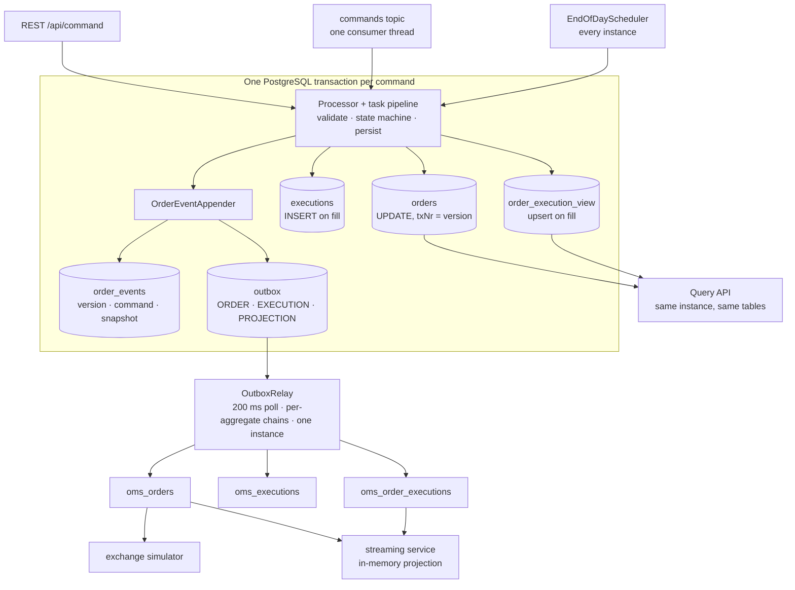
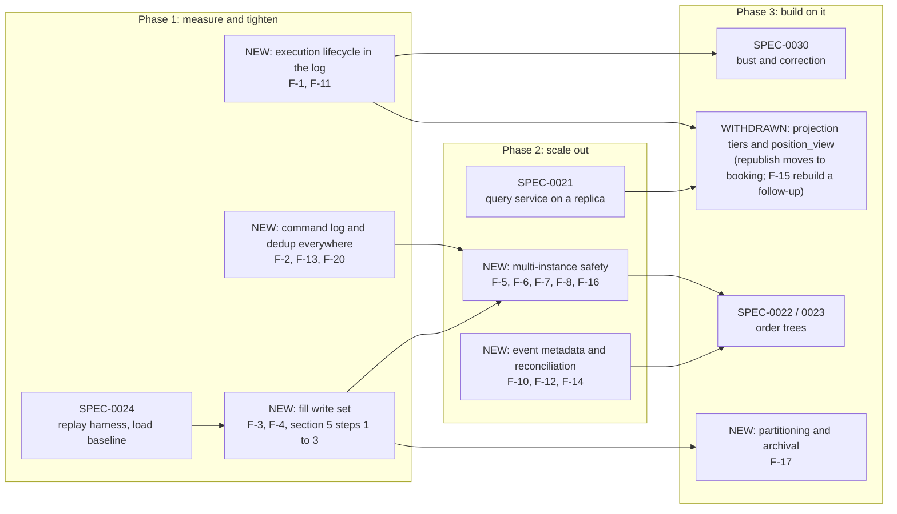

# OMS Event Sourcing and CQRS Review

**Date:** 2026-11-07
**Status:** Draft for discussion
**Author:** Claude Code (Fable 5.1), for Toni Badertscher
**Scope:** oms-core write path, event log, outbox, projections and query path as on `main`
(commit `09bd78e`, 2026-11-07), with the streaming service and exchange simulator as consumers

> **How to read this document.** Section 1 is the verdict. Section 2 is the write path as it
> actually runs today, with the per-fill write set, because every scalability argument below
> rests on it. Section 3 scores the nine criteria the team named. Sections 4 and 5 answer the two
> questions asked directly: the missing execution event table, and whether `order_execution_view`
> needs to be a table. Section 6 lists every finding with a fix. Section 7 is what the dedicated
> frameworks (Axon, Marten, EventStoreDB, Debezium) do that is worth borrowing, and what is not.
> Section 8 is the roadmap as spec tickets. No load test was run; every throughput statement is
> derived from code and configuration, not measured. This review builds on the
> [architecture review of 2026-10-30](architecture-review-2026-10-30.md) and does not repeat the
> findings that review raised and the team has since fixed (status in Appendix B).

---

## Table of Contents

1. [Verdict](#1-verdict)
2. [The write path as built](#2-the-write-path-as-built)
3. [Scorecard against the nine criteria](#3-scorecard-against-the-nine-criteria)
4. [Execution events: where they live and what is missing](#4-execution-events-where-they-live-and-what-is-missing)
5. [Does `order_execution_view` need to be a table?](#5-does-order_execution_view-need-to-be-a-table)
6. [Findings and fixes](#6-findings-and-fixes)
7. [What to borrow from event-sourcing frameworks](#7-what-to-borrow-from-event-sourcing-frameworks)
8. [Scalability and maintainability outlook](#8-scalability-and-maintainability-outlook)
9. [Recommended roadmap](#9-recommended-roadmap)
10. [Appendix A: source references](#appendix-a-source-references)
11. [Appendix B: status of the October 2026 findings](#appendix-b-status-of-the-october-2026-findings)

---

## 1. Verdict

The core is sound and should be kept. Of the nine criteria, six are met or mostly met, two are
partly met, and one, projections, is met for one case and structurally incomplete for the rest.
The design is a disciplined *state-stored aggregate with an event log and a transactional outbox*,
not textbook event sourcing, and the knowledge base says so. That is the right choice for an OMS
whose invariants (cumQty never exceeds orderQty, one fill applied once) must hold inside one
transaction, and it is why the team was able to add projections, trees and corrections without a
framework.

**What is strong.** Every state change appends to `order_events` through one appender with a
per-order version that doubles as the optimistic lock (SPEC-0027). Replay is a lookup and gap
detection exists. Kafka is reached only through the outbox, drained per aggregate in order, with
transient failures costing no attempts (SPEC-0026). Duplicate delivery is refused on three natural
keys. The integration tests prove the sequencing, the rollback of a failed pipeline and the loss of
one of two concurrent writers.

**What is missing, in priority order.**

1. **Execution lifecycle is not first-class in the log.** A fill is recorded as an order event
   whose command carries the execution, which is correct for one aggregate, but there is no way to
   address "the events about execution X", no execution status, and no link from an `executions`
   row to the order version that applied it. Bust and correction (SPEC-0030) cannot be built
   cleanly on this. The fix is **not** a second event table; it is an `exec_id` column and
   execution event types on `order_events`, plus `order_version`, `status` and `exec_ref_id` on
   `executions` (section 4).
2. **Refused commands leave no durable trace.** A cancel request refused because the order was
   already filled exists only in a log line and a counter. An OMS audit needs the ask as well as
   the outcome (F-2).
3. **Write amplification on the fill path.** The order snapshot is serialised to JSON three times
   per fill (event row, ORDER outbox row, EXECUTION outbox row), then a fourth copy of the order
   fields lands in `order_execution_view`, and six `nextval` round trips are made. This is the main
   lever for low latency at volume and it needs no new component (F-3, F-4).
4. **`order_execution_view` is a table nobody reads yet.** Its only reader is
   `GET /api/query/executions`, which no module in the repository calls; the UI reads
   `/api/executions` and the Kafka topic. The table is justified as a *pattern* but not yet by a
   *consumer*. Recommendation: keep the projection framework and the staged message, add
   `order_version` and `root_order_id` to `executions`, and serve the query from a join until a
   consumer needs a shape a join cannot give (section 5).
5. **Horizontal scaling is blocked by design in three places**: the relay assumes one instance,
   the Kafka listener runs one thread, and the end-of-day scheduler runs in every instance. All
   three have cheap fixes (F-6, F-7, F-8).
6. **Projections are synchronous only.** Every projection extends the fill transaction and there
   is no path to feed a projection from the log asynchronously or to republish events to a topic.
   The streaming service already is an asynchronous projection, just not named as one (F-9).

**What to borrow from frameworks.** Explicit change descriptions on events, event metadata
(causation, correlation, principal), aggregate test fixtures, an expected-version check on
commands, a two-tier projection model (inline and asynchronous) and a republish facility. What not
to borrow: an event store as source of truth, hydration by folding, sagas as a runtime, a global
event sequence as the feed. The reasons are in section 7.

Everything recommended here fits the existing policies P-05 to P-08 and P-17: no new framework, no
new infrastructure component, Liquibase changesets only.

---

## 2. The write path as built

Every command runs as one database transaction. The processors differ in shape (the create,
lifecycle and fill paths run task pipelines; accept is a plain service method) but all end in
`OrderEventAppender`, which writes the event row, sets the order's version and stages the outbox
rows. Nothing else writes to Kafka.



### 2.1 Write set of one fill

The fill pipeline (`ExecutionCommandProcessor`, seven tasks) is the hot path. In one transaction
it performs:

| # | Statement | Table | Payload | Notes |
|---|---|---|---|---|
| 1 | SELECT | `orders` | by `order_id` | no lock (`findByOrderId`) |
| 2 | SELECT | `executions` | `exists (order_id, execid)` | idempotency fast path |
| 3 | SELECT | `executions` | `sum(last_qty*last_px)` | avgPx numerator, grows with fills per order |
| 4 | INSERT | `executions` | ~20 columns | `nextval(execution_seq)` |
| 5 | UPDATE | `orders` | state, cumQty, leavesQty, txNr | merged by `save`, written at the next flush (the event's `saveAndFlush`) |
| 6 | INSERT | `order_events` | command JSONB (with the execution) + **order snapshot JSONB** | `nextval(order_event_seq)`, flushed immediately to surface a version conflict |
| 7 | INSERT | `outbox` ORDER | **order snapshot JSONB** | `nextval(outbox_seq)` |
| 8 | INSERT | `outbox` EXECUTION | **order snapshot JSONB** + execution JSONB | `nextval(outbox_seq)`; the order is carried only to derive `rootOrderId` |
| 9 | SELECT | `order_execution_view` | by `(order_id, execid)` | upsert probe |
| 10 | INSERT | `order_execution_view` | 29 columns, 1 unique + 3 secondary indexes | `nextval(order_execution_view_seq)` |
| 11 | INSERT | `outbox` PROJECTION | Avro bytes of `OrderExecution` | `nextval(outbox_seq)` |

After commit the relay sends three Kafka records and runs three deletes. So one fill costs eleven
statements plus six sequence round trips in the transaction, three serialisations of the same
order snapshot, a fourth copy of the order's fields in the view row, and three records on the
wire. Each of those is correct on its own; together they are where the latency and the storage of
the fill path go. Section 6, F-3 and F-4, shows how to roughly halve the write set without
changing any guarantee.

### 2.2 Concurrency, as implemented

Three different strategies coexist:

| Path | Strategy | Conflict outcome |
|---|---|---|
| Lifecycle (reject, cancel, cancel request, cancel reject, expire, close) | `SELECT … FOR UPDATE` on the order row, then dedup on `commandId` | second writer waits, then sees the first's event and is refused as duplicate or by state |
| Fill | optimistic: `txNr + 1` must be a free `(order_id, version)` | loser rolls back; REST answers 409; Kafka retries 4 times with backoff, then dead-letters |
| Accept | optimistic, same mechanism | same |

The optimistic path is correct and tested (`OrderVersionIntegrationTest`), but its failure mode on
Kafka is a dead letter after four attempts, which for a fill means a lost trade waiting for manual
replay. Contention is rare today because the commands topic is keyed by order and consumed by one
thread, but the end-of-day close and REST commands run outside that serialisation. F-5 proposes
unifying on the lock-first strategy that SPEC-0022 already plans for trees.

---

## 3. Scorecard against the nine criteria

| # | Criterion | Status | Evidence | Gap |
|---|---|---|---|---|
| 1 | Capture every business event (command) in a table | **Mostly met** | `order_events.transaction` stores the command for every applied change, REST and Kafka alike (fixed in SPEC-0018); `command_id` indexed per order | Refused commands leave no durable trace (F-2); internal callers may pass `null` (`process(execution)` overload); no principal or origin recorded |
| 2 | Maintain aggregate state | **Met** | `orders` and `executions` are the current state; `txNr` is the version of the latest event (SPEC-0027) | Execution rows have no status or version link; a future bust mutates a row the log cannot address (section 4) |
| 3 | Validate state transitions | **Met** | One `StateMachine` configuration for `State`, consulted by every processor; `LifecycleAction` rule table; partial fill correctly treated as no transition | `CancelState` transitions are hand-coded preconditions, not a machine (F-11); accept bypasses the task pipeline (P-10) |
| 4 | Emit an event for every aggregate state change | **Met** | Single appender, called by every path; event + outbox in one transaction; `EventSourcingIntegrationTest` | Events say *that* the order changed and show the new state; *what* changed is not explicit (F-10) |
| 5 | Strict sequence of events per key | **Met per order; partly across topics** | Unique `(order_id, version)`, contiguous from 1; outbox drained per `(topic, key)` in id order; Kafka key is the root order id on all three topics | No ordering across the three topics (documented); ordering relies on one relay instance and on `allocationSize = 1` sequences (F-6, F-4) |
| 6 | Recover consistent state by replay | **Mostly met** | Snapshot per event, `replayAt`, `isContiguous`; projection rebuild from the log; replay compared to the live row in tests | Replay reconstructs the order, not its executions as of a version (F-1); no production reconciliation job (F-12); no schema version on stored JSON (SPEC-0024 open); no command re-execution (SPEC-0024 open) |
| 7 | Transactionally safe, no loss or inconsistency | **Met** | Outbox in the command transaction; relay deletes only on broker ack; idempotent producer, `acks=all`; dedup on `(sessionId, clOrdId)`, `(orderId, execId)`, `(orderId, commandId)`; failed pipelines marked rollback-only | A fill that loses an optimistic race four times on Kafka goes to the DLT (F-5); a `commandId` collision outside the lifecycle path surfaces as a 500, not a refusal (F-13); staged PROJECTION payloads are bound to the class schema at staging time (F-14) |
| 8 | High volume, low latency | **Partly met** | Async per-aggregate relay (SPEC-0026); virtual threads for sends; indexes on every hot predicate; metrics for outbox depth and age | Eleven statements and three snapshot serialisations per fill (F-3); six `nextval` round trips (F-4); 200 ms publication floor (F-7); one consumer thread, no topic provisioning (F-8); one relay instance (F-6); no measured baseline (SPEC-0024 open) |
| 9 | Support projections | **Met for one case, structurally incomplete** | `Projection` interface, `ProjectTask` in the fill transaction, `order_execution_view`, rebuild endpoint, generic outbox payload (SPEC-0020) | Only the fill pipeline projects; projections are synchronous only; rebuild locks the table and loads everything into memory (F-15); no republish to feed asynchronous projections (F-9); the one table has no consumer yet (section 5) |

The rest of the report is organised around closing these gaps.

---

## 4. Execution events: where they live and what is missing

### 4.1 Where they live today

The team's observation is right that there is no `execution_events` table, and the state-store
specification of February 2026 did call for "an event table per domain object type". But the code
has since made a different, better choice, which the convergence assessment names explicitly:
*Order and its executions are one aggregate; executions are entities inside it.* Under that model
a fill is an order event:

- `order_events` row with `event = PARTIAL_FILL | FILL`, `transaction = ExecutionCreateCmd`
  (which carries the full execution), `resulting_state`, `order_snapshot`, `version = n`.
- `executions` row with the fill and the order's resulting `cumQty`, `leavesQty`, `avgPx`.
- The published `OrderExecution` record and the `order_execution_view` row carry `orderVersion = n`.

So the execution's creation *is* in the event log, sequenced with every other change of the order.
This is the correct boundary: the invariant "cumQty equals the sum of applied fills and never
exceeds orderQty" must hold in one transaction, and one stream per order is what makes the version
check and the Kafka key work. A second stream for executions would split that sequence and force
the team to order two streams against each other, which is the problem the three Kafka topics
already have.

### 4.2 What is missing

Four things, all of which SPEC-0030 (bust and correction) will hit immediately:

1. **Addressability.** There is no way to ask "every event about execution X" without parsing
   `transaction` JSON. The rebuilder already does exactly that (`execIdOf(fill)`), and falls back
   to matching by position for fills recorded before SPEC-0018.
2. **Execution event types.** `Event` has `PARTIAL_FILL` and `FILL`. A bust, a correction and a
   manual cancel (whack) are events on the order *about* an execution, and they change quantities
   in the other direction. They need their own names (`EXEC_BUST`, `EXEC_CORRECT`, `EXEC_WHACK`)
   and, for a bust that reopens a FILLED order, a `FILLED → LIVE` transition the state machine does
   not have today.
3. **Execution status and version link.** `executions` has no `status`, no `exec_ref_id` (FIX
   ExecRefID, tag 19) and no `order_version`. A busted execution would have to be deleted or
   flagged ad hoc, `sumNotionalByOrderId` would have to learn to exclude it, and nothing would say
   which order version applied or reversed it.
4. **Point-in-time replay of executions.** `replayAt(orderId, n)` returns the order at version n,
   but the executions as of version n are not reconstructible once a row can be busted later.

### 4.3 Options

| Option | Shape | Pros | Cons | Verdict |
|---|---|---|---|---|
| **A. Separate `execution_events` table** | One stream per execution with its own version | Matches the 2026-02 spec literally; execution history in one place | Two streams per fill in one transaction; the order's version and the execution's version must be ordered against each other; a second appender, a second outbox key, a second rebuild source; Axon would call this two aggregates and make their invariant eventually consistent | **Reject** |
| **B. Executions stay inside the order stream; make them addressable** | `order_events.exec_id` column + execution event types; `executions.status`, `exec_ref_id`, `order_version`, `busted_at_version` | One stream, one version, one key, as today; "events about execution X" is one indexed query; bust is one order event with a reversing command; replay of executions as of version n is a filter | Execution history is read from the order's log, not a table of its own; the FILLED → LIVE transition must be added | **Recommended** |
| **C. Execution as its own aggregate** | Own table, own stream, own commands; order updated by a process manager | Executions become independently addressable across orders (block executions, allocations) | Breaks the one-transaction invariant between a fill and its order; needs saga-style coordination; the simplest invariant in the system becomes eventually consistent | **Not now**; revisit only if block executions must exist independently of any order |
| **D. Generic `events` table for all aggregates** | One table with `aggregate_type`, `aggregate_id`, `version`, `exec_id`, …, as Axon's `domain_event_entry` | One appender for Order, Quote, QuoteRequest; one rebuild source | A migration of `order_events` for no functional gain today; per-type tables index and archive better | **Not now**; instead make the appender generic in code so Quote and QuoteRequest reuse it with their own tables |

### 4.4 Recommended design (option B)

**Schema, one Liquibase changeset.**

```sql
-- order_events: which execution an event is about, when it is about one
ALTER TABLE order_events ADD COLUMN exec_id VARCHAR(255);
CREATE INDEX idx_order_events_order_id_exec_id ON order_events (order_id, exec_id);
UPDATE order_events SET exec_id = transaction -> 'execution' ->> 'execId'
 WHERE event IN ('PARTIAL_FILL', 'FILL') AND transaction -> 'execution' ->> 'execId' IS NOT NULL;

-- executions: lifecycle and the link to the log
ALTER TABLE executions ADD COLUMN status        VARCHAR(16) NOT NULL DEFAULT 'APPLIED';
ALTER TABLE executions ADD COLUMN order_version BIGINT;            -- version that applied it
ALTER TABLE executions ADD COLUMN root_order_id VARCHAR(255);      -- the Kafka key, no join needed
ALTER TABLE executions ADD COLUMN exec_ref_id   VARCHAR(255);      -- FIX 19, for busts and corrections
ALTER TABLE executions ADD COLUMN busted_at_version BIGINT;
CREATE INDEX idx_executions_root_order_id ON executions (root_order_id);
CREATE INDEX idx_executions_transact_time ON executions (transact_time);
UPDATE executions e SET order_version = v.order_version
  FROM order_execution_view v WHERE v.order_id = e.order_id AND v.execid = e.execid;
```

The backfill of `order_version` from the view works because the view already holds it for every
fill projected since SPEC-0020; fills older than the view are matched by position in a one-off
script, as the rebuilder does today.

**Code.**

- `Event` gains `EXEC_BUST`, `EXEC_CORRECT`, `EXEC_WHACK`. `OrderStateMachineConfig` gains
  `FILLED → LIVE`, guarded in the bust pipeline by "leavesQty becomes positive".
- `OrderEventAppender.appendExecutionEvent` sets `exec_id` on the event and `order_version`,
  `root_order_id` on the execution. A new `appendExecutionLifecycleEvent(order, execution, event,
  command)` records a bust or correction: it writes the event with `exec_id`, updates
  `executions.status` and `busted_at_version`, and stages an `OrderExecution` record whose
  `execType` is `H` (trade cancel) or `G` (trade correct), so consumers see the reversal on the same
  topic and key as the fill.
- `ExecutionRepository.sumNotionalByOrderId` filters `status = 'APPLIED'`.
- `OrderReplayService` gains `executionsAt(orderId, version)`: rows with `order_version <= version`
  and (`busted_at_version is null or busted_at_version > version`). With that, "the order and its
  fills as of version n" is two indexed queries, and the rebuilder's position-matching fallback can
  be deleted once the backfill has run.
- A `ValidateExecutionLifecycleTask` checks: the execution exists and is `APPLIED`, the bust
  quantity does not drive `cumQty` negative, and the resulting state is a valid transition.
- `GET /api/query/orders/{orderId}/events?execId=…` is an additive filter on the existing
  endpoint, giving the execution history the team asked about.

**Why this is enough.** It keeps one stream per order, one version, one Kafka key and one appender,
and it gives every property a separate table would have given: execution history by id, execution
status, point-in-time executions, and a place for bust and correction to record what they did.
Rippling a bust up a tree (SPEC-0022) is the same transaction shape as rippling a fill.

### 4.5 Worked example: one order, two fills, one bust

The question "where is the execution event table?" is easiest to answer by following one order
through its life and looking at the rows each step leaves behind. Steps 1 to 4, 6 and 7 are the
code as it runs today. Step 5, the bust, does not exist yet; it is shown as section 4.4 would
record it, and marked *(proposed)*.

**The order.** `ORD-7F3A`, BUY 100 AAPL LIMIT 172.00, session `SES-A`, `clOrdId` `CL-100`,
account `ACC-1`, submitted over REST by the UI. The exchange simulator answers on the `commands`
topic. Every simulator command carries a `CommandHeader` whose `correlationId` is the root order
id and whose `causationId` is the `orderId:eventId` of the `oms_orders` message it reacts to, so
the chain of cause and effect is in the stored commands.

#### 4.5.1 Timeline

| Step | Command (source, `commandId`) | `order_events` row written | `orders` after | `executions` after | Outbox rows staged, in id order → topic records |
|---|---|---|---|---|---|
| 1 | `OrderCreateCmd` (REST, `c-100`) | v1 `NEW_ORDER`, state `UNACK` | v1, UNACK, cumQty 0, leavesQty 100 | – | ORDER v1 → `oms_orders` eventId 1 |
| 2 | `OrderAcceptCmd` (simulator, `a-…`, causation `ORD-7F3A:1`) | v2 `ACK`, state `LIVE` | v2, LIVE | – | ORDER v2 → `oms_orders` eventId 2 |
| 3 | `ExecutionCreateCmd` EX-1, 40 @ 171.95 (simulator, `f-…`, causation `ORD-7F3A:2`) | v3 `PARTIAL_FILL`, state `LIVE`, command = the fill | v3, LIVE, cumQty 40, leavesQty 60 | EX-1: lastQty 40, lastPx 171.95, cumQty 40, leavesQty 60, avgPx 171.95 | ORDER v3 → `oms_orders` 3; EXECUTION v3 → `oms_executions` (EX-1, orderVersion 3); PROJECTION v3 → `oms_order_executions` (EX-1 with the order, orderVersion 3) |
| 4 | `ExecutionCreateCmd` EX-2, 60 @ 172.00 (simulator, `f-…`, causation `ORD-7F3A:2`) | v4 `FILL`, state `FILLED`, command = the fill | v4, FILLED, cumQty 100, leavesQty 0 | EX-2: lastQty 60, lastPx 172.00, cumQty 100, leavesQty 0, avgPx 171.98 | ORDER v4; EXECUTION v4 (EX-2); PROJECTION v4 (EX-2, orderVersion 4) |
| 5 *(proposed)* | `ExecutionBustCmd` execRefId EX-1 (venue, `b-…`) | v5 `EXEC_BUST`, `exec_id` EX-1, state `LIVE`, command = the bust | v5, LIVE, cumQty 60, leavesQty 40 | EX-1: status `BUSTED`, bustedAtVersion 5; EX-2 unchanged; avgPx of the order now 172.00 | ORDER v5 → `oms_orders` 5; EXECUTION v5 → `oms_executions` (EX-1, execType `H`, orderVersion 5); PROJECTION v5 → `oms_order_executions` (EX-1, execType `H`, cumQty 60, orderVersion 5) |
| 6 | `OrderCancelCmd` (venue, deterministic id, causation `ORD-7F3A:5`) | v6 `CXL`, state `CXL` | v6, CXL, cumQty 60, leavesQty 0 | unchanged | ORDER v6 → `oms_orders` 6 |
| 7 | `OrderCloseCmd` (end of day, `EOD-ORD-7F3A-20261107`) | v7 `CLOSE`, state `CLOSED` | v7, CLOSED | unchanged | ORDER v7 → `oms_orders` 7 |

Two things to notice. First, every command, including both fills and the bust, is stored verbatim
in `order_events.transaction`, so the inputs to every change are in one table in one sequence.
Second, the executions are entities inside that sequence: EX-1 appears at v3 (created) and v5
(busted), EX-2 at v4, and the relative order of "EX-2 filled" and "EX-1 busted" is simply v4 < v5.
A separate execution stream would have to answer that question with a clock.

#### 4.5.2 The tables after step 7

`order_events` (abridged; `exec_id` is the proposed column, the rest exists today):

| id | order_id | version | event | exec_id | command_id | resulting_state | transaction (type and key fields) | order_snapshot (key fields) | time_stamp |
|---|---|---|---|---|---|---|---|---|---|
| 9001 | ORD-7F3A | 1 | NEW_ORDER | | c-100 | UNACK | `OrderCreateCmd` {order: CL-100, BUY 100 AAPL @ 172.00} | txNr 1, UNACK, cumQty 0, leavesQty 100 | 09:30:00.012 |
| 9004 | ORD-7F3A | 2 | ACK | | a-5e1… | LIVE | `OrderAcceptCmd` {orderId, causationId ORD-7F3A:1} | txNr 2, LIVE, marketAckTime set | 09:30:00.240 |
| 9010 | ORD-7F3A | 3 | PARTIAL_FILL | EX-1 | f-0c9… | LIVE | `ExecutionCreateCmd` {execution: EX-1, 40 @ 171.95, execType F} | txNr 3, LIVE, cumQty 40, leavesQty 60 | 09:30:01.105 |
| 9017 | ORD-7F3A | 4 | FILL | EX-2 | f-7aa… | FILLED | `ExecutionCreateCmd` {execution: EX-2, 60 @ 172.00, execType F} | txNr 4, FILLED, cumQty 100, leavesQty 0 | 09:30:01.330 |
| 9031 | ORD-7F3A | 5 | EXEC_BUST | EX-1 | b-311… | LIVE | `ExecutionBustCmd` {execRefId EX-1, text "erroneous trade"} | txNr 5, LIVE, cumQty 60, leavesQty 40 | 10:12:44.900 |
| 9033 | ORD-7F3A | 6 | CXL | | cxl-ORD-7F3A:5 | CXL | `OrderCancelCmd` {orderId, text "cancelled by venue"} | txNr 6, CXL, cumQty 60, leavesQty 0 | 10:12:45.410 |
| 9120 | ORD-7F3A | 7 | CLOSE | | EOD-ORD-7F3A-20261107 | CLOSED | `OrderCloseCmd` {orderId, text "End of day"} | txNr 7, CLOSED | 17:00:00.071 |

The `transaction` column of row v3, as stored (the command exactly as the command API accepted
it, with the header fields SPEC-0025 copies in):

```json
{
  "type": "ExecutionCreateCmd",
  "version": "1.0.0",
  "commandId": "f-0c9e…",
  "correlationId": "ORD-7F3A",
  "causationId": "ORD-7F3A:2",
  "execution": {
    "execId": "EX-1",
    "orderId": "ORD-7F3A",
    "lastQty": 40,
    "lastPx": 171.95,
    "execType": "F",
    "lastMkt": "XNAS",
    "transactTime": "2026-11-07T09:30:01.098Z"
  }
}
```

`executions` (current state of the execution entities; `status`, `order_version`,
`root_order_id`, `exec_ref_id`, `busted_at_version` are the proposed columns):

| id | order_id | execid | last_qty | last_px | cum_qty | leaves_qty | avg_px | exec_type | status | order_version | busted_at_version | root_order_id |
|---|---|---|---|---|---|---|---|---|---|---|---|---|
| 501 | ORD-7F3A | EX-1 | 40 | 171.95 | 40 | 60 | 171.95 | F | BUSTED | 3 | 5 | ORD-7F3A |
| 502 | ORD-7F3A | EX-2 | 60 | 172.00 | 100 | 0 | 171.98 | F | APPLIED | 4 | | ORD-7F3A |

`executions` is to an execution what `orders` is to an order: the row is the current state, the
history is in the log. The order's `orders` row at this point reads txNr 7, CLOSED, cumQty 60,
leavesQty 0, avgPx 172.00.

`oms_order_executions`, the booking contract, received three records for this order, all keyed by
`ORD-7F3A` and therefore on one partition, in this order:

| execId | execType | lastQty | lastPx | cumQty | leavesQty | avgPx | state | orderVersion | tradeDate |
|---|---|---|---|---|---|---|---|---|---|
| EX-1 | F | 40 | 171.95 | 40 | 60 | 171.95 | LIVE | 3 | 2026-11-07 |
| EX-2 | F | 60 | 172.00 | 100 | 0 | 171.98 | FILLED | 4 | 2026-11-07 |
| EX-1 | H *(proposed)* | 40 | 171.95 | 60 | 40 | 172.00 | LIVE | 5 | 2026-11-07 |

A booking consumer books EX-1 and EX-2, then reverses EX-1 when it sees the record with
`execType H` at a higher `orderVersion` for the same `(orderId, execId)`. It deduplicates on
`(orderId, execId, orderVersion)`, which is also what the streaming service does.

#### 4.5.3 Extracting the sequence of business events

**The business events of one order, in order.** Over the query API:

```
GET /api/query/orders/ORD-7F3A/events
```

returns the seven entries above as `OrderEventDto` (orderId, version, event, commandId,
resultingState, timeStamp, transaction, orderSnapshot), oldest first. In SQL:

```sql
SELECT version, event, exec_id, command_id, resulting_state,
       transaction ->> 'type'        AS command_type,
       transaction ->> 'causationId' AS caused_by,
       time_stamp
  FROM order_events
 WHERE order_id = 'ORD-7F3A'
 ORDER BY version;
```

**The events about one execution.** Today, by reading the stored command:

```sql
SELECT version, event, resulting_state, time_stamp
  FROM order_events
 WHERE order_id = 'ORD-7F3A'
   AND transaction -> 'execution' ->> 'execId' = 'EX-1'
 ORDER BY version;                                   -- v3 only; a bust has no column to match yet
```

With the `exec_id` column of section 4.4, and as an additive query parameter on the events
endpoint:

```sql
SELECT version, event, resulting_state, time_stamp
  FROM order_events
 WHERE order_id = 'ORD-7F3A' AND exec_id = 'EX-1'
 ORDER BY version;                                   -- v3 PARTIAL_FILL, v5 EXEC_BUST
```

```
GET /api/query/orders/ORD-7F3A/events?execId=EX-1
```

**The order as it stood after any step.** `OrderReplayService.replayAt("ORD-7F3A", 4)` returns the
v4 snapshot (FILLED, cumQty 100). No folding; one indexed lookup on `(order_id, version)`.

**The executions as they stood after any step** *(proposed)*. After step 4, both fills were
applied; after step 5, EX-1 is busted:

```sql
SELECT execid, last_qty, last_px, status
  FROM executions
 WHERE order_id = 'ORD-7F3A'
   AND order_version <= :v
   AND (busted_at_version IS NULL OR busted_at_version > :v);
-- :v = 4 → EX-1, EX-2      :v = 5 → EX-2
```

**The same from Kafka**, for a consumer that never touches the database: `oms_orders` carries
the order after each step with `eventId` 1 to 7; `oms_order_executions` carries the three
execution records with `orderVersion` 3, 4 and 5; `oms_executions` carries the same three fills
without the order fields. All three are keyed by `ORD-7F3A`.

**The whole tree**, once SPEC-0022 populates `root_order_id` on `order_events`: one query ordered
by `id` over all orders of a root shows the market order's fill and the client order's ripple as
consecutive rows.

#### 4.5.4 What a separate execution event table would look like, and why it is worse

For the same seven steps, option A of section 4.3 would hold:

```
order_events:      ORD-7F3A  v1 NEW_ORDER · v2 ACK · v3 PARTIAL_FILL · v4 FILL · v5 ? · v6 CXL · v7 CLOSE
execution_events:  EX-1      v1 CREATED  · v2 BUSTED
                   EX-2      v1 CREATED
```

Three problems appear at once. Step 3 must write two streams in one transaction and keep both
version checks; the order's v3 and EX-1's v1 are the same fact recorded twice. "Was EX-1 busted
before or after EX-2 was filled?" cannot be answered from the versions, because EX-1 v2 and EX-2 v1
are in different sequences; it needs timestamps, which are not a sequence. And the bust still
has to change the order (cumQty, leavesQty, state), so the order stream needs a v5 anyway, which
is the row option B records and option A duplicates. The single stream is not a shortcut; it is
the consequence of the order being the consistency boundary.

---

## 5. Does `order_execution_view` need to be a table?

### 5.1 What it costs and who reads it

| Aspect | Today |
|---|---|
| Writes per fill | one probe SELECT, one INSERT of 29 columns, four index maintenance operations, one `nextval` |
| Rebuild | `LOCK TABLE … IN EXCLUSIVE MODE`, `deleteAllInBatch`, `findAll` of `order_events` and `executions` into memory, re-project every fill; fills wait for the whole rebuild |
| Schema coupling | every order field it copies exists in `orders`, `Order.avsc`/`OrderMessage.avsc`, `OrderExecution.avsc` and the view; SPEC-0041 had to realign fields across these copies |
| Readers | `GET /api/query/executions` (`ExecutionViewController`). No module in the repository calls it: oms-ui reads `/api/executions` (the raw `executions` page) and the RSocket stream; the streaming service takes its snapshot from `/api/query/search` and its fills from `oms_order_executions`; the MCP server searches orders only |

So the table is correct, tested and consistent by construction, but it is a pattern in search of a
consumer. The `OrderExecution` **message** staged by the same projection is the thing with
consumers: the streaming service today, and booking, which the team has confirmed will consume
`oms_order_executions`. The topic and its record stay whatever is decided about the table; the
bust and correction records of section 4.4 go on the same topic so booking sees reversals in the
same stream as the fills (section 4.5.2).

### 5.2 What the table gives that a join does not

An `OrderExecution` row is "the fill plus the order as of that fill". Of its 29 columns:

- 12 come from the execution itself and already live in `executions` (`execId`, `lastQty`,
  `lastPx`, `cumQty`, `leavesQty`, `avgPx`, `execType`, `lastCapacity`, `lastMkt`,
  `transactTime`, `tradeDate` derived, `orderVersion` once added);
- 15 are order fields that do not change over the order's life today (`clOrdId`, `sessionId`,
  `account`, `side`, `symbol`, `securityId`, `ordType`, `price`, `orderQty`, `settlCurrency`,
  `exDestination`, `rootOrderId`, `parentOrderId`, `leg`) and can be joined from `orders`;
- 1, `state` as of the fill, is `LIVE` for a partial fill and `FILLED` for a full fill, or, after
  replace exists and `price`/`orderQty` can change mid-life, is read from
  `order_events.order_snapshot` at `(order_id, order_version)`, which the unique constraint
  indexes.

A SQL view therefore reproduces the table exactly:

```sql
CREATE VIEW order_execution_v AS
SELECT e.id, e.order_id, e.execid, o.root_order_id, o.parent_order_id, o.leg, o.cl_ord_id,
       o.session_id, o.account, o.side, o.symbol, o.security_id, o.ord_type, o.price, o.order_qty,
       o.settl_currency, o.ex_destination,
       e.last_qty, e.last_px, e.exec_type, e.last_capacity, e.last_mkt, e.transact_time,
       e.cum_qty, e.leaves_qty, e.avg_px,
       ev.resulting_state AS state, e.order_version,
       (e.transact_time AT TIME ZONE 'UTC')::date AS trade_date, ev.time_stamp AS projected_at
  FROM executions e
  JOIN orders o        ON o.order_id = e.order_id
  JOIN order_events ev ON ev.order_id = e.order_id AND ev.version = e.order_version;
```

With indexes on `executions(transact_time)`, `executions(root_order_id)` and `orders(account)`,
the query service's filters (`orderId`, `rootOrderId`, `account`, time range) each hit an index
and the joins are primary-key or unique-key lookups. On the planned replica (SPEC-0021) the view
runs there, untouched by the write path.

### 5.3 Decision rule

A projection deserves its own table when at least one of these holds:

1. The read shape **aggregates** across many source rows (positions per account and symbol, daily
   totals, exposure per client) so that a join per query is unbounded.
2. The read must **survive schema evolution** of its sources (a regulatory report whose columns
   must not move when `orders` changes).
3. The read is served **where the sources are not** (a separate read database, a cache, a search
   index).
4. The read needs **as-of state that the sources overwrite** and the log does not index.

`order_execution_view` meets none of these today: it is one row per source row, it is served from
the same database (or its replica), and the as-of state is in `order_events` under an indexed
key. Positions, which the team will want next, meet rule 1 and are exactly what the projection
framework is for.

### 5.4 Recommendation

1. **Keep the projection framework and the staged message.** `Projection`, `ProjectTask`, the
   generic outbox payload and the rebuild endpoint are the right shape; the `OrderExecution` record
   on `oms_order_executions` is the contract consumers need.
2. **Move the execution query to a view.** Add `order_version` and `root_order_id` to `executions`
   (section 4), create the view above with its three indexes, and point
   `OrderExecutionViewQueryService` at it. The REST contract does not change.
3. **Drop the table in a later changeset**, after the view has served the query API on the replica
   for a release and the SPEC-0024 harness has compared fill-path latency before and after. Until
   then `OrderExecutionProjection` can stop writing the row and stage the message only, which
   removes statements 9 and 10 from the write set immediately.
4. **Use the framework for the first real aggregate projection**: `position_view` keyed by
   `(account, symbol, trade_date)` with `net_qty`, `notional`, `fill_count`, updated inline per
   fill and per bust, rebuilt from `executions` by `order_version`. That is a table by rule 1, it
   exercises the rebuild path on a shape that needs it, and it is what the blotter and risk will
   ask for.

If the team prefers to keep the table for now, the write cost is modest (one indexed upsert) and
the only changes worth making are the rebuild fixes in F-15. The argument against it is
maintainability, not performance: four copies of the order's fields to keep aligned.

**Decision, 2026-11-07.** The table stays, because booking will consume the `OrderExecution`
message and the query API keeps serving the row shape. It is renamed `order_execution_projection`
and the projection name is decoupled from the table name (SPEC-0045). The view remains the
documented alternative if the duplication ever becomes a cost.

**Decision, 2026-11-08.** Recommendation 4 is not taken. Positions are kept in the back office,
not in the OMS, and the only projection the OMS needs is `order_execution_projection` for
booking. SPEC-0051, which carried `position_projection`, is withdrawn. Its other parts go
elsewhere:
- republish (F-9) moves to the booking work, scoped to one order or one trade date, for operator
  resend and reconciliation breaks;
- the shadow-table rebuild (F-15) becomes a follow-up, to be taken up when volume shows the table
  lock hurts;
- the tier naming is kept in the target architecture.

---

## 6. Findings and fixes

Severity: **H** undermines a criterion in section 3 or blocks planned work; **M** costs latency,
storage or operability now; **L** hygiene. Effort: S under a day, M one to three days, L a ticket.

| # | Sev | Finding | Where | Fix | Effort |
|---|---|---|---|---|---|
| F-1 | H | Execution lifecycle is not addressable in the log; executions have no status, version link or reference id; replay cannot give executions as of a version | `Event`, `OrderEvent`, `Execution`, `ExecutionRepository.sumNotionalByOrderId`, `ProjectionRebuilder.execIdOf` | Section 4.4: `exec_id` on events, execution event types, `status`/`order_version`/`root_order_id`/`exec_ref_id`/`busted_at_version` on executions, `executionsAt` in replay, `FILLED → LIVE` | M (fold into SPEC-0030) |
| F-2 | H | Refused commands leave no durable trace: a refusal marks the transaction rollback-only, so the only record is a log line and `oms.commands.consumed{outcome=refused}` | `OrderLifecycleCommandProcessor.markRollbackOnly`, `OrderCreateCommandProcessor`, `ExecutionCommandProcessor`, `CommandListener.handleLifecycle` | A `command_log` table (`command_id`, `type`, `order_id`, `received_at`, `outcome` APPLIED/REFUSED/FAILED, `reason`, `principal`, `source`) written in a `REQUIRES_NEW` transaction after the pipeline result is known, for every command on every path; expose it on `GET /api/query/orders/{orderId}/commands`. Applied commands remain in `order_events`; the log is the audit of the *ask*, and gives dedup a place for refused command ids too | M |
| F-3 | M | The order snapshot is serialised three times per fill and the EXECUTION outbox row carries the whole order only to derive `rootOrderId` | `OrderEventAppender.appendOrderEvent`, `appendExecutionEvent`, `MessagePublisher` | Store `root_order_id` on `executions` and on the outbox row; drop `orderPayload` from the EXECUTION row. Then make ORDER rows pointers: `(order_id, aggregate_version)` only, and let `MessagePublisher` read `order_events.order_snapshot` by the unique key at publish time. One snapshot write per event instead of three; the publisher gains one indexed read per record, off the request path | M |
| F-4 | M | Six `nextval` round trips per fill; every sequence has `allocationSize = 1` | `Order`, `Execution`, `OrderEvent`, `OutboxMessage`, `OrderExecutionView` | Pool `execution_seq`, `order_event_seq`, `order_execution_view_seq` and `order_seq` (`allocationSize = 50`, Hibernate pooled-lo). **Keep `outbox_seq` at 1**, or change the relay to order each aggregate's rows by `aggregate_version` then `id`: with pooled ids, two instances could stage a later version with a smaller id, and the relay orders by id today | S |
| F-5 | H | Three concurrency strategies; the optimistic one turns a lost race into a Kafka retry that dead-letters a fill after four attempts; REST and the scheduler run outside the per-partition serialisation | `ExecutionCommandProcessor.loadOrder`, `OrderAcceptCommandProcessor`, `KafkaConsumerConfig.commandErrorHandler` | Lock first everywhere: `findLockedByOrderId` (root first once trees exist, as SPEC-0022 plans) in the fill and accept paths, keeping the version check as the safety net. A conflict then becomes a wait, not a retry. Additionally exempt `ConcurrencyFailureException` from the DLT budget (retry it unbounded with backoff, since it cannot be a poison message) | S |
| F-6 | H | The relay assumes one instance: ordering across instances is documented as unsafe, and `inFlight` is in-process state | `OutboxRelay` Javadoc, `inFlight` | Short term: a PostgreSQL advisory lock (`pg_try_advisory_lock`) taken at the start of `drain`, so exactly one instance drains and the others return; readiness reports which. Long term, if one relay is the ceiling: partition aggregates across N relays by `hashtext(aggregate_id) % N`, each instance claiming only its slice, which keeps per-aggregate order with no shared state | S / M |
| F-7 | M | Publication latency has a 200 ms floor from the poll, and a full backlog drains one batch per poll | `OutboxRelay.drain`, `kafka.outbox.poll-interval-ms` | After commit (`TransactionSynchronization.afterCommit`, same place `OrderFlowMetrics` counts), nudge the relay to drain now; keep the poll as the fallback for crashes and other instances. Loop `drain` while a batch is full. Both are in-process and keep the guarantee | S |
| F-8 | M | Command ingestion is one consumer thread; topics are not provisioned, so partition counts are the broker default | `CommandListener`, `KafkaConsumerConfig` (no `setConcurrency`), no `NewTopic` beans or compose init | Declare the four topics with their partition counts (a `KafkaAdmin`/`NewTopic` configuration in oms-core or a compose init step), set listener `concurrency` to the partition count, and document that the key (root order id) is what makes this safe. The relay (F-6) is then the next ceiling | S |
| F-9 | H | Projections are synchronous only; no way to feed an asynchronous projection from the log or to republish an aggregate's events | `ProjectTask`, `Projection`, `ProjectionRebuilder` (discards messages) | Define two tiers: *inline* projections (today's interface, for rows that must commit with the change) and *asynchronous* projections, which are Kafka consumers of `oms_order_executions` / `oms_orders` with their own consumer group, offset as checkpoint and DLT. Add `POST /actuator/projections/republish?orderId=…|all&topic=…` that re-stages messages from `order_events` into the outbox under the same keys and versions (consumers already deduplicate on `(orderId, execId, orderVersion)`). The streaming service becomes the first named tier-2 projection | M |
| F-10 | M | Events record *that* and *to what*, not *what changed*; consumers and auditors diff snapshots; no causation, correlation or principal on the event | `OrderEvent`, `OrderEventAppender` | Compute a field-level `changes` JSONB in the appender by diffing the previous snapshot (the order as loaded) against the new one, both already in memory; add `correlation_id`, `causation_id` (SPEC-0022 plans both), `principal` and `source` (REST/Kafka/scheduler) columns. Deltas make positions and audit views trivial and make the log readable without a tool | S |
| F-11 | L | `CancelState` transitions are hand-coded preconditions; the execution lifecycle will need a third small machine | `ValidateLifecycleActionTask` | A `StateMachineConfig<CancelState>` (none → PCXL → CXL/REJ → PCXL …) and, with F-1, `StateMachineConfig<ExecutionStatus>` (APPLIED → BUSTED/CORRECTED), both consulted by their validate tasks (P-10) | S |
| F-12 | M | Log-versus-state reconciliation exists only in tests; a path that mutates an order without appending would go unnoticed in production | `OrderReplayService.isContiguous`, `replay` | A scheduled sampler (every few minutes, N recently changed orders plus a random sample) comparing `orders` to `replay(orderId)` and checking contiguity, exposing `oms.event_log.inconsistent` and `oms.event_log.gaps` gauges and a log line with the order id. It is the cheapest proof that P-05 holds at runtime | S |
| F-13 | L | A `commandId` reused by a new command outside the lifecycle path hits `uq_order_events_order_id_command_id` and surfaces as a 500 (REST) or a retried then dead-lettered record (Kafka) instead of a refusal | `OrderEventAppender.isVersionConflict` | Map that constraint to a typed `DuplicateCommandException`, answered 409 and acknowledged on Kafka, the way the lifecycle dedup task already behaves | S |
| F-14 | L | PROJECTION outbox payloads are encoded with the class's current schema and decoded with the class's schema at publish time; a deployment between staging and publishing that changes the record fails the row and holds its aggregate | `AvroPayloadCodec`, `projections.md` deployment note | Store the writer schema's registry id (or fingerprint) on the row and decode with writer and reader schemas, or add a readiness check that refuses to stop an instance while PROJECTION rows are pending. The first is the durable fix | S |
| F-15 | M | Projection rebuild loads every event and execution into memory and holds an exclusive table lock, blocking fills for the whole rebuild | `ProjectionRebuilder.rebuild` | Stream by order (keyset pagination on `order_events` ordered by `order_id, version`), rebuild into a shadow table, swap by rename in a short transaction. Memory becomes O(one order); fills are blocked for milliseconds, not minutes | M |
| F-16 | L | The end-of-day and GTD schedulers run in every instance; duplicate work is prevented only by command-id dedup | `EndOfDayScheduler` | The same advisory lock pattern as F-6, or `@SchedulerLock`-style leader election on a table row (no library needed) | S |
| F-17 | M | `order_events`, `executions` and `outbox` grow without bound; no partitioning or archival; `CLOSED` exists but drives nothing | schema, `EndOfDayService` | Partition `order_events` by `time_stamp` (monthly, native declarative partitioning; the unique `(order_id, version)` becomes `(order_id, version, time_stamp)` or stays global via a side index, decide in design); archive closed orders' events and executions after a retention period to cold storage, driven by the `CLOSE` event. Measure first with SPEC-0024 | L |
| F-18 | L | Three topics carry one change with no ordering between them; each consumer deduplicates differently | `OrderEventAppender`, `MessagePublisher`, `kafka-topics.md` | The team keeps all three: `oms_orders` (order notifications), `oms_executions` (execution notifications) and `oms_order_executions` (the projection, for booking). The single-topic consolidation from the October review is therefore not planned. What remains is to state per topic, on `kafka-topics.md`, who consumes it, that there is no ordering across topics, and the dedup key `(orderId, execId, orderVersion)` every fill consumer must use | S |
| F-19 | L | No aggregate-level test fixture; pipeline tests set up repositories by hand | `oms-core/src/test` | A small `OrderFixture.given(snapshot…).when(command).expectEvent(type).expectState(…).expectStaged(topic, type)` over the real processors with an in-memory outbox and event repository. Cheap to write, and it is what makes TDD on new events fast (section 7) | S |
| F-20 | L | The accept path bypasses the task pipeline (P-10 says transitions go through the pipeline); the create pipeline can be given a `null` command by internal callers | `OrderAcceptCommandProcessor`, `ExecutionCommandProcessor.process(Execution)` | Fold accept into the lifecycle pipeline as `LifecycleAction.ACCEPT` (`UNACK → LIVE`, event `ACK`, SLA stamp as a reason-effect-style hook); remove the command-less overload once tests pass a command | S |

---

## 7. What to borrow from event-sourcing frameworks

The team's decision to avoid a vendor framework is sound for this system: Axon's aggregate model
would make the one-transaction invariants between an order, its executions and (soon) its parent
eventually consistent, and the convergence assessment shows the trade-offs in full. But the
frameworks encode a decade of operational lessons, and several of them transfer as patterns with
no dependency. The table says, for each concept, how Axon, Marten, EventStoreDB or Debezium do it,
what the OMS has, and whether to adopt, adapt or skip.

| Concept | How the frameworks do it | OMS today | Verdict |
|---|---|---|---|
| **Domain events as deltas** | Axon and EventStoreDB store `OrderFilled{execId, lastQty, lastPx}`; the aggregate is folded from them | Snapshot per event, type names the change, delta only on the execution row | **Adapt**: keep the snapshot, add the `changes` diff (F-10). Delta plus snapshot is what Marten's "inline snapshot" projections amount to |
| **Event metadata** | Correlation id, causation id, user, trace id on every event, propagated from the command (Axon `MetaData`, EventStoreDB metadata) | `command_id` and `time_stamp`; `CommandHeader` carries correlation/causation on Kafka but they are not stored on the event | **Adopt** (F-10, SPEC-0022) |
| **Expected version on commands** | EventStoreDB `expectedRevision`; Axon aggregate version in the command; the append fails if the stream moved | `txNr + 1` conflict between writers, but a *client* cannot say "cancel version 5"; a UI acting on stale data cannot be refused | **Adopt**: optional `expectedVersion` on the OpenAPI `Command` base and the Avro `CommandHeader`; the validate task refuses when `order.txNr != expectedVersion`. Additive under P-04 |
| **Upcasters and event revisions** | Axon `@Revision` + upcaster chain; Marten event versioning | `Order` ignores unknown properties; no schema version on stored JSON | **Adopt** (SPEC-0024, already planned) |
| **Snapshot policy** | Snapshot every N events to bound hydration | Snapshot on every event; replay is O(1) | **Skip**: the OMS already has the stronger property. Revisit only if storage, not latency, becomes the cost (F-17) |
| **Subscribing (inline) processors** | Axon subscribing processors and Marten inline projections run in the command transaction | `ProjectTask` | **Keep**: this is the right tier for rows that must commit with the change |
| **Tracking (asynchronous) processors** | Own thread, tracking token (position in the global stream), replayable by resetting the token, dead-letter queue per processing group | Only the streaming service, informally; no republish | **Adapt** (F-9): Kafka consumer groups are the token, the topic is the stream, the DLT is the dead-letter queue; add republish from the log. No new runtime |
| **Global sequence / `$all` stream** | Axon global index and EventStoreDB `$all` give a total order to feed projections | `order_events.id` and `outbox.id` from sequences, which are *not* commit order under concurrency; the relay copes by ordering within an aggregate only | **Skip the feed, keep the warning**: never poll `order_events` by id as a catch-up feed. If one is ever needed, derive it from `pg_current_xact_id()` plus a commit-ordered watermark, or use Kafka, which already is the feed |
| **Command routing / sequencing policy** | Axon routes commands by aggregate id to one node; `SequencingPolicy` serialises processing per aggregate | Kafka key = root order id serialises Kafka commands; REST and the scheduler are not serialised with them | **Adapt** (F-5): the row lock on the root is the sequencing policy that covers every entry point |
| **Aggregate test fixtures** | Axon `AggregateTestFixture`: given events, when command, expect events and state | Spring Boot tests against Testcontainers | **Adopt** (F-19) |
| **Sagas / process managers** | Framework-managed state and timers for multi-aggregate processes | SPEC-0023 plans a `pending_requests` table per child | **Adapt as a table, not a runtime**: the October review's design is right; a saga framework would add a second state store |
| **Deadline manager** | Durable timers per aggregate (quote expiry, GTD) with leader election | `EndOfDayScheduler` polls GTD every 60 s in every instance | **Adapt**: a leader lock (F-16) now; a `deadlines` table keyed by order and due time when quotes arrive, so expiry is a lookup, not a scan |
| **Idempotent command handling by id** | Command id dedup at the gateway | Dedup on `commandId` only in the lifecycle pipeline; the constraint covers all paths but surfaces as a 500 elsewhere | **Adopt** (F-13, F-2): one dedup task on every pipeline, backed by the constraint and the command log |
| **Outbox event router (Debezium)** | CDC on an outbox table with `aggregatetype`, `aggregateid`, `type`, `payload`; Debezium routes rows to topics | The `outbox` table already has this shape; the polling relay plays Debezium's role | **Skip now, keep the option**: if the relay (even partitioned, F-6) becomes the ceiling, Debezium replaces it with no change to the command path. The pointer design in F-3 is compatible if the payload stays on the row for CDC |
| **Stream closing and archival** | EventStoreDB `$maxAge`/`$tb` metadata; Axon has none; Marten archives streams | `CLOSED` is terminal; nothing uses it | **Adopt** (F-17): closing an order is the archival trigger |
| **Event store as source of truth** | Current state is derived; the log cannot disagree with state | State tables are truth; the log is kept honest by one appender and by tests | **Skip**, deliberately. The replacement for "cannot disagree" is the runtime reconciliation in F-12 |

---

## 8. Scalability and maintainability outlook

### 8.1 Where the ceilings are

| Stage | Today | First ceiling | Lever |
|---|---|---|---|
| Command ingestion (Kafka) | one listener thread, broker-default partitions | one partition's throughput | F-8: provision partitions, `concurrency = partitions`, key by root |
| Command ingestion (REST) | Tomcat threads, Hikari 32, virtual threads off | connection pool under long transactions | lock-first (F-5) shortens conflicts; consider `spring.threads.virtual.enabled=true` once Hibernate and Kafka client behaviour under virtual threads is verified |
| Fill transaction | 11 statements, 3 snapshot serialisations, 6 `nextval` | PostgreSQL write IOPS and commit latency | F-3 and F-4 halve the statement count; F-15 and section 5 remove the view upsert |
| Event log size | unbounded, ~one snapshot per change | storage and index bloat, vacuum time | F-17 partitioning and archival |
| Publication | one relay, 100 rows per drain, 200 ms poll | one instance's send rate | F-7 nudge and loop; F-6 advisory lock then hash-partitioned relays; Debezium as the last resort |
| Projections | inline only | fill latency grows with every projection | F-9 two tiers; put aggregating projections (positions) inline only if the blotter needs them consistent with the fill, otherwise tier 2 |
| Query | same instance, same tables | contention with the write path | SPEC-0021 replica; views over the replica (section 5) |

Nothing here requires a change of architecture. The ordering of the fixes matters: measure first
(SPEC-0024), then reduce the write set (F-3, F-4), then unblock multiple instances (F-5, F-6,
F-8, F-16), then partition storage (F-17).

### 8.2 Maintainability

The codebase is unusually well explained: every class says why it exists and which spec changed it,
and the policies are enforced by gates. Three things would keep that true as the system grows:

1. **One appender per aggregate type, one shape.** When Quote and QuoteRequest arrive, generalise
   `OrderEventAppender` to `EventAppender<A, E>` with the per-type table behind it, rather than
   copying it. The outbox, the relay and the replay service are already aggregate-agnostic.
2. **Fewer copies of the order's fields.** Every field exists in `Order` (JPA), `Order.avsc` (command),
   `OrderMessage.avsc`, `OrderExecution.avsc`, the view, the OpenAPI models and the streaming DTOs.
   Section 5 removes one copy. The October review's single-topic idea (F-18) would remove another.
3. **Name the tiers.** "Inline projection", "asynchronous projection", "command log", "event log"
   and "outbox" should be the words in the knowledge base and the code. The streaming service is an
   asynchronous projection with a bounded cache and should be described as one, with the same
   rebuild story (re-read the topic from the earliest offset, or ask core to republish).

---

## 9. Recommended roadmap

Grouped into spec tickets. Existing tickets are named where the work belongs there; the rest were
created on 2026-11-07 as SPEC-0044 to SPEC-0052 (the letters A to G below map to SPEC-0044,
SPEC-0046, SPEC-0047, SPEC-0048, SPEC-0049, SPEC-0051 and SPEC-0052; the table rename is
SPEC-0045 and the expected-version change SPEC-0050). Each is small enough for one design.



| Ticket | Scope | Depends on | Gate |
|---|---|---|---|
| **SPEC-0024** (open) | Replay runner, load suite, `schema_version` on stored JSON | none | baseline p50/p99 of fill path and publication latency recorded |
| **SPEC-0044 (A): execution lifecycle in the log** | Section 4.4 schema and code; `executionsAt`; `CancelState` and `ExecutionStatus` machines (F-1, F-11) | SPEC-0045 first or together | `GET …/events?execId=` returns a fill's history; replay at version n returns the order and its fills |
| **SPEC-0045: rename the projection table** | `order_execution_view` becomes `order_execution_projection`; projection name decoupled from table name; constraints and sequence renamed; knowledge base updated | none | the rebuild selector is `order_execution`; no contract change |
| **SPEC-0046 (B): command log** | `command_log` table and `REQUIRES_NEW` writer on every path; typed duplicate-command refusal; accept as a lifecycle action (F-2, F-13, F-20) | none | every refused command is queryable; a reused `commandId` answers 409 on every path |
| **SPEC-0047 (C): fill write set** | Pointer outbox rows, `root_order_id` on executions, pooled sequences with the relay ordering by version (F-3, F-4) | SPEC-0024 | one snapshot serialisation per fill; fill path database round trips ≤ 7 with batched inserts; latency compared against baseline |
| **SPEC-0048 (D): multi-instance safety** | Lock-first, conflict retries outside the DLT budget, relay advisory lock, after-commit nudge, topic provisioning and listener concurrency, scheduler leader lock (F-5 to F-8, F-16) | SPEC-0046, SPEC-0047 | two oms-core instances pass `OrderVersionIntegrationTest` and `OutboxHoldIntegrationTest`; no fill reaches the DLT under a contention test |
| **SPEC-0049 (E): event metadata and reconciliation** | `changes`, `correlation_id`, `causation_id`, `principal`, `source`; reconciliation sampler and gauges; writer schema id on PROJECTION rows (F-10, F-12, F-14) | none | dashboards show `oms.event_log.inconsistent = 0`; an event's `changes` lists exactly the fields that differ between consecutive snapshots |
| **SPEC-0050: expected version** | Optional `expectedVersion` on the command base and `CommandHeader`; refusal on mismatch; event version in `CommandResult` (section 7) | SPEC-0046 | a stale client is refused with a reason; a client can wait for its own write by version |
| **SPEC-0021** (open) | Read-only profile, replica, query spec completion | none | query API served from the replica, including the execution view |
| **SPEC-0030** (open) | Bust and correction as execution lifecycle events, `FILLED → LIVE`, reversal on `oms_order_executions` | SPEC-0044 | a bust reverses quantities, is in the log with `exec_id`, and reaches consumers with `execType = H` |
| ~~**SPEC-0051 (F): projection tiers and republish**~~ (withdrawn 2026-11-08, see section 5.4) | ~~Tier definitions, republish endpoint, streaming service documented as tier 2, streaming rebuild, `position_projection` as the first aggregate projection, shadow-table rebuild (F-9, F-15)~~. Republish moves to the booking work; the shadow-table rebuild is a follow-up | — | — |
| **SPEC-0022 / SPEC-0023** (open) | Order trees | SPEC-0048, SPEC-0049 | as in their tickets; root lock from SPEC-0048, causation from SPEC-0049 |
| **SPEC-0052 (G): partitioning and archival** | Monthly partitions on `order_events`, archival of closed orders (F-17) | SPEC-0047, measurements from SPEC-0024 | a year of simulated volume stays within the agreed storage and vacuum budget |

**Sequencing notes.** SPEC-0045 (rename), SPEC-0044 (A) and SPEC-0046 (B) have no dependencies
and remove the two highest-severity gaps; they should go first. SPEC-0047 (C) needs the baseline
from SPEC-0024 to prove it paid off. SPEC-0048 (D) is what makes a second instance safe and should
land before any horizontal scaling. SPEC-0030 should wait for SPEC-0044 rather than invent its own
execution status. SPEC-0051 (F) was meant to be where the projection framework earns its keep,
with `position_projection` as the first read model that needs a table of its own. It was withdrawn
on 2026-11-08, because positions belong to the back office (see section 5.4).

---

## Appendix A: source references

Paths relative to the repository root as of 2026-11-07.

| Topic | Files | What to look at |
|---|---|---|
| Event log writer | `oms-core/src/main/java/org/example/oms/service/OrderEventAppender.java` | `appendOrderEvent` (version from `txNr + 1`, snapshot, ORDER outbox row), `appendExecutionEvent` (EXECUTION row carries the whole order), `stageMessage`, `isVersionConflict` (only the version constraint is typed) |
| Replay | `oms-core/src/main/java/org/example/oms/service/OrderReplayService.java` | `replayAt` is a snapshot lookup; `isContiguous` has no production caller |
| Event entity and schema | `oms-core/src/main/java/org/example/oms/model/OrderEvent.java`, `Event.java`; `oms-core/src/main/resources/db/changelog/001-initial-schema.yaml` (changeset 005), `003-event-sourcing-and-outbox.yaml` (010), `006-order-event-command-id.yaml` | columns, unique constraints, no `exec_id`, no metadata |
| Executions | `oms-core/src/main/java/org/example/common/model/Execution.java`, `oms-core/src/main/java/org/example/oms/repository/ExecutionRepository.java`; changelog 003 changeset 009 | no status, version or root; `sumNotionalByOrderId` over all rows; index on `order_id` only |
| Outbox and relay | `oms-core/src/main/java/org/example/oms/model/OutboxMessage.java`, `service/OutboxRelay.java`, `service/MessagePublisher.java`, `repository/OutboxRepository.java`; changelog 003 changeset 011, `007-projections.yaml` (016), `009-outbox-aggregate-index.yaml` | single-instance note in the class Javadoc; `inFlight`; `claimPending` ordered by id; payload columns |
| Projections | `oms-core/src/main/java/org/example/oms/projection/*.java`, `service/execution/tasks/ProjectTask.java`, `model/OrderExecutionView.java`, `repository/OrderExecutionViewRepository.java`, `service/OrderExecutionViewQueryService.java`, `api/ExecutionViewController.java`; changelog 007 changeset 017 | inline only; `ProjectionRebuilder` locks and loads everything; messages discarded on rebuild |
| Consumers of the execution query | `oms-ui/frontend/src/services/OMSApiService.ts` (`/api/executions`), `oms-streaming-service/src/main/java/org/example/streaming/client/OmsQueryClient.java` (`/api/query/search`), `oms-streaming-service/src/main/java/org/example/streaming/service/KafkaEventStreamProvider.java` (`oms_orders`, `oms_order_executions`) | no caller of `/api/query/executions` |
| Pipelines and concurrency | `oms-core/src/main/java/org/example/oms/service/execution/ExecutionCommandProcessor.java` (`findByOrderId`, no lock), `service/lifecycle/tasks/LoadOrderTask.java` (`findLockedByOrderId`), `service/command/OrderAcceptCommandProcessor.java`, `service/PipelineResults.java` | three strategies |
| Kafka consumer | `oms-core/src/main/java/org/example/oms/config/CommandListener.java`, `KafkaConsumerConfig.java`, `oms-core/src/main/resources/application.yml` | 4 retries, exponential from 500 ms, DLT; `ConcurrencyFailureException` retryable; no `concurrency`; no topic provisioning outside `AbstractKafkaPostgresIntegrationTest` |
| Schedulers | `oms-core/src/main/java/org/example/oms/service/endofday/EndOfDayScheduler.java`, `EndOfDayService.java`, `OrderExpiryService.java` | per-instance scheduling; commands with derived ids |
| State machines | `oms-core/src/main/java/org/example/common/state/OrderStateMachineConfig.java`, `oms-core/src/main/java/org/example/oms/service/lifecycle/ValidateLifecycleActionTask.java` | no `FILLED → LIVE`; cancel-state preconditions in code |
| Payload codec | `oms-core/src/main/java/org/example/oms/mapper/AvroPayloadCodec.java` | writer schema is the class schema; no schema id stored |
| Sequences | `@SequenceGenerator(allocationSize = 1)` in `Order`, `Execution`, `OrderEvent`, `OutboxMessage`, `OrderExecutionView` | six `nextval` per fill |
| Tests | `oms-core/src/test/java/org/example/oms/integration/EventSourcingIntegrationTest.java`, `OrderVersionIntegrationTest.java`, `OutboxHoldIntegrationTest.java`, `ProjectionRebuildIntegrationTest.java`, `OrderExecutionPublicationIntegrationTest.java` | sequencing, rollback, concurrent writers, held aggregates, rebuild, per-partition order |
| Knowledge base | `oms-knowledge-base/architecture/event-sourcing.md`, `shared-table-cqrs.md`, `transactional-outbox.md`, `oms-concepts/projections.md`, `domain/order-event.md`, `domain/outbox-message.md`, `interfaces/kafka-topics.md`, `oms-framework/oms-state-store.md` (section 6, "an event table per domain object type"), `oms-methodolgy/architecture-convergence-assessment.md` (sections 3, 5, 6.2) | decisions this review builds on |
| Policies | `specs/policies/architecture-policies.md` | P-05 to P-08, P-10, P-17 |
| Prior review | `oms-core/docs/architecture-review-2026-10-30.md` | sections 4, 5, 8 and 9 |

## Appendix B: status of the October 2026 findings

For context on what this review does not repeat.

| Oct. # | Finding | Status on 2026-11-07 |
|---|---|---|
| 1 | Executions keyed by `execId` | Fixed, SPEC-0018 / SPEC-0019 (key is the root order id on all topics) |
| 2 | REST fills recorded without their command | Fixed, SPEC-0018 |
| 3 | Streaming snapshot deduplicated on the database id | Fixed, SPEC-0027 / SPEC-0041 |
| 4 | Dedup scanned the whole event history | Fixed, SPEC-0018 (`command_id` column) |
| 5 | `findByRootOrderId` returned one order | Fixed, SPEC-0018 |
| 6 | Two parallel version numbers | Fixed, SPEC-0027 |
| 7 | Relay stopped the whole batch on one failure | Fixed, SPEC-0026 |
| 8 | No schema version on stored JSON | Open, SPEC-0024 |
| 9 | `double` quantities in `Order.avsc` | Fixed, SPEC-0039 (SPEC-0028 withdrawn in its favour) |
| 10 | Query spec incomplete | Partly: order events added (SPEC-0035), executions added (SPEC-0020); tree view open (SPEC-0021) |
| 11 | No read-only profile | Open, SPEC-0021 |
| 12 | No expiry or close in the state machine | Fixed, SPEC-0029 |
| 13 | Nothing re-executes stored commands | Open, SPEC-0024 |
| 14 | Bust and correction unhandled | Open, SPEC-0030; this review's section 4 is the prerequisite |
| 15 | Blotter mapped fills to id-only rows | Fixed, SPEC-0019 / SPEC-0020 / SPEC-0041 |
| 16 | No consumer-side ordering test | Partly: `OrderExecutionPublicationIntegrationTest` proves per-partition order on one topic; cross-topic behaviour is documented, not tested |
