# OMS Target Architecture

**Event sourcing and CQRS in the OMS, as it will be once the planned changes are in**

**Date:** 2026-11-07
**Status:** Draft for discussion
**Basis:** the code on `main` (commit `09bd78e`), the open spec tickets SPEC-0021 to SPEC-0030, and the
recommendations of the [event sourcing and CQRS review](event-sourcing-cqrs-review-2026-11-07.md)
including the decisions taken in its discussion (three topics stay; `order_events` keeps its name;
`order_execution_view` becomes `order_execution_projection`)

> **How to read this document.** It describes one coherent target, not today's code. Where a
> mechanism does not exist yet, section 10 says which ticket delivers it. Sections 1 to 7 explain
> the architecture piece by piece, each with a diagram. Section 8 follows one order with two fills
> through every piece, with sequence diagrams and the rows and records each step leaves behind.
> Section 9 covers scaling and operations. The glossary at the end defines every term used.

---

## Contents

1. [The architecture in one paragraph](#1-the-architecture-in-one-paragraph)
2. [The principles and how the target meets them](#2-the-principles-and-how-the-target-meets-them)
3. [System overview](#3-system-overview)
4. [How state is stored](#4-how-state-is-stored)
5. [How a command is processed](#5-how-a-command-is-processed)
6. [How changes leave the system](#6-how-changes-leave-the-system)
7. [How reads are served](#7-how-reads-are-served)
8. [Walkthrough: one order, two fills](#8-walkthrough-one-order-two-fills)
9. [Scaling and operating the target](#9-scaling-and-operating-the-target)
10. [From today to the target](#10-from-today-to-the-target)
11. [Glossary](#11-glossary)

---

## 1. The architecture in one paragraph

The OMS is a **state-stored aggregate with an event log and a transactional outbox**. The order is
the aggregate; its executions are entities inside it. Every command, whether it arrives over REST,
from the Kafka commands topic or from a scheduler, runs as **one PostgreSQL transaction** that
locks the order's root row, validates the change against a state machine, updates the current-state
tables, appends **one event with the next per-order version** to `order_events`, stages the Kafka
messages in the `outbox`, and updates the inline projections. A command that is refused leaves
nothing behind except a row in the **command log**. After commit, a single **outbox relay** publishes
the staged messages to three Kafka topics, keyed by root order id so that one order tree lands on one
partition, in order. Reads are served by **query instances on a logical replica** and by
**asynchronous projections** that consume the topics. Any order can be reconstructed at any version
from the log, any projection can be rebuilt from it, and any topic can be refilled from it.

---

## 2. The principles and how the target meets them

| # | Principle | How the target meets it | Where to look |
|---|---|---|---|
| 1 | Capture every business event (command) in a table | Applied commands are stored verbatim on their event (`order_events.transaction`). Every command, applied, refused or failed, has a `command_log` row with its outcome. | section 4, section 5 |
| 2 | Maintain aggregate state | `orders` and `executions` are the current state and the source of truth. `orders.tx_nr` is the version of the latest event; `executions.order_version` is the version that applied the fill. | section 4 |
| 3 | Validate state transitions | Three small state machines, consulted by every pipeline: order `State`, `CancelState`, `ExecutionStatus`. Illegal transitions are refusals, never exceptions. | section 5.3 |
| 4 | Emit an event for every aggregate state change | One appender, called by every path, writes the event and the outbox rows in the command's transaction. The event carries the type, the command, a field-level `changes` diff and the full snapshot. | section 5, section 6 |
| 5 | Strict sequence of events per key | Unique `(order_id, version)`, contiguous from 1, is the lock and the sequence. Kafka records carry that version and are keyed by root order id. Consumers deduplicate on `(orderId, execId, orderVersion)`. | section 4, section 6 |
| 6 | Recover consistent state by replay | Snapshot per event: the order at version n is one lookup; the executions at version n are a filter on `order_version` and `busted_at_version`. Projections rebuild from the log; topics refill from the log; a replay harness re-executes stored commands and diffs. | section 7.4 |
| 7 | Transactionally safe, no loss or inconsistency | Outbox in the transaction, relay deletes only on broker ack, idempotent producer. Three natural keys refuse duplicates. Conflicts become waits (root lock) and never dead letters. A runtime sampler compares `orders` with replay. | sections 5, 6, 9 |
| 8 | High volume, low latency | One snapshot serialisation per fill instead of three, pooled sequences and batched inserts, after-commit relay nudge, N command instances behind partition-keyed topics, one relay leader or hash-partitioned relays, replica reads, monthly partitions and archival. | section 9 |
| 9 | Support projections | Tier 1 inline projections (consistent with the change) and tier 2 asynchronous projections (Kafka consumer groups), both rebuildable; `oms_order_executions` is the booking contract. | section 7 |

---

## 3. System overview

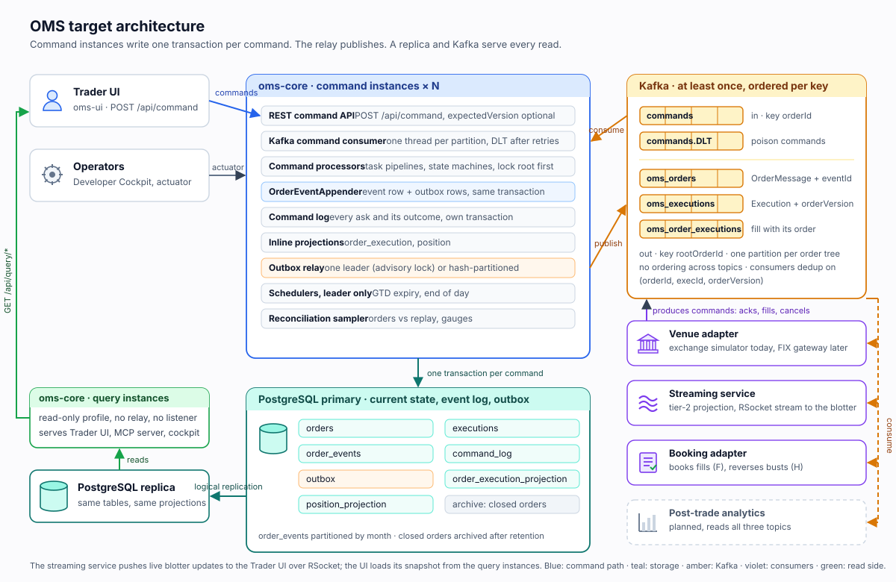

*Figure 1. Clients send commands to N command instances. Each command is one transaction on the
primary. The relay publishes to Kafka; a logical replica feeds read-only query instances; the venue
adapter, the streaming service and booking consume the topics.*

| Component | Responsibility | Runs where |
|---|---|---|
| **Trader UI** (oms-ui) | Enters orders and cancel requests over REST; shows blotters from a query snapshot plus the live stream | browser |
| **Operators** (Developer Cockpit, actuator) | Rebuild and republish projections, inspect the command log, run the replay harness | tooling |
| **oms-core, command instances** | REST command API, Kafka command consumer, the command processors with their task pipelines and state machines, `OrderEventAppender`, the command log, inline projections, the outbox relay (one leader), the schedulers (one leader), the reconciliation sampler | N instances, stateless |
| **PostgreSQL primary** | Current state (`orders`, `executions`), event log (`order_events`), audit (`command_log`), staging (`outbox`), inline projections | one primary |
| **PostgreSQL replica** | Logical replica of every table; serves reads | one or more |
| **oms-core, query instances** | The same application in a read-only profile: no listener, no relay, no schedulers, no Liquibase; datasource read-only; replication lag in health | M instances |
| **Kafka** | `commands` in; `oms_orders`, `oms_executions`, `oms_order_executions` out; `commands.DLT` | cluster |
| **Venue adapter** | Consumes `oms_orders`, acts on market legs, answers with commands carrying a `CommandHeader` (exchange simulator today, FIX gateway later) | separate service |
| **Streaming service** | Tier-2 projection: bounded in-memory blotter from `oms_orders` and `oms_order_executions`, pushed over RSocket | separate service |
| **Booking adapter** | Consumes `oms_order_executions` only; books fills, reverses busts | separate service, planned |
| **Observability** | OTLP to Alloy, Grafana LGTM; every service labelled `service_name` | unchanged |

Everything in blue (command instances) is stateless and horizontally scalable. The three places
that need exactly one actor, the relay, the schedulers and the Liquibase migration, take a
PostgreSQL advisory lock, so any instance can be the leader and failover is automatic.

---

## 4. How state is stored

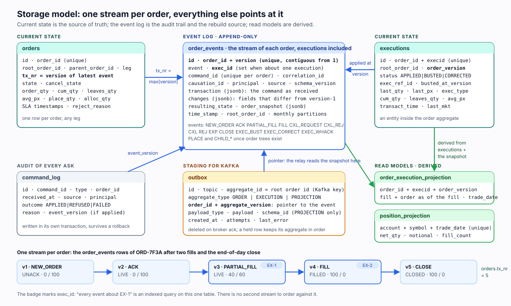

*Figure 2. Current state is the source of truth; `order_events` is the one stream per order and
everything else points at it; read models are derived and rebuildable.*

### 4.1 The order is the aggregate, the execution is an entity inside it

The consistency boundary is the order, or, once trees exist, the order tree under one root. A fill
changes the order's quantities and state, so the fill and the order change commit together. That is
why there is **one stream per order** and no separate execution stream: an execution is created,
busted or corrected by an **order event about that execution**, marked by `exec_id`. The
`executions` table is to an execution what `orders` is to an order, the current state, while the
history of both is in `order_events`.

### 4.2 The tables

| Table | Role | Key facts |
|---|---|---|
| `orders` | current state of every order, any leg | `order_id` unique; `tx_nr` is the version of the latest event; `root_order_id`, `parent_order_id`, `leg` link a tree |
| `executions` | current state of every execution | `(order_id, execid)` unique; `order_version` = the version that applied it; `status` APPLIED / BUSTED / CORRECTED; `exec_ref_id`, `busted_at_version`; `root_order_id` for the Kafka key |
| `order_events` | append-only stream per order | `(order_id, version)` unique and contiguous from 1; `event`; `exec_id` when the event is about one execution; `command_id` unique per order; `correlation_id`, `causation_id`, `principal`, `source`; `transaction` (the command as received); `changes` (fields that differ from the previous snapshot); `resulting_state`; `order_snapshot`; `schema_version`; partitioned by month |
| `command_log` | every ask and its outcome | `command_id`, `type`, `order_id`, `received_at`, `source`, `principal`, `outcome` APPLIED / REFUSED / FAILED, `reason`, `event_version`; written in its own transaction so it survives a rollback |
| `outbox` | messages staged for Kafka | `topic`, `aggregate_id` (the Kafka key, root order id), `aggregate_type`; ORDER and EXECUTION rows are **pointers** `(order_id, aggregate_version)` to the event; PROJECTION rows carry an Avro payload and the writer schema id; deleted on broker ack |
| `order_execution_projection` | tier-1 read model: one row per fill with the order as of that fill | `(order_id, execid, order_version)` unique; the row and the published `OrderExecution` record are built from the same object |
| `position_projection` | tier-1 read model: net quantity and notional per account, symbol and trade date | updated per fill and per bust; rebuildable from `executions` by `order_version` |

### 4.3 What a snapshot buys, and what a delta adds

Every event stores the full order as it stood after the change. Reconstructing the order at version
n is therefore one indexed lookup, not a fold over n events, and the storage cost is accepted. The
`changes` column adds what a snapshot alone cannot show: the fields that differ from version n-1,
so an auditor reads "cumQty 0 → 40, leavesQty 100 → 60" without diffing two JSON documents, and a
projection that needs deltas (positions) does not have to derive them.

### 4.4 Retention

`order_events` is partitioned by month on `time_stamp`. `CLOSED` is the only terminal state and it
is the archival trigger: after the retention period, the events, executions and command-log rows of
closed orders move to cold storage, and the partitions that hold nothing else are detached.
Post-trade analytics keeps its own history from the topics; the OMS does not serve historical queries
beyond its retention.

---

## 5. How a command is processed

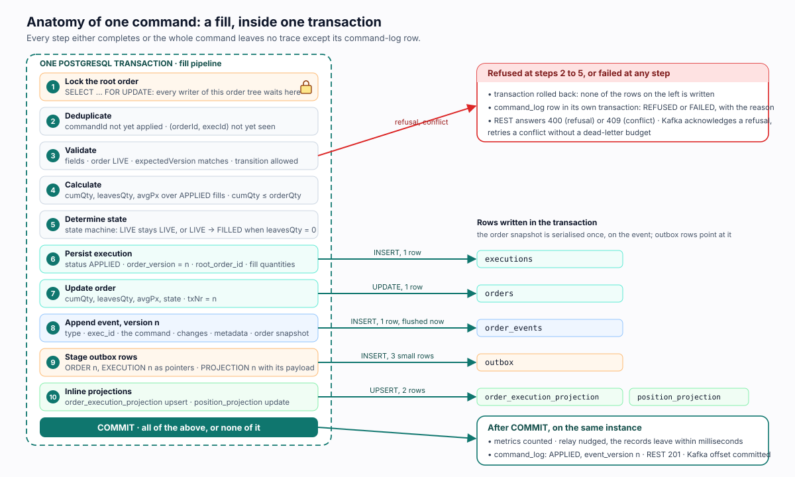

*Figure 3. A fill as one transaction. Every step either completes or the whole command leaves no
trace except its command-log row.*

### 5.1 Entry points and pipelines

Three entry points feed the same processors:

| Entry point | Carries | Serialisation of commands for one order |
|---|---|---|
| `POST /api/command` | one command, optional `expectedVersion`; the result carries the event version it produced | the root row lock |
| `commands` topic | one Avro record per command, `CommandHeader` first; key = order id; N partitions, one consumer thread each | partition order, then the root row lock |
| Schedulers (leader instance) | `OrderExpireCmd`, `OrderCloseCmd` with deterministic command ids | the root row lock |

Four pipelines, each a `TaskPipeline` executed by the `TaskOrchestrator` inside `@Transactional`:

| Pipeline | Commands | Steps |
|---|---|---|
| Create | `OrderCreateCmd`, `OrderPlaceCmd` (trees) | validate → assign id → set state (NEW → UNACK, SLA stamps) → persist → record event |
| Lifecycle | accept, reject, cancel, cancel request, cancel reject, expire, close | lock root → load → deduplicate → validate (state machines) → apply (rule table) → save → record event |
| Fill | `ExecutionCreateCmd` | lock root → deduplicate → validate → calculate → determine state → persist execution → update order → record event → project |
| Execution lifecycle | `ExecutionBustCmd`, `ExecutionCorrectCmd`, `ExecutionWhackCmd` | lock root → load execution → validate (APPLIED, quantities, transition) → reverse or replace → update order → record event (`exec_id`) → project |

In a tree, the market order's pipeline also applies the ripple to the client order in the same
transaction (section 8.9).

### 5.2 Concurrency and idempotency

- **Lock first.** Every pipeline starts with `SELECT … FOR UPDATE` on the root order. Two commands
  for the same tree run one after the other; different trees run in parallel on different instances.
  A conflict is a short wait, not a retry and never a dead letter.
- **Version as the safety net.** The appender takes the next version from `orders.tx_nr` and the
  unique `(order_id, version)` constraint lets only one writer commit it. With the lock this never
  fires; without the lock it still protects the log.
- **Expected version.** A client that acts on a snapshot can send `expectedVersion`; the pipeline
  refuses the command if the order has moved. A refusal, not a conflict.
- **Three idempotency keys.** `(session_id, cl_ord_id)` refuses a repeated create;
  `(order_id, execid)` refuses a repeated fill; `(order_id, command_id)` refuses any repeated
  command. All three are unique constraints, so they hold across instances, and each is checked
  early in the pipeline so that a duplicate is a cheap refusal rather than a constraint violation.

### 5.3 State machines

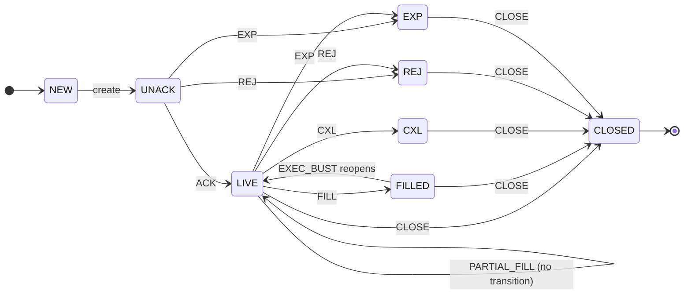

*Order state. `CLOSED` is the only terminal state and the archival trigger. `FILLED → LIVE` exists
only for a bust that reopens quantity.*

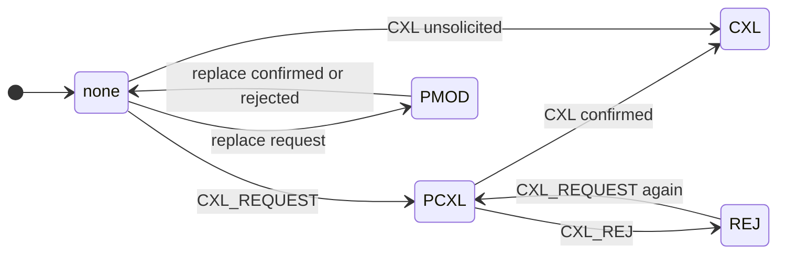

*Cancel state, orthogonal to the order state. Today these rules are preconditions in code; the
target makes them a configuration like the order machine.*

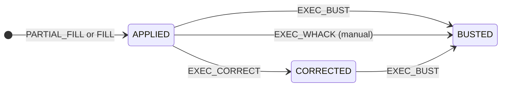

*Execution status. A correction records the replacing fill as a new execution with `exec_ref_id`
pointing at the corrected one.*

### 5.4 Refusals and failures

A refusal (duplicate, illegal transition, failed validation, expected version mismatch) marks the
transaction rollback-only, so none of the rows of figure 3 is written. The command log row is written
in its own transaction with the reason. REST answers 400; the Kafka listener acknowledges the record,
because retrying a refusal can never succeed. A failure (an exception) rolls back the same way, is
logged as FAILED, and on Kafka is retried with backoff and then dead-lettered with its original
bytes. A concurrency failure is neither: it is retried without consuming the dead-letter budget,
because it cannot be a poison message.

---

## 6. How changes leave the system

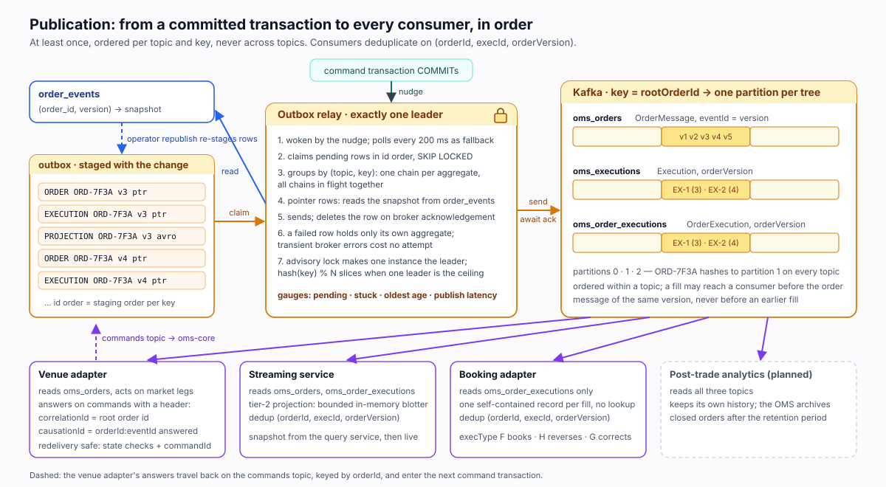

*Figure 4. From a committed transaction to every consumer: at least once, ordered per topic and key,
never across topics.*

### 6.1 The outbox and the relay

The command transaction stages one outbox row per message. ORDER and EXECUTION rows are pointers:
the relay reads the snapshot from `order_events` by `(order_id, version)` when it publishes, so the
snapshot is serialised once, on the event. PROJECTION rows carry the Avro bytes of the record the
projection built, with the writer schema's registry id, so a deployment between staging and
publishing cannot break them.

The relay runs on exactly one instance, elected by a PostgreSQL advisory lock. It is nudged after
every commit on its own instance and polls every 200 ms as the fallback for commits elsewhere. It
claims pending rows in id order with `SKIP LOCKED`, groups them by `(topic, key)`, sends each group
as a chain (each row after the previous one's acknowledgement) with all chains in flight together,
deletes acknowledged rows, and leaves a failed row in place, holding only its own aggregate.
Transient broker errors cost no attempt, so an outage delays publication and never exhausts a retry
budget. When one leader is the ceiling, relays are partitioned by `hash(key) % N` instead, which
keeps per-key order with no shared state.

### 6.2 The topics and their contract

| Topic | Record | Key | Carries | Consumers |
|---|---|---|---|---|
| `oms_orders` | `OrderMessage` | root order id | the order after each change, `eventId` = version, `leg` | venue adapter, streaming service, analytics |
| `oms_executions` | `Execution` | root order id | the fill with the order's resulting quantities, `orderVersion`, `execType` F / H / G | analytics, any fill consumer that has the order already |
| `oms_order_executions` | `OrderExecution` | root order id | the fill with the order as of the fill, `orderVersion`, `tradeDate`; **the booking contract** | booking adapter, streaming service, analytics |
| `commands` | one record per command type | order id | `CommandHeader` first: `commandId`, `correlationId`, `causationId`, `sentAt`, `producer` | oms-core |
| `commands.DLT` | the original bytes | order id | commands that failed after retries or could not be decoded | operators |

The contract every consumer relies on:

1. **At least once.** The relay may publish a record twice after a crash between send and delete.
2. **Ordered within a topic for one key.** All records of one order tree are on one partition of each
   topic, in version order.
3. **Never ordered across topics.** A consumer that needs the fill and the order together reads
   `oms_order_executions`, where each record is self-contained.
4. **Deduplicate on `(orderId, execId, orderVersion)`** for fills and on `(orderId, eventId)` for order
   messages. A bust arrives as a later `orderVersion` for the same `execId` with `execType H`.

### 6.3 Republishing

An operator can re-stage the events of one order, or of every order, for a topic:
`POST /actuator/projections/republish`. The relay publishes them under the same keys and versions,
so consumers that deduplicate correctly see nothing new and a rebuilt consumer is refilled.

---

## 7. How reads are served

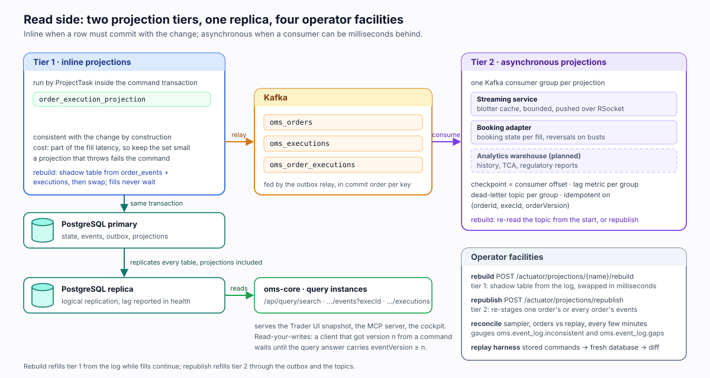

*Figure 5. Two projection tiers, one replica, four operator facilities.*

### 7.1 The query service on the replica

The query instances are the same application in a read-only profile against a logical replica.
They serve `GET /api/query/search`, `GET /api/query/orders/{orderId}/events` (with `execId` and
`version` filters), `GET /api/query/orders/{orderId}/commands` (the command log),
`GET /api/query/executions` (from `order_execution_projection`) and the tree view by root. The health
endpoint reports replication lag. Because every table replicates, projections included, the query
side needs no code of its own for a new read model.

**Read your own writes.** A command result carries the event version it produced. A client that
needs to see its own change waits until the query answer's `eventVersion` for that order is at least
that version, or subscribes to the stream.

### 7.2 Tier 1: inline projections

An inline projection runs inside the command transaction (`ProjectTask`) and is consistent with the
change by construction. It is for rows that must commit with the change: the execution view, the
position per account. Its cost is part of the fill latency, so the set stays small. A projection
that throws fails the command. Rebuild: a shadow table is filled from `order_events` and
`executions` while fills continue, then swapped in by rename.

### 7.3 Tier 2: asynchronous projections

An asynchronous projection is a Kafka consumer group: the streaming service's blotter cache,
booking's state, the analytics warehouse. Its checkpoint is the consumer offset, its lag is a metric,
its failures go to a dead-letter topic per group, and it is idempotent on the dedup keys above.
Rebuild: re-read the topic from the beginning, or ask core to republish. Consistency is eventual,
normally milliseconds.

### 7.4 Replay, rebuild and reconciliation

| Facility | What it does | When to use it |
|---|---|---|
| `OrderReplayService.replayAt(orderId, version)` | the order after any version, one lookup | debugging, audit, point-in-time questions |
| `executionsAt(orderId, version)` | the executions applied and not yet busted at that version | the same, for fills |
| Rebuild (tier 1) | shadow table from the log, swap | after deploying a new projection, after fixing a projection bug |
| Republish (tier 2) | re-stage events into the outbox | after rebuilding a consumer, after a consumer-side bug |
| Reconciliation sampler | every few minutes compares a sample of `orders` to `replay` and checks contiguity; gauges `oms.event_log.inconsistent`, `oms.event_log.gaps` | always on; the proof that nothing writes an order without an event |
| Replay harness | feeds the stored commands of `order_events` in order into a fresh database and diffs the snapshots | before a release; doubles as the load suite |

---

## 8. Walkthrough: one order, two fills

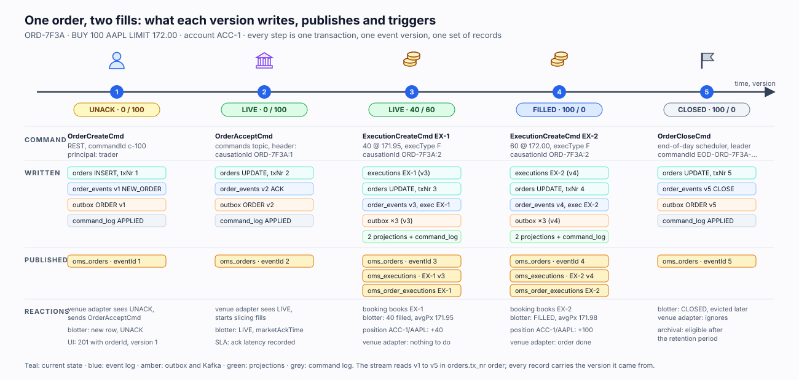

*Figure 6. ORD-7F3A from creation to close: for each version, the command, the rows written, the
records published and who reacts.*

**The order.** `ORD-7F3A`, BUY 100 AAPL LIMIT 172.00, session `SES-A`, `clOrdId` `CL-100`, account
`ACC-1`. The trader enters it in the UI. The venue adapter (the exchange simulator) accepts it and
fills it in two slices. The end-of-day run closes it. Five commands, five versions, one transaction
each. To keep the tables short, the order is its own root and carries leg MKT, a market order placed
directly; section 8.9 shows the same flow with a client leg and a market leg.

### 8.1 Version 1: the trader creates the order

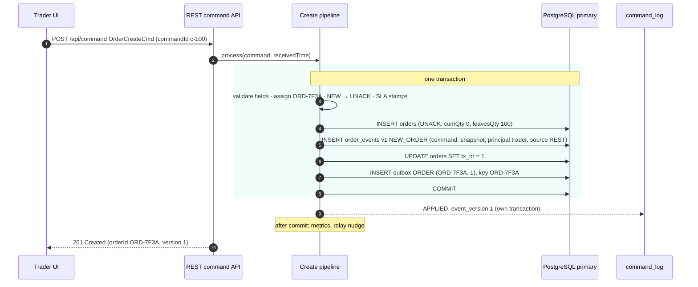

The UI now holds the order id and version 1. Its blotter snapshot will show the order as soon as the
replica carries version 1, and the live stream will show it as soon as the relay has published.

### 8.2 Version 2: the venue accepts

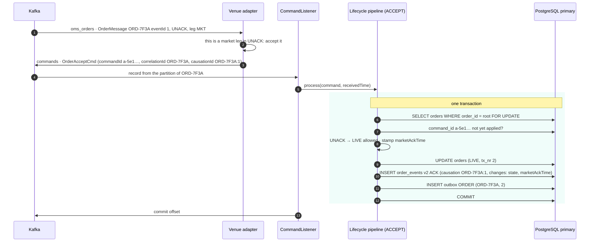

The causation id on the stored command says which published event the venue was answering. A
replayed `oms_orders` record would produce a second accept with a fresh command id, which the state
machine refuses: the order is no longer UNACK.

### 8.3 Version 3: the first fill, 40 at 171.95

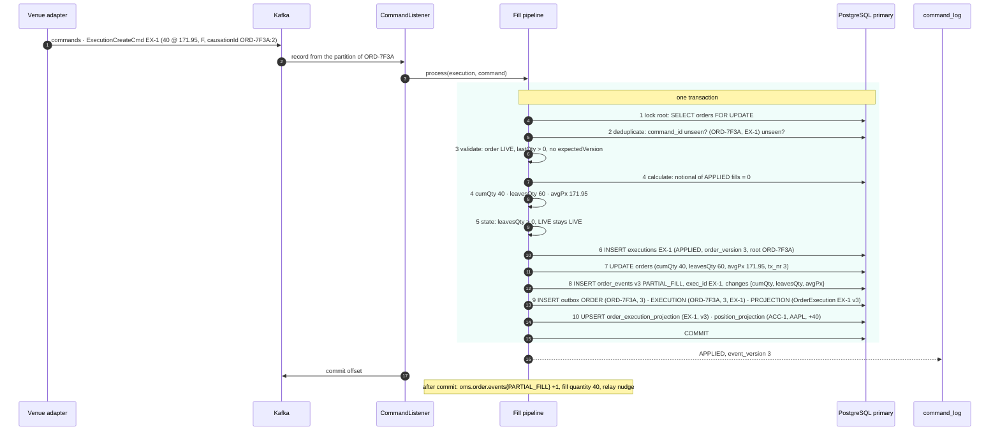

### 8.4 Version 4: the second fill, 60 at 172.00

The same pipeline. What differs:

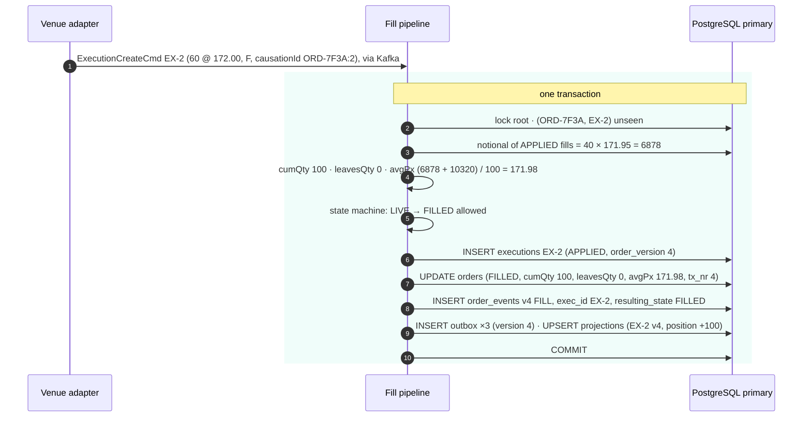

Had the venue sent 70 instead of 60, step 4 would have refused the fill: cumQty 110 exceeds
orderQty 100, nothing is written, the command log says REFUSED with that reason, and the record is
acknowledged on Kafka.

### 8.5 Publication and consumption of a fill

What happens after the commit of version 3 (and identically after version 4):

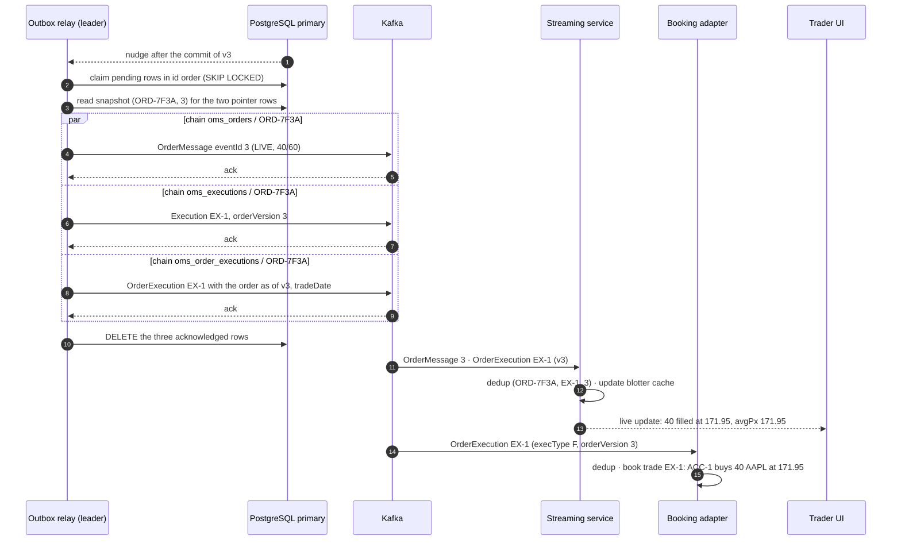

Three chains run in parallel because they are three different `(topic, key)` pairs; within each
chain the relay sends version 3 before version 4. The venue adapter also receives the `oms_orders`
record and finds nothing to do until the order is FILLED, at which point it stops slicing.

### 8.6 Version 5: end of day closes the order

The scheduler on the leader instance runs the end-of-day step: every DAY order still open is expired,
then every finished order unchanged since the cutoff is closed. ORD-7F3A is FILLED and unchanged, so
the scheduler sends `OrderCloseCmd` with command id `EOD-ORD-7F3A-20261107` through the lifecycle
pipeline: lock, dedup, `FILLED → CLOSED` allowed, `order_events` v5 CLOSE, outbox ORDER (ORD-7F3A, 5),
`oms_orders` eventId 5. A second run the same day is refused as a duplicate command. CLOSED makes
the order eligible for archival after the retention period.

### 8.7 The tables after the flow

`orders` (one row):

| order_id | tx_nr | state | cancel_state | order_qty | cum_qty | leaves_qty | avg_px | root_order_id | leg |
|---|---|---|---|---|---|---|---|---|---|
| ORD-7F3A | 5 | CLOSED | | 100 | 100 | 0 | 171.98 | ORD-7F3A | MKT |

`executions` (two rows):

| order_id | execid | status | order_version | last_qty | last_px | cum_qty | leaves_qty | avg_px | busted_at_version |
|---|---|---|---|---|---|---|---|---|---|
| ORD-7F3A | EX-1 | APPLIED | 3 | 40 | 171.95 | 40 | 60 | 171.95 | |
| ORD-7F3A | EX-2 | APPLIED | 4 | 60 | 172.00 | 100 | 0 | 171.98 | |

`order_events` (five rows, abridged):

| version | event | exec_id | command_id | source | causation_id | resulting_state | changes | snapshot |
|---|---|---|---|---|---|---|---|---|
| 1 | NEW_ORDER | | c-100 | REST | | UNACK | all fields (created) | UNACK, 0 / 100 |
| 2 | ACK | | a-5e1… | Kafka | ORD-7F3A:1 | LIVE | state, marketAckTime | LIVE, 0 / 100 |
| 3 | PARTIAL_FILL | EX-1 | f-0c9… | Kafka | ORD-7F3A:2 | LIVE | cumQty, leavesQty, avgPx | LIVE, 40 / 60 |
| 4 | FILL | EX-2 | f-7aa… | Kafka | ORD-7F3A:2 | FILLED | state, cumQty, leavesQty, avgPx | FILLED, 100 / 0 |
| 5 | CLOSE | | EOD-ORD-7F3A-20261107 | scheduler | | CLOSED | state | CLOSED, 100 / 0 |

Each row's `transaction` column holds the command exactly as it was received, for example row 3:

```json
{
  "type": "ExecutionCreateCmd",
  "version": "1.0.0",
  "commandId": "f-0c9e…",
  "correlationId": "ORD-7F3A",
  "causationId": "ORD-7F3A:2",
  "execution": {
    "execId": "EX-1",
    "orderId": "ORD-7F3A",
    "lastQty": 40,
    "lastPx": 171.95,
    "execType": "F",
    "lastMkt": "XNAS",
    "transactTime": "2026-11-07T09:30:01.098Z"
  }
}
```

`command_log` (five rows for the five applied commands, plus any refusal; here a redelivered EX-1
that arrived after version 3):

| command_id | type | order_id | source | outcome | reason | event_version |
|---|---|---|---|---|---|---|
| c-100 | OrderCreateCmd | ORD-7F3A | REST | APPLIED | | 1 |
| a-5e1… | OrderAcceptCmd | ORD-7F3A | Kafka | APPLIED | | 2 |
| f-0c9… | ExecutionCreateCmd | ORD-7F3A | Kafka | APPLIED | | 3 |
| f-0c9… | ExecutionCreateCmd | ORD-7F3A | Kafka | REFUSED | execution already applied: EX-1 | |
| f-7aa… | ExecutionCreateCmd | ORD-7F3A | Kafka | APPLIED | | 4 |
| EOD-ORD-7F3A-20261107 | OrderCloseCmd | ORD-7F3A | scheduler | APPLIED | | 5 |

`order_execution_projection` (two rows) and `position_projection` (one row):

| order_id | execid | order_version | last_qty | last_px | cum_qty | leaves_qty | avg_px | state | account | symbol | trade_date |
|---|---|---|---|---|---|---|---|---|---|---|---|
| ORD-7F3A | EX-1 | 3 | 40 | 171.95 | 40 | 60 | 171.95 | LIVE | ACC-1 | AAPL | 2026-11-07 |
| ORD-7F3A | EX-2 | 4 | 60 | 172.00 | 100 | 0 | 171.98 | FILLED | ACC-1 | AAPL | 2026-11-07 |

| account | symbol | trade_date | net_qty | notional | fill_count | last_order_version |
|---|---|---|---|---|---|---|
| ACC-1 | AAPL | 2026-11-07 | 100 | 17198.00 | 2 | 4 |

Kafka, all keyed by `ORD-7F3A`, in publication order per topic:

| Topic | Records |
|---|---|
| `oms_orders` | eventId 1 UNACK · 2 LIVE · 3 LIVE 40/60 · 4 FILLED · 5 CLOSED |
| `oms_executions` | EX-1 (orderVersion 3) · EX-2 (orderVersion 4) |
| `oms_order_executions` | EX-1 with the order as of v3 · EX-2 with the order as of v4 |

### 8.8 Reading the history back

The sequence of business events of the order, over the query API or in SQL:

```
GET /api/query/orders/ORD-7F3A/events
```

```sql
SELECT version, event, exec_id, command_id, source, resulting_state,
       transaction ->> 'type' AS command_type, changes, time_stamp
  FROM order_events
 WHERE order_id = 'ORD-7F3A'
 ORDER BY version;
```

Every event about one execution:

```
GET /api/query/orders/ORD-7F3A/events?execId=EX-1
```

```sql
SELECT version, event, resulting_state FROM order_events
 WHERE order_id = 'ORD-7F3A' AND exec_id = 'EX-1' ORDER BY version;   -- v3 PARTIAL_FILL
```

Every ask, including refused ones: `GET /api/query/orders/ORD-7F3A/commands`.

The order and its fills as they stood after version 3: `replayAt('ORD-7F3A', 3)` returns the v3
snapshot (LIVE, 40 / 60); `executionsAt('ORD-7F3A', 3)` returns EX-1 only. From Kafka alone, a
consumer that reads `oms_orders` from the beginning of the partition sees versions 1 to 5 in order,
and `oms_order_executions` gives it the two fills with the versions they belong to.

### 8.9 The same flow with an order tree

With order trees (SPEC-0022), the trader's order is a client leg and the venue sees a market leg
placed from it. The fill lands on the market order and ripples to the client order in the same
transaction.

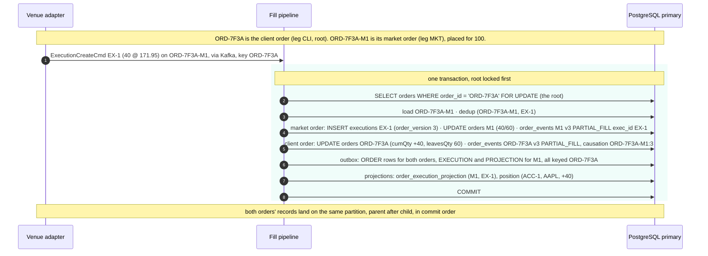

Booking receives one `OrderExecution` record carrying both `orderId` (the market order) and
`rootOrderId` (the client order), so both legs are booked from one record without double counting.

### 8.10 What if

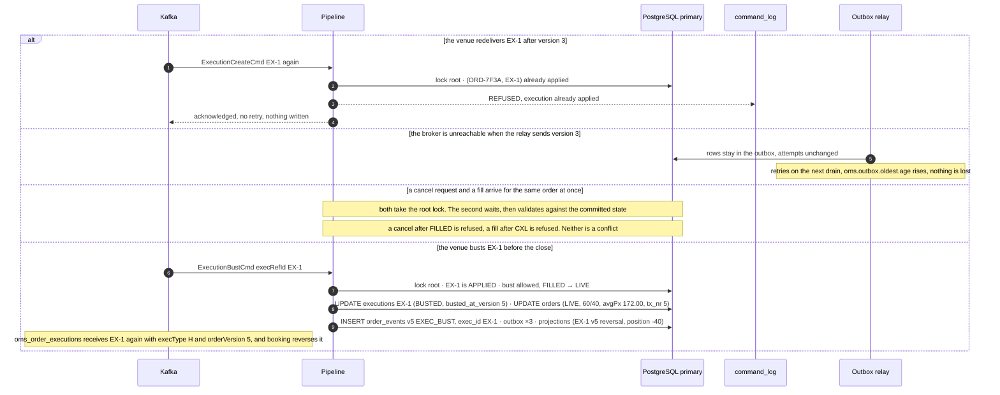

---

## 9. Scaling and operating the target

### 9.1 Where capacity comes from

| Stage | Scaling lever | Serialisation point |
|---|---|---|
| Command ingestion, Kafka | N partitions on `commands`, keyed by order id; listener concurrency = partitions; any number of command instances | one partition per order |
| Command ingestion, REST | any number of command instances behind a load balancer | the root row lock |
| Command transaction | about ten statements per fill but one snapshot serialisation, pooled sequences and batched inserts, so few round trips; PostgreSQL primary sized for write IOPS | the root row lock; the primary |
| Publication | one relay leader by advisory lock; `hash(key) % N` relay slices when the leader is the ceiling; CDC (Debezium) on the outbox as the last resort, with no change to the command path | per `(topic, key)` chain |
| Reads | M query instances on one or more replicas; views and projections replicate with the tables | replication lag |
| Projections | tier 1 small and inline; tier 2 scales with consumer groups and partitions | per partition |
| Storage | monthly partitions on `order_events`; archival of closed orders after retention | vacuum and index size |

### 9.2 Failure modes and what happens

| Failure | Effect | Why nothing is lost |
|---|---|---|
| Command instance crashes mid-transaction | the transaction rolls back; on Kafka the record is redelivered to another instance; on REST the client gets no answer and retries with the same command id | nothing is visible until commit; the retry is deduplicated |
| Crash after commit, before the Kafka offset commit | the command is redelivered | refused as a duplicate; the command log shows APPLIED then REFUSED |
| Broker down | outbox rows accumulate; the relay retries without charging attempts; `oms.outbox.oldest.age` alerts | the rows are in the same database as the state |
| Relay leader dies | another instance takes the advisory lock on its next poll | rows are claimed, not consumed, until acknowledged |
| Relay crashes between send and delete | the row is published again | at least once; consumers deduplicate on the version |
| Poison command (undecodable, unknown type) | straight to `commands.DLT` with the original bytes | operators replay it after the fix |
| Projection bug | tier 1: fix, rebuild into a shadow table, swap; tier 2: fix, reset the consumer group or republish | the log and the topics are the sources |
| A path writes an order without an event | the reconciliation sampler raises `oms.event_log.inconsistent` within minutes | replay is compared with the live row continuously |
| Replica lag spike | query answers are stale by the lag; health reports it; clients that need their own write wait for the version | the write path is unaffected |
| Schema change while PROJECTION rows are pending | the relay decodes with the writer schema id stored on the row | writer and reader schemas are both known |

### 9.3 What to watch

| Metric | Meaning |
|---|---|
| `oms.order.events{event}` | events appended per type, after commit |
| `oms.commands.consumed{type,outcome}` | applied, refused, failed per command type |
| `oms.outbox.pending`, `oms.outbox.stuck`, `oms.outbox.oldest.age` | publication backlog and health |
| `oms.publish.latency` | commit to broker acknowledgement |
| `oms.event_log.inconsistent`, `oms.event_log.gaps` | reconciliation sampler findings; both should be 0 |
| `oms.projection.rebuild{projection}` | rebuild duration |
| consumer group lag per tier-2 projection | how far behind each read model is |
| replication lag on the replica | staleness of the query service |

---

## 10. From today to the target

Every element of this document, with where it stands on 2026-11-07. The tickets SPEC-0044 to
SPEC-0052 were created on that date from this document and the review; their dependencies are
recorded in each ticket's log.

| Element | Status | Delivered by |
|---|---|---|
| One stream per order with a snapshot per event, version as lock, replay by lookup | in place | SPEC-0027 and earlier |
| Transactional outbox, per-aggregate relay chains, transient errors cost no attempt | in place | SPEC-0026 |
| Three topics keyed by root order id; `OrderExecution` on `oms_order_executions` | in place | SPEC-0019, SPEC-0020 |
| Commands topic with `CommandHeader`, one record per type, DLT with original bytes | in place | SPEC-0025 |
| Inline projection framework, rebuild endpoint | in place | SPEC-0020 |
| Expiry and close in the state machine, end-of-day scheduler | in place | SPEC-0029 |
| Observability: OTLP, dashboards, order-flow metrics | in place | SPEC-0031 to SPEC-0038 |
| `exec_id` on events, `EXEC_*` event types, execution status and `order_version`, `executionsAt`, `CancelState` and `ExecutionStatus` machines | planned | SPEC-0044 |
| `order_execution_view` renamed to `order_execution_projection`, projection name decoupled from the table | done | SPEC-0045 |
| `command_log`, typed duplicate-command refusal on every path, accept as a lifecycle action | planned | SPEC-0046 |
| Pointer outbox rows, `root_order_id` on executions, pooled sequences | planned | SPEC-0047 |
| Lock-first on every pipeline, conflicts outside the dead-letter budget, relay leader lock, after-commit nudge, topic provisioning and listener concurrency, scheduler leader lock | planned | SPEC-0048 |
| `changes`, `correlation_id`, `causation_id`, `principal`, `source` on events; reconciliation sampler; writer schema id on PROJECTION rows | planned | SPEC-0049 |
| `expectedVersion` on commands; event version in the command result | planned | SPEC-0050 |
| Read-only query profile on a logical replica, query contract completed | planned | SPEC-0021 |
| Order trees: legs, place command, root lock, upward ripple; cancel and replace fan-out | planned | SPEC-0022, SPEC-0023 |
| Replay harness, load baseline, `schema_version` on stored JSON | planned | SPEC-0024 |
| Bust, correction and whack as execution lifecycle events; `FILLED → LIVE` | planned | SPEC-0030, on SPEC-0044 |
| Projection tiers named, republish endpoint, shadow-table rebuild, `position_projection` | planned | SPEC-0051 |
| Monthly partitions on `order_events`, archival of closed orders | planned | SPEC-0052 |
| Booking adapter | planned | booking integration concept |

---

## 11. Glossary

| Term | Meaning in this document |
|---|---|
| **Aggregate** | The consistency boundary: an order, or an order tree under one root. One command changes one aggregate in one transaction. |
| **Entity** | An object with identity that lives inside an aggregate: an execution inside an order. It has no stream of its own. |
| **Event** | One row of `order_events`: what happened to an order (type), the command that caused it, the fields that changed, and the order afterwards (snapshot), at version n. |
| **Version** | The per-order sequence number of an event, contiguous from 1. `orders.tx_nr` is the latest. It is the optimistic lock, the dedup key on the wire and the replay index. |
| **Snapshot** | The full order stored on every event. Replay at version n is a lookup of that snapshot. |
| **Changes** | The field-level diff between the snapshot at n and at n-1, stored on the event. |
| **Command** | The request to change an order: create, accept, fill, cancel, close, bust. Carries a command id, a correlation id (the root order) and a causation id (the event it answers). |
| **Command log** | One row per command received, with its outcome: applied (and the event version), refused (and why) or failed. Written in its own transaction. |
| **Outbox** | The table where a command transaction stages the Kafka messages it produces. The relay publishes them after commit. |
| **Relay** | The one component that sends to Kafka. One leader, per-key chains, delete on acknowledgement. |
| **Projection, tier 1** | A read model written inside the command transaction: `order_execution_projection`, `position_projection`. Consistent by construction, rebuildable from the log. |
| **Projection, tier 2** | A read model fed from Kafka by a consumer group: the streaming blotter, booking state, analytics. Eventually consistent, refillable by republish. |
| **Replica** | A logical PostgreSQL replica of the primary, serving the query instances. |
| **Root order, leg** | In a tree, the client order is the root (leg CLI); market orders are its children (leg MKT). The root id is every Kafka key. |
| **Ripple** | Applying a market order's change (fill, cancel, reject) to its client order in the same transaction. |
| **Idempotency keys** | `(sessionId, clOrdId)` for creates, `(orderId, execId)` for fills, `(orderId, commandId)` for every command. |
| **Dedup key on the wire** | `(orderId, execId, orderVersion)` for fills, `(orderId, eventId)` for order messages. |
| **Replay** | Reconstructing an order (or its executions) as of a version from the log, or re-executing the stored commands into a fresh database to prove behaviour. |
| **Rebuild, republish** | Refilling a tier-1 projection from the log; refilling a topic (and so tier-2 projections) from the log. |
