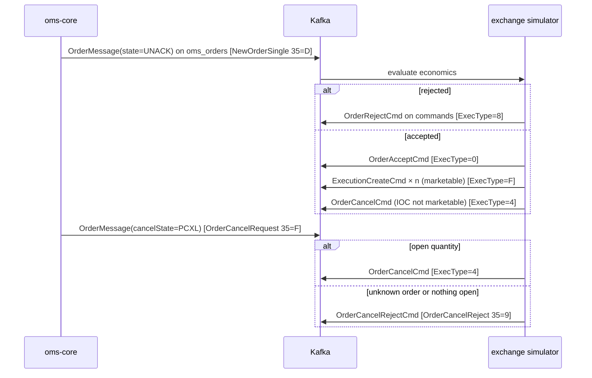

# Exchange Simulator

The venue simulator: a separate service that plays the market for oms-core (SPEC-0001). Capability:
[Exchange Simulation](../../capabilities/exchange-simulation.md). Context: [System Context](system-context.md).

## 1. Purpose

The OMS has no market connectivity. Without something on the other side, an order would stay in
UNACK forever, and acks, fills, rejects and cancels could only be tested by sending each command by
hand. `oms-exchange-simulator` plays the venue. It reads the OMS's order stream and answers each
order the way an exchange does, with FIX semantics, so the whole order lifecycle can run end to
end.

It is a separate, independently deployable service. It talks to oms-core only through Kafka and the
shared contracts in `oms-contracts`, exactly as a real venue adapter would. To test against a real
venue, switch it off.

## 2. Message Flow



| FIX message from the venue | Command sent to oms-core |
|---|---|
| ExecutionReport ExecType=0 (New) | `OrderAcceptCmd` |
| ExecutionReport ExecType=F (Trade) | `ExecutionCreateCmd`, execType `F`, execId `<orderId>-F<n>` |
| ExecutionReport ExecType=8 (Rejected) | `OrderRejectCmd`; its `text` reason lands in the order's `rejectReason` |
| ExecutionReport ExecType=4 (Canceled) | `OrderCancelCmd` |
| OrderCancelReject (35=9) | `OrderCancelRejectCmd`; its `text` reason lands in the order's `rejectReason` |

All commands are keyed by orderId, so one order's commands share a partition and oms-core applies
them in the order sent: the ack is always processed before the fills.

## 3. Triggers

The simulator sees every update the OMS publishes, including the OMS's own echoes of the
simulator's answers. It reacts to exactly two triggers:

1. **New order:** the first message for an orderId with `state = UNACK`.
2. **Cancel request:** a change of `cancelState` into `PCXL` compared with the last message seen for
   that order.

Every reject, cancel and cancel reject also carries a `commandId` derived from the OMS event it
answers: `<orderId>-REJ-<eventId>`, `<orderId>-CXL-<eventId>` or `<orderId>-CXLREJ-<eventId>`.
If Kafka replays a cancel request after its reject has been applied, the state precondition
holds again, but the answer carries an id oms-core has already applied, so it is refused.
This survives simulator restarts, because the id comes from the OMS event, not from a counter.

In oms-core's event log, a cancel request appears as `CXL_REQUEST`, followed by `CXL` when the
simulator confirms it or `CXL_REJ` when it refuses it.

Everything else is ignored. This makes the simulator idempotent: a redelivered order or a repeated
PCXL message triggers nothing. oms-core is idempotent on its side as well, because every command's
precondition stops holding once the command has been applied (see
[Order Lifecycle §4.9.1](../../domain/concepts/order-lifecycle.md)).

## 4. Order Economics

Each symbol has one **reference price**: the price marketable quantity fills at and limit prices
are checked against. There is no order book, bid or ask.

### 4.1 Reference prices (SPEC-0073)

`ReferencePriceService` answers from, in order:

1. **Its cache**: Alpha Vantage answers, including "no quote", kept for `quote-ttl` (default 5 min)
   to stay within the free quota of about 25 requests a day.
2. **Alpha Vantage** `GLOBAL_QUOTE`, field `05. price` (the last price, the same `last` that
   [order entry](../../ui/order-entry.md) shows the trader), when `ALPHAVANTAGE_API_KEY` is set.
   Timeouts: connect 2 s, read 3 s.
3. **The static `simulator.reference-prices`**, when there is no key, Alpha Vantage is rate limited
   (it answers 200 with a `Note` or `Information` member) or unreachable, or it has no quote for the
   symbol. Fallbacks are not cached.

A symbol priced by none of them is rejected (`Unknown symbol <s>`). Alpha Vantage's price wins over
the static one, so AAPL trades at the market price when a key is set. After a rate limit or an
outage, Alpha Vantage is left alone for `provider-backoff` (default 60 s). Lookups run on the
engine's single thread, so this bounds how long a dead provider can hold up the venue to one read
timeout per back-off period.

The key is sent only to Alpha Vantage. It is never logged (requests are logged by function,
failures by exception type), and it never appears in a reject text or a command. Alpha Vantage's
own messages, which echo it, are not passed on. The simulator's client is a trimmed copy of
oms-ui's ([Market Data API](../../domain/interfaces/market-data-api.md)), and the two caches are
separate.

### 4.2 Trading rules

| Rule | Behaviour |
|---|---|
| MARKET order | Marketable; fills at the reference price |
| LIMIT buy | Marketable when price ≥ reference; fills at the reference price (price improvement) |
| LIMIT sell / sell short | Marketable when price ≤ reference; fills at the reference price |
| Not marketable, DAY/GTC/other | Acknowledged and rests (LIVE, no fills) until cancelled |
| Not marketable, IOC | Acknowledged, then cancelled (unsolicited ExecType=4) |
| Marketable quantity | Split into `fill-slices` executions (e.g. 100 / 3 → 33, 33, 34), `fill-delay` apart |

Rejects, checked in this order:

| Condition | Reason |
|---|---|
| orderQty missing or ≤ 0 | `Invalid order quantity` |
| ordType not MARKET or LIMIT | `Unsupported order type <t>` |
| side not BUY, SELL, SELL_SHORT | `Unsupported side <s>` |
| no reference price for the symbol (§4.1) | `Unknown symbol <s>` |
| LIMIT without price | `Limit order without price` |
| LIMIT price zero or negative | `Invalid limit price <p>` |
| LIMIT price not a whole number of ticks (Reg NMS Rule 612): 0.01 at or above 1.00, 0.0001 below | `Price <p> is not a multiple of tick <t>` |
| LIMIT buy above `reference × (1 + collar)`, or sell / sell short below `reference × (1 − collar)` | `Price <p> outside collar <lo>-<hi>` |

The **collar** follows NYSE's Limit Order Price Protection tiers: 10 % for a reference price up to
25.00, 5 % up to 50.00, and 3 % above (`simulator.price-collar`). Only the aggressive side is
collared. A buy priced below the reference, or a sell above it, is accepted and rests however far
away it is. Example at AAPL 170.00: a buy at 175.10 fills and a buy at 175.11 is rejected
`Price 175.11 outside collar 164.9-175.1`, while a buy at 100.00 rests. The collar replaced the
earlier flat ±10 % band around the reference, which also rejected passive limits.

Out of scope: Limit Up–Limit Down bands, halts and auctions. The OMS itself does no pre-trade price
check; the venue is what rejects.

A cancel request for an order with open quantity cancels it. If a fill sequence is still running,
the remaining slices are dropped. A cancel request for a filled, cancelled, rejected or unknown
order is refused (`Too late to cancel` / `Unknown order`).

## 5. Configuration

| Property | Env var | Default |
|---|---|---|
| `simulator.alpha-vantage.api-key` | `ALPHAVANTAGE_API_KEY` | none: static prices only |
| `simulator.alpha-vantage.base-url` | `ALPHAVANTAGE_BASE_URL` | https://www.alphavantage.co |
| `simulator.quote-ttl` | `SIMULATOR_QUOTE_TTL` | 5m |
| `simulator.provider-backoff` | `SIMULATOR_PROVIDER_BACKOFF` | 60s |
| `simulator.reference-prices.<SYMBOL>` | — | the fallback: AAPL 170.00, MSFT 420.00, IBM 250.00, NVDA 120.00, INTC 86.96 |
| `simulator.price-collar.tiers` / `.default-percent` | — | `{max-reference: 25.00, percent: 10}`, `{max-reference: 50.00, percent: 5}`; 3 |
| `simulator.fill-slices` | `SIMULATOR_FILL_SLICES` | 1 |
| `simulator.fill-delay` | `SIMULATOR_FILL_DELAY` | 0ms |
| `simulator.last-mkt` | `SIMULATOR_LAST_MKT` | XSIM |
| `simulator.order-topic` | `ORDER_TOPIC` | oms_orders |
| `simulator.command-topic` | `COMMAND_TOPIC` | commands |
| `simulator.max-tracked-orders` | — | 100000 (oldest orders are forgotten beyond this) |
| `spring.kafka.consumer.auto-offset-reset` | `SIMULATOR_OFFSET_RESET` | latest (a new group does not replay order history) |

## 6. Running It

```bash
cd oms-exchange-simulator && ./gradlew bootJar
cd .. && docker compose up -d --build oms-core exchange-simulator
```

oms-core must run with `KAFKA_ENABLED=true`. Then create an order (see `oms-core/rest.http`):

- symbol AAPL, MARKET: ends FILLED, at 170.00 without a key and at Alpha Vantage's last price with one;
- any other symbol Alpha Vantage quotes (e.g. GOOGL), MARKET, with a key: ends FILLED;
- symbol ZZZZ: ends REJ;
- LIMIT BUY 165 on AAPL at 170.00 (no key): rests LIVE. Send `OrderCancelRequestCmd` for it and it ends CXL;
- LIMIT BUY 175.11 on AAPL at 170.00: ends REJ (collar); 170.005 ends REJ (tick).

To use Alpha Vantage, put `ALPHAVANTAGE_API_KEY=<key>` in the root `.env`; compose passes it to
both oms-ui and the simulator.

## 7. Observability

- Counters at `http://localhost:8094/actuator/prometheus`: `simulator_orders_received_total`,
  `simulator_acks_total`, `simulator_executions_total`, `simulator_rejects_total`,
  `simulator_cancels_total`, `simulator_cancel_rejects_total`.
- `simulator_reference_price_lookups_total{source, outcome}` (SPEC-0073), one per reference price
  lookup. `source` says where the price came from: `CACHE`, `ALPHA_VANTAGE`, `STATIC`, or `NONE`
  (rejected as unknown). `outcome` is `FOUND` when the provider's price was used, otherwise why it
  was not: `NOT_FOUND`, `NOT_CONFIGURED`, `RATE_LIMITED` or `UNREACHABLE`. A rising
  `source="STATIC",outcome="RATE_LIMITED"` means the free quota is spent.
- Every log line about an order carries `orderId` in the MDC.
- Kafka observation is enabled on the template and the listener, so trace context crosses the
  simulator.

## 8. Load Suite

The load suite is from SPEC-0024. It drives a scripted, repeatable order flow through oms-core
while the simulator acks and fills, and it records the result. The simulator takes part unchanged.

For runs at a configurable rate, with live latency charts and AI investigation, use
[Mission Control](../../tools/mission-control.md) (SPEC-0055). This JUnit suite stays the fixed-shape baseline.

**Where and when it runs.**
- The suite is `LoadSuiteRunnerTest` in oms-core test scope, package `org.example.oms.load`.
- It is gated by `OMS_LOAD_SUITE=true`, so CI and `./gradlew check` skip it.
- It needs the running compose stack: oms-core on 8090 with `KAFKA_ENABLED=true`, plus the
  exchange simulator.

**What it does.**
1. It reads `/actuator/prometheus` once before the run.
2. It submits `OMS_LOAD_ORDERS` MARKET orders through `POST /api/command/execute`, with
   `OMS_LOAD_CONCURRENCY` in flight.
3. It waits until every order is terminal (FILLED, CXL, REJ or CLOSED).
4. It reads the metrics again.

**What it measures.**
- **Throughput:** commands applied per second of wall time, from the first submit until the last
  order is terminal. The count is the REST creates plus the delta of
  `oms_commands_consumed_total{outcome="applied"}`, which covers the accepts and fills the
  simulator sent.
- **Latency:** p50, p95 and p99 of each order SLA timer (`oms_order_time_to_ack`,
  `oms_order_oms_processing_time`, `oms_order_market_round_trip`, `oms_order_time_to_market`).
  They are interpolated from the `_seconds_bucket` deltas of this run the way PromQL
  `histogram_quantile` does, so earlier traffic does not count. Their precision is the bucket
  bounds.

**The report.**
- `LoadReportWriter` writes a Markdown report to `OMS_LOAD_REPORT_DIR`, by default
  `build/load-reports/`, named `load-baseline-<timestamp>.md`.
- The report records the run configuration (order count, concurrency, fill slices, base URL)
  beside the numbers.
- It also records the run's **write volume**: the PostgreSQL WAL bytes written between the start
  and the end of the run (`pg_current_wal_lsn()` read through `OMS_LOAD_DB_URL`), in total and
  per order (SPEC-0047). It says `n/a` when the database cannot be reached. The figure covers
  everything the database wrote meanwhile, so run on an otherwise idle stack.
- The baseline committed before SPEC-0020 and SPEC-0022 is
  [Load Baseline (2026-11-08)](../assessments/load-baseline-2026-11-08.md): 79 commands/s, with OMS processing p99 about
  24 ms.

| Env var | Default | Meaning |
|---|---|---|
| `OMS_LOAD_SUITE` | (unset) | `true` runs the suite |
| `OMS_LOAD_BASE_URL` | `http://localhost:8090` | oms-core under test |
| `OMS_LOAD_ORDERS` | 500 | orders submitted |
| `OMS_LOAD_CONCURRENCY` | 8 | creates in flight |
| `OMS_LOAD_FILL_SLICES` | 1 | the simulator's `SIMULATOR_FILL_SLICES`, recorded in the report; set both together |
| `OMS_LOAD_REPORT_DIR` | `build/load-reports` | where the report is written |
| `OMS_LOAD_TIMEOUT_SECONDS` | 600 | how long to wait for every order to be terminal |
| `OMS_LOAD_DB_URL` | `jdbc:postgresql://localhost:5432/postgres` | the database whose WAL position is read (the compose database) |
| `OMS_LOAD_DB_USER` / `OMS_LOAD_DB_PASSWORD` | `postgres` / `changeme` | its credentials (the compose defaults) |

```bash
docker compose up -d --build oms-core exchange-simulator
cd oms-core && OMS_LOAD_SUITE=true ./gradlew test --tests 'org.example.oms.load.LoadSuiteRunnerTest'
```

**Comparing runs.** The numbers depend on the machine. Compare a run only with a baseline of the
same shape (orders, concurrency, fill slices) taken on the same host, with the stack freshly
started.

## 9. Limitations

- **No order book or matching.** Orders never trade against each other, and resting orders never
  fill later.
- **In-memory state.** After a restart, or once more than `max-tracked-orders` newer orders have
  been seen, resting orders are forgotten, and cancel requests for them are refused as
  `Unknown order`.
- **No FIX session layer.** Only FIX semantics are modelled; there is no tag=value encoding,
  sequence numbers or session.
- **Not covered:** replace (35=G), busts and corrections, DAY/GTD expiry, and FOK. Other TIFs behave
  like DAY.

## 10. Related Documents

- [Order Lifecycle](../../domain/concepts/order-lifecycle.md): states, the cancel request flow (§4.9.1) and event types
  (§10.1)
- [Execution Reporting](../../domain/concepts/execution-reporting.md): ExecType → OMS command mapping (§2.2)
- `oms-exchange-simulator/README.md`: build and run
