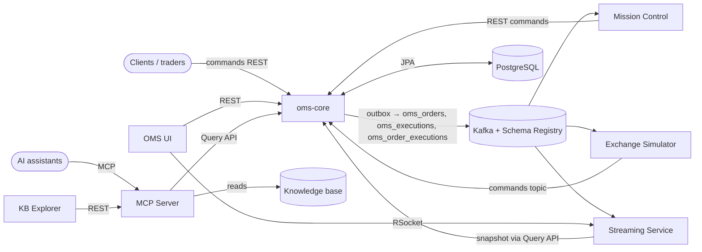

# System Context

| Component | Role |
|---|---|
| [oms-core](oms-core.md) | Commands, state, events, queries (port 8090) |
| [Streaming Service](streaming-service.md) | Real-time feed for the UI (8092 HTTP, 7000 RSocket) |
| [Exchange Simulator](exchange-simulator.md) | Simulated venue (8094) |
| [OMS UI](oms-ui.md) | Admin tool and trade blotter (8080) |
| [MCP Server](../../tools/knowledge-server.md) | Knowledge and order tools for AI assistants (8091) |
| [KB Explorer](../../tools/kb-explorer.md) | Web UI for the knowledge base (local dev server) |
| [oms-contracts](oms-contracts.md) | Shared OpenAPI and Avro contracts |
| [Developer Cockpit](../../tools/developer-cockpit.md) | Desktop tool for the spec workflow and the knowledge base |
| [Mission Control](../../tools/mission-control.md) | Local load-test tool: creates orders over REST, follows them on Kafka |
| Market adapter | Planned: connectivity to real venues, replacing the simulator ([Market Adapter](market-adapter.md)) |

Infrastructure in the root `docker-compose.yml` ([Local Docker Stack](../../infrastructure/local-docker-stack.md)):
PostgreSQL with pgAdmin, Kafka with Schema Registry and Control Center, the Grafana LGTM observability stack — Grafana (3000, provisioned with
Mimir/Loki/Tempo datasources), Mimir (9009, metrics), Loki (3100, logs), Tempo 3 (3200, traces)
and Grafana Alloy as the single telemetry agent (SPEC-0032) — plus the Grafana MCP server (8096). See
[Observability](../../infrastructure/observability.md).

The four Spring services push traces, metrics and logs over OTLP/HTTP to Alloy, labelled by
`service_name` (SPEC-0033):
- the switch is `OTLP_EXPORT_ENABLED`;
- `OTLP_ENDPOINT` is `http://alloy:4318` in compose and `http://localhost:4318` for host-native
  runs.

Alloy ships only the infrastructure containers' stdout to Loki. See
[NFR-007](../../capabilities/non-functional-requirements/NFR-007-observability.md).

Decisions: [Event Sourcing](../decisions/ADR-002-event-sourcing.md), [Transactional Outbox](../decisions/ADR-005-transactional-outbox.md),
[Shared-table CQRS](../decisions/ADR-003-shared-table-cqrs.md), [Contracts Module](../decisions/ADR-001-contracts-module.md),
[Task Pipeline and State Machine](../decisions/ADR-004-task-pipeline-and-state-machine.md).

Methodology: [Software Architecture Methodology](../../delivery/software-architecture-methodology.md),
[Architecture Convergence Assessment](../assessments/architecture-convergence-assessment.md).
Team: [Manifesto](../../delivery/manifesto.md), [Skill Profiles](../../delivery/skill-profiles.md).
