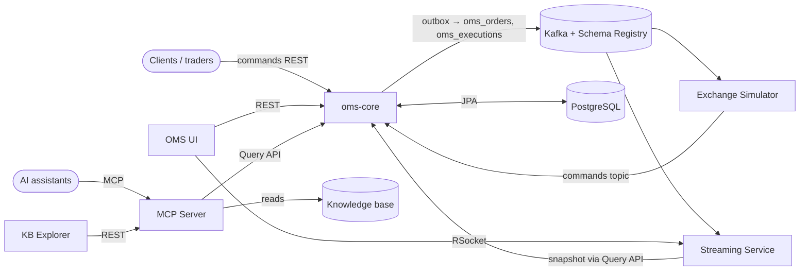

# System Context

| Component | Role |
|---|---|
| [oms-core](oms-core.md) | Commands, state, events, queries (port 8090) |
| [Streaming Service](streaming-service.md) | Real-time feed for the UI (8092 HTTP, 7000 RSocket) |
| [Exchange Simulator](exchange-simulator.md) | Simulated venue (8094) |
| [OMS UI](oms-ui.md) | Admin tool and trade blotter (8080) |
| [MCP Server](mcp-server.md) | Knowledge and order tools for AI assistants (8091) |
| [KB Explorer](kb-explorer.md) | Web UI for the knowledge base (local dev server) |
| [oms-contracts](oms-contracts.md) | Shared OpenAPI and Avro contracts |
| [Developer Cockpit](developer-cockpit.md) | Desktop tool for the spec workflow and the knowledge base |

Infrastructure in the root `docker-compose.yml`: PostgreSQL, Kafka with Schema Registry and
Control Center, Prometheus, Grafana, Jaeger, Loki/Promtail, Qdrant (vector store for the MCP index).

Decisions: [Event Sourcing](event-sourcing.md), [Transactional Outbox](transactional-outbox.md),
[Shared-table CQRS](shared-table-cqrs.md), [Contracts Module](contracts-module.md),
[Task Pipeline and State Machine](task-pipeline-and-state-machine.md).

Methodology: [Software Architecture Methodology](../oms-methodolgy/software-architecture-methodology.md),
[Architecture Convergence Assessment](../oms-methodolgy/architecture-convergence-assessment.md).
Team: [Manifesto](../oms-methodolgy/manifesto.md), [Skill Profiles](../oms-methodolgy/skill-profiles.md),
[Java Backend Developer profile](../oms-methodolgy/agent.md).
