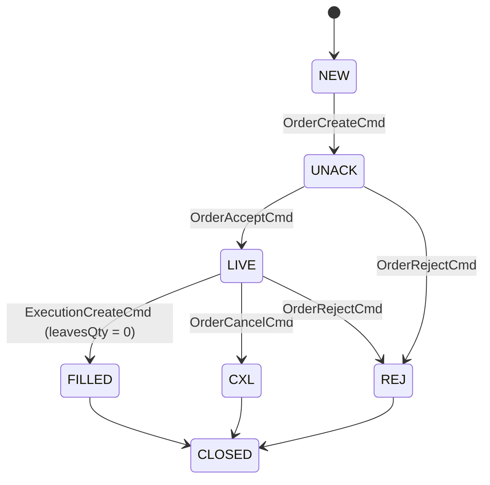

# Order State

An order has two state dimensions: `state` (where the order is in its life) and `cancelState`
(where a cancel request stands). Both are Avro enums in `oms-contracts`.

## States

| State | Meaning |
|---|---|
| NEW | Initial state before the OMS has taken responsibility |
| UNACK | Accepted by the OMS, not yet acknowledged by the market |
| LIVE | Acknowledged by the market and working |
| FILLED | Fully executed (`leavesQty` = 0) |
| CXL | Open quantity cancelled |
| REJ | Refused by the market |
| CLOSED | Terminal: the order is finished |
| EXP | Expired (terminal in the standard configuration; no path leads to it yet) |

## Cancel states

| Cancel state | Meaning |
|---|---|
| PCXL | A cancel request is pending at the market |
| CXL | The market confirmed the cancel |
| REJ | The market refused the cancel request; the order stays LIVE |
| PMOD | Pending modification; reserved for replace, which is not built |

## Transitions as built

The standard configuration (`OrderStateMachineConfig.standard()`, used by every processor):

- A partial fill keeps the order LIVE (no transition is asked of the state machine).
- Lifecycle actions (`LifecycleAction`): **REJECT** → REJ and closes the open quantity, stores the
  reason; **CANCEL** → CXL with cancelState CXL and closes the open quantity; **CANCEL_REQUEST**
  sets cancelState PCXL on a LIVE order with open quantity and no pending cancel, state unchanged;
  **CANCEL_REJECT** sets cancelState REJ when a cancel is pending, state unchanged.
- Nothing moves an order to CLOSED or EXP yet; both are defined but unused.
- `simplified()` and `extended()` configurations exist in code but are not used.

## Differences from the Order Lifecycle specification

[Order Lifecycle Management](../oms-concepts/order-lifecycle.md) is marked stable but describes
transitions the code does not have:

| Specification | As built |
|---|---|
| §4.2 NEW → REJ when validation fails | Invalid orders are not stored; the command fails (400) |
| §4.3 NEW → CXL, cancel before send | No such transition; cancel requests need a LIVE order |
| §4.6 UNACK → FILLED, immediate fill | No such transition; fills need a LIVE order |
| §9.3 duplicate acks ignored | Refused as an invalid transition (no change, but a failure response) |
| §9.4 fill without acknowledgment is processed | Refused until the order is LIVE |
| FILLED / CXL / REJ → CLOSED, EXP | Defined in the state machine, but nothing triggers them |

## Related

- [Order Lifecycle Management Specification](../oms-concepts/order-lifecycle.md) (full specification)
- [State Machine Framework](../oms-framework/state-machine-framework_spec.md)
- [Order](order.md), [Glossary](glossary.md)
