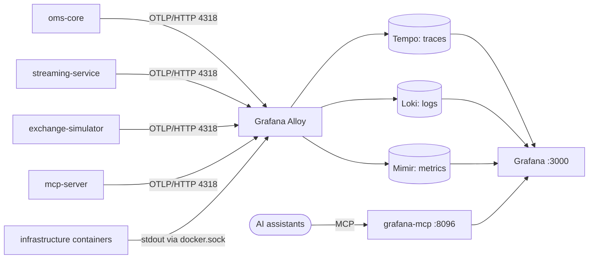

# Observability

The four Java services **push** all three signals over OTLP/HTTP to Alloy when
`OTLP_EXPORT_ENABLED=true` (compose sets it). Alloy is the only agent: it forwards to Tempo, Loki and
Mimir and also ships the stdout of the infrastructure containers to Loki (the services' own logs
arrive over OTLP, not stdout). Nothing scrapes `/actuator/prometheus` any more. Every series, stream
and trace is labelled `service_name` (`oms-core`, `oms-exchange-simulator`, …); Mimir series also
carry `job="oms/<service>"`. How a service produces its telemetry:
[Logging and Tracing](../architecture/patterns/logging-and-tracing.md).

## Logs

Loki (3100). Each line carries the trace and span ids and the MDC (`commandId`, `correlationId`),
so Grafana jumps from a log line to its trace. Query by `service_name`.

## Traces

Tempo (3200, API only; OTLP arrives from Alloy inside the network). Sampling is 1.0 in compose and
0.1 by default elsewhere (`TRACING_SAMPLING_PROBABILITY`). HTTP and Kafka hops continue a trace; the
transactional outbox starts a new one, so a business flow is followed by `correlationId`.

## Metrics

Mimir (9009, Prometheus API under `/prometheus`). oms-core's order-flow metrics include
`oms_order_events{event}`, `oms_orders_by_state{state}`, `oms_executions_quantity_*{side}`, the SLA
histograms `oms_order_time_to_ack`, `oms_order_oms_processing_time`, `oms_order_market_round_trip`,
and outbox pending, stuck and oldest-age gauges ([Order SLA Monitoring](../capabilities/order-sla-monitoring.md)).

## Dashboards

Provisioned read-only from `oms-core/grafana/dashboards/*.json` into the OMS folder:
- **OMS Overview** (`oms-overview`): order events per second, orders by state, fills and filled
  quantity by side, commands consumed, SLA latency p99, outbox health, end of day, warnings and
  errors.
- **OMS Services** (`oms-services`): per service, HTTP requests, errors and p95 latency, JVM
  memory, CPU, threads and Kafka records consumed.

A dashboard drafted through the Grafana MCP server is kept by exporting its JSON into that folder.

## Checking it

`powershell -File oms-core/scripts/lgtm-smoke-test.ps1` sends traffic and checks that traces, logs and
metrics arrive (exit 0 when every check passes). See also
[NFR-007 Observability](../capabilities/non-functional-requirements/NFR-007-observability.md).
