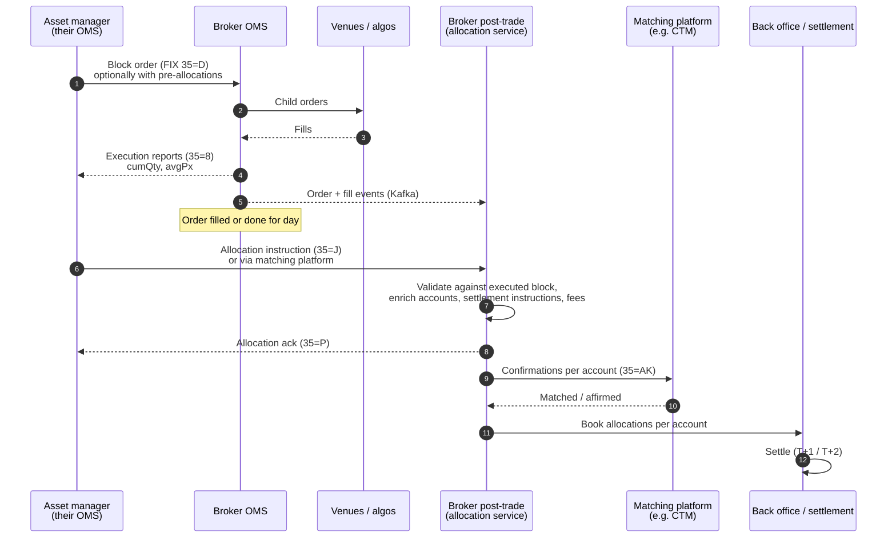
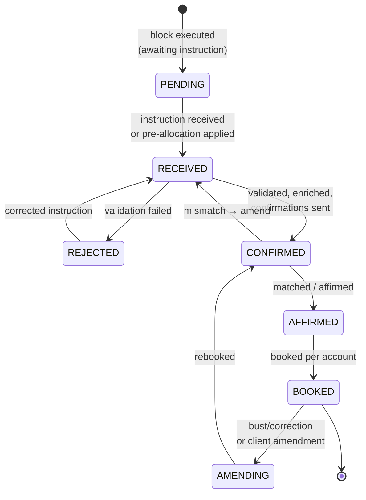

# Block Orders, Allocation and Average Pricing — Concept Paper

**Version:** 0.1
**Last Updated:** 2026-10-18
**Author:** OMS Team
**Status:** Draft for discussion
**Audience:** Architects, lead engineers, and stakeholders from the execution desk, middle office,
operations and compliance

---

## Table of Contents

1. [Summary](#1-summary)
2. [Purpose and Scope](#2-purpose-and-scope)
3. [Two Meanings of "Allocation"](#3-two-meanings-of-allocation)
4. [How Institutional Block Orders Are Processed](#4-how-institutional-block-orders-are-processed)
5. [Two Kinds of Block, Two Kinds of Responsibility](#5-two-kinds-of-block-two-kinds-of-responsibility)
6. [Average Price](#6-average-price)
7. [Fair Allocation Practices](#7-fair-allocation-practices)
8. [Scope: OMS vs Post-Trade](#8-scope-oms-vs-post-trade)
9. [Implications for the OMS](#9-implications-for-the-oms)
10. [The Post-Trade Allocation Service](#10-the-post-trade-allocation-service)
11. [Monitoring and Analytics](#11-monitoring-and-analytics)
12. [Risks and Mitigations](#12-risks-and-mitigations)
13. [Decisions Needed and Next Steps](#13-decisions-needed-and-next-steps)
14. [Appendix A: Facts to Verify](#appendix-a-facts-to-verify)
15. [Appendix B: Glossary](#appendix-b-glossary)

---

## 1. Summary

Institutional clients such as asset managers rarely trade for one account. They decide one trade
for many funds or portfolios, send it to the broker as a single **block order**, and tell the
broker afterwards (sometimes before) how to split the executed quantity across their accounts.
The broker works the block in the market, often across many fills, venues and days. It then
**allocates** the result to the client's accounts at a **single average price**. Each allocation
is confirmed, matched with the client, booked and settled.

This paper concludes:

1. **"Allocation" means two different things, and they belong in different places.**
   - *Fill distribution* (executions → orders) is part of the order lifecycle and stays in the
     **OMS**.
   - *Account allocation* (an executed order → client accounts, with booking, fees and
     settlement) is a **post-trade** workflow and belongs in a dedicated **allocation service**.

   In one sentence: the OMS allocates executions to orders, and post-trade allocates orders to
   accounts.
2. **Average price has a single owner.** The OMS computes the executional average price per order
   and per trading day, updated with each fill. Post-trade uses this price and does not
   recalculate it. Post-trade owns price precision for confirmations, any rounding residual, and
   net money.
3. **Fair allocation is a policy, not a calculation.** Who decides the split, when it is decided,
   and how rounding and partial fills are handled must be explicit, the same every time, and
   auditable. One rule in the existing [Order Grouping](order-grouping.md) spec (the rounding
   remainder always goes to the last member) is not neutral, and the paper recommends changing
   it (§7.4).
4. **The current OMS architecture supports this split.** The post-trade allocation service
   consumes OMS events (with the order included on each fill, as proposed in
   [Post-Trade Analytics](post-trade-analytics.md)), holds its own transactional state, and never
   changes order state directly.
5. **The OMS contracts need a few additions:** trade date, day average price, a "done for day"
   signal, and pre-allocation instructions carried as data. Details are in §9.

---

## 2. Purpose and Scope

### 2.1 Purpose

- Describe how brokers process block orders from institutional clients, from order entry to
  settlement.
- Define fair allocation practices and average price rules that we must support.
- Draw a clear line between what the OMS does and what post-trade does.
- List the changes needed in the OMS and in the existing specs.

### 2.2 In Scope

- Block orders from institutional clients (asset managers, investment managers)
- Broker-side aggregation of several client orders (the [Order Grouping](order-grouping.md) case)
- Pre-trade and post-trade allocation instructions
- Average price calculation, precision, rounding and multi-day orders
- Fair allocation methods, partial fills, rounding and audit
- Confirmation, affirmation and booking, only as far as they affect the boundary with the OMS

### 2.3 Out of Scope

- Settlement processing and custody
- Calculating commission and fee schedules (only where they are calculated)
- Give-ups and step-outs in detail (mentioned only as allocation variants)
- Choosing products for matching platforms or back-office systems

### 2.4 Related Documents

- [Post-Trade Analytics Platform](post-trade-analytics.md): the integration contract, the
  `order-view` and `block-view` projections, and the target architecture
- [Order Grouping](order-grouping.md): broker-side aggregation of client orders
- [Order Quantity Calculations](order-quantity-calculations.md): `placedQty`, `allocQty`, and
  `avgPx` rollup across the order tree
- [Execution Reporting](execution-reporting.md): fills, busts and corrections

---

## 3. Two Meanings of "Allocation"

The word is used for two different operations. The existing specs use it for the first; the
industry mostly uses it for the second. This paper uses distinct terms:

| | **Fill distribution** | **Account allocation** |
|---|---|---|
| Question answered | Which **order** does this execution belong to? | Which **account** receives how much of an executed order, at what price and with what fees? |
| From → to | Market order fills → client order (or grouped order → member orders) | Executed client order (block) → client sub-accounts or funds |
| Timing | With each fill, in real time | After execution: intraday, end of day, or with the client's instruction |
| Changes order state? | Yes: `cumQty`, `leavesQty`, `avgPx` of the receiving order | No. The order is already executed |
| Client sees it as | Execution reports on their order (FIX `35=8`) | Allocation, confirmations and booked trades (FIX `35=J` / `35=AK`, matching platform) |
| Creates bookings / money movement | No | Yes |
| Existing spec terms | "Allocation" in [Order Quantity Calculations](order-quantity-calculations.md) §5 (`allocQty`, STP vs manual); "allocation to members" in [Order Grouping](order-grouping.md) §5 | Not covered yet |
| Owner | **OMS** | **Post-trade allocation service** |

**Recommendation:** use the term *fill distribution* (or keep `allocQty` but describe it as
execution allocation to orders) in the OMS specs, and reserve *allocation* for account allocation.
That alone removes much of the confusion about what is in scope where.

---

## 4. How Institutional Block Orders Are Processed

### 4.1 End-to-End Flow



### 4.2 Steps

1. **Order entry.** The asset manager sends one order for the total quantity. It may contain
   **pre-allocations**: the accounts and quantities or percentages, known before the trade (FIX
   `NoAllocs` / `AllocAccount` / `AllocQty` on the order). Otherwise allocations arrive
   **post-trade**.
2. **Execution.** The broker works the block: care desk, algorithms, several venues, possibly
   several days for GTC or GTD orders. The client gets execution reports with cumulative quantity
   and average price.
3. **Allocation instruction.** The client sends, or confirms, the split across accounts. It
   usually arrives the same day, after the order is filled or done for the day.
4. **Validation and enrichment.** The broker checks the instruction against what was executed:
   - the allocated quantities add up to the executed quantity,
   - the accounts are known,
   - lot sizes and minimum quantities are respected.

   It then adds standing settlement instructions (SSIs), commissions, fees and taxes, and
   calculates net money per account.
5. **Confirmation and affirmation.** One confirmation per account. With institutional clients this
   is typically matched centrally (e.g. on DTCC CTM), so both sides agree before settlement.
6. **Booking and settlement.** Each allocation becomes a booked trade for one account and settles
   with the custodian.

### 4.3 Time Pressure

Settlement cycles are getting shorter. The US moved to T+1 in 2024, and the EU, the UK and
Switzerland plan to follow (Appendix A, A6). Under T+1, allocation, confirmation and affirmation
effectively have to finish **on trade date**. As a result:

- the allocation service must be event-driven, not end-of-day batch;
- the OMS must say promptly and reliably when an order is complete for the day (§9.1).

---

## 5. Two Kinds of Block, Two Kinds of Responsibility

| | **Client block** | **Broker aggregation** (grouped order) |
|---|---|---|
| Origin | One institutional client sends one order for many of **their own** accounts | The broker combines orders from **several** clients (e.g. external asset managers rebalancing many portfolios) into one market order |
| Who decides the split | **The client.** The broker applies the client's instruction | **The broker**, under its own published allocation policy |
| Fair allocation duty | Mainly the client's (e.g. investment adviser rules on fair treatment of their accounts). The broker must apply instructions faithfully and must not influence them | **The broker's** (e.g. MiFID II Delegated Regulation 2017/565 Art. 68/69 for EU business; FinSA order handling rules in Switzerland). The broker may aggregate only if it is unlikely to disadvantage any client, must have an allocation policy, and must apply it consistently |
| Price each account gets | The block's average price | The aggregated order's average price |
| What the OMS does | Manages one client order and its child market orders; distributes fills from child orders to the client order | Manages several client orders plus the grouped order; distributes fills from the grouped order to member client orders |
| What post-trade does | Allocates the client order to the client's accounts | Allocates each member client order to that client's accounts (if they have several) |
| Existing spec | [Order Quantity Calculations](order-quantity-calculations.md) | [Order Grouping](order-grouping.md) |

The two cases can be **combined**. For example, an external asset manager sends individual orders
for several clients, the desk groups them (broker aggregation), and each member order is then
allocated to sub-accounts (account allocation). The model in §8 handles this: fill distribution
happens in the OMS at any depth of the order tree, and account allocation happens in post-trade
at the leaves.

---

## 6. Average Price

### 6.1 Calculation

```
avgPx = Σ(lastQty × lastPx) / Σ(lastQty)
```

The OMS updates it with each fill, without re-reading earlier fills:

```
avgPx_new = (cumQty_prev × avgPx_prev + lastQty × lastPx) / (cumQty_prev + lastQty)
```

This is already implemented (see `service/execution/README.md`). The rollup across the order tree
is specified in [Order Quantity Calculations](order-quantity-calculations.md) §4.1.4 and §15.2.
Precision rule: carry the running notional `Σ(lastQty × lastPx)` exactly (as `BigDecimal`) and
derive `avgPx` from it, rather than rounding `avgPx` at each step, so that rounding errors do not
build up.

### 6.2 Day Average Price and Multi-Day Orders

A GTD or GTC block can execute over several trading days. **Fills from different trade dates
settle on different dates**, so they cannot be combined into one allocation:

- Allocation is done **per order and per trade date**, at that day's average price (`dayAvgPx`
  over `dayCumQty`).
- The order's overall `avgPx` (across all days) is still reported to the client on execution
  reports, but it is not what gets booked.
- `Execution` already has `dayCumQty` and `dayAvgPx` in the entity. They are missing from the
  published contracts (§9).

| Day | Fills | dayCumQty | dayAvgPx | Allocated |
|---|---|---|---|---|
| T | 6,000 @ 50.10, 4,000 @ 50.30 | 10,000 | 50.18 | Separately for trade date T |
| T+1 | 5,000 @ 50.60 | 5,000 | 50.60 | Separately for trade date T+1 |
| Whole order | | 15,000 | 50.32 | Not used for booking |

### 6.3 Price Precision and Rounding Residual

The average price usually has more decimals than the instrument's tick size. Confirmations carry a
price rounded to a fixed precision, so the sum of allocated notionals can differ from the notional
actually traded in the market.

**Worked example.** The block is filled in three executions:

| Fill | Qty | Px | Notional |
|---|---|---|---|
| 1 | 3,000 | 100.10 | 300,300.00 |
| 2 | 4,000 | 100.25 | 401,000.00 |
| 3 | 2,000 | 100.05 | 200,100.00 |
| **Total** | **9,000** | **100.155555…** | **901,400.00** |

Allocated 50 / 30 / 20 at the average price rounded to 4 decimals (100.1556):

| Account | Qty | Notional at 100.1556 |
|---|---|---|
| Fund A | 4,500 | 450,700.20 |
| Fund B | 2,700 | 270,420.12 |
| Fund C | 1,800 | 180,280.08 |
| **Total** | **9,000** | **901,400.40** |

The clients pay **0.40 more** than the broker paid in the market. If the price is truncated to
100.1555 instead, the clients pay 0.50 less and the broker absorbs the difference.

**Rules to define (post-trade policy, set per client or market):**

- the precision of the confirmation price (e.g. 4–6 decimals, or as agreed with the client);
- the rounding mode (round half-up or truncate);
- **who absorbs the residual**: usually the broker (an error or residual account), or a nominated
  account;
- whether the client wants the residual spread across accounts instead.

The OMS is not affected by these rules. It publishes the exact notional and quantity, and
post-trade applies the policy.

### 6.4 Gross vs Net

The OMS average price is **gross** (execution price only). Commissions, fees, taxes and the
resulting **net price and net money** are calculated per account in post-trade, because they
depend on the account, not on the order.

### 6.5 Busts and Corrections After Allocation

If a fill is busted or corrected after allocation, the order's quantity and average price change
in the OMS. This is the existing bust and correction flow ([Execution Reporting](execution-reporting.md)).
Post-trade must then **amend** (cancel and rebook) the affected allocations and confirmations.
This only works if the OMS publishes corrections as new events that refer to the original
execution (see [Post-Trade Analytics](post-trade-analytics.md) §6, F7).

### 6.6 Average Price Across Several Orders

Some clients send several orders for the same instrument and side, and want all of them allocated
at one average price (FIX supports this, e.g. with `AvgPxIndicator`). This is an account
allocation feature. Post-trade groups the orders and calculates the combined average from the
OMS events of each order. The OMS does not need to know about the grouping.

---

## 7. Fair Allocation Practices

### 7.1 Principles

1. **Decide before you know the outcome.** The allocation method, and ideally the target
   quantities per account, are fixed **before** execution. Deciding or changing allocations after
   seeing prices allows *cherry-picking* (giving good fills to favoured accounts), which is the
   main thing regulators look for.
2. **One price for everyone in the block.** All accounts in a block (per trade date) get the same
   average price. No account gets "the good fills".
3. **Apply a documented method the same way every time.** The method can vary by client or
   instrument, but it must be written down and applied consistently.
4. **Partial fills are allocated by the same rule as full fills.** Usually pro rata to the
   intended quantities.
5. **Neutral rounding.** The rounding remainder must not systematically favour or disadvantage
   the same account (§7.4).
6. **Clients before the house.** When client orders are aggregated with orders for the firm's own
   account, clients take priority on partial fills.
7. **Audit trail.** For each allocation, record the method, the inputs (intended quantities,
   executed quantity, price), the result, and every amendment, with who made it and why.

### 7.2 Allocation Methods

| Method | How it works | Typical use |
|---|---|---|
| **Pro rata to intended quantity** | `alloc_i = executedQty × intended_i / Σ intended` | Default for both client blocks and broker aggregation |
| **Fixed percentages / model weights** | Fixed weights per account (e.g. from a model portfolio) | Asset manager rebalancing |
| **Pro rata with minimum or lot size** | Pro rata, then rounded to the lot size, minimum or increment; accounts below the minimum get nothing and their share is redistributed | Bonds (minimum denomination), markets with board lots |
| **Explicit client instruction** | The client sends exact quantities per account after execution | Client blocks without pre-allocation |
| **Random or rotating** | For indivisible remainders or tiny fills: random or rotating order of accounts | Remainder handling (§7.4) |

### 7.3 Partial Fill Example

Intended: Fund A 5,000, Fund B 3,000, Fund C 2,000 (10,000 in total). Executed: **7,777**.

| Account | Exact pro rata | Rounded down | Fraction |
|---|---|---|---|
| A (50%) | 3,888.5 | 3,888 | 0.5 |
| B (30%) | 2,333.1 | 2,333 | 0.1 |
| C (20%) | 1,555.4 | 1,555 | 0.4 |
| **Total** | **7,777** | **7,776** | **remainder 1** |

Where the remaining share goes is a **policy decision**:

| Remainder rule | Goes to | Neutral? |
|---|---|---|
| Always the last account | C | ❌ The same account always gets the remainder |
| Always the largest account | A | ❌ Systematically favours large accounts |
| Largest fraction (Hamilton / largest remainder method) | A (0.5) | ✅ Comes from the numbers themselves, not from who the account is |
| Rotating or random | Varies | ✅ Neutral over time; needs a recorded seed or rotation state for audit |

### 7.4 Recommended Change to the Order Grouping Spec

[Order Grouping](order-grouping.md) §9.1 says: *"Round down to whole shares for all but last
member; allocate remainder to last member."* "Last" depends on sort order, so the same member can
always receive the remainder. The same section also allocates member quantities **with each fill**
(§5.2). As a result, rounding happens many times per order, and members can end up with slightly
different average prices.

Recommended:

1. Use the **largest remainder method** with a deterministic, recorded tie-break (e.g. rotation
   per instrument per day), instead of "last member".
2. With each fill, distribute **quantity** to members using that method. Report **price** to all
   members as the grouped order's average price. Members' own `avgPx` must equal the group
   average for the trade date.
3. Make the method a **configurable policy** (e.g. `pro-rata-largest-remainder`,
   `pro-rata-lot-size`), recorded on the grouped order, so the audit trail shows which policy
   applied.
4. Move the fair allocation audit query (§11.2 of that spec) out of the OMS database and into the
   analytics platform (§11 below).

### 7.5 Practices to Prevent

- Allocating, or changing allocations, after prices are known without a documented reason
  (cherry-picking).
- Reallocating between accounts after the price has moved.
- Accounts in the same block, on the same trade date, receiving different prices.
- Allocating partial fills to the firm's own account ahead of clients.
- Handling remainders in a way that always benefits the same account.
- Making allocation changes outside the system (spreadsheets, email) that leave no audit trail.

---

## 8. Scope: OMS vs Post-Trade

### 8.1 Boundary

```mermaid
flowchart LR
    subgraph OMS["OMS: order and execution lifecycle"]
        CO[Client order / block] --> MO[Market child orders]
        MO -->|fills| MO
        MO -->|fill distribution| CO
        GO[Grouped order] -->|fill distribution<br/>per policy| MEM[Member client orders]
        CO --> PUB[Outbox → Kafka<br/>order on the fill,<br/>dayAvgPx, trade date]
        MEM --> PUB
    end

    subgraph PT["Post-trade: account allocation"]
        AI[Allocation instructions<br/>35=J / matching platform] --> AL[Allocation service]
        PUB -->|block-view| AL
        AL --> CF[Confirmations 35=AK<br/>matching / affirmation]
        AL --> BK[Booking per account<br/>fees · net money · SSIs]
        BK --> ST[Settlement]
    end

    AL -. commands only,<br/>e.g. pre-allocation update .-> CO
```

**Rule:** the OMS distributes executions to orders, and post-trade allocates executed orders to
accounts. Information flows from the OMS to post-trade as events. Post-trade changes OMS state
only through the OMS command API, and rarely needs to.

### 8.2 Responsibility Matrix

| Responsibility | OMS | Post-trade | Notes |
|---|---|---|---|
| Accept the block order, validate, risk checks | ✅ | | |
| Capture pre-allocation instructions on the order | ✅ (store and pass on) | ✅ (interpret and apply) | The OMS stores them as data and checks basic consistency (Σ ≤ orderQty). It does not allocate |
| Route child orders, process fills | ✅ | | |
| Fill distribution: child → client order | ✅ | | `allocQty`, STP and manual modes |
| Fill distribution: grouped → member orders | ✅ | | Policy-driven (§7.4) |
| `cumQty`, `leavesQty`, `avgPx`, `dayCumQty`, `dayAvgPx` | ✅ | | Single source of truth; post-trade never recalculates them |
| Execution reports to the client | ✅ | | |
| Signal "done for day" or order complete | ✅ | | Trigger for final allocation |
| Bust and correction of fills | ✅ | reacts | Post-trade amends affected allocations |
| Receive post-trade allocation instructions (`35=J`, matching platform) | | ✅ | |
| Validate allocations against executed quantity per trade date | | ✅ | From `block-view` events |
| Apply allocation method, lot sizes, remainder policy (account level) | | ✅ | |
| Average price across several orders | | ✅ | §6.6 |
| Price precision, rounding residual | | ✅ | §6.3 |
| Commissions, fees, taxes, net money | | ✅ | |
| Settlement instructions (SSIs) | | ✅ | |
| Confirmations, matching, affirmation | | ✅ | |
| Booking to back office, give-ups / step-outs | | ✅ | |
| Allocation amendments and cancellations | | ✅ | |
| Allocation audit trail | fill distribution part | account allocation part | Both sent to the analytics platform |
| Fair allocation monitoring | | | **Analytics platform** (§11) |

### 8.3 Why Account Allocation Is Not in the OMS

- **It changes nothing about the order.** Once executed, the order's quantities and price are
  final for that trade date. Account allocation only divides up the result.
- **It needs data the OMS does not own:** account master data, SSIs, fee schedules, tax rules,
  client agreements.
- **It has its own lifecycle:** instruction → validated → confirmed → affirmed → booked →
  settled, plus amendments. That lifecycle runs on its own timeline and can continue for days.
- **It integrates with other systems:** matching platforms, back office, custodians. Adding these
  to the OMS would bring their availability and change rate into the trading path.
- **Different consistency boundary.** An allocation is a transaction over one block and many
  accounts. An OMS command is a transaction over one order. Combining them would widen the OMS's
  locking and transaction scope.

### 8.4 Why Fill Distribution Stays in the OMS

- **It changes order state** (`cumQty`, `leavesQty`, `avgPx`, the state machine) and must be
  consistent with it in the same transaction.
- **The client needs it in real time,** through execution reports on their own order.
- **Fair handling of client orders starts at execution.** For broker aggregation, the
  distribution policy applies in the OMS when each fill arrives.

---

## 9. Implications for the OMS

### 9.1 Contract Changes (`oms-contracts`)

These extend the changes C1–C7 from [Post-Trade Analytics](post-trade-analytics.md) §6.3.

| # | Change | Why | Current state |
|---|---|---|---|
| B1 | **Trade date** on executions (and order messages) | Allocation per trade date (§6.2); T+1 timelines | Not in `Execution.avsc` or `OrderMessage.avsc` |
| B2 | **`dayCumQty` and `dayAvgPx`** in published messages | Allocation at day average price | On the `Execution` entity; not in contracts; ignored in `OrderMapper` |
| B3 | **Exact notional** (`Σ lastQty × lastPx`) per order and per day | Lets post-trade apply rounding policy without recalculating from fills | Not published |
| B4 | **"Done for day" / complete signal** per order and trade date | Trigger for final allocation; T+1 | Check how state `CLOSED` and end-of-day processing are published (Appendix A) |
| B5 | **Pre-allocation instructions** on the order (accounts, quantities or percentages, method) as pass-through data | Supports pre-allocated blocks; evidence that allocation was decided before execution (§7.1) | Not in the command API or the Avro schemas |
| B6 | **Allocation policy and tie-break state** on grouped orders | Audit of fill distribution (§7.4) | Not specified |
| B7 | Field-level sensitivity tags for account identifiers in pre-allocations | Data protection ([Post-Trade Analytics](post-trade-analytics.md) §11) | Not tagged |

### 9.2 Behaviour Changes

| # | Change | Spec affected |
|---|---|---|
| B8 | Replace the "remainder to last member" rule with the largest remainder method plus a recorded tie-break | [Order Grouping](order-grouping.md) §9.1 |
| B9 | Members of a grouped order are reported at the group's average price (per trade date) | [Order Grouping](order-grouping.md) §5, §6.2 |
| B10 | Rename "allocation" in OMS specs to "fill distribution", or explain the difference explicitly | [Order Quantity Calculations](order-quantity-calculations.md) §5, [Order Grouping](order-grouping.md) §5 |
| B11 | Move the fair allocation audit query to the analytics platform | [Order Grouping](order-grouping.md) §11.2 |

### 9.3 What Does Not Change

- The order state machine. An order does not wait for account allocation before it reaches a
  terminal state.
- The way the OMS persists data and the event log.
- The incremental average price calculation.
- The transactional outbox. Post-trade consumes the same topics as every other consumer.

---

## 10. The Post-Trade Allocation Service

### 10.1 Responsibilities

- Consume `block-view` (order + fills, per trade date) from the projection layer.
- Receive allocation instructions from clients (FIX `35=J`, matching platform, or a UI for
  manual entry), and load pre-allocations from order events.
- Validate, enrich, apply the allocation method and remainder policy, and calculate fees and net
  money.
- Send confirmations, track matching and affirmation, and book to the back office.
- Handle amendments caused by client changes or by OMS busts and corrections.
- Publish allocation events for reporting, analytics and the trade blotter.

### 10.2 Allocation Lifecycle



### 10.3 Design Notes

- **Its own database (Postgres).** The allocation service is transactional. One allocation is
  booked exactly once, and amendments are versioned. It is not a cache and not part of the
  analytics store.
- **Idempotent consumption** using the order `version` carried in OMS events.
- **The unit of allocation is (order, trade date).** For multi-order average pricing it is
  (allocation group, trade date).
- **Uses the OMS's numbers as given.** Quantity, notional and average price come from OMS events.
  The service reconciles its totals against them, and must not recalculate them from fills.
- **Readiness depends on OMS signals.** A block becomes ready for final allocation when the
  OMS reports it as done for the day or complete (B4). Provisional allocations, such as applied
  pre-allocations, may be built before that.
- **Event-driven, with a batch fallback.** T+1 needs allocations as soon as possible, but an
  end-of-day sweep catches anything that was missed.

---

## 11. Monitoring and Analytics

Fair allocation is something regulators examine, so it needs evidence over time, not just correct
calculation each time. This is an analytics use case. It runs on the analytics platform from
[Post-Trade Analytics](post-trade-analytics.md), never on the OMS or allocation databases.

| Metric | Shows |
|---|---|
| Spread of prices across accounts within a block and trade date | Must be zero (one price per block and day) |
| Allocated share vs intended share, per account over time | Systematic over- or under-allocation on partial fills |
| How often each account receives the rounding remainder | Bias in remainder handling |
| Late allocations and amendments after execution, with the price move between execution and amendment | Possible cherry-picking |
| Partial-fill priority between client and house accounts | Clients before the house |
| Time from execution to allocation, confirmation and affirmation | Readiness for T+1 |
| Rounding residual absorbed per period | Cost of the precision policy |

---

## 12. Risks and Mitigations

| Risk | Impact | Mitigation |
|---|---|---|
| The two meanings of "allocation" lead to account allocation logic being built into the OMS | OMS complexity, coupling to back office | Terminology (§3); responsibility matrix (§8.2) |
| Allocating across trade dates for multi-day orders | Settlement breaks | Trade date and day average price in contracts (B1, B2); unit = (order, trade date) |
| Remainder bias in fill distribution | Regulatory finding | Largest remainder method + recorded tie-break (B8); monitoring (§11) |
| Allocation decided after execution | Cherry-picking allegations | Pre-allocations captured on the order (B5); amendments audited with reasons |
| Post-trade recalculates average price differently from the OMS | Price differences between client reports and confirmations | Single source: OMS notional and quantity (B3); reconciliation |
| Busts after booking not reflected | Wrong bookings | Correction events that refer to the original fill; automatic amendment flow |
| T+1 compresses the timeline | Late affirmations, failed settlements | Event-driven allocation; prompt done-for-day signal (B4) |
| Account identifiers in pre-allocations leak to third parties | Data protection breach | Sensitivity tags (B7); tokenisation in the projection layer |

---

## 13. Decisions Needed and Next Steps

### 13.1 Decisions

| # | Decision | Owner |
|---|---|---|
| D1 | Adopt the boundary "the OMS allocates executions to orders; post-trade allocates orders to accounts" | Architecture |
| D2 | Build the allocation service or use an existing post-trade or middle-office system | Architecture / operations |
| D3 | Default fair allocation policy for broker aggregation (method, remainder rule, tie-break) | Compliance / execution desk |
| D4 | Price precision and rounding residual policy | Middle office / finance |
| D5 | Whether pre-allocations are supported at order entry from the start | Business / product |

### 13.2 Next Steps

1. Update [Order Grouping](order-grouping.md) and [Order Quantity Calculations](order-quantity-calculations.md)
   for B8–B11.
2. Add B1–B3 and B5 to `oms-contracts`. Implement B4 as an explicit event.
3. Specify the allocation service: API, allocation instruction model, state machine, and the FIX
   messages it supports.
4. Build an end-to-end test scenario:
   - a multi-day GTD block with pre-allocations,
   - a partial fill with a rounding remainder,
   - a bust after booking,
   - checked against the expected allocations, confirmations and amendments.

---

## Appendix A: Facts to Verify

| # | Fact | Why it matters |
|---|---|---|
| A1 | How end of day and "done for day" are represented today (state `CLOSED`? an end-of-day job?) and whether an event is published | B4, allocation trigger |
| A2 | Whether `dayCumQty` and `dayAvgPx` on `Execution` are calculated today, and how a trade date is determined (time zone, venue calendar) | B1, B2 |
| A3 | Whether grouped orders (`GROUPED`) are implemented or still only specified | §7.4, B8, B9 |
| A4 | Which allocation channels clients use (FIX `35=J`, CTM, email, portal) | Allocation service scope |
| A5 | Whether there is an existing middle-office or back-office system that already does account allocation | D2 |
| A6 | Settlement cycle timetable for the markets we trade (US T+1 since 2024; planned EU, UK and Swiss move to T+1) | §4.3 |
| A7 | Which regulatory rules on aggregation and allocation apply to our entities (FinSA / FinSO; MiFID II Delegated Regulation 2017/565 Art. 68–69 for EU business) | §5, §7 |
| A8 | Price precision conventions agreed with institutional clients | §6.3 |

---

## Appendix B: Glossary

| Term | Meaning |
|---|---|
| **Block order** | One order for the total quantity of many accounts of the same client |
| **Broker aggregation / grouped order** | One market order combining orders from several clients |
| **Fill distribution** | Assigning executions to orders in the OMS (from a child to a client order, or from a grouped order to member orders) |
| **Account allocation** | Splitting an executed order across client accounts, with booking, fees and settlement (post-trade) |
| **Pre-allocation** | Account split provided with the order, before execution |
| **Post-trade allocation** | Account split provided after execution (FIX `AllocationInstruction`, `35=J`) |
| **Day average price** | Average price of the fills on one trade date (`dayAvgPx`) |
| **Rounding residual** | Difference between the market notional and the sum of allocation notionals at the rounded price |
| **Largest remainder method** | Rounding method that gives the remaining units to the accounts with the largest fractional parts |
| **Cherry-picking** | Assigning favourable fills to selected accounts after prices are known |
| **SSI** | Standing settlement instructions: where and how an account settles |
| **Confirmation / affirmation** | The broker's per-account trade details (`35=AK`) and the client's agreement to them, often through a matching platform |
| **Give-up / step-out** | Allocating executed quantity to another broker for clearing or settlement |
| **Net money** | Gross notional plus or minus commissions, fees and taxes, per account |
