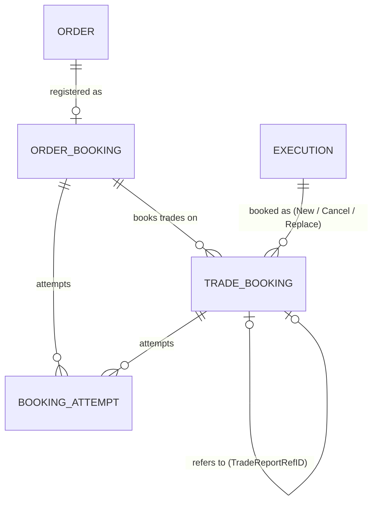
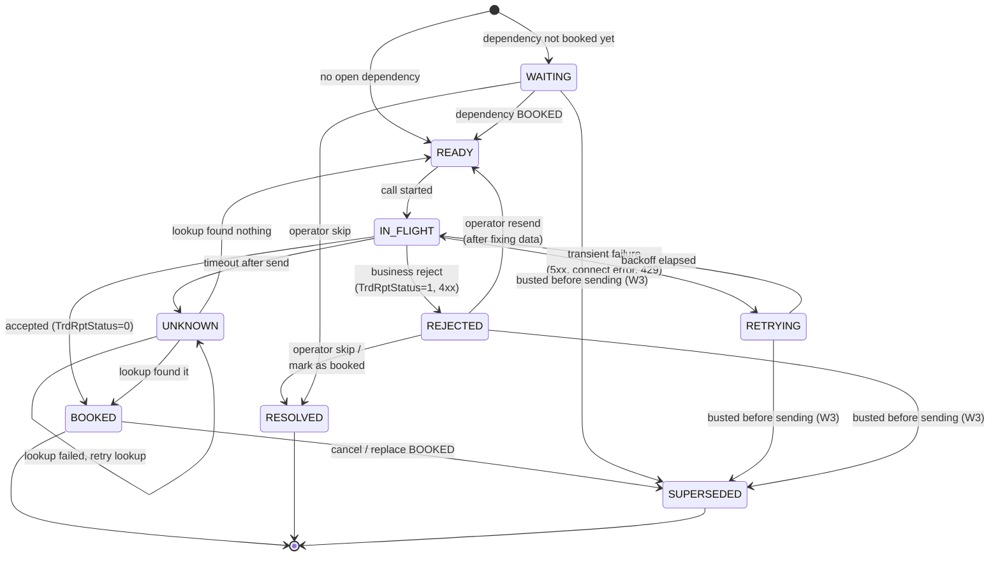
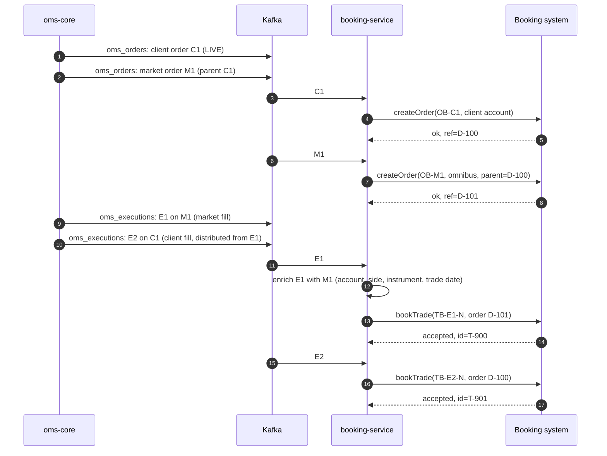
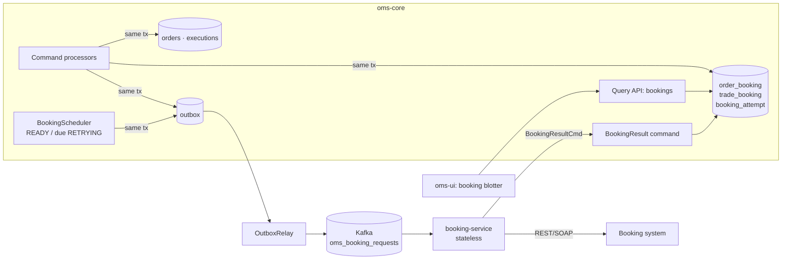
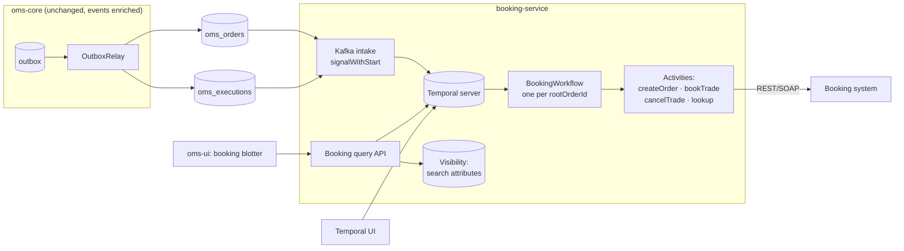

# Booking Integration — Draft Specification

**Version:** 0.1
**Last Updated:** 2026-10-23
**Author:** OMS Team
**Status:** Draft for discussion
**Audience:** Architects and lead engineers in OMS and post-trade, operations

---

## Table of Contents

1. [Summary](#1-summary)
2. [Purpose and Scope](#2-purpose-and-scope)
3. [Context and Problem](#3-context-and-problem)
4. [FIX Semantics](#4-fix-semantics)
5. [Booking Model](#5-booking-model)
6. [Booking Workflow](#6-booking-workflow)
7. [Option A: Booking Entity in the OMS](#7-option-a-booking-entity-in-the-oms)
8. [Option B: Booking Service on Temporal](#8-option-b-booking-service-on-temporal)
9. [Comparison](#9-comparison)
10. [Failure Scenarios](#10-failure-scenarios)
11. [Recommendation](#11-recommendation)
12. [Contract Changes](#12-contract-changes)
13. [Risks and Mitigations](#13-risks-and-mitigations)
14. [Decisions Needed and Next Steps](#14-decisions-needed-and-next-steps)
15. [Appendix A: Facts to Verify](#appendix-a-facts-to-verify)
16. [Appendix B: Glossary](#appendix-b-glossary)

---

## 1. Summary

The downstream booking system books trades for settlement. It offers only a synchronous SOAP/REST
interface and cannot consume OMS events. A **booking adapter** has to turn the OMS event streams
into a series of calls: register client and market orders, then book each execution enriched with
the order's details, and cancel or amend bookings when fills are busted or corrected. Any of these
calls can fail. The downstream system can be unavailable for hours. Some failures leave us unsure
whether the call succeeded.

This paper concludes:

1. **Atomicity with the trade is already solved.** The transactional outbox writes the order and
   execution events in the same transaction as the state change, and `OutboxRelay` delivers them
   at least once. The open problem is different: **recording how far a multi-step, failure-prone
   sequence of downstream calls has progressed**, so it can continue after a crash, an outage or a
   reject. That progress state has to live somewhere. The two options differ in where.
2. **The FIX model that fits is the Trade Capture Report** (`35=AE`), with the downstream answer
   modelled as a Trade Capture Report Ack (`35=AR`). It is not the Allocation Instruction
   (`35=J`), which is account allocation and belongs to the post-trade allocation service
   ([Block Order Allocation](block-order-allocation.md) §8). FIX has no message for registering an
   order in a booking system, so that step is modelled as an order-level booking record that
   carries the `NewOrderSingle` fields needed downstream.
3. **One booking model and one workflow serve both options** (§5, §6). The options differ only in
   where the state lives and what runs the retries:
   - **Option A**: booking records are entities in oms-core, created in the same transaction as
     the order or fill. A thin booking-service makes the calls and reports results back as
     commands.
   - **Option B**: booking-service owns the state as **Temporal workflows**, one per root order,
     fed by the existing Kafka topics. The OMS does not change apart from enriching its events.
4. **Recommendation: Option B**, with the booking state owned by booking-service (§11). It keeps
   post-trade integration out of the OMS's transaction scope and availability, which the
   allocation paper already argues for. It also gives retries, timers, and waiting for an
   operator decision as built-in features rather than code we write and maintain. If the team
   does not want to run a Temporal cluster, the fallback is the same model and workflow in
   booking-service's own Postgres (§11.2), not Option A.
5. **The decisive unknown is the downstream API.** If it neither accepts our reference as an
   idempotency key nor lets us look a booking up by it, no design can avoid duplicate bookings
   after a timeout. This must be checked before either option is built (Appendix A, F1–F2).

---

## 2. Purpose and Scope

### 2.1 Purpose

Describe two ways to deliver OMS orders and executions to a request/response-only booking system
durably: at least once, with no duplicate bookings, with progress visible to users, and with
manual resend. Give enough detail on the model and workflow to choose between them.

### 2.2 In Scope

- Registering client and market orders downstream
- Booking executions, enriched with order details, per leg (client and market)
- Cancelling and amending bookings after a bust or correction
- Retries, outages, ambiguous outcomes, rejects
- Status visibility and operator actions (resend, skip, mark as booked)
- Reconciliation of OMS against downstream

### 2.3 Out of Scope

- **Account allocation** of blocks, confirmations, and affirmation. These belong to the post-trade
  allocation service ([Block Order Allocation](block-order-allocation.md) §10). If the downstream
  system turns out to also be where allocations are booked, this paper and that one need to be
  merged (Appendix A, F7).
- Fees, net money, SSIs. These are calculated downstream or by the allocation service.
- The physical protocol mapping (SOAP envelopes, REST payloads). That waits until the downstream
  API is known.

### 2.4 Related Documents

- [Block Order Allocation](block-order-allocation.md): the OMS/post-trade boundary
- [Order Model, Trading Capacity and Booking Legs](order-model-trading-capacity.md): client and
  market legs, omnibus control
- [Post-Trade Analytics](post-trade-analytics.md): event projections such as `block-view`
- [Execution Reporting](execution-reporting.md), [Streaming Architecture](streaming-architecture.md)

---

## 3. Context and Problem

### 3.1 The Downstream Interface (Assumed)

The downstream API is not specified yet. This paper assumes the following operations. Each one
must be confirmed (Appendix A).

| Operation | Purpose | Depends on |
|---|---|---|
| `createOrder` (client) | Register a client order; returns a downstream order id | — |
| `createOrder` (market) | Register a market order, linked to its client or group order | Parent's downstream id, if the link is required |
| `bookTrade` | Book one execution on one order | Order's downstream id |
| `cancelTrade` | Reverse a booked trade (bust) | Trade's downstream id |
| `amendTrade` | Correct a booked trade, or cancel and rebook | Trade's downstream id |
| `getByReference` | Look up an order or trade by our reference | — |

### 3.2 What the OMS Publishes Today

| Topic | Payload | Key | Notes |
|---|---|---|---|
| `oms_orders` | `OrderMessage`: full order snapshot after each event, with `parentOrderId`, `rootOrderId`, `account`, `side`, `symbol`, `state` | `orderId` | Enough to register the order |
| `oms_executions` | `Execution`: `execId`, `orderId`, `lastQty`, `lastPx`, `cumQty`, `leavesQty`, `avgPx`, `execType`, `lastMkt`, `lastCapacity`, `transactTime` | `orderId` | **No** account, side, instrument, trade date, settlement date, order version or `rootOrderId`, which is why executions have to be enriched |

Both topics are filled from the outbox in commit order, so events for one order arrive in order
**within a topic**. There is **no ordering across the two topics**: the first fill of an order
can reach a consumer before the order event that created it. The adapter must handle this.

Busts and corrections (`ExecutionBustCmd`, `ExecutionWhackCmd`) exist as command schemas, but
there is no processor for them yet, so what they publish is not defined (Appendix A, F5).

### 3.3 What Makes This Hard

| # | Problem | Example |
|---|---|---|
| P1 | **Multi-step with dependencies** | A trade cannot be booked before its order is registered, and a market order may need its client order's downstream id |
| P2 | **Partial failure** | The client order is registered, the market order call fails |
| P3 | **Ambiguous outcome** | `bookTrade` times out. We do not know whether the trade was booked |
| P4 | **Long outages** | The downstream system is down for four hours during the trading day; thousands of calls queue up |
| P5 | **Business rejects** | The downstream system rejects a trade because of missing reference data. Retrying will not help until someone fixes the data |
| P6 | **Corrections after the fact** | A fill is busted after it was booked, or before the original booking succeeded |
| P7 | **Visibility** | Middle office has to see what is booked, what is pending and what is stuck, and act on it |
| P8 | **Event ordering** | No ordering across topics (§3.2); redelivery is possible at any time |

### 3.4 Requirements

| # | Requirement |
|---|---|
| R1 | Every client and market execution is booked **exactly once in effect**: at-least-once delivery plus idempotent calls |
| R2 | No booking is lost because of a crash, a restart or a downstream outage |
| R3 | Dependencies are respected: order before trade, original before cancel or amend |
| R4 | Transient failures are retried automatically with backoff, without limit while the cause is an outage |
| R5 | Business rejects stop and wait for a person; they do not retry forever and do not block unrelated bookings |
| R6 | Ambiguous outcomes are resolved by lookup before any retry that could create a duplicate |
| R7 | Every booking has a visible status, a history of attempts, and the last error |
| R8 | Operators can resend, skip, or mark as booked manually, with an audit trail |
| R9 | One stuck booking does not block the bookings of other orders |
| R10 | Daily reconciliation compares OMS fills with downstream bookings and reports differences |
| R11 | The OMS's command path does not slow down or fail when the downstream system is slow or down |

R11 is already met by the outbox and follows from [Block Order Allocation](block-order-allocation.md)
§8.3: post-trade availability must not reach the trading path.

---

## 4. FIX Semantics

### 4.1 Candidate Messages

| FIX message | Fits? | Why |
|---|---|---|
| Execution Report (`35=8`) | Source, not target | It is what the OMS already produces. Booking consumes it |
| Allocation Instruction (`35=J`) / Allocation Report (`35=AS`) | **No** | Splits an executed block across client accounts. That is account allocation, owned by the post-trade allocation service. Using it here would mix the two meanings of "allocation" the allocation paper separates (§3 there) |
| Confirmation (`35=AK`) | No | Confirms an allocation to a client. Also post-trade allocation |
| **Trade Capture Report (`35=AE`)** | **Yes** | Reports one trade with its sides, accounts, capacity and dates to a downstream party. Has cancel and replace semantics through `TradeReportTransType` and a reference to the original report |
| **Trade Capture Report Ack (`35=AR`)** | **Yes**, for the answer | `TrdRptStatus` (accepted / rejected) and a reject reason |
| New Order Single (`35=D`) | Partly | Supplies the fields for registering an order. FIX has no message for "create this order in a booking system" |

### 4.2 Trade Booking: Fields From the Trade Capture Report

| Field | Tag | Use in the trade booking |
|---|---|---|
| `TradeReportID` | 571 | Our idempotency key for this booking message (§5.3) |
| `TradeReportTransType` | 487 | `0` New, `1` Cancel, `2` Replace |
| `TradeReportRefID` | 572 | For Cancel and Replace: the `TradeReportID` being cancelled or replaced |
| `TradeReportType` | 856 | `0` Submit |
| `TrdType` | 828 | `0` Regular trade |
| `ExecID` | 17 | The OMS execution |
| `OrderID` | 37 | The OMS order (client or market leg) |
| `ClOrdID` | 11 | The client's order id, for client legs |
| `Side` | 54 | From the order |
| `Account` | 1 | Client account (client leg) or omnibus/trading book (market leg) |
| `LastQty` / `LastPx` | 32 / 31 | From the execution |
| `LastCapacity` | 29 | Agency, riskless principal, principal ([Trading Capacity](order-model-trading-capacity.md) §4.4) |
| `LastMkt` | 30 | Venue |
| `TradeDate` | 75 | Required for settlement; not published by the OMS yet (§12) |
| `SettlDate` | 64 | Derived downstream or from reference data |
| `TransactTime` | 60 | From the execution |
| Instrument block | 55, 48, 22, 207 | From the order |
| `SettlCurrency` | 120 | From the order |

The answer from downstream is modelled on the Trade Capture Report Ack:

| Field | Tag | Use |
|---|---|---|
| `TrdRptStatus` | 939 | `0` Accepted, `1` Rejected |
| `TradeReportRejectReason` | 751 | Reject reason code |
| `Text` | 58 | Downstream error text |
| `SecondaryTradeReportID` | 818 | The downstream system's own id for the booked trade |

### 4.3 Order Booking: Fields From New Order Single

The order booking registers a client or market order downstream. It reuses `NewOrderSingle`
fields: `OrderID` (37), `ClOrdID` (11), `Account` (1), `Side` (54), `OrderQty` (38), `OrdType`
(40), `Price` (44), instrument block, `OrderCapacity` (528), plus the order role and parent
reference from [Trading Capacity](order-model-trading-capacity.md) §11 (O1, O2). The downstream
id returned is stored as `BookingRefID` (466).

### 4.4 From Execution Report to Trade Booking

| OMS `ExecType` (150) | Booking action | `TradeReportTransType` (487) |
|---|---|---|
| `F` Trade | Book the trade | `0` New |
| `H` Trade Cancel (bust) | Cancel the booking | `1` Cancel, `TradeReportRefID` = original |
| `G` Trade Correct | Replace the booking (or cancel and rebook, if downstream cannot amend) | `2` Replace, `TradeReportRefID` = original |
| All others (`0` New, `4` Canceled, `I` Order Status, …) | No trade booking. Some may update the order booking (§6.2, W8) | — |

### 4.5 Two Kinds of Status

FIX describes only the counterparty's answer (`TrdRptStatus`). Delivering the message reliably
needs a second status that FIX leaves to the implementation. The model keeps them apart:

- **Delivery status**: where *we* are in getting the message through (pending, in flight,
  retrying, unknown, …). See §5.4.
- **Downstream status**: what the downstream system *answered*, as `TrdRptStatus` and reject
  reason.

---

## 5. Booking Model

The model is the same in both options. Option A stores it in oms-core tables; Option B stores it
as workflow state and exposes it through queries and search attributes (§8.5).

### 5.1 Entities



- **OrderBooking**: one per OMS order (client, group or market) that has to be registered
  downstream.
- **TradeBooking**: one per booking message for an execution on one order. A fill that is booked,
  then busted, produces two: a New and a Cancel that refers to it.
- **BookingAttempt**: one per call to the downstream system. Append-only. Used for audit and to
  show the history to operators.

Each execution belongs to exactly one order, so each leg (client fill, market fill) is a separate
execution with a separate trade booking. The omnibus control in
[Trading Capacity](order-model-trading-capacity.md) §10.1 can then be checked on bookings as
well as on fills.

### 5.2 Fields

**OrderBooking**

| Field | Type | Notes |
|---|---|---|
| `bookingId` | string | Our reference, deterministic: `OB-{orderId}` |
| `orderId` | string | OMS order (37) |
| `rootOrderId`, `parentOrderId` | string | Tree position |
| `orderRole` | enum | `CLIENT`, `GROUP`, `MARKET`, `HOUSE` |
| `orderVersion` | long | OMS event version the payload was built from |
| `payload` | json | Order fields sent downstream (§4.3) |
| `deliveryStatus` | enum | §5.4 |
| `trdRptStatus` | enum | Downstream answer, if any |
| `bookingRefId` | string | Downstream id (466) |
| `dependsOn` | string | `bookingId` of the parent order booking, if downstream needs the link |
| `attempts`, `nextAttemptAt`, `lastError` | | Retry bookkeeping |
| `createdAt`, `updatedAt` | timestamp | |

**TradeBooking**

| Field | Type | Notes |
|---|---|---|
| `tradeReportId` | string | Our reference, deterministic (§5.3) (571) |
| `tradeReportTransType` | enum | `NEW`, `CANCEL`, `REPLACE` (487) |
| `tradeReportRefId` | string | Booking being cancelled or replaced (572) |
| `execId`, `orderId` | string | (17), (37) |
| `orderBookingId` | string | Dependency: the order must be booked first |
| `payload` | json | Enriched trade (§4.2) |
| `deliveryStatus` | enum | §5.4 |
| `trdRptStatus`, `rejectReason`, `text` | | Downstream answer (939, 751, 58) |
| `secondaryTradeReportId` | string | Downstream id (818) |
| `tradeDate` | date | (75) — used for reconciliation and the operator view |
| `attempts`, `nextAttemptAt`, `lastError` | | Retry bookkeeping |
| `resolvedBy`, `resolution` | | Operator who skipped or marked it as booked, and why |

**BookingAttempt**

| Field | Notes |
|---|---|
| `bookingId` / `tradeReportId`, `attemptNr` | |
| `startedAt`, `finishedAt` | |
| `operation` | `createOrder`, `bookTrade`, `getByReference`, … |
| `outcome` | `OK`, `TRANSIENT`, `REJECTED`, `UNKNOWN` |
| `httpStatus` / SOAP fault, `error` | |
| `actor` | `system` or the operator who triggered a resend |

### 5.3 Identity and Idempotency

All references are **deterministic**, derived from OMS identifiers, so any retry, redelivery or
replay produces the same reference:

| Message | Reference |
|---|---|
| Order booking | `OB-{orderId}` |
| Trade booking New | `TB-{execId}-N` |
| Trade booking Cancel | `TB-{execId}-C` |
| Trade booking Replace | `TB-{execId}-R{n}` (n = correction number) |

The reference is sent downstream on every call. Depending on what the downstream API supports
(Appendix A, F1–F2):

1. **Downstream deduplicates on our reference.** Best case. Retries are always safe.
2. **Downstream lets us look up by our reference.** After an ambiguous outcome the workflow looks
   up first, and only resends if nothing was found.
3. **Neither.** Duplicates cannot be ruled out after a timeout. Ambiguous outcomes must stop and
   wait for an operator. This should be raised with the downstream team as a requirement.

### 5.4 Delivery Status



| Status | Meaning | Who acts |
|---|---|---|
| `WAITING` | Blocked by a dependency that is not `BOOKED` | System (on dependency booked) |
| `READY` | Can be sent | System |
| `IN_FLIGHT` | A call is in progress | System |
| `RETRYING` | Transient failure; next attempt at `nextAttemptAt` | System |
| `UNKNOWN` | Outcome unknown; must be resolved by lookup before resending | System, then operator if lookup is not possible |
| `REJECTED` | Downstream rejected it; retrying will not help | **Operator** |
| `BOOKED` | Accepted downstream | — |
| `SUPERSEDED` | A later Cancel or Replace for it was booked | — |
| `RESOLVED` | Closed by an operator without a successful call (skipped or booked by hand) | — |

A booking that stays in `WAITING`, `RETRYING` or `UNKNOWN` longer than a threshold is **stuck**
and raises an alert, like `oms.outbox.stuck` today.

---

## 6. Booking Workflow

### 6.1 Happy Path: Agency Client Order With One Market Child and One Fill



### 6.2 Rules

| # | Rule |
|---|---|
| W1 | **Order before trade.** A trade booking is `WAITING` until its order booking is `BOOKED`. An execution that arrives before its order event (§3.2) creates a `WAITING` trade booking; it does not fail |
| W2 | **Parent before child**, only if downstream requires the link. Otherwise market and client orders are independent |
| W3 | **Original before cancel or replace.** A Cancel or Replace waits until the original is `BOOKED`. If the original is still not sent when the bust arrives (`WAITING`, `RETRYING`, `REJECTED`), both are closed together without calling downstream: the original becomes `SUPERSEDED` and the cancel `RESOLVED` with the reason "cancelled before booking". An original in `IN_FLIGHT` or `UNKNOWN` must be resolved first, because it may already be booked |
| W4 | **Enrichment from the order snapshot.** The trade payload is built from the execution plus the latest order snapshot (`OrderMessage`) held with the order booking. The adapter does not call the OMS query API, so an OMS outage does not stop booking |
| W5 | **Idempotent intake.** An event that has already been applied (same `execId` and `ExecType`, or same order `version`) is ignored |
| W6 | **Per-order serialisation, cross-order parallelism.** Calls for one order tree are made one after another, in dependency order. Different trees are independent, so one stuck order does not block others (R9) |
| W7 | **Ambiguous outcomes are resolved before resending** (§5.3) |
| W8 | **Order updates.** A replace (`35=G`) or a terminal state may need to update the order downstream. Whether this is needed depends on the downstream API (Appendix A, F4). If it is, it is a new step on the order booking and follows the same rules |
| W9 | **Operator actions** are commands: `resend`, `skip`, `markBooked(ref)`. Each is recorded as a `BookingAttempt` with the operator as `actor` |
| W10 | **Reconciliation.** Once per trade date, all `BOOKED` trade bookings are compared with the downstream system's list for that date, and both are compared with OMS fills. Differences become a break report (R10) |

### 6.3 Retry Policy

| Failure | Class | Action |
|---|---|---|
| Connect error, 502/503/504, SOAP server fault | Transient | Retry with exponential backoff: 1 s doubling to 5 min, **no attempt limit** |
| 429 / throttling | Transient | Respect `Retry-After`; reduce concurrency |
| Read timeout after the request was sent | Ambiguous | `UNKNOWN` → look up by reference |
| 400/422, SOAP client fault, `TrdRptStatus=1` | Business reject | `REJECTED`, alert, wait for an operator |
| 409 "already exists" | Success | Treat as `BOOKED`; read the downstream id with a lookup |
| 401/403 | Configuration | Stop all calls (circuit open), alert. Not per booking |

During a long outage a **circuit breaker** stops individual retries. Bookings stay in `RETRYING`
and are resumed together when a health check succeeds, so recovery does not start with a burst of
retries that all fail.

---

## 7. Option A: Booking Entity in the OMS

### 7.1 Architecture



### 7.2 How It Works

1. When a command processor accepts an order or processes a fill, it creates the
   `OrderBooking` or `TradeBooking` **in the same transaction**, using the order it already has
   loaded. Enrichment is therefore free, and the booking exists if and only if the fill exists.
2. `BookingScheduler` (a scheduled job like `OutboxRelay`) picks bookings that are `READY` or due
   for retry, in dependency order, sets them to `IN_FLIGHT`, and stages a `BookingRequest`
   message in the outbox.
3. booking-service consumes the request, calls downstream, and sends a `BookingResultCmd`
   (`BOOKED` with downstream id, `TRANSIENT`, `REJECTED`, `UNKNOWN`) back to the OMS command
   topic. It keeps no state of its own.
4. The OMS applies the result, records a `BookingAttempt`, moves dependent bookings from
   `WAITING` to `READY`, and calculates `nextAttemptAt` for retries.
5. Operators see bookings in oms-ui next to the orders and fills, and issue `resend`, `skip` and
   `markBooked` through the command API.

An `IN_FLIGHT` booking whose result never arrives (booking-service crashed after the call) is
moved to `UNKNOWN` by the scheduler after a timeout, and resolved by lookup.

### 7.3 Storage

New Liquibase changeset in oms-core (`005-booking.yaml`): `order_booking`, `trade_booking`,
`booking_attempt`, with fields as in §5.2, unique on `booking_id` and `trade_report_id`, and an
index on `(delivery_status, next_attempt_at)` for the scheduler.

New contracts in oms-contracts: `BookingRequest.avsc`, `BookingResultCmd.avsc`, operator commands
in `oms-cmd-api.yml`, and booking views in `oms-query-api.yml`.

### 7.4 Variant: Dispatcher Inside oms-core

booking-service could be dropped and the scheduler could call downstream directly. This removes
one network hop and one service, but puts the downstream client, its timeouts and its failures
inside the OMS process. It is not recommended, for the reasons in §7.5.

### 7.5 Assessment

| | |
|---|---|
| ✅ | Booking records are created atomically with the fill and enriched with no extra lookup |
| ✅ | One database and one UI; operators see order, fills and bookings in one place |
| ✅ | Uses patterns the team already has (entities, command processors, outbox, scheduled relay) |
| ✅ | No new infrastructure |
| ❌ | **Moves post-trade state into the OMS.** This contradicts the boundary in [Block Order Allocation](block-order-allocation.md) §8.3: booking has its own lifecycle and timeline, and integrates with systems the OMS should not depend on |
| ❌ | Grows the OMS's write load: every fill also creates a booking, an outbox row, and later a result command and an attempt row. Roughly 3× the writes per fill |
| ❌ | We build a workflow engine ourselves: scheduler, dependency release, backoff, timeouts for lost results, circuit breaker, operator commands. Each is simple; together they are a sizeable piece of code that has to be correct under concurrency |
| ❌ | Two hops per call (OMS → Kafka → booking-service → OMS) make the flow harder to follow and debug |
| ❌ | Every change to the downstream integration (new step, new system) needs an OMS release |
| ❌ | A second downstream system would add another set of booking tables, or a generic one, to the OMS |

---

## 8. Option B: Booking Service on Temporal

### 8.1 Architecture



[Temporal](https://github.com/temporalio/temporal) persists every step of a workflow as an event
history. If a worker crashes, another worker replays the history and continues from the last
completed step. Retries, timers and waiting for a signal are part of the engine. The Temporal
server can run on the Postgres instance in `docker-compose.yml`, and the Java SDK has a Spring
Boot starter.

### 8.2 Workflow Granularity

**One workflow per root order**, with workflow id `booking-{rootOrderId}`. The root order and all
its children (market orders, group members) are booked by one workflow, which makes dependencies
(W1–W3) simple local state instead of coordination between workflows.

Alternative: one workflow per order. This shortens histories, but a market order's workflow then
has to wait for a signal from its parent's workflow, which is harder to get right. Only needed if
root order trees become very large (§8.6).

### 8.3 Intake

booking-service consumes `oms_orders` and `oms_executions`. For each event it calls
**`signalWithStart`** on `booking-{rootOrderId}`: this starts the workflow if it does not exist,
and delivers the event as a signal in either case. The Kafka offset is committed only after
Temporal has accepted the signal, so an event is never lost between Kafka and Temporal.

This needs `rootOrderId` on execution events (§12, E1). Without it, booking-service would need its
own `orderId → rootOrderId` table, which reintroduces the state Option B is meant to avoid.

Redelivered events are delivered as signals again; the workflow ignores them (W5).

### 8.4 Workflow

```java
@WorkflowInterface
public interface BookingWorkflow {

    @WorkflowMethod
    void run(BookingState carriedOver);            // non-null after continue-as-new

    @SignalMethod void onOrder(OrderMessage order);
    @SignalMethod void onExecution(Execution execution);

    // operator actions (W9)
    @SignalMethod void resend(String bookingId, String operator);
    @SignalMethod void skip(String bookingId, String operator, String reason);
    @SignalMethod void markBooked(String bookingId, String downstreamRef, String operator);

    @QueryMethod BookingView view();               // §5.2 model, for the UI
}

@ActivityInterface
public interface BookingActivities {
    String createOrder(OrderBookingRequest request);     // returns BookingRefID
    TradeBookingAck bookTrade(TradeBookingRequest request);
    TradeBookingAck cancelTrade(TradeBookingRequest request);
    TradeBookingAck replaceTrade(TradeBookingRequest request);
    Optional<String> lookup(String reference);          // resolves UNKNOWN (W7)
}
```

The workflow keeps the model of §5 in memory: a map of order bookings and trade bookings with
their delivery status. Its main loop:

```text
loop:
    await (a booking is READY) or (a signal arrived) or (the tree is complete and quiet)
    apply signals: create or update bookings, ignore duplicates, release WAITING ones
    for each READY booking in dependency order:
        call the activity (retries per §6.3 are handled by Temporal)
        on accepted  → BOOKED, release dependants
        on reject    → REJECTED, upsert search attribute BookingStuck=true, wait for operator signal
        on timeout   → UNKNOWN, call lookup, then BOOKED or READY
    if history is long → continue-as-new with current state
    if every order in the tree is terminal and every booking BOOKED/RESOLVED/SUPERSEDED
       and no signal for N days → complete
```

Retry policies are set per activity:

| Activity failure | Temporal configuration |
|---|---|
| Transient | `RetryOptions`: initial 1 s, coefficient 2, max interval 5 min, **unlimited attempts** |
| Business reject | Thrown as a **non-retryable** `ApplicationFailure`; the workflow sets `REJECTED` and waits for a signal |
| Ambiguous timeout | `StartToCloseTimeout` per call; on timeout the workflow calls `lookup` before resending |
| Rate limit | Worker `maxConcurrentActivityExecutionSize` and a task queue per downstream system |

A late bust for a completed workflow starts a new run with the same workflow id (`signalWithStart`
with a reuse policy that allows it). The new run reads the earlier bookings from the last run's
result, or from a lookup downstream.

### 8.5 Visibility and Operator Actions

- **Search attributes** on each workflow: `RootOrderId`, `TradeDate`, `Account`,
  `BookingStatus` (worst status in the tree), `BookingStuck`, `PendingCount`, `RejectedCount`.
  They allow listing, for example, "all trees with a rejected booking for today".
- **Query** `view()` returns the full booking model of one tree.
- booking-service exposes both through a **REST API** (`GET /bookings?status=REJECTED&tradeDate=…`,
  `GET /bookings/{rootOrderId}`, `POST /bookings/{id}/resend|skip|mark-booked`). oms-ui shows a
  booking blotter from it, so users do not need the Temporal UI.
- The **Temporal UI** is for engineers: event history, inputs, failures, stack traces.
- `BookingAttempt` history comes from the workflow history. If it has to be kept longer than
  Temporal's retention period, booking-service writes attempts to its own table or publishes them
  as events for the analytics platform.

### 8.6 Constraints to Design For

| Constraint | Handling |
|---|---|
| **History size** (Temporal recommends well under 50k events or 50 MB per run) | Continue-as-new after a fixed number of bookings or events, carrying the current state. A block with thousands of fills goes through several runs |
| **Determinism**: workflow code is replayed and must give the same result | No clock, random numbers or I/O in workflow code; use `Workflow.currentTimeMillis()` and activities |
| **Versioning**: changing workflow code while workflows are running | `Workflow.getVersion()` for logic changes; worker versioning for larger changes. Must be part of the team's review checklist |
| **Long-lived workflows** (GTC orders stay open for weeks) | Fine for Temporal; timers and continue-as-new keep them cheap |
| **Payload size and sensitive data** | Signals carry account identifiers. Use a payload codec for encryption if required ([Post-Trade Analytics](post-trade-analytics.md) §11) |
| **Operating the cluster** | Temporal server, its database, upgrades, monitoring. Or Temporal Cloud, which sends payloads (encryptable) to a third party |

### 8.7 Assessment

| | |
|---|---|
| ✅ | **OMS does not change** apart from enriching events (§12). Post-trade availability and change rate stay outside the trading path, as the allocation paper requires |
| ✅ | Durable progress, retries with backoff, timers, waiting for an operator, and recovery after a crash are built into the engine and tested by others |
| ✅ | The workflow code reads like the booking process (§6), so the process itself is visible in the code |
| ✅ | Strong debugging: every step, input and failure is in the workflow history |
| ✅ | Grows with post-trade: allocation, confirmations or a second booking system become new activities or workflows in the same engine |
| ❌ | **New infrastructure** to run and monitor, and a new failure mode: if Temporal is down, booking stops (Kafka holds events until it is back) |
| ❌ | **Learning curve**: determinism, versioning and history limits are unfamiliar and cause subtle bugs if ignored |
| ❌ | Visibility for business users has to be built (§8.5), it does not come with the existing OMS UI |
| ❌ | Enrichment depends on OMS events carrying enough data (§12). The order event must be received before the trade can be booked (W1) |
| ❌ | State is spread over workflow histories; reports across many trees rely on search attributes or on a separate table |

---

## 9. Comparison

| Requirement / concern | Option A: OMS entity | Option B: Temporal |
|---|---|---|
| R1 Exactly once in effect | Idempotent references + lookup | Idempotent references + lookup |
| R2 No loss | Booking created in fill transaction | Kafka offset committed after `signalWithStart` |
| R3 Dependencies | Scheduler query on `dependsOn` | Local workflow state |
| R4 Transient retries | Own scheduler and backoff | `RetryOptions` |
| R5 Business rejects wait | Status + operator command | Non-retryable failure + signal |
| R6 Ambiguous outcomes | Own timeout for lost results + lookup | Activity timeout + lookup |
| R7 Visibility | OMS tables, existing UI | Search attributes + query API; new blotter |
| R8 Operator actions | OMS commands | Signals via booking-service API |
| R9 Isolation of stuck bookings | Per booking in scheduler | Per workflow |
| R10 Reconciliation | SQL on booking tables | Activity per trade date + search attributes, or a projection table |
| R11 OMS path unaffected | Partly: extra writes per fill in the OMS | Fully |
| Atomic with the fill | **Yes** | No, but not needed: the outbox is atomic and Kafka delivery is durable |
| Enrichment | Free (order already loaded) | From events; needs E1–E4 (§12) |
| New infrastructure | None | Temporal server |
| Code we own | Scheduler, state machine, retries, timeouts, circuit | Workflow, activities, query API |
| Team familiarity | High | Low at first |
| Fit with OMS/post-trade boundary | Poor | Good |
| Extends to more post-trade steps | Grows the OMS | Natural |

---

## 10. Failure Scenarios

| # | Scenario | Option A | Option B |
|---|---|---|---|
| S1 | Downstream down for 4 hours | Bookings in `RETRYING`; circuit open; resume together on health check | Activities retry with backoff up to 5 min; workers idle; resume on their own |
| S2 | booking-service crashes during a call | Result never arrives → scheduler times out `IN_FLIGHT` → `UNKNOWN` → lookup | Activity times out → retried on another worker; workflow calls lookup first (W7) |
| S3 | `bookTrade` times out | `UNKNOWN` → lookup | `UNKNOWN` → lookup |
| S4 | Downstream rejects a trade (unknown account) | `REJECTED`, shown in OMS blotter; operator fixes reference data, resends | `REJECTED`, `BookingStuck=true`; operator resends via booking API |
| S5 | Fill event arrives before its order event | Cannot happen: booking created inside the OMS | Trade booking `WAITING` until order booking `BOOKED` |
| S6 | Bust arrives while the original is `RETRYING` | Both closed without calling downstream (W3) | Same, inside the workflow |
| S7 | Bust arrives after the workflow completed | n/a | New run with the same id; reads earlier bookings; books the cancel |
| S8 | Kafka redelivers an execution | n/a for booking creation; duplicate result commands ignored | Duplicate signal ignored (W5) |
| S9 | Temporal cluster down | n/a | Intake stops committing offsets; Kafka holds events; resumes when Temporal is back |
| S10 | OMS down | Booking stops (state is in the OMS) | Booking of already received events continues |
| S11 | Booking accepted downstream but OMS never sees the result | Scheduler timeout → lookup | n/a (state is in booking-service) |
| S12 | End of day: a fill exists in the OMS but not downstream | Reconciliation finds it; booking shows why (status, last error) | Same, via search attributes and the workflow view |

---

## 11. Recommendation

### 11.1 Option B

Choose **Option B**: booking-service owns the booking state and runs the workflow on Temporal.

1. **The boundary is already decided.** [Block Order Allocation](block-order-allocation.md) §8
   puts post-trade lifecycles, integrations with external systems, and their state outside the
   OMS, and lets post-trade affect the OMS only through commands. Booking is such a lifecycle.
   Option A would be the first exception to that rule, and booking is unlikely to be the last
   post-trade integration.
2. **Option A's main advantage is not needed.** Creating the booking in the fill transaction is
   attractive, but the outbox already makes the fill event atomic with the fill, and durable
   consumption makes the hand-off safe. What remains is progress tracking, which does not need
   to be in the same database as the order.
3. **The difficult code is the engine, not the booking logic.** Retries, timeouts for lost
   results, dependency release, waiting for an operator, and recovery after a crash are where
   Option A would need most of its code and most of its tests. Temporal provides them.
4. **It grows with post-trade.** Allocation, confirmations and a second booking target fit in
   the same service and engine.

What would change the recommendation:

- The downstream system needs data only the OMS has at the time of the fill, and that data
  cannot reasonably be put on the event. Then enrichment favours Option A.
- The team or operations cannot take on Temporal in the next releases. Then use §11.2.
- Volumes are so low (tens of trades a day) that a full engine is not worth it. Then use §11.2.

### 11.2 Fallback: State Machine in booking-service

If Temporal is not an option, keep the ownership of Option B but implement the engine as in
Option A, **in booking-service with its own Postgres**: the §5 tables, a Kafka consumer that
writes bookings, and a scheduler that sends them. This keeps the OMS unchanged and the boundary
intact, at the cost of owning the scheduler, retries and timeouts ourselves. The model (§5) and
workflow (§6) are the same, so a later move to Temporal changes the engine, not the design.

### 11.3 What to Build First

1. Confirm the downstream API: idempotency, lookup, operations, error model (Appendix A).
2. Contract changes E1–E5 (§12). These are needed in every option and are small.
3. Spike: one `BookingWorkflow` for a client order with one market child, one fill and one bust,
   against a stub of the downstream API that can fail, time out and reject. Run S1–S8.
4. Measure history size per order for a realistic block; set the continue-as-new threshold.
5. Booking blotter in oms-ui, backed by the booking-service query API.
6. Daily reconciliation (W10).

---

## 12. Contract Changes

Needed for Option B and the fallback, and useful for any other consumer. They overlap with B1
(trade date) in [Block Order Allocation](block-order-allocation.md) §9.1 and O1–O3 in
[Trading Capacity](order-model-trading-capacity.md) §11.2.

| # | Change | Where | Why |
|---|---|---|---|
| E1 | `rootOrderId` on `Execution.avsc` | oms-contracts | Route the event to the right workflow (§8.3) |
| E2 | Order `version` (event version) on `OrderMessage.avsc` and `Execution.avsc` | oms-contracts | Idempotent intake and ordering (W5) |
| E3 | `tradeDate` on `Execution.avsc` | oms-contracts | Required for booking and reconciliation (= B1) |
| E4 | `orderRole`, `orderCapacity`, and `lastCapacity` as an enum | oms-contracts | Booking legs and capacity (= O1–O3) |
| E5 | Define what a bust and a correction publish: an `Execution` with `execType` `H` / `G` and a reference to the original `execId` | oms-contracts, oms-core | Cancel and replace bookings (§4.4) |

Option A would instead need `BookingRequest`, `BookingResultCmd`, operator commands and booking
query views in oms-contracts (§7.3).

---

## 13. Risks and Mitigations

| Risk | Impact | Mitigation |
|---|---|---|
| Downstream API has no idempotency key and no lookup | Duplicate bookings after timeouts | Raise as a requirement with the downstream team now; until then, `UNKNOWN` stops for an operator (§5.3, case 3) |
| Workflow code change breaks running workflows (non-determinism) | Workflows stuck after a deploy | `Workflow.getVersion()`, replay tests in CI against recorded histories |
| History grows too large for big blocks | Workflow fails | Continue-as-new threshold, measured in the spike |
| Business users cannot see why something is not booked | Manual checks, mistrust | Booking blotter in oms-ui; stuck alert; reconciliation report |
| Order event arrives much later than its fills | Trade bookings wait | Alert on `WAITING` older than a threshold; reconciliation catches the rest |
| Temporal cluster unavailable | Booking stops | Kafka retains events; monitoring and runbook for the cluster; consider Temporal Cloud |
| Two systems now hold "booked" status (OMS shows the fill, booking-service shows the booking) | Confusing views | The OMS does not show booking status itself; the blotter reads it from booking-service |

---

## 14. Decisions Needed and Next Steps

### 14.1 Decisions

| # | Decision | Recommended |
|---|---|---|
| D1 | Where does booking state live? | booking-service (Option B or §11.2), not the OMS |
| D2 | Temporal or own state machine in booking-service? | Temporal, subject to the spike (§11.3) |
| D3 | Self-hosted Temporal or Temporal Cloud? | Self-hosted on the existing Postgres for development; decide for production with operations |
| D4 | Workflow per root order or per order? | Per root order (§8.2) |
| D5 | Booking unit: per execution per leg, or aggregated (e.g. per order per trade date)? | Per execution per leg, unless downstream requires aggregation (F6) |
| D6 | Is booking-service also the home of the post-trade allocation service? | Open; depends on F7 |

### 14.2 Next Steps

1. Answer Appendix A with the downstream team.
2. Contract changes E1–E5.
3. Temporal spike (§11.3, steps 3–4).
4. Decide D1–D6; turn this draft into a specification in `oms-framework/`.

---

## Appendix A: Facts to Verify

| # | Question | Affects |
|---|---|---|
| F1 | Does the downstream API accept a client-supplied reference and reject or ignore duplicates? | §5.3, R1 |
| F2 | Can we look up an order or trade by our reference? | §5.3, W7 |
| F3 | SOAP or REST; synchronous answer or later status callback/polling? | Activity design, §6.3 |
| F4 | Does an order replace or a terminal state have to be sent downstream? | W8 |
| F5 | What do busts and corrections publish today? (no processor exists for `ExecutionBustCmd` / `ExecutionWhackCmd`) | §4.4, E5 |
| F6 | Is the booking unit one execution, or an aggregate per order and trade date? | D5 |
| F7 | Does the downstream system also handle account allocation, or does it receive allocations from elsewhere? | §2.3, D6 |
| F8 | Rate limits, maintenance windows, cut-off times per trade date | §6.3, alerts |
| F9 | Must market and client orders be linked downstream (parent reference)? | W2 |
| F10 | Data protection requirements for account data held in Temporal | §8.6 |

## Appendix B: Glossary

| Term | Meaning |
|---|---|
| Booking | Recording a trade in the books of the bank, as the basis for settlement |
| Order booking | Registration of an OMS order in the booking system |
| Trade booking | One booking message for one execution on one order: New, Cancel or Replace |
| Leg | The client side or the market side of a trade ([Trading Capacity](order-model-trading-capacity.md) §10) |
| Delivery status | How far we are in getting a booking message accepted downstream |
| Ambiguous outcome | A call whose result is unknown, typically a timeout after sending |
| Durable execution | Running a multi-step process so that it continues from the last completed step after any failure |
| Workflow / activity | Temporal: the durable process / one side-effecting step it calls, such as a REST call |
| Signal / query | Temporal: an input sent to a running workflow / a read of its current state |
| Continue-as-new | Temporal: end a workflow run and start a new one with the same id and carried-over state, to keep histories small |
