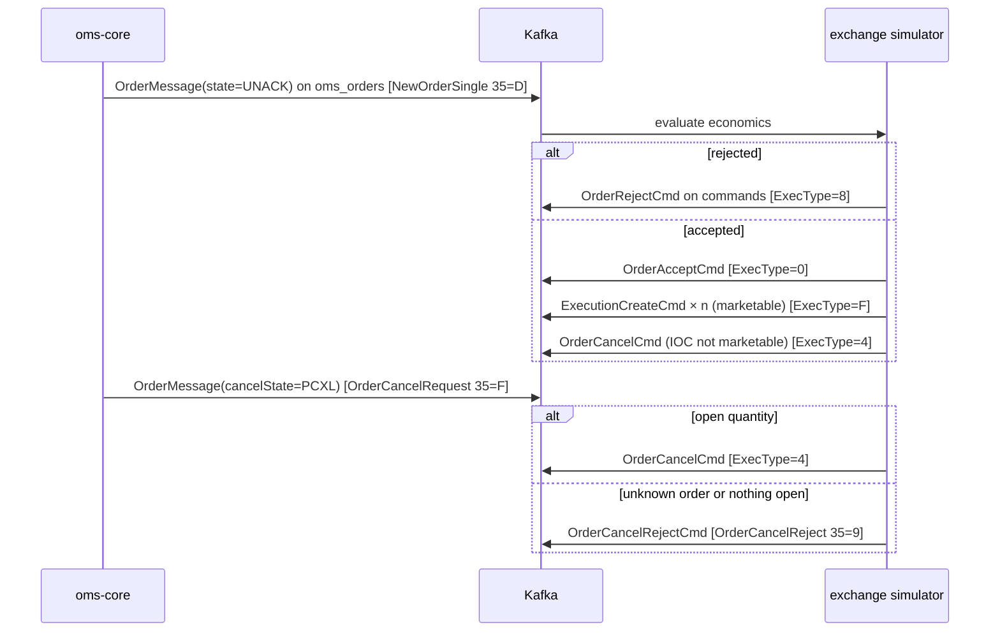

# Exchange Simulator

**Version:** 1.0
**Last Updated:** 2026-10-24
**Author:** OMS Team
**Status:** Active
**Ticket:** SPEC-0001

---

## 1. Purpose

The OMS has no market connectivity. Without something on the other side, an order would stay in
UNACK forever, and acks, fills, rejects and cancels could only be tested by sending each command by
hand. `oms-exchange-simulator` plays the venue. It reads the OMS's order stream and answers each
order the way an exchange does, with FIX semantics, so the whole order lifecycle can run end to
end.

It is a separate, independently deployable service. It talks to oms-core only through Kafka and the
shared contracts in `oms-contracts`, exactly as a real venue adapter would. To test against a real
venue, switch it off.

## 2. Message Flow



| FIX message from the venue | Command sent to oms-core |
|---|---|
| ExecutionReport ExecType=0 (New) | `OrderAcceptCmd` |
| ExecutionReport ExecType=F (Trade) | `ExecutionCreateCmd`, execType `F`, execId `<orderId>-F<n>` |
| ExecutionReport ExecType=8 (Rejected) | `OrderRejectCmd`; its `text` reason lands in the order's `rejectReason` |
| ExecutionReport ExecType=4 (Canceled) | `OrderCancelCmd` |
| OrderCancelReject (35=9) | `OrderCancelRejectCmd`; its `text` reason lands in the order's `rejectReason` |

All commands are keyed by orderId, so one order's commands share a partition and oms-core applies
them in the order sent: the ack is always processed before the fills.

## 3. Triggers

The simulator sees every update the OMS publishes, including the OMS's own echoes of the
simulator's answers. It reacts to exactly two triggers:

1. **New order:** the first message for an orderId with `state = UNACK`.
2. **Cancel request:** a change of `cancelState` into `PCXL` compared with the last message seen for
   that order.

Every reject, cancel and cancel reject also carries a `commandId` derived from the OMS event it
answers: `<orderId>-REJ-<eventId>`, `<orderId>-CXL-<eventId>` or `<orderId>-CXLREJ-<eventId>`.
If Kafka replays a cancel request after its reject has been applied, the state precondition
holds again, but the answer carries an id oms-core has already applied, so it is refused.
This survives simulator restarts, because the id comes from the OMS event, not from a counter.

In oms-core's event log, a cancel request appears as `CXL_REQUEST`, followed by `CXL` when the
simulator confirms it or `CXL_REJ` when it refuses it.

Everything else is ignored. This makes the simulator idempotent: a redelivered order or a repeated
PCXL message triggers nothing. oms-core is idempotent on its side as well, because every command's
precondition stops holding once the command has been applied (see
[Order Lifecycle §4.9.1](order-lifecycle.md)).

## 4. Order Economics

Each symbol has a static **reference price**. There is no order book and no market data feed.

| Rule | Behaviour |
|---|---|
| MARKET order | Marketable; fills at the reference price |
| LIMIT buy | Marketable when price ≥ reference; fills at the reference price (price improvement) |
| LIMIT sell / sell short | Marketable when price ≤ reference; fills at the reference price |
| Not marketable, DAY/GTC/other | Acknowledged and rests (LIVE, no fills) until cancelled |
| Not marketable, IOC | Acknowledged, then cancelled (unsolicited ExecType=4) |
| Marketable quantity | Split into `fill-slices` executions (e.g. 100 / 3 → 33, 33, 34), `fill-delay` apart |

Rejects, checked in this order:

| Condition | Reason |
|---|---|
| orderQty missing or ≤ 0 | `Invalid order quantity` |
| ordType not MARKET or LIMIT | `Unsupported order type <t>` |
| side not BUY, SELL, SELL_SHORT | `Unsupported side <s>` |
| no reference price for the symbol | `Unknown symbol <s>` |
| LIMIT without price | `Limit order without price` |
| LIMIT price outside reference ± `price-band-percent` | `Price <p> outside band <lo>-<hi>` |

A cancel request for an order with open quantity cancels it. If a fill sequence is still running,
the remaining slices are dropped. A cancel request for a filled, cancelled, rejected or unknown
order is refused (`Too late to cancel` / `Unknown order`).

## 5. Configuration

| Property | Env var | Default |
|---|---|---|
| `simulator.reference-prices.<SYMBOL>` | — | AAPL 170.00, MSFT 420.00, IBM 250.00, NVDA 120.00, INTC 86.96 |
| `simulator.price-band-percent` | `SIMULATOR_PRICE_BAND_PERCENT` | 10 |
| `simulator.fill-slices` | `SIMULATOR_FILL_SLICES` | 1 |
| `simulator.fill-delay` | `SIMULATOR_FILL_DELAY` | 0ms |
| `simulator.last-mkt` | `SIMULATOR_LAST_MKT` | XSIM |
| `simulator.order-topic` | `ORDER_TOPIC` | oms_orders |
| `simulator.command-topic` | `COMMAND_TOPIC` | commands |
| `simulator.max-tracked-orders` | — | 100000 (oldest orders are forgotten beyond this) |
| `spring.kafka.consumer.auto-offset-reset` | `SIMULATOR_OFFSET_RESET` | latest (a new group does not replay order history) |

## 6. Running It

```bash
cd oms-exchange-simulator && ./gradlew bootJar
cd .. && docker compose up -d --build oms-core exchange-simulator
```

oms-core must run with `KAFKA_ENABLED=true`. Then create an order (see `oms-core/rest.http`):

- symbol AAPL, MARKET: ends FILLED;
- symbol ZZZZ: ends REJ;
- LIMIT BUY 165: rests LIVE. Send `OrderCancelRequestCmd` for it and it ends CXL.

## 7. Observability

- Counters at `http://localhost:8094/actuator/prometheus`: `simulator_orders_received_total`,
  `simulator_acks_total`, `simulator_executions_total`, `simulator_rejects_total`,
  `simulator_cancels_total`, `simulator_cancel_rejects_total`.
- Every log line about an order carries `orderId` in the MDC.
- Kafka observation is enabled on the template and the listener, so trace context crosses the
  simulator.

## 8. Limitations

- **No order book or matching.** Orders never trade against each other, and resting orders never
  fill later.
- **In-memory state.** After a restart, or once more than `max-tracked-orders` newer orders have
  been seen, resting orders are forgotten, and cancel requests for them are refused as
  `Unknown order`.
- **No FIX session layer.** Only FIX semantics are modelled; there is no tag=value encoding,
  sequence numbers or session.
- **Not covered:** replace (35=G), busts and corrections, DAY/GTD expiry, and FOK. Other TIFs behave
  like DAY.

## 9. Related Documents

- [Order Lifecycle](order-lifecycle.md): states, the cancel request flow (§4.9.1) and event types
  (§10.1)
- [Execution Reporting](execution-reporting.md): ExecType → OMS command mapping (§2.2)
- `oms-exchange-simulator/README.md`: build and run
