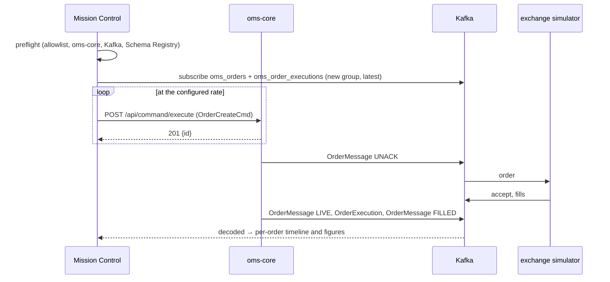

# Mission Control

**Version:** 1.0
**Last Updated:** 2026-11-08
**Author:** OMS Team
**Status:** Active
**Ticket:** SPEC-0055

---

## 1. Purpose

Mission Control (`mission-control/`) drives a load run through oms-core and reports what the
order flow did.

**Why it follows Kafka.** In this OMS a REST create only starts the work. The order reaches the
venue, is acknowledged and is filled through the outbox, Kafka and the
[exchange simulator](exchange-simulator.md). Timing the HTTP response therefore says little, so
Mission Control follows every order on Kafka until it is terminal.

**What it is.** A local Node server (port 8097, loopback only) and a browser UI. It replaces the
earlier Mastra-based prototype.

**How it relates to the JUnit load suite.** The suite (`LoadSuiteRunnerTest`, §8 of the exchange
simulator page) stays the fixed-shape baseline. Mission Control is the tool for:
- configurable runs;
- live charts;
- digging into a run.

## 2. A Run



| Phase | Meaning |
|---|---|
| `PREFLIGHT` | The target host must be in `MC_ALLOWED_HOSTS` (default `localhost`, `127.0.0.1`), and oms-core health, Kafka and the Schema Registry must answer. A failure refuses the run before any order is sent |
| `RUNNING` | The consumer group has joined; orders are being sent |
| `DRAINING` | Everything is sent; waits until every created order is terminal (FILLED, CXL, REJ, CLOSED, EXP) or the completion timeout (default 30 s) passes |
| `COMPLETED` / `STOPPED` | Saved to `data/<runId>/` (`run.json`, `samples.ndjson`) |

Only one run is active at a time.

**Rate and duration.** At most 200 orders/s and 600 s.

**Order template.** The symbol, side, type, quantity, price and time in force of every order in
the run.

## 3. Load Generation

The generator is **open loop**:
- order *i* is due at `start + i × 1000/rate`;
- a 5 ms tick sends every due order without waiting for earlier responses, so a slow oms-core
  never delays the next send (no coordinated omission).

Each order carries:
- `sessionId` `mc-<runId>`;
- `clOrdId` `<runId>-<seq>`.

That pair is unique in the OMS ([FR-004](../functional-requirements/FR-004-reject-duplicate-client-order-id.md)).

**Generator-limited runs.** A run is flagged **generator-limited** when it achieved less than 95 %
of the target rate, or when the p99 lateness of its sends (sent − due) exceeded 50 ms. Its figures
then describe Mission Control rather than OMS.

## 4. Tracking and Figures

Mission Control consumes `oms_orders` (`OrderMessage`) and `oms_order_executions`
(`OrderExecution`). It decodes them by their writer schema, read from the Schema Registry, and
never registers a schema.

**Correlation.** Messages are matched to orders by `sessionId` and `clOrdId`, which both messages
carry. They are not matched by the 201's `orderId`, because the outbox can publish UNACK before
the HTTP response is handled. Other sessions' messages are ignored.

**Deduplication.** Redeliveries are dropped by:
- `(orderId, eventId)` for orders;
- `(orderId, execId, orderVersion)` for executions.

Kafka delivers at least once ([Kafka Topics](../interfaces/kafka-topics.md)).

**Figures.** All are in ms, on Mission Control's clock, from the order's due time. Each is set on
its first occurrence:

| Figure | Until |
|---|---|
| Time to OMS ack (`toOmsAck`) | the REST create answers 201 |
| Time to market (`toMarket`) | the first `OrderMessage` with state UNACK is seen (the order was released towards the venue) |
| Time to order live / market ack (`toLive`) | the `OrderMessage` with state LIVE is seen; the venue's accept moves the order to LIVE |
| Time to first fill (`toFirstFill`) | the first `OrderExecution` is seen |
| Time to filled (`toFilled`) | the `OrderMessage` with state FILLED is seen |

**OMS checkpoint deltas.** These come from the SLA fields on `OrderMessage` (µs → ms); see
[Order SLA Monitoring](../capabilities/order-sla-monitoring.md):
- `omsAck` = `ackTime − orderReceivedTime`
- `omsToMarket` = `marketSendTime − orderReceivedTime`
- `marketRoundTrip` = `marketAckTime − marketSendTime`

**Percentiles** are exact (nearest-rank over all samples).

**Histograms** use log-spaced buckets from 1 ms to 60 s, for display only.

**Outcomes outside the figures.** A run reports:
- **create errors:** the HTTP status or timeout, and the body;
- **venue rejects:** the `rejectReason`;
- **incomplete orders:** the last state seen.

None of them contributes to a figure it never reached.

## 5. AI Investigation

Each run has an **Investigate** panel. The agent uses the Vercel AI SDK the same way
developer-cockpit does:
- a `streamText` tool loop, capped at 1–20 steps (default 8);
- a provider set by `MC_AI_PROVIDER` (`anthropic`, `openai` or `local`);
- a key read only from `ANTHROPIC_API_KEY` or `OPENAI_API_KEY`.

Without a key, the panel says so and everything else works.

| Tool | Reads |
|---|---|
| `runSummary` | the run's configuration, counts, errors and percentiles |
| `slowestOrders` | the slowest orders by one figure, with timelines and deltas |
| `orderEvents` | an order's history from `GET /api/query/orders/{orderId}/events` |
| `queryMetrics` | a PromQL range query against Mimir, limited to the run window ± 1 min |
| `queryLogs` | a LogQL range query against Loki, over the same window |

All the tools are read-only. Tool calls and the answer stream into the UI.

## 6. Running It

```bash
docker compose up -d            # from the repository root: oms-core, simulator, broker, registry
cd mission-control && npm install && npm run dev   # UI http://localhost:5181, API http://127.0.0.1:8097
npm run e2e -- --rate 20 --duration 60             # scripted end-to-end check
```

The environment variables (`MC_*`) are listed in `mission-control/README.md`.

**Run on an otherwise idle stack.** Anything else on the stack shows up in the numbers.

## 7. Limitations

- **Create-only scenarios.** Cancels and replaces are not generated; the tool only observes what
  the simulator does (accept, fill, reject, IOC cancel).
- **At most 200 orders/s.** The generator flags runs it could not keep up with, but does not
  correct for its own limits beyond that.
- **The figures include Kafka delivery to Mission Control and decoding.** Mission Control and OMS
  should run on the same host so both clocks agree. Only the checkpoint deltas are pure OMS time.
- **Mission Control's own metrics are not exported to Grafana.**

## 8. Related Documents

- [Exchange Simulator](exchange-simulator.md): the venue in every run; §8 is the JUnit load suite.
- [Order SLA Monitoring](../capabilities/order-sla-monitoring.md): the OMS-side checkpoints.
- [Kafka Topics](../interfaces/kafka-topics.md): the topics Mission Control reads.
- `mission-control/README.md`: setup and configuration.
