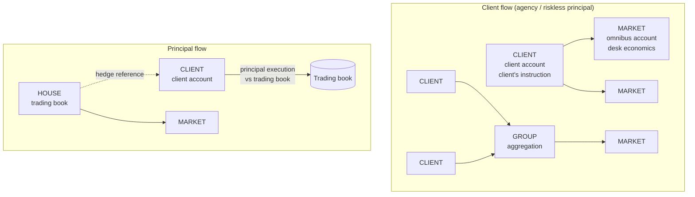

# Order Model, Trading Capacity and Booking Legs — Concept Paper

**Version:** 0.1
**Last Updated:** 2026-10-18
**Author:** OMS Team
**Status:** Draft for discussion
**Audience:** Architects, lead engineers, and stakeholders from the execution desk, middle office,
operations and compliance

---

## Table of Contents

1. [Summary](#1-summary)
2. [Purpose and Scope](#2-purpose-and-scope)
3. [Market Roles: Buy Side and Sell Side](#3-market-roles-buy-side-and-sell-side)
4. [Trading Capacity: Who Takes the Risk](#4-trading-capacity-who-takes-the-risk)
5. [Order Handling: Low Touch and High Touch](#5-order-handling-low-touch-and-high-touch)
6. [Client Types and Who Bears What](#6-client-types-and-who-bears-what)
7. [Business Scenarios](#7-business-scenarios)
8. [Single Order vs Client and Market Orders](#8-single-order-vs-client-and-market-orders)
9. [The Order Model](#9-the-order-model)
10. [Booking Legs and the Omnibus Account](#10-booking-legs-and-the-omnibus-account)
11. [Implications for the OMS](#11-implications-for-the-oms)
12. [Risks and Mitigations](#12-risks-and-mitigations)
13. [Decisions Needed and Next Steps](#13-decisions-needed-and-next-steps)
14. [Appendix A: Facts to Verify](#appendix-a-facts-to-verify)
15. [Appendix B: Glossary](#appendix-b-glossary)

---

## 1. Summary

The OMS needs a clear answer to one modelling question: **is one order enough, or must a client
order be separated from the order(s) sent to the market?** The answer depends on three properties
of each business flow:

- **Market role:** which side of the market the bank is on (buy side or sell side).
- **Trading capacity:** whether the bank acts for the client (agency), with the client as a
  counterparty but with an offsetting trade at the same moment (riskless principal), or as a
  counterparty taking risk itself (principal).
- **Handling:** whether a person on the execution desk works the order (high touch) or it runs
  straight through electronically (low touch).

This paper concludes:

1. **Separate client orders from market orders for all client flow**, including 1:1 low-touch
   flow. For simple flows, the market order is created automatically. The client order holds the
   client's instruction and the client account. The market order holds what the desk decides and
   the omnibus (or house) account. The two have different counterparties, states, accounts and
   regulatory roles.
2. **Keep the tree to a fixed shape:** `CLIENT` → optional `GROUP` → `MARKET`. Allow no
   further nesting, and never give market orders children. Algo slicing belongs in the EMS or the
   broker's algorithm, not in the OMS.
3. **Capacity changes the shape of the tree, not only a flag.** Agency and riskless principal use
   the client → market tree. In a principal trade, the client order is filled from the bank's own
   book. The bank's hedging orders are **separate house orders**, not children of the client
   order.
4. **Handing an order to the broker does not hand over market risk.** A care or "not held" order
   transfers *discretion* and responsibility for best execution. Market risk moves to the broker
   only in principal trades. External and institutional asset managers do not take market risk
   themselves; their clients or funds do.
5. **Each order level maps to a booking leg.** Market fills book against the omnibus account;
   client fills book from the omnibus account to the client account. The omnibus account must net
   to zero per instrument and trade date. This is a key control, and it only works with separate
   client and market legs.
6. **A single order is enough only for orders without a client:** proprietary, treasury or hedging
   orders on a house account.

---

## 2. Purpose and Scope

### 2.1 Purpose

- Define the terms buy side, sell side, agency, principal, riskless principal, low touch and high
  touch as they apply to us.
- Clarify who takes which risk in each business model, with particular attention to external
  asset managers.
- List the business scenarios and show, for each one, whether the client / market order split is
  needed.
- Define a constrained order model and the booking legs that follow from it.

### 2.2 In Scope

- Client order flow from private clients, external asset managers and institutional clients
- Agency, riskless principal and principal execution; crosses
- The order tree (`CLIENT`, `GROUP`, `MARKET`) and house orders
- Booking legs and the omnibus account, only at the level of the boundary between the OMS and
  booking

### 2.3 Out of Scope

- Detailed booking and accounting rules (post-trade / back office)
- Market making and risk management for principal trading books
- Account allocation and fair allocation (covered in [Block Order Allocation](block-order-allocation.md))

### 2.4 Related Documents

- [Order Quantity Calculations](order-quantity-calculations.md): client → market tree,
  `placedQty`, fill distribution
- [Order Grouping](order-grouping.md): aggregation of client orders (n:1)
- [Block Order Allocation](block-order-allocation.md): fill distribution vs account allocation,
  average price, fair allocation
- [Post-Trade Analytics](post-trade-analytics.md): integration contract and downstream platform

---

## 3. Market Roles: Buy Side and Sell Side

| | **Buy side** | **Sell side** |
|---|---|---|
| Who | Asset managers, pension funds, insurers, hedge funds, external asset managers (EAMs), the bank's own portfolio management | Brokers, dealers, investment banks, and the bank's trading and execution desk |
| Main activity | Makes **investment decisions** for clients or funds | Provides **execution, liquidity and market access**; sometimes takes risk |
| Typical system | Portfolio management and buy-side OMS: order generation, pre-trade investment compliance, pre-allocation | Sell-side OMS: client order handling, routing, execution, fill distribution |
| Paid by | Management and performance fees | Commissions, spreads, markups |
| Duty towards the client | Suitability, fair allocation across the accounts it manages | Best execution, fair handling of client orders, fair allocation when aggregating orders |

**A bank can be on both sides.** In a private or universal bank, portfolio management and advisory
make investment decisions (buy side) and send orders to the bank's own execution desk (sell side).
External asset managers send orders to the bank as their broker and custodian.

**Assumption of this paper:** our OMS is a **sell-side OMS**. It receives client orders (from
private client channels, EAMs, institutional clients and the bank's internal buy side) and is
responsible for executing them. Generating investment decisions is out of scope.

---

## 4. Trading Capacity: Who Takes the Risk

Trading capacity describes **in what role the bank faces the client and the market** for a given
trade. It decides who bears market risk, how the bank is paid, and how the trade is booked and
reported.

### 4.1 The Capacities

| Capacity | What the bank does | Market risk | Counterparty / settlement risk | Bank earns | Typical use |
|---|---|---|---|---|---|
| **Agency** | Executes in the market **for the client's account** | **Client** | Bank towards the market (in its own name, see §4.2); client towards the bank | Commission | Exchange-traded equities, ETFs, most private client and EAM flow |
| **Riskless principal** (matched principal) | Buys from the market and sells to the client (or the reverse) at the **same moment**; is the counterparty on both sides | Effectively **client** (no open position kept) | **Bank** on both legs | Markup or markdown in the price, or commission | Bonds, OTC instruments, cross-border flows where the bank acts as counterparty |
| **Principal** (risk trade) | Trades with the client **from its own book** at a firm price | **Bank** (until hedged) | Bank towards the client | Spread; risk premium | Bond RFQs, principal blocks and risk bids, guaranteed benchmark (e.g. VWAP) trades, market making |
| **Cross** | Matches two client orders internally | Each client for their own side | Bank in between | Commission (both sides) | Internalisation, matching of block liquidity |

### 4.2 Agency in Its Own Name: the Swiss Commission Model

In Switzerland, banks traditionally execute client securities orders as a **commission agent**
(*Kommissionär*, Swiss Code of Obligations Art. 425 ff.). The bank acts **in its own name but for
the client's account**:

- **Economically it is agency.** The client bears market risk and gets the execution price; the
  bank earns a commission.
- **Legally, the bank is the counterparty towards the market** and settles through its own
  accounts, typically an **omnibus account**, before booking to the client's account.
- In certain conditions the commission agent may itself act as the counterparty (*Selbsteintritt*,
  Art. 436 CO). That is in effect a principal or riskless principal execution, so the capacity must
  be recorded per execution, not assumed per client.

This is why the omnibus account appears even in plain agency flow: the bank faces the market in
its own name.

### 4.3 Market Risk Moves Only With Principal Trades

A common misunderstanding: when an asset manager hands an order to the broker as a care or
"not held" order, it seems the broker takes over the trade. It takes over **discretion**: when,
where and how to execute. It also takes the duty to execute well. The **price risk** remains with
the client until the order is filled. If the market moves against the order, the client gets a
worse price.

Market risk moves to the bank only when the bank **commits to a price** before it has executed in
the market:

- a principal block or risk bid,
- an RFQ quote that is accepted,
- a guaranteed VWAP or closing price.

### 4.4 FIX and Regulatory Codes

| Concept | FIX (order) `OrderCapacity` (528) | FIX (execution) `LastCapacity` (29) | MiFIR trading capacity (EU) |
|---|---|---|---|
| Agency | `A` Agency | `1` Agent | `AOTC` (any other capacity) |
| Riskless principal | `R` Riskless principal | `4` Principal | `MTCH` (matched principal) |
| Principal | `P` Principal | `4` Principal | `DEAL` (dealing on own account) |
| Cross | n/a | `2` Cross as agent / `3` Cross as principal | depends on capacity |

The exact mapping must be confirmed for the regimes that apply to us (Appendix A).

---

## 5. Order Handling: Low Touch and High Touch

| | **Low touch** | **High touch** |
|---|---|---|
| What happens | Order runs straight through electronically. The client or channel chooses the venue or algo | A sales trader or the execution desk works the order with discretion |
| Examples | DMA, sponsored access, client-chosen algos, private client e-banking orders, EAM portal orders below a threshold | Care orders, large blocks, illiquid instruments, portfolio trades, sourcing block liquidity, principal facilitation |
| Desk changes economics? | No | Yes: order type, limit, algo and parameters, venue, timing, splitting |
| Shape of the tree | 1:1, created automatically | 1:n splitting, n:1 aggregation, re-routing |
| Typical volume and fee | High volume, low commission | Lower volume, higher commission or spread |
| Controls | Automated pre-trade risk checks, limits, kill switches | Plus desk supervision and documentation of handling decisions |
| FIX `HandlInst` (21) | `1` Automated, private, no broker intervention → `AUTO` | `2` Automated, broker intervention OK → `BROKER_INTERVENTION_OK`; `3` Manual → `MANUAL` |

Between the two there is often **electronic sales trading**. Clients choose algos, and a desk
monitors and steps in when needed. In the model this is low touch that **can become high touch**.
An order can move from automatic to desk handling, for example after a reject, a limit breach, or a
client request.

`HandlInst` already exists in our contracts with exactly these values. It can be the main switch
between automatic placement and desk handling (§9.3).

---

## 6. Client Types and Who Bears What

| Client type | Who makes the investment decision | Who bears market risk | Where the assets are held | Bank's role | Bank's main duties |
|---|---|---|---|---|---|
| **Private client, self-directed** | The client | The client | At the bank | Broker + custodian (agency / commission) | Best execution, fair order handling |
| **Private client, discretionary mandate** | The bank (internal buy side) | The client | At the bank | Asset manager + broker + custodian | Suitability, fair allocation (as the decision-maker), best execution |
| **External asset manager (EAM)** | The EAM, under a limited power of attorney from the client | **The EAM's client**. The EAM trades in the client's name, not on its own balance sheet | At the bank (custodian) | Broker + custodian (agency / commission) | Best execution; fair allocation when the bank aggregates EAM orders |
| **Institutional asset manager** (fund manager, pension fund) | The asset manager | **The fund or end investor** | Usually at a third-party custodian | Broker (agency, sometimes principal) | Best execution; apply the client's allocation instructions faithfully |
| **Institutional client trading at a risk price** | The client | **The bank** (from the moment the price is agreed) | Third-party custodian | Principal | Fair pricing, managing its own risk |
| **The bank itself** (treasury, trading book) | The bank | The bank | Bank's own accounts | House | Internal limits, market conduct |

**About EAMs:** an external asset manager is a buy-side firm (in Switzerland licensed under FinIA)
that manages portfolios held at the bank. It **does not take market risk itself**. Gains and losses
belong to its clients. It also does **not transfer market risk to the bank** by placing orders.
The bank carries operational and settlement risk towards the market. It carries little credit risk
towards the EAM's client, because it holds the client's assets and cash and can check that they
are available before executing.

---

## 7. Business Scenarios

| # | Scenario | Capacity | Handling | Tree shape | Client leg books | Market leg books |
|---|---|---|---|---|---|---|
| S1 | Private client order via e-banking | Agency (commission) | Low | `CLIENT` → `MARKET` (1:1 auto) | Client account vs omnibus | Omnibus vs street |
| S2 | Advisor or discretionary order for one client | Agency | Low or high | 1:1 auto, or desk split | Client vs omnibus | Omnibus vs street |
| S3 | EAM single-portfolio order | Agency | Low (portal), high above threshold | 1:1 auto, or desk split | Client vs omnibus | Omnibus vs street |
| S4 | **EAM bulk rebalancing** of many portfolios | Agency | High | n `CLIENT` → `GROUP` → m `MARKET` | Each client vs omnibus at the group average price | Omnibus vs street |
| S5 | **Institutional block, care order** | Agency | High | `CLIENT` → n `MARKET` (split across venues and algos, re-routes) | Client (institution) vs omnibus; then account allocation to funds | Omnibus vs street |
| S6 | Institutional DMA or algo | Agency | Low | 1:1 auto | Client vs omnibus or clearing account | Omnibus vs street |
| S7 | Bond order, riskless principal | Riskless principal | High (RFQ to dealers) | `CLIENT` → `MARKET` | Client vs omnibus **at the client price** (incl. markup) | Omnibus vs dealer at the market price |
| S8 | **Principal risk trade** (risk bid, accepted RFQ quote, guaranteed VWAP) | Principal | High | `CLIENT` filled by a **principal execution**; hedges are separate `HOUSE` orders | Client vs trading book at the risk price | Hedges: trading book vs street (separate orders) |
| S9 | Internal cross between two clients | Agency cross | Low or high | Two `CLIENT` orders filled against each other; no `MARKET` order | Client A vs omnibus vs client B | none |
| S10 | Proprietary, treasury or hedging order | House | Low or high | **Single `HOUSE` order** (may be split into `MARKET` orders) | none | Trading book vs street |
| S11 | Order passed to an external broker (no direct venue access) | Agency | Low or high | `CLIENT` → `MARKET` (destination = broker) | Client vs omnibus | Omnibus vs executing broker |

### 7.1 Where the Split Matters

| Reason | Scenarios | Why one order is not enough |
|---|---|---|
| The desk changes economics | S2, S3, S4, S5, S7 | The client's instruction must stay unchanged, as evidence for best execution and order handling |
| Splitting and re-routing (1:n) | S5, S7, S11 | `placedQty`, several venues, a history of each placement |
| Aggregation (n:1) | S4 | Several clients share one market order |
| Different accounts on each leg | All client flow | Client account vs omnibus or trading book |
| Different counterparties and states | All client flow | A venue reject must not reject the client order |
| Price transformation | S7, S8 | Client price ≠ market price (markup, risk price) |
| Separate regulatory legs | All client flow | Market-side and client-side transactions are reported separately |

### 7.2 Where a Single Order Is Enough

- **House orders (S10):** there is no client, so no client leg is needed. A house order can still
  be split into market orders if the desk works it.
- **Pure pass-through flow without its own booking:** for example, a firm that only routes orders
  and books nothing itself. That is not our case.

---

## 8. Single Order vs Client and Market Orders

### 8.1 Options

| Option | Description | Assessment |
|---|---|---|
| **A. Single order** | One order with optional "working" fields (market-side order type, limit, algo) | ❌ Works only for 1:1 without re-routing. Mixes client and market state. Cannot represent aggregation, splitting or different accounts on each leg |
| **B. Full tree whenever it is needed** | Single order for simple flow; tree only when the desk splits or aggregates | ⚠️ Two different shapes for consumers (booking, reporting, reconciliation). The model changes when an order moves from low to high touch |
| **C. Constrained tree, always present** | Every client order has at least one market order; created automatically for low touch | ✅ **Recommended.** One shape everywhere. The cost is one extra order row and its events per client order |

### 8.2 Where the Complexity Comes From, and How to Avoid It

| Source of complexity | Avoided by |
|---|---|
| Arbitrary nesting | Fixed roles and maximum depth (§9.1) |
| Algo slicing modelled as orders | Slicing stays in the EMS or algo; the OMS sees one market order and its fills |
| Two-way state synchronisation | One-way rules: fills and quantities go up the tree, cancel and amend requests go down (§9.4) |
| Special cases for 1:1 flow | Automatic placement; the same model as high touch (§9.3) |
| UI overload | Show client orders collapsed by default; the tree opens up only for desk users |
| Principal hedges attached to client orders | Hedges are separate `HOUSE` orders, optionally linked for reference (§9.5) |

---

## 9. The Order Model

### 9.1 Roles and Structure



| Role | Parent | Children | Account | Economics | Sent to the market |
|---|---|---|---|---|---|
| `CLIENT` | none, or `GROUP` (as a member) | `MARKET` | Client account | As instructed by the client; never changed by the desk | No |
| `GROUP` | none | `MARKET` | Omnibus | Aggregate of the members | No |
| `MARKET` | `CLIENT`, `GROUP` or `HOUSE` | **none** | Omnibus (client flow) or trading book (house flow) | As decided by the desk | **Yes** |
| `HOUSE` | none | `MARKET` (optional) | Trading or treasury book | As decided by the bank | Through `MARKET` children, or directly if it has none |

`GROUP` membership is a relation from `CLIENT` orders to the group. It is not a parent–child
relation in the sense of fill propagation: fills reach members through fill distribution (see
[Block Order Allocation](block-order-allocation.md) §3).

### 9.2 Capacity Determines How a Client Order Is Filled

| Capacity | Client order is filled by | Price on the client fill |
|---|---|---|
| Agency | Fills of its `MARKET` children, moved up the tree | Market price (average) |
| Riskless principal | Fills of its `MARKET` children, moved up the tree | Market price ± markup |
| Principal | A **principal execution** against the trading book (no market child) | Agreed risk price |
| Cross | An internal execution against another client order | Cross price |

### 9.3 Automatic Placement (Low Touch)

When a `CLIENT` order is accepted with `HandlInst = AUTO`, the OMS creates one `MARKET` child in
the same transaction:

- same quantity, side, order type, limit and time in force;
- destination taken from the client's instruction or from routing rules;
- account set to the omnibus account for the client's booking entity and market.

The desk does not see a separate line. If the order is later handed to the desk (a reject, a limit
breach, or `BROKER_INTERVENTION_OK` / `MANUAL`), the existing market child stays in the history and
the desk can re-route or split from there. **The model does not change when handling changes.**

### 9.4 Propagation Rules

| Direction | What | Rule |
|---|---|---|
| Up | Fills | Market fill → parent `cumQty`, `avgPx` (fill distribution for groups) |
| Up | Quantities | `placedQty = Σ children orderQty` of open children; `cumQty = Σ distributed fills` |
| Up | Client state | Derived only from the client order's own quantities and the client's actions: filled when `cumQty = orderQty` |
| Up | Market reject or cancel | Returns the quantity to the parent as unplaced. **Never** changes client state directly |
| Down | Client cancel | Requests cancel of all open market children; the client order is cancelled once they are confirmed (partial fills remain) |
| Down | Client amend (replace) | Validated against what is already placed and executed; changes to market children are requested, not forced |

### 9.5 Principal Trades and Hedges

In a principal trade the bank fills the client and then manages its own position:

- The client order receives a **principal execution** (`LastCapacity = 4`) against the trading
  book, at the agreed price.
- Any hedging or unwinding is done through **`HOUSE` orders** on the trading book, at times and
  sizes the trader chooses. They are not children of the client order. The client is not
  affected by them, and their fills must not move up into the client order.
- For audit and supervision (e.g. checking that hedging does not trade ahead of the client), house
  orders may carry a **reference** to the client order they hedge. That is only a link.

---

## 10. Booking Legs and the Omnibus Account

Booking is done in post-trade from OMS events. The OMS provides each leg with its account,
quantity, price and capacity. The table shows the resulting legs per capacity.

| Capacity | Market leg (from `MARKET` fills) | Client leg (from `CLIENT` fills) | Bank revenue |
|---|---|---|---|
| Agency (commission) | Omnibus ↔ street counterparty, at market price | Client ↔ omnibus, at average market price | Separate commission posting to the client |
| Riskless principal | Omnibus ↔ street, at market price | Client ↔ omnibus, at client price (incl. markup) | Markup: remains as cash in the omnibus account and is booked out to P&L |
| Principal | none for the client trade (hedges: trading book ↔ street) | Client ↔ trading book, at risk price | Trading P&L on the trading book |
| Agency cross | none | Client A ↔ omnibus ↔ client B, at cross price | Commission from both clients |
| House | Trading book ↔ street | none | Trading P&L |

### 10.1 The Omnibus Control

For agency and riskless principal flow, **per booking entity, instrument and trade date**:

```
Σ quantity(market fills)  =  Σ quantity(client fills)
Σ cash(market fills)      =  Σ cash(client fills)  −  known residuals
```

Known residuals are average price rounding (see [Block Order Allocation](block-order-allocation.md)
§6.3) and riskless principal markups. Any other difference is a **break**: a fill that was not
distributed, a booking that is missing, or a bust that was handled on only one side.

The check is only possible because the client and market legs are separate, linked records. It
runs in post-trade or on the analytics platform, from OMS events (see
[Post-Trade Analytics](post-trade-analytics.md)), never on the OMS database.

---

## 11. Implications for the OMS

### 11.1 What Exists Today

- `parentOrderId`, `rootOrderId` and `placeQty` on `Order`
- `HandlInst` (`AUTO`, `BROKER_INTERVENTION_OK`, `MANUAL`) and `ExecInst` (`NO_CROSS`,
  `OK_TO_CROSS`, `MID_PEG`) in the contracts
- `lastCapacity` on executions, as free text
- The client → market tree specified in [Order Quantity Calculations](order-quantity-calculations.md)
- Command processors exist only for creating and accepting orders and for processing
  executions. There is **no placement command** yet, and no child orders are created.

### 11.2 Changes

| # | Change | Where |
|---|---|---|
| O1 | Add an **`orderRole`** enum (`CLIENT`, `GROUP`, `MARKET`, `HOUSE`) to the order. Do not infer the role from `parentOrderId` | `oms-contracts` (OpenAPI, Avro) |
| O2 | Add **`orderCapacity`** to client and house orders (agency, riskless principal, principal) | `oms-contracts` |
| O3 | Turn `lastCapacity` into an **enum** that matches FIX `LastCapacity` | `oms-contracts` |
| O4 | Add a **place / route command** that creates `MARKET` children; add **automatic placement** for `HandlInst = AUTO` | `oms-core` command processors |
| O5 | Add a **principal execution command** (fill a client order against the trading book at an agreed price) | `oms-core` |
| O6 | Enforce **tree constraints**: allowed parent and child roles, `MARKET` orders have no children, maximum depth | `oms-core` validation |
| O7 | Implement the **propagation rules** (§9.4), including market reject → unplaced quantity | `oms-core` |
| O8 | Store an **account per order node**, with omnibus and trading book accounts resolved from the booking entity and market | `oms-core`, reference data |
| O9 | Add client price vs market price (**markup**) for riskless principal client fills | `oms-contracts`, `oms-core` |
| O10 | Add `NOT_HELD` to `ExecInst` to record discretion granted by the client | `oms-contracts` |
| O11 | Add an optional **hedge reference** from `HOUSE` orders to client orders | `oms-contracts` |

All published events carry `orderRole`, capacity and account, so downstream consumers can filter
by leg ([Post-Trade Analytics](post-trade-analytics.md) §8).

---

## 12. Risks and Mitigations

| Risk | Impact | Mitigation |
|---|---|---|
| The tree grows into a general graph over time | Complexity, bugs in propagation | Fixed roles and constraints (O1, O6), enforced in code and specs |
| Special-casing 1:1 orders | Two shapes for every consumer | Always create the market child (§9.3) |
| Market-side events change client state | Client sees rejects for venue problems | One-way propagation rules (§9.4) |
| Principal hedges modelled as children | Hedge fills reach the client order; risk is mixed up with client flow | Hedges are `HOUSE` orders with a reference only (§9.5) |
| Capacity assumed per client instead of recorded per execution | Wrong booking, wrong regulatory reporting | Capacity on the order and on each execution (O2, O3) |
| Omnibus breaks go unnoticed | Financial loss, audit findings | Daily omnibus control (§10.1) on the post-trade or analytics platform |
| Terms used inconsistently across teams | Wrong requirements | Glossary (Appendix B); align the specs |

---

## 13. Decisions Needed and Next Steps

### 13.1 Decisions

| # | Decision | Owner |
|---|---|---|
| D1 | Adopt option C (constrained tree, always present) | Architecture |
| D2 | Which capacities are in scope for the first release (agency only, or also riskless principal and principal) | Business / product |
| D3 | Omnibus account structure per booking entity and market | Operations / finance |
| D4 | Rules for moving orders from automatic to desk handling | Execution desk |
| D5 | Whether internal crossing (S9) is offered | Business / compliance |

### 13.2 Next Steps

1. Update [Order Quantity Calculations](order-quantity-calculations.md) with the roles, the
   constraints and the propagation rules.
2. Add O1–O3 and O10 to `oms-contracts`.
3. Implement the place command and automatic placement (O4) together with the propagation rules
   (O7), test first: a 1:1 automatic flow, a desk split with a re-route after a venue reject, and
   a client cancel with partial fills.
4. Specify principal execution (O5) once D2 is decided.

---

## Appendix A: Facts to Verify

| # | Fact | Why it matters |
|---|---|---|
| A1 | Which capacities the bank actually uses, per asset class and booking entity | D2, O2 |
| A2 | Legal basis for client execution in Switzerland (commission agent, Swiss CO Art. 425 ff. and Art. 436) and how self-entry is documented | §4.2 |
| A3 | Mapping of capacities to FIX `OrderCapacity` / `LastCapacity` and to the reporting regimes that apply (FinfraG; MiFIR for EU business) | §4.4 |
| A4 | Omnibus account structure: per market, per currency, per booking entity? | O8, §10 |
| A5 | Whether institutional clients settle via the omnibus account or directly to their custodian | §10, S5 |
| A6 | Thresholds and rules for moving EAM portal orders to the desk | §5, S3 |

---

## Appendix B: Glossary

| Term | Meaning |
|---|---|
| **Buy side** | Firms that make investment decisions for clients or funds (asset managers, EAMs, pension funds, the bank's portfolio management) |
| **Sell side** | Firms that provide execution, liquidity and market access (brokers, dealers, the bank's execution desk) |
| **EAM** | External asset manager: an independent firm that manages client portfolios held at the bank, under a limited power of attorney |
| **Agency** | The bank executes for the client's account; the client bears market risk; the bank earns a commission |
| **Commission agent** (*Kommissionär*) | Swiss form of agency: the bank acts in its own name for the client's account |
| **Riskless principal** | The bank is the counterparty to both client and market, with offsetting trades at the same moment; no open position |
| **Principal** | The bank trades with the client from its own book at a firm price and bears market risk |
| **Low touch** | Electronic, automatic handling without desk intervention |
| **High touch** | Order worked by a person on the desk, with discretion |
| **Care order / not held** | An order where the client gives the broker discretion over timing and price. Discretion moves to the broker; market risk does not |
| **Client order** | The order as instructed by the client; booked to the client account |
| **Market order** (street order) | The order sent to a venue or broker; booked to the omnibus account or trading book. Not to be confused with the order type "market" (`MKT`) |
| **House order** | An order for the bank's own account (trading, treasury, hedging) |
| **Omnibus account** | Bank account through which client trades pass towards the market; should net to zero per instrument and day |
| **Principal execution** | A fill of a client order against the bank's trading book rather than the market |
| **Markup / markdown** | Difference between the market price and the client price in riskless principal trades |
