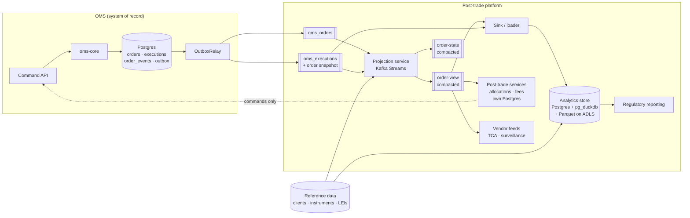

# Post-Trade Analytics Platform — Concept Paper

**Version:** 0.1
**Last Updated:** 2026-10-18
**Author:** OMS Team
**Status:** Draft for discussion
**Audience:** Architects, lead engineers, and stakeholders from operations, compliance and data

---

## Table of Contents

1. [Summary](#1-summary)
2. [Purpose and Scope](#2-purpose-and-scope)
3. [The OMS Today](#3-the-oms-today)
4. [Post-Trade Use Cases](#4-post-trade-use-cases)
5. [Why These Workloads Do Not Belong in the OMS](#5-why-these-workloads-do-not-belong-in-the-oms)
6. [Fitness Assessment of the OMS Architecture](#6-fitness-assessment-of-the-oms-architecture)
7. [Target Architecture](#7-target-architecture)
8. [The Contract Between OMS and Platform](#8-the-contract-between-oms-and-platform)
9. [Retention, Replay and Long-Lived Orders](#9-retention-replay-and-long-lived-orders)
10. [Technology Options on Azure Switzerland North](#10-technology-options-on-azure-switzerland-north)
11. [Data Protection](#11-data-protection)
12. [Build vs Buy](#12-build-vs-buy)
13. [Risks and Mitigations](#13-risks-and-mitigations)
14. [Decisions Needed and Next Steps](#14-decisions-needed-and-next-steps)
15. [Appendix A: Facts to Verify](#appendix-a-facts-to-verify)
16. [Appendix B: Glossary](#appendix-b-glossary)

---

## 1. Summary

The OMS is built to keep each order and its executions consistent. It stores the current state of
each order, records every change in an event log in the same transaction, and publishes events
through a transactional outbox. That is the right design for managing order and execution
lifecycles, but it is not the right place for work that runs over many orders: regulatory
reporting, transaction cost analysis (TCA), allocations, reconciliation, and analytics over long
time ranges.

This paper concludes:

1. **The OMS architecture is fit for purpose** as the system of record for orders and executions.
   This depends on one planned change: every execution event carries a snapshot of its order
   ("order on the fill"). With that change, almost every downstream use case can be served from
   OMS events alone, without reading back from the OMS database.
2. **Post-trade workloads belong in a separate platform** that consumes OMS events, builds its own
   read models, and never writes back to the OMS except through its command API.
3. **The platform is layered:** a stream-processing projection layer, an analytics store, dedicated
   post-trade services for transactional workflows such as allocations, and outbound feeds to
   vendors (for example TCA).
4. **A small set of gaps in the OMS's published events must be closed first** (§6.3). None of
   them change the architecture. They concern message keys, a version number and a few fields.
5. **For Azure Switzerland North, start with managed PostgreSQL plus pg_duckdb**, with history in
   Parquet on Azure Data Lake Storage. Keep Microsoft Fabric (or Azure Data Explorer) as the next
   step if in-house real-time or market-data-scale analytics becomes a requirement. Buy TCA from a
   vendor rather than building it.

---

## 2. Purpose and Scope

### 2.1 Purpose

- Confirm that the current OMS architecture is fit for purpose once post-trade and analytics
  requirements are taken into account.
- Define how a post-trade analytics platform fits alongside the OMS, and how it adds to the OMS
  without making it more complex.
- Provide a basis for technology and build-vs-buy decisions.

### 2.2 In Scope

- Post-trade use cases typical for banks and brokers (§4)
- The integration contract between OMS and platform (§8)
- Retention and replay, including multi-day orders such as GTD (§9)
- Technology options under our constraints: Azure, managed services, Switzerland North (§10)
- Protection of sensitive data and data passed to third parties (§11)

### 2.3 Out of Scope

- Detailed design of individual regulatory reports
- Choice of vendor products (vendors are named only as examples)
- Pre-trade and real-time risk controls, which remain in the OMS command path
- Market abuse surveillance (treated here only as a data consumer)

### 2.4 Related Documents

- [OMS Architecture Convergence Assessment](../oms-methodolgy/architecture-convergence-assessment.md)
  — custom state-based OMS compared with Axon (event-sourced)
- [Streaming Architecture](streaming-architecture.md)
- [Execution Reporting](execution-reporting.md)
- [Order Quantity Calculations](order-quantity-calculations.md)
- [Order Grouping](order-grouping.md)

---

## 3. The OMS Today

What already exists in `oms-core` and is relevant to this paper:

| Capability | Implementation | Why it matters for post-trade |
|---|---|---|
| Current-state storage | `orders`, `executions` tables; optimistic locking via `txNr` | The OMS always holds a consistent current state. Producing a snapshot costs nothing because no events need replaying. |
| Event log | `order_events`, appended in the same transaction with a version per order (`OrderEventAppender`) | A complete, ordered history per order: the audit trail and the source for replays |
| Replay | `OrderReplayService` (`replay`, `replayAt(version)`, `history`, `isContiguous`) | Lets us rebuild or check any order as of any version |
| Transactional outbox | `OutboxMessage` drained by `OutboxRelay` to Kafka | Events are published if and only if the change was committed |
| Topics | `oms_orders`, `oms_executions` (Avro, Schema Registry) | The integration surface for every downstream consumer |
| Incremental quantities | `cumQty`, `leavesQty`, `avgPx` updated per fill | Order-level average price is computed in the OMS, with no re-read of past fills |
| SLA timestamps | `orderReceivedTime`, `ackTime`, `marketSendTime`, `marketAckTime` (`OrderSlaRecorder`) | Needed for arrival-price benchmarks, best-execution evidence and latency metrics |
| Order hierarchy | `parentOrderId`, `rootOrderId` | Links block, child and execution, as needed for allocations and parent-level TCA |

**What the OMS deliberately does not have:** a separate materialised read store, projections that
combine data from several orders, or analytical query capabilities. This paper argues that this is
correct, and that those capabilities belong downstream.

---

## 4. Post-Trade Use Cases

The table below lists the post-trade use cases that banks and brokers typically have. Each one is
described by the properties that decide where it should run.

| # | Use case | Typical requirement | Data shape | Latency | Consistency need | Retention |
|---|---|---|---|---|---|---|
| U1 | **Transaction reporting** | Regulatory reporting of executed transactions (e.g. FinfraG in Switzerland; MiFIR Art. 26 for EU business; EMIR / FinfraG for derivatives) | One record per execution, enriched with order, client, instrument and trader data | T+1 (some regimes intraday) | Complete and correct; corrections reported as amendments or cancellations | Long (years) |
| U2 | **Order record keeping** | Regulators can ask for every order lifecycle event, with precise timestamps (e.g. MiFIR Art. 25) | Full event history per order | On request | Complete, unchanged, reproducible as of a point in time | Long (years) |
| U3 | **Best execution evidence** | Show that client orders were executed on the best available terms (FIDLEG / FinSA in Switzerland; MiFID II for EU) | Executions + order timestamps + market data benchmarks | Periodic (monthly or quarterly) | Reproducible | Long |
| U4 | **Transaction cost analysis (TCA)** | Slippage vs arrival price, VWAP, implementation shortfall, reversion | Executions joined with market data at the time of each fill | T+1 (intraday is optional) | Accurate timestamps | Medium to long |
| U5 | **Allocations and average pricing** | Split block executions across client accounts; average-price allocation; fair allocation rules | Block order + all fills + allocation instructions | Intraday to end of day | **Transactional**: each allocation must be booked exactly once | Long |
| U6 | **Commissions, fees and billing** | Calculate client commissions, rebates and venue fees | Executions + client and fee schedule | End of day to monthly | Correct, auditable | Long |
| U7 | **Reconciliation** | Match OMS fills with broker and venue confirmations, drop copies and back office | Executions from several sources, matched on IDs and quantities | Intraday to end of day | Complete | Medium |
| U8 | **Client reporting** | Execution reports and statements for clients | Order + fills per client | End of day / periodic | Correct | Long |
| U9 | **Operational metrics** | Latency, fill rates, reject rates, order volumes, SLA breaches | Order events + SLA timestamps | Near real time | Approximate is acceptable | Short to medium |
| U10 | **Surveillance (as a consumer)** | Market abuse detection, usually a vendor system | Complete order and execution history | Near real time to T+1 | Complete | Long |

### 4.1 What These Use Cases Have in Common

- **They work across many orders**: per client, per instrument, per day, per venue, per block.
  The OMS is designed around a single order.
- **Most of them need data the OMS does not own**: client reference data, instrument data, fee
  schedules, market data, legal entity identifiers (LEIs).
- **They must be reproducible**: "What did we know and report on date X?" They need history as of
  a point in time, not only the current state.
- **Corrections are normal**: trade busts and corrections must produce amendments downstream,
  never silent changes to records already reported.
- **Two kinds of consistency.** U5 and U6 are **transactional workflows**: the result is
  booked, money moves, and it must happen exactly once. The others are **read and analysis**. This
  difference decides the target architecture (§7).

---

## 5. Why These Workloads Do Not Belong in the OMS

| Property | OMS (order and execution lifecycle) | Post-trade and analytics |
|---|---|---|
| Unit of work | One order, one transaction | Thousands to millions of rows per query |
| Access pattern | Read by key, update, append | Scans, aggregations, window functions, time-based (as-of) joins |
| Storage optimised for | Rows (whole records) | Columns (few fields across many rows) |
| Latency budget | Milliseconds, on the trading path | Seconds to hours |
| Failure impact | Trading stops | A report is delayed |
| Data scope | Orders and executions | Plus reference data, market data and other systems' data |
| Change rate of requirements | Low (lifecycle semantics are stable) | High (new reports, new regulations, new metrics) |

Putting analytical work into the OMS would:

- **Compete for resources with the trading path.** Large scans on the OMS database affect latency
  and lock behaviour for live orders.
- **Bring frequently changing requirements into a component that must change rarely.** Each new
  report would mean an OMS release.
- **Add data the OMS should not own**, such as market data, fee schedules and client hierarchies.
- **Increase reads from the database.** For example, joining each published execution to its order
  at publish time, or building cross-order projections in the command path.

The OMS should focus on being a **complete, consistent and timely source of facts** about orders
and executions. Everything else consumes those facts.

---

## 6. Fitness Assessment of the OMS Architecture

### 6.1 Criteria

A platform that consumes OMS events needs them to meet the following criteria. Each is assessed
against the current architecture with "order on the fill" assumed.

| # | Criterion | What it means | Assessment |
|---|---|---|---|
| F1 | **Completeness** | Every committed change is published; nothing is published that was not committed | ✅ The transactional outbox guarantees this |
| F2 | **Self-describing events** | A consumer can process an event without calling back to the OMS | ✅ with order on the fill. Each execution carries the order state that resulted from that fill. Today: ⚠️ execution messages carry only fill-level fields |
| F3 | **Ordering per order** | All events of one order reach consumers in the order they happened | ⚠️ Order messages are keyed by `orderId`, but execution messages are keyed by `execId` (`OrderEventAppender`), so the fills of one order can land on different partitions |
| F4 | **Idempotency and staleness detection** | Consumers can discard duplicates and out-of-date events | ⚠️ `order_events` has a version per order, but the published messages do not carry it |
| F5 | **Replay** | Any consumer can be rebuilt from scratch, independently of Kafka retention | ✅ `order_events` + `OrderReplayService` provide the source. A way to re-publish from it is still missing (§9) |
| F6 | **History as of a point in time** | "What was the state of order X at version or time T?" | ✅ `replayAt(orderId, version)` |
| F7 | **Correction semantics** | Busts and corrections appear as new events that consumers can recognise, never as overwrites | ✅ by design (`ExecutionBustCmd`, `ExecutionWhackCmd`, append-only log). Check that the published messages say clearly which execution is corrected (Appendix A) |
| F8 | **Benchmark timestamps** | Order arrival, market send and acknowledgement, and fill timestamps, in UTC, at sufficient precision | ✅ SLA timestamps recently added. Check precision and time zone (Appendix A) |
| F9 | **Hierarchy linkage** | Block → child → execution can be reconstructed | ✅ `parentOrderId`, `rootOrderId` |
| F10 | **Terminal states** | Consumers can tell when an order will receive no more events (for clean-up and end-of-life processing) | ✅ the states `FILLED`, `CXL`, `REJ`, `CLOSED`, `EXP` exist. Check that expiry of GTD orders publishes an event (Appendix A) |
| F11 | **Schema governance** | Contracts are versioned and evolve compatibly | ✅ Avro + Schema Registry; all contracts in `oms-contracts` |
| F12 | **Isolation** | Analytical load cannot affect the OMS | ✅ as long as consumers read Kafka, never the OMS database |

### 6.2 Verdict

The architecture is **fit for purpose**. The properties that are hard to add later are already
in place:

- a consistent current state,
- an append-only event log with a version per order,
- publication through an outbox, and
- replay.

The remaining gaps concern the content and keys of published messages, not the structure.

**Comparison with an event-sourced approach (Axon).** An event-sourced OMS would offer built-in
projections. However, it would pay for them on the command path, by rebuilding aggregates from
their events. It would still need an external analytics store for every use case in §4, because
building projections inside the OMS does not give columnar analytics, data from other systems, or
long-term history queries. The advantages of the custom approach (cheap snapshots, order-level
values such as `avgPx` updated per fill) remain. Projections become a concern of the platform
instead of the OMS.

### 6.3 Changes Required in the OMS

All changes are additive and fit the existing contract-first workflow (`oms-contracts`).

| # | Change | Fixes | Effort |
|---|---|---|---|
| C1 | **Order on the fill**: embed the order snapshot that results from each fill in the execution message | F2 | Low. The order is already loaded when the fill is processed, so no extra reads are needed |
| C2 | **Key execution messages by `orderId`** instead of `execId` | F3 | Low. Check consumers that depend on the current key |
| C3 | **Add `version`** (the version of the order in `order_events`) to order and execution messages | F4 | Low |
| C4 | **Add `avgPx`** (and `dayAvgPx` if used) to `OrderMessage` | F2 | Low |
| C5 | **Correction references**: make sure bust and correction messages refer to the original `execId` and carry an explicit execution type | F7 | Low to medium |
| C6 | **Re-publish from the event log**: an admin operation that sends the events of selected orders or time ranges from `order_events` to a dedicated replay topic | F5 | Medium |
| C7 | **Sensitivity tags** on Avro fields that identify clients (§11) | Data protection | Low |

---

## 7. Target Architecture

### 7.1 Overview

### 7.2 Components

| Layer | Component | Responsibility | Consistency model |
|---|---|---|---|
| **Source** | OMS (`oms-core`) | Order and execution lifecycle; publishes facts | Strong, transactional |
| **Transport** | Kafka (`oms_orders`, `oms_executions`) | Durable, ordered delivery per order | Per partition, at least once |
| **Projection** | Projection service (Kafka Streams) | Joins orders and fills; aggregates per order and per block; enriches with reference data; tokenises sensitive fields; publishes `order-view` and `order-state` | Eventually consistent; can be rebuilt |
| **Analytics store** | Postgres + pg_duckdb, Parquet on ADLS | History, ad-hoc queries, report generation, reproducibility as of a point in time | Eventually consistent; append-only history |
| **Post-trade services** | Allocations, fees (each with its own database) | Transactional workflows that need exactly-once results | Strong within the service |
| **Reporting** | Regulatory reporting jobs | Generate, submit and amend reports; track what was reported | Strong for the record of what was submitted |
| **Feeds** | Vendor adapters | TCA and surveillance feeds (FIX drop copy or files) | At least once, reconciled |
| **Cache (optional)** | Redis | Low-latency lookups for UIs, only if needed | Cache only, never the source |

### 7.3 Projections

| Projection | Key | Content | Consumers |
|---|---|---|---|
| `order-state` | `orderId` | Latest order snapshot; tombstoned some time after the order reaches a terminal state | Bootstrapping consumers; UI |
| `order-view` | `orderId` | Order + all fills + derived values (fill count, venues, first and last fill time, VWAP of fills) | Reporting, client reporting, feeds |
| `block-view` | `rootOrderId` | Block + child orders + fills, ready for allocation | Allocation service |
| Execution facts | `execId` (in the store) | One row per fill with the order snapshot, enriched | Transaction reporting, TCA feed, reconciliation |

Order on the fill (C1) means **execution facts need no join at all**. The projection service is
needed only for views that combine all fills of an order or all orders of a block.

### 7.4 Why Not a Cache as the Aggregation Layer

An earlier idea was to build these views in Redis. Redis is a good fit as a **serving cache**
but a poor fit as the **aggregation layer**:

- It is not the system of record. After data loss or a consumer bug, everything has to be rebuilt
  from elsewhere anyway.
- It does not support analytical queries such as scans, windows or joins with reference data and
  market data.
- Each consumer would have to reimplement the joins, ordering and idempotency logic.

Kafka Streams gives views that can be rebuilt and are backed by changelog topics, at no more
operational cost than Redis. It runs as a library inside a Spring Boot application, so it fits our
existing stack.

### 7.5 Allocations Are a Post-Trade Domain, Not Analytics

Allocating block executions to client accounts **books money**. It needs its own transactional
state: allocation instructions, confirmations, amendments and booking status. It runs exactly once
per execution. It therefore belongs in a **dedicated post-trade service with its own database**.
That service consumes `block-view` and, where it has to affect orders, issues commands to the OMS.
It must not run in the analytics store or in a cache.

---

## 8. The Contract Between OMS and Platform

Rules that keep the OMS simple and the platform independent:

1. **The OMS publishes facts, not reports.** Events describe what happened to an order and carry
   the resulting state. The OMS has no knowledge of downstream use cases.
2. **One partition key per order.** Every message about an order is keyed by `orderId` (C2).
3. **Every message carries the order version** (C3). Consumers must process idempotently: ignore
   anything with a version at or below the last one applied.
4. **Corrections are new events.** A bust or correction never overwrites a fill. Consumers derive
   amendments from it (C5).
5. **No reads from the OMS database by consumers.** Not for enrichment and not for reconciliation.
   If something is missing from an event, the contract is extended in `oms-contracts`.
6. **No writes back except through commands.** Post-trade services that need to change order state
   use the OMS command API like any other client.
7. **Schema evolution is backward compatible** and enforced by Schema Registry.
8. **Sensitive fields are tagged in the schema** (C7). The platform decides how to treat them; the
   OMS does not mask them.

---

## 9. Retention, Replay and Long-Lived Orders

Orders that stay open for several days, such as GTD orders, raise the question of whether Kafka
retention must cover the full life of an order. **It does not**, if state and history are kept in
separate places:

| Data | Where | Retention |
|---|---|---|
| Raw events (`oms_orders`, `oms_executions`) | Kafka, time-based retention | Long enough for consumers to recover from an outage (e.g. 7–14 days) |
| State of open orders (`order-state`, Kafka Streams state stores) | Compacted Kafka topics | Latest value per order. Tombstoned a grace period after a terminal state, so size is set by the number of **active** orders, not by how long they live |
| Fills per order | Aggregated into `order-view` | Same as above. The full list of fills lives in the analytics store |
| Full history | `order_events` in the OMS database; analytics store | Regulatory retention (years) |

Consequences:

- **Avoid stream-to-stream windowed joins** across orders and fills. Use a stream-to-table join or
  an aggregate keyed by `orderId`, so that no window has to span the life of a GTD order.
- **A new projection** starts from `order-state` (open orders) and then follows the raw event
  topics.
- **A full rebuild** ("reprocess everything since January") uses re-publish from the event log
  (C6), not Kafka retention. The OMS stays the system of record; Kafka is only the transport.
- **Tiered storage** (supported in recent Kafka versions) makes longer retention cheaper. It is an
  operational option, not a design requirement.
- **Terminal events** must be reliable for every order type, including GTD expiry. Otherwise
  tombstones never get written and the compacted state grows without limit.

---

## 10. Technology Options on Azure Switzerland North

### 10.1 Constraints

- Production runs on **Microsoft Azure**, region **Switzerland North** (paired region Switzerland
  West).
- **Managed services** are preferred.
- Data services should be **managed by Microsoft**. A third-party service requires sensitive fields
  to be masked or encrypted (§11).

### 10.2 Analytics Store Options

| Option | Managed by | Switzerland North | Strengths | Weaknesses |
|---|---|---|---|---|
| **Azure Database for PostgreSQL Flexible Server + pg_duckdb** | Microsoft | ✅ | Same technology and skills as the OMS. pg_duckdb (generally available) adds a vectorised columnar engine and SQL over Parquet in Blob/ADLS storage. Lowest new complexity | Postgres tables remain row-based. Not built for analytics at market-data scale |
| **Microsoft Fabric** (Lakehouse, Warehouse, Eventhouse, Power BI) | Microsoft (SaaS) | ✅ all Fabric workloads; Switzerland West also has full Fabric | Integrated platform: OneLake/Delta for history, Eventhouse (KQL) for time series, Power BI for reporting. Ingests from Kafka | Capacity-based pricing (paid continuously). CI/CD and infrastructure-as-code less mature. KQL is another language to learn |
| **Azure Data Explorer** | Microsoft | ✅ | Strong time-series and log analytics. Native Kafka sink. Same engine as Fabric Eventhouse | Separate service to run. Microsoft's strategic direction is Fabric |
| **Azure Databricks** | Microsoft billing and support; control plane run by Databricks | ✅ (check availability of serverless features) | Mature lakehouse (Delta) for large-scale data engineering. Common as an enterprise data platform | Heaviest option. Serverless compute runs in accounts managed by Databricks, which compliance may classify as third party |
| **ClickHouse Cloud** | Third party | ❌ On Azure, only West US 3, East US 2 and Germany West Central | Excellent columnar engine | Not available in Switzerland; the self-hosted alternative is not managed. **Excluded** |

### 10.3 Recommendation

1. **First, find out whether the organisation already runs an enterprise data platform.** Adding
   the OMS projections to it is cheaper and faster to approve than building a new one.
2. **Otherwise, start with PostgreSQL Flexible Server + pg_duckdb**, running separately from the OMS
   database:
   - recent data in Postgres tables,
   - history written as date-partitioned Parquet on ADLS,
   - both queryable with SQL.

   This covers use cases U1–U3 and U6–U9 at the volumes an OMS produces.
3. **Move to Fabric (or Azure Data Explorer)** if real-time analytics in-house, joins with market
   data at scale, or broad self-service BI become requirements. The Kafka projections stay the
   same, so the analytics store can be replaced without changing the OMS or the projection service.

### 10.4 Kafka Platform

The projection design depends on **log compaction** and **Kafka Streams** (internal changelog and
repartition topics). If production uses Azure Event Hubs through its Kafka endpoint, support for
both depends on the tier and must be confirmed before committing to this design (Appendix A). If
production uses a third-party Kafka service, the masking rules in §11 apply to it too.

---

## 11. Data Protection

### 11.1 Principles

- **Classify once, in the contract.** Tag fields that identify clients in the Avro schemas (C7),
  e.g. `account`, client identifiers, LEIs and free-text fields.
- **Tokenise in one place.** The projection service replaces tagged fields with tokens before data
  leaves the OMS trust zone. Keys are held in **Azure Key Vault**. The mapping from token to real
  value stays in-house, which allows per-client reports to be translated back internally.
- **Masked data is the default.** Every sink receives tokenised data unless it has an approved need
  for real values.
- **Use a separate restricted path for identified data.** Regulatory reporting (U1) and client
  reporting (U8) need real identifiers. They get a separate, access-controlled store or schema,
  instead of unmasking everything.
- **Customer-managed keys** for encryption at rest wherever the service supports them (Postgres
  Flexible Server, Azure Data Explorer; check the current status for Fabric).

### 11.2 Data Passed to Third Parties

Feeds to vendors (TCA, surveillance) process data outside our tenant and possibly outside
Switzerland. Swiss banking secrecy (Art. 47 BankA) and FINMA's outsourcing requirements apply.

- Send **tokenised client identifiers only**. TCA does not need client identity.
- Compliance must decide whether a vendor feed counts as material outsourcing, and which contract
  and audit terms are needed.
- Keep every vendor feed as a **separate adapter** on top of `order-view` or the execution facts.
  The OMS never integrates with vendors directly.

---

## 12. Build vs Buy

| Use case | Recommendation | Reasoning |
|---|---|---|
| U1 Transaction reporting | **Build the data, buy or use the submission channel** | The data (execution facts + reference data) is ours. Submission usually goes through a trading venue, an approved reporting mechanism (ARM) or a vendor |
| U2 Order record keeping | **Build** | Already largely covered by `order_events` + the analytics store |
| U3 Best execution evidence | **Buy (vendor TCA) + build the evidence trail** | Independent analysis carries more weight with regulators and clients |
| U4 TCA | **Buy** (e.g. Bloomberg BTCA, Virtu, LSEG, big xyt) | Market data is the main cost and the vendor already has it. Benchmark methods are standard. Peer comparison is possible. T+1 is enough for most needs |
| U5 Allocations | **Build** (post-trade service) or use an existing post-trade system | Closely tied to how we book and to our client hierarchies |
| U6 Fees and commissions | **Build** or use the back-office system | Depends on the existing back office |
| U7 Reconciliation | **Build** on the analytics store | Matching our data with confirmations is specific to our sources |
| U8 Client reporting | **Build** | Built from `order-view` |
| U9 Operational metrics | **Build** | From SLA timestamps and existing observability (Prometheus, Grafana). No market data needed |
| U10 Surveillance | **Buy** | Specialised domain; we supply the feed |

**What buying TCA requires from us:** accurate and consistent timestamps (F8), complete hierarchy
links (F9), venue and liquidity attributes on each fill, and a dependable feed with tokenised
client identifiers.

---

## 13. Risks and Mitigations

| Risk | Impact | Mitigation |
|---|---|---|
| Downstream views drift from the OMS (bugs, missed events) | Wrong reports | Version-based idempotency (C3); daily reconciliation of `order-view` against OMS totals; rebuild via re-publish (C6) |
| Out-of-order events between the order and execution topics | Wrong aggregates | Key by `orderId` (C2); order-on-fill snapshot (C1) carries the state that resulted from each fill |
| Unlimited growth of compacted state | Cost, slow restores | Tombstones after terminal states; reliable terminal events (F10) |
| Pressure to add report logic to the OMS | OMS complexity, release coupling | Contract rule §8.1: extend events, never add reports to the OMS |
| Kafka platform limits (Event Hubs tier) | Projection design not possible | Confirm compaction and Kafka Streams support before committing (Appendix A) |
| Sensitive data reaches third parties | Regulatory breach | Schema tags + tokenisation in the projection layer; compliance sign-off per feed |
| Analytics store outgrown | Performance | The projection layer decouples the store; move to Fabric or Azure Data Explorer without changing the OMS |
| Vendor lock-in for TCA | Switching cost | Produce vendor formats from our own projection; keep the raw facts in-house |

---

## 14. Decisions Needed and Next Steps

### 14.1 Decisions

| # | Decision | Owner |
|---|---|---|
| D1 | Confirm "order on the fill" and the contract changes C1–C5, C7 | OMS team |
| D2 | Use the organisation's existing data platform, or start with Postgres + pg_duckdb | Architecture / data |
| D3 | Buy TCA (vendor selection is out of scope here) | Business / trading |
| D4 | Rules for tokenisation and handling of data passed to third parties | Compliance / security |
| D5 | Ownership of post-trade services (allocations, fees) | Architecture / operations |

### 14.2 Next Steps

1. Implement contract changes C1–C4 in `oms-contracts` and `oms-core` (small, additive).
2. Confirm the facts in Appendix A.
3. Build a first projection service that produces `order-view`, with tokenisation, plus one sink
   into Postgres + pg_duckdb.
4. Validate it against one real use case end to end. Suggestion: the daily transaction reporting
   extract (U1), including a bust and correction.
5. Implement re-publish from the event log (C6) and run a full rebuild of the projection as an
   acceptance test.

---

## Appendix A: Facts to Verify

| # | Fact | Why it matters |
|---|---|---|
| A1 | Which Kafka platform runs in production (Event Hubs tier, Confluent Cloud, other), and whether it supports log compaction and Kafka Streams | §9, §10.4 |
| A2 | Whether expiry of GTD and other multi-day orders publishes an event with state `EXP` | Tombstones, F10 |
| A3 | Precision and time zone of SLA timestamps and `transactTime` | TCA, best execution, F8 |
| A4 | Whether bust and correction messages refer to the original `execId` and say which execution type they are | Amendments, F7 |
| A5 | Which current consumers rely on executions being keyed by `execId` | Impact of C2 |
| A6 | Which pg_duckdb version is offered on Azure Database for PostgreSQL, and how it supports DuckDB-only SQL (e.g. `ASOF JOIN`) | §10.2 |
| A7 | Current status of customer-managed keys in Microsoft Fabric | §11.1 |
| A8 | Whether an enterprise data platform already exists in the organisation | §10.3 |
| A9 | Which regulatory regimes apply to our entities and business (FinfraG, MiFIR for EU business, EMIR) | §4, §12 |

---

## Appendix B: Glossary

| Term | Meaning |
|---|---|
| **Order on the fill** | Every execution event carries a snapshot of the order as it is after that fill |
| **Projection / read model** | A view derived from events and shaped for a particular consumer; can be rebuilt |
| **Compacted topic** | A Kafka topic that keeps only the latest record per key; a tombstone (null value) removes the key |
| **Tombstone** | A record with a null value that tells Kafka compaction to delete the key |
| **Transactional outbox** | A pattern in which events are written in the same database transaction as the state change, then relayed to Kafka |
| **Re-publish** | Sending historical events from `order_events` to Kafka again, to rebuild downstream state |
| **Tokenisation** | Replacing a sensitive value with a stand-in value (token) that can only be translated back with a key held by us |
| **TCA** | Transaction cost analysis: measuring execution quality against benchmarks such as arrival price or VWAP |
| **ARM** | Approved reporting mechanism: a service that submits transaction reports to regulators |
| **pg_duckdb** | A Postgres extension that embeds the DuckDB columnar analytics engine |
