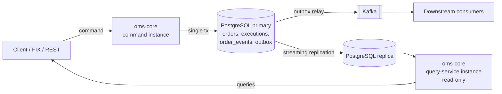
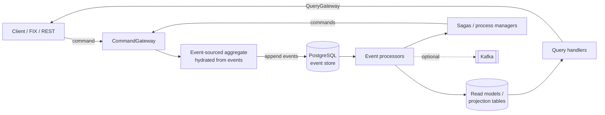
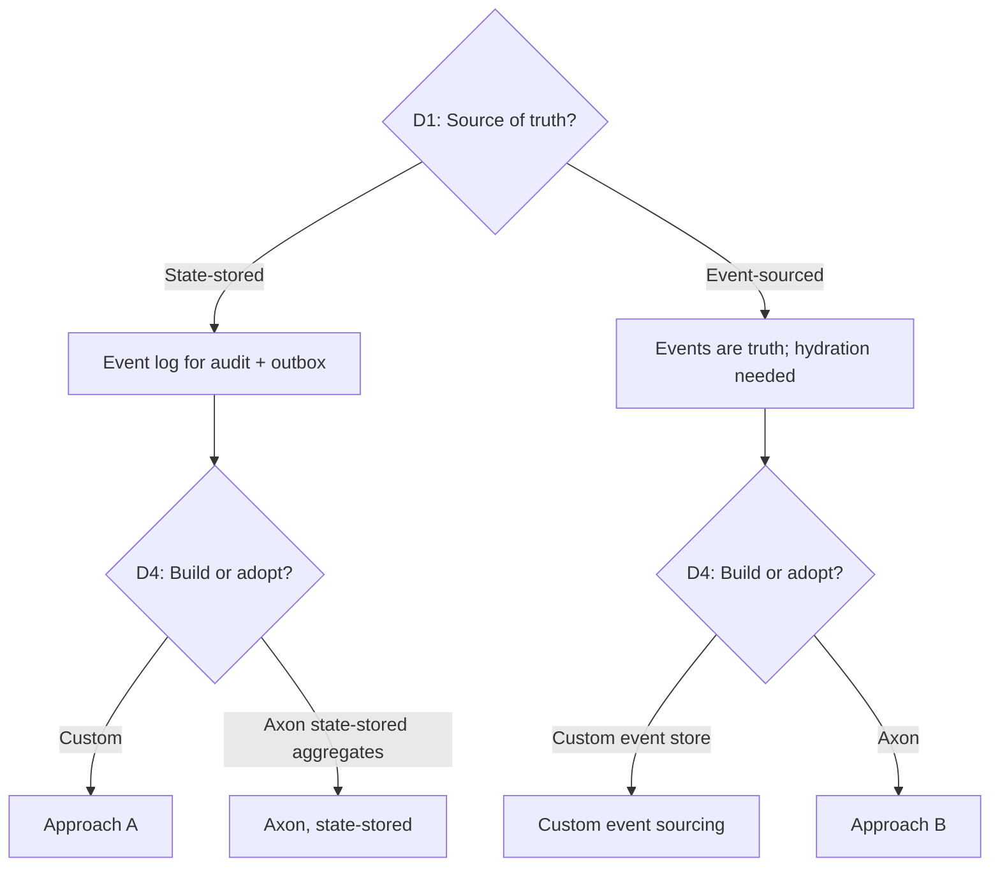
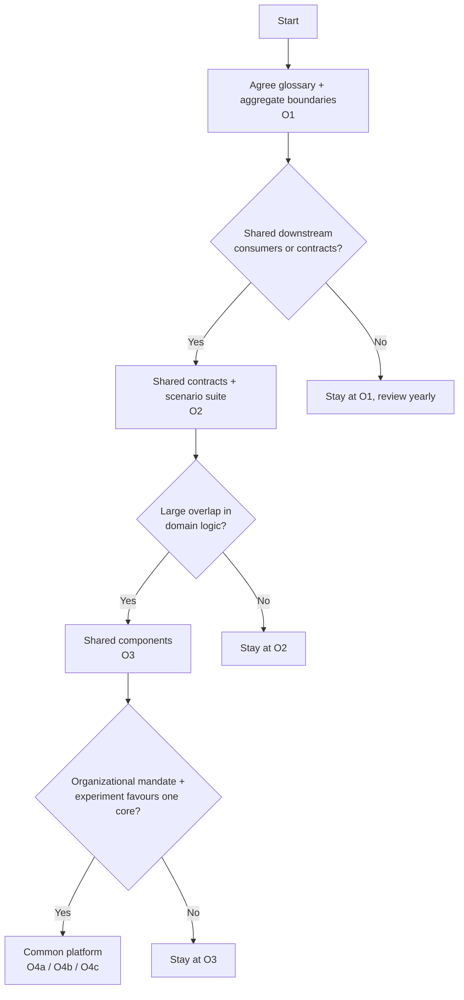

# OMS Architecture Convergence Assessment

**Status:** Draft for discussion
**Last Updated:** 2026-10-08
**Audience:** Architects and lead engineers of both OMS teams

---

## Table of Contents

1. [Purpose and How to Use This Document](#1-purpose-and-how-to-use-this-document)
2. [Collaboration Levels](#2-collaboration-levels)
3. [Shared Glossary](#3-shared-glossary)
4. [The Two Approaches at a Glance](#4-the-two-approaches-at-a-glance)
5. [Separate the Decisions](#5-separate-the-decisions)
6. [Detailed Comparison by Dimension](#6-detailed-comparison-by-dimension)
7. [Summary: Strengths and Weaknesses](#7-summary-strengths-and-weaknesses)
8. [Question Bank](#8-question-bank)
9. [Evaluation Criteria and Scoring](#9-evaluation-criteria-and-scoring)
10. [Side-by-Side Experiment](#10-side-by-side-experiment)
11. [Convergence Options](#11-convergence-options)
12. [Risks of Converging (and of Not Converging)](#12-risks-of-converging-and-of-not-converging)
13. [Proposed Next Steps](#13-proposed-next-steps)
14. [Appendix A: Facts to Verify](#appendix-a-facts-to-verify)
15. [Appendix B: Domain Scope Under Discussion](#appendix-b-domain-scope-under-discussion)

---

## 1. Purpose and How to Use This Document

Two teams are building order management cores for similar needs with different architectures:

- **Approach A — Custom:** a Spring Boot service with hand-built event logging, a transactional
  outbox to Kafka, and a read path served by instances of the same service against PostgreSQL
  read replicas.
- **Approach B — Axon:** a service built on the open-source Axon Framework with a PostgreSQL event
  store, using event-sourced aggregates and Axon's command, event and query infrastructure.

This document is meant to help both teams decide **whether and how to converge** on core OMS
architecture and design principles. It does not recommend an outcome. It tries to:

- give both teams one vocabulary (section 3),
- split the comparison into decisions that can be made independently (section 5),
- describe each approach fairly, dimension by dimension, with the questions each side should answer
  (sections 6 and 8),
- agree on how to judge the outcome before any evidence is collected (section 9),
- describe an experiment that produces evidence instead of opinions (section 10),
- lay out the realistic convergence options (section 11).

**Ground rules for the discussion**

1. Agree on the criteria and their weights (section 9) before running any comparison.
2. Every claim about either approach should be backed by code, a measurement, or production
   experience. Mark everything else as an assumption.
3. Each team describes its own approach, and the other team reviews it. Nobody writes the
   description of the other team's approach unchecked.
4. "We would have to change" is not an argument against an option. "It would cost X and we would
   gain or lose Y" is.

---

## 2. Collaboration Levels

Convergence is not all-or-nothing. Each level below includes the ones before it.

| Level | What is shared | What stays separate | Typical effort | Reversibility |
|---|---|---|---|---|
| **L0 — Exchange** | Knowledge, lessons learned, reviews | Everything else | Low | Trivial |
| **L1 — Concepts** | Glossary, domain model, state machines, aggregate boundaries, design principles | Code, contracts, infrastructure | Low | High |
| **L2 — Contracts** | Event schemas (Avro), API specs (OpenAPI), integration topics, an executable scenario suite | Implementation and internal architecture | Medium | High |
| **L3 — Components** | Selected libraries (e.g. validation, state machine, domain model jar, test fixtures) | Core runtime and persistence model | Medium–High | Medium |
| **L4 — Platform** | One core runtime and architecture, with extension points for regional or product needs | Extensions, deployment, operations | High | Low |

Levels L1 and L2 are useful whatever happens later and don't block L3 or L4. They are a sensible
starting point even if the long-term goal is L4.

---

## 3. Shared Glossary

Many disagreements turn out to be about words. Agree on these definitions first and use them
consistently in all further discussion.

| Term | Agreed meaning | Not to be confused with |
|---|---|---|
| **Aggregate** | A consistency boundary (DDD): a cluster of objects whose invariants must hold together within a single transaction, modified only through its root. One command targets one aggregate. | A collection of orders (use *grouped order*, *block order*, *list order*), or "the aggregated state of events". |
| **Aggregate root** | The entity through which an aggregate is accessed and changed (e.g. `Order`). | |
| **Entity (inside an aggregate)** | An object with identity that lives inside an aggregate and has no lifecycle of its own (e.g. an `Execution` inside an `Order`). | A JPA entity, which is a persistence concept. |
| **Event** | An immutable fact that something happened (e.g. `OrderAccepted`). Named in the past tense. | A message on a Kafka topic, which may carry an event or a state snapshot. |
| **Event stream** | The ordered sequence of events for one aggregate instance. | A Kafka topic. |
| **Event store** | Durable, append-only storage of event streams. | |
| **Event sourcing** | Events are the source of truth; current state is derived by applying events in order. | Keeping an audit log of events next to a stored state (see *state-stored with event log*). |
| **State-stored with event log** | Current state is the source of truth and is stored directly; every change also appends an event for audit and publication. | Event sourcing. |
| **Hydration (rehydration)** | Rebuilding an aggregate's in-memory state by loading its events (optionally starting from a snapshot) and applying them. | Loading a row from a table. |
| **Snapshot** | A stored copy of an aggregate's state at a given event version, used to shorten hydration. | A Kafka message carrying the full order state ("state transfer event"). |
| **Upcasting** | Converting an event stored in an old schema into the current schema when it is read. | Schema migration of a table. |
| **Projection** | A component that consumes events and maintains a read model. | |
| **Read model** | Data shaped for queries, built from events (projection) or copied from the write model (replication). | |
| **CQRS** | Separation of the command (write) model from the query (read) model. Can be done at the API level, the deployment level, or the data model level (see section 6.5). | Read scaling via replicas alone (that is deployment-level CQRS only). |
| **Process manager / saga** | A component that coordinates a long-running process across aggregates by reacting to events and issuing commands (e.g. allocating a grouped order's fills to client orders). | A distributed transaction. |
| **Deadline** | A scheduled future trigger for an aggregate or process (e.g. quote expiry, order SLA). | |
| **Outbox** | A table written in the same transaction as the state change, drained asynchronously to a broker, so the database and broker can't disagree. | |
| **Grouped / block order** | A business construct: one order placed in the market on behalf of several client orders. Whether it is one aggregate or several is a design decision (section 6.2). | "Aggregate". |
| **List order** | FIX term for a set of orders submitted together (`NewOrderList`), not necessarily executed as one. | Grouped order. |

**Suggestion:** where a FIX term exists (Execution Report, Quote Request, Quote, Trade Capture
Report, Allocation Instruction), use it. Both teams already know it and it is independent of either
architecture.

---

## 4. The Two Approaches at a Glance

> Each team should check and correct the description of its own approach. Approach A is described
> from the oms-core prototype plus the production setup; confirm that production matches.

### 4.1 Approach A — Custom (state-stored with event log)

- **Source of truth:** the `orders` (and `executions`) tables.
- **Event log:** every state change appends a row to `order_events` with a per-order `version`, the
  command, the resulting state and a full snapshot of the order.
- **Loading:** read the current row. "Replay" reads the snapshot on the event at the requested
  version, so there is no folding of events.
- **Concurrency:** optimistic locking on the order (`txNr`) plus a unique `(order_id, version)`
  constraint on the event log.
- **Command handling:** a task pipeline (validate → set state → persist → publish) with a
  configurable state machine.
- **Publication:** transactional outbox, drained to Kafka by a relay. Messages carry the full order
  or execution state.
- **Read side:** the same service deployed read-only against PostgreSQL streaming replicas. The read
  model has the same shape as the write model.
- **Dependencies:** Spring Boot, Spring Data JPA, Liquibase, Kafka. No event-sourcing framework.

### 4.2 Approach B — Axon (event-sourced aggregates)

- **Source of truth:** the event store. *(Confirm: are any aggregates state-stored?)*
- **Loading:** hydrate the aggregate from its event stream, starting from a snapshot if configured.
- **Concurrency:** optimistic on the aggregate's sequence number, enforced by the event store.
- **Command handling:** annotated command handlers on the aggregate. Events applied via
  event-sourcing handlers.
- **Read side:** event processors build projections. Queries go through query handlers.
- **Long-running processes:** sagas / process managers and a deadline manager. *(Confirm what is
  used, and its status in the Axon version in use.)*
- **Publication:** *(Confirm: Kafka extension, own outbox, or event processor publishing?)*
- **Dependencies:** Axon Framework (open source, Apache 2.0) on PostgreSQL; no Axon Server.
  *(Confirm version: 4.x or 5.x.)*

---

## 5. Separate the Decisions

"Approach A vs. Approach B" mixes several independent decisions. Each can be made separately, and
some combinations are valid that neither team uses today.

| # | Decision | Options | A today | B today |
|---|---|---|---|---|
| **D1** | **Source of truth / state modelling** | State-stored with event log · Event-sourced · Hybrid (event-sourced, snapshot on every event) | State-stored with event log | Event-sourced |
| **D2** | **Aggregate boundaries** | Per-entity design choices (section 6.2) | Order (+ executions) | *To confirm* |
| **D3** | **Read side strategy** | Replicated write model · Projections · Both | Replication | Projections |
| **D4** | **Infrastructure: build or adopt** | Custom code · Axon · Another framework or library | Custom | Axon |
| **D5** | **Integration contract** | Fat state events · Thin domain events · Both on separate topics | Fat state messages | *To confirm* |
| **D6** | **Process coordination** | Choreography via events · Process managers · Workflow engine | Custom tasks (SLA work in progress) | Sagas / deadlines |

Notes:

- **D1 matters more than D4.** It decides how state is audited, how schemas evolve, and what
  performance looks like. Axon supports state-stored aggregates; custom code can do event sourcing.
  Many arguments for or against Axon are really arguments about D1.
- **D2 must be the same in any comparison.** Otherwise the experiment measures modelling
  differences, not architecture differences.
- **D3 and D5 can be decided independently of D4.** Projections can be built from Kafka topics
  without Axon; replication works with an Axon write side.
- **L1 and L2 convergence (section 2) only needs agreement on D2, D5 and the glossary.** It does not
  require agreement on D1, D3 or D4.

---

## 6. Detailed Comparison by Dimension

Each subsection has the same structure: how A does it, how B does it, trade-offs, and questions to
settle.

### 6.1 Source of Truth and State Modelling (D1)

| | A — State-stored with event log | B — Event-sourced |
|---|---|---|
| Truth | Current-state tables | Event store |
| Event content | Event type + command + resulting state + full snapshot | Domain event with the change only (typically) |
| Reconstructing past state | Read the snapshot at version N (constant time) | Replay events up to N (time grows with N) |
| Risk of state and log disagreeing | Possible if a code path changes state without appending; detected by contiguity and replay checks | Impossible by construction |
| Storage cost per change | Higher (full snapshot per event) | Lower per event; snapshots optional |
| New derived information from history | Limited to what snapshots contain | Any projection can be computed from history |

**Trade-offs**

- A is simpler to reason about, query and fix by hand (it's SQL on current state), but the event log
  is only as complete as the discipline of every code path.
- B guarantees a complete history and makes new projections cheap, but every load depends on
  hydration, and every schema change in an event lives forever.

**Questions**

- Which regulatory or audit needs require a *complete* history of every state change? Does the
  current approach meet them with evidence?
- Has either team needed to answer a question from history that the stored data couldn't answer?
- How often are events read after they are written (replay, audit, debugging, projections)?

### 6.2 Aggregate Design and Consistency Boundaries (D2)

This is the most important design discussion and is independent of framework choice.

| Domain object | Candidate boundary | Reasoning | Open points |
|---|---|---|---|
| **Order + Executions** | One aggregate; executions are entities inside it | A fill changes cumulative and leaves quantity, average price and state; these invariants must hold in one transaction | Expected maximum number of fills per order? |
| **Grouped / block order** | (a) One aggregate with children inside · (b) Parent aggregate + child aggregates coordinated by a process manager | (a) gives strong consistency, but every child fill contends on one lock and grows one stream · (b) scales, but rules across the block become eventually consistent | Which rules must hold *instantly* across the group (e.g. total allocated ≤ parent filled)? |
| **QuoteRequest + Quotes** | (a) One RFQ aggregate containing quotes · (b) Separate aggregates | (a) fits if "first acceptable quote wins, others expire" must be atomic · (b) fits if quotes have independent lifecycles | Lifecycle rules for quote acceptance, expiry, re-quote |
| **Trade Capture Report, Allocation Instruction** | Separate bounded context (post-trade), consuming OMS events | Different lifecycle, different ownership, likely different consistency needs | Scope of core OMS: section 13 and Appendix B |

**Questions**

- For each candidate boundary: which invariants must hold in the same transaction, and which can
  tolerate milliseconds to seconds of delay?
- What are the expected sizes: fills per order, children per grouped order, quotes per request,
  events per stream over the object's lifetime?
- Where does each team draw these boundaries today, and why?

### 6.3 Loading, Hydration and Write-Path Performance

| | A | B |
|---|---|---|
| Loading cost | One row read (plus executions if needed) | Read N events since last snapshot, deserialize, upcast, apply |
| Effect of long histories | None on load; storage grows | Load time grows with stream length unless snapshotted or cached |
| Mitigations | — | Snapshot triggers (e.g. every N events), aggregate caching, smaller aggregates, closing out finished streams |
| Write cost | Update state row + insert event (with snapshot) + insert outbox row | Insert event(s); snapshot occasionally |
| Hot aggregate contention | Row lock / optimistic retry on the order | Sequence conflict / retry on the aggregate |

**Questions for team B**

- In which situations does hydration take long? How long, and for how many events?
- Are snapshots configured? With which trigger? Is there aggregate caching?
- Are the slow cases caused by large aggregates (e.g. grouped orders, long-lived orders)? See 6.2.

**Questions for team A**

- What is the write amplification from storing a full snapshot on every event, measured in bytes per
  order lifecycle and in rows per day?
- What is the p99 latency of the command path, and where is the time spent?

**Questions for both**

- What are the throughput and latency targets (orders/s, fills/s, p99 command latency)? Is either
  approach measured against them today?

### 6.4 Concurrency and Ordering

| | A | B |
|---|---|---|
| Mechanism | `txNr` optimistic lock on the order + unique `(order_id, version)` on events | Unique `(aggregate_id, sequence)` in the event store |
| Conflict handling | Transaction rollback and retry | Exception, retry policy in the command bus |
| Global ordering | Per-order version only | Global sequence (global index) used by event processors |
| Scaling commands across instances | Any instance can handle any order (database arbitrates) | Without Axon Server: routing by aggregate id is needed for caching and fewer conflicts *(confirm how it's done)* |

**Questions**

- How are commands for the same order routed when several instances run?
- How are fills and amendments that arrive at the same time handled? What is the observed conflict
  rate?
- Does anything rely on a global order of events across aggregates?

### 6.5 Read Side and CQRS (D3)

| | A — Replicated write model | B — Projections |
|---|---|---|
| CQRS level | API and deployment (separate query service), same data model | API, deployment and data model |
| Operational complexity | Low (standard PostgreSQL replication) | Projection code, tracking tokens, monitoring of lag, replays |
| Read model shape | Same as write schema | Shaped for each query |
| Adding a new view (blotter by desk, positions, client exposure) | Change the write schema or query complex joins on replica | Add a projection and replay history |
| Fixing a broken read model | Not separable from write model | Reset the token and replay |
| Consistency | Replication lag (typically ms) | Projection lag (ms to s) |
| Read-your-own-writes | Needs routing to primary or waiting for lag | Needs subscription queries or waiting for lag |

**Questions**

- How many distinct query shapes exist today, and how many are expected (blotters, monitoring,
  regulatory reports, client views)?
- Does any UI or downstream system need read-your-own-writes? How is it handled?
- How long does a full projection replay take today in B, and how often is it done?
- Could A's downstream needs be met by projections built from Kafka topics instead?

### 6.6 Event Schema Evolution

| | A | B |
|---|---|---|
| Stored events | Snapshots in the schema at the time they were written | Domain events in the schema at the time they were written |
| Reading old events | Code must tolerate old snapshot shapes | Upcasters convert old events when read |
| Table schema changes | Liquibase migrations on current state | Mostly projections; event store schema is generic |
| Kafka contract | Avro + Schema Registry compatibility rules | *(Confirm)* |

**Questions**

- How many breaking event changes has each team had? How were they handled?
- How long must events stay readable (regulatory retention)?
- Is the Avro schema used for stored events, for Kafka messages, or both?

### 6.7 Long-Running Processes (D6)

Examples in scope: order SLA and timeouts, grouped-order allocation, quote expiry, good-till-date
expiry, end-of-day processing.

| | A | B |
|---|---|---|
| Mechanism | Custom (task pipeline, SLA timestamps and checks under development) | Sagas / process managers, deadline manager *(confirm status in version used)* |
| State of a process | Custom tables | Saga store |
| Timers | Custom (scheduler) | Deadline manager (scheduler-backed) |
| Testing | Custom | Saga test fixtures |

**Questions**

- Which long-running processes exist or are planned in each project?
- How are timers made reliable across restarts and multiple instances?
- How is a stuck or failed process detected and repaired?

### 6.8 Integration and Publication (D5)

| | A | B |
|---|---|---|
| Delivery guarantee to Kafka | Transactional outbox, at least once | *(Confirm: extension, outbox, or processor-based)* |
| Message content | Full order / execution state | *(Confirm)* |
| Ordering guarantee per order | Per-aggregate key on Kafka | *(Confirm)* |
| Consumer contract | Avro in `oms-contracts` | *(Confirm)* |

**Questions**

- What do downstream consumers (post-trade, risk, reporting) need: full state, deltas, or both?
- Could both teams publish the **same** event and topic contract to downstream systems, whatever
  their internals? (This is the core of L2 convergence.)

### 6.9 Audit, Compliance and Data Lifecycle

**Questions for both**

- Which record-keeping obligations apply in each region (order record keeping, timestamps and clock
  synchronization, retention periods)? Do they differ between regions?
- How is personal or client data in events handled with respect to deletion rights? Append-only
  stores often need crypto-shredding or keeping personal data out of events.
- How are old data archived? Can a stream or order be "closed out" and moved to cold storage?
- Can an auditor get the full history of an order with plain tools (SQL), or does it need
  application code?

### 6.10 Extensibility and Product Variants

Both projects need equities (listed) and OTC (quote request / quote), and likely other asset
classes later.

**Questions**

- How are product- or region-specific rules added today (inheritance, strategy beans, separate
  aggregates, configuration)?
- What would an extension point look like in a shared platform: separate aggregates per product,
  pluggable validation, pluggable state machines?
- What must be identical across regions, and what must be customizable? (Turn the answer into the
  boundary of a potential L3/L4 platform.)

### 6.11 Testing

| | A | B |
|---|---|---|
| Unit testing domain logic | JUnit with mocks or task-level tests | Aggregate test fixtures (given events / when command / expect events) |
| Process testing | Custom | Saga test fixtures |
| Integration testing | Spring Boot tests with PostgreSQL and Kafka | Spring Boot tests with PostgreSQL event store |

**Questions**

- Could both teams share an implementation-independent scenario suite (given / when / then in
  business terms) that both codebases must pass? See section 10.

### 6.12 Operations and Observability

**Questions**

- What does each team need to operate in production (databases, brokers, schedulers, dashboards)?
- How is a stuck event processor, a projection that falls behind, or a stuck outbox detected and
  fixed?
- How is a single order debugged in production: which tools, which data?
- Incident history: which production issues were caused by the architecture or the framework, and
  which by domain logic?

### 6.13 Dependency and Lifecycle Risk (D4)

| | A — Custom | B — Axon (open source on PostgreSQL) |
|---|---|---|
| Code you own and maintain | All infrastructure code (event log, outbox, relay, task pipeline, state machine) | Domain code + integration; infrastructure maintained upstream |
| Upgrade risk | Spring Boot / library upgrades only | Plus Axon major versions (4 → 5 is a significant rewrite) |
| Coupling of domain code | To your own abstractions | To Axon annotations, message types and aggregate model |
| Exit cost | n/a | Rewriting command handling, aggregates, processors; events in the store remain usable |
| Vendor | n/a | AxonIQ (commercial company behind an open-source framework) |
| Licence | n/a | Apache 2.0 for the framework; commercial products optional *(confirm nothing commercial is needed)* |
| Hiring and onboarding | Plain Spring knowledge | Spring + Axon concepts; smaller talent pool |
| Battle-testing | Your own tests and production usage | Wide production usage across many companies |

**Questions**

- Which Axon version does team B use, and what is the upgrade plan?
- Is Axon compatible with the target stack (Spring Boot 4, Java 25, Jackson 3)?
- How much infrastructure code does each team maintain today (lines, components, bug count)?
- What would leaving Axon in five years cost? What would adopting it cost team A now?

---

## 7. Summary: Strengths and Weaknesses

### Approach A — Custom, state-stored with event log, replicated read path

**Strengths**

- Simple mental model: current state in tables, readable with SQL.
- No hydration; loading cost doesn't depend on history length.
- Point-in-time state is a single lookup (snapshot on every event).
- Low operational complexity on the read side (standard PostgreSQL replication).
- Few dependencies; no framework upgrade cycle beyond Spring.
- Complete control over behaviour, performance tuning and debugging.

**Weaknesses**

- Completeness of the event log depends on discipline; needs checks (contiguity, replay comparisons).
- Write amplification (full snapshot per event).
- Read model is the write model: new query shapes require write-schema changes or heavy queries.
- No built-in way to rebuild or add read models from history.
- Long-running processes, timers, schema evolution and similar concerns must be built and
  maintained in-house.
- Infrastructure code is a team responsibility forever.

### Approach B — Axon, event-sourced, projections

**Strengths**

- Event log is complete by construction.
- New read models can be built and rebuilt from history.
- Mature building blocks: aggregates, event processors, sagas, deadlines, upcasters, snapshots.
- Strong given/when/then test fixtures.
- Well-known patterns and documentation; shared language with the wider event-sourcing community.
- Less infrastructure code to own.

**Weaknesses**

- Hydration cost grows with stream length; needs snapshotting, caching and careful aggregate sizing.
- More moving parts on the read side (processors, tokens, replays, lag).
- Domain code is coupled to the framework; major-version upgrades can be costly.
- Every event schema lives forever; upcasting needs discipline.
- Events are harder to inspect ad hoc (serialized payloads in a generic table).
- Smaller talent pool; steeper learning curve.

> Both lists should be reviewed and extended by both teams, with evidence attached where possible.

---

## 8. Question Bank

A consolidated list for workshops. Each question should get an owner and an answer with evidence.

### 8.1 For both teams

1. What are the non-negotiable requirements (latency, throughput, availability, retention,
   regulation)?
2. Which pains does your current architecture cause? Which has it solved well?
3. Which parts of your design would you do differently if you started again?
4. Where do you draw aggregate boundaries for Order, Execution, grouped order, QuoteRequest and
   Quote?
5. What is in scope of the core OMS, and what belongs downstream (trade capture, allocations,
   confirmations, settlement)?
6. How many engineers work on the core, and how many on infrastructure vs. domain logic?
7. What is the expected lifetime of the system, and the expected rate of new products and regions?
8. What do you need from the other team to make collaboration worth it?

### 8.2 For team A

1. Does production match the prototype (snapshot per event, outbox, replicated query service)?
2. How do you prevent and detect state changes that bypass the event log?
3. What is the replication lag in practice, and who is affected by it?
4. How are new query shapes handled today? How many are coming?
5. How will long-running processes (SLA, grouping allocation, quote expiry) be implemented?
6. How much code and effort goes into infrastructure rather than domain logic?

### 8.3 For team B

1. Which Axon version? Which event storage engine (JPA or JDBC) and serializer?
2. When does hydration take long? Stream sizes, timings, snapshot configuration, caching?
3. Which event processors are used (tracking, pooled streaming, subscribing)? How long do replays
   take?
4. How are commands routed across instances without Axon Server?
5. How do events reach Kafka or other consumers, and with what guarantees?
6. Which Axon features are actually used, and which were evaluated and rejected?
7. Which problems were caused by Axon itself (bugs, limitations, upgrades)?
8. Any PostgreSQL-specific issues (payload column types, sequence gaps affecting event processors,
   table growth)?

### 8.4 For business, compliance and management

1. Are there regulatory requirements on order history that favour one model?
2. Is there a policy on adopting third-party frameworks for core trading systems (approval, support
   contracts, vendor assessment)?
3. Is a common platform an organizational goal, or is the goal shared knowledge and contracts?
4. Who would own a shared component, and how would priorities between regions be decided?

---

## 9. Evaluation Criteria and Scoring

Agree on criteria and weights **before** running the experiment. Score each option 1–5 per
criterion, with a short justification and a link to evidence.

| # | Criterion | Weight (to agree) | A | B | Evidence |
|---|---|---|---|---|---|
| 1 | Meets latency and throughput targets | | | | |
| 2 | Correctness and completeness of history (audit) | | | | |
| 3 | Ease of adding new query views | | | | |
| 4 | Ease of handling event and schema evolution | | | | |
| 5 | Support for long-running processes and timers | | | | |
| 6 | Testability of domain logic | | | | |
| 7 | Operational complexity | | | | |
| 8 | Debuggability of a single order in production | | | | |
| 9 | Infrastructure code owned by the team | | | | |
| 10 | Dependency and upgrade risk | | | | |
| 11 | Onboarding time and talent availability | | | | |
| 12 | Fit for product and regional extensions | | | | |
| 13 | Migration effort from the current state (per team) | | | | |
| 14 | Regulatory and compliance fit | | | | |

Notes:

- Score the decisions from section 5 separately where possible (e.g. D3 read side independently of
  D4 framework).
- Record dissenting opinions next to scores; don't average them away.

---

## 10. Side-by-Side Experiment

### 10.1 Goal

Produce comparable evidence for the criteria in section 9 by implementing **the same slice** with
**the same aggregate boundaries** in both styles. The goal is not to build a product.

### 10.2 Setup

- Shared contracts: commands, events and queries from `oms-contracts` (or an agreed subset).
- Two implementations:
  - **A:** oms-core (existing), extended where needed.
  - **B:** a new module (e.g. `oms-core-axon`) on Axon with a PostgreSQL event store, using the same
    Axon version as team B.
- Pairing: one engineer from each team on each implementation, so neither is a strawman.
- Time box: 2–3 weeks.

### 10.3 Shared scenario suite

Written in business terms (given / when / then) and executed against both implementations through
their public APIs.

| # | Scenario | What it shows |
|---|---|---|
| 1 | New order → accept → partial fill → fill | Basic lifecycle |
| 2 | New order → partial fill → cancel remaining | State machine, quantity rules |
| 3 | Amend (replace) during partial fill | Concurrency, invariants |
| 4 | Concurrent fills on the same order | Conflict handling, retry |
| 5 | Order with 5,000 fills, then a new command | Hydration and snapshot behaviour |
| 6 | Grouped order with 50 child orders, fills allocated to children | Aggregate boundary choice, process coordination |
| 7 | Quote request → several quotes → accept one → others expire | OTC lifecycle, deadlines |
| 8 | Order SLA breached → alert / state change | Timers, long-running process |
| 9 | Change an event schema with existing data | Schema evolution, upcasting |
| 10 | Add a new query view after the fact (e.g. blotter by desk) | Read-side flexibility, replay |
| 11 | Publish to Kafka with exactly the same contract | Integration convergence (L2) |
| 12 | Restart during processing | Recovery, at-least-once behaviour |

### 10.4 Measurements

| Metric | How |
|---|---|
| Command latency (p50 / p99) | Load test, same hardware and database |
| Throughput (commands/s) at target latency | Load test |
| Hydration / load time vs. stream length | Scenario 5 with 10 / 100 / 1,000 / 5,000 events, with and without snapshots |
| Storage per order lifecycle | Bytes in database after scenarios 1 and 5 |
| Projection rebuild time | Scenario 10, for 1M orders |
| Lines of code: domain vs. infrastructure | Count per implementation |
| Effort per scenario | Logged hours |
| Test expressiveness | Review by both teams |
| Debugging experience | Inject a defect; time to find it |

### 10.5 Outputs

- Filled-in scoring table (section 9) with evidence.
- List of surprises in both directions.
- A recommendation per decision (D1–D6), not one overall verdict.

---

## 11. Convergence Options

| Option | Description | Fits when | Main cost | Main risk |
|---|---|---|---|---|
| **O1 — Share concepts** (L1) | Common glossary, domain model, aggregate boundaries, state machines, principles | Teams have different constraints or timelines | Workshops, docs | Drift over time |
| **O2 — Share contracts and scenarios** (L2) | O1 + common event and API contracts and a shared scenario suite both implementations pass | Downstream systems are shared or similar; implementations may differ | Contract governance | Lowest-common-denominator contracts |
| **O3 — Share components** (L3) | O2 + shared libraries (domain model, validation, state machine, test fixtures) on top of each team's runtime | Large overlap in domain logic, but different infrastructure preferences | Library ownership, release coordination | Coupling without a shared runtime |
| **O4a — Common platform on Axon** (L4) | Both teams on one Axon-based core with extension points | Experiment shows Axon's capabilities outweigh coupling and hydration costs | Team A migration | Framework lock-in, upgrade cost |
| **O4b — Common platform on custom core** (L4) | Both teams on one custom core | Experiment shows custom core meets needs with acceptable infrastructure effort | Team B migration | Owning all infrastructure |
| **O4c — Common platform, hybrid** (L4) | E.g. event-sourced model with snapshot per event, projections built from Kafka, custom or Axon infrastructure chosen per concern | Different concerns favour different approaches | Design effort | Complexity of mixing styles |

---

## 12. Risks of Converging (and of Not Converging)

### Risks of converging

- **Lowest common denominator:** a platform that fits both teams poorly.
- **Coordination overhead:** shared ownership slows down both teams' delivery.
- **Migration cost:** at least one team rewrites core parts of a working system.
- **Governance gaps:** unclear ownership of shared code, contracts and priorities.
- **Regional differences:** regulatory or market differences underestimated.

### Risks of not converging

- **Duplicate effort** on the same hard problems (event store, outbox, processes, schema evolution).
- **Diverging contracts** that make shared downstream systems more expensive.
- **Knowledge silos:** lessons learned stay in one team.
- **Missed scale:** one stronger platform vs. two average ones.

### Mitigations

- Converge step by step (O1 → O2 → O3 → O4) with explicit review points.
- Keep contracts and scenarios independent of implementation so either core can be replaced later.
- Define ownership and a decision process before sharing code.

---

## 13. Proposed Next Steps

| # | Step | Output | Suggested timing |
|---|---|---|---|
| 1 | Review this document in both teams; each team corrects the description of its own approach | Corrected sections 4 and 6 | Week 1 |
| 2 | Glossary workshop | Agreed section 3 | Week 1–2 |
| 3 | Aggregate boundary workshop (Order/Execution, grouped order, QuoteRequest/Quote) and core OMS scope | Agreed section 6.2 and Appendix B | Week 2–3 |
| 4 | Answer the question bank | Section 8 answered with evidence | Week 2–4 |
| 5 | Agree criteria and weights | Section 9 weights | Week 3 |
| 6 | Run the side-by-side experiment | Section 10 outputs | Week 4–6 |
| 7 | Decision workshop per decision (D1–D6) and collaboration level | Decision record | Week 7 |

---

## Appendix A: Facts to Verify

These points depend on versions and licensing that change over time. Verify them before relying on
them.

| Topic | What to verify |
|---|---|
| Axon version | Which major version team B uses (4.x or 5.x) and its support timeline |
| Axon 5 changes | Status of aggregates vs. newer consistency models (e.g. dynamic consistency boundaries), sagas, deadline manager, and PostgreSQL storage support compared with 4.x |
| Stack compatibility | Support for Spring Boot 4, Java 25 and Jackson 3 |
| Licensing | That everything in use is Apache 2.0 and no commercial component is required in production |
| PostgreSQL storage | Payload column mapping (`bytea` vs. large objects), handling of gaps in the global sequence by event processors, index and table growth |
| Command routing | How commands are distributed across instances without Axon Server |
| Kafka integration | Which mechanism publishes events to Kafka and with which delivery guarantee |
| Approach A in production | Whether production matches the oms-core prototype (snapshot per event, outbox, replicated query service) |

---

## Appendix B: Domain Scope Under Discussion

| Domain object | Product type | Core OMS? | Notes |
|---|---|---|---|
| Order | Listed | Yes | Including amend and cancel |
| Execution | Listed | Yes | Probably an entity inside the Order aggregate |
| Grouped / block order | Listed | Yes | See existing order grouping concept; aggregate boundary to decide |
| QuoteRequest | OTC | Yes | |
| Quote | OTC | Yes | Boundary relative to QuoteRequest to decide |
| Trade Capture Report | Both | Undecided | Candidate for post-trade context |
| Allocation Instruction | Both | Undecided | Candidate for post-trade context; overlaps with grouped-order allocation |
| Confirmations, settlement instructions | Both | Probably not | Downstream |

Related existing concepts in this knowledge base:

- [Order lifecycle](../oms-concepts/order-lifecycle.md)
- [Order grouping](../oms-concepts/order-grouping.md)
- [Streaming architecture](../oms-concepts/streaming-architecture.md)
- [Domain model specification](../oms-framework/domain-model_spec.md)
- [State machine framework](../oms-framework/state-machine-framework_spec.md)
- [Task orchestration framework](../oms-framework/task-orchestration-framework_spec.md)
- [State query store](../oms-framework/state-query-store_spec.md)
