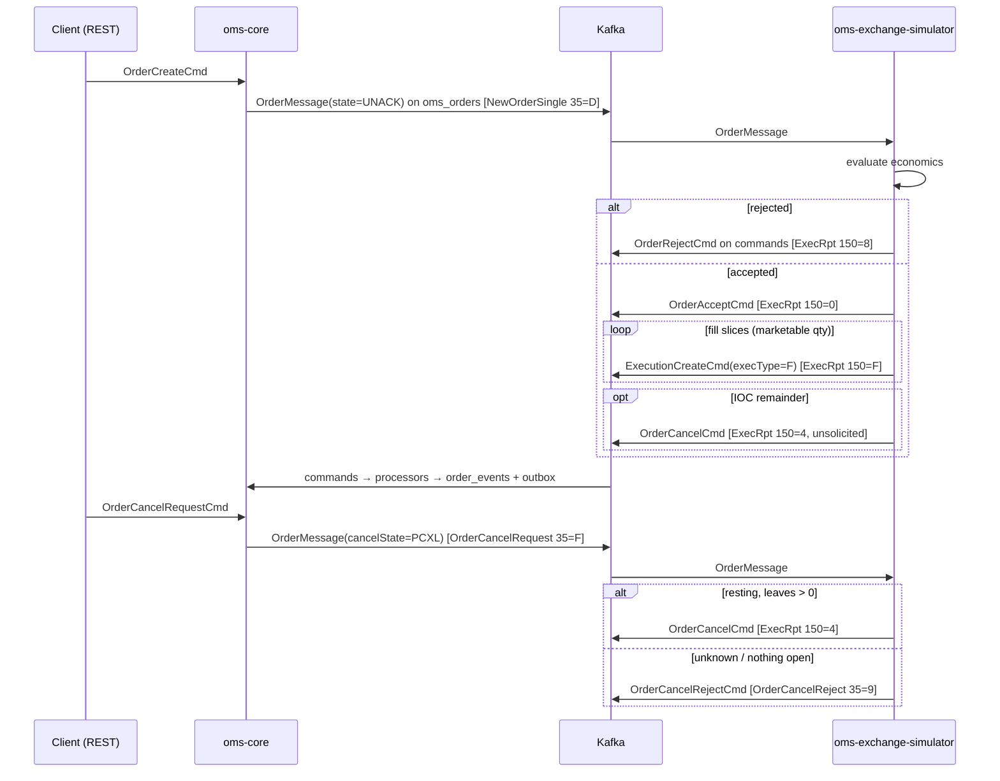

# Design — SPEC-0001: Add exchange simulator with FIX execution workflow

> **Stage 2 of 3 — how.** Concrete enough that the plan can be written without re-reading the
> code, and checked line by line against the architecture policies. Write "None — <reason>" for a
> section that genuinely does not apply.

## Context

**Today**

- **Order creation** runs `OrderCreateCommandProcessor`, a pipeline of `ValidateOrderTask` →
  `AssignOrderIdTask` → `SetOrderStateTask` (NEW → UNACK) → `PersistOrderTask` →
  `PublishOrderEventTask`. The last task hard-codes `Event.NEW_ORDER` and calls
  `OrderEventAppender.appendOrderEvent`, which writes the `order_events` row and an `OutboxMessage`
  for `kafka.order-topic` (`oms_orders`). `OutboxRelay` → `MessagePublisher` then sends an Avro
  `OrderMessage`, keyed by `orderId`. Each later state change publishes the full order again.
- **Market ack**: `OrderAcceptCommandProcessor` (`oms-core/.../service/command/`) loads the order,
  checks UNACK → LIVE with `OrderStateMachineConfig.createStandard()`, saves the order and appends
  `Event.ACK`. If the transition is illegal it returns an unsuccessful result and writes nothing.
- **Fills**: `ExecutionCommandProcessor` runs `ValidateExecutionTask` (order must be LIVE) →
  `CalculateOrderQuantitiesTask` → `DetermineOrderStateTask` (LIVE → LIVE/FILLED) →
  `PersistExecutionTask` (unique `(orderId, execID)`) → `UpdateOrderTask` →
  `PublishExecutionEventTask` (`PARTIAL_FILL`/`FILL`).
- **Entry points**:
  - `CommandController` (REST `/api/command`, implements generated `ExecuteApi`) dispatches with
    `instanceof`.
  - `CommandListener` (Kafka `kafka.command-topic` = `commands`, Avro `CommandMessage` union)
    dispatches with a pattern `switch`. Unsuccessful results are logged and acknowledged;
    exceptions go to retry and then the DLT (`KafkaConsumerConfig.commandErrorHandler`).
- **Model**: `Order` has `state` (`State`), `cancelState` (`CancelState` CXL/PCXL/PMOD/REJ), `text`
  (VARCHAR 255) and `@Version txNr`. Since changeset 003, `state` and `cancel_state` are stored as
  VARCHAR(32), and `order_events.event` is VARCHAR(255). The standard state machine already has
  UNACK → LIVE/REJ and LIVE → FILLED/CXL/REJ.
- **Missing**: no command or processor rejects, cancels, requests a cancel or rejects a cancel.
  `Cmd.avsc` lists OCXL/OREJ, but nothing implements them. No component plays the market.

**Closest examples followed**:
- `OrderAcceptCommandProcessor` + `OrderAcceptCommandProcessorTest`: load, state-machine check,
  append event, return a result object.
- `OrderCreateCommandProcessor`: pipeline assembly, rollback on failure.
- `CommandListenerKafkaIntegrationTest`: Kafka command integration tests.
- `oms-streaming-service`: standalone Spring Boot module with `includeBuild('../oms-contracts')`
  and a Dockerfile.

**Knowledge-base pages read**: `order-lifecycle.md` (§4.5, §4.9, §5.2, §7, §9.2, §10),
`execution-reporting.md` (§2, §3), `state-machine-framework_spec.md`,
`task-orchestration-framework_spec.md`, `validation-rules.md`, `error-handling.md`,
`openapi-contracts.md`, `testing-patterns.md`.

## Approach

Two halves that communicate only through Kafka and the shared contracts.



### A. oms-core: four lifecycle commands (one processor, one pipeline)

New package `org.example.oms.service.lifecycle`:

- **`LifecycleAction`** (enum): one constant per command. It holds the target `State` (or `null` for
  no state change), the resulting `CancelState` (or "unchanged"), the `Event` to record, and whether
  leavesQty is zeroed.

  | Action | Command | Precondition (else refused) | Effect | Event |
  |---|---|---|---|---|
  | `REJECT` | `OrderRejectCmd` | `stateMachine.isValidTransition(state, REJ)` (UNACK, LIVE) | state REJ, leavesQty 0, text | `REJ` |
  | `CANCEL` | `OrderCancelCmd` | `isValidTransition(state, CXL)` (LIVE) | state CXL, cancelState CXL, leavesQty 0, text if given; cumQty kept | `CXL` |
  | `CANCEL_REQUEST` | `OrderCancelRequestCmd` | state == LIVE, leavesQty > 0, cancelState != PCXL | cancelState PCXL | `CXL_REQUEST` (new) |
  | `CANCEL_REJECT` | `OrderCancelRejectCmd` | cancelState == PCXL | cancelState REJ, text | `CXL_REJ` (new) |

- **`OrderLifecycleCommandProcessor`** (`@Service`, `@Transactional`,
  `@Observed(name = "oms.order-lifecycle-processor.process")`):
  - `process(Command, Instant receivedTime)` maps the command type to a `LifecycleAction`, builds an
    `OrderTaskContext` (command, orderId, action) and runs the `OrderLifecyclePipeline` with
    `stopOnFailure`. On failure it calls `setRollbackOnly()`, as `OrderCreateCommandProcessor` does.
  - Returns `OrderLifecycleResult {success, orderId, action, errorMessage}`.
- **Pipeline tasks**, in `service/lifecycle/tasks`, ordered with the same numbering scheme:
  1. `LoadOrderTask` (50): `orderRepository.findByOrderId`. A blank orderId fails with
     "orderId is required"; a missing order fails with "Order not found: …".
  2. `ValidateLifecycleActionTask` (100): applies the precondition column using
     `OrderStateMachineConfig.createStandard()`. Failure message:
     `"<Action> not allowed for order <id> in state <state>/<cancelState>"`.
  3. `ApplyLifecycleActionTask` (300): `order.toBuilder()` with the effect column plus
     `transactTime = now`. `text` is truncated to 255 characters. Sets `context.event`.
  4. `SaveOrderTask` (400): `orderRepository.saveAndFlush`. An `OptimisticLockingFailureException`
     (`txNr`) is rethrown, not converted into a result.
  5. `PublishOrderEventTask` (500, **existing, generalized**): appends `context.getEvent()`, falling
     back to `Event.NEW_ORDER` when it is unset. The create pipeline does not change.
- `OrderTaskContext` gets two fields: `Event event` and `LifecycleAction lifecycleAction`.
- `Event` enum gets two new values: `CXL_REQUEST` and `CXL_REJ`.
- **Entry points**:
  - `CommandController`: one branch for the four types →
    `orderLifecycleCommandProcessor.process`. Success returns 200 `CommandResult{id=orderId,
    status=OK}`; failure returns 400 `CommandResult{status=FAILED, message=errorMessage}`, the
    same shape as the accept branch.
  - `CommandListener`: four new `case`s. Each converts the Avro record to the cmd model by
    constructor (as `handleOrderAccept` does) and logs and acknowledges an unsuccessful result.
  - Both pass `receivedTime`.

### B. New module `oms-exchange-simulator`

Standalone Gradle build with `includeBuild('../oms-contracts')`, Spring Boot 4.1.0, Java 25.
Package `org.example.simulator`:

- **`config.SimulatorProperties`** (`@ConfigurationProperties("simulator")`):
  - `referencePrices: Map<String, BigDecimal>`
  - `priceBandPercent` (default 10)
  - `fillSlices` (default 1)
  - `fillDelay` (`Duration`, default 0)
  - `lastMkt` (default `XSIM`)
  - `orderTopic` (default `oms_orders`), `commandTopic` (default `commands`)

  `application.yml` ships defaults: AAPL 170.00, MSFT 420.00, IBM 250.00, NVDA 120.00, all
  overridable by environment variables.
- **`engine.OrderEvaluator`** (pure, no Spring): `evaluate(OrderMessage) → Evaluation`. Rejects, in
  this order:
  1. missing or ≤ 0 `orderQty`: "Invalid order quantity";
  2. `ordType` not MARKET/LIMIT: "Unsupported order type <t>";
  3. side not BUY/SELL/SELL_SHORT: "Unsupported side <s>";
  4. no reference price for the symbol: "Unknown symbol <s>";
  5. LIMIT without a price: "Limit order without price";
  6. LIMIT price outside the reference ± band: "Price <p> outside band <lo>-<hi>".

  Otherwise it accepts with `marketable` (MARKET always; LIMIT buy when price ≥ reference, sell
  when price ≤ reference), `fillPrice = reference` and `ioc = timeInForce == IMMEDIATE_OR_CANCEL`.
- **`engine.FillSlicer`** (pure): splits qty into ≤ `fillSlices` positive slices. The first n−1
  slices are `floor(qty / n)` and the last takes the remainder; n is reduced when `floor` would give
  0. Example: 100 / 3 → 33, 33, 34.
- **`engine.ExchangeEngine`**: the single-threaded "matching engine". It owns a
  `ScheduledExecutorService` with one thread and an in-memory
  `Map<String, SimOrder{orderId, leavesQty, cumQty, lastCancelState, done}>`.
  - All work runs on that thread, so each order's events are processed serially (exchange
    semantics; proposal decision on fills that race a cancel).
  - `onOrderMessage(OrderMessage)` enqueues work:
    - first sight of an orderId with state UNACK → evaluate, then reject or accept;
    - marketable quantity → schedule slices at `fillDelay` intervals; IOC with a remainder →
      `OrderCancelCmd` after the last slice; non-marketable non-IOC → rest; non-marketable IOC →
      `OrderCancelCmd`;
    - `cancelState` changes into PCXL (compared with `lastCancelState`): if known with
      leavesQty > 0 and not done → `OrderCancelCmd`, mark done, and skip pending slices; otherwise
      → `OrderCancelRejectCmd` ("Unknown order" / "Too late to cancel");
    - anything else is ignored. This covers redelivery and the OMS's own LIVE/fill updates
      (proposal AC-10).
  - Each scheduled slice re-checks `done` before it sends.
  - execIds are deterministic (`<orderId>-F<n>`), so a resend is caught by the OMS's
    `(orderId, execID)` unique constraint.
- **`kafka.OrderMessageListener`**: `@KafkaListener(topics = "${simulator.order-topic}", groupId =
  "exchange-simulator")`. It delegates to the engine and adds `orderId` to the MDC.
- **`kafka.CommandGateway`**: builds the Avro command records, wraps each in a `CommandMessage` and
  sends it with `KafkaTemplate<String, CommandMessage>` keyed by `orderId`. It blocks on `get(10s)`,
  so per-order send order is preserved.

  | Field | Value |
  |---|---|
  | `type` | the record name, e.g. `OrderAcceptCmd` |
  | `version` | `1.0.0` |
  | `Execution` | `execId`, `orderId`, `lastQty`, `lastPx`, `cumQty`, `leavesQty` (all scale 4), `execType = "F"`, `lastMkt`, `transactTime` |
- **`metrics.SimulatorMetrics`**: Micrometer counters `simulator.orders.received`,
  `simulator.acks`, `simulator.executions`, `simulator.rejects`, `simulator.cancels`,
  `simulator.cancel.rejects`. Exposed at `/actuator/prometheus`.
- **Wiring**:
  - Kafka uses the same Avro + Schema Registry serializer settings as oms-core.
  - Server port 8094.
  - `Dockerfile` follows oms-streaming-service's.
  - `docker-compose.yml` gets an `exchange-simulator` service (depends on broker and
    schema-registry; env `KAFKA_BROKERS`, `REGISTRY_URL`).
  - The root `settings.gradle`/`build.gradle` include the build, and `oms-contracts`'
    `verifyContracts` adds the module to its stray-contract check.

### What-Changes → where

| Proposal bullet | Where |
|---|---|
| Simulator service and its FIX mapping | B: `ExchangeEngine`, `CommandGateway` |
| Order economics and reject rules | B: `OrderEvaluator`, `FillSlicer` |
| In-memory resting orders, redelivery ignored, metrics | B: `ExchangeEngine`, `SimulatorMetrics` |
| Four OMS commands | A: `OrderLifecycleCommandProcessor` + tasks, controller, listener |
| Contracts | Contract Changes below |
| New event kinds | A: `Event.CXL_REQUEST`, `Event.CXL_REJ` |
| Knowledge base | Knowledge Base Updates below |

## Contract Changes

All additive (P-04). Generated classes added: `org.example.common.model.cmd.{OrderRejectCmd,
OrderCancelCmd, OrderCancelRequestCmd, OrderCancelRejectCmd}` and
`org.example.common.model.msg.{same names}`. `CommandMessage` (msg) gains four union branches.
`Command` (cmd) gains four discriminator subtypes. No existing generated class loses or changes a
member.

**`oms-contracts/src/main/openapi/oms-cmd-api.yml`**:

```yaml
    Command:
      discriminator:
        propertyName: type
        mapping:
          OrderCreateCmd: '#/components/schemas/OrderCreateCmd'
          OrderAcceptCmd: '#/components/schemas/OrderAcceptCmd'
          ExecutionCreateCmd: '#/components/schemas/ExecutionCreateCmd'
          OrderRejectCmd: '#/components/schemas/OrderRejectCmd'
          OrderCancelCmd: '#/components/schemas/OrderCancelCmd'
          OrderCancelRequestCmd: '#/components/schemas/OrderCancelRequestCmd'
          OrderCancelRejectCmd: '#/components/schemas/OrderCancelRejectCmd'

    OrderRejectCmd:
      description: Market rejected the order (FIX ExecutionReport ExecType=8).
      allOf:
        - $ref: '#/components/schemas/Command'
        - type: object
          required: [orderId]
          properties:
            orderId: { type: string, minLength: 1 }
            text: { type: string, maxLength: 255, description: Reject reason }

    OrderCancelCmd:
      description: Market confirmed a cancel, solicited or unsolicited (FIX ExecutionReport ExecType=4).
      allOf:
        - $ref: '#/components/schemas/Command'
        - type: object
          required: [orderId]
          properties:
            orderId: { type: string, minLength: 1 }
            text: { type: string, maxLength: 255 }

    OrderCancelRequestCmd:
      description: Client requests cancellation of the open quantity (FIX OrderCancelRequest 35=F).
      allOf:
        - $ref: '#/components/schemas/Command'
        - type: object
          required: [orderId]
          properties:
            orderId: { type: string, minLength: 1 }

    OrderCancelRejectCmd:
      description: Market refused a cancel request (FIX OrderCancelReject 35=9).
      allOf:
        - $ref: '#/components/schemas/Command'
        - type: object
          required: [orderId]
          properties:
            orderId: { type: string, minLength: 1 }
            text: { type: string, maxLength: 255, description: Cancel reject reason }
```

**`oms-contracts/src/main/avro/OrderRejectCmd.avsc`**. `OrderCancelCmd.avsc` and
`OrderCancelRejectCmd.avsc` are identical apart from the name and doc. `OrderCancelRequestCmd.avsc`
has no `text` field.

```json
{
  "namespace": "org.example.common.model.msg",
  "type": "record",
  "name": "OrderRejectCmd",
  "doc": "Market rejected the order (FIX ExecutionReport ExecType=8).",
  "fields": [
    { "name": "type", "type": "string", "doc": "Command type discriminator" },
    { "name": "version", "type": ["null", "string"], "default": null },
    { "name": "orderId", "type": ["null", "string"], "default": null },
    { "name": "text", "type": ["null", "string"], "default": null, "doc": "Reject reason" }
  ]
}
```

**`CommandMessage.avsc`**: new branches appended at the end of the union. Existing branch order is
kept.

```json
"type": [
  "org.example.common.model.msg.QuoteRequestCreateCmd",
  "org.example.common.model.msg.QuoteCreateCmd",
  "org.example.common.model.msg.OrderCreateCmd",
  "org.example.common.model.msg.OrderAcceptCmd",
  "org.example.common.model.msg.ExecutionCreateCmd",
  "org.example.common.model.msg.ExecutionWhackCmd",
  "org.example.common.model.msg.ExecutionBustCmd",
  "org.example.common.model.msg.OrderRejectCmd",
  "org.example.common.model.msg.OrderCancelCmd",
  "org.example.common.model.msg.OrderCancelRequestCmd",
  "org.example.common.model.msg.OrderCancelRejectCmd"
]
```

**Compatibility**: adding union branches is BACKWARD compatible, because a new reader resolves old
data by branch name. This is the Schema Registry default. It is proven by the AC-11 test against a
baseline copy of the current resolved `CommandMessage` schema.

## Data & Persistence

None (no migration):
- `orders.state` and `orders.cancel_state` are VARCHAR(32) storing enum names (changeset 003), and
  no values are added to `State` or `CancelState`.
- `order_events.event` is VARCHAR(255) storing `Event` names, so `CXL_REQUEST`/`CXL_REJ` fit.
- `orders.text` is VARCHAR(255); the OpenAPI `maxLength: 255` and truncation in
  `ApplyLifecycleActionTask` keep it valid.
- Optimistic locking is unchanged: `@Version txNr` on `Order`, enforced by `saveAndFlush` in
  `SaveOrderTask`.
- `(orderId, execID)` stays the uniqueness guard for simulator fills.

`LiquibaseMigrationIntegrationTest` must still pass (no new changelog). Rollback is a code-only
revert.

## Events & Messaging

- **`order_events` (P-05)**: every successful lifecycle command appends exactly one event through
  `OrderEventAppender.appendOrderEvent` in the processor's transaction (`REJ`, `CXL`,
  `CXL_REQUEST`, `CXL_REJ`) with the next per-order version, the command and the snapshot. The
  replay snapshot therefore reflects the new state, cancelState and leavesQty.
- **Outbox (P-06)**: the same call stages the order for `oms_orders`. No new topics, and no
  `KafkaTemplate` in oms-core services.
- **Simulator**:
  - consumes `oms_orders` (group `exchange-simulator`, `auto-offset-reset: earliest`, specific Avro
    reader) and produces `CommandMessage` to `commands` with key = `orderId`;
  - has no database, so the outbox pattern does not apply. It is an external party, like a real
    venue session. A crash between deciding and sending loses the response, which is acceptable
    for a test tool; the order stays UNACK or LIVE in the OMS, as it would with a dropped venue
    connection.
- **Ordering**: both topics are keyed by `orderId`, so per-order messages stay in order on one
  partition:
  - the simulator sends ack → fills → cancel in sequence (blocking sends from one thread);
  - `CommandListener` processes a partition serially, so `ValidateExecutionTask` (needs LIVE) always
    runs after the ack has committed.
- **Idempotency (P-08)**:
  - **OMS**: each action's precondition is false once it has been applied (REJ/CXL are not valid
    sources for REJ/CXL; a second cancel request sees PCXL; a second cancel reject sees REJ, not
    PCXL). A duplicate is refused with no write, logged and acknowledged.
  - **Simulator**: acts only on (first UNACK sight) and (a change of `cancelState` into PCXL).
    Every other message, including redeliveries, is a no-op. Fill execIds are deterministic.

## Domain, State & Orchestration

- **State machine (P-10)**: no new transitions. The existing standard config covers UNACK/LIVE → REJ
  and LIVE → CXL; CANCEL_REQUEST and CANCEL_REJECT change only `cancelState`. Every check uses
  `OrderStateMachineConfig.createStandard()`, the instance the other processors use.
- **Pipeline (P-10)**: Load → Validate → Apply (set state) → Save → Publish, run by
  `TaskOrchestrator`, as described in Approach A.
- **Fills while PCXL**: `ValidateExecutionTask` checks only `state == LIVE`, so fills are still
  accepted while a cancel is pending (FIX semantics: a fill can cross a cancel). After CXL, a late
  fill is refused by the existing check.
- **Errors (P-13)**:

  | Source | Problem | Response |
  |---|---|---|
  | REST | business refusal | 400 with `CommandResult{status: FAILED, message}`, like the existing accept branch |
  | REST | malformed body (missing orderId, text > 255) | rejected by bean validation on the generated model; existing `ResponseEntityExceptionHandler` Problem+JSON |
  | REST | optimistic-lock conflict | existing `GlobalExceptionHandler.handleOptimisticLocking` (409 Problem+JSON) |
  | Kafka | refusal | logged at WARN and acknowledged |
  | Kafka | exception | retry, then DLT (unchanged) |
- **Validation (simulator boundary)**: `OrderEvaluator` validates every inbound order. Anything it
  cannot trade becomes an `OrderRejectCmd` with a reason; it never throws on bad data. An
  `OrderMessage` it cannot deserialize is handled by `ErrorHandlingDeserializer` and logged and
  skipped.

## Alternatives & Decisions

- **Decision: simulator replies over the Kafka `commands` topic.** Alternative: REST
  `/api/command`. Rejected because REST would need an HTTP client, retries and ordering control in
  the simulator, while Kafka gives per-order ordering, retry and DLT for free, and the processors
  behind both are the same.
- **Decision: a new standalone module `oms-exchange-simulator`.** Alternative: a profile inside
  oms-streaming-service or oms-core. Rejected because a venue is an external party: it must deploy,
  scale and be switched off independently (microservices principle), and putting it inside oms-core
  would let simulator code reach OMS internals and blur the boundary being tested.
- **Decision: one `OrderLifecycleCommandProcessor` with a shared pipeline driven by a
  `LifecycleAction` table.** Alternative: four sibling processors cloned from
  `OrderAcceptCommandProcessor`. Rejected because four copies of the load/check/save/append code
  would invite drift, while the table makes the rules reviewable in one place. Accept stays as it is
  (out of scope).
- **Decision: generalize `PublishOrderEventTask` to read the event from the context.** Alternative:
  a new `RecordLifecycleEventTask`. Rejected because it would duplicate a ten-line task; the default
  keeps create behaviour unchanged.
- **Decision: single-threaded engine with a scheduled executor.** Alternative: sleeping in the Kafka
  listener thread. Rejected because it blocks the other orders on the partition and makes a cancel
  wait for slicing to finish. Alternative: per-order actors. Rejected as more machinery than the
  ACs need.
- **Decision: split end-to-end verification across modules.** Each end-to-end AC is proven by two
  tests that meet at the Kafka contract:
  - the simulator integration test proves that a given `OrderMessage` produces exactly the expected
    `CommandMessage` sequence;
  - the oms-core integration test proves that this sequence drives the order to the expected
    state, rows and events.

  Alternative: one test running both services (Testcontainers `GenericContainer` with built images).
  Rejected because it needs Docker images built before tests, couples module builds and breaks
  P-18. A manual docker-compose smoke run is documented in the knowledge-base page.
- **Decision: static reference prices, fill at reference, no book** (proposal assumption).
- **Decision: extra reject reasons** (unsupported ordType/side, limit without price) beyond the three
  in the proposal, so that no inbound order makes the engine throw. Each is a reject with a reason,
  consistent with AC-4/AC-5.
- **Build and dependency changes (P-17)**:
  - New module build: Spring Boot web (actuator only), `spring-boot-starter-kafka`,
    `io.confluent:kafka-avro-serializer:7.9.9`, `micrometer-registry-prometheus`, Lombok, and
    Testcontainers Kafka for tests. These are the same artifacts and versions oms-core uses; nothing
    new is introduced to the repository.
  - `oms-contracts/build.gradle` adds JUnit Jupiter (`testImplementation
    'org.junit.jupiter:junit-jupiter'`, version from the Boot BOM, plus `junit-platform-launcher`)
    for the AC-11 compatibility test, and adds `oms-exchange-simulator` to `verifyContracts`.
  - Root `settings.gradle`/`build.gradle` include the new build.
- **Changed during implementation: the command-API `Execution` schema is extended (additive)**
  because, in `oms-cmd-api.yml`, `Execution` declared only `execId` and `orderId`, and
  `OrderMapper.toExecution` ignored every field including `execID`. Every `ExecutionCreateCmd` sent
  via REST or Kafka therefore reached `ValidateExecutionTask` without execID, lastQty or lastPx and
  was refused. Fills through commands, which AC-1 and AC-2 depend on, could never have worked. The
  existing tests call `ExecutionCommandProcessor` directly, which is why this was hidden.
  - Fix: add optional properties to `Execution`: `lastQty`, `lastPx`, `cumQty`, `leavesQty`
    (number), `execType`, `lastMkt`, `lastCapacity` (string), `transactTime` (date-time,
    `x-java-type: java.time.Instant`). `lastQty` and `lastPx` stay optional in the schema so that
    no existing client breaks; `ValidateExecutionTask` still requires them.
  - `OrderMapper.toExecution` maps `execId → execID` and the new fields by name.
  - Alternative: a separate `ExecutionReportCmd`. Rejected because `ExecutionCreateCmd` is
    already the documented fill command, and the Avro `Execution` already carries these fields.
    Additive change, P-04 compliant; covered by new task T-19 and `OrderMapperExecutionTest`.
- **Changed during implementation: new orders get `cumQty = 0` and `leavesQty = orderQty`** in
  `SetOrderStateTask`. Until now the create path left both null (`OrderMapper` ignores them and no
  task set them), which contradicts `order-lifecycle.md` §8.1 (NEW/UNACK: cumQty 0, leavesQty =
  orderQty).
  - Consequences: a resting order would show null leavesQty (AC-3), and the CANCEL_REQUEST
    precondition `leavesQty > 0` would refuse every unfilled order (AC-7).
  - This aligns the code with the documented semantics; it does not change them.
    `CalculateOrderQuantitiesTask` already treats a null cumQty as 0, so fills behave the same.
  - Covered by task T-20 and `SetOrderStateTaskTest`.
- **Changed during implementation: `CommandListener` maps the Avro `ExecutionCreateCmd` with
  MapStruct** (`OrderMapper.toCmdExecution`) instead of `objectMapper.convertValue`. Jackson
  serializes the Avro record's `getSchema()` and throws "Not an array", so every Kafka fill went to
  the DLT. The mapping is target-driven, so Avro-only members are ignored, and
  `transactTime` Instant → OffsetDateTime uses the existing `instantToOffset`. `OrderCreateCmd`
  has the same latent defect; it is not needed by any AC here and is listed as a follow-up.
  Covered by task T-21.
- **Changed after independent review: lifecycle commands carry an optional `commandId`, and a
  command whose id is already in the order's event log is refused as a duplicate.**
  - Why: state preconditions alone are not idempotent across a Kafka replay. After
    `CANCEL_REQUEST → CANCEL_REJECT`, the order is LIVE/REJ and the cancel-request precondition
    holds again. A replay of `[CR, CXL_REJ]` from an uncommitted offset would therefore apply both a
    second time (two extra events, txNr +2, PCXL re-published, the venue answers again). A stale
    `OrderCancelRejectCmd` replayed after a newer request would wrongly reject it.
  - Contract (additive, P-04): `commandId` (`["null","string"]`, default null) appended to the four
    Avro lifecycle records; optional `commandId` (string, maxLength 64) on the four OpenAPI
    schemas. The compatibility baseline still passes.
  - oms-core: new `DeduplicateCommandTask` (order 75, after load). When the command has a
    commandId and any `order_events.transaction` of that order carries the same commandId (same
    command type), it fails with `"Duplicate command <id> for order <orderId>"`. Nothing is
    written; the refusal is logged and acknowledged like every other.
    - The check reads the order's own event stream, which is small and already indexed by order_id,
      so it needs no new table or migration.
    - The event stream is the record of applied commands, so it cannot drift from it.
    - A command without a commandId keeps the state-precondition behaviour, so existing clients
      are unaffected.
  - Simulator: each lifecycle command it sends carries a deterministic id derived from the
    `OrderMessage` that triggered it: `<orderId>-REJ-<eventId>`, `<orderId>-CXL-<eventId>` and
    `<orderId>-CXLREJ-<eventId>`. `eventId` is the order's event-log version that oms-core puts on
    every published `OrderMessage`. For a cancel request, it is the version of the `CXL_REQUEST`
    event.
    - A replayed request therefore produces the same id, and the answer is a duplicate.
    - A genuinely new request has a new version and gets a new id, even after a simulator restart,
      which a per-process counter would not survive.
    - If `eventId` is absent, no commandId is sent and the state preconditions still apply.
  - Alternatives rejected:
    - A processed-commands table: needs a migration and duplicates what the event log already
      records.
    - Storing Kafka offsets: does not cover the REST path.
    - Narrowing AC-10: would change the accepted contract.
  - Tests: `OrderLifecycleCommandProcessorTest#duplicateCommandId_refusedWithoutWrites`,
    `ExchangeWorkflowIntegrationTest#replayedCancelRequestAndReject_afterProcessing_haveNoSecondEffect`,
    and `ExchangeEngineTest#commandIdsAreDeterministicPerAnswer`. Tasks T-22 to T-24.
- **Also from the review (minor, fixed in T-25)**:
  - The simulator's default `auto-offset-reset` is now `latest`, so a new consumer group does not
    replay the retained order history as new orders. Tests set `earliest` explicitly.
  - `FillSlicer` no longer uses `intValueExact()`, which overflows on quantities above
    `Integer.MAX_VALUE`.
  - The engine keeps order state in a bounded LRU map (`simulator.max-tracked-orders`, default
    100000), so memory stays bounded. Evicting as soon as an order is terminal was rejected: a Kafka
    replay of the order's UNACK message would then look like a new order, and the venue would ack
    and fill it again. With the LRU, only orders older than the window are forgotten; a cancel
    request for such an order is refused as unknown, the documented restart behaviour.
  - `ExchangeWorkflowIntegrationTest` asserts that `OrderReplayService` reproduces the stored
    state after each new event (P-05).

## Risks & Mitigations

## Risks & Mitigations

- **Avro decimal scale mismatch**: Avro `decimal(18,4)` throws if the BigDecimal scale differs.
  `CommandGateway` sets scale 4 (`HALF_UP`) on every quantity and price, and a unit test covers
  serialization of each command with the real `KafkaAvroSerializer` (mock registry).
- **Fill arriving before the ack commits**: the same partition key and serial processing prevent it.
  `ExchangeWorkflowIntegrationTest` sends ack and fills back to back to prove it.
- **Simulator reacting to the OMS's own updates**: the engine acts only on the two triggers, and
  unit tests feed it LIVE/PARTIAL/FILLED/CXL messages and assert no commands.
- **Integration test flakiness from timing**: tests use Awaitility-style polling with a 10 s bound
  (existing tests use the same pattern) and `fillDelay = 0`. AC-3's "no fills for 3 s" is a bounded
  negative check.
- **In-memory state lost on restart**: by design (out of scope). AC-8 makes the resulting behaviour
  explicit (cancel reject).
- **Cancel-request flow without a running simulator**: the order stays PCXL. The documentation
  states that cancel requests need a venue, which is FIX behaviour too.
- **Spec tooling does not know the module yet**: `spec verify` skips it until a human adds it to
  `specs/config.json`. The verify stage runs `oms-exchange-simulator: ./gradlew check` explicitly and
  records the output.

## Test Strategy

The simulator half is tested with Testcontainers Kafka and a `mock://` schema registry; the oms-core
half extends `AbstractKafkaPostgresIntegrationTest`. Classes marked (new) are created in this ticket.

| AC | Level | Test class#method | What it asserts |
|---|---|---|---|
| AC-1 | unit + integration (sim) + integration (core) | sim `ExchangeEngineTest#marketOrder_singleSlice_acksThenFillsAtReference` (new); sim `ExchangeSimulatorKafkaIntegrationTest#unackOrder_producesAckThenSingleFill` (new); core `ExchangeWorkflowIntegrationTest#ackThenSingleFill_ordersFilledWithNewAckFillEvents` (new) | sim: exactly [OrderAcceptCmd, ExecutionCreateCmd(lastQty 100, lastPx 170.0000, execType F)] on `commands`; core: order FILLED, cumQty 100, leavesQty 0, one execution, events NEW_ORDER, ACK, FILL |
| AC-2 | unit + integration (sim) + integration (core) | sim `FillSlicerTest#splitsIntoPositiveSlicesSummingToQty` (new); sim `ExchangeEngineTest#threeSlices_sendsThreeFillsWithDistinctExecIds` (new); core `ExchangeWorkflowIntegrationTest#ackThenThreeFills_eventsPartialPartialFill` (new) | 33/33/34 slices, distinct execIds, sum 100; core events NEW_ORDER, ACK, PARTIAL_FILL, PARTIAL_FILL, FILL and state FILLED |
| AC-3 | unit + integration (sim) | sim `OrderEvaluatorTest#limitBuyAboveReference_isMarketableAtReferencePrice` (new); sim `OrderEvaluatorTest#limitBuyBelowReference_rests` (new); sim `ExchangeSimulatorKafkaIntegrationTest#nonMarketableLimit_ackOnlyNoFillsWithin3s` (new); core `ExchangeWorkflowIntegrationTest#ackOnly_orderLiveWithFullLeaves` (new) | fill at 170.0000; resting order: only an ack, then no ExecutionCreateCmd for 3 s; core order LIVE, cumQty 0, leaves = orderQty |
| AC-4 | unit + integration (sim) + integration (core) | sim `OrderEvaluatorTest#unknownSymbol_rejected` (new); sim `ExchangeSimulatorKafkaIntegrationTest#unknownSymbol_producesRejectOnly` (new); core `ExchangeWorkflowIntegrationTest#reject_orderRejWithReasonAndNoExecutions` (new) | OrderRejectCmd with text containing "Unknown symbol" and nothing else; core state REJ, leavesQty 0, text kept, last event REJ, 0 executions |
| AC-5 | unit | sim `OrderEvaluatorTest#limitOutsidePriceBand_rejected`, `OrderEvaluatorTest#zeroOrMissingQty_rejected` (new); sim `ExchangeEngineTest#invalidQty_sendsRejectOnly` (new) | reason mentions band; zero/null qty → only OrderRejectCmd, no accept or exec |
| AC-6 | unit + integration (core) | sim `ExchangeEngineTest#iocNotMarketable_acksThenCancels`, `ExchangeEngineTest#iocMarketable_fillsAndDoesNotCancel` (new); core `ExchangeWorkflowIntegrationTest#ackThenCancel_orderCxlWithZeroLeaves` (new) | sim sequences; core state CXL, cancelState CXL, cumQty 0, leavesQty 0, events NEW_ORDER, ACK, CXL |
| AC-7 | web-mvc + integration (core) + unit + integration (sim) | core `ExchangeWorkflowIntegrationTest#cancelRequestViaRest_thenCancelConfirm_orderCxl` (new, MockMvc against the full context); sim `ExchangeEngineTest#cancelRequestForRestingOrder_sendsCancel` (new); sim `ExchangeSimulatorKafkaIntegrationTest#pcxlForRestingOrder_producesCancel` (new); core `CommandControllerWebMvcTest#cancelRequest_success_returns200Ok` (extended) | REST 200 OK; DB cancelState PCXL, state LIVE; OrderMessage with cancelState PCXL on the orders topic; after OrderCancelCmd: CXL/CXL, leaves 0, events …CXL_REQUEST, CXL; sim emits OrderCancelCmd |
| AC-8 | unit + integration (core) | sim `ExchangeEngineTest#cancelRequestForUnknownOrder_sendsCancelReject` (new); core `ExchangeWorkflowIntegrationTest#cancelRequestThenCancelReject_orderStaysLiveWithCancelStateRej` (new) | sim OrderCancelRejectCmd "Unknown order"; core state LIVE, leaves unchanged, cancelState REJ, last event CXL_REJ |
| AC-9 | unit + web-mvc | core `OrderLifecycleCommandProcessorTest` (new): `cancelRequest_onTerminalOrPendingOrder_refused`, `cancel_onTerminal_refused`, `reject_onTerminal_refused`, `cancelReject_withoutPendingCancel_refused`, `unknownOrder_refused`; core `CommandControllerWebMvcTest#lifecycleCommand_failure_returns400Failed` (extended) | result FAILED with message; `OrderEventAppender` and `orderRepository.save*` never called (Mockito verify); HTTP 400 FAILED |
| AC-10 | integration (core) + unit (sim) | core `ExchangeWorkflowIntegrationTest#duplicateLifecycleCommands_onKafka_haveNoSecondEffect` (new); sim `ExchangeEngineTest#redeliveredUnack_andOmsOwnUpdates_sendNothing` (new) | each of the four commands sent twice on `commands` → one event each, state/cancelState/txNr unchanged after the duplicate; sim sends no further commands. After review: a replay of an already-applied commandId is refused (unit, integration), and simulator commandIds are deterministic: core `OrderLifecycleCommandProcessorTest#duplicateCommandId_refusedWithoutWrites`, core `ExchangeWorkflowIntegrationTest#replayedCancelRequestAndReject_afterProcessing_haveNoSecondEffect`, sim `ExchangeEngineTest#commandIdsAreDeterministicPerAnswer` |
| AC-11 | unit (contracts) + build | contracts `CommandMessageCompatibilityTest#newSchemaReadsBaselineData` (new); `./gradlew check` in oms-contracts, oms-core, oms-streaming-service, oms-mcp-server, oms-exchange-simulator | `SchemaCompatibility.checkReaderWriterCompatibility(new, baseline) == COMPATIBLE` for `CommandMessage` (embeds every command record); all module checks green |
| AC-12 | integration (sim) | sim `SimulatorMetricsIntegrationTest#countersExposedOnPrometheusEndpoint` (new); sim `ExchangeEngineTest#logsIncludeOrderId` (new, logback ListAppender) | `/actuator/prometheus` contains `simulator_orders_received_total`, `simulator_acks_total`, `simulator_executions_total`, `simulator_rejects_total`, `simulator_cancels_total` > 0; log events carry orderId |

## Policy Compliance

| Policy | Title | Status | How / Justification |
|---|---|---|---|
| P-01 | Contracts live only in oms-contracts | comply | New .avsc and OpenAPI schemas only in `oms-contracts/src/main/{avro,openapi}`; the simulator consumes the jar; `verifyContracts` extended to the new module |
| P-02 | Specification before code, generated models only | comply | Plan puts the contract change and regeneration first; all command/msg classes are generated |
| P-03 | Never edit generated code | comply | No edits under `build/generated*` |
| P-04 | Contracts evolve compatibly | comply | Additive only: new records, union branches appended, new OpenAPI schemas and mappings; proven by `CommandMessageCompatibilityTest` |
| P-05 | Every state change is recorded in the event log | comply | Every lifecycle action appends one event through `OrderEventAppender` (via generalized `PublishOrderEventTask`) in the same transaction; snapshot carries the new state for replay |
| P-06 | Kafka only through the transactional outbox | comply | oms-core publishes only through `OrderEventAppender` → outbox → `OutboxRelay`. The simulator is an external, stateless venue with no database; its direct `KafkaTemplate` sends are its only output and are not on the OMS command path (R04 scope is oms-core) |
| P-07 | Schema changes through new Liquibase changesets | n/a | No schema change: the new enum values fit the existing VARCHAR columns; no changelog edited |
| P-08 | Concurrency and idempotency are explicit | comply | `txNr` optimistic locking via `saveAndFlush`; preconditions make every lifecycle command idempotent; deterministic execIds plus the `(orderId, execID)` unique constraint; simulator dedupes on its two triggers; tested in AC-10 |
| P-09 | Commands and queries stay separate | comply | New writes only via the command API and processors; query API untouched |
| P-10 | State transitions go through the state machine and task pipeline | comply | Load → Validate (standard state machine) → Apply → Save → Publish pipeline; no new transitions needed; no setters in controllers |
| P-11 | Layering and conventions | comply | Thin controller/listener → processor → repository; Lombok, constructor injection, packages `org.example.oms.service.lifecycle` and `org.example.simulator.*`; mirrors `OrderCreateCommandProcessor` and `OrderAcceptCommandProcessor` |
| P-12 | Jackson 3 only | comply | No new Jackson 2 imports; the simulator needs no JSON binding (Avro only) |
| P-13 | Errors and validation follow the framework specs | comply | Business refusals return a `CommandResult` FAILED (400) like existing commands; bean validation and `GlobalExceptionHandler` Problem+JSON unchanged; the simulator validates every inbound order and rejects instead of throwing |
| P-14 | Test first, every acceptance criterion is proven by an automated test | comply | Test Strategy maps every AC to named tests; the plan writes each test before its implementation |
| P-15 | Observability | comply | SLF4J with orderId (MDC in the simulator listener and engine); Micrometer counters; `@Observed` on the new processor; Kafka observation enabled on simulator template and listener so trace context propagates |
| P-16 | Security | comply | No secrets: broker and registry URLs come from environment variables with localhost defaults; inbound orders validated by `OrderEvaluator`; OpenAPI `minLength`/`maxLength` on new fields |
| P-17 | Simplicity and dependencies | comply | Only artifacts already used in oms-core; build changes recorded in Alternatives & Decisions; no order book or FIX engine |
| P-18 | Modules build standalone | comply | The simulator has its own `settings.gradle` with `includeBuild('../oms-contracts')`; `./gradlew check` is run in every affected module and contracts consumer |
| P-19 | Documentation follows behaviour | comply | Knowledge-base pages below are updated in this ticket |

## Knowledge Base Updates

- **New `oms-knowledge-base/oms-concepts/exchange-simulator.md`**: purpose, FIX message → OMS
  command mapping, order economics and reject rules, configuration properties, triggers and
  idempotency, limitations (no book, in-memory state), and how to run it with docker compose and
  the `rest.http` cancel-request example.
- **`oms-concepts/order-lifecycle.md`**: the command that drives each transition (OrderRejectCmd,
  OrderCancelCmd); the cancel-request flow via `cancelState` PCXL → CXL/REJ; the new events
  `CXL_REQUEST` and `CXL_REJ` in §10.1.
- **`oms-concepts/execution-reporting.md`**: in §2.2, the FIX ExecType → OMS command mapping
  (0 → accept, F → execution, 4 → cancel, 8 → reject) and a pointer to the simulator.
- **`oms-core/rest.http`** (not the knowledge base, but documentation): examples for the four new
  commands.
