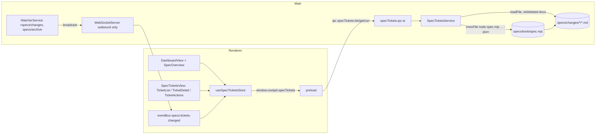

# Design — SPEC-0002: Integrate spec workflow into developer cockpit

> **Stage 2 of 3 — how.** Concrete enough that the plan can be written without re-reading the
> code, and checked line by line against the architecture policies. Write "None — <reason>" for a
> section that genuinely does not apply.

## Context

**The workflow today.** `specs/tools/spec.mjs` (zero-dependency ESM) is the only implementation of
the rules: ticket front-matter parsing (`parseFrontmatter`, `loadTicket`), task and AC parsing
(`parseTasks`, `acceptanceCriteria`), the stage gates (`GATES`, `runGate`), approvals
(`approvalRequired`, `cmdApprove`) and evidence freshness (`fingerprint`). All of its output is
text. It derives `ROOT` from its own location (`specs/tools/..`), so it works against whichever
workspace it is run from. Exit codes are 0 (ok), 1 (gate/check failed) and 3 (awaiting approval).

Two weaknesses matter here:

- `resolveTicket` loads *every* ticket folder and calls `t.id.slice(5)`. A folder with a missing
  `ticket.md` throws in `loadTicket` (`readFileSync`), and one without front-matter crashes on the
  `undefined` id. So one bad folder breaks every command, including commands for other tickets.
- `parseArgs` treats the token after any `--flag` as its value unless that token starts with
  `--`. So `--json` must always come last.

**The cockpit today** (Electron 34 + React 19 + zustand + Tailwind, `developer-cockpit/`):

- Main-process services are plain classes without Electron imports, created lazily by
  `src/main/ipc/*.ipc.ts`, which register `ipcMain.handle('<area>:<op>')` channels. Examples are
  `SpecsService` + `specs.ipc.ts` and `GitService` + `git.ipc.ts`. The preload
  (`src/main/preload.ts`) exposes them as `window.cockpit.<area>`, typed by `CockpitAPI` in
  `src/shared/types/ipc.ts`.
- `CodeGenService` is the existing example of running an external process
  (`child_process.execFile`, no shell, timeout, `maxBuffer`).
- Live updates: `WatcherService` (chokidar) watches a fixed list of source folders, debounces 300 ms
  and broadcasts `file:*` events through `WebSocketServer` (port 9321). That server is
  **outbound-only**: it has no `message` handler. The renderer's `eventBus` receives the events and
  views subscribe with `useEventBus` (see `GitOverviewView`).
- Renderer: views are lazy-loaded in `ContentArea.VIEW_MAP`. Navigation is driven by `ViewId` /
  `NAV_ITEMS` in `stores/navigation.ts`, with icons in `Sidebar.ICON_MAP`; `CommandPalette` reads
  `NAV_ITEMS`. Per-area stores live in `stores/*.ts` (pattern: `stores/specs.ts`). Markdown is
  rendered with `react-markdown` + `remark-gfm` + `rehype-highlight` inside
  `views/knowledge-base/DocumentViewer.tsx`. UI primitives are in `components/ui/*` (dialog, tabs,
  table, badge, select, input, button).
- `DashboardView` is a static grid of quick-link cards. `ai-chat` is a `PlaceholderView`, so there
  are no AI tools.
- There is no test runner. `typecheck` runs `tsc` over two configs: renderer (`tsconfig.json`,
  bundler resolution) and main (`tsconfig.node.json`, commonjs).

**Closest examples followed:** `SpecsService`/`specs.ipc.ts` for the service + IPC layering,
`CodeGenService` for process execution, `GitOverviewView` for live refresh, and `stores/specs.ts`
for the store.

**Read:** `specs/README.md`, `specs/policies/architecture-policies.md`, `specs/tools/spec.mjs`, and
`developer-cockpit/spec/03-features.md` §1 (outdated spec dashboard), `04-backend-services.md`,
`05-data-model.md` and `06-realtime.md`. The OMS framework specs (state machine, task
orchestration, query store, validation, error handling) were checked for relevance. None apply,
because no OMS service code changes.

## Approach

**Principle: the CLI is the single source of truth.** The cockpit never parses gate rules and
never writes ticket files. It reads ticket data through new `--json` output on `spec.mjs` and
performs every action by running `spec.mjs`. It reads the four stage Markdown documents directly,
read-only, only for display.



### 1. `specs/tools/spec.mjs`: additive `--json` (text output unchanged)

- New helper `tryLoadTicket(dir)` returns `{ ticket }` or `{ error }`. Errors: `ticket.md is
  missing`, `ticket.md has no front-matter or no id`, or the exception message. `resolveTicket`
  uses it and **skips** folders that fail (robustness fix for AC-10; valid tickets behave as
  before).
- New helper `ticketJson(t)` →
  `{ id, dir, archived, meta, tasks: { done, total }, acs: string[] }`. `dir` is relative to ROOT
  with `/` separators; `meta` is the raw front-matter object.
- `list --json [--all]` → `{ user: gitUser(), tickets: ticketJson[], errors: [{ dir, error }] }`,
  always exit 0.
- `status <id> --json` → `ticketJson(t)` plus:
  - `goal`: the `## Goal` section, comments stripped and trimmed;
  - `log`: the lines of `## Log` that start with `- `, without the marker;
  - `taskList`: `[{ id, done, acs, summary }]`, where `summary` is the first line of the task with
    the checkbox and `**T-n**` removed;
  - `gate`: the result of `runGate` for the current stage as `{ stage, pass, errors, warnings,
    exceptions }`, or `null` if the stage has no gate (`done`, `blocked`);
  - `evidence`: `{ result, ranAt, modules, fresh, coversModules }` from `evidence/last-run.json`,
    or `null`. `fresh` is `ev.fingerprint === fingerprint(ev.modules)`; `coversModules` means every
    `verifyModules(t)` entry is in `ev.modules`;
  - `next`: the same text as the `Next:` line.
- `gate [id] [stage] --json` → the same `gate` object, with exit code unchanged (1 on fail).
- `HELP` documents `--json`. Each JSON document is written as a single
  `JSON.stringify(x)` line on stdout.

### 2. Shared types: `src/shared/types/specTickets.ts` (new)

```ts
export const SPEC_STAGES = ['proposal', 'design', 'plan', 'implement', 'verify', 'done'] as const;
export type SpecStage = (typeof SPEC_STAGES)[number];
export type SpecTicketStatus = SpecStage | 'blocked';
export const SPEC_DOCUMENTS = ['proposal', 'design', 'tasks', 'verification'] as const;
export type SpecDocument = (typeof SPEC_DOCUMENTS)[number];

export interface SpecTicketSummary {
  id: string; title: string; type: string; status: SpecTicketStatus;
  awaiting: string; autopilot: boolean; modules: string[]; approvals: string[];
  owner: string; beads: string; created: string;
  blockedFrom: string; blockedReason: string;
  archived: boolean; dir: string;
  tasks: { done: number; total: number }; acs: string[];
}
export interface SpecTicketLoadError { dir: string; error: string }
export interface SpecTicketList { user: string; tickets: SpecTicketSummary[]; errors: SpecTicketLoadError[] }
export interface SpecGateResult { stage: string; pass: boolean; errors: string[]; warnings: string[]; exceptions: string[] }
export interface SpecEvidence { result: 'pass' | 'fail'; ranAt: string; modules: string[]; fresh: boolean; coversModules: boolean }
export interface SpecTask { id: string; done: boolean; acs: string[]; summary: string }
export interface SpecTicketDetail extends SpecTicketSummary {
  goal: string; log: string[]; taskList: SpecTask[];
  gate: SpecGateResult | null; evidence: SpecEvidence | null; next: string;
  documents: Partial<Record<SpecDocument, string>>;
}
export type SpecAction =
  | { kind: 'new'; title: string; type: string; modules: string[]; goal: string }
  | { kind: 'advance'; id: string }
  | { kind: 'approve'; id: string }
  | { kind: 'reopen'; id: string; stage: SpecStage; reason: string }
  | { kind: 'block'; id: string; reason: string }
  | { kind: 'unblock'; id: string }
  | { kind: 'note'; id: string; text: string }
  | { kind: 'autopilot'; id: string; on: boolean };
export interface SpecActionResult { exitCode: number; stdout: string; stderr: string; awaitingApproval: boolean }
```

### 3. Main process

- **`src/main/services/SpecCli.ts`** (new) wraps the CLI call:
  `run(args): Promise<{ exitCode, stdout, stderr }>` uses
  `execFile(nodePath, [<root>/specs/tools/spec.mjs, ...args], { cwd: root, env: { ...process.env,
  ELECTRON_RUN_AS_NODE: '1' }, timeout: 60_000, maxBuffer: 10 MB, windowsHide: true })`.
  `nodePath` defaults to `process.execPath`: in Electron it runs as Node because of
  `ELECTRON_RUN_AS_NODE`, and under Vitest it already is Node, so nothing requires `node` on the
  PATH. Non-zero exits are returned, not thrown. A spawn failure, timeout or missing CLI throws
  `Error('spec CLI failed: …')`. Each call is logged once with `console.info('[spec-cli]', args[0],
  id, exitCode, ms)`.
- **`src/main/services/SpecTicketsService.ts`** (new, no Electron imports):
  - `listTickets(includeArchived)` runs `list [--all] --json` and maps each entry to
    `SpecTicketSummary`. The mapping converts snake_case to camelCase and defaults missing strings
    to `''` and missing arrays to `[]`.
  - `getTicket(id)` runs `status <id> --json`, maps it, then reads `proposal.md`, `design.md`,
    `tasks.md` and `verification.md` from `<root>/<dir>/`, keeping only the files that exist.
  - `runAction(action)`:
    - Validates the input first. `id` must match `/^SPEC-\d{4}$/`, `kind` must be in the
      whitelist, `stage` must be in `SPEC_STAGES`, `new` needs a non-empty title, type, goal and
      modules, and no free text may start with `--` (see the decision below). A violation throws
      without running the CLI. Empty reasons and notes are not checked here; they go to the CLI,
      which rejects them (next bullet).
    - Maps each action to CLI arguments:
      - new → `new <title> --type <t> --modules <a,b> --goal <goal>`
      - advance → `advance <id>`
      - reopen → `reopen <id> <stage> <reason>`
      - block → `block <id> <reason>`
      - unblock → `unblock <id>`
      - note → `note <id> <text>`
      - autopilot → `autopilot <id> on|off`
    - `approve` first loads the ticket. If `awaiting` is empty, it returns `{ exitCode: 1, stderr:
      '<id> is not awaiting approval' }` without running the CLI. If no git user is configured
      (`list.user === ''`), it refuses with `'set git user.name before approving'`. Otherwise it
      runs `approve <id> <awaiting> --by <user>`.
    - Result: `awaitingApproval = exitCode === 3`.
  - Text the CLI would reject (empty reason, etc.) is still passed through for the CLI to reject
    when validation is the CLI's own rule, e.g. reopen to a later stage. That is what makes AC-7
    "the CLI's error".
- **`src/main/ipc/specTickets.ipc.ts`** (new): `specTickets:list`, `specTickets:get` and
  `specTickets:run`, with a lazy singleton as in `specs.ipc.ts`. It is registered in
  `src/main/index.ts` `registerAllIpc`. This is the **only** importer of `SpecTicketsService`.
- **`WatcherService`**: add `'specs/changes'` and `'specs/archive'` to `watchPaths`. In
  `debouncedEmit`, a path under `<root>/specs/(changes|archive)/` also schedules one coalesced
  `specs:tickets-changed` broadcast. This uses a single 300 ms trailing timer, so a burst of writes,
  such as `spec verify` logs, causes one refresh. Payload: `{ path }` of the last change.
- **`src/shared/types/events.ts`**: add `'specs:tickets-changed'` to `EventType` and
  `SpecTicketsChangedPayload { path: string }`.
- **`WebSocketServer`**: unchanged, still outbound-only (AC-9).

### 4. Preload / API

`CockpitAPI.specTickets: { list(includeArchived: boolean): Promise<SpecTicketList>;
get(id: string): Promise<SpecTicketDetail>; run(action: SpecAction): Promise<SpecActionResult> }`,
wired in `preload.ts`.

### 5. Renderer

- **`src/renderer/lib/spec-tickets.ts`** (new, pure functions):
  - `isMine(t, user)`: trimmed, case-insensitive equality; false when `user` is empty.
  - `filterTickets(tickets, { user, mineOnly, stage, module, text })`: `mineOnly` is ignored when
    `user` is empty (AC-3); `text` matches the id or title, case-insensitive.
  - `stageIndex(t)` → 0–5 (blocked uses `blockedFrom`).
  - `summarize(tickets, user)` → `{ perStage: Record<SpecTicketStatus, number>, awaiting:
    SpecTicketSummary[], blocked: SpecTicketSummary[], tasksDone, tasksTotal, completionPct: number
    | null }`. It covers non-archived tickets only, puts mine first in the awaiting and blocked
    lists, and sets `completionPct` to `null` when `tasksTotal === 0`, otherwise
    `Math.round(100 * done / total)`.
- **`src/renderer/stores/specTickets.ts`** (new, zustand). State: `list`, `user`, `errors`,
  `showArchived`, `mineOnly` (default `true`), filters, `selectedId`, `detail`, `loading`, `error`,
  `running`, `lastResult`. Actions:
  - `load()`, `select(id)` and `refresh()`, which reloads the list and the detail if one is
    selected;
  - `run(action)`, which sets `running`, calls the API, stores `lastResult`, then `refresh()`.
    The buttons are disabled while it runs, so the cockpit never runs two actions at once.
- **`src/renderer/hooks/useSpecTicketsLiveRefresh.ts`** (new): `useEventBus('specs:tickets-changed',
  () => store.refresh())`. It is used by `SpecTicketsView` and `SpecOverview`.
- **`views/spec-tickets/`** (new):
  - `SpecTicketsView` is a two-pane layout.
  - `TicketList`: filters (Mine/All toggle, stage select, module select, search, show archived),
    a table (id, title, type, stage badge, owner, modules, task progress bar, flags for awaiting,
    blocked and autopilot) and error rows for `errors`.
  - `TicketDetail`: header, `StageProgress` (six steps with the current one highlighted, blocked
    shown in red), Goal, a `GateResult` panel (PASS/FAIL, errors, warnings), `Tabs` with one tab
    per existing document rendered through `MarkdownContent`, Traceability (ACs × tasks from
    `taskList`), an Evidence card (result, `ranAt`, Fresh/Stale badge, missing modules), the Log
    and `TicketActions`.
  - `TicketActions`: buttons Advance, Approve (rendered **only** when `awaiting`), Reopen…,
    Block…/Unblock and Note…, plus an Autopilot switch. Approve opens `ApproveDialog` ("Approve
    <stage> of <id> — <title>?"), with Cancel and Approve buttons. Reopen, Block and Note open small
    input dialogs.
  - `ActionOutput` shows the exit code and the stdout/stderr of `lastResult`, in amber for exit 3
    and red for exit 1.
  - `NewTicketDialog` asks for title, type (from the existing types), modules and goal. It is
    reachable from the list header.
- **`components/MarkdownContent.tsx`** (new): the `ReactMarkdown` block and component overrides
  extracted from `DocumentViewer`, which now uses it. The rendering is identical.
- **Dashboard:** new `views/dashboard/SpecOverview.tsx` rendered above the quick links in
  `DashboardView`. It shows stage count chips, Awaiting approval and Blocked lists, and
  task-completion % with a bar. Clicking an item runs `select(id)` and
  `setActiveView('spec-tickets')`. A `spec-tickets` quick link is added as well.
- **Navigation:** `ViewId` gains `'spec-tickets'`. `NAV_ITEMS` gets `{ id: 'spec-tickets', label:
  'Spec Tickets', group: 'Development', icon: 'ListChecks' }` after Dashboard. `ListChecks` is added
  to `Sidebar.ICON_MAP` and the view to `ContentArea.VIEW_MAP`.

### 6. Build and tests

- devDependencies: `vitest`, `jsdom`, `@testing-library/react`. Script: `"test": "vitest run"`.
- New `developer-cockpit/vitest.config.ts` with the `@` / `@shared` aliases (same as
  `vite.config.ts`), `environment: 'node'`, `include: ['test/**/*.test.{ts,tsx}']` and
  `testTimeout: 20_000`. Renderer tests opt in with `// @vitest-environment jsdom`.
- Tests live in `developer-cockpit/test/{main,renderer}/…`, outside `src`, so the two `tsc`
  configs and the Electron build are untouched.
- Fixture helper `test/fixtures/workspace.ts`: `createWorkspace()` creates a temp dir, copies
  `<repo>/specs/{tools,templates,policies}` and `config.json` (repo = `path.resolve(process.cwd(),
  '..')`), runs `git init -b main` with `user.name Alice`, creates an `oms-knowledge-base/README.md`
  and makes an initial commit. Helpers `cli(ws, ...args)` and `writeTicket(ws, folder, meta, docs)`
  write fixture tickets. All writes happen in the temp workspace; the repository's own `specs/` is
  never touched.
- `specs/config.json`: `developer-cockpit.verify` becomes `["npm run typecheck", "npm test"]`.

### What Changes → where

| Proposal bullet | Where |
|---|---|
| Spec Tickets view: list, Mine/All, filters | `views/spec-tickets/TicketList`, `lib/spec-tickets.filterTickets`, store |
| Detail panel | `TicketDetail`, `StageProgress`, `GateResult`, `MarkdownContent`, `SpecTicketsService.getTicket`, `status --json` |
| Workflow actions incl. confirmed approve | `TicketActions`, `ApproveDialog`, `NewTicketDialog`, `SpecTicketsService.runAction`, `SpecCli` |
| Dashboard overview | `SpecOverview`, `lib/spec-tickets.summarize` |
| Live updates | `WatcherService`, `events.ts`, `useSpecTicketsLiveRefresh` |
| Vitest + verify command | `package.json`, `vitest.config.ts`, `specs/config.json` |
| `--json` on the CLI | `spec.mjs` `list`/`status`/`gate`, `tryLoadTicket`, `ticketJson` |

## Contract Changes

None to OpenAPI or Avro: no OMS API or message changes.

The new internal interfaces are additive:

- **CLI:** `--json` on `list`, `status` and `gate`. Without the flag, output and exit codes are
  byte-for-byte unchanged. The one behaviour change is that `resolveTicket` skips unloadable
  folders instead of crashing. That only affects workspaces that were broken before.
- **Cockpit IPC:** new `specTickets:*` channels and the `CockpitAPI.specTickets` namespace.
- **Cockpit events:** new event type `specs:tickets-changed`. Existing events are unchanged.

## Data & Persistence

None in OMS: no entities, tables or Liquibase changes. The source of truth stays the files under
`specs/`, which only `spec.mjs` writes. The cockpit adds no persistence of its own. The Mine/All
toggle and the filters are session state in the zustand store and are not saved to
`~/.developer-cockpit/config.json`.

## Events & Messaging

None in OMS: no `order_events`, outbox or Kafka changes. Inside the cockpit there is one new
outbound WebSocket event, `specs:tickets-changed`, coalesced with a 300 ms trailing debounce.
Handling it is idempotent: it only triggers a re-read, so duplicate or missed-then-repeated events
are harmless.

## Domain, State & Orchestration

None in OMS: no order state machine or task pipeline changes.

The ticket lifecycle (`proposal → design → plan → implement → verify → done`, plus `blocked` and
`awaiting`) remains owned by `spec.mjs`. The cockpit only invokes its commands. Error handling:

- CLI rule violations come back as `SpecActionResult` with exit code 1 and the CLI's message. They
  are shown in `ActionOutput` and are not errors in the cockpit.
- Exit 3 means awaiting approval and is shown as information.
- Input that fails the cockpit's own validation (bad id, unknown action) and process failures
  (spawn, timeout, invalid JSON) reject the IPC promise. The store shows them in its `error`
  banner. Nothing is swallowed.

## Alternatives & Decisions

- **Source of truth: call `spec.mjs` with `--json`.** Rejected: re-implementing parsing and gates in
  TypeScript. It would create a second copy of the gate rules that drifts from the CLI, CI and
  hooks, which would break AC-2 ("identical to `spec gate`"). Cost of the chosen option: one Node
  process per read (~100–300 ms), acceptable against AC-11's 1 s budget. If it is not, the fallback
  is to read front-matter directly for the list only, with gates still from the CLI.
- **Run the CLI with `process.execPath` + `ELECTRON_RUN_AS_NODE=1`.** Rejected: requiring `node` on
  the PATH, which a packaged Electron app cannot assume. Also rejected: `import()`-ing `spec.mjs`
  into the main process, because it calls `process.exit` and `console.log`.
- **Approve in the cockpit (requester decision).** The guarantee "approvals are human" is
  preserved in three ways:
  - the CLI hook still blocks agents from running `spec approve`;
  - the cockpit requires an explicit confirmation dialog, only offers approve when `awaiting` is
    set, and records `--by <git user.name>`;
  - action channels exist only on renderer IPC. The WebSocket server stays outbound-only and the AI
    Assistant has no tools (AC-9).
- **Approve passes the awaiting stage explicitly.** Rejected: letting `cmdApprove` default. Without
  `awaiting`, it approves the *current* stage, which would let a human pre-approve a stage that has
  not passed its gate.
- **Read Markdown documents directly in the main process.** Rejected: embedding the contents in
  `status --json`. It would bloat the CLI's output for every caller. The reads are confined to the
  ticket's own folder and a fixed set of four file names.
- **New dependencies (P-17).**
  - `vitest`: same Vite toolchain and config as the app, so no Babel or ts-jest setup. Jest was
    rejected because it needs a separate transform stack for TS/ESM.
  - `jsdom`: the DOM environment for the renderer component tests (AC-3/4/5/8).
    `happy-dom` was rejected as less compatible with Radix.
  - `@testing-library/react`: renders components and fires events in tests. `user-event` was
    rejected as unnecessary, because `fireEvent` is enough.
  - All three are devDependencies only, so nothing ships in the app.
- **Tests outside `src/`, not type-checked by `tsc`.** Rejected: adding tests to the two tsconfigs,
  which mix bundler and commonjs resolution. Vitest type-strips the tests. Typechecking of
  production code is unchanged.
- **Changed during implementation: `@testing-library/dom` added as a fourth dev dependency**,
  because `@testing-library/react` 16 declares it as a required peer dependency and does not
  install it. Still dev-only.
- **Changed during implementation: the AC-11 performance test runs as a separate, sequential
  step of `npm test`** (`vitest run --exclude "**/*.perf.test.ts" && vitest run .perf.test`).
  Inside the parallel suite, the 11 other files spawn the CLI continuously, and one measured run
  took 5.4 s, which measured CPU contention rather than listing. On its own it takes about 200 ms.
  The 1 s threshold is unchanged. Rejected: raising the threshold, which would weaken the AC, and
  `fileParallelism: false` for the whole suite, which would make every run slower.
- **Changed after the independent review**:
  - Each action result belongs to the ticket it was run on (`lastResultFor`, `null` for `new`).
    TicketActions shows only its own ticket's result, and the ticket list shows the result of
    `new`. A successful `new` selects the created ticket. Before this, the outcome of `new` was
    invisible (AC-7).
  - `refresh()` drops the selection when the open ticket disappears from the list.
    `load()` applies only the latest of overlapping responses (request counter).
  - Reopen is also offered for blocked tickets, because the CLI supports it from `blocked_from`.
  - `list --json` also returns `types` from `specs/config.json`. NewTicketDialog uses them instead
    of a hard-coded copy.
  - `runAction` rejects title, type, goal, reason or note text that starts with `--`, and module
    names that do not match `^\w[\w.-]*$` (second review). Rejected:
    adding a `--` end-of-options marker to `parseArgs`, which would be a larger change to the
    CLI's argument handling for one edge case.
  - `activeTickets()` (used by `ci` and the hooks) and the text `list` also use `tryLoadTicket`.
    The text `list` reports a broken folder on stderr instead of crashing.
- **No `spec verify` / `spec archive` actions.** They are deferred per the proposal: they are long
  builds that need streaming and cancellation.

## Risks & Mitigations

| Risk | Mitigation |
|---|---|
| The CLI and the cockpit (or an agent) write `ticket.md` at the same time; last writer wins | The cockpit serializes its own actions (`running` disables buttons) and always re-reads after an action and on every `specs:tickets-changed`. The cross-process race already exists between two terminals; documented, not solved here. |
| Electron-as-Node startup is slower than plain Node, threatening AC-11 | AC-11 is measured with Node in tests. `listTickets` makes one process call regardless of ticket count. Fallback recorded in Decisions. |
| `--json` placed before a positional arg is swallowed by `parseArgs` | `SpecCli` always appends `--json` last; covered by the service tests. |
| An agent could drive approve by automating the cockpit UI | Out of the threat model: the hooks are guardrails, not a security boundary (`specs/README.md`). Approve still records the git user and shows in the log for review. |
| **Autopilot blocks this ticket's own `spec.mjs`/`config.json` edits** (PreToolUse hook denies `specs/tools` and `specs/config.json` while any ticket is on autopilot) | Implement SPEC-0002 with autopilot **off**, or have the plan put the `spec.mjs` and `config.json` tasks first and run them interactively. |
| Watcher noise during `spec verify` (log files in `evidence/`) | A single coalesced trailing debounce gives one refresh per burst. |
| chokidar on a temp workspace where the other watch paths do not exist | Missing paths are tolerated; asserted by the AC-6 watcher test. |
| Tests touching the real repository's `specs/` | Every test uses `createWorkspace()` in `os.tmpdir()`; the fixture never passes the repo root to `SpecCli`. |
| Windows paths in CLI output | `dir` is always `/`-separated and relative; the service joins it with `path.join`. |

## Test Strategy

All tests are under `developer-cockpit/test/` and run with `npm test` (Vitest). *Integration* means
the real `spec.mjs` runs against a temp git workspace from `test/fixtures/workspace.ts`.

| AC | Level | Test class#method | What it asserts |
|---|---|---|---|
| AC-1 | integration | `test/main/SpecTicketsService.test.ts#listTickets maps front-matter of active and archived tickets` | Two active and one archived fixture ticket. `listTickets(false)` returns the two active ones, with every field equal to the written front-matter. `listTickets(true)` also returns the archived one with `archived: true`. |
| AC-2 | integration | `test/main/SpecTicketsService.test.ts#getTicket reports stage, tasks, ACs and the CLI gate result` | Ticket at `plan` with 3/5 tasks ticked and 4 ACs: `status 'plan'`, stage index 2, `tasks {3,5}`, `acs.length 4`. `detail.gate` deep-equals the JSON of `spec gate <id> --json`, and its errors equal the `ERROR` lines of text `spec gate <id>`. |
| AC-3 | unit + component | `test/renderer/spec-tickets-lib.test.ts#filterTickets mine-only, all, and no-user fallback`; `test/renderer/SpecTicketsView.test.tsx#lists only my tickets by default and all after toggle` | Alice/Bob fixtures: by default only Alice's rows render; after clicking "All tickets" both render; with `user ''` both render by default. |
| AC-4 | unit + component | `test/renderer/spec-tickets-lib.test.ts#summarize counts stages, awaiting, blocked and completion`; `test/renderer/SpecOverview.test.tsx#shows summary and opens ticket on click` | Exact per-stage counts, awaiting/blocked ids (mine first), `completionPct` (and `null` with no tasks). Clicking an awaiting item sets `selectedId` and `activeView === 'spec-tickets'`. |
| AC-5 | integration + component | `test/main/SpecTicketsService.test.ts#getTicket returns goal, documents, log and evidence freshness`; `test/renderer/TicketDetail.test.tsx#renders goal, documents, log and evidence` | Real `spec verify` on a fixture ticket with module `oms-knowledge-base` (no verify commands) gives `evidence.fresh true`; after editing `oms-knowledge-base/README.md`, `fresh false`. The component renders the goal text, a tab per present document with its Markdown heading, every log line, and the Fresh/Stale badge. |
| AC-6 | integration + unit | `test/main/WatcherService.test.ts#broadcasts specs:tickets-changed within 2s of a ticket change`; `test/renderer/specTickets-store.test.ts#refreshes list and open detail on specs:tickets-changed` | A fake broadcaster receives `specs:tickets-changed` within 2000 ms of writing, adding or removing a `ticket.md` in the temp workspace, and one event for a burst of 10 writes. Store test: the emitted event triggers `list` and `get(selectedId)` on the mocked API. |
| AC-7 | integration + component | `test/main/SpecTicketsService.actions.test.ts#advance failing gate keeps stage and returns errors`, `#advance passing gate moves stage or awaits approval`, `#new, reopen, block, unblock, note, autopilot match the CLI`, `#invalid input is rejected by the CLI without file change`; `test/renderer/TicketActions.test.tsx#shows exit code and output` | Failing gate: exit 1, `status` unchanged, stdout has `ERROR`. Passing gate: next stage, or exit 3 with `awaiting` set. Each action applied through the service to ticket A and through the CLI to an identical ticket B gives the same `ticket.md` (timestamps in log lines normalized). Reopen to a later stage and block without a reason return exit 1 and leave `ticket.md` byte-identical. The component shows the exit code and output. |
| AC-8 | integration + component | `test/main/SpecTicketsService.actions.test.ts#approve requires awaiting and records git user`; `test/renderer/TicketActions.test.tsx#approve needs confirmation and is hidden unless awaiting` | Not awaiting: result exit 1, CLI not run, file unchanged. Awaiting `proposal`: `approvals` contains `proposal`, the log has `proposal approved by Alice`, status is `design`. Component: no Approve button without `awaiting`; Cancel → `run` not called; Confirm → `run({kind:'approve', id})` called once. |
| AC-9 | integration + static | `test/main/websocket-no-actions.test.ts#ws messages cannot trigger actions`, `#only specTickets.ipc imports SpecTicketsService` | A client sends action-shaped JSON (`{type:'specTickets:run', payload:{kind:'approve'…}}`, `advance`, garbage). After 500 ms the fixture `ticket.md` is byte-identical. Scanning `src/` finds `SpecTicketsService` imported only by `src/main/ipc/specTickets.ipc.ts`, and `server.ts` has no `'message'` handler. |
| AC-10 | integration | `test/main/SpecTicketsService.test.ts#bad ticket folders become error entries without breaking others` | A folder without `ticket.md` and a folder with no front-matter give two `errors` entries naming the folder and the problem. The valid tickets are still listed, and `getTicket(validId)` and `runAction(note)` on a valid ticket still succeed. |
| AC-11 | integration (perf) | `test/main/SpecTicketsService.perf.test.ts#lists 50 tickets in under 1s` | 50 generated tickets, one warm-up call, then `listTickets(false)` measured with `performance.now()` < 1000 ms, returning 50 entries. |

## Policy Compliance

| Policy | Title | Status | How / Justification |
|---|---|---|---|
| P-01 | Contracts live only in oms-contracts | n/a | No OpenAPI or Avro files are touched or created. |
| P-02 | Specification before code, generated models only | n/a | No API or message contracts change. The cockpit's own types are hand-written TS interfaces for an internal IPC, as in the existing `src/shared/types/*`. |
| P-03 | Never edit generated code | comply | No `build/generated*` paths are involved. |
| P-04 | Contracts evolve compatibly | n/a | No OMS contracts change. The internal CLI interface change is additive (`--json`), and text output and exit codes are unchanged. |
| P-05 | Every state change is recorded in the event log | n/a | No order state changes. The equivalent for tickets, the `ticket.md` log, is still written only by `spec.mjs`, for every cockpit action. |
| P-06 | Kafka only through the transactional outbox | n/a | No Kafka involvement. |
| P-07 | Schema changes through new Liquibase changesets | n/a | No database. |
| P-08 | Concurrency and idempotency are explicit | comply | The cockpit serializes its own actions and re-reads after each action and on every change event. The refresh handler is idempotent. Approve is idempotent in the CLI (`includes` check). The residual cross-process race is documented in Risks. |
| P-09 | Commands and queries stay separate | comply | Reads (`specTickets:list/get` → `list/status --json`, which never write) are separate from actions (`specTickets:run`). The store keeps read state and action results apart. |
| P-10 | State transitions go through the state machine and task pipeline | comply | Every ticket state change goes through `spec.mjs` commands, the workflow's own state machine and gates. The cockpit never writes `ticket.md`. |
| P-11 | Layering and conventions | comply | Follows the cockpit's existing layering: Electron-free service → `*.ipc.ts` → preload/`CockpitAPI` → zustand store → view. `execFile` follows `CodeGenService`, live refresh follows `GitOverviewView`, and Markdown rendering is extracted from `DocumentViewer` rather than duplicated. |
| P-12 | Jackson 3 only | n/a | No Java code. |
| P-13 | Errors and validation follow the framework specs | comply | There is no HTTP API, so RFC 7807 does not apply. CLI errors are surfaced verbatim with their exit code; validation and process failures reject the IPC promise and show in the store's error banner; nothing is swallowed (see Domain, State & Orchestration). |
| P-14 | Test first, every acceptance criterion is proven by an automated test | comply | Vitest is introduced, and every AC maps to named tests in Test Strategy, written before the implementation of each slice. |
| P-15 | Observability | comply | Each CLI invocation is logged in the main process (`[spec-cli]` command, id, exit code, duration), following the cockpit's console logging convention; there are no `printStackTrace` equivalents. Micrometer and tracing do not apply to a local desktop tool. |
| P-16 | Security | comply | `execFile` without a shell (no injection), whitelisted actions, id regex and stage enum checked in the main process, document reads confined to the ticket folder and four fixed names. No secrets. The WebSocket server stays outbound-only. |
| P-17 | Simplicity and dependencies | comply | One implementation of the rules (the CLI). Three dev-only dependencies (vitest, jsdom, @testing-library/react), recorded with rejected alternatives in Alternatives & Decisions. No runtime dependencies are added. |
| P-18 | Modules build standalone | comply | developer-cockpit verifies on its own (`npm run typecheck`, `npm test` from `developer-cockpit/`). `spec.mjs` stays zero-dependency. No Gradle module is affected. |
| P-19 | Documentation follows behaviour | comply | The cockpit spec pages and `specs/README.md` are updated in this ticket (see Knowledge Base Updates). No `oms-knowledge-base/` page describes the cockpit or the workflow UI. |

## Knowledge Base Updates

The pages that describe this behaviour live with the module, not in `oms-knowledge-base/`:

- `developer-cockpit/spec/03-features.md` §1 Dashboard: rewrite for the real workflow
  (`specs/changes|archive/SPEC-NNNN-*/ticket.md`, six stages plus blocked/awaiting, gates,
  evidence). Add the Spec Tickets view and its actions.
- `developer-cockpit/spec/04-backend-services.md`: add `SpecTicketsService` / `SpecCli` and the
  `specTickets:*` channels.
- `developer-cockpit/spec/05-data-model.md`: add the `SpecTicket*` types and state that the files
  in `specs/` are the source of truth.
- `developer-cockpit/spec/06-realtime.md`: add the `specs:tickets-changed` event and its debounce.
- `specs/README.md`: mention `--json` on `list`/`status`/`gate` and the cockpit as a UI for the
  workflow (approve from the cockpit is a human action with confirmation).

`oms-knowledge-base/`: none. OMS domain behaviour does not change. Rule R11 may warn; this
section is the answer to that warning.
