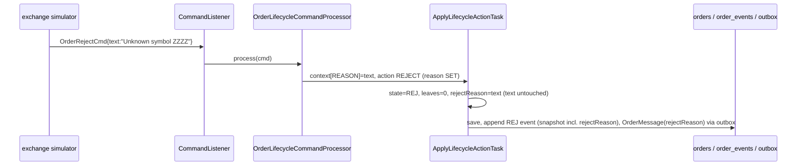

# Design — SPEC-0003: Store venue reject reason on the order

> **Stage 2 of 3 — how.** Concrete enough that the plan can be written without re-reading the
> code, and checked line by line against the architecture policies. Write "None — <reason>" for a
> section that genuinely does not apply.

## Context

- **Where the reason comes from.** Since SPEC-0001, `OrderRejectCmd`, `OrderCancelCmd` and
  `OrderCancelRejectCmd` carry a `text` reason. The exchange simulator fills it, for example
  `Unknown symbol INTC` or `Too late to cancel`.
- **What happens to it today.** `OrderLifecycleCommandProcessor` puts the text into the context
  under `ApplyLifecycleActionTask.TEXT`. `ApplyLifecycleActionTask` then writes it into
  `order.text`, the client's FIX Text (58), truncated to 255 characters
  (`oms-core/.../service/lifecycle/tasks/ApplyLifecycleActionTask.java:45`).
- **How `text` travels after that.** It goes out to:
  - `OrderMessage` (`OrderMessageMapper.java:72`, `.setText`);
  - the query API, mapped by name by MapStruct in `QueryOrderDtoMapper`;
  - `order_events.order_snapshot`, the JSON of the whole order;
  - oms-streaming-service (`streaming/mapper/OrderMessageMapper.java:54`, `OrderDto.text`), whose
    `MetadataService` lists the fields by hand;
  - oms-ui:
    - the blotter columns come from oms-core's reflection-based `MetamodelService`
      (`/api/v1/metamodel/Order`), so a new field on `Order` appears automatically, labelled by
      `formatDisplayName` ("Reject Reason");
    - the detail panel groups fields with hard-coded lists in `components/DetailPanel.tsx`;
    - `types/streaming.ts` declares the streamed order type.
- **Database.** The highest changelog is `004-sla-timestamps.yaml`, and the last changeset id is
  `012-order-sla-timestamps`.

## Approach

Add one nullable field, `rejectReason`, and route the venue's reason into it instead of `text`.
`LifecycleAction` already holds the rule table for each action; it gains one more column, the
**reason effect**:

| Action | targetState | cancelState | event | closes qty | **reason effect** |
|---|---|---|---|---|---|
| REJECT | REJ | — | REJ | yes | **SET** from the command text |
| CANCEL | CXL | CXL | CXL | yes | **NONE** (the order's reason is unchanged) |
| CANCEL_REQUEST | — | PCXL | CXL_REQUEST | no | **CLEAR** (set to null) |
| CANCEL_REJECT | — | REJ | CXL_REJ | no | **SET** from the command text |

`ApplyLifecycleActionTask` applies the effect: SET writes the truncated text into `rejectReason`,
skipping blank or missing text; CLEAR nulls it; NONE leaves it alone. It never touches `text`.
The context key `TEXT` is renamed `REASON`.



Downstream, every layer gets the field by name:
- the entity, `OrderMessage` and the query API through mappers;
- oms-streaming-service through its mapper, `OrderDto` and `MetadataService`;
- oms-ui through `types/streaming.ts`, the existing "Status" group of the detail panel (see
  Decisions), and a display name.

## Contract Changes

`oms-contracts/src/main/avro/OrderMessage.avsc`: a new field appended at the end of the record,
which is the safest position for Avro evolution:

```json
{
  "name": "rejectReason",
  "type": ["null", "string"],
  "doc": "Latest reason the venue gave for refusing the order or a cancel request (FIX Text 58 on the ExecutionReport ExecType=8 or the OrderCancelReject). Not the client's text.",
  "default": null
}
```

`oms-contracts/src/main/openapi/oms-query-api.yml`, `Order` schema, after `text`:

```yaml
        rejectReason:
          type: string
          maxLength: 255
          description: Latest reason the venue gave for refusing the order or a cancel request (FIX Text 58 from the venue). The client's own text stays in `text`.
```

The command schemas are unchanged; they already carry `text`. Compatibility (P-04): both changes
are additive and optional. A new `OrderMessageCompatibilityTest` in oms-contracts follows the
SPEC-0001 pattern: a baseline of the current resolved schema is captured first, then
`SchemaCompatibility.checkReaderWriterCompatibility` is run in both directions.

## Data & Persistence

- `Order` entity (`oms-core/.../common/model/Order.java`): `private String rejectReason;` after
  `text`, with a short comment on how it differs from `text`.
- New changelog `oms-core/src/main/resources/db/changelog/005-order-reject-reason.yaml`, included
  last in `db.changelog-master.yaml`:

```yaml
databaseChangeLog:
  - changeSet:
      id: 013-order-reject-reason
      author: oms
      changes:
        - addColumn:
            tableName: orders
            columns:
              - column: { name: reject_reason, type: VARCHAR(255) }
```

  Nullable, no default, no backfill, no index (it is display data, not used in filters). Existing
  changesets 001 to 012 are untouched.

## Events & Messaging

- **Event log:** no new event types. Each REJ and CXL_REJ event's `order_snapshot` contains
  `rejectReason`, and CXL_REQUEST snapshots show it cleared. Replay from the snapshot therefore
  reproduces the field (P-05). `OrderReplayService` needs no change, because it deserializes the
  whole `Order`.
- **Outbox:** `OrderMessage` gains `rejectReason`, set in `OrderMessageMapper`. It is still
  published only through the outbox (P-06).
- **Idempotency:** unchanged. Duplicate and replayed commands are refused before Apply
  (`DeduplicateCommandTask`, state preconditions), so the field is written at most once per command.

## Domain, State & Orchestration

- No state machine change. The pipeline is unchanged (Load → Deduplicate → Validate → Apply →
  Save → Publish).
- `LifecycleAction` gains `ReasonEffect reasonEffect` (a nested enum: `SET`, `CLEAR`, `NONE`), as
  in the table above.
- `ApplyLifecycleActionTask`:
  - `REASON` replaces `TEXT`;
  - `MAX_REASON_LENGTH = 255` (the width of `orders.reject_reason`);
  - it applies the effect and never calls `builder.text(...)`.
- `OrderLifecycleCommandProcessor` puts the command text under `REASON`.
- Validation and errors: no new validation. An over-long reason is truncated, not refused (AC-5),
  because a venue's verbose message must never cause its reject to be lost.

## Alternatives & Decisions

- **Decision: a dedicated `rejectReason` field.**
  - Alternatives considered:
    1. Keep writing `text`. Rejected: it destroys the client's text, which is the reported problem.
    2. A list or history of reasons. Rejected: the history is already in `order_events`; a single
       latest value is what the blotter needs.
    3. Separate fields for the order reject reason and the cancel reject reason. Rejected: it
       doubles the UI and contract surface for no use case. The cancel state tells which kind it
       was.
- **Decision: the field name is `rejectReason`, not `venueText`, `ordRejReason` or `text58`.**
  - It says what the field is for. `ordRejReason` would clash with FIX tag 103, which is a code.
  - Accepted at proposal approval.
- **Decision: CANCEL does not store its reason; CANCEL_REQUEST clears it.**
  - A successful cancel is not an error.
  - A pending cancel request must not show the reason from an earlier refusal.
  - The cancel's reason is still in the CXL event's command JSON.
- **Decision: the reason effect lives in the `LifecycleAction` table, not in if/else code in the
  task.** It keeps all per-action rules in one place, as SPEC-0001 established.
- **Decision: in the oms-ui detail panel, `rejectReason` joins the existing "Status" group**
  (`state`, `cancelState`, `positionEffect`), labelled "Reject Reason". A reason is read next to
  the state it explains. This was preferred over the "Other" group next to `text`, where it would
  be confused with the client's text.
- No new dependencies or build changes (P-17).

## Risks & Mitigations

- **Stale `text` on old orders:** orders rejected before this change keep the venue reason in
  `text`, and their `rejectReason` is null. This is accepted: they are development data only
  (proposal, deferred).
- **Consumers ignoring the new Avro field:** additive with a default, so old readers keep working.
  This is proven by the compatibility test.
- **Hand-maintained field list in oms-streaming-service's `MetadataService`:** if it is
  forgotten, the streaming blotter would not offer the field. Covered by a streaming-service test
  that asserts the field appears in the metadata and the DTO mapping.

## Test Strategy

| AC | Level | Test (class#method) | What it proves |
|---|---|---|---|
| AC-1 | unit + integration | core `OrderLifecycleCommandProcessorTest#reject_onUnackOrder_movesToRejWithReasonAndNoOpenQuantity` (assertions changed to rejectReason and text kept); `ExchangeWorkflowIntegrationTest#reject_orderRejWithReasonAndNoExecutions` (asserts rejectReason, text "Sample order" kept) | reason in rejectReason, client text preserved |
| AC-2 | unit + integration | core `OrderLifecycleCommandProcessorTest#cancelReject_onPendingCancel_setsCancelStateRejAndKeepsOrderLive` (assert reason/text); `ExchangeWorkflowIntegrationTest#cancelRequestThenCancelReject_orderStaysLiveWithCancelStateRej` (assert rejectReason "Unknown order", text kept) | cancel reject stores reason |
| AC-3 | unit | core `OrderLifecycleCommandProcessorTest#cancel_withReason_doesNotTouchTextOrRejectReason` (new) | cancel stores nothing on the order |
| AC-4 | unit | core `OrderLifecycleCommandProcessorTest#cancelRequest_clearsAnEarlierRejectReason` (new) | clear on cancel request |
| AC-5 | unit | core `OrderLifecycleCommandProcessorTest#reject_truncatesReasonToTheColumnWidth` (renamed from `reject_truncatesTextToTheColumnWidth`) | truncation to 255 |
| AC-6 | integration | core `ExchangeWorkflowIntegrationTest#reject_reasonReachesOrdersTopicAndQueryApi` (new: consumes OrderMessage from `orders`, GETs `/api/query/search`); sim `ExchangeSimulatorKafkaIntegrationTest#unknownSymbol_producesRejectOnly` (already asserts the reason text the simulator sends) | reason flows simulator → OMS → topic → query API |
| AC-7 | unit (UI + streaming + core) | oms-ui `DetailPanel.test.tsx#showsRejectReasonInStatusSection` (new); oms-streaming-service `OrderMessageMapperTest#mapsRejectReason` and `MetadataServiceTest#orderMetadataListsRejectReason` (new); core `MetamodelServiceTest#orderMetamodelIncludesRejectReason` (new; the blotter column selector is driven by this endpoint) | the UI can show the column and detail field |
| AC-8 | build | oms-contracts `OrderMessageCompatibilityTest#newSchemaReadsBaselineData` (new) and query-API additive check by review; `./gradlew check` in contracts, core, streaming, mcp, simulator; `npm test` in oms-ui | compatible, everything builds |

## Policy Compliance

| Policy | Title | Status | How / justification |
|---|---|---|---|
| P-01 | Contracts live only in oms-contracts | comply | Both schema changes are in oms-contracts. |
| P-02 | Specification before code, generated models only | comply | Contracts are changed first; `OrderMessage` and the query `Order` stay generated. |
| P-03 | Never edit generated code | comply | Only sources are edited. |
| P-04 | Contracts evolve compatibly | comply | Additive optional fields with defaults; proven by `OrderMessageCompatibilityTest`. |
| P-05 | Every state change is recorded in the event log | comply | The field is set inside the existing lifecycle pipeline; the event snapshot carries it. |
| P-06 | Kafka only through the transactional outbox | comply | Only the `OrderMessage` content changes; publishing still goes through the outbox. |
| P-07 | Schema changes through new Liquibase changesets | comply | New `005-order-reject-reason.yaml` / changeset `013-order-reject-reason`; 001–004 untouched. |
| P-08 | Concurrency and idempotency are explicit | comply | Unchanged: txNr, deduplication and preconditions run before Apply. |
| P-09 | Commands and queries stay separate | comply | The command side writes the field; the query API only reads it. |
| P-10 | State transitions go through the state machine and task pipeline | comply | Written by `ApplyLifecycleActionTask` inside the existing pipeline; no new transitions. |
| P-11 | Layering and conventions | comply | Extends the `LifecycleAction` rule table and the existing mappers; follows existing UI groups. |
| P-12 | Jackson 3 only | comply | No Jackson usage is added. |
| P-13 | Errors and validation follow the framework specs | comply | No new error paths; truncation instead of refusal is documented. |
| P-14 | Test first, every acceptance criterion is proven by an automated test | comply | Test Strategy covers AC-1 to AC-8; each task is red then green. |
| P-15 | Observability | comply | The existing apply log line gains the reason (`rejectReason=...`). |
| P-16 | Security | comply | Display-only free text; the UI renders it as text through React, not HTML. Length is bounded. |
| P-17 | Simplicity and dependencies | comply | One field, one enum column; no new dependencies. |
| P-18 | Modules build standalone | comply | No build changes. |
| P-19 | Documentation follows behaviour | comply | The knowledge-base pages listed below are updated. |

## Knowledge Base Updates

- `oms-knowledge-base/oms-concepts/order-lifecycle.md`: in §4.5, the reject stores the reason in
  `rejectReason`, not `text`. In §4.9.1, add the reason effect to the table (cancel reject sets it,
  cancel request clears it).
- `oms-knowledge-base/oms-concepts/exchange-simulator.md`: in §2, the reasons land in the
  order's `rejectReason`.
- `oms-knowledge-base/oms-concepts/execution-reporting.md`: in §2.2, FIX Text (58) maps to
  `rejectReason`; OrdRejReason (103) and CxlRejReason (102) are not yet modelled.
- `oms-knowledge-base/oms-framework/domain-model_spec.md`: add `rejectReason` to the Order
  fields.
