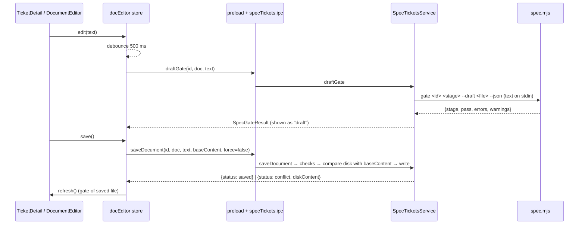

# Design — SPEC-0004: Edit spec ticket documents in the cockpit

> **Stage 2 of 3 — how.** Concrete enough that the plan can be written without re-reading the
> code, and checked line by line against the architecture policies. Write "None — <reason>" for a
> section that genuinely does not apply.

## Context

SPEC-0002 built the Spec Tickets feature in developer-cockpit. The relevant pieces today:

- `specs/tools/spec.mjs`: the only implementation of the workflow rules. `doc(t, stage)` reads a
  stage document via `DOCS = { proposal, design, plan: tasks.md, verify: verification.md }`; every
  gate (`GATES.proposal|design|plan|implement|verify`) and `acceptanceCriteria()` read documents only
  through `doc()`. `cmdGate(t, stage, opts)` prints a gate result (`--json` → `gateJson()`), exit 1 on
  failure. `parseArgs` treats `--key value` as an option. `stdinJson()` already reads stdin for hooks.
- `developer-cockpit/src/main/services/SpecCli.ts`: runs `spec.mjs` via `execFile` with
  `ELECTRON_RUN_AS_NODE`; `json()` appends `--json` and parses stdout regardless of exit code.
- `developer-cockpit/src/main/services/SpecTicketsService.ts`: `listTickets`, `getTicket` (CLI
  `status --json` + reads the four documents from the ticket dir), `runAction` (validated argv for
  workflow actions). Ticket ids are checked against `/^SPEC-\d{4}$/`.
- `src/main/ipc/specTickets.ipc.ts`: `specTickets:list|get|run`; exposed via `preload.ts`
  (`window.cockpit.specTickets`), typed in `src/shared/types/ipc.ts`. The WebSocket server is
  outbound-only (SPEC-0002 AC-9, `test/main/websocket-no-actions.test.ts`).
- `src/shared/types/specTickets.ts`: `SPEC_STAGES`, `SPEC_DOCUMENTS`, `SpecTicketDetail` (incl.
  `documents`, `taskList`, `gate`).
- Renderer: `stores/specTickets.ts` (zustand: `select`, `refresh`, `run`), `views/spec-tickets/
  TicketDetail.tsx` (document tabs rendered by `MarkdownContent`, `Traceability` task list,
  `GateResult`, `TicketActions`), `hooks/useSpecTicketsLiveRefresh.ts` (refresh on
  `specs:tickets-changed`, emitted by `WatcherService` for `specs/changes|archive`).
- Closest existing example for editing: `views/specs-editor/SpecEditor.tsx` + `stores/specs.ts`
  (Monaco editor, dirty flag, debounced validation with a same-file guard, Ctrl/Cmd+S, Save button).
  The new editor is a sibling of it. The closest example for main-side validation is
  `SpecTicketsService.toArgs()` (strict input checks, refusal results).
- Tests: Vitest; main tests run the real CLI in a throw-away git workspace
  (`test/fixtures/workspace.ts` → `createWorkspace()`); renderer tests use jsdom +
  Testing Library with `mockCockpit()` from `test/renderer/ticket-fixtures.ts`.
- Read: `specs/README.md`, `developer-cockpit/spec/03-features.md` §1, `04-backend-services.md`,
  `05-data-model.md`, SPEC-0002 proposal/design. The OMS framework specs (state machine, task
  orchestration, Liquibase, Kafka) do not apply: nothing in an OMS service changes.

## Approach



### 1. `spec.mjs`: draft gate (proposal: "spec.mjs gate gains an additive draft option", AC-8, AC-3)

- New module-level `let DRAFT = null;` (`{ file, content }`).
- `doc(t, stage)` becomes: if `DRAFT && DOCS[stage] === DRAFT.file` return `DRAFT.content`, else as
  today. All gates and `acceptanceCriteria()` already go through `doc()`, so the draft is seen
  everywhere a gate would read the file.
- `cmdGate` becomes `async`. If `opts.draft` is set: it must be one of `Object.values(DOCS)` (else
  `fail('--draft must be one of …')`), content is read from stdin with a new `stdinText()` (the
  read loop of `stdinJson()` factored out; `stdinJson` then parses its result), and `DRAFT` is set
  before `runGate`. Nothing is written. The `main()` `case 'gate'` awaits it.
- Usage line in `HELP`: `gate [id] [stage] [--json] [--draft <file>]  … (--draft: gate <file> as
  read from stdin, nothing is written)`.
- Without `--draft`, `DRAFT` stays `null` and every code path is unchanged.

### 2. Shared rule: which document is editable (AC-1, AC-4)

In `src/shared/types/specTickets.ts` (it already holds the stage constants used by both processes):

```ts
export const STAGE_DOCUMENT: Partial<Record<SpecStage, SpecDocument>> =
  { proposal: 'proposal', design: 'design', plan: 'tasks', implement: 'tasks', verify: 'verification' };
export const DOCUMENT_FILES: Record<SpecDocument, string> = { proposal: 'proposal.md', … };
/** The one document a human may edit now, or null (archived, done, unknown stage). */
export function editableDocument(t: Pick<SpecTicketSummary, 'status' | 'blockedFrom' | 'archived'>): SpecDocument | null;
/** Stage whose gate a draft of the editable document is checked against. */
export function editableStage(t): SpecStage | null;   // status, or blockedFrom when blocked
```

`DOCUMENT_FILES` moves here from `SpecTicketsService` (which imports it instead).

### 3. Main process (AC-2 … AC-6)

New types in `specTickets.ts`:

```ts
export type SpecSaveResult =
  | { status: 'saved'; content: string }
  | { status: 'conflict'; diskContent: string };
```

`SpecTicketsService` gains three methods; each first loads the ticket with `getTicket(id)` (CLI
`status --json`, so stage, `blocked_from`, `archived` and `dir` come from the CLI) and resolves the
file with a private `documentPath(ticket, doc)`:

- `documentPath`: `doc` must be in `SPEC_DOCUMENTS` (so `ticket.md`, `evidence/…` or `../x` are
  impossible by construction and rejected with `invalid document "<doc>"`); `doc` must equal
  `editableDocument(ticket)` (else `<doc>.md is not editable at stage <stage>`; archived/done →
  `… is archived` / `… is done`); the resolved path must be inside
  `<root>/specs/changes/` (defence in depth against an odd `dir`). Errors are thrown → the IPC
  invoke rejects; no write happens.
- `saveDocument(id, doc, content, baseContent, force)`: `content` must be a string ≤ 1 MB. Reads the
  file; if `!force && disk !== baseContent` → `{ status: 'conflict', diskContent }`; else
  `fs.writeFileSync(file, content, 'utf-8')` → `{ status: 'saved', content }`. Content is written
  exactly as given (no newline or EOL normalisation), so AC-2's byte equality holds.
- `draftGate(id, doc, content)`: same checks, then `cli.json(['gate', id, editableStage(t),
  '--draft', DOCUMENT_FILES[doc]], content)` → `SpecGateResult`.
- `toggleTask(id, taskId, done, baseContent, force)`: requires stage `implement` (blocked-from
  implement counts as not implement; ticking is for active work) and `taskId` matching
  `/^T-\d+$/`; `doc` is `tasks`. Conflict check as in save. Rewrites only the marker of the first
  line matching `^(\s*-\s*\[)[ xX](\]\s*\*\*T-n\*\*)` that is **outside** `<!-- … -->` comments (the
  template contains a commented example task). Not found → error `T-n not found in tasks.md`.
  Returns `SpecSaveResult`.

`SpecCli.run(args, input?)` / `json(args, input?)`: when `input` is given, it is written to the
child's stdin (`child.stdin.end(input)`), otherwise stdin is closed immediately (unchanged
behaviour for existing calls, which never read stdin).

IPC (`specTickets.ipc.ts`), preload and `CockpitApi` in `ipc.ts`:
`specTickets:saveDocument`, `specTickets:draftGate`, `specTickets:toggleTask`. Renderer-only, like
`specTickets:run`; nothing is added to the WebSocket server.

### 4. Renderer (AC-1 … AC-7)

- New store `stores/docEditor.ts` (zustand, sibling of `stores/specs.ts`):
  state `ticketId, doc, base, text, dirty, draftGate, checking, conflict: string | null, saving,
  error`; actions:
  - `open(ticketId, doc, content)`, `close()`;
  - `edit(text)`: sets `text`, `dirty = text !== base`, clears `draftGate` when not dirty, and
    debounces (500 ms, module-level timer + sequence number; a result is applied only if ticket,
    document and sequence still match) a call to `draftGate`;
  - `save(force = false)`: `saveDocument(…, base, force)`; on `saved` → `base = text`, `dirty =
    false`, `draftGate = null`, then `useSpecTicketsStore.getState().refresh()`; on `conflict` →
    `conflict = diskContent`;
  - `reload()`: `base = text = conflict`, clear `conflict`, `dirty = false`;
  - `syncFromDisk(ticketId, doc, content)`: called when the detail is refreshed; if the same document
    is open and `!dirty` and `content !== base` → `base = text = content` (AC-6 second half);
  - `confirmLeave(): boolean`: `true` if not dirty; else `window.confirm('Discard unsaved changes to
    <doc>.md of <id>?')`; on `true` it closes the editor.
- `useSpecTicketsStore.select` and `useNavigationStore.setActiveView` call
  `useDocEditorStore.getState().confirmLeave()` first and return without changing anything if it
  returns `false` (AC-7). Document tab switches in `TicketDetail` (Tabs become controlled) do the
  same.
- New component `views/spec-tickets/DocumentEditor.tsx`: toolbar with file name, *Modified* badge,
  *Checking…* indicator, Save (disabled unless dirty; Ctrl/Cmd+S), Done (leave edit mode, guarded);
  a conflict banner with **Reload from disk** and **Overwrite** (`save(true)`); Monaco
  (`@monaco-editor/react`, `language="markdown"`, same options as `SpecEditor`).
- `TicketDetail.tsx`: the tab of `editableDocument(detail)` shows an **Edit** button; in edit mode it
  renders `DocumentEditor` instead of `MarkdownContent`. An effect calls `syncFromDisk` when
  `detail.documents[doc]` changes. `GateResult` receives `draft` when the editor is open and dirty
  with a `draftGate`, and then shows that result with a "draft (unsaved)" label; otherwise
  `detail.gate` as today.
- `Traceability` task list: when `detail.status === 'implement'` and not archived, each task gets a
  checkbox (`aria-label="Toggle T-n"`) calling `toggleTask(id, T-n, !done, detail.documents.tasks)`;
  disabled while the tasks.md editor is dirty or a toggle is running. A conflict shows an inline
  message and triggers `refresh()`. Otherwise the existing ✓/○ icons stay.
- `TicketActions.tsx`: Advance and Approve are `disabled` while the doc editor is dirty for this
  ticket, with the title "Save or discard your edits first".

Mapping of the proposal's What-Changes bullets: Edit mode → §2, §3 `saveDocument`, §4
`DocumentEditor`/`TicketDetail`; live gate → §1, §3 `draftGate`, §4 `edit`; tick tasks → §3
`toggleTask`, §4 `Traceability`; conflict safety → §3 conflict checks, §4 `syncFromDisk`/banner;
guards → §4 `confirmLeave`, `TicketActions`; draft option → §1.

## Contract Changes

None — no OpenAPI or Avro change. The only interface changes are developer-cockpit internal IPC
channels (additive) and an additive, optional `--draft <file>` option on `spec gate`.

## Data & Persistence

None — no database. The cockpit writes the four Markdown stage documents in
`specs/changes/<ticket>/` (the existing source of truth) and never `ticket.md` or `evidence/`.

## Events & Messaging

None — no `order_events`, outbox or Kafka. Saved files trigger the existing in-app
`specs:tickets-changed` event through `WatcherService`; no new event.

## Domain, State & Orchestration

None for OMS orders. For spec tickets, stage transitions keep going only through the CLI
(`spec advance|approve|reopen`); editing never changes `ticket.md`. Input validation of the new IPC
calls is in §3 (`documentPath`, content type/size, task id pattern); refusals are thrown errors with a
human-readable message, as in `SpecTicketsService.toArgs`.

## Alternatives & Decisions

- **Draft gate: CLI with stdin, not a TypeScript port of the gate rules.** One implementation of the
  rules (as decided in SPEC-0002); AC-3's equality holds by construction. Rejected: TS
  re-implementation (drifts), and gating a temp copy of the ticket folder (the copied CLI computes
  `ROOT` from its own location, and the verify gate needs the real git workspace for fingerprints).
  Cost: one CLI process per typing pause (~100–300 ms), acceptable with a 500 ms debounce.
- **Override inside `doc()`** rather than threading a parameter through every gate: one changed
  function, and no gate can miss the draft.
- **Main process takes document names, never paths.** Removes the traversal class of bugs; the path
  check stays as defence in depth.
- **Conflict detection by comparing with `baseContent`** (the text the editor loaded), not mtime or a
  hash: exact, and needs no new detail fields. Documents are small (KBs).
- **Only the current stage's document is editable** (proposal assumption): keeps gates and approvals
  meaningful; Reopen covers the rest.
- **Unsaved-edit confirmation via `window.confirm`**: synchronous, which keeps the guard a simple
  boolean check in `select`/`setActiveView`. Rejected: a custom Radix dialog, which needs a
  pending-navigation mechanism for little gain in a desktop tool. Easy to swap later.
- **Editor: Monaco** (`@monaco-editor/react`), already a dependency and used by the Specs Editor.
  No new dependency at design time (but see the change below: `monaco-editor` became a direct
  dependency). In tests it is replaced by a `<textarea>` with `vi.mock`.
- **Compatibility proof for AC-8 via Vitest file snapshots recorded against the unmodified CLI**
  (task order: snapshot test first, then change the CLI). `specs/` is not yet in git, so there is no
  committed baseline to diff against.
- **Changed during implementation (verify review): Monaco is loaded from the bundle.**
  `@monaco-editor/react` fetches Monaco from cdn.jsdelivr.net by default, which the renderer CSP
  (`script-src 'self'`) blocks, so neither this editor nor the existing Specs Editor could load in
  the app; the tests mock Monaco and could not see it. New `src/renderer/lib/monaco.ts`:
  `loader.config({ monaco })` with the bundled `monaco-editor` and `self.MonacoEnvironment.getWorker`
  returning Vite `?worker` builds (JSON, CSS, HTML and TS workers by language label, the generic
  editor worker otherwise). Every component that renders an `Editor` (DocumentEditor, SpecEditor,
  FilePreview) imports it, so Monaco stays in lazy chunks and the loader is configured before its
  first `init()`; App.tsx's idle preload imports it too instead of calling `loader.init()` (which
  had locked the loader onto the CDN at startup). Workers are emitted as same-origin files, so the
  CSP stays unchanged.
  **Dependency change:** `monaco-editor` (already installed at 0.55.1 as the peer of
  `@monaco-editor/react`) becomes a direct dependency at the same version. Rejected: relaxing the
  CSP to allow the CDN (runtime network dependency, weaker CSP), and replacing Monaco with a
  textarea/CodeMirror (new dependency or worse editing, and the Specs Editor would stay broken).
- **Changed during implementation (verify review):** the editor closes (asking first if dirty)
  when the ticket's editable document changes underneath it (CLI advance/reopen); a pending draft
  check clears the previous draft result and error; `SpecCli` ignores stdin `EPIPE`; saving refuses a
  missing document instead of creating it; non-editable document tabs show a "Reopen to change"
  hint; a tick conflict offers no Overwrite (a tick has no text of its own; the list reloads and the
  user ticks again).
- **Changing `specs/tools/spec.mjs` under autopilot** (approved in the proposal): autopilot is
  switched off for the CLI task and back on afterwards; the change is limited to §1.

## Risks & Mitigations

- **Draft gate latency / process churn while typing** → 500 ms debounce, sequence guard drops stale
  results, at most one request in flight per store (a new one supersedes). AC-3 test measures the
  2 s bound.
- **Lost edits through concurrent writers (CLI, Claude Code, another editor)** → base-content
  check on every save and tick (AC-6); explicit Overwrite only.
- **Accidental change of CLI behaviour** → change confined to `doc()` + `cmdGate`; snapshot tests
  of `gate`, `status`, `list`, `advance` text and JSON output recorded before the change (AC-8).
  Claude Code hooks call `hook pre-tool|stop`, which are untouched.
- **Writing outside the ticket** → names not paths, stage mapping enforced in main, path prefix
  check (AC-4).
- **Tick regex hitting the commented template example** → skip matches inside `<!-- … -->`;
  covered by a test with the real template.
- **Window close with unsaved edits** is not guarded (not in the ACs); recorded as a follow-up.
- **Line endings:** files are written exactly as edited. Monaco keeps the EOL of the loaded text, so a
  CRLF file stays CRLF.

## Test Strategy

| AC | Level (unit / web-mvc / integration / e2e) | Test class#method | What it asserts |
|---|---|---|---|
| AC-1 | unit + component | `test/shared/editableDocument.test.ts` — "maps each stage to its document", "blocked uses blocked_from", "archived and done have none"; `test/renderer/TicketDetail.edit.test.tsx` — "offers Edit only on the current stage document", "offers no Edit for archived or done tickets" | Mapping table for all stages; exactly one Edit button on the right tab; none for archived/done |
| AC-2 | integration (real CLI, temp workspace) + component | `test/main/SpecTicketsService.documents.test.ts` — "saveDocument writes exactly the edited text"; `test/renderer/DocumentEditor.test.tsx` — "save via button and Ctrl+S clears Modified and refreshes the gate" | File bytes equal edited text; indicator cleared; `refresh` called and gate panel shows saved result |
| AC-3 | integration + store | `SpecTicketsService.documents.test.ts` — "draftGate equals gate after writing the same text and leaves the file unchanged" (proposal, design, plan, verify stages); `test/renderer/docEditor-store.test.ts` — "debounced draft gate result arrives within 2 s and is shown as draft"; `TicketDetail.edit.test.tsx` — "gate panel labels draft results" | Same pass/errors/warnings as `spec gate --json` after write; file unchanged; result applied < 2 s after last keystroke; "draft" label |
| AC-4 | integration | `SpecTicketsService.documents.test.ts` — "saveDocument rejects ticket.md, evidence, traversal, other-stage, archived and done documents" | Each call rejects with an error; directory listing and file contents are unchanged |
| AC-5 | integration + component | `SpecTicketsService.documents.test.ts` — "toggleTask flips only that marker", "toggleTask is refused outside implement", "toggleTask ignores the commented template example"; `TicketDetail.edit.test.tsx` — "task checkboxes only at implement" | Byte diff limited to one character; progress via `getTicket` +1 / −1; rejection and no write outside implement |
| AC-6 | integration + store + component | `SpecTicketsService.documents.test.ts` — "save and tick report a conflict when the file changed on disk", "overwrite with force"; `docEditor-store.test.ts` — "reload drops edits and takes disk content", "syncFromDisk follows the file when not dirty"; existing `WatcherService.test.ts` (event within 2 s) | No write on conflict; diskContent returned; Reload/Overwrite behave; clean editor shows new content after refresh |
| AC-7 | component | `test/renderer/DocumentEditor.guards.test.tsx` — "selecting another ticket, tab or view asks to confirm; cancel keeps edits and selection", "Advance and Approve are disabled while dirty" | `window.confirm` called; on false, selection/view/text unchanged; buttons disabled |
| AC-8 | integration (CLI) | `test/main/spec-cli-draft.test.ts` — "gate --draft equals gate after write and writes nothing", "rejects unknown --draft file", "outputs without --draft match the pre-change snapshots" | JSON equality; files unchanged (content compare of ticket dir); text+JSON+exit codes of gate/status/list/advance equal snapshots recorded before the change |

## Policy Compliance

| Policy | Title | Status | How / Justification |
|---|---|---|---|
| P-01 | Contracts live only in oms-contracts | n/a | No OpenAPI/Avro contract involved; no contract folder created. |
| P-02 | Specification before code, generated models only | n/a | No API or message change; no generated models used. |
| P-03 | Never edit generated code | comply | No file under `build/generated*` or `dist/` is touched. |
| P-04 | Contracts evolve compatibly | comply | No OMS contracts change; the CLI option is additive and output without it is proven unchanged (AC-8). |
| P-05 | Every state change is recorded in the event log | n/a | No order state changes; ticket state still changes only via the CLI, which logs to ticket.md. |
| P-06 | Kafka only through the transactional outbox | n/a | No Kafka. |
| P-07 | Schema changes through new Liquibase changesets | n/a | No database. |
| P-08 | Concurrency and idempotency are explicit | comply | Concurrent writers handled explicitly with base-content conflict detection on save and tick (AC-6); tick sets an explicit target value, so a repeated request has no second effect. |
| P-09 | Commands and queries stay separate | comply | Read paths (`list`, `get`, `draftGate`) never write; writes are separate IPC calls (`saveDocument`, `toggleTask`). |
| P-10 | State transitions go through the state machine and task pipeline | n/a | No order transitions; spec stage transitions stay in the CLI. |
| P-11 | Layering and conventions | comply | Thin IPC handler → `SpecTicketsService` → CLI/fs; store + component follow `stores/specs.ts` and `SpecEditor.tsx`. |
| P-12 | Jackson 3 only | n/a | TypeScript/Node only. |
| P-13 | Errors and validation follow the framework specs | comply | No HTTP API; IPC input validated in main (names, stage, size, task id), refusals thrown with clear messages, consistent with `SpecTicketsService.toArgs`; nothing swallowed. |
| P-14 | Test first, every acceptance criterion is proven by an automated test | comply | Every AC has tests in the table above; the plan writes each test before its implementation, AC-8 snapshots before the CLI change. |
| P-15 | Observability | comply | Main-side writes and refusals logged with `console.info`/`console.warn` including ticket id and document, like `SpecCli`'s `[spec-cli]` log line. |
| P-16 | Security | comply | Renderer input is untrusted: document names (no paths), stage enforcement, path prefix check, size limit; no WebSocket/AI access to writes; no secrets. |
| P-17 | Simplicity and dependencies | comply | One dependency change, recorded under Alternatives & Decisions: `monaco-editor` (already installed as a peer at 0.55.1) becomes direct. Otherwise existing libraries only; smallest CLI change (`doc()` override + option). |
| P-18 | Modules build standalone | comply | developer-cockpit verify (`npm run typecheck`, `npm test`) runs standalone; no OMS module touched. |
| P-19 | Documentation follows behaviour | comply | Cockpit spec pages and `specs/README.md` updated (see below). |

## Knowledge Base Updates

None in `oms-knowledge-base/` — no OMS domain concept, lifecycle or service behaviour changes. The
behaviour that does change is documented where it lives:

- `developer-cockpit/spec/03-features.md` §1: editing the current stage document, draft gate,
  ticking tasks, conflicts and guards; remove "documents are read-only".
- `developer-cockpit/spec/04-backend-services.md`: `SpecTicketsService.saveDocument|draftGate|
  toggleTask`, `SpecCli` stdin input.
- `developer-cockpit/spec/05-data-model.md`: `SpecSaveResult`, `editableDocument`/`STAGE_DOCUMENT`.
- `specs/README.md`: `spec gate --draft <file>` (reads stdin, writes nothing).
