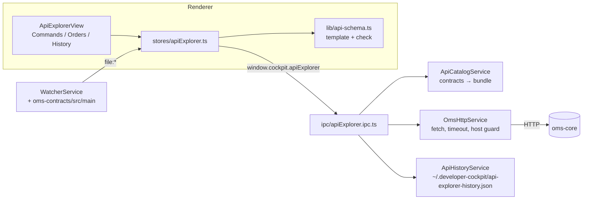

# Design — SPEC-0007: API Explorer as OMS-aware console

> **Stage 2 of 3 — how.** Concrete enough that the plan can be written without re-reading the
> code, and checked line by line against the architecture policies. Write "None — <reason>" for a
> section that genuinely does not apply.

## Context

**developer-cockpit today** (paths under `developer-cockpit/`):

- `src/renderer/stores/navigation.ts` already has `ViewId` `'api-explorer'` and the nav item
  (Development group, icon `Globe`). `components/layout/ContentArea.tsx` maps it to
  `<PlaceholderView name="API Explorer" />`.
- Main process: `src/main/index.ts` creates `ConfigService` and `WatcherService` and registers one
  `register*Ipc(ipcMain, configService)` per area. `src/main/preload.ts` exposes `window.cockpit.<area>`.
  No main-process service makes HTTP calls yet. Electron 34 ships Node 20, so global `fetch` and
  `AbortSignal.timeout` are available.
- `ConfigService(configDir = ~/.developer-cockpit)` holds `config.json`. `save()` replaces the config
  object; `SettingsView` saves via `config:save`. `InfrastructureConfig` has URL fields
  (`prometheusUrl`, …) with Settings inputs.
- `WatcherService` watches `oms-core/src`, `oms-knowledge-base`, `specs/changes`, … but **not
  `oms-contracts`**, and broadcasts `file:changed|created|deleted` over the WebSocket. The renderer
  subscribes with `hooks/useEventBus.ts`.
- `SpecsService` reads the configured `specs.openApiPaths` (default `oms-contracts/src/main/openapi`)
  with `js-yaml` (already a dependency).
- Monaco is bundled (`src/renderer/lib/monaco.ts`, SPEC-0004) and used by `DocumentEditor`.

**oms-core as it is called** (no change in this ticket):

| Purpose | Request | Source |
|---|---|---|
| command | `POST /api/command/execute`, body `Command` (`type` discriminator) → `CommandResult {id, status OK/FAILED, message}`; 201 on create, 400 on failure | `CommandController` (`@RequestMapping("/api/command")` + `ExecuteApi` path `/execute`) |
| query | `GET /api/query/search?<filters>&page&size&sort` → `PagedOrderDto {content: OrderDto[], page}` | `QueryController` + `SearchApi` `/search`; filters per `OrderSpecifications` |
| events | `GET /api/order-events/orderId/{orderId}` → `OrderEvent[] {id, orderId, version, event, transaction, resultingState, orderSnapshot, timeStamp}` | `OrderEventController` (`@Hidden`, not contracted) |

**Contracts** (`oms-contracts/src/main/openapi`):
- `oms-cmd-api.yml`: the `Command` discriminator maps 7 types. Each type is
  `allOf: [$ref Command, {required, properties}]`.
- Nested schemas `Order` and `Execution`. Enum properties are written as
  `allOf: [$ref: 'schema.yml#/components/schemas/Side']`.
- `schema.yml` holds the shared enums (`State`, `CancelState`, `Side`, `OrdType`, …).

**Closest examples followed:**
- `SpecTicketsService` + `specTickets.ipc.ts` + `test/main/SpecTicketsService*.test.ts`: a
  main-process service behind IPC, with constructor-injected collaborators for tests.
- `views/contracts/ContractsView.tsx`: a tabbed view.
- `views/spec-tickets/DocumentEditor.tsx`: the Monaco editor with a findings list.
- `lib/spec-tickets.ts`: pure renderer logic with its own unit test.

**Read:** proposal, `specs/policies/architecture-policies.md`, `developer-cockpit/spec/02`, `03`, `04`, `05`,
`oms-framework/openapi-contracts.md`, `state-query-store_spec.md` (filter semantics). The other OMS
framework specs do not apply, because no OMS module changes.

## Approach



### 1. Shared types and tables — `src/shared/apiExplorer.ts` (new)

- Types:
  - `CommandCatalog { commandTypes: string[]; schemas: Record<string, JsonSchema>; error?: string }`
  - `JsonSchema` (subset: `type`, `properties`, `required`, `enum`, `items`, `format`, `example`,
    `minLength`, `maxLength`, `description`)
  - `ApiResponse { ok: boolean; status: number | null; durationMs: number; body: unknown;
    rawBody: string; error?: string; url: string }`
  - `QueryParam { field: string; op: FilterOp; value: string }`
  - `OrderFollowUp { order: OrderDto | null; events: TimelineEvent[] | null; rawEvents?: unknown;
    error?: string }`
  - `HistoryEntry` (below)
- `API_PREFIX = { command: '/api/command', query: '/api/query' }`. Paths:
  - `COMMAND_PATH = API_PREFIX.command + '/execute'`
  - `SEARCH_PATH = API_PREFIX.query + '/search'`
  - `EVENTS_PATH = (id) => '/api/order-events/orderId/' + encodeURIComponent(id)`
- `FILTER_FIELDS`: the filterable fields, mirroring the query API description and
  `OrderSpecifications`.
  - string: `orderId, rootOrderId, parentOrderId, clOrdId, account, symbol, securityId`, operators
    `eq, like`;
  - numeric: `price, orderQty, cashOrderQty`, operators `eq, gt, gte, lt, lte, between`;
  - datetime: `sendingTime, transactTime, expireTime, orderReceivedTime, ackTime, marketSendTime,
    marketAckTime`, the same operators as numeric;
  - enum: `side → Side, ordType → OrdType, state → State, cancelState → CancelState`, operator `eq`.
    The values come from the catalog's `schema.yml` enums, not hard-coded.
- `toSearchParams(params, page, size, sort): URLSearchParams`, a pure function. The key is `field`
  for `eq` and `field__op` otherwise; `between` takes `a,b`. It throws on an unknown field or an
  operator that isn't valid for the field.
- `isLocalHost(baseUrl)`: hostname is `localhost`, `127.0.0.1` or `[::1]`/`::1`.
- `DEFAULT_OMS_CORE_URL = 'http://localhost:8090'`.

### 2. Catalog — `src/main/services/ApiCatalogService.ts` (new) (AC-1, AC-2)

`ApiCatalogService(workspaceRoot, openApiPaths)` → `load(): CommandCatalog`:

1. In the configured `openApiPaths`, find `oms-cmd-api.yml`, `oms-query-api.yml` and `schema.yml`.
   Load them with `js-yaml`. If a file is missing, `load` returns `error: '<file> not found in <paths>'`
   instead of throwing.
2. `commandTypes = Object.keys(cmd.components.schemas.Command.discriminator.mapping)`, in file order.
3. Bundle each command type and each `schema.yml` enum into a self-contained `JsonSchema`:
   - `$ref` resolution: `#/…` against the same file, `schema.yml#/…` against `schema.yml`.
   - `allOf` merge: union of `properties` and `required`. A single-element `allOf` around a `$ref`
     collapses to the referenced schema; the property's `description` is kept.
   - The discriminator and `x-*` keys are dropped.
   - A visited set guards against `$ref` cycles: a repeated ref becomes `{}` ("any").
4. `schemas` holds the bundled command schemas plus `enum:<Name>` entries for `State`,
   `CancelState`, `Side` and `OrdType` (used by the filter builder).

It reads on every call, with no cache: the files are small (~30 KB). This keeps AC-1 live without
invalidation logic.

`WatcherService`: add `'oms-contracts/src/main'` to `watchPaths`. The renderer store reloads the
catalog on any `file:*` event whose path contains `oms-contracts` and ends in `.yml`/`.yaml`, with a
300 ms debounce.

### 3. Template and checks — `src/renderer/lib/api-schema.ts` (new, pure) (AC-2, AC-3)

- `buildTemplate(type, schema)` returns an object:
  - `type` set to the command type, `version: '1.0.0'`;
  - every required property, recursively: object → its required properties; `string` → `example`
    if present, else `''`; with `format: date-time`, the current time in ISO format; `number`/`integer`
    → `example` or `0`; `boolean` → `false`; enum → the first value; array → `[]`.
  - A required string with `minLength >= 1` gets a placeholder that satisfies the check: `"<name>"`,
    e.g. `"<clOrdId>"`. So the template passes `checkBody` with no findings (AC-2) while still
    showing the user what to fill in.
- `checkBody(text, schema)` returns `{ parseError?: string; findings: { path: string; message: string }[] }`:
  - Invalid JSON gives `parseError`, taken from `JSON.parse` with line and column from the offset.
  - Otherwise it walks the schema and reports, each with a dotted path:
    - a missing required property;
    - a wrong type (`string`, `number` (also `integer`), `boolean`, `object`, `array`);
    - a value outside the enum;
    - `minLength` and `maxLength` violations;
    - `type` not equal to the selected command type.
  - Unknown properties are not reported: the server ignores them, and they are no danger.
- `orderIdOf(type, body, response)` returns the order to follow up:
  - `OrderCreateCmd` with status OK: `response.body.id`;
  - `ExecutionCreateCmd`: `body.execution.orderId`;
  - otherwise `body.orderId`;
  - `null` when there is none.

### 4. HTTP — `src/main/services/OmsHttpService.ts` (new) (AC-4, AC-5, AC-6, AC-7, AC-9)

`OmsHttpService(getBaseUrl: () => string, fetchImpl = fetch, now = performance.now)`:

- `sendCommand(bodyText, confirmedHost?)`:
  - The body must parse as JSON, otherwise refused with `error`, without sending. This is the
    defence for AC-3.
  - If the base URL isn't local, the call is refused unless `confirmedHost` equals its host. This
    enforces AC-7 in main, not only in the UI.
  - Then it POSTs to `base + COMMAND_PATH` with `Content-Type: application/json` and
    `Accept: application/json, application/problem+json`.
- `search(params, page, size, sort)`: builds the query with `toSearchParams` (an unknown field or
  operator is refused) and GETs `base + SEARCH_PATH + '?' + qs`.
- `followUp(orderId)`: GETs `search?orderId=<id>&size=1` and `EVENTS_PATH(id)` in parallel.
  - The order is `content[0]`, or `null` if there is none.
  - Events are kept as `TimelineEvent {version, event, resultingState, timeStamp, transaction,
    orderSnapshot}` when every element has a numeric `version` and a string `event`, sorted by
    version.
  - Otherwise `events: null` and `rawEvents` holds the body (degrade, don't fail).
  - If one call fails, the other's result is still returned, with that call's error.
- Every request:
  - The base URL is read per request via `getBaseUrl()`, which is
    `config.infrastructure.omsCoreUrl || DEFAULT_OMS_CORE_URL` (AC-9).
  - Timeout: `AbortSignal.timeout(10_000)`.
  - The response body is read as text, capped at 5 MB, then `JSON.parse`d when the content type is
    JSON (the raw text is kept otherwise).
  - Results:
    - any HTTP status → `ok: status < 400`;
    - network error or timeout → `{ ok: false, status: null, error: 'oms-core not reachable at <base>: <cause>' }`
      (e.g. `ECONNREFUSED`, `timeout after 10000 ms`).
    - Nothing is thrown across IPC.
  - Base URL validation: it must parse as `http:` or `https:`; otherwise
    `error: 'Invalid oms-core URL: …'`.
- Logging: one line per request, `[api-explorer] POST /api/command/execute 201 34ms` (with
  `orderId=` when known).

### 5. History — `src/main/services/ApiHistoryService.ts` (new) (AC-8)

- `ApiHistoryService(configDir = ~/.developer-cockpit)` keeps its file at
  `<configDir>/api-explorer-history.json`.
- `HistoryEntry`:

  ```ts
  { id: string; at: string /* ISO */; kind: 'command' | 'query';
    label: string /* command type, or 'search' */;
    method: 'POST' | 'GET'; path: string; status: number | null; durationMs: number;
    request: { body: string } | { params: QueryParam[]; page?: number; size?: number; sort?: string } }
  ```
- Operations:
  - `add` prepends an entry and trims the list to 100;
  - `list` returns the entries newest first;
  - `clear` writes `[]`.
- Writes are atomic: write `.tmp`, then rename.
- If the file is unreadable or corrupt, `list` returns `[]` and logs once. The next `add`
  overwrites it.
- Bodies over 64 KB are stored truncated, with `truncated: true`, and restoring one shows a notice.
- The IPC layer records an entry after each `sendCommand`/`search`, including failures
  (`status: null`). Follow-up reads are not recorded: they are derived, and recording them would
  flood the history.

### 6. IPC and preload — `src/main/ipc/apiExplorer.ipc.ts` (new)

Registered in `main/index.ts` with the other areas; services are built lazily with the current
config:

| channel | args | returns |
|---|---|---|
| `apiExplorer:catalog` | — | `CommandCatalog` |
| `apiExplorer:baseUrl` | — | `{ baseUrl, local: boolean }` |
| `apiExplorer:sendCommand` | `bodyText, confirmedHost?` | `ApiResponse` (+ history entry) |
| `apiExplorer:search` | `params, page?, size?, sort?` | `ApiResponse` (+ history entry) |
| `apiExplorer:followUp` | `orderId` | `OrderFollowUp` |
| `apiExplorer:history` | — | `HistoryEntry[]` |
| `apiExplorer:clearHistory` | — | `void` |

`preload.ts` exposes these as `window.cockpit.apiExplorer.{catalog, baseUrl, sendCommand, search,
followUp, history, clearHistory}`, and `shared/types/ipc.ts` gets the matching type.

### 7. Config (AC-9)

- `InfrastructureConfig.omsCoreUrl: string`, default `'http://localhost:8090'`. A saved config
  without the key gets the default through the existing one-level `merge()`. No migration is needed.
- `SettingsView`, Infrastructure section: an input labelled "oms-core URL". The service reads the
  value on each request, so a save takes effect on the next request.

### 8. Renderer

**`stores/apiExplorer.ts`** (zustand):
- state:
  - catalog: `catalog`, `catalogError`;
  - commands: `selectedType`, `bodyText`, `check`, `sending`, `lastCommand: { type, body,
    response }`;
  - follow-up: `followUpId`, `followUp`, `followUpLoading`;
  - queries: `filters: QueryParam[]`, `page`, `size`, `sort`, `searchResult`;
  - history: `history`;
  - target: `baseUrl`, `local`.
- actions:
  - `loadCatalog`;
  - `selectType(type, preset?)`: replaces the body with `buildTemplate`, with `preset` merged in
    (e.g. `{orderId}`), after asking if the body was edited;
  - `setBody` (re-checks on change, debounced 200 ms);
  - `send(confirm: (host) => boolean)`: shows the confirmation for a non-local host, sends, then
    loads the follow-up when `orderIdOf` finds an order;
  - `refreshFollowUp`, `openFollowUp(orderId)`;
  - filter actions: add, update, remove;
  - `search`, `loadHistory`, `restore(entry)`, `clearHistory`.

**`views/api-explorer/ApiExplorerView.tsx`** (replaces the placeholder in `ContentArea`):
- **Header:** title, the target `oms-core: http://localhost:8090` with a "non-local" badge when
  `!local`, and the tabs *Commands*, *Orders*, *History*.
- **Commands** (`CommandsTab.tsx`):
  - left: the list of command types (buttons, the selected one marked);
  - centre: a Monaco JSON editor (`language: 'json'`) of `bodyText`, the findings list below it
    (`role="list"`, each item `path — message`, or the parse error), and **Send**. Send is disabled
    only while sending or when there is a parse error.
  - The response panel shows the status badge, `NNN ms`, and the body pretty-printed. When a problem
    body (`application/problem+json`) has a `title` or `detail`, those are shown above it. When the
    status is `null`, an alert shows the reachability error.
- **Order follow-up** (`OrderFollowUp.tsx`), shown in Commands and Orders whenever `followUpId` is
  set:
  - the order card: `orderId`, `state`, `cancelState`, `side`, `symbol`, `orderQty`, `cumQty`,
    `leavesQty`, `price`;
  - "Order <id> not found" when the order is `null`;
  - the timeline table: version, event, resulting state, time, with a row that expands to show the
    `transaction` and `orderSnapshot` JSON; or the raw JSON when `events` is `null`;
  - **Refresh**, and **Next command ▾**, listing the command types that have an `orderId` property,
    each calling `selectType(type, { orderId })` and switching to Commands.
- **Orders** (`OrdersTab.tsx`):
  - filter rows: a field select (`FILTER_FIELDS`), an operator select (that field's operators), and
    a value input (a select of enum values for enum fields; two inputs for `between`);
  - page, size (1–500) and sort inputs;
  - the read-only request URL (`base + SEARCH_PATH + '?' + toSearchParams(...)`), and **Search**;
  - the results table (orderId, clOrdId, symbol, side, orderQty, cumQty, state, transactTime) with
    page metadata and previous/next. Clicking a row opens the follow-up.
- **History** (`HistoryTab.tsx`):
  - a list, newest first, of time, `label`, `method path`, and the status (or "unreachable");
  - choosing an entry calls `restore`, which switches to the matching tab with the body or filters;
  - **Clear history** asks for confirmation.

**Mapping of What Changes:**

| What Changes item | Sections |
|---|---|
| Commands (type list, template, checks, send) | §2, §3, §4, §8 Commands |
| Order follow-up | §4 `followUp`, §8 |
| Orders (filter builder, URL, table) | §1 `FILTER_FIELDS`/`toSearchParams`, §4 `search`, §8 Orders |
| Target and safety | §4, §7, §8 header |
| History | §5, §8 History |
| Docs | Knowledge Base Updates |

## Contract Changes

None. The explorer reads `oms-cmd-api.yml`, `oms-query-api.yml` and `schema.yml` and writes nothing
to them. The follow-up uses the uncontracted event endpoint as agreed in the proposal; a follow-up
ticket will add it to `oms-query-api.yml`.

## Data & Persistence

None in OMS.

The cockpit gains a per-user file, `~/.developer-cockpit/api-explorer-history.json` (§5), and a
config key, `infrastructure.omsCoreUrl` (§7). For rollback: an older cockpit ignores both.

## Events & Messaging

None of its own. The cockpit publishes nothing to Kafka. Commands it sends go through oms-core's
normal path (event log, outbox) like any other client's.

One cockpit-internal change: `WatcherService` now also watches `oms-contracts/src/main`, which
reuses the existing `file:*` events.

## Domain, State & Orchestration

None in OMS: no transitions or tasks change, and oms-core remains the authority on what each
command does.

Input validation sits at the cockpit's IPC boundary (§4):
- a command body must be JSON;
- search parameters must be known fields with valid operators;
- the base URL must be `http(s)`;
- a command to a non-local host needs a matching `confirmedHost`.

The client-side schema checks only warn (AC-3), because oms-core's validation stays authoritative.
oms-core's error responses (`CommandResult` with FAILED, or Problem+JSON) are shown as returned.

## Alternatives & Decisions

- **Main-process HTTP, not renderer `fetch`.** Calling from the renderer would need a CSP
  `connect-src` entry for an arbitrary configurable host, plus CORS on oms-core for the Electron
  origin. Main has neither problem and can enforce the host guard.
- **Own small schema walker, not a JSON Schema validator library (ajv) or Monaco's built-in JSON
  schema diagnostics.**
  - ajv would be a new dependency for about 80 lines of checks over an OpenAPI subset, and it wants
    OpenAPI-to-JSON-Schema conversion anyway.
  - Monaco diagnostics are stubbed in the test environment, so AC-3 couldn't be proven, and Monaco
    can't deliver the findings to the store.
  - P-17: no new dependency.
- **Bundle schemas in main, run the template and checks in the renderer.** File access and YAML
  belong in main. The pure template/check functions run on every keystroke and are unit-testable
  without IPC.
- **Read the catalog on every request, no cache.** The files are tiny, and freshness (AC-1)
  matters more than about 5 ms. Rejected: caching with invalidation on watcher events, which adds
  coupling for no measurable gain.
- **A fixed URL prefix and filter-field table in the cockpit** (proposal decisions).
  `test/shared/apiExplorer.test.ts` fails if `FILTER_FIELDS` and the query API description diverge,
  in either direction.
- **The event timeline degrades to raw JSON** when the uncontracted shape changes, rather than
  failing the view.
- **The history records only sends,** not follow-up reads.
- **No new dependency or build change.**
- **Changed during implementation: the body check runs on every change, not debounced 200 ms.** The
  walk over a command schema is a few hundred property visits; a debounce would add timer state to
  the store and tests for no visible gain.
- **Changed during implementation: `checkBody` locates JSON syntax errors with its own small scanner.**
  V8's `JSON.parse` message for e.g. `{"a": }` has no position ("Unexpected token '}', … is not
  valid JSON"), so AC-3's line/column could not come from it. The scanner runs only after
  `JSON.parse` failed.
- **Changed during implementation: "Next command" offers commands with a top-level `orderId`, or a
  *required* `orderId` one level down** (`execution.orderId`). `OrderCreateCmd`'s `order` has an
  optional `orderId` and is not a command on an existing order (found by the follow-up test).
- **Changed after the independent review (T-15):** `ApiResponse.refused` / `HistoryEntry.refused`
  mark requests refused before sending (shown as *refused*, not *unreachable*);
  `OrderFollowUp.orderError` separates a failed order query from an unknown order; a blank
  `followUp` id is refused; history writes are wrapped so a failing write never loses the response;
  `null` is checked like any value (no contract schema is nullable); any change to filters, size or
  sort resets the page to 0, so the URL shown is the one Search sends.
- **Changed during implementation: history entries for a body that is not JSON are labelled
  `(invalid JSON)`**, one without `type` `(no type)`; they are recorded like any other send (AC-8).

## Risks & Mitigations

- **The uncontracted events endpoint changes shape.** Mitigated by shape detection with a raw JSON
  fallback (tested), and by the follow-up ticket to contract it.
- **Commands sent to a shared environment by mistake.** Mitigated by the host guard enforced in main
  plus the confirmation (AC-7), and the base URL always visible in the header.
- **Large search results or response bodies.** Mitigated by the 5 MB read cap and size limited to
  500 by the UI and the server.
- **Secrets.** There is no auth in scope, and the history holds only request bodies the user typed.
  It lives in the user's home folder, not the repository.
- **The runtime check needs a running oms-core** (postgres, broker, schema-registry). Verify starts
  it with `docker compose up -d postgres broker schema-registry oms-core`. If Docker is unavailable,
  the ticket blocks with that reason rather than skipping the check. The AC-4 integration test
  uses a local Node HTTP server, so automated evidence doesn't depend on Docker.

## Test Strategy

All paths are under `developer-cockpit/test/`.

| AC | Level | Test class#method | What it asserts |
|---|---|---|---|
| AC-1 | integration (repo contracts, read-only) + integration (temp dir) + component | `main/ApiCatalogService.test.ts`, "lists the command types of the repository's Command mapping", "follows the mapping on disk (add/remove a type in a temp copy)", "reports a missing contract file instead of throwing"; `main/WatcherService.test.ts`, "watches oms-contracts/src/main"; `renderer/ApiExplorer.commands.test.tsx`, "reloads the command list when a contract file changes" | 7 types in mapping order; a type added to a temp copy appears and a removed one disappears on the next `load()`; error text; the watch list includes `oms-contracts/src/main`; a `file:changed` event for `…/oms-contracts/…/oms-cmd-api.yml` triggers `catalog()` again and the new list renders |
| AC-2 | unit (bundled repo schemas) | `renderer/api-schema.test.ts`, "template for every command type has the type and all required properties and passes the check", "resolves allOf and schema.yml refs (Order.side is the Side enum)", "nested required properties are filled (execution.execId)" | For all 7 types: `type` set, every required path present, `checkBody` returns no findings; enum value taken from `Side`; `ExecutionCreateCmd.execution.execId` present |
| AC-3 | unit + component | `renderer/api-schema.test.ts`, "reports missing required, wrong type, enum and length with paths", "reports JSON parse errors with line and column"; `renderer/ApiExplorer.commands.test.tsx`, "send stays enabled with findings and is disabled for invalid JSON"; `main/OmsHttpService.test.ts`, "refuses a body that is not JSON without sending" | Findings `order.side`, `order.orderQty`, `orderId` with messages; the parse error; button states; the fake fetch is not called |
| AC-4 | integration (real HTTP server on an ephemeral port) | `main/OmsHttpService.test.ts`, "posts the command to /api/command/execute and returns status, duration and body" (201 and 400 cases), "reports oms-core not reachable on connection refused", "times out after 10 s" (fake timers, with the timeout injected), "never throws across IPC"; `renderer/ApiExplorer.commands.test.tsx`, "shows status, duration and body; shows the unreachable alert" | Method, path, content type and body received by the server; the result fields; the error text contains the base URL; the view stays interactive |
| AC-5 | unit (fake fetch) + component | `main/OmsHttpService.test.ts`, "followUp loads the order and events sorted by version", "unknown order gives order null and no timeline", "unexpected event shape falls back to raw"; `renderer/api-schema.test.ts`, "orderIdOf for create, execution and order commands"; `renderer/ApiExplorer.followup.test.tsx`, "shows state and timeline after a create, refresh reloads, not found message, next command presets orderId" | The two URLs requested (with the id encoded); version order; "Order X not found"; the template opens with `orderId` |
| AC-6 | unit + component | `shared/apiExplorer.test.ts`, "toSearchParams builds eq, op and between keys and rejects unknown fields or operators", "FILTER_FIELDS matches the query API description"; `main/OmsHttpService.test.ts`, "search refuses unknown filter fields"; `renderer/ApiExplorer.orders.test.tsx`, "field and operator choices by kind, enum values from the catalog, URL shown equals URL sent, results table and paging, row opens follow-up" | Exact query strings; the drift check against `oms-query-api.yml`; operator options per field; the shown URL string equals the URL the fake `search` received |
| AC-7 | unit + component | `shared/apiExplorer.test.ts`, "isLocalHost"; `main/OmsHttpService.test.ts`, "refuses a command to a non-local host without matching confirmation; queries need none"; `renderer/ApiExplorer.commands.test.tsx`, "asks before sending to a non-local host; cancel sends nothing" | localhost, 127.0.0.1 and ::1 count as local, `oms-test.example` doesn't; fetch not called without a confirmed host; the confirm text names the host |
| AC-8 | integration (temp config dir) + component | `main/ApiHistoryService.test.ts`, "keeps the newest 100 across instances", "clear empties the file", "corrupt file reads as empty", "truncates large bodies"; `main/apiExplorer.ipc.test.ts`, "records each send including failures, not follow-ups"; `renderer/ApiExplorer.history.test.tsx`, "lists entries, restore puts back body or filters, clear asks first" | A new service instance on the same dir sees the entries (the restart); order and limit; the file content after clear; restore switches tab and fills the editor or filters |
| AC-9 | unit + integration (fake ipcMain + real ConfigService) | `main/apiExplorer.ipc.test.ts`, "defaults to http://localhost:8090", "uses the new base URL after config save without re-registering"; `renderer/SettingsView.test.tsx`, "edits the oms-core URL" | The request URL host follows `configService.save()`; the Settings input saves `infrastructure.omsCoreUrl` |

**Runtime check (verify)** against oms-core started with Docker Compose, in the built app over CDP:
1. Commands → `OrderCreateCmd`: fill the template, then Send → 201, and the follow-up shows state
   `NEW`/`UNACK` and event v1.
2. **Next command** → `OrderAcceptCmd` → Send, and the timeline shows v2.
3. Orders → `symbol eq` → the row is found, and clicking it opens the same follow-up.
4. History lists the three sends.
5. Screenshot each tab.

## Policy Compliance

| Policy | Title | Status | How / Justification |
|---|---|---|---|
| P-01 | Contracts live only in oms-contracts | comply | The explorer reads the contracts from the configured `oms-contracts` paths. No copies; no contract folder created. |
| P-02 | Specification before code, generated models only | comply | Command types, templates and checks are derived from the contracts at runtime; nothing hand-maps the command models. The filter table mirrors the contract description and is drift-tested. |
| P-03 | Never edit generated code | n/a | No generated code involved (TypeScript cockpit only). |
| P-04 | Contracts evolve compatibly | n/a | No contract change. |
| P-05 | Every state change is recorded in the event log | n/a | The cockpit changes no order state itself. Commands go through oms-core, which records them. |
| P-06 | Kafka only through the transactional outbox | n/a | No Kafka in the cockpit. |
| P-07 | Schema changes through new Liquibase changesets | n/a | No database. |
| P-08 | Concurrency and idempotency are explicit | comply | History writes are atomic (tmp + rename), and there's a single writer, the main process. Sends aren't retried automatically, so there's no accidental duplicate command. `commandId` stays the user's choice. |
| P-09 | Commands and queries stay separate | comply | Separate tabs, IPC channels and service methods for commands (`sendCommand`) and queries (`search`, `followUp`). Reads never POST. |
| P-10 | State transitions go through the state machine and task pipeline | n/a | No transitions are implemented here; oms-core's pipeline handles every command sent. |
| P-11 | Layering and conventions | comply | IPC → services (injectable fetch, clock, config dir), as in `SpecTicketsService`. Pure logic in `lib/` and `shared/`, state in a zustand store, tabbed view as in `ContractsView`. |
| P-12 | Jackson 3 only | n/a | TypeScript only. |
| P-13 | Errors and validation follow the framework specs | comply | oms-core's error bodies (FAILED `CommandResult`, Problem+JSON `title`/`detail`) are shown as returned. Network failures are reported with their cause. Nothing is swallowed, and IPC never throws. |
| P-14 | Test first, every acceptance criterion is proven by an automated test | comply | Every AC is mapped to the tests above, which are written red first. |
| P-15 | Observability | comply | One `[api-explorer]` log line per request (method, path, status, ms, orderId if known), as `[codegen]` does. There are no metrics in the cockpit (no Micrometer there). |
| P-16 | Security | comply | Input is validated at the IPC boundary (JSON body, known filter fields, http(s) base URL, encoded order id). The host guard is enforced in main. No secrets: no auth, URL in user config, history in the user's home folder. The renderer CSP is unchanged. |
| P-17 | Simplicity and dependencies | comply | No new dependency: global `fetch`, existing `js-yaml` and Monaco. Own schema walker over the OpenAPI subset actually used. |
| P-18 | Modules build standalone | comply | developer-cockpit verify (`npm run typecheck`, `npm test`); OMS modules untouched. |
| P-19 | Documentation follows behaviour | comply | Cockpit spec pages updated (below). |

## Knowledge Base Updates

None in `oms-knowledge-base/`, since OMS behaviour doesn't change. Cockpit docs:

- `developer-cockpit/spec/03-features.md`: a new **API Explorer** section covering the Commands,
  Order follow-up, Orders and History tabs, the target, the guard and the uncontracted events
  endpoint.
- `developer-cockpit/spec/02-information-architecture.md`: the API Explorer entry's description.
- `developer-cockpit/spec/04-backend-services.md`: the ApiCatalogService, OmsHttpService and
  ApiHistoryService, and the IPC channels.
- `developer-cockpit/spec/05-data-model.md`: `infrastructure.omsCoreUrl` and the history file
  format.
