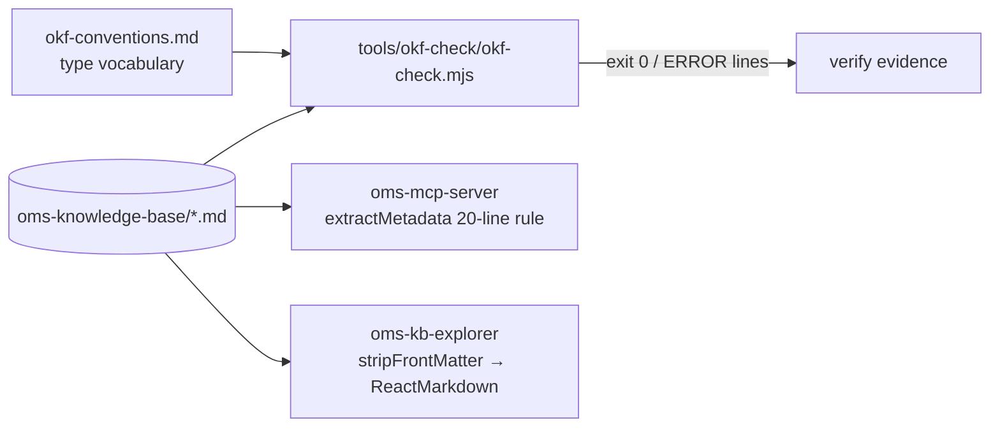

# Design — SPEC-0009: Convert knowledge base to OKF bundle

> **Stage 2 of 3 — how.** Concrete enough that the plan can be written without re-reading the
> code, and checked line by line against the architecture policies. Write "None — <reason>" for a
> section that genuinely does not apply.

## Context

- **Bundle today.** `oms-knowledge-base/` holds 32 `.md` files in `oms-concepts/`,
  `oms-framework/`, `oms-methodolgy/`, `illustrations/`, `ui/` and the root. None has front matter.
  Metadata is a bold header under the H1 (`**Version:**`, `**Status:**`, `**Last Updated:**`),
  present in 20 documents; status values seen: `Active`, `Complete`, `Implementation Complete`,
  `Draft`, `Draft for discussion`; dates as `2026-02-14`, `2025-10-08` or `October 8, 2025`.
  `oms-methodolgy/skill-profiles.md` has no H1. `animations/` holds only Python, `.pyc` and video
  files (no concepts).
- **OKF v0.2** (`SPEC.md` in GoogleCloudPlatform/open-knowledge-format): concept = any non-reserved
  `.md`; id = path without `.md`; front matter with non-empty `type` is the only hard requirement
  (§11); `index.md` (no front matter except `okf_version` at root, §8, §12) and `log.md`
  (`YYYY-MM-DD` headings newest first, §9) are reserved; `status` ∈ draft|stable|deprecated;
  timestamps ISO 8601 with offset; actors `human:<id>`, `process:<id>`, `<producer>/<version>`;
  trust tier derived from `verified`.
- **Consumers.**
  - `oms-mcp-server/src/main/java/org/example/mcp/docs/MarkdownParser.java#extractMetadata` matches
    `^\*\*(Version|Status|Last Updated|Category):\*\*\s*(.+)$` (case-insensitive, on trimmed lines)
    in the **first 20 lines**; `DocumentRepository#listAll` feeds it to `listDomainDocs` and to the
    explorer's `/api/kb/documents`. `DocumentFileUtils#isDocFile` picks up every `.md`.
  - `oms-kb-explorer/src/components/DocumentViewer.tsx` renders `document.content` (raw file from
    `/api/kb/documents/read`) with `ReactMarkdown`, no front matter handling. The explorer has no
    test runner; its tsconfig already uses `allowImportingTsExtensions` and `erasableSyntaxOnly`.
  - `developer-cockpit/src/main/services/KbService.ts` parses with `gray-matter` (strips front
    matter, uses `title`); `RequirementsService#scanAllForType` matches `type` against
    `use-cases`, `functional-requirements`, `non-functional-requirements`, `actors`.
- **Closest existing example.** `specs/tools/spec.mjs`: a dependency-light Node ESM CLI that
  validates markdown documents and exits non-zero with `ERROR <file>: <message>` lines. The checker
  follows its style and output format.
- **KB pages read:** `oms-knowledge-base-strategy.md`, `KNOWLEDGE-BASE-REVIEW-REPORT.md` (headers),
  headers of all 32 documents.

## Approach

Three deliverables: a checker, the converted bundle, and the explorer strip.



**1. Checker — `tools/okf-check/`** (new, outside the bundle so test fixtures are never read as
concepts by the MCP server):

- `okf-check.mjs` — CLI `node tools/okf-check/okf-check.mjs <bundleDir>`; exports
  `checkBundle(dir) → { errors: [{file, rule, message}], warnings: [...] }` for tests. Prints
  `ERROR <relpath> [<rule>]: <message>` per finding, a summary line, exit 1 if any error else 0.
- Front matter is read as the text between a first line `---` and the next line `---`, parsed with
  `js-yaml` `load(text, { schema: JSON_SCHEMA })` so timestamps stay strings (no implicit Date).
- Rules (ids appear in the output):

  | Rule | Source | Check |
  |---|---|---|
  | `OKF-FM` | §11.1 | non-reserved `.md` starts with a parseable YAML mapping block |
  | `OKF-TYPE` | §11.2 | `type` is a non-empty string |
  | `OMS-KEYS` | project | `title`, `description` non-empty strings; `tags` non-empty list of strings |
  | `OKF-STATUS` | §5.4 | `status` present and ∈ {draft, stable, deprecated} (presence is project rule) |
  | `OMS-VOCAB` | project | `type` ∈ `type_vocabulary` declared in `<bundle>/okf-conventions.md` front matter; missing conventions file is an error |
  | `OKF-TIME` | §5 | `updated`, `stale_after`, `generated.at`, `verified[].at`, `sources[].last_modified` match ISO 8601 date-time with `Z` or `±hh:mm` |
  | `OKF-ACTOR` | §7 | `generated.by`, `verified[].by` match `^human:\S+$`, `^process:\S+$` or `^[\w.-]+/[\w.-]+$` |
  | `OMS-UNVERIFIED` | project | no `verified` key (conversion must not claim review); downgraded to a warning once a later ticket allows it |
  | `OKF-INDEX-ROOT` | §12 | root `index.md` exists; front matter is exactly `{okf_version: "0.2"}` |
  | `OKF-INDEX` | §8 | non-root `index.md` has no front matter; every folder containing concepts (recursively) has an `index.md` that links every concept and every child folder's `index.md` |
  | `OKF-LOG` | §9 | `log.md`, where present, has no front matter, `## YYYY-MM-DD` headings strictly descending |
  | `OKF-LINK` | §6 | every relative or `/`-prefixed markdown link `[..](target)` outside fenced code resolves to an existing file (anchor and query stripped; `http(s):`, `mailto:`, pure `#anchor` ignored). Error, not warning, as a project rule (OKF only requires consumers to tolerate) |

- `package.json` (`"type": "module"`, dependency `js-yaml`, script `test: node --test`),
  `test/okf-check.test.mjs`, `test/fixtures/<case>/…` (one mini-bundle per failure case plus a
  `valid/` bundle), `test/baseline-metadata.json` and `test/mcp-metadata.mjs` (see AC-7).
- `README.md` — how to run, rule table.

**2. Bundle conversion** (one-off; edits are hand-reviewed, no generator is committed):

- Prepend front matter to each of the 32 documents, compact so bold headers stay within line 20:
  ```yaml
  ---
  type: Specification
  title: Order Lifecycle Management Specification
  description: Order state transitions, business workflows and FIX semantics in one reference.
  tags: [order-lifecycle, state-machine, fix]
  status: stable
  version: "1.0"
  updated: "2026-02-14T00:00:00Z"
  ---
  ```
  `version` and `updated` are extension keys (allowed by OKF §4), set only when the bold header
  has them; `updated` is the `Last Updated` date at `00:00:00Z`. Bold headers are kept verbatim.
  `title` = H1 text (or a written title for `skill-profiles.md`). No `generated`/`verified`.
- Type vocabulary (declared in `okf-conventions.md` as `type_vocabulary`) and mapping:

  | type | documents |
  |---|---|
  | `Concept Paper` | oms-concepts/{block-order-allocation, booking-integration, order-model-trading-capacity, post-trade-analytics} |
  | `Specification` | oms-concepts/{exchange-simulator, execution-reporting, order-grouping, order-lifecycle, order-quantity-calculations, order-replace, streaming-architecture}, all 9 oms-framework/*, illustrations/order-state-indicator-spec, ui/oms-admin-ui_spec |
  | `Diagram` | illustrations/{order_allocation_diagrams, task-orchestration-diagrams} |
  | `Methodology` | oms-methodolgy/{agent, ai-augmented-development, manifesto, skill-profiles, software-architecture-methodology} |
  | `Assessment` | oms-methodolgy/architecture-convergence-assessment, KNOWLEDGE-BASE-REVIEW-REPORT |
  | `Strategy` | oms-knowledge-base-strategy |
  | `Reference` | okf-conventions |

  None collides with the cockpit's requirement keys.
- Status mapping (AC-8): `Active`, `Complete`, `Implementation Complete` → `stable`; `Draft`,
  `Draft for discussion` → `draft`; no header → `draft`.
- New files: `index.md` (root, with `okf_version: "0.2"`, linking root concepts and the five
  folder indexes), `oms-concepts/index.md`, `oms-framework/index.md`, `oms-methodolgy/index.md`,
  `illustrations/index.md`, `ui/index.md`; `log.md` with a `## 2026-10-27` entry describing the
  conversion; `okf-conventions.md` (type `Reference`): vocabulary with definitions, required keys,
  status mapping, how to add a document, how to run the checker.
- Fix every link the checker reports (known: `oms-framework/error-handling.md` →
  `../oms-concepts/streaming-architecture.md`).

**3. Explorer strip — `oms-kb-explorer`:**

- New `src/utils/frontMatter.ts` exporting `stripFrontMatter(content: string): string`: if the
  content (after an optional BOM) starts with `---` + newline and a later line is exactly `---`,
  return everything after that line (leading blank lines trimmed); otherwise return the input.
  Handles `\r\n`.
- `DocumentViewer.tsx`: render `{stripFrontMatter(document.content)}` instead of
  `{document.content}`.
- Test `src/utils/frontMatter.test.ts` with `node:test` + `node:assert`, run by a new script
  `"test": "node --test src/**/*.test.ts"` (Node ≥ 22.18 strips types natively). Test files are
  excluded from `tsconfig.app.json` (`"exclude": ["src/**/*.test.ts"]`) because the app's `types`
  do not include Node.

## Contract Changes

None — no OpenAPI or Avro change; the MCP server API and the explorer's REST calls are unchanged.

## Data & Persistence

None — no database involvement; the knowledge base is files in git.

## Events & Messaging

None — no events or Kafka.

## Domain, State & Orchestration

None — no order state, state machine or task pipeline involvement.

## Alternatives & Decisions

- **Checker language and YAML parser** — Node ESM script with `js-yaml` (MIT, already in the repo's
  dependency tree via `gray-matter` in developer-cockpit), isolated in `tools/okf-check/package.json`.
  Rejected: a hand-written YAML-subset parser (AC-1 demands "parseable YAML"; a subset parser would
  accept/reject the wrong things); importing `js-yaml` from `developer-cockpit/node_modules` (hidden
  coupling to another module's install); a Java/Gradle check in oms-mcp-server (couples the bundle's
  validity to a service module, slower feedback). **New dependency: `js-yaml` in a new tool package.**
- **Checker location** — `tools/okf-check/` rather than inside `oms-knowledge-base/`: fixtures are
  `.md` files and would otherwise be indexed by the MCP server as concepts and break conformance.
- **Type vocabulary in the bundle** (`okf-conventions.md` front matter `type_vocabulary`) rather
  than in checker config: the KB stays self-describing, and SPEC-0010 extends types without touching
  the tool.
- **Keep bold headers** — compatibility copy until SPEC-0011 reads front matter; front matter is the
  source of truth. Rejected: dropping them (regresses `listDomainDocs` and explorer badges now).
- **JSON_SCHEMA for YAML parsing** — keeps timestamps and versions as strings so `OKF-TIME` checks
  the written text. Rejected: default schema (turns `2026-02-14T00:00:00Z` into a `Date`, hiding
  offset problems).
- **AC-7 measured with a faithful port of `extractMetadata`** (`test/mcp-metadata.mjs`, same
  patterns, same 20-line limit, a comment pointing at the Java source) against a baseline captured
  from the unconverted bundle. Rejected: a JUnit test in oms-mcp-server (adds a third module for a
  read-only check). The verify stage additionally cross-checks live via the running MCP server's
  `listDomainDocs` when available.
- **Explorer test runner** — Node's built-in `node --test` with native type stripping. Rejected:
  adding Vitest (new dev dependency for one pure function). **Build change: new `test` script and a
  tsconfig `exclude`.**
- **No folder renames** — concept ids stay stable; renames belong to SPEC-0010.
- **Changed during implementation: fixtures** — only `test/fixtures/valid/` and `empty-type/` are
  on disk; the other failure cases are built in the test by copying `valid/` to a temp directory
  and changing one file, because each case should break exactly one rule and a directory per case
  (about 30) would mostly duplicate `valid/`.
- **Changed during implementation: explorer build fixes (T-9b)** — `npm run build` in
  oms-kb-explorer already failed on the base branch with 7 TypeScript errors (unused names,
  react-markdown v10 no longer passing `inline`, `style`/`ref` spread into SyntaxHighlighter).
  Fixed because the module's verify command is the build. No runtime change: `inline` was always
  undefined, so `!inline` was always true.
- **Changed at verify: stricter `OKF-LINK`** (independent review) — a link must stay inside the
  bundle and resolve to a file or to a folder that has an `index.md`; plain existence let
  directory links and `../..` escapes pass. Test `#"internal links must stay in the bundle…"`.
- **Changed during implementation: AC-8 test scope** — the status mapping test skips
  `okf-conventions.md`, which the conversion created (`stable`); AC-8 covers pre-existing documents.

## Risks & Mitigations

- **Front matter pushes bold headers beyond line 20** → compact front matter (≤ 10 lines);
  AC-7 test fails if any baseline value changes.
- **YAML quoting mistakes in descriptions** (colons, quotes) → every file goes through the checker
  (AC-1); descriptions avoid leading special characters.
- **Explorer strip removes content that only looks like front matter** (a document starting with a
  thematic break) → only a block at offset 0 that closes with `---` is stripped; AC-9 tests the
  body-thematic-break and no-front-matter cases. No current document starts with `---`.
- **Node version** → `node --test` on `.ts` needs Node ≥ 22.18 (repo uses 22.20); documented in the
  explorer README.
- **Index drift** as documents are added → `OKF-INDEX` fails the checker when a concept is not
  listed.
- **Agents reading raw files now see front matter** → harmless and useful (type, status); SPEC-0011
  surfaces it as structured data.

## Test Strategy

| AC | Level (unit / web-mvc / integration / e2e) | Test class#method | What it asserts |
|---|---|---|---|
| AC-1 | integration (real bundle) | tools/okf-check/test/okf-check.test.mjs#"real bundle conforms" | `checkBundle('oms-knowledge-base')` returns no errors; every non-reserved `.md` was parsed and has a non-empty `type`; CLI exits 0 |
| AC-2 | unit (fixtures) | okf-check.test.mjs#"rejects missing/unparseable front matter and empty type" | fixtures `no-frontmatter`, `bad-yaml`, `empty-type` each yield an error with the file and rule `OKF-FM`/`OKF-TYPE`; CLI exits 1 |
| AC-3 | unit + real bundle | okf-check.test.mjs#"requires project keys and vocabulary" | fixtures missing `title`, `description`, `tags` (absent and empty), invalid `status`, unknown `type`, missing conventions file → named errors; real bundle has none |
| AC-4 | unit + real bundle | okf-check.test.mjs#"index and log rules" | fixtures: root index without/with extra front matter, sub-index with front matter, folder without index, concept not linked from index, log with ascending dates → errors; real bundle passes |
| AC-5 | unit + real bundle | okf-check.test.mjs#"timestamps, actors and no verified" | fixtures: `updated` without offset, `generated.by: bob`, a `verified` entry → errors; valid fixture with `+02:00` and `human:x` passes; real bundle has no `verified` |
| AC-6 | unit + real bundle | okf-check.test.mjs#"internal links resolve" | fixture with a broken relative and a broken `/`-prefixed link → two `OKF-LINK` errors; links inside code fences, external URLs and anchors are ignored; real bundle has zero |
| AC-7 | integration (real bundle vs baseline) | tools/okf-check/test/mcp-metadata.test.mjs#"MCP metadata unchanged" | port of `MarkdownParser#extractMetadata` returns, for every path in `baseline-metadata.json`, the same `version` and `status` |
| AC-8 | integration (real bundle vs baseline) | mcp-metadata.test.mjs#"status mapping" | for each baseline entry, front matter `status` equals the mapped value; documents with no baseline status are `draft` |
| AC-9 | unit | oms-kb-explorer/src/utils/frontMatter.test.ts#{strips leading block, keeps body thematic breaks, passes through plain content, handles CRLF and BOM} | `stripFrontMatter` output starts at the first body line, contains no YAML key; other inputs unchanged |

## Policy Compliance

| Policy | Title | Status | How / Justification |
|---|---|---|---|
| P-01 | Contracts live only in oms-contracts | n/a | no contract touched |
| P-02 | Specification before code, generated models only | n/a | no API/message change; OKF SPEC.md is the spec followed |
| P-03 | Never edit generated code | comply | no file under `build/generated*` edited |
| P-04 | Contracts evolve compatibly | n/a | no contract touched |
| P-05 | Every state change is recorded in the event log | n/a | no order state |
| P-06 | Kafka only through the transactional outbox | n/a | no Kafka |
| P-07 | Schema changes through new Liquibase changesets | n/a | no database |
| P-08 | Concurrency and idempotency are explicit | n/a | no commands or concurrent writes; checker is read-only and idempotent |
| P-09 | Commands and queries stay separate | n/a | no command/query API involved |
| P-10 | State transitions go through the state machine and task pipeline | n/a | no state transitions |
| P-11 | Layering and conventions | comply | checker follows `specs/tools/spec.mjs` CLI style; explorer helper in a `utils` module used by the existing component |
| P-12 | Jackson 3 only | n/a | no Java |
| P-13 | Errors and validation follow the framework specs | n/a | no API errors; checker reports every violation, swallows nothing |
| P-14 | Test first, every acceptance criterion is proven by an automated test | comply | every AC mapped above; fixtures and tests are written before conversion and the strip |
| P-15 | Observability | n/a | no service runtime change; CLI output is structured `ERROR file [rule]: msg` |
| P-16 | Security | comply | no secrets; checker only reads inside the given directory and does not follow links outside it |
| P-17 | Simplicity and dependencies | comply | one new dependency (`js-yaml`, in an isolated tool package) and no new explorer dependency; both recorded in Alternatives & Decisions |
| P-18 | Modules build standalone | comply | `oms-kb-explorer` still passes `npm run build`; the tool package is independent of every module |
| P-19 | Documentation follows behaviour | comply | the KB itself is the change; conventions page and log entry added; explorer README notes `npm test` |

## Knowledge Base Updates

- All 32 documents: front matter added (bodies unchanged except link fixes).
- New `okf-conventions.md`: type vocabulary, required keys, status mapping, how to add a document,
  how to run the checker.
- New `index.md` at the root and in each of the five content folders; new `log.md`.
- `oms-framework/error-handling.md` (and any other the checker flags): broken links fixed.
- `oms-knowledge-base-strategy.md`: one short note under its structure section that the bundle
  follows OKF v0.2 and points to `okf-conventions.md`.
