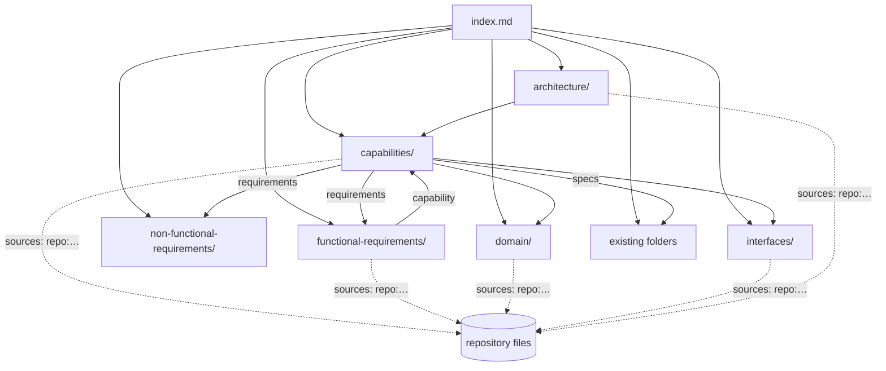

# Design — SPEC-0010: Structure KB into requirements and capabilities

> **Stage 2 of 3 — how.** Concrete enough that the plan can be written without re-reading the
> code, and checked line by line against the architecture policies. Write "None — <reason>" for a
> section that genuinely does not apply.

## Context

- **Bundle (after SPEC-0009).** `oms-knowledge-base/` is an OKF v0.2 bundle: 33 concepts with front
  matter, folder `index.md` files, `log.md`, and `okf-conventions.md` whose `type_vocabulary` the
  checker enforces. `tools/okf-check/okf-check.mjs` exports `checkBundle(dir)` and
  `parseFrontMatter`; rules live in `checkConcept`, `checkIndexes`, `checkLog` and the link loop.
  Its tests use a `valid/` fixture plus in-test variants (`okf-check.test.mjs`) and real-bundle
  tests (`mcp-metadata.test.mjs`). This ticket extends exactly that code and test style.
- **What the system does today** (read from code; this is what as-built content describes):
  - Commands. `CommandController` (`/api/command`, implements generated `ExecuteApi` = OpenAPI
    `/execute`) dispatches `OrderCreateCmd`, `ExecutionCreateCmd`, `OrderAcceptCmd` and, through
    `OrderLifecycleCommandProcessor.supports`, `OrderRejectCmd`, `OrderCancelCmd`,
    `OrderCancelRequestCmd`, `OrderCancelRejectCmd`. `CommandListener` (Kafka topic `commands`)
    dispatches the same seven. (Corrected during implementation: the first draft said lifecycle
    commands came only through Kafka.) No dispatcher handles
    `ExecutionBustCmd`, `ExecutionWhackCmd`, `QuoteCreateCmd`, `QuoteRequestCreateCmd`; there is
    no replace command at all.
  - Processors: `OrderCreateCommandProcessor`, `OrderAcceptCommandProcessor`,
    `OrderLifecycleCommandProcessor` (`LifecycleAction` REJECT, CANCEL, CANCEL_REQUEST,
    CANCEL_REJECT), `ExecutionCommandProcessor`; task pipelines under `service/command/tasks`,
    `service/execution/tasks`, `service/lifecycle/tasks`; `StateMachine` + `OrderStateMachineConfig`.
  - Persistence and events: `@Entity` classes `Order`, `Execution` (`org.example.common.model`),
    `OrderEvent`, `OutboxMessage` (`org.example.oms.model`); `OrderEventAppender`,
    `OrderReplayService`, `OutboxRelay` → `MessagePublisher`; `OrderSlaRecorder`.
  - Reads: `QueryController` (`/api/query`, generated `SearchApi` = OpenAPI `/search`),
    `OrderController` (`/api/orders`), `ExecutionController` (`/api/executions`),
    `OrderEventController` (`/api/order-events`), `MetamodelController` (`/api/v1/metamodel`).
  - Kafka topics in `oms-core/src/main/resources/application.yml`: `order-topic: oms_orders`,
    `execution-topic: oms_executions`, `command-topic: commands` (failures go to `<topic>.DLT`).
  - Avro: 31 schemas in `oms-contracts/src/main/avro/`; `Cmd.avsc` is an *enum* of command codes,
    the commands are the *records* named `*Cmd`.
  - Deployable components (root `docker-compose.yml`, services with `build:`): `oms-core`,
    `streaming-service`, `exchange-simulator`, `mcp-server`, `oms-ui`; plus `oms-kb-explorer`
    (run locally) and `developer-cockpit` (desktop tool); `oms-contracts` is a library.
  - oms-core tests (27 classes) exist for every processor, the listener, the controller, event
    sourcing, the outbox, the state machine, the SLA recorder and the exchange workflow.
- **Developer cockpit.** `RequirementsService` (config `knowledgeBase.rootPath:
  oms-knowledge-base`) reads `*.md` non-recursively from `<kb>/functional-requirements/` and
  `<kb>/non-functional-requirements/` (also `oms-concepts/<x>`, `oms-framework/<x>`) with
  gray-matter and maps `id`, `title`, `priority`, `status` (FR) and `id`, `title`, `category`,
  `metric`, `target` (NFR).
- **Specs read:** proposal; `okf-conventions.md`; headers and sections of all existing specs (via
  the MCP overview); `KNOWLEDGE-BASE-REVIEW-REPORT.md` (outdated: its "missing" documents now exist).

## Approach



### 1. Bundle layout and types

New folders under `oms-knowledge-base/`, one concept per file, `status: draft` on every new
concept (machine-generated, unreviewed):

| Folder | `type` | Extra keys (project) |
|---|---|---|
| `capabilities/` | `Capability` | `maturity` (implemented \| partial \| planned), `commands` (list of `*Cmd` names, may be `[]`) |
| `functional-requirements/` | `Requirement` | `id` (`FR-nnn`), `priority` (must \| should \| could \| wont), `implementation` (implemented \| partial \| not-implemented), `capability` (bundle path, e.g. `/capabilities/order-capture.md`) |
| `non-functional-requirements/` | `Requirement` | as FR with `id` `NFR-nnn`, plus `category`, `metric`, `target` (cockpit) |
| `domain/` | `Domain Concept`, `Glossary` | `entity` (JPA entity class name) on entity concepts |
| `interfaces/` | `Interface` | `covers` (list of `openapi:<path>`, `http:<base path>`, `avro:<Schema>`, `kafka:<topic>`) |
| `architecture/` | `Architecture`, `Component`, `Decision` | `component` (compose service or module name) on components |

`okf-conventions.md` gains these seven types in `type_vocabulary`, a definition each, the extra
keys, and the `repo:` source scheme. File names: kebab-case of the title; requirements
`FR-001-<slug>.md` so ids sort.

Every new concept carries:
```yaml
generated: { by: claude-code/claude-opus-5-5, at: "<ISO instant of authoring>" }
sources:
  - resource: "repo:oms-core/src/main/java/org/example/oms/service/command/OrderCreateCommandProcessor.java"
  - resource: "repo:oms-core/src/test/java/org/example/oms/api/CommandControllerWebMvcTest.java"
```
`repo:<path>` is an OKF scope descriptor (§5.1 allows one) naming a file relative to the repository
root; other OKF resource forms (URLs, `/bundle/paths`) remain allowed.

### 2. Content inventory

**Capabilities (19).** Body sections: Summary, Actors, Behaviour (as built or as proposed),
Requirements (links), Interfaces, Domain, Detailed specifications (links to existing docs), Known
gaps (contradictions between specs and code), Verification (link to `testing-patterns.md` and the
tests).

| File | maturity | commands | existing specs linked |
|---|---|---|---|
| order-capture | implemented | OrderCreateCmd | order-lifecycle, domain-model_spec, validation-rules, openapi-contracts, error-handling, task-orchestration-framework_spec, task-orchestration-diagrams |
| order-acceptance | implemented | OrderAcceptCmd | order-lifecycle, state-machine-framework_spec |
| order-cancellation | implemented | OrderCancelRequestCmd, OrderCancelCmd, OrderCancelRejectCmd | order-lifecycle, order-replace (cancel sections) |
| order-rejection | implemented | OrderRejectCmd | order-lifecycle, order-replace (reject sections) |
| execution-processing | partial | ExecutionCreateCmd, ExecutionBustCmd, ExecutionWhackCmd | execution-reporting, order-quantity-calculations, order_allocation_diagrams |
| order-replace | planned | [] | order-replace |
| order-query | implemented | [] | state-query-store_spec, oms-state-store |
| event-sourcing-and-replay | implemented | [] | oms-state-store |
| event-publication | implemented | [] | streaming-architecture |
| real-time-streaming | implemented | [] | streaming-architecture |
| exchange-simulation | implemented | [] | exchange-simulator |
| order-sla-monitoring | implemented | [] | — |
| admin-ui | implemented | [] | oms-admin-ui_spec, order-state-indicator-spec |
| knowledge-services | implemented | [] | ai-augmented-development, oms-knowledge-base-strategy |
| quotes | planned | QuoteCreateCmd, QuoteRequestCreateCmd | — |
| order-grouping | planned | [] | order-grouping |
| block-allocation | planned | [] | block-order-allocation, order-model-trading-capacity |
| booking-integration | planned | [] | booking-integration |
| post-trade-analytics | planned | [] | post-trade-analytics |

Every `Specification` / `Concept Paper` appears at least once (AC-7); `testing-patterns.md` is
linked from every implemented capability's Verification section.

**Functional requirements (~40)**, about 2–4 per implemented capability, derived from processors,
tasks, validation, state machine config and tests (each cites ≥ 1 main and ≥ 1 test source); 1–3
per planned capability derived from its concept paper (`not-implemented`, sources = the concept
paper's bundle path and the relevant contract if any). `execution-processing` gets bust and whack
requirements as `not-implemented`.

**Non-functional requirements (~8)**: idempotent command handling, optimistic concurrency
(`txNr`), auditability (event log in the same transaction), reliable publication (outbox),
contract compatibility, observability (metrics, tracing, structured logs), order SLA measurement,
replayability. Each with `category`, `metric`, `target` taken from the code or config where a
number exists (otherwise the target states the qualitative rule and `implementation: partial`).

**Domain (8):** `order`, `execution`, `order-event`, `outbox-message` (`entity` key each),
`order-state` (all `State` and `CancelState` symbols with meaning and transitions),
`order-quantities`, `quote-and-quote-request` (schema-only), `glossary` (type `Glossary`).

**Interfaces (5):** `command-api` (`openapi:/execute`, `http:/api/command`), `query-api`
(`openapi:/search`, `http:/api/query`), `rest-read-api` (`http:/api/orders`, `http:/api/executions`,
`http:/api/order-events`, `http:/api/v1/metamodel`), `kafka-topics` (`kafka:oms_orders`,
`kafka:oms_executions`, `kafka:commands`), `avro-messages` (all 31 `avro:` names, grouped).

**Architecture (~14):** `system-context` (type `Architecture`, mermaid context diagram); components
`oms-core`, `streaming-service`, `exchange-simulator`, `mcp-server`, `oms-ui`, `kb-explorer`,
`oms-contracts`, `developer-cockpit` (type `Component`); decisions `event-sourcing`,
`transactional-outbox`, `shared-table-cqrs`, `contracts-module`, `task-pipeline-and-state-machine`
(type `Decision`: context, decision, consequences, links to policies P-01…P-10 by name).

Indexes: one `index.md` per new folder; root `index.md` reorganised into Capabilities,
Requirements, Domain, Interfaces, Architecture, then the existing folders and root documents.
Existing documents get a "Related" line linking back to their capability only where AC-7
reachability needs it (they are already reachable through folder indexes, so this is expected to
be rare). `log.md`: new `## 2026-10-27`-or-later entry.

### 3. Checker rules (`tools/okf-check/okf-check.mjs`)

`checkBundle(dir, { repo })` gains an optional repository root (default: parent of the bundle);
CLI `--repo <dir>`. New rules, applied by `type`:

| Rule | Applies to | Check |
|---|---|---|
| `OMS-CAP` | Capability | `maturity` ∈ {implemented, partial, planned}; `commands` is a list of strings; body links ≥ 1 concept of type `Requirement` |
| `OMS-REQ` | Requirement | `id` matches `^(FR\|NFR)-\d{3}$` and is unique across the bundle; `priority` ∈ MoSCoW; `implementation` ∈ {implemented, partial, not-implemented}; `capability` resolves to an existing concept of type `Capability`; FR ids live in `functional-requirements/`, NFR ids in `non-functional-requirements/` |
| `OMS-SRC` | every concept with `sources` | every `repo:` resource exists under the repository root; a Requirement with implementation ≠ not-implemented cites ≥ 1 `repo:` path containing `/src/main/` (or a contract under `oms-contracts/src/main/`) and ≥ 1 containing `/src/test/` |
| `OMS-PROV` | concepts of the seven new types | `generated.by` is a tool actor (`<producer>/<version>`, not `human:`), `generated.at` set, `sources` non-empty; (`verified` already forbidden by `OMS-UNVERIFIED`) |

Fixtures: the `valid/` fixture gains a capability, an FR, and `src/main/Foo.java` /
`src/test/FooTest.java` stubs (non-`.md`, ignored by the walk) and the vocabulary entries; tests
run `checkBundle(dir, { repo: dir })`.

### 4. Coverage and reachability tests (`tools/okf-check/test/kb-coverage.test.mjs`)

Read the real repository and bundle; small regex extractors, each with a comment naming the source
it mirrors:

- **commands (AC-2):** record schemas named `*Cmd` from `oms-contracts/src/main/avro/*.avsc`
  (parse JSON, `type === 'record'`); dispatched = `instanceof (\w+Cmd)` in `CommandController.java`
  ∪ `model\.msg\.(\w+Cmd)` in `CommandListener.java`. Assert each command in exactly one
  capability's `commands`, no capability lists an unknown command, and a capability whose commands
  are not all dispatched is not `implemented`.
- **interfaces (AC-5):** expected = `openapi:` top-level paths of `oms-cmd-api.yml`,
  `oms-query-api.yml` (js-yaml) ∪ `http:` class-level `@RequestMapping("…")` in
  `oms-core/src/main/java/org/example/oms/api/*.java` ∪ `avro:` every schema `name` ∪ `kafka:` the
  values of keys ending `-topic:` under `oms:` in oms-core `application.yml` (default after `:` in
  `${VAR:default}`). Assert expected == union of `covers`, each item exactly once.
- **domain (AC-6):** classes annotated `@Entity` (line `^@Entity`) under `oms-core/src/main/java`;
  each has a `Domain Concept` with that `entity`. `State.avsc`, `CancelState.avsc` symbols each
  appear as a whole word in `domain/order-state.md`.
- **reachability (AC-7):** BFS over markdown links (reusing `linkTargets` + resolution) from the
  root `index.md`; every `.md` is visited. Every concept of type `Specification` or
  `Concept Paper` is the target of a body link from ≥ 1 `Capability`.
- **cockpit (AC-9):** port of `RequirementsService#scanDocuments` (non-recursive `readdir` of
  `<kb>/functional-requirements` and `<kb>/non-functional-requirements`, front matter `id`,
  `title`, `priority`); every `Requirement` concept in the bundle is found with those values.

## Contract Changes

None — contracts are read by tests only.

## Data & Persistence

None — no database involvement.

## Events & Messaging

None — topics and messages are documented, not changed.

## Domain, State & Orchestration

None — no behaviour change. The `order-state` domain concept documents the existing
`OrderStateMachineConfig` and `LifecycleAction` transitions as built.

## Alternatives & Decisions

- **One file per requirement in cockpit-compatible root folders** — chosen: makes each requirement
  an addressable OKF concept (own status, links, sources) and lights up the cockpit's existing
  Requirements view without touching the cockpit. Rejected: one requirements document per
  capability (fewer files, but no per-requirement status, invisible to the cockpit);
  `requirements/functional/` nesting (cleaner tree, but the cockpit reads only root-level folders).
- **Leave existing specs in place** — approved assumption (proposal); new concepts link to them.
- **`repo:` scope descriptor for code sources** — chosen: unambiguous, independent of the concept's
  depth, checkable. Rejected: relative paths like `../../oms-core/…` (depth-dependent, and body
  links leaving the bundle are rejected by `OKF-LINK`); remote URLs (no canonical remote/branch).
- **Coverage tests instead of hand-maintained inventories** — the structure is kept honest by tests
  that read contracts and code, so drift fails the suite.
- **Status `draft` for all new concepts** — they are generated and unreviewed; maturity and
  implementation carry what is built.
- **No new dependencies** — the coverage tests use `js-yaml` (already a dependency) and Node.
- **Changed during implementation: source classification** — "main" and "test" sources are
  recognised by layout, not only `src/main` / `src/test`: a test source is a `src/test/` tree, a
  `*.test.*` file or a `*Test.java`; a main source is any other file under a `src/` tree. Needed
  because oms-ui, oms-kb-explorer and developer-cockpit keep code in `src/` and tests as `*.test.ts`.
- **Changed during implementation: Kafka topic extraction** — topics are keys ending `-topic` under
  `kafka:` in oms-core `application.yml` (the design first said `oms:`).
- **Changed at verify (independent review): meaning of `implementation`** — `implemented` means
  built *and* covered by the cited tests; behaviour that is built but only partly tested is
  `partial` with the reason stated (FR-002, FR-018, NFR-005). Contradictions between stable specs
  and the code are listed in the capabilities' Known gaps and in `domain/order-state.md`. Coverage
  extractors scan controllers recursively, fail on controllers without a class-level mapping, and
  accept literal topic names.
- **Changed during implementation: untested behaviour** — behaviour with no automated test (e.g.
  the over-fill guard in `CalculateOrderQuantitiesTask`) is not written as an `implemented`
  requirement; it is listed under the capability's "Known gaps" instead, because `OMS-SRC` rightly
  demands a test for implemented requirements.

## Risks & Mitigations

- **Hallucinated content** (a requirement describing behaviour the code lacks) → every as-built
  requirement must cite existing main and test files (`OMS-SRC`); content is derived by reading
  those files; `status: draft` + unverified trust tier; the independent reviewer samples
  requirements against the code.
- **Coverage regexes miss a pattern** (e.g. a controller without class-level mapping) → tests assert
  non-empty expected sets with known members (e.g. `OrderCreateCmd`, `http:/api/orders`) so a broken
  extractor fails loudly.
- **Volume (~100 new files) and consistency** → the checker and coverage tests run after each
  folder; indexes are generated from front matter (as in SPEC-0009) to avoid drift.
- **MCP retrieval quality changes** with many new short documents → spot-check
  `RetrievalEvalTest` in oms-mcp-server during verify (not a gated module; recorded as evidence).
- **Cockpit reads `status`** expecting draft/approved/implemented/tested → OKF `draft` is a valid
  cockpit value; `implementation` carries the build state.

## Test Strategy

| AC | Level (unit / web-mvc / integration / e2e) | Test class#method | What it asserts |
|---|---|---|---|
| AC-1 | unit (fixtures) + real bundle | tools/okf-check/test/okf-check.test.mjs#"capability rules" ; #"real bundle conforms" | variants: missing/invalid `maturity`, non-list `commands`, no requirement link → `OMS-CAP` on the file; real bundle clean |
| AC-2 | integration (repo) | tools/okf-check/test/kb-coverage.test.mjs#"every command schema belongs to exactly one capability" | command set = record `*Cmd` schemas; each in exactly one capability; capability with an undispatched command is not `implemented` |
| AC-3 | unit + real bundle | okf-check.test.mjs#"requirement rules" | variants: duplicate id, bad id pattern, bad priority, bad implementation, dangling capability, capability pointing to a non-Capability, FR in the NFR folder → `OMS-REQ`; real bundle clean |
| AC-4 | unit + real bundle | okf-check.test.mjs#"repository sources exist and implemented requirements cite code and tests" | variants: missing `repo:` path, implemented requirement without a test source, without a main source → `OMS-SRC`; real bundle clean |
| AC-5 | integration (repo) | kb-coverage.test.mjs#"every interface item is documented exactly once" | expected set from OpenAPI, controllers, Avro, application.yml equals the union of `covers`, no duplicates, no unknown items |
| AC-6 | integration (repo) | kb-coverage.test.mjs#"every entity and state symbol is documented" | each `@Entity` class has a Domain Concept; each State/CancelState symbol appears in `domain/order-state.md` |
| AC-7 | integration (bundle) | kb-coverage.test.mjs#"every concept is reachable and every spec is linked from a capability" | BFS from root index visits all `.md`; every Specification/Concept Paper has an incoming link from a Capability |
| AC-8 | unit + real bundle | okf-check.test.mjs#"new concept types carry provenance" | variants: missing `generated`, `human:` actor, empty `sources` → `OMS-PROV`; real bundle clean |
| AC-9 | integration (bundle) | kb-coverage.test.mjs#"cockpit requirement scan finds every requirement" | port of `RequirementsService#scanDocuments` finds each Requirement with matching id, title, priority |

## Policy Compliance

| Policy | Title | Status | How / Justification |
|---|---|---|---|
| P-01 | Contracts live only in oms-contracts | n/a | contracts only read |
| P-02 | Specification before code, generated models only | n/a | no API or message change |
| P-03 | Never edit generated code | comply | nothing under `build/generated*` touched |
| P-04 | Contracts evolve compatibly | n/a | no contract change |
| P-05 | Every state change is recorded in the event log | n/a | no behaviour change (documented only) |
| P-06 | Kafka only through the transactional outbox | n/a | no behaviour change (documented only) |
| P-07 | Schema changes through new Liquibase changesets | n/a | no database |
| P-08 | Concurrency and idempotency are explicit | n/a | no commands added; documented as NFRs |
| P-09 | Commands and queries stay separate | n/a | no API change |
| P-10 | State transitions go through the state machine and task pipeline | n/a | no state change |
| P-11 | Layering and conventions | comply | checker rules added in the existing `checkConcept` style; tests follow the SPEC-0009 fixture-variant pattern |
| P-12 | Jackson 3 only | n/a | no Java |
| P-13 | Errors and validation follow the framework specs | n/a | no API errors; checker reports every finding |
| P-14 | Test first, every acceptance criterion is proven by an automated test | comply | every AC mapped above; rules and coverage tests written red before content |
| P-15 | Observability | n/a | no runtime change |
| P-16 | Security | comply | no secrets; tests only read repository files |
| P-17 | Simplicity and dependencies | comply | no new dependency; decisions recorded above |
| P-18 | Modules build standalone | n/a | no gated module code changes (oms-knowledge-base has no build) |
| P-19 | Documentation follows behaviour | comply | this ticket is documentation; conventions and log updated |

## Knowledge Base Updates

- New folders `capabilities/`, `functional-requirements/`, `non-functional-requirements/`,
  `domain/`, `interfaces/`, `architecture/`, each with `index.md`.
- `okf-conventions.md`: seven new types, their keys, the `repo:` scheme.
- Root `index.md`: reorganised by section.
- `log.md`: entry for this restructuring.
- Existing documents: link additions only where reachability requires them.
