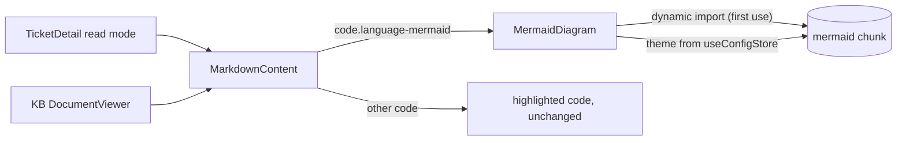

# Design — SPEC-0013: Render Mermaid diagrams in spec tickets

> **Stage 2 of 3 — how.** Concrete enough that the plan can be written without re-reading the
> code, and checked line by line against the architecture policies. Write "None — <reason>" for a
> section that genuinely does not apply.

## Context

All Markdown in developer-cockpit goes through one component:
`developer-cockpit/src/renderer/components/MarkdownContent.tsx`. It wraps `react-markdown` with
`remark-gfm` and `rehype-highlight` and overrides element renderers (`h1..h3`, `code`, `pre`,
`table`, …) for Tailwind typography. Its `code` override treats any `className` containing
`language-` as a block and renders `<code class="language-x hljs …">`. A ` ```mermaid ` fence is
therefore shown as highlighted source. It is used by:

- `src/renderer/views/spec-tickets/TicketDetail.tsx:112`: read mode of the ticket documents
  (proposal / design / tasks / verification);
- `src/renderer/views/knowledge-base/DocumentViewer.tsx:23`: the KB viewer.

Theme: `src/renderer/stores/config.ts` keeps `config.general.theme` (`light | dark | system`) and
toggles the `dark` class on `<html>`. The closest existing consumer of the theme in a component is
`src/renderer/views/file-explorer/FilePreview.tsx:46-52`, which derives `isDark` from
`useConfigStore` (plus `matchMedia` for `system`). This design follows that pattern.

The closest existing Mermaid renderer is `oms-kb-explorer/src/components/MermaidDiagram.tsx`
(`mermaid.initialize` + `mermaid.render` into a ref, copy-source button, error panel). This change
ports it, with lazy loading, `securityLevel: 'strict'` made explicit, render-race protection and the
cockpit's own UI tokens (`bg-muted`, `border-border`, `lucide-react` icons).

CSP (`src/renderer/index.html`): `script-src 'self'; style-src 'self' 'unsafe-inline'`. Mermaid is
bundled by Vite into same-origin chunks and injects `<style>` inside the SVG, which this CSP allows.
The CSP is not changed.

Tests: Vitest with per-file `// @vitest-environment jsdom` and `@testing-library/react`
(`test/renderer/TicketDetail.test.tsx` is the pattern). jsdom has no SVG layout (`getBBox`), so tests
that only care about integration mock the `mermaid` module.

KB specs read: none in `oms-knowledge-base/oms-framework/` apply (no backend, contract, state or
event change). Cockpit specs read: `developer-cockpit/spec/03-features.md`,
`09-tech-stack-options.md`, `10-implementation-guide.md`.

## Approach



1. **New `src/renderer/components/MermaidDiagram.tsx`** (`export function MermaidDiagram({ source })`):
   - `const isDark = useIsDarkTheme()`: inline, same expression as `FilePreview`
     (`theme === 'dark' || (theme === 'system' && matchMedia(...).matches)`).
   - `useEffect` on `[source, isDark]`: `const mermaid = (await import('mermaid')).default;`
     `mermaid.initialize({ startOnLoad: false, securityLevel: 'strict', theme: isDark ? 'dark' : 'default' });`
     `const { svg } = await mermaid.render(id, source)` where `id` comes from React `useId()`
     (sanitised to `[A-Za-z0-9_-]`, prefixed `mermaid-`). The result is written to state; a
     `cancelled` flag in the effect cleanup drops stale results, so a theme switch or a document
     change mid-render cannot paint an old diagram.
   - States: `loading` (shows the source in a muted `<pre>` so nothing jumps and text is readable
     immediately), `ok` (container `div` with `data-testid="mermaid-diagram"`, SVG injected via
     `dangerouslySetInnerHTML`; the SVG is Mermaid's DOMPurify-sanitised output under `strict`),
     `error` (`role="alert"` panel "Diagram could not be rendered", the error message, then the
     source in a `<pre>`).
   - A copy-source button (`aria-label="Copy diagram source"`, lucide `Copy` / `Check`) calls
     `navigator.clipboard.writeText(source)`. It is shown in the `ok` and `error` states.
   - `mermaid.render` may leave a temporary element `#d<id>` in `document.body` on error; it is
     removed in the `catch`.
2. **`MarkdownContent.tsx`**: in the `code` override, before the existing block branch:
   `if (/\blanguage-mermaid\b/.test(className ?? '')) return <MermaidDiagram source={String(children).replace(/\n$/, '')} />;`
   `rehype-highlight` has no `mermaid` grammar and leaves the text as a single string child, so
   `String(children)` is the raw source. The `pre` override wraps code blocks in a muted `<pre>`; to
   avoid a diagram inside a `<pre>`, the `pre` override checks whether its single child is a
   `MermaidDiagram` element and returns the child unwrapped.
3. **Dependency**: `mermaid` `^12.2.0` in `dependencies` (12.2.0 was released 2026-10-13, at least two
   weeks old). It is only reachable through the dynamic import, so Vite splits it into its own chunks
   and the main bundle and startup are unchanged.

Mapping proposal → code:

| What Changes bullet | Where |
|---|---|
| mermaid fence rendered as SVG in Spec Tickets and KB viewer | `MarkdownContent` `code` override → `MermaidDiagram` |
| follows theme, re-renders on switch | `MermaidDiagram` effect deps `[source, isDark]`, `useConfigStore` |
| invalid syntax → error + source, page continues | `MermaidDiagram` error state (no throw out of the component) |
| copy source | `MermaidDiagram` copy button |
| other code unchanged | existing `code` / `pre` branches untouched for non-mermaid |
| new dependency, nothing breaking | `developer-cockpit/package.json` only |

## Contract Changes

None. The change is renderer-only inside developer-cockpit. No OpenAPI, Avro or IPC contract changes.

## Data & Persistence

None. Nothing is stored; ticket and KB files are read as today.

## Events & Messaging

None. No order events, outbox, Kafka or cockpit WebSocket messages are involved.

## Domain, State & Orchestration

None. No OMS domain, state machine or task pipeline involved. The only "state" is the component's
local `loading | ok | error` render state described in Approach.

## Alternatives & Decisions

- **Decision: client-side `mermaid` library, loaded lazily.**
  - Rejected `rehype-mermaid` (named in `spec/09-tech-stack-options.md`): its default strategies
    render through Playwright/a headless browser, or need `mermaid-isomorphic`. That is a heavy
    dependency and a poor fit for an Electron renderer that already is a browser.
  - Rejected a static import: mermaid adds several MB to the renderer bundle and would slow startup
    for users who never open a diagram.
  - Rejected sharing the component with oms-kb-explorer: there is no shared UI package, so creating
    one is out of proportion (P-17). Porting about 80 lines is cheaper.
  - P-17: this is the one new dependency. MIT-licensed, widely used, already used in this repo by
    oms-kb-explorer.
- **Decision: theme from `useConfigStore`, following `FilePreview`.** Rejected a `MutationObserver` on
  `<html class>`: it is more general, but it is a new pattern. Known limitation, shared with
  `FilePreview`: with theme `system`, an OS-level theme change does not re-render until the next
  config change or navigation. Acceptable, and out of the ACs.
- **Decision: `securityLevel: 'strict'` set explicitly** even though it is Mermaid's default, so a
  future default change or a copied config cannot loosen it silently (AC-7).
- **Decision: show the source while loading** rather than a spinner, so the reviewer sees content at
  once and layout does not jump to empty.

## Risks & Mitigations

| Risk | Mitigation |
|---|---|
| Mermaid needs something the CSP forbids (eval, inline script) | Mermaid 10+ does not use eval; AC-8's runtime check in the built Electron app proves it, with the CSP untouched (asserted by a test, AC-7) |
| Concurrent renders (several diagrams, theme switch) interfere: `initialize` is global, `render` ids collide | unique `useId`-based ids; `cancelled` flag drops stale results; every render re-initialises with its own theme just before `render`, and diagrams render one by one through a module-level promise chain (`renderQueue = renderQueue.then(...)`) so `initialize` + `render` pairs never interleave |
| Bad diagram text throws and blanks the document (error boundary) | `try/catch` around import+render; error state renders inside the component; AC-3 test |
| Malicious diagram text (XSS) | `securityLevel: 'strict'` (DOMPurify, click directives disabled); AC-7 test with real mermaid output |
| jsdom cannot lay out SVG, so real-mermaid tests fail | integration tests mock `mermaid`; the AC-7 test uses real mermaid with `SVGElement.prototype.getBBox` / `getComputedTextLength` stubbed; if real rendering still cannot run under jsdom, AC-7 falls back to asserting the `initialize` config + the CSP test + a runtime check in the app, and that fallback is recorded in verification |
| Bundle size | dynamic import; check in AC-8 that the main entry chunk does not contain mermaid (`npm run build` output shows a separate chunk) |

## Test Strategy

All renderer tests are new files under `developer-cockpit/test/renderer/` with
`// @vitest-environment jsdom`. Unless stated otherwise, `mermaid` is mocked with
`vi.mock('mermaid', …)`: `initialize` is a spy, and `render` resolves `{ svg: '<svg data-fake="1">…</svg>' }`
or rejects for sources containing `INVALID`.

| AC | Level | Test class#method | What it asserts |
|---|---|---|---|
| AC-1 | component (jsdom) | `TicketDetail.mermaid.test.tsx#renders a mermaid block in design.md as a diagram` | rendering `TicketDetail` with a design.md containing a mermaid fence shows `data-testid="mermaid-diagram"` containing an `<svg>`, `mermaid.render` was called with the exact source, and no `code.language-mermaid` element remains |
| AC-2 | component (jsdom) | `MermaidDiagram.test.tsx#renders mermaid in the knowledge-base DocumentViewer` | `DocumentViewer` with a KB document containing a mermaid fence shows the diagram |
| AC-3 | component (jsdom) | `MermaidDiagram.test.tsx#shows error and source for invalid syntax and keeps rendering the rest` | `role="alert"` present with the source text; a heading after the block is rendered; no error boundary fallback |
| AC-4 | component (jsdom) | `MermaidDiagram.test.tsx#uses the dark theme in dark mode and re-renders on theme switch` | with config theme `dark`, `initialize` called with `theme: 'dark'`; after `useConfigStore.setState(theme 'light')`, `initialize` called again with `theme: 'default'` and `render` called a second time |
| AC-5 | component (jsdom) | `MermaidDiagram.test.tsx#copies the exact source to the clipboard` | clicking "Copy diagram source" calls a stubbed `navigator.clipboard.writeText` with the exact source (multi-line, no trailing newline) |
| AC-6 | component (jsdom) | `MermaidDiagram.test.tsx#leaves other code blocks and inline code unchanged` | a `java` fence still renders `code.language-java` inside `pre`, inline code renders `<code>` with the inline classes, `mermaid.render` not called |
| AC-7 | unit (jsdom, real mermaid) + static | `MermaidDiagram.security.test.tsx#sanitises script and handlers in diagram text` and `#keeps the CSP unchanged` | real mermaid renders a flowchart with `` in a label and a `click` directive: the injected DOM contains no `script` element and no attribute starting with `on`, and a global spy is not called; `initialize` received `securityLevel: 'strict'`; `src/renderer/index.html` CSP equals the current string exactly |
| AC-8 | build + runtime | `npm run typecheck`, `npm test`, `npm run build` in developer-cockpit; runtime check in the Electron app | all exit 0; build output has mermaid in a separate chunk; screenshot/notes in `evidence/` of SPEC-0013's own design.md showing the flowchart above rendered in Spec Tickets (dark and light) |

## Policy Compliance

| Policy | Title | Status | How / Justification |
|---|---|---|---|
| P-01 | Contracts live only in oms-contracts | n/a | no contracts touched; developer-cockpit only |
| P-02 | Specification before code, generated models only | comply | the cockpit spec (`spec/03-features.md`) already specifies the behaviour; no models involved |
| P-03 | Never edit generated code | n/a | no generated code involved |
| P-04 | Contracts evolve compatibly | n/a | no contract changes |
| P-05 | Every state change is recorded in the event log | n/a | no order state change |
| P-06 | Kafka only through the transactional outbox | n/a | no Kafka |
| P-07 | Schema changes through new Liquibase changesets | n/a | no database |
| P-08 | Concurrency and idempotency are explicit | n/a | no persistence or messaging. In-UI render races are handled by cancellation + a render queue (see Risks) |
| P-09 | Commands and queries stay separate | n/a | no OMS API |
| P-10 | State transitions go through the state machine and task pipeline | n/a | no order state |
| P-11 | Layering and conventions | comply | follows existing cockpit patterns: shared component in `components/`, theme via `useConfigStore` as `FilePreview` does, Tailwind tokens, lucide icons; ported from oms-kb-explorer's `MermaidDiagram` |
| P-12 | Jackson 3 only | n/a | no Java |
| P-13 | Errors and validation follow the framework specs | comply | no API errors; render errors are caught and shown in the UI (not swallowed), message logged via `console.error` as elsewhere in the renderer |
| P-14 | Test first, every acceptance criterion is proven by an automated test | comply | each AC has a test above, written before the implementation; AC-8 adds build + runtime evidence |
| P-15 | Observability | n/a | renderer UI only; no backend flow, metrics or traces |
| P-16 | Security | comply | `securityLevel: 'strict'` explicit, CSP unchanged, sanitisation proven by the AC-7 test; no secrets |
| P-17 | Simplicity and dependencies | comply | one new dependency (`mermaid`), justified in Alternatives & Decisions; smallest change: one new component plus one branch in `MarkdownContent` |
| P-18 | Modules build standalone | comply | developer-cockpit only; `spec verify` runs `npm run typecheck` and `npm test` there |
| P-19 | Documentation follows behaviour | comply | cockpit spec pages updated (see below); no OMS domain behaviour changes, so no `oms-knowledge-base/` page changes |

## Knowledge Base Updates

None in `oms-knowledge-base/`: no OMS domain concept, lifecycle or behaviour changes. Cockpit
documentation updated in this ticket:

- `developer-cockpit/spec/10-implementation-guide.md`: tick "Mermaid diagram support".
- `developer-cockpit/spec/09-tech-stack-options.md`: Markdown row says `mermaid` (client-side, lazy)
  instead of `rehype-mermaid`.
- `developer-cockpit/spec/03-features.md`: note that Spec Tickets documents also render Mermaid
  (today it is listed under the KB viewer only).
