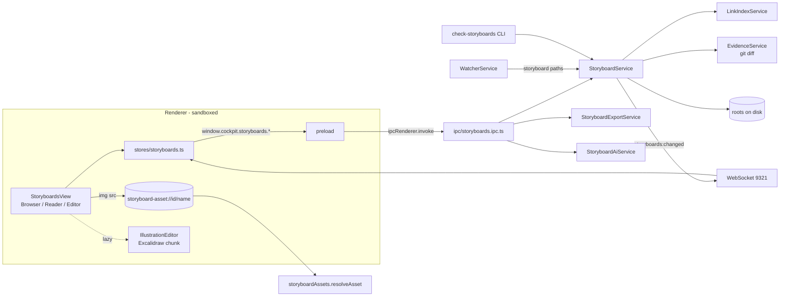

# Design — SPEC-0014: Add file-backed storyboards to developer cockpit

> **Stage 2 of 3 — how.** Concrete enough that the plan can be written without re-reading the
> code, and checked line by line against the architecture policies. Write "None — <reason>" for a
> section that genuinely does not apply.

## Context

The work is all in `developer-cockpit`, an Electron 34 + React 19 + Vite 6 + Tailwind 4 desktop
app.

- **Main process** (`src/main/`). `index.ts` creates the services and registers the IPC modules
  (`ipc/*.ipc.ts`, one `registerXxxIpc(ipcMain, configService)` each). It starts a `ws` server on
  port 9321 (`websocket/server.ts`) and `WatcherService` (chokidar). The watcher broadcasts
  `file:*` and `specs:tickets-changed` events.
- **Preload** (`src/main/preload.ts`) exposes `window.cockpit.*`, typed by `src/shared/types/ipc.ts`.
  The renderer runs sandboxed with `contextIsolation` and no Node.
- **Renderer** (`src/renderer/`):
  - Each view is lazy-loaded in `components/layout/ContentArea.tsx` (`VIEW_MAP`). Navigation is
    `stores/navigation.ts` (`ViewId`, `NAV_ITEMS`) and stores are zustand.
  - Server events reach the renderer through `lib/event-bus.ts` and `hooks/useEventBus.ts`.
  - The page CSP is in `src/renderer/index.html`
    (`img-src 'self' data:`, `font-src 'self' data:`, `connect-src 'self' ws://localhost:9321`).
- **Config.** `ConfigService` reads `~/.developer-cockpit/config.json`, merged over
  `DEFAULT_CONFIG` (`src/shared/types/config.ts`). `CockpitConfig.ai` already declares
  `provider: 'anthropic'`, `model`, `apiKeyEnvVar: 'ANTHROPIC_API_KEY'`, `maxTokens` and
  `temperature`, but no AI adapter exists.
- **Closest existing examples**, which this design follows as siblings:
  - Scan and read: `KbService` + `ipc/kb.ipc.ts`, a lazy singleton that parses with `gray-matter`.
  - Writes with conflict detection: `SpecTicketsService.writeIfUnchanged`, which returns
    `{ status: 'conflict', diskContent }`. Its renderer side is `DocumentEditor` with the
    `TicketDetail` conflict handling.
  - Change events and live refresh: `WatcherService.emitSpecTicketsChanged` and
    `hooks/useSpecTicketsLiveRefresh.ts`.
  - Lazy heavy library: `components/MermaidDiagram.tsx` (dynamic `import('mermaid')`,
    `securityLevel: 'strict'`, render queue).
  - Markdown: `components/MarkdownContent.tsx` (`react-markdown` + GFM). It has no `rehype-raw`,
    so raw HTML is not rendered.
  - Test fixtures: `test/fixtures/workspace.ts` builds a temporary git workspace. Tests are vitest
    with jsdom for renderer tests.
- **Link sources** for the link index:
  - `oms-contracts/src/main/openapi/oms-cmd-api.yml` (`operationId: executeCommand`, with the
    command discriminator mapping read by `ApiCatalogService`) and `oms-query-api.yml`
    (`searchOrders`).
  - `oms-contracts/src/main/avro/*.avsc` (records such as `OrderMessage` and `Execution`).
  - The state diagram in `oms-knowledge-base/domain/order-state.md` ("Transitions as built",
    `A --> B` lines).
  - `FR-nnn` and `NFR-nnn` ids from `RequirementsService`.
- **Knowledge-base constraint.** `oms-knowledge-base/` is an OKF 0.2 bundle checked by
  `tools/okf-check/okf-check.mjs`: every `.md` file is a concept with required front matter, and
  every folder needs an `index.md`. The requester decided (2026-10-29) that
  `oms-knowledge-base/storyboards/` is **excluded** from the bundle. Storyboards keep the
  source-spec format and are checked by `check:storyboards` instead.
- **Read:**
  - Specs: [source-spec.md](./source-spec.md), `developer-cockpit/spec/11-storyboards.md`,
    `spec/05-data-model.md`, `spec/07-ai-integration.md`.
  - Knowledge base: `oms-knowledge-base/okf-conventions.md`, `architecture/developer-cockpit.md`,
    `domain/order-state.md`.
  - The OMS framework specs (`domain-model_spec.md`, `state-machine-framework_spec.md` and the
    others) govern oms-core and do not apply here; see Policy Compliance.

## Approach

### Components



Everything under `src/main/storyboards/` is free of `electron` imports, so the CLI and the tests
can use it under plain Node. Only `ipc/storyboards.ipc.ts` and `index.ts` touch Electron.

### New and changed files

**Shared** (`src/shared/`):

| File | Content |
|---|---|
| `types/storyboards.ts` | Model types (below), `ProblemCode`, the `StoryboardResult<T>` union, `StoryboardsConfig` |
| `storyboards/ids.ts` | `SLUG = /^[a-z0-9][a-z0-9-]{0,63}$/`; `ASSET_NAME = /^[a-z0-9][a-z0-9-]{0,63}\.(excalidraw\.svg\|svg\|png\|jpe?g\|webp)$/`; `slugify(title)`; `assetStem(stepId, extId?, n?)`, which truncates to 55 characters plus `-` plus an 8-hex sha256 suffix when longer than 64 so that long extension-asset names stay valid and distinct |
| `storyboards/labels.ts` | `stepLabel(index)` gives `"3"`; `extensionLabel(stepIndex, extIndex)` gives `"3a"`. Derived only, never stored |
| `storyboards/mermaid.ts` | `toMermaid(detail, { extensions })`, a pure function used by the renderer, main and the CLI |
| `storyboards/validate.ts` | `validate(detail, linkIndex): Problem[]`, a pure function with the 11 codes |
| `types/config.ts` | Adds `storyboards: StoryboardsConfig` to `CockpitConfig` and `DEFAULT_CONFIG` |
| `types/events.ts` | Adds `'storyboards:changed'` to `EventType` and `StoryboardsChangedPayload { reason: 'external' \| 'config' }` |
| `types/ipc.ts` | Adds a `storyboards` namespace to `CockpitAPI` |

**Main** (`src/main/storyboards/` plus wiring):

| File | Responsibility |
|---|---|
| `StoryboardService.ts` | The scan map (`id → { rootId, dir }`); `scan()`, `detail(id)`, all write operations, revision tokens, echo suppression and change listeners |
| `parse.ts` | Bounded, symlink-safe reads (`lstat`, then size check, then `realpath` containment); front-matter parsing with `yaml` (`parseDocument`, which keeps formatting); normalising `in`/`out`/`extensions`/`illustrations`; extracting headings and anchors with the slug rule `MarkdownContent` uses |
| `frontMatter.ts` | `applyPatch(doc: yaml.Document, patch)` sets only the patched keys, so unknown keys, comments and flow style survive. `serialize()` produces `---\n<yaml>---\n<body>`; it re-parses its own output before returning and throws if that fails |
| `roots.ts` | Expands root globs (`*` segments only) against the workspace root. A `rootId` is `sha256(realpath).slice(0,12)`, an opaque capability returned by `scan()` |
| `svgSafety.ts` | `checkSvg(text, maxBytes): { ok: true } \| { ok: false, reason }` (rules below) |
| `assets.ts` | `resolveAsset(service, id, name, cfg)` returns `{ status, headers, body }`. It is a pure function, wrapped by the protocol handler |
| `LinkIndexService.ts` | Builds and caches `{ api, events, states, requirements }` as `Set<string>`. Invalidated on config changes and on watcher events under `oms-contracts/src/main`, `functional-requirements/`, `non-functional-requirements/` and `domain/order-state.md` |
| `EvidenceService.ts` | Parses cards and computes trust, drift and broken evidence during `scan()` (rules below) |
| `StoryboardExportService.ts` | `html(id, sequenceSvg?)` builds the standalone HTML; `pdf(html)` is Electron-only and lives in the IPC module |
| `markdownHtml.ts` | Markdown to HTML for the export: `unified` + `remark-parse` + `remark-gfm` + `remark-rehype` (no `allowDangerousHtml`) + `rehype-stringify`. Raw HTML is dropped |
| `ai/AiAdapter.ts`, `ai/AnthropicAdapter.ts`, `StoryboardAiService.ts` | The three assists (rules below) |
| `cli/checkStoryboards.ts` | The `check:storyboards` content gate |
| `ipc/storyboards.ipc.ts` | `registerStoryboardsIpc(ipcMain, configService, wsServer)`: one handler per operation, export save dialogs and PDF |
| `main/index.ts` | Registers the privileged scheme `storyboard-asset` (`standard`, `secure`, `supportFetchAPI: false`) before `app.ready`. Calls `protocol.handle('storyboard-asset', …)` to `resolveAsset`. Registers the IPC module and passes storyboard roots to `watcherService.setExtraPaths` |
| `services/WatcherService.ts` | Adds an `onPath(listener)` hook. `StoryboardService` subscribes and decides whether to broadcast |
| `services/ConfigService.ts` | `merge` fills the new `storyboards` section from defaults. Adds `resolveStoryboardsConfig(config, env)`, which applies the env overrides |
| `services/KbService.ts` | `scanDirectory` skips `<kbRoot>/storyboards`, so step files do not appear as KB documents |
| `ipc/config.ipc.ts` | After a save, calls `storyboardService.reconfigure()` (clears the catalogue and link index, rescans, broadcasts `storyboards:changed {reason:'config'}`) |

**Renderer** (`src/renderer/`):

| File | Responsibility |
|---|---|
| `stores/navigation.ts`, `components/layout/ContentArea.tsx` | `ViewId 'storyboards'`, NAV item `{ label: 'Storyboards', group: 'Knowledge', icon: 'Clapperboard' }` placed after Requirements; a lazy `StoryboardsView` |
| `stores/storyboards.ts` | zustand state: `catalogue`, `scanErrors`, `roots`, `detail`, `selectedStepId`, `hoveredStepId`, `mode: 'strip'\|'lanes'\|'sequence'`, `layers: { data, extensions }`, `filter`, `editing`, `presenting`. Drafts live in `sessionStorage` under the key `storyboard-draft:<id>:<stepId>` |
| `hooks/useStoryboardsLiveRefresh.ts` | Calls `refresh()` (a full rescan) on `storyboards:changed` |
| `views/storyboards/StoryboardsView.tsx` | Master-detail shell and the global key handler |
| `views/storyboards/StoryboardBrowser.tsx` | Catalogue grouped by domain; substring filter over title, summary and step titles; filters for domain, status and tag; badges; thumbnail strip; scan diagnostics; New (only when `writable && roots.length`); Rescan |
| `views/storyboards/StripOverview.tsx`, `LanesOverview.tsx`, `SequenceOverview.tsx` | The three overview modes. Strip and Lanes draw with `roughjs` using `seed = fnv1a(step.id)`. Sequence uses `MermaidDiagram` plus "Copy source" and "Download .mmd" |
| `views/storyboards/StepDetail.tsx` | Position and title, hand-off and kind, illustrations through `` (placeholder on error or missing), a "not editable" badge for non-Excalidraw images, `MarkdownContent`, link chips, data annotations, alternate paths with their labels, Prev/Next/Overview |
| `views/storyboards/ChecksPanel.tsx` | Problems grouped by severity. Clicking a problem selects its step. Quick fixes |
| `views/storyboards/ProvenancePanel.tsx` | Trust, drift, repos, changed or missing sources, `kb_links` |
| `views/storyboards/PresentationMode.tsx` | Fixed overlay with the title, a large illustration or placeholder, the `What happens` section only, a progress bar, arrow keys, Esc, and an alternate-paths toggle |
| `views/storyboards/StepEditor.tsx` | Form (title, kind, from, to, illustrations), Monaco source with a live `MarkdownContent` preview, link pickers (combobox over the link index), the data editor, the extension editor (continuation select limited to later steps plus stay and end), Save, `ConflictDialog` |
| `views/storyboards/StoryEditor.tsx` | Story front matter (title, status, domain, owner, tags, lanes) and body |
| `views/storyboards/NewStoryWizard.tsx` | Root (from scan), domain, title, lanes (label and kind), one or more step titles |
| `views/storyboards/IllustrationEditor.tsx` | Loaded only through `React.lazy(() => import('./IllustrationEditor'))`. Sets `window.EXCALIDRAW_ASSET_PATH = './excalidraw-assets/'` before importing `@excalidraw/excalidraw`. Loads `_library` through IPC. Saves with `exportToSvg({ exportEmbedScene: true })` |
| `views/storyboards/AiAssistMenu.tsx` | Shown only when `storyboards.aiAvailable()` is true; shows proposals, and the user applies them into the draft |
| `components/CommandPalette.tsx` | Extra entries "Open storyboard…", "New storyboard" and "Present storyboard" (the last only while a storyboard is open) |
| `views/requirements/FunctionalReqTab.tsx`, `views/knowledge-base/DocumentViewer.tsx` | A "Storyboards" backlink row, from `storyboards.backlinks()` |
| `index.html` | CSP `img-src 'self' data: storyboard-asset:`. `font-src` and `worker-src` stay `'self'` (Excalidraw assets are self-hosted) |

**Build** (`developer-cockpit/`):
- `scripts/copy-excalidraw-assets.mjs` copies `node_modules/@excalidraw/excalidraw/dist/prod/fonts` to
  `src/renderer/public/excalidraw-assets/`. It runs as the `predev` and `prebuild` npm scripts, and
  its output is gitignored.
- New npm scripts:
  - `"check:storyboards": "tsc -p tsconfig.node.json && node dist/main/storyboards/cli/checkStoryboards.js"`
  - `"test:e2e": "npm run build && playwright test -c e2e/playwright.config.ts"`

**Content** (`oms-knowledge-base/storyboards/`):
- `README.md`: what storyboards are and how to check them.
- `_templates/story.md` and `_templates/step.md`, using the `{{id}}` and `{{title}}` placeholders.
- `_library/oms-storyboard.excalidrawlib`.
- `order-lifecycle/place-and-fill-order/`:
  - `story.md` with lanes `trader` (actor), `api-client` (channel), `oms-core` (system),
    `exchange` (external, the exchange simulator) and `oms-ui` (channel).
  - Steps `submit-order`, `accept-order`, `route-to-exchange`, `receive-fill`, `see-fill-in-ui`.
  - At least one `*.excalidraw.svg`.
  - `story.card.yaml` pinned to the commit current at implementation, with sources in `oms-core`.

**Tooling outside the cockpit:** `tools/okf-check/okf-check.mjs` does not descend into
`<bundle>/storyboards`. A test in `tools/okf-check/test/okf-check.test.mjs` covers this.

### Model (`src/shared/types/storyboards.ts`)

```ts
export type LaneKind = 'actor' | 'channel' | 'system' | 'external';
export type StepKind = 'user' | 'system' | 'external' | 'manual';
export type StoryStatus = 'draft' | 'stable' | 'deprecated';
export type TrustTier = 'unevidenced' | 'evidenced' | 'human-verified';
export type DriftStatus = 'none' | 'current' | 'drifted' | 'missing' | 'unknown'; // worst wins: unknown > missing > drifted > current > none

export interface Lane { id: string; label: string; kind: LaneKind }
export interface Illustration { src: string; caption?: string; url: string | null; missing: boolean; editable: boolean }
export type Origin =
  | { kind: 'step'; ref: string } | { kind: 'extension'; ref: string /* step/ext */ }
  | { kind: 'external'; lane: string } | { kind: 'external'; label: string } | { kind: 'unknown' };
export interface DataIn { name: string; shape?: string; origin: Origin }   // origin defaults to unknown
export interface DataOut { name: string; shape?: string; final?: boolean }
export type ContinueAt = { kind: 'stay' } | { kind: 'step'; step: string } | { kind: 'end' };
export interface Extension { id: string; label: string; when: string; then: string; continueAt: ContinueAt;
  illustrations: Illustration[]; in: DataIn[]; out: DataOut[] }
export interface StepLinks { api: string[]; events: string[]; states: string[]; requirements: string[] }
export interface Step { id: string; index: number; title: string; kind: StepKind; from?: string; to?: string;
  illustrations: Illustration[]; links: StepLinks; in: DataIn[]; out: DataOut[]; extensions: Extension[];
  body: string; headings: Heading[]; revision: string; sourcePath: string; readable: boolean }
export interface StoryboardSummary { id; title; description; domain; status; owner?; tags: string[];
  sourcePath /* workspace-relative, display only */; modified: number; stepCount: number;
  thumbnails: (string | null)[]; trust: TrustTier; drift: DriftStatus; hasCard: boolean; stepTitles: string[] }
export interface StoryboardDetail extends StoryboardSummary { lanes: Lane[]; steps: Step[]; body: string;
  headings: Heading[]; revision: string; evidence: Evidence | null; problems: Problem[] }
export interface Problem { code: ProblemCode; severity: 'error' | 'warning'; stepId?: string; extensionId?: string; message: string }
export interface ScanError { code: 'duplicate-id' | 'symlink' | 'oversized' | 'malformed-story' | 'malformed-card' | 'missing-root'; path: string; message: string }
export type StoryboardResult<T> = ({ ok: true } & T)
  | { ok: false; code: 'conflict'; message: string; latestRevision: string }
  | { ok: false; code: 'read-only' | 'not-found' | 'invalid' | 'too-large' | 'exists'; message: string };
export interface StoryboardsConfig { enabled: boolean; roots: string[]; maxSourceBytes: number; maxAssetBytes: number; writable: boolean }
// DEFAULT: { enabled: true, roots: ['oms-knowledge-base/storyboards'], maxSourceBytes: 1_048_576, maxAssetBytes: 524_288, writable: true }
```

### Operations (IPC channels, `window.cockpit.storyboards.*`)

| Channel | Input | Result |
|---|---|---|
| `storyboards:scan` | none | `{ catalogue, errors: ScanError[], roots: { rootId, label }[], writable, enabled }` |
| `storyboards:detail` | `{ id }` | `StoryboardResult<{ detail }>` |
| `storyboards:create` | `{ rootId, domain, title, lanes, stepTitles }` | `StoryboardResult<{ id }>` |
| `storyboards:saveStory` | `{ id, patch, body, revision }` | `StoryboardResult<{ revision, changed: boolean }>` |
| `storyboards:createStep` | `{ id, title, afterStepId \| null, revision }` | `StoryboardResult<{ stepId, revision }>` |
| `storyboards:saveStep` | `{ id, stepId, patch, body, revision }` | `StoryboardResult<{ revision, changed }>` |
| `storyboards:deleteStep` | `{ id, stepId, deleteAssets, revision }` | `StoryboardResult<{ revision, deleted: string[] }>` |
| `storyboards:reorder` | `{ id, stepIds, revision }` | `StoryboardResult<{ revision }>` |
| `storyboards:saveIllustration` | `{ id, name, svg }` | `StoryboardResult<{ name, url }>` |
| `storyboards:library` | `{ id }` | `StoryboardResult<{ library: string \| null }>` |
| `storyboards:links` | none | `{ api: string[], events: string[], states: string[], requirements: string[] }` |
| `storyboards:backlinks` | `{ target }` (a KB path or requirement id) | `{ id, title }[]` |
| `storyboards:exportMermaid` | `{ id, extensions, save }` | `StoryboardResult<{ source }>`; `save` opens a save dialog |
| `storyboards:exportHtml` | `{ id, sequenceSvg?, save }` | `StoryboardResult<{ html }>` |
| `storyboards:exportPdf` | `{ id, sequenceSvg? }` | `StoryboardResult<{ path }>` (save dialog) |
| `storyboards:aiAvailable` / `storyboards:aiAssist` | `{ kind, id, stepId }` | `StoryboardResult<{ proposal }>` |

- Every handler validates its input before it touches the service. Ids must match `SLUG` and be
  present in the scan map; `rootId` must be one the last scan returned; names must match
  `ASSET_NAME`; `patch` keys must be in an allowlist (`title, status, domain, owner, tags, lanes`
  for the story; `title, kind, from, to, illustrations, links, in, out, extensions` for a step).
  Anything else gets `{ ok:false, code:'invalid' }`.
- No channel accepts a filesystem path.
- `sourcePath` is returned for display only.

### Scan, read and validation

- **`scan()`**:
  - Expands the roots (a missing root becomes a `missing-root` error) and walks them, skipping
    dot-folders, `_templates` and `_library`.
  - A folder is a storyboard when it contains `story.md`. Symlinked files and folders get a
    `symlink` error and are skipped. Files over `maxSourceBytes` get an `oversized` error.
  - Parses `story.md`, each listed step (titles, the first illustration for the thumbnail,
    `links.requirements` for backlinks) and `story.card.yaml`.
  - A duplicate id makes **both** entries scan errors and leaves both out of the map, so neither
    silently wins.
  - Runs `EvidenceService` and builds the backlinks.
  - Sorts the catalogue by `domain`, then `title` (`localeCompare`).
  - Swaps in the new map atomically.
  - The description is the card's `description`, or else the first paragraph under `## Summary`.
    When a card exists, its `id`, `title`, `description`, `status` and `tags` take precedence.
- **`detail(id)`** resolves through the scan map only, reads the story and its steps (an
  unreadable step becomes a stub with `readable:false`), resolves illustrations to
  `storyboard-asset://<id>/<src>` with `missing` set by `lstat`, derives the labels, and runs
  `validate()` with the cached link index.
- **`validate()`** rules, one problem per occurrence:

| Code | Rule |
|---|---|
| `step-unreadable` (error) | A listed step is missing, symlinked, oversized or has unparsable front matter, or its `id` does not match the file name |
| `unknown-lane` (error) | `from` or `to` is not a declared lane id |
| `missing-illustration` (warning) | A step's or extension's `src` file is absent |
| `unresolved-link` (warning) | The value is not in its index category, and that category is non-empty |
| `orphan-step` (warning) | `steps/*.md` exists but is not listed |
| `data-no-source` (warning) | An input's origin is `unknown` (or missing) |
| `data-never-read` (warning) | A non-final `out` (step or extension) whose name (case-insensitive) is not an `in.name` of any later step, or of an extension of a later step |
| `data-origin-unresolved` (warning) | An origin `step` ref is not an earlier declared step; an `extension` ref is not `<earlier-step>/<existing-ext>`; an `external` lane is not declared |
| `extension-unknown-target` (error) | `continueAt.step` is not declared |
| `extension-backward-target` (error) | `continueAt.step` index ≤ the owning step's index |
| `extension-duplicate-id` (error) | The same extension id appears twice on one step |

- **Link index.** The api category is `<spec-file-stem>#<operationId>` for every operation in
  `openApiPaths` (`oms-cmd-api#executeCommand`, `oms-query-api#searchOrders`), plus
  `oms-cmd-api#<CommandType>` for each discriminator mapping entry (`oms-cmd-api#OrderCreateCmd`).
  This is needed because all commands share one operation. The other categories:
  - events: each Avro `record` name;
  - states: `"A -> B"` for each `A --> B` line in the `stateDiagram` of `domain/order-state.md`
    (lines with `[*]` excluded);
  - requirements: the FR and NFR ids.

### Writes

- **Revision.** `rev(file) = <mtimeMs>-<sha256(bytes).slice(0,16)>`. Every write first compares
  the caller's revision with the current one and returns `conflict` with `latestRevision` when
  they differ.
  - Overwrite is the client resending with `latestRevision`. There is no force flag.
  - Story-level operations (`createStep`, `deleteStep`, `reorder`) take the revision of
    `story.md`.
- **Save.**
  1. Parse the current file as a `yaml.Document` and `applyPatch`.
  2. `serialize`, then re-parse and re-normalise. On failure return `invalid` and touch nothing.
  3. If the bytes are equal, return `{ changed:false }` without writing.
  4. Otherwise write a temporary file `.<name>.<rand>.tmp` in the same folder, `rename` it over
     the target, and record the written hash in `recentWrites` (path → hash, 5 s).
- **`create`.** Resolve `rootId` to a root and check that `domain` is `/`-separated slugs and
  that `slugify(title)` is a valid, globally unused id; otherwise `exists` or `invalid`. Create
  `<root>/<domain>/<slug>/{story.md,steps/,assets/}` from `<root>/_templates` when present, or
  from built-in templates. Each step file gets `## What happens`, `## Business rules` and
  `## Notes`. Step ids are `slugify(title)`, with `-2`, `-3` and so on appended on collision.
  Then rescan.
- **`createStep`.** Create `steps/<slug>.md` and insert its id after `afterStepId`, or at the
  end. **`reorder`** requires `stepIds` to be a permutation of the current list and changes only
  the `steps` node of `story.md`.
- **`deleteStep`.** Remove the id from `steps`. With `deleteAssets`, also delete
  `steps/<id>.md` and each asset the step (and its extensions) references that no other step or
  extension references. Return the deleted names.
- **`saveIllustration`.**
  - `name` must match `^[a-z0-9][a-z0-9-]{0,63}\.excalidraw\.svg$`.
  - `checkSvg` must pass, and the file is written atomically to `assets/`.
  - The step's `illustrations` reference is added only by a later `saveStep`.
- **Read-only.** `writable === false` makes every write return `read-only` before any file system
  access.
- **Watcher echo.**
  - `StoryboardService.onWatcherPath(p)` handles paths under a root. If `recentWrites.get(p)`
    equals the file's current hash, the event is dropped; this is the echo of our own write.
  - Otherwise, after a 300 ms debounce, it runs one `scan()` and one broadcast of
    `storyboards:changed {reason:'external'}`.
  - The renderer always rescans on that event and never patches part of the catalogue.

### Assets and SVG safety

- **`resolveAsset(id, name)`**:
  1. `id` must match `SLUG` and be in the scan map (else 404).
  2. `name` must match `ASSET_NAME`, contain no `/`, `\` or `..`, and not be absolute (else 400).
  3. Resolve `p = join(dir, 'assets', name)`; `lstat(p)` must be a regular file, not a symlink
     (else 404).
  4. `size ≤ maxAssetBytes` (else 413).
  5. `realpath(p)` must start with `realpath(dir/assets) + sep` (else 404).
  6. Content types: `.svg` → `image/svg+xml` with
     `Content-Security-Policy: default-src 'none'; style-src 'unsafe-inline'; img-src data:; font-src data:`;
     `.png` → `image/png`; `.jpg`/`.jpeg` → `image/jpeg`; `.webp` → `image/webp`. All responses
     carry `X-Content-Type-Options: nosniff`.
- **`checkSvg`** parses with `@xmldom/xmldom` (a parse error is rejected) and walks every element.
  It rejects:
  - size above `maxAssetBytes`;
  - any `script` or `foreignObject` element (case-insensitive, any namespace);
  - any attribute whose name starts with `on`;
  - an `href` or `xlink:href` that is not `#…` or `data:image/…`;
  - a CSS `url(…)` in `<style>` text or in a `style` attribute that is not `#…`, `data:image/…`
    or `data:font/…`. Excalidraw embeds fonts this way; see Decisions.
- **HTML export** re-runs `checkSvg` on every inlined illustration and on the sequence SVG. A
  failure, or an unreadable or missing file, is replaced by a `<figure class="missing">` with the
  file name and caption.

### Evidence (`story.card.yaml`)

- Parsed with `yaml`; a parse error or a missing `id` is a `malformed-card` scan error.
- **Trust.** No card gives `unevidenced`. A card with any `verified[].by` starting with `human:`
  gives `human-verified`. Otherwise the card gives `evidenced`.
- **Drift**, per `evidence.repos[]` entry (`module`, `commit`), during `scan()` only:
  - `git cat-file -e <commit>^{commit}` fails → `unknown`, and the evidence is broken.
  - For each source of that module (`path`, `line`, `end_line`):
    - The file is absent at `HEAD` (`git cat-file -e HEAD:<module>/<path>`) → `missing`.
    - Otherwise run `git diff --unified=0 <commit> HEAD -- <module>/<path>` and parse the
      `@@ -a,b` hunks. If any old-side range overlaps `[line, end_line]` the source is `drifted`;
      a source without lines is `drifted` on any hunk. Otherwise it is `current`.
  - The storyboard takes the worst status. No card or no repos gives `none`.
  - Only committed history is compared, so working-tree edits never change drift.
  - The git commands use `spawnSync` with a 5 s timeout. Results are cached per
    `(commit, module/path)` for the life of the scan map and cleared when a scan is triggered by
    a watcher event under that module.
- **`kb_links`** resolve against `ConfigService.getKnowledgeBasePath()`. Each missing target is
  reported as broken evidence (`EvidenceIssue { kind: 'kb-link-missing' }`) and as a backlink
  only when it exists.
- `check:storyboards` fails on broken evidence in both modes.

### Generated outputs

- **`toMermaid`**:
  - Starts with `sequenceDiagram` and `autonumber` off. Numbering is explicit: `n. Title`.
  - One `actor` or `participant` line per lane, in declaration order (`actor` only for lane kind
    `actor`), with the label sanitised.
  - For each step in order:
    - With `from` and `to`: `from->>to: n. title`, or `from-->>to` when `kind === 'external'`.
    - With only one of them: `Note over x: n. title`.
    - With neither: `Note over <first lane>: n. title`.
  - An undeclared lane is appended as `participant <id>` the first time it is referenced.
  - With `extensions: true`, after the step emit `opt na When: <when>` /
    `Note over <lane>: Then: <then> → <continuation>` / `end`.
  - Sanitising collapses whitespace and removes `;`, `#`, `<`, `>`, `{`, `}`, `:` (in labels and
    messages) and line breaks.
- **`html()`** builds a single document:
  - `<style>` with screen and `@media print` rules, and no `<script>`.
  - The title, a metadata table, the summary, and the story body as HTML (`markdownHtml`).
  - The sequence SVG, rendered by the renderer with `MermaidDiagram`'s queue using
    `sequence: { htmlLabels: false }` and passed in. Without it, the Mermaid source is shown in a
    `<pre>`.
  - For each step in order: the heading with its label, the hand-off, inline SVG, or base64
    `data:image/*` for raster images, the body HTML, data tables, and alternate paths with their
    labels.
  - The text is HTML-escaped, and no `storyboard-asset:`, `http:` or `https:` URL is emitted.
- **PDF** loads the HTML into a hidden `BrowserWindow` (`webPreferences: { javascript: false }`)
  through a `data:` URL, calls `webContents.printToPDF({ printBackground: true })`, and writes the
  result to the path the user chose.

### Renderer behaviour

- **Keys.** `StoryboardsView` listens to `keydown` on its root and ignores events whose target is
  an `input`, `textarea`, `select`, `[contenteditable]` or inside `.monaco-editor`.
  - `ArrowRight`/`j` selects the next step and `ArrowLeft`/`k` the previous one, both clamped.
  - `Home` and `End` select the first and last step.
  - `Escape` clears the selection, giving the overview.
  - `e` opens `StepEditor` when `writable`; `p` sets `presenting`.
- **Shared selection.** Strip and Lanes read and write the same `selectedStepId` and
  `hoveredStepId` in the store.
- **Layers.** The data and extensions toggles are rendered only when the story has data or
  extensions, so a story with neither renders exactly as before.
- **Quick fixes:**
  - `data-no-source` sets `in[i].origin = { kind: 'external', label: 'unspecified' }`.
  - `data-never-read` sets `out[i].final = true`.
  - Both go through `saveStep` with the step's revision; a conflict opens `ConflictDialog`.
  - They are offered only for a step's own `in`/`out`, not for extensions.
- **`ConflictDialog`.** Reload re-reads `detail`, replaces the draft and clears the session
  draft. Overwrite resends the same patch with `latestRevision`.
- **Drafts** are saved to `sessionStorage` on change (debounced 500 ms), restored when the editor
  opens, and cleared on a successful save or on Reload.

### AI assists

- `StoryboardAiService` is constructed with an `AiAdapter` (`complete(system, user, maxTokens): Promise<string>`).
- **`AnthropicAdapter`** sends `fetch('https://api.anthropic.com/v1/messages')` from the main
  process. It sets `x-api-key: process.env[config.ai.apiKeyEnvVar]` and
  `anthropic-version: 2023-06-01`, uses `model`, `maxTokens` and `temperature` from config, and
  times out after 60 s.
- **`aiAvailable()`** is true only when `config.ai.provider === 'anthropic'` and the env var is
  non-empty.
- **Context.**
  - The prompt is built from the step title, lane labels, declared links and up to 3 extracts of
    linked KB or requirement documents, each truncated to 2 000 characters.
  - The whole user prompt is capped at `MAX_CONTEXT_CHARS = 12 000`; the cap is exported and
    tested.
  - No file paths and no other storyboards are sent.
- **Outputs:**
  - `draftProse` returns Markdown with the three house sections.
  - `reviewExtensions` sends the journey and the state index and returns
    `{ when, then, continueAt }[]`, parsed from JSON, with invalid entries dropped.
  - `suggestLinks` sends the prose and the candidate index and returns only the values that are
    exactly in `LinkIndexService` (filtered after the response).
- **No file writes.** The service has no file-system dependency at all. Proposals are applied
  into the editor draft, and only Save writes.

### The `check:storyboards` CLI

- `node dist/main/storyboards/cli/checkStoryboards.js [--strict] [--workspace <dir>]`.
  - The workspace defaults to `../` relative to `developer-cockpit`.
  - Config is `DEFAULT_CONFIG.storyboards` with the env overrides; it ignores the user config so
    that CI is reproducible.
- It prints one line per storyboard (`id  status  trust  drift  errors/warnings`), then each scan
  error and problem.
- **Exit 1** when there is any scan error, any `error`-severity problem, or broken evidence. With
  `--strict`, also when there is any warning, drift other than `none` or `current`, or trust
  `unevidenced`.
- **Exit 0** otherwise.

### Mapping from the proposal's What Changes

| What Changes bullet | Where it happens |
|---|---|
| Storyboards view | `views/storyboards/*`, `stores/storyboards.ts`, navigation and `ContentArea` |
| Content tree | `oms-knowledge-base/storyboards/**`, the `okf-check` skip, the `KbService` skip |
| StoryboardService via IPC | `src/main/storyboards/*`, `ipc/storyboards.ipc.ts`, preload, `types/ipc.ts` |
| Asset protocol | `storyboards/assets.ts` and the `protocol.handle` in `main/index.ts`; CSP in `index.html` |
| Authoring | `StepEditor`, `StoryEditor`, `NewStoryWizard`, `ConflictDialog`, the write operations |
| Illustration editor | `IllustrationEditor` (lazy), `copy-excalidraw-assets.mjs`, `saveIllustration`, `svgSafety` |
| Presentation and exports | `PresentationMode`, `shared/storyboards/mermaid.ts`, `StoryboardExportService`, the PDF IPC |
| Evidence and provenance | `EvidenceService`, `ProvenancePanel`, backlinks |
| `storyboards:changed` | `WatcherService.onPath` → `StoryboardService` → `wsServer.broadcast`; `useStoryboardsLiveRefresh` |
| `check:storyboards` | `cli/checkStoryboards.ts` and the npm script |
| AI assists | `ai/*`, `StoryboardAiService`, `AiAssistMenu` |
| Configuration | `types/config.ts`, `ConfigService.resolveStoryboardsConfig`, a Settings section |

## Contract Changes

None. No OpenAPI or Avro file changes. `oms-contracts` is only read, to build the link index.

## Data & Persistence

None in the OMS database; storyboards are files. File-level rules (atomic temporary file plus
rename, revision tokens, no write when the bytes are unchanged, re-parse before write) are under
Approach → Writes.

## Events & Messaging

None on Kafka or in `order_events`. The only new event is `storyboards:changed` on the cockpit's
local WebSocket (port 9321). It has the payload `{ reason }`, is debounced, and is sent once per
burst. It is idempotent by construction: the receiver always does a full rescan.

## Domain, State & Orchestration

None for the OMS: no state machine, task pipeline or OMS validation changes. Storyboard
validation is advisory and returned as data (`Problem[]`). IPC errors are values of the
`StoryboardResult` union (`conflict`, `read-only`, `not-found`, `invalid`, `too-large`,
`exists`); handlers do not throw across IPC. Asset protocol errors are HTTP-style statuses
(400, 404, 413).

## Alternatives & Decisions

- **IPC plus a custom protocol, not HTTP routes.**
  - Rejected: an embedded HTTP server (as in source-spec §7.6). The cockpit has no HTTP server,
    and adding one opens a local port to every process on the machine. IPC is scoped to the
    window.
  - The protocol is needed only for ``, which cannot use IPC.
- **Front matter is edited with `yaml` (eemeli/yaml, ISC, no dependencies)** through its
  `Document` API, so that unknown keys, comments and flow style survive and diffs stay small.
  Rejected: `gray-matter.stringify` and `js-yaml.dump`, which re-emit the whole front-matter block
  and reformat lines that did not change. That would break "reviewable diffs" and the unchanged
  save. `gray-matter` stays for the existing read-only services.
- **`@xmldom/xmldom` (MIT, no dependencies) for SVG checks** in the main process.
  - Rejected: regex-only checks, which are bypassable with namespaces, entity tricks or
    comments.
  - Rejected: DOMPurify plus jsdom in main, which sanitises silently where the spec says reject,
    and is heavier.
  - We **reject** unsafe content and do not rewrite it, so a saved file is always exactly what the
    author drew.
- **Permitting `data:font/*` in CSS `url()`** inside SVGs is an extension of source-spec §7.5,
  which lists `href` rules only. Excalidraw's embedded-scene SVGs inline their fonts this way.
  Fonts cannot run script, and the asset CSP blocks every network fetch.
- **`@excalidraw/excalidraw` (MIT)** for illustrations. Rejected: tldraw (production licence key)
  and a home-made editor. It is lazy-loaded behind `React.lazy`, and its fonts are copied locally
  with `EXCALIDRAW_ASSET_PATH` pointed at them. No CDN, consistent with the CSP.
- **`roughjs` (MIT, about 9 KB)** for the Strip, Lanes and placeholder sketches with seeded
  stability. Rejected: plain SVG (no sketch look, which `11-storyboards.md` §9.1 wants) and
  React Flow (graph layout, not needed for a linear journey).
- **`unified`, `remark-parse`, `remark-gfm`, `remark-rehype` and `rehype-stringify`** for the HTML
  export. These are already in the tree through `react-markdown`; they become direct dependencies
  with pinned versions. Rejected: rendering React to static markup in main, which pulls React into
  the main process for one export.
- **`@playwright/test` (Apache-2.0, devDependency)** for the Electron end-to-end tests (AC-15 and
  AC-16, and the PDF part of AC-10).
  - Rejected: Spectron (dead) and jsdom-only tests, which cannot observe chunk loading,
    `protocol.handle` or `printToPDF`.
  - It runs through `npm run test:e2e`, not the default `npm test`, because it needs a build and
    a display.
- **No AI SDK dependency.** `AnthropicAdapter` is a single `fetch` call. Rejected:
  `@anthropic-ai/sdk`; one endpoint does not justify the dependency.
- **Excluding `oms-knowledge-base/storyboards/` from the OKF bundle** (decided by the requester,
  2026-10-29). Rejected:
  - making every story and step file an OKF concept with service-maintained `index.md` files, a
    format change and extra write complexity;
  - moving the root outside the knowledge base, which contradicts the location decision.
- **Duplicate ids exclude both storyboards**, rather than keeping the first one found, so that the
  outcome never depends on the order of the directory walk (source-spec §5.2).
- **Drafts in `sessionStorage`** (source-spec), not `~/.developer-cockpit/drafts/`
  (`11-storyboards.md`). This keeps nothing outside the repository and the session.
- **The CLI ignores the user config.** CI must not depend on a developer's home folder.
- **Changed during implementation (T-15): front matter is patched as text, per key.** The `yaml`
  Document API (`doc.set` + `toString`) re-emits flow collections with different padding
  (`[{ name: Quote }]` → `[ { name: Quote } ]`), so unrelated lines would show up in review diffs.
  `patchFrontMatter` now replaces only the source span of each changed top-level key (located with
  the parser's node ranges), deletes the span for `null`, and appends new keys. A save that changes
  only the body reuses the original front-matter text verbatim. `yaml` remains the parser, and is
  also used to render the changed key.
- **Changed after the independent review (verify stage, 2026-10-29).** Fixed:
  - **Folder containment (blocking).** `folderState()` treats a symlinked or junctioned `steps/` or
    `assets/` (or a real path that differs from the expected one) as *linked*. Then:
    - the scan reports it as a `symlink` error, and the storyboard stays listed;
    - steps become unreadable and illustrations count as missing;
    - `writeGuard` refuses every write;
    - `writeAtomic` and every `rmSync` check that the target's real folder is the storyboard folder
      or its own `steps/` or `assets/`;
    - `deleteStep` requires a slug step id;
    - `create` refuses a domain path that runs through a linked folder (found in the re-review);
    - `_templates/` and `_library/` are used only when they are real folders.
  - **Minimal diffs from the editor (major).** The editor sends only the keys that differ from the
    loaded step (`stepDraft.patchFromDraft`), and `patchFrontMatter` treats an empty list or an
    all-empty `links` map as an absent key.
  - **SVG reject rules (major).** Every attribute except `xmlns*` is checked like CSS. Refused:
    `url()` to anything but `#` or inline data (quote-aware); any URL scheme or `//`; `xml:base`;
    CSS escapes; `image-set()`, `image()` and `cross-fade()`.
  - **Front-matter edge cases.** New keys are appended in patch order without a blank line. A flow
    root, or a key sharing a line with another key, is refused (`invalid`) rather than corrupted. A
    trailing comment on an edited single-line key is kept. The closing `---` must start a line.
  - **IPC errors.** Channels that return a `StoryboardResult` turn thrown file-system errors into
    `{ ok: false, code: 'invalid' }`.
- **Changed during implementation (T-39): a git failure is not a missing commit.** Under load a
  `git cat-file` timed out and was reported as "commit not in this repository" (broken evidence).
  `EvidenceService` now tells git's "missing" (exit 128) apart from a failure or timeout. A failure
  only makes drift `unknown`, with a logged warning, which still fails `--strict` but is not broken
  evidence. Object lookups are cached per `HEAD`, and the timeout is 15 s instead of 5 s. A
  regression test covers it.
- **Changed during implementation (T-21, T-23, T-28): file layout.** `AnthropicAdapter` lives in
  `ai/AiAdapter.ts`. The three overview modes share `Overviews.tsx`, and the checks and provenance
  panels share `Panels.tsx`. There is an extra IPC channel, `storyboards:readIllustration`: the
  editor needs the SVG text to reopen a sketch, and the asset protocol only serves ``.
  `kbExtracts.ts` reads the bounded requirement and KB extracts for AI prompts.
- **Changed during implementation (T-2): two test-only environment overrides.** These are
  `COCKPIT_WORKSPACE_ROOT` and `COCKPIT_CONFIG_DIR` (planned in tasks.md), plus `COCKPIT_WS_PORT`
  and `COCKPIT_RENDERER_SEARCH`. The e2e harness also removes `ELECTRON_RUN_AS_NODE`, which VS Code
  exports and which makes Electron start as plain Node. With these, an e2e run starts next to a
  running cockpit (port 9321 is taken) without touching its config. The page CSP still allows only
  `ws://localhost:9321`, so the e2e instance runs without live events; no AC depends on them.

## Risks & Mitigations

| Risk | Mitigation |
|---|---|
| Excalidraw does not work under the cockpit's strict CSP or Electron sandbox (fonts, workers, `eval`) | The first implementation task is a spike that loads `IllustrationEditor` in the built app and round-trips an embedded-scene SVG (covered by AC-15 and AC-16). Its fallback is recorded in this section if it is needed: relax only `font-src`/`worker-src` to `'self' blob:`, never a remote host. **Spike outcome (T-2, 2026-10-29):** Excalidraw 0.18.1 mounts under the unchanged CSP. Two adjustments were needed. (1) `EXCALIDRAW_ASSET_PATH` must be absolute (`new URL('./excalidraw-assets/', location.href)`), because Excalidraw resolves a relative path against `location.origin`, which is unusable under `file://`. (2) Excalidraw appends an `esm.sh` fallback to every font source and Chromium requests it, so a Vite transform (`excalidrawLocalAssets` in `vite.config.ts`) rewrites that fallback to the local folder. The build contains no remote font URL, and the e2e spike sees no remote request and no CSP violation. In `npm run dev`, Vite pre-bundles dependencies without the transform; the CSP still blocks the CDN there |
| An Excalidraw SVG fails `checkSvg` (unexpected markup) | A checked-in fixture exported by Excalidraw must pass `checkSvg` (unit test). E2E AC-16 saves a real drawing through the same path |
| Bundle size or startup regression | Excalidraw stays in a lazy chunk (AC-15). `roughjs` is small. The view itself is lazy, like every other view |
| `git diff` cost during the scan on big histories | Run only for cards; per-(commit, path) cache; 5 s timeout, which yields `unknown`, never a hang |
| Watcher echo loops or missed external edits | Hash-based echo suppression keyed per path; a 300 ms debounce; a full rescan on every event (unit test with a fake watcher) |
| Symlink or TOCTOU tricks in assets | `lstat`, then `realpath` containment, then reading by the resolved path; bounded read; the protocol never follows symlinks |
| The front-matter round trip changes bytes | The `yaml` Document API, plus the unchanged-save test and the "unknown keys survive" test (AC-4) |
| The MCP server (`DocumentRepository`) walks `oms-knowledge-base` and will see step files | Harmless: it indexes Markdown it finds. Excluding storyboards from MCP, or exposing them properly, is the agreed follow-up ticket |
| `@excalidraw/excalidraw@0.18.1` brings `npm audit` advisories (moderate on its bundled `@excalidraw/mermaid-to-excalidraw`/`langium` chain, high on a nested `nanoid`) | The code is only loaded in the lazy editor chunk, inside the sandboxed renderer, on local content the author drew. The mermaid-to-excalidraw dialog is not used. Recorded at T-1 (2026-10-29); upgrade when 0.18.x/0.19 ships fixed versions. The advisories that already existed (`simple-git`, `ws`, `js-yaml`, `dompurify`, `monaco-editor`) are not introduced by this ticket |
| The real corpus drifts after later commits and turns `--strict` red | Intended: that is what the gate is for. The README explains re-pinning |

## Test Strategy

Unit and component tests run in `npm test` (vitest). Fixture storyboards live under
`test/fixtures/storyboards/` and are copied into temporary folders by a helper
`createStoryboardWorkspace()` in `test/fixtures/storyboards.ts`; evidence tests use
`createWorkspace()` (git). E2E tests run in `npm run test:e2e` (Playwright `_electron`) against
the production build and a temporary workspace.

| AC | Level | Test class#method | What it asserts |
|---|---|---|---|
| AC-1 | unit | `test/main/StoryboardService.scan.test.ts#discovers roots, nested domains, cardless; reports duplicate, symlink, oversized` | Sorted catalogue with all §7.2 fields and trust `unevidenced`; 3 scan errors plus `missing-root`; valid entries kept |
| AC-2 | unit | `test/shared/storyboardValidate.test.ts#each code` (11 cases) and `test/main/StoryboardService.detail.test.ts#broken storyboard still opens` | One problem per defect, with the exact code and severity; `detail` is `ok` with steps in order |
| AC-3 | unit | `test/main/StoryboardService.writes.test.ts#reorder relabels extensions and rewrites only steps` | Labels `3a`/`3b` after the reorder; step files byte-identical; the `story.md` diff limited to the `steps` node |
| AC-4 | unit | `StoryboardService.writes.test.ts#save keeps unknown keys`, `#unchanged save writes nothing`, `#stale revision conflicts` (for both step and story) | Unknown keys survive; same bytes and mtime; `conflict` with `latestRevision`, file untouched |
| AC-5 | unit | `StoryboardService.writes.test.ts#read-only rejects every write`, `#create rejects unknown rootId` | Every write op returns `read-only` and a tree hash is unchanged; an unknown `rootId` gives `invalid` |
| AC-6 | unit | `StoryboardService.writes.test.ts#delete keeps files without deleteAssets`, `#delete removes only exclusively-referenced assets` | `orphan-step` reported; shared asset kept, own assets and the step file removed |
| AC-7 | unit | `test/main/storyboardAssets.test.ts#rejects …` (unknown id, traversal, absolute, nested, symlink, extension, oversized) and `#serves types and svg csp` | Status codes; `Content-Type`; the SVG CSP header |
| AC-8 | unit | `test/main/svgSafety.test.ts#rejects script / on* / foreignObject / external href / xlink:href / css url / oversize`, `#accepts excalidraw fixture`; `StoryboardService.writes.test.ts#saveIllustration rejects unsafe and keeps embedded scene` | Each rejection and nothing written; the Excalidraw fixture is accepted and its embedded payload is byte-identical after the save; long `assetStem` names are valid and distinct |
| AC-9 | unit | `test/shared/storyboardMermaid.test.ts#participants in lane order`, `#notes instead of drops`, `#fallback participant`, `#opt blocks balanced and opt-in`, `#sanitises` | Exact Mermaid lines |
| AC-10 | unit + e2e | `test/main/StoryboardExport.test.ts#standalone html` and `e2e/storyboards.export.spec.ts#pdf export` | No `<script>`, `on*`, or `http(s):`/`storyboard-asset:`; all steps in order; inline SVG; fallback figure; data and extension sections; a non-empty `%PDF` file |
| AC-11 | unit (git workspace) | `test/main/EvidenceService.test.ts#drifted after committed change`, `#uncommitted change ignored`, `#human-verified tier`, `#missing kb_link is broken evidence`, `#unknown commit` | Drift and trust values; broken-evidence issues |
| AC-12 | component (jsdom) | `test/renderer/StoryboardReader.test.tsx#keyboard navigation and boundaries`, `#ignores keys in inputs`, `#selection and hover shared between strip and lanes`, `#placeholder for missing illustration`, `#checks panel does not hide journey`, `#layers absent without data or extensions` | DOM state after the key events and mode switches |
| AC-13 | component | `test/renderer/StoryboardPresentation.test.tsx#shows what-happens only`, `#arrows move`, `#escape exits` | Overlay content and navigation |
| AC-14 | component | `test/renderer/StoryboardStepEditor.test.tsx#conflict reload`, `#conflict overwrite resends latest revision`, `#quick fixes use saveStep` | IPC mock calls and dialog flow |
| AC-15 | e2e | `e2e/storyboards.lazy.spec.ts#editor chunk loads only on open and never from remote` | The recorded requests contain no `excalidraw` chunk before the editor opens and one after; no request to a non-`file:`/`storyboard-asset:`/`ws://localhost` URL |
| AC-16 | e2e | `e2e/storyboards.authoring.spec.ts#wizard to export round trip` | The files on disk, the reader after reload, Mermaid text and HTML all contain the edits; the sketch reopens with its scene |
| AC-17 | unit + repo | `test/main/checkStoryboards.test.ts#normal fails on errors`, `#strict fails on warnings, drift, unevidenced`, `#repository corpus passes normal and strict` | Exit codes and per-storyboard lines; the real `oms-knowledge-base/storyboards` gives exit 0 in both modes |
| AC-18 | unit + component | `test/main/StoryboardAiService.test.ts#suggestLinks filters to index`, `#context bounded`, `#no fs access`, `#unavailable without key`; `test/renderer/StoryboardAiMenu.test.tsx#hidden without provider` | Filtering; prompt length ≤ `MAX_CONTEXT_CHARS`; the service has no file-system handle; the menu is hidden |

The OKF exclusion is covered by `tools/okf-check/test/okf-check.test.mjs#skips storyboards
subtree`, and the KB exclusion by `test/main/KbService.test.ts#skips storyboards` (new).

## Policy Compliance

| Policy | Title | Status | How / Justification |
|---|---|---|---|
| P-01 | Contracts live only in oms-contracts | n/a | No contract files are added; the cockpit only reads `oms-contracts/src/main/*` for the link index |
| P-02 | Specification before code, generated models only | comply | The feature is specified first (`source-spec.md`, this design, `spec/11-storyboards.md` rewritten). No OpenAPI or Avro model is involved; the storyboard types are cockpit-internal TypeScript |
| P-03 | Never edit generated code | n/a | No generated code is touched. The copied Excalidraw fonts are a gitignored build output |
| P-04 | Contracts evolve compatibly | n/a | No contract changes. `CockpitConfig.storyboards` is additive and filled from defaults for old config files |
| P-05 | Every state change is recorded in the event log | n/a | No OMS state; storyboard history is git |
| P-06 | Kafka only through the transactional outbox | n/a | No Kafka. The local WebSocket event is not domain messaging |
| P-07 | Schema changes through new Liquibase changesets | n/a | No database |
| P-08 | Concurrency and idempotency are explicit | comply | Revision tokens (mtime plus content hash) on every write, with `conflict` and `latestRevision`; atomic rename; the change event is idempotent (full rescan); unchanged saves write nothing |
| P-09 | Commands and queries stay separate | comply | Read channels (`scan`, `detail`, `links`, exports) and write channels are separate, and reads never write |
| P-10 | State transitions go through the state machine and task pipeline | n/a | No order state changes; storyboards only *reference* transitions |
| P-11 | Layering and conventions | comply | Follows the cockpit's layering: shared types, then main services, then `*.ipc.ts`, then preload, then renderer stores and views; zustand; lazy views; kebab-case view folders as existing |
| P-12 | Jackson 3 only | n/a | No Java |
| P-13 | Errors and validation follow the framework specs | comply | The framework specs cover oms-core HTTP errors and do not apply directly. The cockpit-equivalent rules: input validated at the IPC boundary, errors returned as the typed `StoryboardResult` union like `SpecSaveResult`, never thrown across IPC |
| P-14 | Test first, every acceptance criterion is proven by an automated test | comply | Every AC is mapped to a vitest or Playwright test in the Test Strategy table; tests are written before each task's code |
| P-15 | Observability | comply | There is no `orderId` in this tool. Main-process logging follows the cockpit convention (`console.info/warn` with a `[storyboards]` prefix, as `[spec-tickets]`) for scans (count, duration, errors), writes, conflicts and rejected assets. No secrets or file contents are logged |
| P-16 | Security | comply | No secrets in code (the API key comes from the env var named in config); every IPC and protocol input validated; no client paths; symlink and containment checks; SVG rejection rules; asset CSP; no raw HTML in Markdown; a script-free export |
| P-17 | Simplicity and dependencies | comply | New dependencies are each justified under Decisions: `yaml`, `@xmldom/xmldom`, `@excalidraw/excalidraw`, `roughjs`, direct `unified`/`remark-*`/`rehype-stringify` (already transitive), and devDependency `@playwright/test`. No HTTP server, no AI SDK, no WYSIWYG editor |
| P-18 | Modules build standalone | comply | `developer-cockpit` still builds with `npm run typecheck`, `npm test` and `npm run build`; `tools/okf-check` keeps its own `npm test` green. No Gradle module is affected |
| P-19 | Documentation follows behaviour | comply | See Knowledge Base Updates: the cockpit architecture page, OKF conventions (the exclusion), the storyboards README, and the rewritten `spec/11-storyboards.md` |

## Knowledge Base Updates

- `oms-knowledge-base/architecture/developer-cockpit.md`: the Storyboards view,
  `StoryboardService`, the asset protocol and `check:storyboards`.
- `oms-knowledge-base/okf-conventions.md`: `storyboards/` is outside the OKF bundle, and why, and
  that `check:storyboards` checks it.
- `oms-knowledge-base/storyboards/README.md` (new; not a concept): the storyboard format, how to
  run the checks, and how to re-pin evidence.
- `oms-knowledge-base/log.md`: a dated entry for the new storyboards area.
- Outside the knowledge base, in this ticket:
  - `developer-cockpit/spec/11-storyboards.md` is rewritten to match the built feature, with the
    source-spec vocabulary and the IPC adaptation.
  - `spec/README.md`, `03-features.md`, `04-backend-services.md` and `05-data-model.md` get the
    view, the service and the `storyboards` config section.
  - `tools/okf-check/README.md` documents the skipped subtree.
