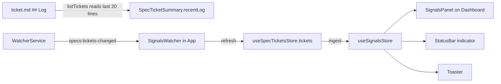

# Design — SPEC-0016: Replace Needs me with live signals panel

> **Stage 2 of 3 — how.** Concrete enough that the plan can be written without re-reading the
> code, and checked line by line against the architecture policies. Write "None — <reason>" for a
> section that genuinely does not apply.

## Context

- **Ticket list:** `src/main/services/SpecTicketsService.ts` → `listTickets()` runs
  `spec.mjs list --json` and maps each ticket with `toSummary()` into `SpecTicketSummary`
  (`src/shared/types/specTickets.ts`).
  - The CLI's list JSON carries no log.
  - Only `status --json` (`getTicket()`, one ticket) returns `log: string[]`, which is the
    `## Log` lines of `ticket.md` without the leading `- `.
  - The proposal keeps the CLI unchanged.
- **Log format:** written by `logTo()` in `specs/tools/spec.mjs`. Each line is
  `- YYYY-MM-DD HH:MM — <text>`, except the first, which is `- YYYY-MM-DD created`. The texts are:
  - `<stage> gate passed; awaiting human approval[ (policy exceptions: …)]`
  - `<stage> → <next>`
  - `<stage> approved by <name>`
  - `reopened at <stage>: <reason>`
  - `blocked: <reason>`
  - `unblocked → <status>`
  - `autopilot on|off`
  - `autopilot switched off: no progress after …`
  - `set <key> = …`
  - `verify run: pass|fail`
  - `archived`
  - free notes
- **Live refresh:**
  - `WatcherService` broadcasts `specs:tickets-changed` (debounced) for any change under
    `specs/changes` or `specs/archive`.
  - `useSpecTicketsLiveRefresh()` (`src/renderer/hooks/`) calls `useSpecTicketsStore.refresh()`
    and is mounted by `SpecOverview` and `SpecTicketsView`. So today nothing refreshes while other
    views are open.
- **Dashboard:**
  - `views/dashboard/SpecOverview.tsx` loads the tickets and renders `KpiTiles`, then a grid with
    the *Ticket progress* card (`StageDonut`) and the *Needs me* card (`TicketLinks` ×3 from
    `summarize()` in `lib/spec-tickets.ts`: `awaiting`, `blocked`, `mineInProgress`).
  - `DashboardView` shows the store's load `error` as an alert.
- **Shell:**
  - `App.tsx` renders `Sidebar`, `ContentArea` and `StatusBar`
    (`components/layout/StatusBar.tsx`, which shows the connection and workspace).
  - Navigation is `useNavigationStore.setActiveView(view)`, and `openTicket(id)` in
    `lib/open-ticket.ts` opens a ticket.
  - There is no toast component yet.
- **Tests:**
  - `test/main/SpecTicketsService.test.ts` uses a real workspace fixture
    (`test/fixtures/workspace.ts`, `writeTicket`).
  - `SpecTicketsService.perf.test.ts` keeps listing 50 tickets under 1 s.
  - `test/renderer/Dashboard.test.tsx` uses a FakeWebSocket for live refresh.
- **Closest examples:**
  - SPEC-0015's `kpis()` and `StageDonut`: a pure helper in `lib`, presentational views, and
    shared store state;
  - the existing zustand stores (`stores/navigation.ts`, `stores/specTickets.ts`).
- **Read:** the proposal, `developer-cockpit/spec/03-features.md` §1 and the dataviz skill's
  status-colour rule (status colours are reserved and always come with an icon and a label).

## Approach



### 1. Log entries in the ticket list (main process)

- `SpecTicketSummary` gets `recentLog: string[]`: the last 20 `## Log` entries, oldest first,
  without `- `, in the same form as `SpecTicketDetail.log`.
- `listTickets()` fills it after the CLI call, with a new private `readRecentLog(dir)`:
  - It resolves `path.resolve(workspaceRoot, dir, 'ticket.md')` and refuses anything outside
    `<workspaceRoot>/specs/`.
  - It reads the file and takes the lines between `## Log` and the next `## ` heading that start
    with `- `, and keeps the last 20.
  - If the file cannot be read, it returns `[]`. The ticket still lists.
- `toSummary()` sets `recentLog: []`, so `getTicket()` and the other callers stay typed.
  `getTicket()` keeps its full `log`.

### 2. Signals (pure, `src/renderer/lib/signals.ts`)

```ts
export type SignalLevel = 'critical' | 'attention' | 'good' | 'info';
export interface Signal {
  key: string;            // `${ticketId}|${raw}|${occurrence}`; stable across reloads (see below)
  ticketId: string; title: string; owner: string;
  date: string;           // YYYY-MM-DD
  time: string;           // HH:MM or '' (e.g. "created")
  sortKey: string;        // `${date} ${time || '00:00'}`
  text: string;           // event text after the em dash
  level: SignalLevel;
}
export function parseLogEntry(raw: string): { date: string; time: string; text: string } | null;
export function classify(text: string): SignalLevel;
export function collectSignals(tickets: SpecTicketSummary[], limit = 20): Signal[];
```

- **Key:** an entry's index in `recentLog` shifts once a ticket has more than 20 entries, so the key
  must not use it.
  - The key is `ticketId|raw line|occurrence`, where `occurrence` counts identical raw lines of the
    same ticket within the window. Log lines carry a minute timestamp, so identical lines are rare.
  - This keeps a key stable when older entries leave the 20-entry window.
- **`classify`**, in order:

  | Rule | Level |
  |---|---|
  | `^verify run: fail`, `^blocked:`, `^reopened at `, `^autopilot switched off` | critical |
  | `gate passed; awaiting human approval` | attention |
  | `^verify run: pass`, `→ done$` | good |
  | anything else, including unknown lines | info |

- **`parseLogEntry`:** regex `^(\d{4}-\d{2}-\d{2})(?: (\d{2}:\d{2}))?(?: — | )(.*)$`. A line that
  does not match gives `date: '', time: ''`, with the whole line as text and `info` level. It sorts
  last.
- **`collectSignals`:**
  - takes non-archived tickets only;
  - flattens all entries;
  - sorts by `sortKey` descending, with ties broken by later position in the ticket's log and then
    by ticket id;
  - returns the first `limit` entries.

### 3. Signals store (`src/renderer/stores/signals.ts`, zustand)

```ts
interface SignalsState {
  initialized: boolean;
  known: Set<string>;        // keys seen in any ingest
  fresh: Set<string>;        // keys that arrived after the first ingest (the "new" marker)
  unseen: Signal[];          // new critical/attention signals not yet acknowledged, newest first
  toasts: Signal[];          // currently shown toasts, at most 3
  ingest(tickets: SpecTicketSummary[]): void;
  markSeen(): void;          // unseen = []
  dismissToast(key: string): void;
}
```

- `ingest()` uses every entry of every non-archived ticket's `recentLog`, not only the top 20.
  - On the **first** call, it adds all keys to `known` and sets `initialized`. Nothing is fresh,
    unseen or toasted.
  - On **later** calls, each key not in `known` is added to `known` and `fresh`. If the entry is
    `critical` or `attention`, it is also prepended to `unseen` and pushed to `toasts` (keeping
    the last 3).
- The store resets with `getInitialState()` in tests, as the other stores do.

### 4. One app-wide watcher (`src/renderer/components/SignalsWatcher.tsx`)

- It renders nothing. It is mounted once in `App.tsx`, next to `StatusBar`.
- On mount it calls `useSpecTicketsStore.load()` and `useSpecTicketsLiveRefresh()`.
- It subscribes to `useSpecTicketsStore` and calls `useSignalsStore.ingest(tickets)` whenever
  `tickets` changes and the last load succeeded (`error === null`).
- `SpecOverview` and `SpecTicketsView` drop their own `useSpecTicketsLiveRefresh()`, so each change
  causes one CLI run instead of two. `SpecOverview` keeps its `load()` on mount, so opening the
  Dashboard still reloads.

### 5. Signals panel (`views/dashboard/SignalsPanel.tsx`) replaces *Needs me*

- A `Card role="region" aria-label="Signals"`, with the same column as *Needs me* had.
- **Your turn** (`section aria-label="Your turn"`):
  - It lists `summarize().awaiting` (detail "approve <stage>") and `summarize().blocked` (detail:
    the blocked reason), each with its status icon: `Hourglass` for awaiting, `AlertTriangle` for
    blocked.
  - The user's own entries come first across both kinds, with awaiting before blocked within each
    owner. The list is capped at `max-h-40` and scrolls. *Changed in verify:* the first version kept
    `summarize()`'s per-group order, which put another owner's awaiting ticket before the user's own
    blocked one (independent review, AC-3).
  - Each entry is a button that calls `openTicket(id)`.
  - When empty it shows "Nothing needs you.".
- **Activity** (`section aria-label="Activity"`):
  - It is an `<ol>` of `collectSignals(tickets)` inside a scroll box with
    `max-h-[22rem] overflow-y-auto`.
  - Each entry is a button that opens its ticket. It shows:
    - the level icon in its status colour (`XCircle` critical in `--color-destructive`,
      `Hourglass` attention in `--color-warning`, `CheckCircle2` good in `--color-success`,
      `Info` info in muted);
    - a visible level label in small uppercase muted text ("critical", "attention", "good",
      "info");
    - the time, or the date when it is not today, in tabular figures;
    - the ticket id in mono, the event text and the title truncated in muted text.
  - A fresh entry (`fresh.has(key)`) gets a "new" pill and `data-new="true"`.
  - When empty it shows "No activity yet.".
- **Unavailable:** with `error && !tickets.length`, both sections are replaced by "Signals are
  unavailable: tickets could not be loaded.", as SPEC-0015 does for the donut.
- `summarize()` loses `mineInProgress`; its test case is updated. `TicketLinks` moves into
  `SignalsPanel` for *Your turn*.

### 6. Status-bar indicator (`components/layout/StatusBar.tsx`)

- With `unseen.length > 0`, the left side shows a button `aria-label="<n> new signals"`. It
  contains:
  - a `Bell` icon tinted by the most severe unseen level: destructive if any critical, otherwise
    warning;
  - the count;
  - the latest signal as `<id> <text>`, truncated at `max-w-96`.
- Clicking it calls `setActiveView('dashboard')` and `markSeen()`.
- With nothing unseen, the bar is unchanged.

### 7. Toasts (`components/Toaster.tsx`)

- Fixed at the bottom right, above the status bar, `z-50`. It renders `toasts` as
  `role="status"` cards. Each card has:
  - the level icon and label;
  - the ticket id and event text;
  - an **Open** button, which calls `openTicket(id)` and dismisses the toast;
  - a close `×` button.
- Each toast dismisses itself after 8 s (`setTimeout` per key, cleared on unmount).
- It is mounted once in `App.tsx`.

### Mapping to the proposal

| What Changes | Where |
|---|---|
| Signals panel: Your turn and Activity, fixed height | `SignalsPanel.tsx`, `lib/signals.ts`, `SpecOverview.tsx` |
| Mine in progress removed | `SpecOverview.tsx`, `summarize()` |
| Status-bar indicator | `StatusBar.tsx`, `stores/signals.ts` |
| Toasts | `Toaster.tsx`, `stores/signals.ts` |
| Signals in every view | `SignalsWatcher.tsx` in `App.tsx`; `recentLog` from `SpecTicketsService` |

## Contract Changes

None. This is renderer and main-process code in `developer-cockpit`. No OpenAPI, Avro or IPC
channel changes; the `specTickets.list` IPC result gains the additive `recentLog` field in the
shared TypeScript type.

## Data & Persistence

None. The cockpit only reads `ticket.md`. The seen and fresh state lives in memory for the session,
as the proposal decided.

## Events & Messaging

None new. The existing `specs:tickets-changed` WebSocket event is reused. It is now consumed once,
app-wide, by `SignalsWatcher`, instead of by the two views.

## Domain, State & Orchestration

None. There is no OMS state. Signals are derived, read-only data. The spec workflow's state stays in
the CLI.

## Alternatives & Decisions

- **Read the log in the cockpit, not in the CLI.** Alternative: add `recentLog` to the CLI's
  `ticketJson()`. Rejected, because the proposal keeps the CLI unchanged. If a later ticket changes
  the CLI anyway, `readRecentLog` can be swapped for the CLI field without touching the renderer.
- **Diff log entries, not ticket snapshots.**
  - Alternative: compare status, awaiting and blocked between two loads.
  - Rejected for two reasons:
    - it misses events that leave the status unchanged, such as a failed verify run, a reopen to
      the same stage, or autopilot switching off;
    - it invents texts, while the log already holds the authoritative wording and time.
- **Twenty entries per ticket.** The feed shows at most 20, so a ticket never needs more. Keeping
  the window per ticket also bounds `ingest()`.
- **Toasts only for critical and attention.** This follows the proposal, so an autopilot run
  produces no toast stream. There is no new dependency: the toast is about 60 lines of React,
  where a library such as sonner would be a new package for one use (P-17).
- **Status colours for levels.** Levels are statuses, not categories, so they use the reserved
  status tokens (`--color-destructive`, `--color-warning`, `--color-success`), never the
  `--stage-*` palette. Each level always comes with an icon and a visible label.
- **Unseen count resets only on click.** Being on the Dashboard does not clear it automatically:
  AC-5 defines the click as the acknowledgement, and the "new" pills in the feed stay visible.

## Risks & Mitigations

| Risk | Mitigation |
|---|---|
| Listing gets slower (one extra file read per ticket) | Synchronous reads of small files. `SpecTicketsService.perf.test.ts` keeps 50 tickets under 1 s |
| Duplicate or missing "new" marks when entries roll out of the 20-entry window | Keys do not use the window index (raw line plus occurrence). Unit-tested with a ticket that has more than 20 entries |
| A toast flood after a bulk change (e.g. a branch switch rewriting many logs) | At most 3 toasts are kept; the rest only count in the status bar |
| The first load after a failed load would mark everything as new | `ingest()` runs only on successful loads, and the first successful one only initialises |
| A path in `dir` escapes the workspace | `readRecentLog` refuses paths outside `<workspaceRoot>/specs/` (P-16) |
| Log format changes in the CLI | Unknown lines degrade to *info* with their text unchanged (AC-7), unit-tested |

## Test Strategy

| AC | Level | Test class#method | What it asserts |
|---|---|---|---|
| AC-1 | unit + component | `test/main/SpecTicketsService.test.ts#listTickets returns the last 20 log entries per ticket`; `test/renderer/signals.test.ts#collectSignals merges non-archived logs newest first, capped at 20`; `test/renderer/Dashboard.test.tsx#signals panel replaces Needs me` | `recentLog` read from `ticket.md` (last 20, oldest first); ordering, cap and archived exclusion; panel rows show time, id, title and text; no "Needs me" or "Mine in progress" |
| AC-2 | unit + component | `signals.test.ts#classify maps log texts to levels`; `test/renderer/SignalsPanel.test.tsx#each activity entry shows a level icon and label` | The eight example texts give the expected levels; every row has `[data-level]`, an icon and visible label text |
| AC-3 | component | `Dashboard.test.tsx#your turn lists awaiting and blocked, mine first, and opens tickets`; `SignalsPanel.test.tsx#your turn empty state` | Order, detail texts, click opens the ticket; "Nothing needs you." |
| AC-4 | unit + component | `test/renderer/signalsStore.test.ts#first ingest marks nothing new; later entries are fresh`, `#keys stay stable when entries leave the window`; `Dashboard.test.tsx#live refresh adds a new activity entry marked new` | The new entry is at the top with `data-new`; first-load entries are not new |
| AC-5 | component | `test/renderer/SignalsShell.test.tsx#status bar counts new critical and attention signals and opens the dashboard` | Count and latest text appear after a live event in another view; good and info do not count; the click navigates and resets to zero; nothing is counted at the first load |
| AC-6 | component | `SignalsShell.test.tsx#toast for a new critical or attention signal, not for good or info` | Toast text and the Open action open the ticket; no toast for good or info |
| AC-7 | unit + component | `Dashboard.test.tsx#shows load errors instead of an empty portfolio` (extended); `signals.test.ts#unknown lines are info with their text unchanged` | "Signals are unavailable…" shown, and no "Nothing needs you." or "No activity yet."; unknown line keeps its text and is *info* |

Visual check as in SPEC-0015: a one-off Playwright screenshot of the built app in light and dark,
with a toast and the status-bar indicator visible.

## Policy Compliance

| Policy | Title | Status | How / Justification |
|---|---|---|---|
| P-01 | Contracts live only in oms-contracts | n/a | No contracts touched |
| P-02 | Specification before code, generated models only | comply | Proposal and design come first; `03-features.md` is updated |
| P-03 | Never edit generated code | n/a | No generated code |
| P-04 | Contracts evolve compatibly | n/a | No OpenAPI or Avro change; the shared TS type gains an additive field |
| P-05 | Every state change is recorded in the event log | n/a | No OMS state; this reads the spec workflow's own log |
| P-06 | Kafka only through the transactional outbox | n/a | No Kafka |
| P-07 | Schema changes through new Liquibase changesets | n/a | No database |
| P-08 | Concurrency and idempotency are explicit | comply | Ingest is idempotent by stable key (re-ingesting the same tickets adds nothing). Overlapping loads are already ordered by the store's `loadSeq` |
| P-09 | Commands and queries stay separate | n/a | Read-only view |
| P-10 | State transitions go through the state machine and task pipeline | n/a | No order state |
| P-11 | Layering and conventions | comply | Main-process file read in the service, pure derivation in `lib/signals.ts`, session state in a zustand store, presentational components |
| P-12 | Jackson 3 only | n/a | No Java |
| P-13 | Errors and validation follow the framework specs | comply | An unreadable `ticket.md` gives `[]` without failing the list. A load error shows "Signals are unavailable…" and never an empty feed (AC-7) |
| P-14 | Test first, every acceptance criterion is proven by an automated test | comply | Every AC maps to the tests above; each task writes its test first |
| P-15 | Observability | n/a | Pure UI; the signals are themselves the feedback. No new logs or metrics |
| P-16 | Security | comply | `readRecentLog` only reads `ticket.md` under `<workspaceRoot>/specs/`. Log text is rendered as text, never as HTML |
| P-17 | Simplicity and dependencies | comply | No new package; the toast and the bell use lucide icons, which are already used |
| P-18 | Modules build standalone | comply | `developer-cockpit` typecheck, test and build |
| P-19 | Documentation follows behaviour | comply | `developer-cockpit/spec/03-features.md` §1 (Dashboard and status bar) and `02-information-architecture.md` |

## Knowledge Base Updates

None in `oms-knowledge-base/`: no page there covers the cockpit. The cockpit's own spec pages are
updated: `developer-cockpit/spec/03-features.md` §1 (the Signals panel, the status-bar indicator
and toasts) and `02-information-architecture.md` (the Dashboard row).
