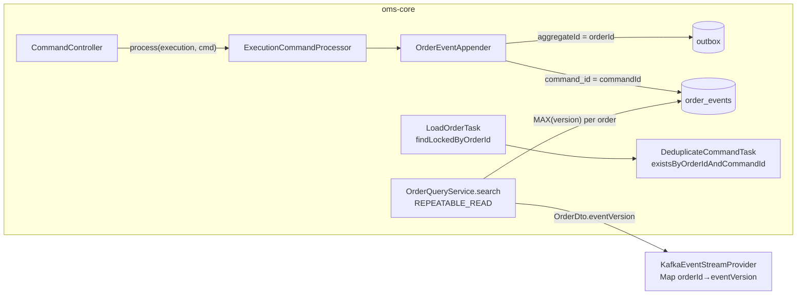

# Design — SPEC-0018: Fix outbox key, audit and dedup defects

> **Stage 2 of 3 — how.** Concrete enough that the plan can be written without re-reading the
> code, and checked line by line against the architecture policies. Write "None — <reason>" for a
> section that genuinely does not apply.

## Context

Paths are relative to `oms-core/src/main/java/org/example/oms/` unless stated otherwise.

1. **Execution key.**
   - `service/OrderEventAppender.appendExecutionEvent` stages the execution outbox row with
     `aggregateId(execution.getExecID())` (line ~101).
   - `service/MessagePublisher.publish` sends `kafkaTemplate.send(topic, aggregateId, payload)`, so
     the outbox `aggregateId` is the Kafka key.
   - `OutboxRepository.claimPending` orders by primary key and has no constraint on `aggregate_id`
     (`003-event-sourcing-and-outbox.yaml`), so changing the value is safe.
   - The order row is already staged with `aggregateId(order.getOrderId())`.
2. **REST fills.** `api/CommandController` (line ~114) calls `executionCommandProcessor.process(execution)`.
   That overload passes `command = null`, so `PublishExecutionEventTask` → `appendExecutionEvent`
   stores `transaction = null`. `config/CommandListener` (line ~139) already calls
   `process(execution, cmd)`.
3. **Snapshot deduplication.**
   - `oms-streaming-service/.../service/KafkaEventStreamProvider.getOrderEventStream` collects
     `snapshotEventIds` (a `Set<Long>`) from `convertQueryDtoToOrderDto`, which maps
     `queryDto.getId()`, the database id, to `eventId`.
   - Live events get `eventId` from `OrderMessage.eventId`, the per-order event version
     (`mapper/OrderMessageMapper`, fed from `OutboxMessage.aggregateVersion`).
   - The query `OrderDto` (`oms-contracts/src/main/openapi/oms-query-api.yml`) has `id` and `txNr`
     but no event version. `txNr` is not the event version (see the `OutboxMessage.aggregateVersion`
     comment; unifying them is SPEC-0027).
   - Query path: `api/QueryController` → `service/OrderQueryService.search` (class-level
     `@Transactional(readOnly = true)`) → `mapper/QueryOrderDtoMapper` (MapStruct).
4. **Deduplication.**
   - `service/lifecycle/tasks/DeduplicateCommandTask` (order 75) loads
     `findByOrderIdOrderByVersionAsc(orderId)` and compares class and `commandId` against every
     stored `transaction`.
   - The lifecycle pipeline (`service/lifecycle/OrderLifecycleCommandProcessor`) is:
     `LoadOrderTask` (50, `findByOrderId`) → dedup (75) → validate → apply →
     `SaveOrderTask` (400, `saveAndFlush`) → `PublishOrderEventTask` (append).
   - Concurrency is optimistic today. The loser of two concurrent copies fails at `SaveOrderTask`
     with `OptimisticLockingFailureException`. The processor rethrows it, REST answers 409
     (`GlobalExceptionHandler`), and Kafka retries via `commandErrorHandler`.
   - Only the four lifecycle commands carry `commandId` (`oms-cmd-api.yml`).
5. **Tree finder.** `repository/OrderRepository.findByRootOrderId` returns `Optional<Order>`.
   Nothing calls it.

**Closest examples:**
- The dedup and pipeline follow the existing lifecycle tasks.
- The new migration follows `005-order-reject-reason.yaml`.
- The integration tests follow `ExchangeWorkflowIntegrationTest` (REST and Kafka over
  `AbstractKafkaPostgresIntegrationTest`), `EventSourcingIntegrationTest` (outbox rows) and
  `LiquibaseMigrationIntegrationTest`.

**Read:**
- `oms-framework/task-orchestration-framework_spec.md` and `error-handling.md`;
- the KB pages listed in the proposal;
- the architecture review §8.

## Approach



| What Changes (proposal) | Where |
|---|---|
| Execution messages keyed by `orderId` | `OrderEventAppender.appendExecutionEvent`: `aggregateId(order.getOrderId())`; Javadoc on `MessagePublisher` states that the key is the order id |
| Every topic's key documented | `oms-knowledge-base/interfaces/kafka-topics.md`: a *Key* column |
| REST fills record their command | `CommandController`: `executionCommandProcessor.process(execution, executionCreateCmd)` |
| `OrderDto.eventVersion` | the contract (below); `OrderEventRepository.findLatestVersions`; `OrderQueryService.search` returns the page with a version map; the `QueryOrderDtoMapper` sets `eventVersion` |
| Snapshot dedup per order on the version | `KafkaEventStreamProvider` |
| `command_id` column, unique index, backfill | `006-order-event-command-id.yaml`, `OrderEvent.commandId`, `OrderEventAppender` |
| Dedup without the history scan | `DeduplicateCommandTask` → `existsByOrderIdAndCommandId`; `LoadOrderTask` → `findLockedByOrderId` |
| `findByRootOrderId` list, `findByParentOrderId` | `OrderRepository` |

### 1. Key (`OrderEventAppender`)

- `appendExecutionEvent` stages the execution row with `aggregateId(order.getOrderId())`. Nothing
  else changes: `MessagePublisher` keeps sending `aggregateId` as the key, and the log line keeps
  `execID`.

### 2. REST fill (`CommandController`)

- Change the call to `executionCommandProcessor.process(execution, executionCreateCmd)`.
- The command-less overload stays for tests and internal callers.
- Its Javadoc gets one sentence: an entry point that has a command must pass it, or the event
  log loses it.

### 3. `eventVersion` and the snapshot

- **Repository** (`OrderEventRepository`):
  ```java
  @Query("SELECT e.orderId AS orderId, MAX(e.version) AS version FROM OrderEvent e "
       + "WHERE e.orderId IN :orderIds GROUP BY e.orderId")
  List<OrderVersion> findLatestVersions(Collection<String> orderIds);
  interface OrderVersion { String getOrderId(); long getVersion(); }   // nested projection
  ```
  The existing unique index on `(order_id, version)` serves this query.
- **Service** (`OrderQueryService`):
  - `search` is annotated `@Transactional(readOnly = true, isolation = Isolation.REPEATABLE_READ)`.
  - It returns a new `record OrderSearchResult(Page<Order> orders, Map<String, Long> eventVersions)`
    in `org.example.oms.service`.
  - REPEATABLE_READ gives both queries one Postgres snapshot. The order row and its event are
    committed in one transaction, so `eventVersion` always matches the order state in the same
    response. Without that, a newer version could be paired with an older state, and the streaming
    service would then drop the live event that carries the newer state.
- **Mapper:** `QueryOrderDtoMapper.toPagedOrderDto(OrderSearchResult)` maps the page as today, then
  sets `eventVersion` on each DTO from the map (null when an order has no events).
  `QueryController` passes the result through.
- **Streaming** (`KafkaEventStreamProvider`):
  - `convertQueryDtoToOrderDto` maps `queryDto.getEventVersion()` to `eventId`.
  - `snapshotEventIds` (`Set<Long>`) becomes `Map<String, Long> snapshotVersions`
    (orderId → eventVersion).
  - The live filter drops an event when `eventId != null`, `snapshotVersions.get(orderId) != null`
    and `eventId <= snapshotVersion`.
  - `maxSnapshotEventId` is removed: it compared versions across orders and meant nothing. The
    completion log reports the snapshot size instead.
  - The cache fallback path is unchanged.

### 4. `command_id` and deduplication

- **Entity:** `OrderEvent` gets `@Column(name = "command_id") private String commandId;`. A
  second `@UniqueConstraint(name = "uq_order_events_order_id_command_id", columnNames = {"order_id", "command_id"})`
  is added to `@Table`. It documents the migrated constraint; `validate` does not check it.
- **Appender:** `OrderEventAppender.appendOrderEvent` sets `.commandId(commandIdOf(command))`.
  - `commandIdOf` moves from `DeduplicateCommandTask` (package-private static) to
    `OrderEventAppender` as `public static String commandIdOf(Command)`, with the same switch.
  - The task calls it there, so one place decides which commands carry an id.
- **Repository:** `OrderEventRepository.existsByOrderIdAndCommandId(String orderId, String commandId)`.
- **Task:** `DeduplicateCommandTask` replaces the scan with `existsByOrderIdAndCommandId(orderId, commandId)`.
  It no longer compares classes (proposal assumption, approved). Its message stays
  `"Duplicate command " + commandId + " for order " + orderId`, and the refusal path stays
  `markValidationFailed` → `TaskResult.failed`. REST therefore answers 400 `FAILED` with that
  message, and Kafka logs "refused" and acknowledges.
- **Lock:**
  - `OrderRepository` gets `@Lock(LockModeType.PESSIMISTIC_WRITE) Optional<Order> findLockedByOrderId(String orderId)`
    (a derived query; the text between `find` and `By` is free).
  - `LoadOrderTask` uses it. That task is used only by the lifecycle pipeline.
  - A second copy of a command now waits at load until the first commits. It then sees the
    committed event and is refused by the dedup task (AC-7), instead of failing at `SaveOrderTask`
    with a 409.
  - `txNr` stays as the backstop for any path that does not take the lock.
- **Unique index:** the integrity backstop. If it ever fires, it raises `DataIntegrityViolationException`
  → 409 (REST) via the existing handler. Under the lock it should not fire.

### 5. Finders (`OrderRepository`)

```java
List<Order> findByRootOrderId(String rootOrderId);
List<Order> findByParentOrderId(String parentOrderId);
```

The class Javadoc's finder list is updated.

## Contract Changes

`oms-contracts/src/main/openapi/oms-query-api.yml`, `components.schemas.OrderDto.properties`, after `txNr`:

```yaml
        eventVersion:
          type: integer
          format: int64
          description: >-
            The order's latest event-log version: the highest order_events.version for the order,
            and the eventId of its newest oms_orders message. Absent when the order has no events.
```

- **Additive and optional** (P-04). The generated `org.example.common.model.query.OrderDto` gains
  `eventVersion` (`Long`). Every consumer (oms-core, oms-streaming-service, oms-mcp-server,
  oms-exchange-simulator) rebuilds against it. Only oms-core and oms-streaming-service use it.
- **No Avro change.** The `oms_executions` key change is a key change, not a schema change.

## Data & Persistence

New `oms-core/src/main/resources/db/changelog/006-order-event-command-id.yaml`, included last
from `db.changelog-master.yaml`. Files 001–005 are not edited (P-07).

```yaml
databaseChangeLog:
  - changeSet:
      id: 006-tag-before-command-id
      author: oms
      changes:
        - tagDatabase:
            tag: before-006-command-id
  - changeSet:
      id: 006-order-events-command-id
      author: oms
      comment: Lifecycle deduplication by an indexed command id instead of scanning the event history (SPEC-0018)
      changes:
        - addColumn:
            tableName: order_events
            columns:
              - column: { name: command_id, type: varchar(255) }
        - sql:
            sql: >-
              UPDATE order_events SET command_id = transaction ->> 'commandId'
              WHERE transaction ->> 'commandId' IS NOT NULL
        - addUniqueConstraint:
            tableName: order_events
            constraintName: uq_order_events_order_id_command_id
            columnNames: order_id, command_id
      rollback:
        - dropUniqueConstraint: { tableName: order_events, constraintName: uq_order_events_order_id_command_id }
        - dropColumn: { tableName: order_events, columnName: command_id }
```

- **Nullable column.** Postgres treats NULLs as distinct in a unique constraint, so the many
  events without a `commandId` do not collide.
- **The tag changeset** lets the AC-8 test migrate a fresh database to just before this change,
  insert legacy rows, then apply the rest.
- **Where `commandId` sits in the JSON.** The stored `transaction` JSON holds `commandId` as a
  top-level property of the four lifecycle commands, written by Jackson from the generated
  command models. The T-task for the migration first checks this against a real stored row. If it
  differs, it adjusts the JSON path and records why under Alternatives & Decisions.
- **Optimistic locking** (`txNr`) is unchanged. The lifecycle load adds a row lock (§4).

## Events & Messaging

- **`order_events`:** the same events as today, in the same order. Each event now stores
  `command_id`, and REST fills now store their `ExecutionCreateCmd` in `transaction` (P-05).
  Replay (`OrderReplayService`) reads snapshots and is unaffected.
- **Outbox (P-06):** unchanged apart from the execution row's `aggregateId`. Publishing stays in
  `OutboxRelay`/`MessagePublisher`.
- **Topics:** `oms_executions` records are keyed by `orderId`. All records of one order land on one
  partition per topic. Cross-topic ordering is still not guaranteed (booking paper §3.2; SPEC-0019).
  - **Consumer impact:** oms-streaming-service reads `orderId` from the payload, not the key, and
    the exchange simulator does not consume `oms_executions`. Old records keyed by `execId` stay
    on their partitions. This is not a schema change and nothing breaks; it is called out in the
    KB.
- **Consumer idempotency (P-08):**
  - oms-core's lifecycle commands are deduplicated by `(order_id, command_id)`.
  - The streaming service drops live order events at or below the snapshot version per order.

## Domain, State & Orchestration

- **No state-machine change.** The lifecycle pipeline keeps its tasks and order (P-10). Two tasks
  change their queries:
  - `LoadOrderTask` takes the row lock;
  - `DeduplicateCommandTask` uses the indexed existence check.
- **Errors (P-13):**
  - A duplicate is refused as before: 400 `CommandResult{status: FAILED}`, Kafka acknowledged.
  - A concurrency conflict on a path without the lock still yields Problem+JSON 409.
  - No new error types.

## Alternatives & Decisions

- **The insert conflict alone as the duplicate signal** (the review's wording). Rejected:
  - `SaveOrderTask` flushes the order update before the event is appended. A concurrent copy
    therefore always loses on `txNr` first, as `OptimisticLockingFailureException`, and never
    reaches the `command_id` index.
  - Over REST that is a 409, not the refusal AC-5 and AC-7 require.
  - Detecting the duplicate on insert would also need the failed transaction translated after
    Postgres aborted it.
  - The indexed `exists` check plus the row lock gives a deterministic refusal; the index stays as
    the integrity backstop.
- **Row lock on lifecycle load vs. retry on conflict.**
  - Chosen: `PESSIMISTIC_WRITE` in `LoadOrderTask`.
  - Rejected: Spring Framework 7's `@Retryable`, or a retry loop in the controller.
    - The retry must wrap the transaction, which depends on proxy ordering.
    - It would add a second retry layer on the Kafka path, which already retries.
  - The lock is held for one short transaction on one order row, and it also serialises different
    lifecycle commands on the same order instead of failing one with 409.
  - The tree work (SPEC-0022) plans a root lock in the same place.
- **`eventVersion` computed at query time vs. stored on `orders`.**
  - Chosen: query time. One grouped query per page over the existing `(order_id, version)` index,
    with REPEATABLE_READ for consistency.
  - Rejected: a column on `orders`. It would have to be written after `SaveOrderTask`'s flush,
    which bumps `txNr` a second time with no event. Folding it into the save is SPEC-0027's job
    (unify `txNr` and the version).
- **Dedup across command types** (approved assumption). `commandId` alone identifies a command
  within an order.
- **Keep `ExecutionCommandProcessor.process(Execution)`.** It is used by integration tests, and
  removing it does not serve an AC. The REST path is fixed and the Javadoc warns.
- **Key by `orderId`, not `rootOrderId`.** Trees do not exist yet, and `oms_orders` uses `orderId`
  (see the proposal).
- **No new dependency or build change** (P-17).
- **Changed during implementation (T-6):** the streaming `OrderMessageMapper` also sets `eventId`
  from `OrderMessage.eventId`, on both `toOrderDto` and `toOrderEvent`. It used to copy the version
  only into `sequenceNumber`, so every live event had `eventId = null`, and the snapshot
  deduplication never matched anything. AC-4 cannot hold without it. `sequenceNumber` is kept
  for existing readers.
- **Changed during verification (T-14):** `QueryController` carried a class-level
  `@Transactional(readOnly = true)`. `OrderQueryService.search` joined that READ COMMITTED
  transaction, and Spring ignores a joining method's isolation, so §3's REPEATABLE_READ never took
  effect. The annotation is removed from the controller: the service owns the transaction (P-11), and
  the mapper needs none (`Order` has no lazy associations). A test asserts the isolation level that is
  actually in effect while the versions are read.
- **Changed during implementation (T-2):** the changesets in `006-order-event-command-id.yaml` are
  numbered `014-tag-before-command-id` and `015-order-events-command-id`, continuing the
  repository's running changeset numbering (005's changeset is `013-…`), not `006-…`. The tag name
  `before-006-command-id` is as designed. The stored `transaction` JSON was checked: the generated
  commands use `@JsonTypeInfo(As.PROPERTY, property = "type")`, so `commandId` is a top-level
  property and `transaction ->> 'commandId'` is the right path.

## Risks & Mitigations

| Risk | Mitigation |
|---|---|
| The backfill fails on legacy rows holding the same `commandId` twice for one order | The old scan prevented that within one class. A dev database with a cross-class reuse fails loudly at migration, not silently. AC-8's test covers the normal case |
| `commandId` sits at a different JSON path than assumed | T-task checks a stored row first; AC-8 fails if wrong |
| Lock wait under heavy contention on one order | One row, one short transaction. Lifecycle commands per order are rare (a handful per order) |
| REPEATABLE_READ serialization failures | Read-only transactions never fail with serialization errors in Postgres |
| A streaming subscriber misses an update because `eventVersion` came from a different snapshot than the state | Both queries run in one REPEATABLE_READ transaction (§3) |
| Consumers that relied on the `execId` key | None found (streaming reads the payload; the simulator does not consume the topic); documented in the KB |

## Test Strategy

| AC | Level | Test class#method | What it asserts |
|---|---|---|---|
| AC-1 | integration | `ExchangeWorkflowIntegrationTest#fills_areKeyedByOrderIdOnBothTopics` (new) | Accept plus two fills with different `execId`s over Kafka. Consume `oms_executions` and `orders`: every record for the order has key `orderId`, two execution records and the matching order records |
| AC-2 | integration | `ExchangeWorkflowIntegrationTest#restFill_recordsItsCommandInTheEventLog` (new) | POST `ExecutionCreateCmd` → 201. The FILL event's `transaction` is an `ExecutionCreateCmd` with the posted `execId` |
| AC-3 | integration | `ExchangeWorkflowIntegrationTest#queryApi_reportsTheLatestEventVersion` (new) | After create plus accept plus one fill (versions 1–3), `GET /api/query/orders?orderId=…` → `eventVersion` 3. After a second fill → 4 |
| AC-4 | unit | `oms-streaming-service` `KafkaEventStreamProviderTest#snapshotDeduplicatesLiveEventsPerOrderByVersion` (new) | Mock `OmsQueryClient` returns A@3, B@1. Mocked `KafkaReceiver` emits order messages A 2, A 3, A 4, B 3. The stream with snapshot yields the two SNAPSHOT events, then exactly A 4 and B 3 (StepVerifier) |
| AC-5 | integration | `OrderLifecycleIntegrationTest#duplicateCommandId_isRefusedOverRestAndLeavesOrderUnchanged` (new); `ExchangeWorkflowIntegrationTest#duplicateCommandId_overKafka_isAcknowledgedNotDeadLettered` (new) | REST: second cancel request with the same `commandId` → 400, `FAILED`, message contains `C`; state, `txNr` and event count unchanged. Kafka: a redelivered copy leaves the order unchanged, and no record appears on `commands.DLT` |
| AC-6 | integration | `OrderLifecycleIntegrationTest#lifecycleEvent_storesCommandId_andCommandWithoutIdIsStillApplied` (new) | The event row's `commandId` = `C`. A cancel without `commandId` is applied and its row has `commandId` null |
| AC-7 | integration | `OrderLifecycleIntegrationTest#concurrentDuplicates_exactlyOneApplied` (new) | Two threads call `OrderLifecycleCommandProcessor.process` with the same command, released together by a latch. Exactly one result succeeds and the other fails with the duplicate message; exactly one event has that `command_id` |
| AC-8 | integration | `CommandIdBackfillMigrationIntegrationTest#legacyEventsAreBackfilled_andRedeliveryIsRefused` (new) | Own Postgres container. Before Spring starts: Liquibase `updateToTag("before-006-command-id")`, then insert a legacy order with a NEW_ORDER and a cancel-request event whose JSON has `commandId` `C`. Spring then migrates the rest. Asserts `command_id` = `C`, and that processing that cancel request again is refused |
| AC-9 | integration | `OrderRepositoryTreeIntegrationTest#rootAndParentFinders_returnLists` (new, Postgres via Testcontainers) | R, two children, a grandchild: `findByRootOrderId(R)` returns 3 without throwing; `findByParentOrderId(R)` returns the 2 children |

Existing tests that must stay green:
- `OrderLifecycleCommandProcessorTest` (unit; mocks for `findLockedByOrderId` and `existsByOrderIdAndCommandId` updated);
- `EventSourcingIntegrationTest`;
- `LiquibaseMigrationIntegrationTest`, plus an assertion that `uq_order_events_order_id_command_id` exists;
- `CommandControllerWebMvcTest`, with the stub updated to the two-argument `process`.

## Policy Compliance

| Policy | Title | Status | How / Justification |
|---|---|---|---|
| P-01 | Contracts live only in oms-contracts | comply | Only `oms-contracts/src/main/openapi/oms-query-api.yml` changes |
| P-02 | Specification before code, generated models only | comply | The OpenAPI change is task 1. `OrderDto.eventVersion` comes from the regenerated model |
| P-03 | Never edit generated code | comply | Regenerated, not edited |
| P-04 | Contracts evolve compatibly | comply | One optional OpenAPI property, additive. No Avro change. The key change is documented, with no consumer reading the key |
| P-05 | Every state change is recorded in the event log | comply | Same events. REST fills now record their command, and each event records `command_id` |
| P-06 | Kafka only through the transactional outbox | comply | Only the staged `aggregateId` changes; publishing stays in the relay |
| P-07 | Schema changes through new Liquibase changesets | comply | New `006-order-event-command-id.yaml`; 001–005 untouched; entity matches |
| P-08 | Concurrency and idempotency are explicit | comply | Unique `(order_id, command_id)`, an indexed dedup check, a row lock on the lifecycle load with `txNr` kept, and per-order version dedup in streaming. Duplicate and concurrent-duplicate tests (AC-5, AC-7) |
| P-09 | Commands and queries stay separate | comply | The query path only reads (`readOnly`). The new repository query is read-only |
| P-10 | State transitions go through the state machine and task pipeline | comply | No transition change; the pipeline is kept and two tasks change their queries |
| P-11 | Layering and conventions | comply | The controller stays thin. The version map is built in the service and mapped in the MapStruct mapper; Spring Data derived queries and projections |
| P-12 | Jackson 3 only | comply | No new Jackson usage |
| P-13 | Errors and validation follow the framework specs | comply | Refusal and conflict responses unchanged (CommandResult `FAILED` and Problem+JSON 409) |
| P-14 | Test first, every acceptance criterion is proven by an automated test | comply | Every AC maps to a new test above, written red first in each task |
| P-15 | Observability | comply | Existing logs keep `orderId`; the duplicate refusal still logs at WARN with `commandId` and `orderId` |
| P-16 | Security | n/a | No new input surface, secrets or entitlements |
| P-17 | Simplicity and dependencies | comply | No new library; the smallest change per finding; the alternatives are recorded above |
| P-18 | Modules build standalone | comply | `spec verify` builds oms-contracts and every consumer in `impacts` |
| P-19 | Documentation follows behaviour | comply | KB pages below |

## Knowledge Base Updates

- `oms-knowledge-base/interfaces/kafka-topics.md`: a *Key* column: `commands` → the producer's
  `orderId`; `oms_orders` and `oms_executions` → `orderId`. A note that every record of one order
  lands on one partition per topic, with no ordering across topics.
- `oms-knowledge-base/oms-concepts/booking-integration.md` §3.2: check that it still says `orderId`
  for both topics. It does, and now matches the code. Add a source note if needed.
- `oms-knowledge-base/functional-requirements/FR-010-deduplicate-lifecycle-commands.md`: the
  dedup looks up `order_events.command_id` under a unique `(order_id, command_id)` index. Same
  `commandId`, any lifecycle type → refused. Concurrent copies are serialised by a row lock.
- `oms-knowledge-base/non-functional-requirements/NFR-001-idempotent-command-handling.md`: the
  mechanism, the same as FR-010, if it describes the scan.
- `oms-knowledge-base/domain/order-event.md`: the `command_id` column.
- `oms-knowledge-base/oms-concepts/streaming-architecture.md`: snapshot deduplication is per order
  on `eventVersion`/`eventId`, where it describes the snapshot.
- `oms-knowledge-base/interfaces/` query API page, if one lists `OrderDto` fields: `eventVersion`.
