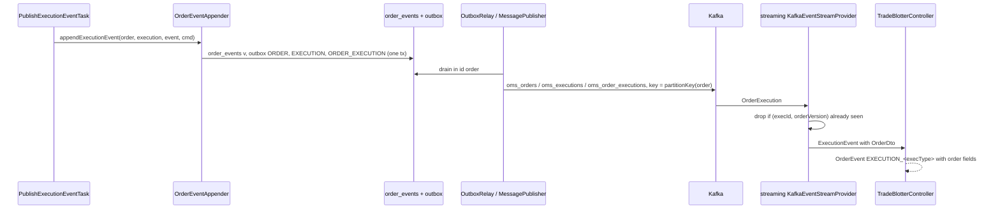

# Design — SPEC-0019: Publish OrderExecution events with order context

> **Stage 2 of 3 — how.** Concrete enough that the plan can be written without re-reading the
> code, and checked line by line against the architecture policies. Write "None — <reason>" for a
> section that genuinely does not apply.

## Context

**oms-core, fill path.** `ExecutionCommandProcessor` runs the execution pipeline:
`ValidateExecutionTask` → `CalculateOrderQuantitiesTask` (refuses an overfill) →
`DetermineOrderStateTask` → `PersistExecutionTask` (refuses a duplicate `(orderId, execID)`) →
`UpdateOrderTask` → `PublishExecutionEventTask`. The last task calls
`OrderEventAppender.appendExecutionEvent(order, execution, event, command)`, which appends the
`order_events` row (version `v`) and stages two outbox rows in the same transaction:

- `ORDER` → `kafka.order-topic` (`oms_orders`), `aggregateId = orderId`, `orderPayload = order`,
  `aggregateVersion = v`;
- `EXECUTION` → `kafka.execution-topic` (`oms_executions`), `aggregateId = orderId`,
  `executionPayload = execution`, `aggregateVersion = v`.

`OutboxRelay` drains `outbox` in id order and calls `MessagePublisher.publish`, which switches on
`OutboxMessage.AggregateType`, maps with `OrderMessageMapper` / `ExecutionMessageMapper`, and sends
with key `aggregateId`. `outbox.aggregate_type` is `VARCHAR(32)` with no check constraint
(`003-event-sourcing-and-outbox.yaml`); `order_payload` and `execution_payload` are nullable `jsonb`.
`OrderMessageMapper` already publishes `rootOrderId` as `order.rootOrderId ?? order.orderId`.

**Refusals.** An overfill fails in `CalculateOrderQuantitiesTask`; a duplicate `execId` fails in
`PersistExecutionTask`. Both roll back the whole command, so no event or outbox row exists
(`EventSourcingIntegrationTest#duplicateExecution_isRejectedAndChangesNothing` and the overfill
case next to it).

**oms-streaming-service.** `KafkaConfig` builds `KafkaReceiver<String, OrderMessage>`
(`streaming.kafka.topics.orders`) and `KafkaReceiver<String, Execution>`
(`streaming.kafka.topics.executions`). `KafkaEventStreamProvider.startExecutionConsumer` maps each
`Execution` to an `ExecutionDto`, caches it by `execId`, and emits an `ExecutionEvent` with
`eventType` `"NEW"` and no order. `TradeBlotterController.toOrderEvent` turns that into an
`OrderEvent` carrying only `orderId`, `sequenceNumber` and `timestamp`, which is why fill rows are
empty (finding 15). `KafkaEventStreamProviderTest` already drives the provider with mocked
receivers and `StepVerifier` (SPEC-0018 AC-4).

**Tests.** `AbstractKafkaPostgresIntegrationTest` starts shared Postgres and Kafka containers.
Topics are auto-created with one partition. `ExchangeWorkflowIntegrationTest#fills_areKeyedByOrderIdOnBothTopics`
is the closest example of a test that consumes the published topics from the earliest offset.
oms-contracts guards `OrderMessage` and `CommandMessage` with baseline compatibility tests
(`OrderMessageCompatibilityTest`, `src/test/resources/compat/*-baseline.json`); `Execution` has none.

**Closest examples followed.** The `EXECUTION` outbox path (appender → relay → publisher → mapper)
for the new message; `OrderMessageCompatibilityTest` for the Avro guards;
`ExchangeWorkflowIntegrationTest` for topic-consuming tests; `KafkaEventStreamProviderTest` for the
streaming tests.

**Read:** `oms-core/docs/architecture-review-2026-10-30.md` §5 and §8;
`oms-knowledge-base/oms-concepts/booking-integration.md` (§3.2, §5.2, §12);
`interfaces/kafka-topics.md`; `oms-framework/testing-patterns.md`; the policies.

## Approach



Mapping of the proposal's What Changes:

| What changes | Where |
|---|---|
| `OrderExecution` record | new `oms-contracts/src/main/avro/OrderExecution.avsc` |
| `Execution` + `rootOrderId`, `orderVersion` | `oms-contracts/src/main/avro/Execution.avsc` |
| Topic `oms_order_executions` | `application.yml` `kafka.order-execution-topic: ${ORDER_EXECUTION_TOPIC:oms_order_executions}`; `OrderEventAppender` stages a third row |
| Publication via outbox | `OutboxMessage.AggregateType.ORDER_EXECUTION`; `MessagePublisher` case → new `OrderExecutionMessageMapper` |
| Key `rootOrderId` on all three topics | `OrderEventAppender.partitionKey(order)` = `rootOrderId ?? orderId`, used as `aggregateId` for every row it stages |
| `Execution.rootOrderId` / `orderVersion` | `ExecutionMessageMapper.toExecutionMessage(execution, order, version)` |
| Streaming consumes the new topic, dedups | `KafkaConfig` receiver for `OrderExecution`; `KafkaEventStreamProvider.startExecutionConsumer` rewritten |
| Blotter fill events with order fields | `ExecutionEvent.order`; `TradeBlotterController.toOrderEvent` |
| Consumer-side ordering test | new `OrderExecutionPublicationIntegrationTest`; base test creates multi-partition topics |

**oms-core changes.**

1. `OutboxMessage.AggregateType` gains `ORDER_EXECUTION`. The Javadoc of `aggregateId` becomes
   "the partition key: the order's root order id, or its own order id".
2. `OrderEventAppender`:
   - new `public static String partitionKey(Order order)` returning
     `order.getRootOrderId() != null ? order.getRootOrderId() : order.getOrderId()`;
   - `appendOrderEvent` stages the `ORDER` row with `aggregateId(partitionKey(order))`;
   - `appendExecutionEvent` stages the `EXECUTION` row with `aggregateId(partitionKey(order))` and,
     new, `orderPayload(order)`, then a third row `ORDER_EXECUTION` → `orderExecutionTopic`, same
     key and `aggregateVersion = v`, with both `orderPayload(order)` and `executionPayload(execution)`;
   - constructor gains `@Value("${kafka.order-execution-topic:oms_order_executions}") String orderExecutionTopic`.
3. `MessagePublisher.publish` gains `case ORDER_EXECUTION -> orderExecutionMessageMapper.toOrderExecutionMessage(message.getExecutionPayload(), message.getOrderPayload(), message.getAggregateVersion(), message.getCreatedAt())`,
   and the `EXECUTION` case passes `orderPayload` and `aggregateVersion` to `ExecutionMessageMapper`.
   The "no payload" guard stays: an `ORDER_EXECUTION` row without either payload throws, and the
   relay records the failure.
4. New `org.example.oms.mapper.OrderExecutionMessageMapper` (`@Component`, hand-written like the
   other two Avro mappers, because MapStruct does not target Avro builders here). It reuses
   `OrderMessageMapper`'s enum mappings for `Side`, `OrdType` and `State` (made package-visible
   static helpers), sets `rootOrderId` = `partitionKey(order)`, `orderVersion` = `version`, and
   `tradeDate` = `LocalDate.ofInstant(transactTime ?? createdAt, ZoneOffset.UTC)`. `createdAt` is
   the outbox row's staging time, written in the fill's transaction, so a republished row always
   carries the same `tradeDate`.
5. `ExecutionMessageMapper.toExecutionMessage(execution, order, version)` sets
   `rootOrderId` = `partitionKey(order)` (or `execution.orderId` when `order` is null, for `EXECUTION`
   rows staged before this change) and `orderVersion` = `version`.

**oms-streaming-service changes.**

1. `application.yml`: `streaming.kafka.topics.order-executions: ${ORDER_EXECUTION_TOPIC:oms_order_executions}`.
   `streaming.kafka.topics.executions` is removed (no reader left).
2. `KafkaConfig`: the `executionReceiver` bean becomes `KafkaReceiver<String, OrderExecution>
   orderExecutionReceiver()` subscribed to `order-executions`, same deserializer settings.
3. `KafkaEventStreamProvider.startExecutionConsumer` consumes `OrderExecution`:
   - **dedup**: `executionCache` (by `execId`) keeps the `orderVersion` last emitted. A record whose
     `execId` is cached with an `orderVersion` ≥ the incoming one is acknowledged and skipped
     (logged at DEBUG with `orderId`, `execId`, `orderVersion`);
   - otherwise maps to `ExecutionDto` (gains `orderVersion`) and to the streaming `OrderDto` via a
     new `OrderExecutionMapper` in `org.example.streaming.mapper` (same style as its
     `OrderMessageMapper`), caches, and emits `ExecutionEvent` with `eventType` = `execType` (or
     `"NEW"` when absent), `order` = the `OrderDto`, `sequenceNumber` = `orderVersion`.
4. `ExecutionEvent` gains `private OrderDto order`.
5. `TradeBlotterController.toOrderEvent` sets `.order(execEvent.getOrder())` and
   `.eventId(execEvent.getExecution().getOrderVersion())` in addition to today's fields.

## Contract Changes

**`Execution.avsc`**: two fields appended at the end, both optional (P-04 additive):

```json
{ "name": "rootOrderId", "type": ["null", "string"], "default": null,
  "doc": "Root of the order's tree; the order's own id when it has no root. The record's Kafka key." },
{ "name": "orderVersion", "type": ["null", "long"], "default": null,
  "doc": "The order's event-log version this fill produced (order_events.version)." }
```

**New `OrderExecution.avsc`** (namespace `org.example.common.model.msg`). Every field is optional
with `"default": null`, following `Execution` and `OrderMessage`; `decimal` is the same
`bytes`/`decimal(18,4)` type `Execution` uses; `Side`, `OrdType` and `State` reference the existing
named types, as `OrderMessage` does.

```json
{
  "namespace": "org.example.common.model.msg",
  "type": "record",
  "name": "OrderExecution",
  "doc": "One fill with the order it changed, as of that change. Published on oms_order_executions, keyed by rootOrderId.",
  "fields": [
    { "name": "execId",        "type": ["null", "string"], "default": null },
    { "name": "lastQty",       "type": ["null", decimal],  "default": null },
    { "name": "lastPx",        "type": ["null", decimal],  "default": null },
    { "name": "execType",      "type": ["null", "string"], "default": null },
    { "name": "lastCapacity",  "type": ["null", "string"], "default": null },
    { "name": "lastMkt",       "type": ["null", "string"], "default": null },
    { "name": "transactTime",  "type": ["null", {"type": "long", "logicalType": "timestamp-millis"}], "default": null },
    { "name": "orderId",       "type": ["null", "string"], "default": null },
    { "name": "rootOrderId",   "type": ["null", "string"], "default": null },
    { "name": "parentOrderId", "type": ["null", "string"], "default": null },
    { "name": "leg",           "type": ["null", "string"], "default": null, "doc": "Leg enum name (CLI, MKT)" },
    { "name": "clOrdId",       "type": ["null", "string"], "default": null },
    { "name": "sessionId",     "type": ["null", "string"], "default": null },
    { "name": "account",       "type": ["null", "string"], "default": null },
    { "name": "side",          "type": ["null", "Side"],   "default": null },
    { "name": "symbol",        "type": ["null", "string"], "default": null },
    { "name": "securityId",    "type": ["null", "string"], "default": null },
    { "name": "ordType",       "type": ["null", "OrdType"], "default": null },
    { "name": "price",         "type": ["null", decimal],  "default": null },
    { "name": "orderQty",      "type": ["null", decimal],  "default": null },
    { "name": "settlCurrency", "type": ["null", "string"], "default": null },
    { "name": "exDestination", "type": ["null", "string"], "default": null },
    { "name": "cumQty",        "type": ["null", decimal],  "default": null },
    { "name": "leavesQty",     "type": ["null", decimal],  "default": null },
    { "name": "avgPx",         "type": ["null", decimal],  "default": null },
    { "name": "state",         "type": ["null", "State"],  "default": null },
    { "name": "orderVersion",  "type": ["null", "long"],   "default": null },
    { "name": "tradeDate",     "type": ["null", {"type": "int", "logicalType": "date"}], "default": null,
      "doc": "UTC calendar date of transactTime (of the fill's processing time when it has none)." }
  ]
}
```

(`decimal` above stands for `{"type":"bytes","logicalType":"decimal","precision":18,"scale":4}`,
written out in full in the file.) `leg` is a string rather than a new Avro enum: `Leg` has no
schema today, and a string keeps the record readable when the tree tickets add legs.

Generated classes: new `org.example.common.model.msg.OrderExecution`; `msg.Execution` gains two
accessors. Compatibility guards: `ExecutionCompatibilityTest` against
`compat/Execution-baseline.json`, the schema as it stands before this change (committed first, in
the red step), checked in both directions; `compat/OrderExecution-baseline.json` added with the new
schema so later changes are guarded too. No OpenAPI change.

## Data & Persistence

None — no table or column changes. The `ORDER_EXECUTION` row uses the existing `outbox` columns
(`aggregate_type` is `VARCHAR(32)` with no check constraint; both payload columns already exist and
are nullable). `EXECUTION` rows additionally fill `order_payload`, which was null for them. No
Liquibase changeset, so `LiquibaseMigrationIntegrationTest` is unaffected.

## Events & Messaging

- **`order_events` (P-05)**: unchanged. One row per fill, version `v`, as today. The new message is
  a projection of that row's change, not a new event.
- **Outbox (P-06)**: per applied fill, three rows in one transaction, in this id order: `ORDER`,
  `EXECUTION`, `ORDER_EXECUTION`, all with `aggregateVersion = v` and the same key. A refused fill
  rolls back and stages nothing. Only `OutboxRelay` → `MessagePublisher` sends.
- **Keys**: `partitionKey(order)` on all three topics. For every order existing today it equals
  `orderId`, so keys do not change value; for an order with `rootOrderId` `R` it is `R`.
- **Ordering**: the relay publishes in id order, so all records of one root are sent in commit
  order, and with one key they land on one partition of each topic. There is still no ordering
  across topics; `oms_order_executions` removes the need for it, because each record is
  self-contained.
- **Idempotency (P-08)**: the relay is at-least-once, so a record can be published twice. Consumers
  deduplicate on `(execId, orderVersion)`; the streaming service does (above). The producer side
  stays idempotent through the existing `(orderId, execID)` unique constraint: a redelivered
  `ExecutionCreateCmd` is refused and stages nothing.

## Domain, State & Orchestration

None — no state machine transition or pipeline step changes. `PublishExecutionEventTask` still makes
one `appendExecutionEvent` call; the appender stages one more row. Validation and error responses
are unchanged (a refused fill answers exactly as today).

## Alternatives & Decisions

- **Outbox shape: an `ORDER_EXECUTION` row with both existing payload columns.** Rejected: the
  review's generic `payload`/`payload_type` columns (a Liquibase change, and the projection
  framework's job, SPEC-0020); building `OrderExecution` at publish time from the `ORDER` row
  (couples two rows, breaks the one-row-one-record rule of the relay); adding order fields to
  `Execution` only (option A; the review keeps `Execution` lean for the simulator).
- **Partition key `rootOrderId ?? orderId`, defined once in `OrderEventAppender.partitionKey`.**
  Rejected: keeping `orderId` (the Goal and the roadmap ask for root keys before trees, §9);
  `rootOrderId` without fallback (null keys would scatter records round-robin).
- **`tradeDate` from `transactTime`, else outbox `createdAt`, in UTC.** Confirmed at proposal
  approval. Rejected: publish-time `now()` (a republished record would change its date);
  venue-local dates (no venue time-zone data exists).
- **Streaming dedup on `(execId, orderVersion)` in the existing `executionCache`.** Rejected: a
  separate unbounded seen-set (memory grows forever); dedup on `execId` alone (would also drop a
  future bust or correction of the same execution, which carries a higher `orderVersion`).
  Trade-off: a redelivery arriving after its entry was evicted from the cache is emitted again;
  the cache holds `maxCacheSize` executions, far more than a redelivery window.
- **Multi-partition topics in tests.** `AbstractKafkaPostgresIntegrationTest` creates `orders`,
  `oms_executions` and `oms_order_executions` with 3 partitions through Kafka's `AdminClient` (on
  the test classpath already via spring-kafka) before the context starts. Rejected: relying on
  auto-created single-partition topics, on which an ordering test proves nothing.
- **No new dependency or build change** (P-17).
- **Changed during verification: the consumer dedup key is `(orderId, execId, orderVersion)`**, not
  `(execId, orderVersion)` as this design and the proposal state, because `execId` is unique per
  order only (`uq_executions_order_id_execid`): with the shorter key, a fill on another order that
  reuses an `execId` would be dropped as a redelivery. The independent review found it; the
  streaming cache, the `OrderExecution.avsc` doc and the KB now use the longer key. AC-7 is
  unaffected: it concerns one order, where the two keys agree.

## Risks & Mitigations

| Risk | Mitigation |
|---|---|
| One more outbox row and send per fill slows the fill path | One insert in the same transaction and one send by the relay, as for the other two rows; measured later with the load harness (SPEC-0024, out of scope) |
| `EXECUTION` rows staged before deployment have no `orderPayload` | `ExecutionMessageMapper` falls back to `execution.orderId` for `rootOrderId`; covered by a unit test |
| Existing integration tests assume one partition | They assert per key, and per-key ordering holds on any partition count; the full `oms-core` suite runs in verify |
| Streaming `ExecutionEvent` gains a field the UI does not render | Additive JSON field; UI rendering is out of scope |
| Schema Registry compatibility on `Execution` | Nullable fields with defaults; `ExecutionCompatibilityTest` checks both directions |

## Test Strategy

| AC | Level | Test class#method | What it asserts |
|---|---|---|---|
| AC-1 | unit (oms-contracts) | `ExecutionCompatibilityTest#newSchemaReadsBaselineAndBack` (new); `OrderExecutionSchemaTest#hasEveryContextFieldNullableWithNullDefault` (new) | Baseline ↔ new `Execution` compatible both ways (`SchemaCompatibility`); `Execution` has `rootOrderId` and `orderVersion` nullable, default null; `OrderExecution` has every field listed in the proposal, each nullable with default null |
| AC-2 | integration | `OrderExecutionPublicationIntegrationTest#fillsOverRestAndKafka_publishOneOrderExecutionEach` (new) | One fill over REST, one over Kafka; exactly one `OrderExecution` per `execId` on `oms_order_executions`, key `O`; `execId`, `lastQty`, `lastPx`, order fields equal the order after that fill (read from `order_events` snapshot); `orderVersion` = the fill's `order_events.version` = `eventId` of the matching `orders` record; `tradeDate` = UTC date of `transactTime` |
| AC-3 | integration | `OrderExecutionPublicationIntegrationTest#executionRecords_carryRootOrderIdAndOrderVersion` (new) | Each `oms_executions` record of those fills has `rootOrderId` `O` and the same `orderVersion` as its `OrderExecution` |
| AC-4 | integration | `OrderExecutionPublicationIntegrationTest#refusedFills_publishNothing` (new) | Duplicate `execId` and overfill are refused; after a sentinel fill on another order is seen, no record for the refused `execId`s on `oms_order_executions` or `oms_executions`; event count unchanged |
| AC-5 | integration | `OrderExecutionPublicationIntegrationTest#childOrder_isKeyedByRootOnAllThreeTopics` (new) | Order `C` created with `rootOrderId` and `parentOrderId` `R`: every record for `C` on `orders`, `oms_executions`, `oms_order_executions` has key `R`; an order without root has key = own `orderId` on all three |
| AC-6 | integration | `OrderExecutionPublicationIntegrationTest#rootAndChildFills_arriveOnOnePartitionInCommitOrder` (new) | With 3-partition topics: fills alternately on `R` and `C` (≥ 2 each, posted sequentially over REST); consumed from earliest, all on one partition, offsets in posting order, each order's `orderVersion` strictly increasing |
| AC-7 | unit (streaming) | `KafkaEventStreamProviderTest#orderExecutionRedelivery_isEmittedOnce` (new) | Same `(execId, orderVersion)` delivered twice → one `ExecutionEvent`; a following record for the same order with a new `execId` and higher `orderVersion` → emitted |
| AC-8 | unit (streaming) | `TradeBlotterExecutionStreamTest#executionsAndAllStreams_carryOrderFields` (new; real provider with mocked receivers, real `TradeBlotterController`) | For `EXECUTIONS` and `ALL`: the fill's event has `eventType` `EXECUTION_<execType>` and `order.orderId`, `symbol`, `side`, `account`, `orderQty`, `cumQty`, `leavesQty`, `state` equal to the `OrderExecution` |

Unit tests alongside: `OrderExecutionMessageMapperTest` (field mapping, `tradeDate` from
`transactTime`, fallback to `createdAt`), `ExecutionMessageMapperTest` (new fields, null `order`
fallback), `OrderEventAppenderTest` or the existing appender coverage (three rows, keys). The
existing `ExchangeWorkflowIntegrationTest#fills_areKeyedByOrderIdOnBothTopics` keeps passing
(root-less orders keep their keys).

## Policy Compliance

| Policy | Title | Status | How / Justification |
|---|---|---|---|
| P-01 | Contracts live only in oms-contracts | comply | `OrderExecution.avsc` and the `Execution.avsc` change are in `oms-contracts/src/main/avro` only |
| P-02 | Specification before code, generated models only | comply | Schemas change first (first tasks), then `./gradlew build` regenerates `msg.OrderExecution` / `msg.Execution`; no hand-written message classes |
| P-03 | Never edit generated code | comply | Generated sources only regenerated |
| P-04 | Contracts evolve compatibly | comply | All new Avro fields nullable with `null` default; new record is additive; compatibility test against a baseline; key change keeps per-order ordering and today's key values (stated in the proposal as non-breaking) |
| P-05 | Every state change is recorded in the event log | comply | No new state change; the fill's existing `order_events` row is the source of `orderVersion` |
| P-06 | Kafka only through the transactional outbox | comply | New message staged as an outbox row in the fill's transaction; only the relay publishes |
| P-07 | Schema changes through new Liquibase changesets | n/a | No database schema change; existing outbox columns are reused |
| P-08 | Concurrency and idempotency are explicit | comply | Producer idempotency unchanged (`(orderId, execID)` unique); consumer dedup on `(execId, orderVersion)` in the streaming service, tested (AC-7) |
| P-09 | Commands and queries stay separate | comply | Command path stages messages; no query API change |
| P-10 | State transitions go through the state machine and task pipeline | n/a | No transition or pipeline change; the existing publish task stages one more row |
| P-11 | Layering and conventions | comply | Mapping in `mapper` packages next to the existing Avro mappers; staging stays in `OrderEventAppender`; constructor injection |
| P-12 | Jackson 3 only | comply | No new Jackson usage |
| P-13 | Errors and validation follow the framework specs | n/a | No API error or validation change; refused fills answer as today |
| P-14 | Test first, every acceptance criterion is proven by an automated test | comply | Every AC has a named test above, written red first in the plan |
| P-15 | Observability | comply | Publisher logs the new type like the others (`aggregateType`, key, partition, offset); streaming logs skipped duplicates at DEBUG with `orderId`, `execId`, `orderVersion`; relay metrics cover the new rows |
| P-16 | Security | comply | No new input surface or secrets; topic name from configuration / environment |
| P-17 | Simplicity and dependencies | comply | No new library, table or service; one record, one outbox type, one mapper per module; alternatives above |
| P-18 | Modules build standalone | comply | oms-contracts first; verify builds oms-core, oms-streaming-service, oms-mcp-server, oms-exchange-simulator against the new jar |
| P-19 | Documentation follows behaviour | comply | KB pages below |

## Knowledge Base Updates

- `interfaces/kafka-topics.md`: add `oms_order_executions` (key `rootOrderId`, `OrderExecution`,
  consumer streaming service); keys of `oms_orders` and `oms_executions` become `rootOrderId`
  (own `orderId` for roots); ordering per root.
- `interfaces/avro-messages.md`: `OrderExecution` fields; `Execution` + `rootOrderId`, `orderVersion`.
- `oms-concepts/booking-integration.md`: §3.2 lists `oms_order_executions`; §12 marks E1, E2 (and
  E3 via `OrderExecution.tradeDate`, UTC rule) as delivered.
- `oms-concepts/streaming-architecture.md` and `capabilities/real-time-streaming.md`: the execution
  stream reads `oms_order_executions`, dedups on `(execId, orderVersion)`, and fill events carry the
  order.
- `capabilities/event-publication.md`: three outbox rows per fill, and the partition-key rule.
