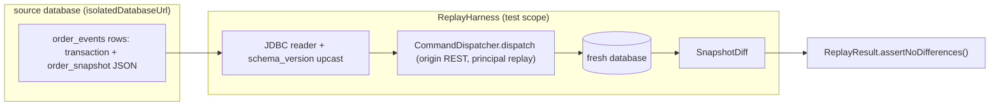

# Design — SPEC-0024: Build replay harness and load suite

> **Stage 2 of 3 — how.** Concrete enough that the plan can be written without re-reading the
> code, and checked line by line against the architecture policies.

## Context

Today the event log is written but never re-executed. `OrderEventAppender`
(oms-core/src/main/java/org/example/oms/service/OrderEventAppender.java) appends `OrderEvent` rows
whose `transaction` column holds the whole `Command` JSON and whose `order_snapshot` holds the
state the order was left in; `OrderReplayService` reads snapshots but nothing ever replays the
commands. Nothing in the read path version-checks the JSON: the columns are plain `jsonb` decoded
directly by Hibernate into the generated `Command` / `Order` models, which ignore unknown
properties — so a renamed field is silently lost (finding 8). The latest changelog is
`013-command-log.yaml`; `014-` is free.

On the performance side, oms-core already exposes SLA timers under `oms.order.*` (written by
`OrderSlaRecorder`, histogram + SLO buckets configured by `OmsConfig.orderSlaHistogramFilter`) on
`/actuator/prometheus`, and the exchange simulator counts acks/fills/rejects
(`SimulatorMetrics`). No harness drives them together and no baseline numbers are recorded
anywhere.

Test infrastructure that the harness follows: `AbstractKafkaPostgresIntegrationTest`
(oms-core/src/test/java/org/example/oms/integration/AbstractKafkaPostgresIntegrationTest.java)
starts one shared Postgres+Kafka container pair and, importantly, provides
`isolatedDatabaseUrl(name)` — a dedicated empty database in the same container that Liquibase
migrates. That is exactly the "fresh database" a replay needs, and the second-instance pattern
(`SecondInstance.java`, from SPEC-0048) shows how a second Spring context is started against it.

Knowledge base read: `oms-framework/oms-state-store.md` (event table = JSON events + snapshots),
`oms-framework/testing-patterns.md` (test tiers, fixture conventions). The closest existing
example this change follows: `OutboxHoldTwoInstanceIntegrationTest` (second context against an
isolated database) plus a pure diff component unit-tested on its own.

## Approach

Replay runner — **test scope in oms-core**, package `org.example.oms.replay` under
`src/test/java`:

1. `OrderSnapshotHistory` — the source history: every `order_events` row of the source database
   as (orderId, version, event, command as deserialised `Command`, resultingState,
   `order_snapshot` as deserialised `Order`), read with plain JDBC against the source
   `DataSource` in `id` order. Reading through JDBC keeps the harness independent of the ORM
   caching and works identically on a production dump.
2. `SnapshotDiff` — pure comparator over two histories keyed by (orderId, version). Reports
   `DiffItem(orderId, version, field, sourceValue, replayedValue)` for every field that differs
   (state, quantities, prices, txNr) plus orders/events missing on one side. Also an aggregate
   `DiffSummary` (count of differences, list of items). Known non-deterministic fields
   (`timeStamp`, SLA checkpoint instants, ids the sequence assigns) are excluded by name.
3. `ReplayHarness` — the runner. Given a source database and a target (fresh) database:
   - opens a second Spring context whose datasource is the target database (Liquibase migrates
     it) and which runs with `kafka.enabled=false`, so it has no listener and no relay (see
     Wiring below and "Changed during implementation");
   - deserialises each source row's `transaction` JSON; rows whose JSON has no `schema_version`
     are treated as version 1 per the upcasting rule and logged at WARN with the orderId and
     version (the rule itself is the documented one, see Knowledge Base Updates);
   - re-executes each command in `id` order through
     `CommandDispatcher.dispatch(command, origin)` — the same entry point REST, Kafka and the
     scheduler use, so the whole path (validation, state machine, task pipelines, event append)
     is exercised. The origin is built by the harness as source `REST` with principal `replay`
     (see "Changed during implementation"); a create command is pinned to the source row's
     orderId, which `AssignOrderIdTask` then keeps, so (orderId, version) keys line up;
   - reads the replayed `order_events` from the target database the same way; outbox rows
     produced during replay are ignored;
   - diffs source against replayed with `SnapshotDiff` and returns a `ReplayResult` (compared,
     differences, summary lines). `ReplayResult.assertNoDifferences()` throws an AssertionError
     listing the diff items — that is what turns replay into a test.

   Duplicate commands are refused by design (SPEC-0046's `uq_order_events_order_id_command_id`);
   the harness does not re-apply a command that was refused in the source history — the second+
   application of one command is not part of the recorded history, so it must not be part of the
   replay. (Changed during implementation: a refused command writes no event, so every recorded
   event is an applied command; the harness reports any replayed command that is not applied as
   a regression, `ReplayResult.notApplied`, rather than matching refusals.) Keeping the diff meaningful for
   accepted events.

4. `ReplayHarnessIntegrationTest` — its own Postgres container, Kafka off (replay needs no
   broker): the test context's database is the source, and each test replays into a fresh,
   empty database created in the same container. The source gets a scripted history through
   the real command path (`CommandDispatcher`, the entry point `CommandController` calls)
   covering create → accept → fills (multiple, split) → cancel; then the harness replays into
   the target and asserts zero differences. A second test tampers one source snapshot's
   quantity (a recorded history today's code no longer reproduces) and asserts the diff reports
   the differing (orderId, version, field) and the harness fails. A third nulls the source
   rows' `schema_version` (legacy shape) and asserts the replay succeeds with the WARN.

Component sketch:



Load suite — also test scope in oms-core, package `org.example.oms.load`:

- `LoadReport` — immutable record (orderCount, concurrency, fillSlices, durationSeconds,
  throughputPerSecond, latencyPercentiles p50/p95/p99 per SLA timer name) with
  `LoadReportWriter.write(report, Path)` producing the timestamped
  `oms-core/docs/load-baseline-<timestamp>.md` table. Writer unit-tested standalone.
- `LoadSuiteRunner` — a JUnit 5 test gated by
  `@EnabledIfEnvironmentVariable(named = "OMS_LOAD_SUITE", matches = "true")` that runs only on
  demand, never in CI or `gradlew check` gating: it requires a running stack (oms-core on 8090
  with the exchange simulator connected, i.e. the root docker compose), drives a scripted flow —
  N orders at C concurrency via `POST /api/command` — waits for the flow to drain (every order
  FILLED, CANCELLED or REJECTED), then reads the SLA timers' quantile gauges from
  `/actuator/prometheus` (`oms.order.*` timers configured by `OmsConfig.orderSlaHistogramFilter`)
  and writes the report via `LoadReportWriter`. Throughput is measured at the driver (commands
  completed / wall time).

Because the runner is gated and machine-dependent, AC-5 is proven in the test suite by the
`LoadReportWriter` unit test (report content contains throughput and the three percentiles), and
the gated run is exercised locally, with its output committed as the baseline document (AC-6).

## Contract Changes

None — no OpenAPI paths or Avro schema change (P-04). `schema_version` is a column of
`order_events` owned by oms-core, not part of any wire contract; the harness lives in test code
and adds no `CommandSource` value (that enum is published as `CommandSource` in
oms-query-api.yml, so a new value would be a contract change).

## Data & Persistence

New changelog `oms-core/src/main/resources/db/changelog/014-order-events-schema-version.yaml`
(next free number; no existing changeset edited), included from `db.changelog-master.yaml`:

```yaml
databaseChangeLog:
  # SPEC-0024: the command and snapshot JSON in order_events carry no schema version, so a
  # renamed field is lost silently on read (architecture review finding 8). New events store
  # ORDER_EVENT_SCHEMA_VERSION (1); a row without the column is treated as version 1 by the
  # upcasting rule documented in oms-knowledge-base/oms-framework/oms-state-store.md.
  - changeSet:
      id: 014-order-events-schema-version
      author: oms
      changes:
        - addColumn:
            tableName: order_events
            columns:
              - column: { name: schema_version, type: INTEGER }
      rollback:
        - dropColumn:
            tableName: order_events
            columnName: schema_version
```

- Nullable on purpose: existing rows stay unknown (they are version 1 by the rule); no backfill,
  so the changeset is instant on a table of any size.
- Entity: `OrderEvent` gains `private Integer schemaVersion;` (nullable, column
  `schema_version`). `ddl-auto: validate` requires the column to match;
  `LiquibaseMigrationIntegrationTest` covers the migration itself.
- Writer: `OrderEventAppender` sets
  `schemaVersion(OrderEventSchemaVersion.CURRENT)` on every appended event;
  `OrderEventSchemaVersion` is a constants holder in `org.example.oms.model`
  (`public static final int CURRENT = 1;`) — the one place that knows the current version.
- Concurrency: no new constraint interacts with `txNr` or `(order_id, version)`; P-08 unaffected.

## Events & Messaging

No new events, topics or outbox message shapes (P-05, P-06 unchanged) — the replay path goes
through `CommandDispatcher`, so every re-executed change appends through `OrderEventAppender`
into the *target* database's `order_events` and outbox as normal; consumer idempotency is
untouched (P-08). `CommandDispatch` / `CommandResult` gain nothing; command-log rows written
during replay carry source `REST` with principal `replay`, and exist only in the target database.

Wiring: the replay context is started with `kafka.enabled=false`, the application's default,
under which neither `CommandListener` nor `OutboxRelay` exists. This keeps replay from
draining the target's outbox or competing for consumer-group leadership while it runs, with no
production code besides the changelog, the entity and the appender.

## Domain, State & Orchestration

No state machine transition or task pipeline changes (P-10): replay re-executes the same
commands, so every state change goes through the existing validate → state machine → persist →
publish tasks. The replay origin is an ordinary `CommandOrigin` (its `receivedAt` feeds SLA
stamping and the command-log row exactly like the other origins). No API surface changes; RFC 7807 error mapping
is untouched (P-13). Refusals during replay: a source command that was refused wrote no event,
so it is not in the replayed history; a recorded (applied) command that the replay refuses or
fails on is reported as not applied and fails the replay.

## Alternatives & Decisions

- **Replay through `CommandDispatcher` vs re-appending events directly.** Chosen dispatch — it
  exercises the whole command path (validation, state machine, pipelines, event append), which is
  the behaviour that must be reproduced. Re-appending stored events or copying snapshots would
  test only the copying and prove nothing about the path. Rejected.
- **Second Spring context vs raw JDBC replay.** Chosen a second context (pattern inherited from
  `SecondInstance`, SPEC-0048): the command path needs the whole application. A pure-JDBC
  reimplementation of the path would be a second implementation to keep in sync. Rejected.
- **`schema_version` in the wire contracts vs a database column.** Chosen the database column —
  the versioned artefact is the stored JSON, which exists nowhere on the wire and is not an Avro
  or OpenAPI concern; adding it to the contracts would churn every consumer for no read-side
  benefit. (Also why P-01/P-02 are n/a for contracts.)
- **Upcasting via an explicit version ladder in code now vs documenting the rule first.** Chosen
  documenting first with version 1 as the only version: there is nothing to upcast yet, and the
  golden fixtures lock the decode. The ladder appears with the first version bump; over-building
  now is speculative generality. Rejected.
- **Load suite as a new module / Gatling-JMeter-k6** vs a gated test in oms-core. Chosen the
  gated test — zero new dependencies (P-17); the driver is a few hundred lines over an existing
  REST API and the existing Prometheus text endpoint. A load framework would add a runtime and a
  DSL for a baseline that one scripted flow measures just as well. Rejected.
- **Load suite in the exchange simulator module.** Considered, rejected: the load generator is a
  *client of* the OMS command API and a reader of OMS metrics — an oms-core test concern; the
  simulator participates unchanged. Ticket modules therefore narrow to
  `oms-core, oms-knowledge-base` (`spec set` runs with this design).
- **Changed during implementation: no `CommandSource.REPLAY`.** The design added one, assuming
  it stayed inside `command_log`. It does not: `CommandLogEntryDtoMapper` maps the enum onto
  `CommandSource` in oms-query-api.yml (`[REST, KAFKA, SCHEDULER]`), so a new value would be a
  contract change, which this ticket rules out. The harness builds
  `new CommandOrigin(CommandSource.REST, "replay", now)` in test code instead: the principal
  marks the replay, and those rows exist only in a replay target database.
- **Changed during implementation: no `outbox.relay.enabled` property.** The target context runs
  with `kafka.enabled=false`, the application's default, under which `CommandListener` and
  `OutboxRelay` are not created at all, so a new switch would duplicate one that exists. T-5
  becomes the test-side target starter; the production change shrinks to the changelog, the
  entity and the appender.
- **Changed during implementation: replayed creates keep the source orderId.** `AssignOrderIdTask`
  draws a random id, so a replayed create would get a new one and no (orderId, version) key would
  match. The harness sets the source row's orderId on the create command's order; the task skips
  orders that already carry one, so the rest of the path is unchanged.
- **Changed during implementation: one decoder for the stored JSON.** The fixtures are rows in
  column shape (`order_id`, `transaction`, `order_snapshot`, optional `schema_version`), and
  `StoredEventDecoder` (test scope, `org.example.oms.replay`) applies the upcasting rule for both
  the fixture test and the harness's JDBC reader, so the rule lives in one place.
- **Changed during implementation: the replay IT runs without Kafka** on its own Postgres
  container rather than extending `AbstractKafkaPostgresIntegrationTest`: replay needs no
  broker, and an own container gives source and target databases nothing else writes to. The
  divergence test tampers a source snapshot instead of seeding the target, since a seeded
  target row would collide with the replayed create rather than show a diff.

- **Changed during implementation: percentiles from histogram buckets.** The design said the
  runner reads the SLA timers' "quantile gauges". `orderSlaHistogramFilter` configures
  `percentilesHistogram` and SLO buckets, not client-side percentiles, so `/actuator/prometheus`
  exposes `_bucket` series and no quantiles. The runner scrapes before and after the run and
  interpolates p50/p95/p99 from the bucket deltas the way `histogram_quantile` does, so only
  this run's traffic counts and production metric config stays untouched. Throughput counts
  REST creates plus the delta of `oms_commands_consumed_total{outcome="applied"}`.

## Risks & Mitigations

- **Replay divergence from non-determinism** (timestamps, generated ids, SLA stamps): the diff
  compares identity, state, quantities, prices and version — not `timeStamp`, SLA checkpoint
  instants or sequence-assigned ids. `SnapshotDiff` excludes these by an explicit, documented
  name list; if a regression later hides there, the ticket that introduces it widens the
  assertion.
- **Replay context competing with the source context** (Kafka group leadership, outbox drains):
  both isolated databases plus listener/relay disabled at start-up (Wiring); the base class's
  isolated-database mechanism already isolates advisory locks and leadership.
- **Command JSON semantics moving under us** (a later ticket changes the model): that is exactly
  what `schema_version` is for; the golden-file test fails first and the upcast is added with it.
- **Load numbers are machine-dependent**: the report carries configuration beside the numbers, so
  a baseline is only compared against runs of the same shape on the same host — stated in the
  baseline document itself.
- **Gated test silently never runs**: `LiquibaseMigrationIntegrationTest` and the unit tests run
  in CI regardless; the gated runner is exercised once locally and in the verify stage, with its
  output committed as evidence.

## Test Strategy

| AC | Level (unit / web-mvc / integration / e2e) | Test class#method | What it asserts |
|---|---|---|---|
| AC-1 | integration | `ReplayHarnessIntegrationTest#replaysCommandHistoryIntoFreshDatabaseWithZeroDifferences` | create → accept → fills → cancel history replayed; every (orderId, version) snapshot identical; `assertNoDifferences()` passes |
| AC-2 | unit | `SnapshotDiffTest#reportsEachDifferingVersionAndField` | deviating quantity/state at one version yields a diff item naming orderId, version and field; missing-side rows are reported |
| AC-2 | integration | `ReplayHarnessIntegrationTest#failsWithDiffWhenReplayDiverges` | a seeded deviation makes `assertNoDifferences()` throw, listing the diff; the replay is reported failed |
| AC-3 | integration | `ReplayHarnessIntegrationTest#replaysLegacyRowsWithoutSchemaVersionAndWarns` | source seeded with legacy JSON (no `schema_version`) replays; the harness logs a warning naming the orders treated as legacy |
| AC-4 | unit | `OrderEventSchemaVersionTest#readsLegacyFixtureAsVersionOneAndDecodesCommand` | each golden fixture under `src/test/resources/fixtures/order-events/` decodes to the current `Command`/`Order` model with `schemaVersion` treated as 1, type and orderId as in the fixture |
| AC-4 | unit | `OrderEventSchemaVersionTest#legacyFixtureLosesNoFieldOnRead` | every field and value of each fixture survives decode and re-encode, so a renamed or dropped model field fails the test (review finding 1) |
| AC-5 | unit | `LoadReportWriterTest#writesThroughputAndLatencyPercentilesToFile` | given measurements, the written report contains throughput (commands/s) and p50/p95/p99 per SLA timer plus the run configuration |
| AC-5 | unit | `PrometheusSnapshotTest#interpolatesQuantilesFromThisRunsBucketDeltas` | p50/p95/p99 come from this run's histogram bucket deltas, interpolated as `histogram_quantile` does; no observations means no quantile |
| AC-5 | integration (gated by `OMS_LOAD_SUITE=true`) | `LoadSuiteRunnerTest#runsScriptedFlowAndWritesReport` | the gated run against a live stack produces the report file; exercised locally, output committed as evidence |
| AC-6 | verify-stage evidence | committed `oms-core/docs/load-baseline-<date>.md` | document states the configuration plus measured throughput and percentiles; checked in the verify stage |

## Policy Compliance

| Policy | Title | Status | How / Justification |
|---|---|---|---|
| P-01 | Contracts live only in oms-contracts | comply | no OpenAPI or Avro change at all; `schema_version` is an oms-core database column |
| P-02 | Specification before code, generated models only | comply | no model change; nothing hand-written into `org.example.common.model.*` |
| P-03 | Never edit generated code | comply | nothing under `build/generated` touched |
| P-04 | Contracts evolve compatibly | n/a | no contract change |
| P-05 | Every state change is recorded in the event log | comply | replay re-executes commands through the dispatcher, so every replayed change appends through `OrderEventAppender`; the harness's snapshot diff checks exactly that log |
| P-06 | Kafka only through the transactional outbox | comply | no publish path added; the replay context's relay is disabled, nothing publishes directly |
| P-07 | Schema changes through new Liquibase changesets | comply | new `014-order-events-schema-version.yaml` with rollback; no existing changeset edited; entity updated to match (`ddl-auto: validate`) |
| P-08 | Concurrency and idempotency are explicit | comply | no concurrency semantics change; replay refuses duplicates exactly like the live path (unique `(order_id, command_id)`), asserted by the harness |
| P-09 | Commands and queries stay separate | comply | the harness writes only through the command path; no query API touch |
| P-10 | State transitions go through the state machine and task pipeline | comply | replay uses the same dispatcher and processors; no new transition or task |
| P-11 | Layering and conventions | comply | test code follows the module layout (`org.example.oms.replay`, `org.example.oms.load`); plain records, constructor injection |
| P-12 | Jackson 3 only | comply | fixture decode uses the project's Jackson 3 mapper (`tools.jackson.*`) |
| P-13 | Errors and validation follow the framework specs | comply | no new API errors; harness failure is a test assertion, not an API response |
| P-14 | Test first, every acceptance criterion is proven by an automated test | comply | every AC above maps to a named test; tests are written before their task is ticked |
| P-15 | Observability | comply | the harness logs replay progress and legacy warnings with orderId/version; the load suite reads the existing SLA timers rather than adding a parallel measurement |
| P-16 | Security | comply | no secrets; the gated runner is configured by environment variables, never credentials in code |
| P-17 | Simplicity and dependencies | comply | no new library or module; harness and load suite are test-scope code over existing APIs (alternatives recorded above) |
| P-18 | Modules build standalone | comply | only oms-core changes; `./gradlew check` in oms-core alone must pass; knowledge-base verify is empty |
| P-19 | Documentation follows behaviour | comply | Knowledge Base Updates below are planned tasks in this ticket, not an afterthought |

## Knowledge Base Updates

- `oms-framework/oms-state-store.md` — new section: event JSON schema versioning and the
  upcasting rule (missing `schema_version` ⇒ version 1; upcasts v1→vN are pure, ordered
  transformations documented per version; fixtures protect them).
- `oms-framework/testing-patterns.md` — new section: the replay harness (what it proves, how to
  run it against a dump) and golden-file fixtures of legacy events.
- `oms-concepts/exchange-simulator.md` — new section: the load suite (the gated runner, what it
  measures, the committed baseline document and how to compare runs).
