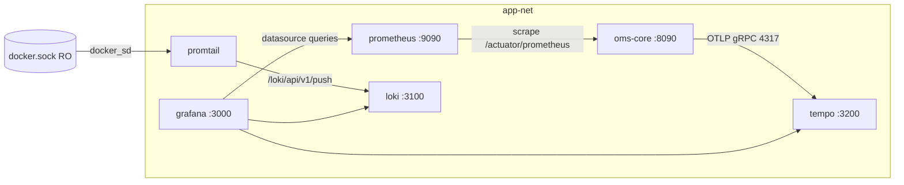

# Design — SPEC-0031: Add Grafana LGTM stack to docker-compose

> **Stage 2 of 3 — how.** Concrete enough that the plan can be written without re-reading the
> code, and checked line by line against the architecture policies. Write "None — <reason>" for a
> section that genuinely does not apply.

## Context

The observability legs of the stack are decorative today (`docker-compose.yml:230-262`):

- `prometheus` (v3.13.2) runs and is on `app-net`, but `oms-core/prometheus.yml` scrapes
  `app:8090`, a hostname that does not exist on `app-net` — the service is named `oms-core`
  (`docker-compose.yml:3`). It collects nothing but itself.
- `grafana` (13.1.3) runs with `GF_SECURITY_ADMIN_PASSWORD` default `secret`, no provisioning
  mounts. Bare install: no datasources.
- `loki` (3.7.6) bind-mounts `./oms-core/loki-config.yml` — which exists only as an
  **empty directory** Docker created because the bind source was missing. Loki falls back to
  baked-in defaults. No `networks:`, so it is on the compose default network, unreachable from
  `grafana` (which is on `app-net`).
- `promtail` (3.6.11) bind-mounts `./oms-core/promtail-config.yml`, also an empty directory.
  No `networks:`. It has nothing to scrape and no reachable Loki.
- `tempo` does not exist. Traces go to Jaeger (UI `:16686`, OTLP gRPC host `:4317`,
  `COLLECTOR_OTLP_ENABLED=true`), configured via `oms-core` env `TRACING_URL: http://jaeger:4317`
  (`docker-compose.yml:14`, an in-network override of `oms-core/.env`).

This is the repo's own finding F4 with enablers E1/E5/E7
(`mission-control/docs/architecture/mission-control-v2.md:131,137-138,691,693,697`), and
`NFR-007` marks observability "partial". The LGTM house defaults are Prometheus `9090`,
Grafana `3000`, Loki `3100` (`developer-cockpit/src/shared/types/config.ts:80-82`).

**What this ticket does not touch:** `oms-core/.env`, the `jaeger` service, any Java/Gradle build,
any OpenAPI/Avro contract, any `oms-*` code. Everything is compose + config files + one script.
Closest existing examples followed: `qdrant` in `docker-compose.yml` (pinned image,
`container_name`, explicit `networks:`, named volume, `restart: unless-stopped`),
`oms-core/prometheus.yml` (config bind-mounted from `oms-core/`),
`order-generator.ipynb` (`oms-core/scripts/` for repo scripts).

Framework specs read: none of `domain-model`, `state-machine`, `task-orchestration`,
`state-query-store`, `openapi-contracts`, `validation-rules` apply — no application code changes.

## Approach

"LGTM" = **L**oki (logs) + **G**rafana (visualisation) + **T**empo (traces), with the already-pinned
Prometheus as the metrics backend. Pieces:



1. **Config files become real.** `oms-core/loki-config.yml` and `oms-core/promtail-config.yml`
   (replacing the empty directories), new `oms-core/tempo-config.yml`, new
   `oms-core/grafana/provisioning/datasources/oms.yml`.
2. **docker-compose.yml.** `loki`, `promtail`: add `app-net`, `command:` (both images default to a
   config path that does not match our mount), data volumes, `restart: unless-stopped`.
   New `tempo` service, host port `3200` only (in-network `:4317` for OTLP; Jaeger already owns
   host `4317`). `grafana` gains the provisioning mount.
   `oms-core` env override `TRACING_URL` → `http://tempo:4317`.
   *(Implementation note: the named `loki-storage`/`tempo-storage` volumes from the first draft were
   dropped — see Risks.)*
3. **`oms-core/prometheus.yml`:** scrape target `app:8090` → `oms-core:8090` (repair, not new scope).
4. **Smoke-test script** `oms-core/scripts/lgtm-smoke-test.ps1` — the automated proof for every AC.
5. **Docs:** `CLAUDE.md` monitoring section, `architecture/system-context.md`, `NFR-007`.

### Files

**`oms-core/loki-config.yml`** (single-binary local dev, TSDB schema v13, filesystem storage):

```yaml
auth_enabled: false

server:
  http_listen_port: 3100

common:
  instance_addr: 127.0.0.1
  path_prefix: /loki
  storage:
    filesystem:
      chunks_directory: /loki/chunks
      rules_directory: /loki/rules
  replication_factor: 1
  ring:
    kvstore:
      store: inmemory

schema_config:
  configs:
    - from: 2024-01-01
      store: tsdb
      object_store: filesystem
      schema: v13
      index:
        prefix: index_
        period: 24h

storage_config:
  tsdb_shipper:
    active_index_directory: /loki/tsdb-index
    cache_location: /loki/tsdb-cache

limits_config:
  # 7d rename usage keeps local disk small; structured metadata off (label-values check uses plain labels)
  retention_period: 168h
  allow_structured_metadata: false

compactor:
  retention_enabled: true
```

All `/loki/...` paths are Loki's default container-local paths (anonymous volume), matching
upstream's single-node local config. `auth_enabled: false` stays as the compose service already
implies — this is local dev behind unpublished-to-the-internet ports (`3100` was already published
before this ticket). A named volume is unnecessary for a dev stack that can be recreated.

**`oms-core/promtail-config.yml`** (Docker SD, pushes to Loki over `app-net`):

```yaml
server:
  http_listen_port: 9080

positions:
  filename: /tmp/positions.yaml

clients:
  - url: http://loki:3100/loki/api/v1/push

scrape_configs:
  - job_name: docker
    docker_sd_configs:
      - host: unix:///var/run/docker.sock
        refresh_interval: 15s
        filters:
          - name: label
            values: ["com.docker.compose.service"]
    relabel_configs:
      - source_labels: ["__meta_docker_container_label_com_docker_compose_service"]
        target_label: compose_service
      - source_labels: ["__meta_docker_container_id"]
        target_label: docker_container_id
      - source_labels: ["__meta_docker_container_log_stream"]
        target_label: stream
      - source_labels: ["__meta_docker_container_name"]
        target_label: docker_name
      - source_labels: ["__meta_docker_container_image"]
        target_label: docker_image
      - action: labeldrop
        regex: "__meta_docker_container_label_(.?)+"
```

`docker_sd` reads logs through the daemon socket (no `/var/lib/docker` mount), and the label
filter restricts scraping to this compose project's services (`com.docker.compose.service` is set
by Compose on every service container) so an operator's unrelated containers are not shipped.
`/var/run/docker.sock` is mounted read-only.

**`oms-core/tempo-config.yml`** (local backend, OTLP receiver, reporting off):

```yaml
server:
  http_listen_port: 3200

distributor:
  receivers:
    otlp:
      protocols:
        grpc:
          endpoint: 0.0.0.0:4317
        http:
          endpoint: 0.0.0.0:4313

storage:
  trace:
    backend: local
    local:
      path: /tmp/tempo/blocks
    wal:
      path: /tmp/tempo/wal
    block:
      bloom_filter_false_positive: .05

usage_report:
  reporting_enabled: false
```

Traces are accepted in-network on `tempo:4317` (host port 4317 stays Jaeger's — no collision).

**`oms-core/grafana/provisioning/datasources/oms.yml`**:

```yaml
apiVersion: 1

datasources:
  - name: Prometheus
    uid: oms-prometheus
    type: prometheus
    access: proxy
    url: http://prometheus:9090
    isDefault: true
    editable: false
    jsonData:
      httpMethod: POST
      timeInterval: 15s
  - name: Loki
    uid: oms-loki
    type: loki
    access: proxy
    url: http://loki:3100
    editable: false
  - name: Tempo
    uid: oms-tempo
    type: tempo
    access: proxy
    url: http://tempo:3200
    editable: false
```

Datasources only (dashboards are a later ticket). In-network URLs (`prometheus`, `loki`,
`tempo`) match AC-3. Grafana provisioning `/etc/grafana/provisioning` default directory is where
the UI-less install looks.

**`docker-compose.yml` changed services** (network `app-net`; new volumes under `volumes:`):

```yaml
  loki:
    image: grafana/loki:3.7.6
    container_name: loki
    command: -config.file=/etc/loki/loki-config.yaml
    ports:
      - 3100:3100
    volumes:
      - ./oms-core/loki-config.yml:/etc/loki/loki-config.yaml
    networks:
      - app-net
    restart: unless-stopped

  promtail:
    image: grafana/promtail:3.6.11
    container_name: promtail
    command: -config.file=/etc/promtail/promtail-config.yaml
    volumes:
      - ./oms-core/promtail-config.yml:/etc/promtail/promtail-config.yaml
      - /var/run/docker.sock:/var/run/docker.sock:ro
    networks:
      - app-net
    restart: unless-stopped

  tempo:
    image: grafana/tempo:2.10.10
    container_name: tempo
    command: -config.file=/etc/tempo/tempo-config.yaml
    ports:
      - "3200:3200"
    volumes:
      - ./oms-core/tempo-config.yml:/etc/tempo/tempo-config.yaml
    networks:
      - app-net
    restart: unless-stopped
```

`grafana` gains `- ./oms-core/grafana/provisioning:/etc/grafana/provisioning:ro`.
`oms-core.environment` gains the tracing override change:
`TRACING_URL: http://tempo:4317` (replacing `http://jaeger:4317`; the `jaeger` service stays).

**`oms-core/prometheus.yml`** corrected job:

```yaml
  - job_name: 'oms'
    metrics_path: '/actuator/prometheus'
    scrape_interval: 15s
    static_configs:
      - targets: ['oms-core:8090']
```

**`oms-core/scripts/lgtm-smoke-test.ps1`** — param `-AdminPassword secret` (matching the
`GF_SECURITY_ADMIN_PASSWORD` default), steps in this order:

1. `AC-1 Check-Config` — `docker compose config --quiet` exit 0; `Test-Path` file (not container)
   and non-empty length for the 4 config.yml/yaml/provisioning paths;
   `docker compose run --rm --no-deps prometheus promtool check config /etc/prometheus/prometheus.yml`,
   `docker compose run --rm --no-deps loki -config.file=/etc/loki/loki-config.yaml -verify-config`,
   `docker compose run --rm --no-deps tempo -config.file=/etc/tempo/tempo-config.yaml -config.verify`
   — both upstream validation flags accepted; if a flag turns out not to exist, that check falls
   back to "container starts" in step 2 (see Alternatives).
2. `AC-2 Wait-StackHealthy` — `docker compose up -d grafana prometheus loki promtail tempo postgres oms-core`,
   requiring `postgres`+`oms-core` (AC-4..AC-6 need the app). Poll up to 60s:
   `docker compose ps --status running` reports running state for the 5 LGTM services AND
   `docker compose ps --status restarting` lists none of them.
   Docker Desktop on Windows: the `/var/run/docker.sock` bind exists.
3. `AC-3 Check-GrafanaDatasources` — `Invoke-RestMethod http://localhost:3000/api/datasources`
   with basic auth `admin`/`secret`: `type` in {prometheus, loki, tempo} and `url` values
   {http://prometheus:9090, http://loki:3100, http://tempo:3200} (AC-3's URLs are echoed back as
   provisioned; Grafana returns the config).
4. `AC-4 Check-PrometheusTarget` — `GET http://localhost:9090/api/v1/targets?state=active`:
   `data.activeTargets[]` with `scrapeUrl` `http://oms-core:8090/actuator/prometheus` has `health == "up"`
   (retry ≤ 60s, the job scrapes every 15s).
5. `AC-5 Check-LokiLabels` — `GET http://localhost:3100/loki/api/v1/label/compose_service/values`:
   values include `oms-core` (retry ≤ 60s from the moment AC-2 finished).
6. `AC-6 Check-Tempo` — `GET http://localhost:3200/ready` (retry ≤ 60s) then plain-string contains
   `"status: ready"` (this endpoint answers "ready"); `docker compose exec -T oms-core printenv TRACING_URL`
   → `http://tempo:4317`.
7. Print PASS/FAIL per AC and exit non-zero on any FAIL.

The checks are idempotent — rerunning is safe; no stack teardown is performed by the script
(keeps it non-destructive).

## Contract Changes

None — this ticket changes no OpenAPI path or Avro schema. `oms-contracts/src/main/openapi/`
and `src/main/avro/` are untouched (P-01/P-04 trivially hold).

## Data & Persistence

None — no database changes, no Liquibase changelog, no `orders`/`order_events`/`outbox` changes.
**Data & Persistence.** None — no database changes, no Liquibase changelog, no
`orders`/`order_events`/`outbox` changes. *(Implementation note: the first draft added named
volumes `loki-storage`/`tempo-storage`, dropped during implementation because (a) Tempo's
image-owned `/var/tempo` layout is the upstream convention and bind-mounting over `/tmp/tempo`
made the container fail with root-owned-volume permission errors, and (b) Loki's default
`/loki` container paths with an anonymous volume match upstream's local single-node example —
a dev stack that can be recreated does not need named persistence. Both decisions were verified by
the smoke test's `up -d` + health check. The only named volume kept is the pre-existing
`grafana-storage`.)* `positions.filename: /tmp/positions.yaml` inside the promtail container
is ephemeral by design (dev): a recreated promtail re-reads using `docker_sd` since-refresh state;
log dedup across restarts is not a dev-stack requirement.

## Events & Messaging

None — no new entries in `order_events`, no `outbox` messages, no new/changed Kafka topics
(P-05/P-06 untouched). Prometheus→oms-core scrape, promtail→Loki push, and oms-core→Tempo OTLP
export use the app's existing endpoints; the OTLP path already exists in production form
(`TRACE` to Jaeger) and merely changes destination host in the compose env override.

## Domain, State & Orchestration

None — no state machine transitions, task pipeline steps, validation rules or error responses
change. No application code changes at all.

## Alternatives & Decisions

**Metrics backend: Prometheus, not Mimir.** Prometheus is already pinned and running in the
stack (`prom/prometheus:v3.13.2`) and is the standard Grafana local-dev metrics source. Mimir
would add a whole horizontally-scalable store for a single-node dev compose; rejected (P-17 simplicity).

**Traces: add Tempo beside Jaeger, not instead of it.** Goal asks for LGTM, whose T is Tempo.
Alternative rejected: point Grafana at Jaeger's own datasource type — Grafana has no Jaeger
datasource option today; Jaeger-query-as-_trace backend in Grafana is unsupported without the
deprecated Tempo conversion. Jaeger is left in place because `oms-core/.env` (host-native
`bootRun` dev flow) still defaults `TRACING_URL=http://localhost:4317` and other tickets may use
the Jaeger UI. The compose-only `oms-core` env override for the container flow changes to
`http://tempo:4317` so container traces land in Tempo→Grafana (AC-6), and host `4317` stays with
Jaeger so both flows coexist on one host.

**New pinned image: `grafana/tempo:2.10.10`** (latest stable 2.x). This is the one new
dependency (first new component); recorded per P-17. Loki stays `grafana/loki:3.7.6`
and Grafana `grafana/grafana:13.1.3`, Promtail `grafana/promtail:3.6.11` — already pinned in
compose; keep their existing pins (R10 rule expects no unnecessary upgrades).

**Promtail scraping: `docker_sd` over `/var/run/docker.sock`, not log-file mounts.** Alternative
(mounting `/var/lib/docker/containers` with `static_configs` on host paths) rejected: Docker
Desktop mounts use VM-internal paths; the daemon socket is the stable cross-platform way and
gives `compose_service` labels without template guessing.

**Grafana tempo host port 3200:** standard Grafana-LGTM convention for Tempo. Note
`mission-control/docs/architecture/mission-control-v2.md` (F5) reserves host 3200 for the Mission
Control server it wants to move there; that is a different repo's future plan (service not
deployed on this host today), and the first 60s probe `docker ps` shows nothing on 3200. If both
ever run on one host, one bind changes (infra-only change).

**Smoke-test script vs JUnit test.** All 6 ACs are infra-level
(compose/host-port/HTTP-observable), not `JUnit`-testable in `oms-core`. A repeatable
`lgtm-smoke-test.ps1` (matching the SPEC-0001 "manual docker-compose smoke run as recorded
evidence" precedent) is the automated test. Testcontainers covers app integration, not
"my compose observability stack boots".

## Risks & Mitigations

| Risk | Mitigation |
|---|---|
| Docker Desktop (Windows) bind of `/var/run/docker.sock` may behave differently from Linux | Mount is `:ro`; if docker_sd connectivity fails, `Wait-StackHealthy` passes but `Check-LokiLabels` fails loudly on AC-5; fallback would be `static_configs` with `\\.\pipe\docker_engine` path — resolve at implementation if hit |
| Promtail label name mangling across versions (`__meta_docker_container_label_...` snake-casing) | Verify with `docker compose exec promtail wget -qO- localhost:9080/metrics` grep `promtail_custom` counters during smoke test; relabel keys chosen to match current 3.6.11 docs |
| Loki `bloom_filter_false_positive` folded from companion docs — if rejected at config load, Loki exits and AC-2 fails | Loki `-verify-config` runs file validity in AC-1 before any `up -d`; drop minor unsupported keys rather than widen scope |
| Tempo 2.x needs additional keys on some configs (e.g. `multicopter…`) for `local` backend removed by default | `tempo -config.verify` in AC-1; a default-good local config keeps the write-ASCII surface minimal |
| Port 3200 may be taken by a future Mission Control service on the same host (F5 plan) | Not deployed now (probe); if it never fits, reinstall tempo bind under an alternate host port, grafana datasource uses in-network URL so it's unaffected |
| `docker compose ps --status restarting` wording varies with Compose v2/v5 | Script uses `ps --status running` count + explicit `restarting` as distinct status (Compose v5.6.1 on this host supports both filters) |

## Test Strategy

Test layout: all checks are in `oms-core/scripts/lgtm-smoke-test.ps1`, functions per check;
running it is the verify action (`node specs/tools/spec.mjs verify` runs it as part of the
specific test command in the gate; the ticket verification.md cites its output).

| AC | Level (unit / web-mvc / integration / e2e) | Test class#method | What it asserts |
|---|---|---|--- |
| AC-1 | integration | `oms-core/scripts/lgtm-smoke-test.ps1#Check-Config` | `docker compose config --quiet` exits 0; the 4 bind-mounted config paths exist as **files** with non-empty content; promtool/loki `-verify-config`, tempo `-config.verify` and promtail `-check-syntax` parse them; grafana provisioning `oms.yml` has the required provisioning structure (root mapping, `apiVersion`, `datasources`, the three datasources) — its ingestion by Grafana is proven behaviourally by AC-3 |
| AC-2 | e2e | `...ps1#Wait-StackHealthy` | `docker compose up -d` of prometheus, grafana, loki, promtail, tempo, postgres, oms-core exits 0; for 60s (5s probes) `docker compose ps` lists the five LGTM services running with none restarting; `docker compose exec -T promtail/loki` runs the service's own binary (`-check-syntax` / `-verify-config`) on the mounted config inside the running containers — presence AND YAML validity, stronger than `cat` (minimal images ship no coreutils) |
| AC-3 | e2e | `...ps1#Check-GrafanaDatasources` | `GET :3000/api/datasources` (basic auth admin/secret) yields datasources of types prometheus/loki/tempo with URLs http://prometheus:9090, http://loki:3100, http://tempo:3200 |
| AC-4 | e2e | `...ps1#Check-PrometheusTarget` | `GET :9090/api/v1/targets` shows target `oms-core:8090` (job `oms`, path `/actuator/prometheus`) with `health=up` within 60s |
| AC-5 | integration | `...ps1#Check-LokiLabels` | `GET :3100/loki/api/v1/label/compose_service/values` includes `oms-core` within 60s of stack healthy |
| AC-6 | e2e | `...ps1#Check-Tempo` | `GET :3200/ready` reports ready; `docker compose exec -T oms-core printenv TRACING_URL` prints `http://tempo:4317` |

## Policy Compliance

| Policy | Title | Status | How / Justification |
|---|---|---|---|
| P-01 | Contracts live only in oms-contracts | n/a | No contract files touched; no `src/main/openapi` or `avro` folders created anywhere else |
| P-02 | Specification before code, generated models only | n/a | No generated models; new YAML configs are here because docker-compose bind-mounts these exact paths (they are the deploy spec for an infra component) |
| P-03 | Never edit generated code | n/a | Nothing generated is touched |
| P-04 | Contracts evolve compatibly | n/a | No OpenAPI/Avro changes |
| P-05 | Every state change is recorded in the event log | n/a | No order state changes |
| P-06 | Kafka only through the transactional outbox | n/a | No new Kafka producers; scrape vs push log paths only |
| P-07 | Schema changes through new Liquibase changesets | n/a | No DB schema changes |
| P-08 | Concurrency and idempotency are explicit | n/a | No shared mutable state; LGTM services are single-node, `restart: unless-stopped` makes liveness explicit |
| P-09 | Commands and queries stay separate | n/a | No new endpoints |
| P-10 | State transitions go through the state machine and task pipeline | n/a | No state machine changes |
| P-11 | Layering and conventions | comply | Configs live under `oms-core/` at the paths compose already mounts; script under `oms-core/scripts/` with the existing scripts; no Java code so no layer changes |
| P-12 | Jackson 3 only | n/a | No Java/serialization changes |
| P-13 | Errors and validation follow the framework specs | n/a | No request processing or error responses changed |
| P-14 | Test first, every acceptance criterion is proven by an automated test | comply | `lgtm-smoke-test.ps1` is written alongside the configs and maps 1:1 to AC-1..6 (Test Strategy); run before verify gate, test functions are the JUnit-of-this-change |
| P-15 | Observability | comply | This ticket builds the observability pipeline itself: promtail→Loki ships logs (verified by AC-5), Tempo path whitelisted in AC-6; no app logging changes needed |
| P-16 | Security | comply | No secrets in code/config: Grafana admin password stays an env var default; docker.sock read-only; Loki/Grafana ports are local dev only; no credentials added |
| P-17 | Simplicity and dependencies | comply | One new pin (tempo 2.10.10) + LOKI/LOKI paths in existing pinned versions, decision recorded above; dashboards, Mimir, OTel collector, Alloy, Jaeger removal all rejected/deferred |
| P-18 | Modules build standalone | n/a | No Gradle/build change; `oms-core` builds unchanged. Smoke script uses docker, not a module build |
| P-19 | Documentation follows behaviour | comply | `CLAUDE.md` §Monitoring, `architecture/system-context.md`, `NFR-007-observability.md` updated in this ticket |

## Knowledge Base Updates

- `oms-knowledge-base/architecture/system-context.md` — observability components row gains Tempo (`:3200`) and notes the fixed Prometheus→`oms-core:8090` scrape and promtail→Loki flow being live.
- `oms-knowledge-base/non-functional-requirements/NFR-007-observability.md` — `implementation` note now points at Tempo in-gstack (Grafana/Loki/Tempo reachable), not Jaeger-only; implementer checks if partial→partial-with-verified-presence.
- `CLAUDE.md` §Monitoring — add Grafana `3000`, Loki `3100`, Tempo `3200`, promtail flow; state Prometheus now scrapes `oms-core:8090`.
