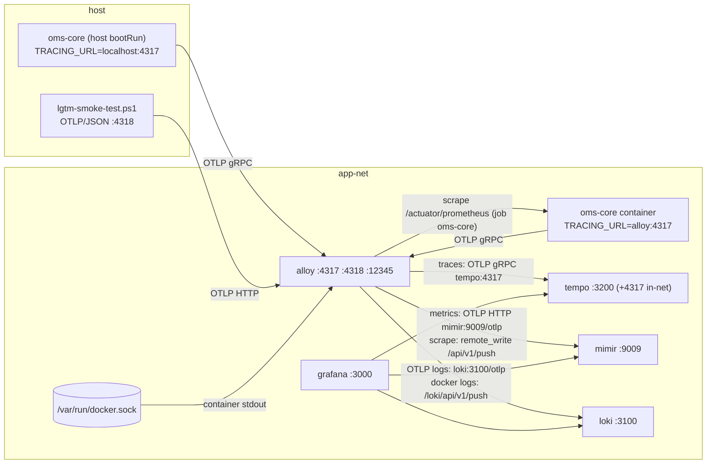

# Design — SPEC-0032: Migrate LGTM stack to Alloy, Mimir, Tempo 3

> **Stage 2 of 3 — how.** Concrete enough that the plan can be written without re-reading the
> code, and checked line by line against the architecture policies. Write "None — <reason>" for a
> section that genuinely does not apply.

## Context

The local observability stack is the SPEC-0031 setup in the root `docker-compose.yml`:

| Service | Image today | Config (bind-mounted) | Host ports |
|---|---|---|---|
| `grafana` | `grafana/grafana:13.1.3` | `oms-core/grafana/provisioning/` → `/etc/grafana/provisioning:ro` | 3000 |
| `loki` | `grafana/loki:3.7.6` | `oms-core/loki-config.yml` → `/etc/loki/loki-config.yaml` | 3100 |
| `tempo` | `grafana/tempo:2.10.10` | `oms-core/tempo-config.yml` → `/etc/tempo/tempo-config.yaml` | 3200 |
| `promtail` | `grafana/promtail:3.6.11` | `oms-core/promtail-config.yml` + `/var/run/docker.sock:ro` | — |
| `prometheus` | `prom/prometheus:v3.13.2` | `oms-core/prometheus.yml` (scrapes `oms-core:8090/actuator/prometheus`, job `oms`) | 9090 |
| `jaeger` | `jaegertracing/jaeger:2.20.0` | — | 16686, **4317** |

- Grafana provisioning `oms-core/grafana/provisioning/datasources/oms.yml` declares `Prometheus`
  (uid `oms-prometheus`, default), `Loki` (`oms-loki`), `Tempo` (`oms-tempo`), with no correlations.
- Compose `oms-core` sets `TRACING_URL: http://tempo:4317`. `oms-core/.env` (host-native
  `bootRun`) keeps `TRACING_URL=http://localhost:4317`, which is Jaeger's host port.
- Loki runs `allow_structured_metadata: false`, so its native OTLP endpoint (`/otlp/v1/logs`)
  cannot be used as it stands.
- `oms-core/scripts/lgtm-smoke-test.ps1` is SPEC-0031's AC proof. It has one PowerShell function
  per AC, uses `Wait-Until` polling and `Add-Result`, and exits 0 only when every AC passes.

**Closest existing example:** SPEC-0031 (`specs/changes/SPEC-0031-add-grafana-lgtm-stack-to-docker-compose`).
It is the same kind of change: compose services, bind-mounted configs under `oms-core/`, and a
PowerShell smoke test as the automated AC proof. This design is a sibling of it, and the new
smoke test keeps its structure and file path.

**Spikes done at design (2026-10-31, throwaway containers, images already pulled):**
- `grafana/tempo:3.1.1` single binary accepts the current `tempo-config.yml` unchanged
  (`-config.verify=true`). It is `/ready` in under 3 s, takes an OTLP/HTTP span, and serves it
  from `/api/v2/traces/<id>` within 3 s. **No Kafka needed** in single-binary mode; it warns only
  that metrics-generator is off.
- `grafana/mimir:3.2.4` with `target: all`, filesystem storage and replication factor 1 is
  `/ready` after about 36 s (ring warm-up). Native OTLP push to `/otlp/v1/metrics` returns 200
  and the series can be queried at `/prometheus/api/v1/query`. **Mimir 3 keeps the OTLP metric
  name as sent and adds no `_total` suffix**, so AC-8 posts the literal name
  `spec0032_smoke_total` and queries that same name.
- `grafana/loki:3.7.9` with `allow_structured_metadata: true` takes OTLP logs on `/otlp/v1/logs`
  (204). The record is returned by `query_range` with `{service_name="spec0032-smoke"} |= "<body>"`.
- `grafana/alloy:v1.21.3`: the draft config below passes `alloy validate`. `alloy convert
  --source-format=promtail` on the current Promtail config gives the `discovery.docker` /
  `discovery.relabel` / `loki.source.docker` blocks reused here.

Knowledge base read: `non-functional-requirements/NFR-007-observability.md`,
`architecture/system-context.md`. The framework specs (`domain-model_spec.md`,
`state-machine-framework_spec.md`, etc.) do not apply, because nothing in this ticket touches
domain code.

## Approach

Replace the three obsolete services with one telemetry agent, **Alloy**, and one metrics store,
**Mimir**. Upgrade Tempo, Loki and Grafana. Rewire Grafana and the compose `oms-core` env. All
changes are compose plus configuration; no Java and no Gradle.



Each What Changes bullet, and where it happens:

| Proposal bullet | Where |
|---|---|
| Remove `promtail`, `prometheus`, `jaeger` and their configs | `docker-compose.yml` (delete 3 services); delete `oms-core/promtail-config.yml` and `oms-core/prometheus.yml` |
| New `alloy` (OTLP 4317/4318, → Tempo/Mimir/Loki, Docker log tailing, actuator scrape) | `docker-compose.yml` service `alloy`; new `oms-core/alloy-config.alloy` |
| New `mimir` (monolithic, filesystem, host 9009) | `docker-compose.yml` service `mimir`; new `oms-core/mimir-config.yml` |
| Tempo 3; Loki and Grafana latest | `docker-compose.yml` image pins; `oms-core/tempo-config.yml` (comments, in-network HTTP receiver port); `oms-core/loki-config.yml` (`allow_structured_metadata: true`) |
| Grafana `Prometheus` → `Mimir` datasource, trace→log/metric links | `oms-core/grafana/provisioning/datasources/oms.yml` |
| Compose `oms-core` `TRACING_URL=http://alloy:4317`, sampling 1.0 | `docker-compose.yml` `oms-core.environment` |
| Smoke test and docs | `oms-core/scripts/lgtm-smoke-test.ps1` (rewritten for SPEC-0032 ACs); `CLAUDE.md`, `NFR-007`, `system-context.md`, `oms-core/src/main/resources/readme.txt` |

### `docker-compose.yml`, observability section after the change

```yaml
  oms-core:
    environment:
      # ...
      # Compose-only overrides: container telemetry goes to the Alloy agent (SPEC-0032),
      # which forwards traces to Tempo. Host-native bootRun keeps oms-core/.env's
      # localhost:4317, which is now also Alloy's host port. Sample every local request.
      TRACING_URL: http://alloy:4317
      MANAGEMENT_TRACING_SAMPLING_PROBABILITY: "1.0"
      TRACING_ENABLED: ${TRACING_ENABLED:-true}

  grafana:
    image: grafana/grafana:13.3.0          # was 13.1.3; rest unchanged
  loki:
    image: grafana/loki:3.7.9              # was 3.7.6; rest unchanged

  # Telemetry agent of the LGTM stack (SPEC-0032): OTLP in on 4317/4318 (host and
  # in-network), container log tailing over the Docker socket (Promtail's successor),
  # oms-core actuator scrape. Forwards traces→Tempo, metrics→Mimir, logs→Loki.
  alloy:
    image: grafana/alloy:v1.21.3
    container_name: alloy
    command:
      - run
      - /etc/alloy/config.alloy
      - --server.http.listen-addr=0.0.0.0:12345   # default 127.0.0.1 would hide /-/ready from the host
      - --storage.path=/var/lib/alloy/data
    ports:
      - "4317:4317"     # OTLP gRPC (was jaeger)
      - "4318:4318"     # OTLP HTTP
      - "12345:12345"   # Alloy UI / readiness
    volumes:
      - ./oms-core/alloy-config.alloy:/etc/alloy/config.alloy:ro
      - /var/run/docker.sock:/var/run/docker.sock:ro
    depends_on:
      - loki
      - tempo
      - mimir
    networks:
      - app-net
    restart: unless-stopped

  # Metrics store of the LGTM stack (SPEC-0032): Mimir monolithic, filesystem storage,
  # classic ingester path (no Kafka ingest storage). Prometheus API under /prometheus.
  mimir:
    image: grafana/mimir:3.2.4
    container_name: mimir
    command: -config.file=/etc/mimir/mimir-config.yaml
    ports:
      - "9009:9009"
    volumes:
      - ./oms-core/mimir-config.yml:/etc/mimir/mimir-config.yaml:ro
    networks:
      - app-net
    restart: unless-stopped

  # Trace backend (SPEC-0031, Tempo 3 since SPEC-0032). OTLP only in-network, from Alloy.
  tempo:
    image: grafana/tempo:3.1.1             # was 2.10.10; rest unchanged
```

The `jaeger`, `prometheus` and `promtail` service blocks are deleted. No new named volumes: Mimir,
Loki and Tempo keep data in the container filesystem, as Loki and Tempo already do, so data
survives `restart` but not `down`. That is acceptable for a dev stack.

### `oms-core/alloy-config.alloy` (new; draft validated with `alloy validate`)

```alloy
// Grafana Alloy — the single telemetry agent of the OMS LGTM stack (SPEC-0032).
// Bind-mounted by docker-compose.yml at /etc/alloy/config.alloy.

// ---- OTLP in: host and in-network 4317 (gRPC) / 4318 (HTTP) ----
otelcol.receiver.otlp "default" {
	grpc { endpoint = "0.0.0.0:4317" }
	http { endpoint = "0.0.0.0:4318" }
	output {
		metrics = [otelcol.processor.batch.default.input]
		logs    = [otelcol.processor.batch.default.input]
		traces  = [otelcol.processor.batch.default.input]
	}
}

otelcol.processor.batch "default" {
	output {
		metrics = [otelcol.exporter.otlphttp.mimir.input]
		logs    = [otelcol.exporter.otlphttp.loki.input]
		traces  = [otelcol.exporter.otlp.tempo.input]
	}
}

otelcol.exporter.otlp "tempo" {
	client {
		endpoint = "tempo:4317"
		tls { insecure = true }
	}
}

otelcol.exporter.otlphttp "mimir" {
	client { endpoint = "http://mimir:9009/otlp" }
}

otelcol.exporter.otlphttp "loki" {
	client { endpoint = "http://loki:3100/otlp" }
}

// ---- oms-core actuator scrape; removed by SPEC-0033 once the app pushes OTLP ----
prometheus.scrape "oms_core" {
	job_name        = "oms-core"
	targets         = [{"__address__" = "oms-core:8090"}]
	metrics_path    = "/actuator/prometheus"
	scrape_interval = "15s"
	forward_to      = [prometheus.remote_write.mimir.receiver]
}

prometheus.remote_write "mimir" {
	endpoint { url = "http://mimir:9009/api/v1/push" }
}

// ---- container logs of this compose project (Promtail's former job) ----
discovery.docker "compose" {
	host             = "unix:///var/run/docker.sock"
	refresh_interval = "15s"
	filter {
		name   = "label"
		values = ["com.docker.compose.service"]
	}
}

discovery.relabel "compose" {
	targets = []
	rule {
		source_labels = ["__meta_docker_container_label_com_docker_compose_service"]
		target_label  = "compose_service"
	}
	rule {
		source_labels = ["__meta_docker_container_log_stream"]
		target_label  = "stream"
	}
	rule {
		source_labels = ["__meta_docker_container_name"]
		target_label  = "docker_name"
	}
}

loki.source.docker "compose" {
	host          = "unix:///var/run/docker.sock"
	targets       = discovery.docker.compose.targets
	relabel_rules = discovery.relabel.compose.rules
	forward_to    = [loki.write.default.receiver]
}

loki.write "default" {
	endpoint { url = "http://loki:3100/loki/api/v1/push" }
}
```

The implementer runs `alloy fmt` on it, which expands the one-line blocks. The Promtail labels
`docker_container_id` and `docker_image` are dropped. Nothing queries them, and they only add
stream cardinality; `compose_service`, `stream` and `docker_name` stay.

### `oms-core/mimir-config.yml` (new; spiked)

```yaml
# Mimir — metrics store of the OMS LGTM stack (SPEC-0032), monolithic single node.
# Bind-mounted by docker-compose.yml at /etc/mimir/mimir-config.yaml.
target: all
multitenancy_enabled: false     # tenant "anonymous"; no X-Scope-OrgID needed
server:
  http_listen_port: 9009
  log_level: warn
common:
  storage:
    backend: filesystem
    filesystem:
      dir: /data/mimir
blocks_storage:
  storage_prefix: blocks
  tsdb:
    dir: /data/tsdb
ingester:
  ring:
    replication_factor: 1
store_gateway:
  sharding_ring:
    replication_factor: 1
usage_stats:
  enabled: false
```

### `oms-core/tempo-config.yml` (changed)

Header comment updated (Tempo 3.1.1, SPEC-0032; traces arrive from Alloy). The in-network OTLP
HTTP receiver moves from the unusual `4313` to the standard `4318`, and gRPC stays on `4317`.
Neither is published to the host. Everything else stays as it is: the spike proved Tempo 3.1.1
accepts the config as is.

### `oms-core/loki-config.yml` (changed)

`limits_config.allow_structured_metadata: true` (needed for `/otlp/v1/logs`). The header comment
names SPEC-0032 and the Alloy push paths. Schema v13/tsdb is unchanged, so existing local data
stays readable.

### `oms-core/grafana/provisioning/datasources/oms.yml` (changed)

```yaml
apiVersion: 1

# The SPEC-0031 Prometheus datasource is persisted in the grafana-storage volume;
# removing it from this file alone would leave it behind (AC-3 requires exactly three).
deleteDatasources:
  - name: Prometheus
    orgId: 1

datasources:
  - name: Mimir
    uid: oms-mimir
    type: prometheus
    access: proxy
    url: http://mimir:9009/prometheus
    isDefault: true
    editable: false
    jsonData:
      httpMethod: POST
      timeInterval: 15s
      prometheusType: Mimir
  - name: Loki
    uid: oms-loki
    type: loki
    access: proxy
    url: http://loki:3100
    editable: false
  - name: Tempo
    uid: oms-tempo
    type: tempo
    access: proxy
    url: http://tempo:3200
    editable: false
    jsonData:
      tracesToLogsV2:
        datasourceUid: oms-loki
        spanStartTimeShift: -5m
        spanEndTimeShift: 5m
        filterByTraceID: true
        tags:
          - key: service.name
            value: service_name
      tracesToMetrics:
        datasourceUid: oms-mimir
        spanStartTimeShift: -5m
        spanEndTimeShift: 5m
        tags:
          - key: service.name
            value: job
      serviceMap:
        datasourceUid: oms-mimir
      nodeGraph:
        enabled: true
```

### Smoke test `oms-core/scripts/lgtm-smoke-test.ps1` (rewritten)

Same path, so the `CLAUDE.md` reference stays valid, and the same helpers (`Add-Result`,
`Wait-Until`, splatted native args, PS 5.1-safe JSONL parsing). The functions are re-cut to
SPEC-0032 AC-1..AC-8 (see Test Strategy). Two additions:

- **Orphan cleanup before AC-2** (`Remove-ObsoleteContainers`). Containers left from removed
  services keep running as compose orphans; a leftover `jaeger` would hold host 4317 and stop
  `alloy` from starting. The script removes containers labelled
  `com.docker.compose.project=<project>` with `com.docker.compose.service` in
  {`promtail`, `prometheus`, `jaeger`} (`docker ps -aq --filter label=… | docker rm -f`). It then
  runs the AC-2 command exactly as written. The docs give developers the one-time equivalent:
  `docker compose up -d --remove-orphans`.
- **Freshness**: SPEC-0031's Promtail already wrote `compose_service=oms-core` into Loki, so the
  label-values check alone could pass on old data. *Changed during implementation (spec-reviewer
  finding):* passing `start=` to `/loki/api/v1/label/compose_service/values` does not work, because
  Loki ignores it there (verified live). AC-5 therefore also writes a unique marker to oms-core's
  container stdout (`docker compose exec -T oms-core sh -c "echo <marker> > /proc/1/fd/1"`) after
  the Promtail containers are removed. It then requires `query_range {compose_service="oms-core"}
  |= "<marker>"` to return that exact line, which only Alloy can have shipped.
  AC-4's `up{job="oms-core"}` cannot be satisfied by old data: Mimir is new and Prometheus used
  job `oms`.

## Contract Changes

None. No OpenAPI or Avro file is touched. The only interface change is the local-dev port layout
(BREAKING for local dev, stated in the proposal): Jaeger UI `:16686` and Prometheus `:9090` go
away; OTLP `:4317` moves from Jaeger to Alloy with the same protocol, so clients change nothing;
`:4318`, `:9009` and `:12345` are new.

## Data & Persistence

None in Postgres: no entity, no Liquibase changelog. Local dev telemetry: Prometheus and Jaeger
data is dropped with their services. Existing Loki data stays readable (schema unchanged). Tempo 3
reads the same local block path; if a Tempo 2 block were unreadable, deleting the container is
the documented remedy (dev data only). The Grafana `grafana-storage` volume is kept, and the old
datasource is removed through `deleteDatasources`.

## Events & Messaging

None. No `order_events`, outbox or Kafka change. Telemetry transport (OTLP, Loki push, remote
write) is outside the domain messaging policies.

## Domain, State & Orchestration

None. No state machine, task pipeline or validation change.

## Alternatives & Decisions

**Telemetry agent: Grafana Alloy (`grafana/alloy:v1.21.3`), not `otel/opentelemetry-collector-contrib`
plus a log shipper.** Alloy embeds the OTel Collector components (`otelcol.*`) for OTLP in and out,
and it is Promtail's official successor (`loki.source.docker`, and `alloy convert` turns the
existing Promtail config into Alloy syntax). One container does the work of Promtail, Prometheus's
scrape and Jaeger's OTLP receiver. The vanilla collector would need its own `docker_stats`/filelog
setup, which does not read Docker Desktop's VM-internal log paths cleanly, or a second container.
Rejected for P-17. Swapping later only means replacing the agent; the backends and the OTLP ports
stay.

**Metrics store: Grafana Mimir 3.2.4, monolithic, filesystem, classic ingesters.** This is the
requester's decision and reverses SPEC-0031's Prometheus choice. Kafka ingest storage, object
storage (MinIO) and multi-tenancy were rejected: none is needed for a single-node dev stack, and
the spike shows Mimir 3 runs without them.

**Metrics paths into Mimir.** OTLP metrics go through Alloy `otelcol.exporter.otlphttp` to Mimir's
native `/otlp` endpoint. The actuator scrape goes through `prometheus.scrape` →
`prometheus.remote_write` to `/api/v1/push`. Rejected: converting OTLP to Prometheus inside Alloy
(`otelcol.exporter.prometheus`). It adds a translation step whose naming rules differ from
Mimir's, and Mimir's native OTLP keeps names as sent (spike).

**Logs paths into Loki.** OTLP logs go to Loki's native `/otlp` (needs
`allow_structured_metadata: true`). Docker logs go to `/loki/api/v1/push`. Rejected:
`otelcol.exporter.loki` (OTLP → Loki push conversion). Grafana deprecates it in favour of native
OTLP ingestion.

**Tempo 3 single binary keeps the SPEC-0031 config.** Rejected: adopting Tempo 3's Kafka-backed
ingest architecture (no Kafka path for observability; P-17). The metrics-generator (span metrics,
service graphs) stays off. The Grafana `serviceMap` link is configured but stays empty until a
later ticket enables it.

**Ports.** Alloy takes 4317 and 4318 (OTLP defaults, so `oms-core/.env` is unchanged) and 12345 (its
default UI port), bound to `0.0.0.0` with `--server.http.listen-addr` for AC-2. Mimir uses 9009.
Port 9090 is freed. Rejected: keeping Tempo's OTLP on the host. That would give two OTLP entry
points again.

**Smoke test replaces, not extends, the SPEC-0031 script.** The SPEC-0031 ACs check Prometheus
and Promtail, which no longer exist. The file path stays (it is referenced from `CLAUDE.md`), and
the header and summary name SPEC-0032 AC-1..AC-8. As in SPEC-0031, all ACs are compose-level and
HTTP-observable, so a JUnit/Testcontainers test in `oms-core` would test the wrong thing.

**AC-8 metric name.** The script posts a monotonic sum named literally `spec0032_smoke_total`
(with `startTimeUnixNano`) and queries `spec0032_smoke_total`. The spike showed Mimir 3 adds no
suffix. Alternative rejected: posting `spec0032_smoke` and relying on suffix translation, which
is version-dependent.

**Changed during implementation (spec-reviewer findings):** AC-8's metric data point carries a
random `run_id` attribute, and the query is `spec0032_smoke_total{run_id="<id>"}`. Without it, an
earlier run's sample inside Mimir's 5-minute lookback could satisfy the check. AC-2 also requires
`RestartCount` = 0 for the five containers, because a `State` snapshot can miss a crash loop. The
AC-5 change is described under Approach → Freshness.

**No new named volumes** (see Approach). Rejected: a `mimir-storage` volume. Loki and Tempo have
none either, and the stack is dev-only.

**Dependency / build changes (P-17):** two new pinned images (`grafana/alloy:v1.21.3`,
`grafana/mimir:3.2.4`); three removed (`promtail`, `prometheus`, `jaeger`); three bumped (Tempo
2.10.10 → 3.1.1, Loki 3.7.6 → 3.7.9, Grafana 13.1.3 → 13.3.0). No Gradle or npm change.

## Risks & Mitigations

| Risk | Mitigation |
|---|---|
| Leftover `jaeger` / `promtail` / `prometheus` containers (compose orphans) block host 4317 or keep shipping duplicate logs | Smoke test removes them before AC-2; docs give `docker compose up -d --remove-orphans` as the one-time migration step |
| `loki.source.docker` over `/var/run/docker.sock` on Docker Desktop for Windows | Same socket mount Promtail uses today, and it works on this host; AC-5 fails loudly if not |
| Mimir ring warm-up (~36 s in the spike) makes AC-2/AC-4 flaky | AC-2 polls `/ready` for up to 90 s; AC-4 polls for 90 s after that |
| Grafana keeps the old `Prometheus` datasource from the `grafana-storage` volume, so AC-3 "exactly three" fails | `deleteDatasources` entry in provisioning; AC-3 asserts the exact set |
| Tempo datasource health check in Grafana 13.3 fails on an empty Tempo | AC-3 polls up to 60 s; AC-6 runs after AC-3 in the script only for ordering, and if health needs data the order flips (AC-6 first). Decided at implement, recorded in Notes |
| Tempo 3 cannot read SPEC-0031 Tempo 2 local blocks | Dev data only; `docker compose rm -sf tempo` and up again (documented in readme.txt) |
| OTLP name or label translation differs from the spike (Loki `service_name`, Mimir `job`) | Spike used the exact target versions; the smoke test queries by `service_name="spec0032-smoke"` (Loki) and by metric name (Mimir) |
| `developer-cockpit` / `mission-control` defaults still point at `localhost:9090` | Out of scope (proposal); listed as a follow-up |

## Test Strategy

As in SPEC-0031, every AC is proven by a function in `oms-core/scripts/lgtm-smoke-test.ps1`, run
with `powershell -File oms-core/scripts/lgtm-smoke-test.ps1`. Exit 0 only when every AC passes.
The script is written first and run red against the current stack (T-1), then turned green.

| AC | Level (unit / web-mvc / integration / e2e) | Test class#method | What it asserts |
|---|---|---|---|
| AC-1 | integration | `oms-core/scripts/lgtm-smoke-test.ps1#Check-Config` | `docker compose config --format json` exits 0; services include alloy, mimir, tempo, loki, grafana and exclude promtail, prometheus, jaeger; each image tag parses as a version ≥ the AC minimum (alloy v1.21.3, mimir 3.2.4, tempo 3.1.1, loki 3.7.9, grafana 13.3.0; no `latest`); `oms-core/promtail-config.yml` and `oms-core/prometheus.yml` do not exist; config sanity: `alloy validate`, `loki -verify-config`, `tempo -config.verify=true` on the mounted files |
| AC-2 | e2e | `…ps1#Remove-ObsoleteContainers` then `#Wait-StackHealthy` | after orphan cleanup, `docker compose up -d grafana loki tempo mimir alloy` exits 0; within 90 s (5 s probes) all five are `running` with none `restarting`, and `:3100/ready`, `:3200/ready`, `:9009/ready`, `:12345/-/ready` each return 200 |
| AC-3 | e2e | `…ps1#Check-GrafanaDatasources` | `GET :3000/api/datasources` (admin/secret) returns exactly {Mimir/prometheus/`http://mimir:9009/prometheus`, Loki/`http://loki:3100`, Tempo/`http://tempo:3200`}; `GET /api/datasources/uid/<uid>/health` returns `status: OK` for each |
| AC-4 | e2e | `…ps1#Check-MimirScrape` | after `docker compose up -d postgres oms-core`, `GET :9009/prometheus/api/v1/query?query=up{job="oms-core"}` returns a sample with value `1` within 90 s |
| AC-5 | e2e | `…ps1#Check-LokiLabels` | `GET :3100/loki/api/v1/label/compose_service/values` includes `oms-core` within 90 s, **and** a unique marker written to oms-core's container stdout after Promtail's removal is returned by `query_range` within 90 s (Promtail's old data cannot satisfy it) |
| AC-6 | e2e | `…ps1#Check-HostTracePath` | a span with a random 16-byte trace id posted as OTLP/JSON to `http://localhost:4318/v1/traces` returns 200; `GET :3200/api/v2/traces/<traceId>` returns 200 within 60 s |
| AC-7 | e2e | `…ps1#Check-CoreTracingEnv` | `docker compose exec -T oms-core printenv TRACING_URL` prints `http://alloy:4317` and `printenv MANAGEMENT_TRACING_SAMPLING_PROBABILITY` prints `1.0` |
| AC-8 | e2e | `…ps1#Check-OtlpLogsAndMetrics` | an OTLP/JSON log (service `spec0032-smoke`, unique body) posted to `:4318/v1/logs` and a monotonic sum `spec0032_smoke_total` posted to `:4318/v1/metrics` both return 200; within 90 s Loki `query_range` `{service_name="spec0032-smoke"} \|= "<body>"` returns the line and Mimir `query=spec0032_smoke_total` returns a sample |

The `oms-core` module verify (`./gradlew check`) also runs in `spec verify`. It is unaffected
(no Java change) and must stay green.

## Policy Compliance

| Policy | Title | Status | How / Justification |
|---|---|---|---|
| P-01 | Contracts live only in oms-contracts | n/a | No contract files touched; no `src/main/openapi` or `src/main/avro` created |
| P-02 | Specification before code, generated models only | n/a | No API or message change; the compose file and bind-mounted configs are the deployment spec for infra components |
| P-03 | Never edit generated code | n/a | Nothing generated is touched |
| P-04 | Contracts evolve compatibly | n/a | No OpenAPI/Avro changes; the local-dev port break is marked BREAKING in the proposal with the affected parties |
| P-05 | Every state change is recorded in the event log | n/a | No order state changes |
| P-06 | Kafka only through the transactional outbox | n/a | No Kafka producer or topic change; Tempo and Mimir run without Kafka ingest |
| P-07 | Schema changes through new Liquibase changesets | n/a | No DB schema change |
| P-08 | Concurrency and idempotency are explicit | n/a | No order or command processing touched |
| P-09 | Commands and queries stay separate | n/a | No endpoints added or changed |
| P-10 | State transitions go through the state machine and task pipeline | n/a | No state machine or pipeline change |
| P-11 | Layering and conventions | comply | Follows the SPEC-0031 layout: configs as `oms-core/<component>-config.*` bind-mounted from the root compose, provisioning under `oms-core/grafana/provisioning`, smoke test at the existing `oms-core/scripts/lgtm-smoke-test.ps1` with the same helpers; no Java |
| P-12 | Jackson 3 only | n/a | No Java/serialization change |
| P-13 | Errors and validation follow the framework specs | n/a | No request handling or error responses changed |
| P-14 | Test first, every acceptance criterion is proven by an automated test | comply | Smoke test rewritten first and run red (T-1); one function per AC (Test Strategy), exit 0 only when AC-1..AC-8 all pass |
| P-15 | Observability | comply | This ticket is the observability transport: one OTLP entry point for traces, metrics and logs, container logs to Loki, actuator metrics to Mimir, sampling 1.0 locally; trace propagation in app code is unchanged and SPEC-0033's job |
| P-16 | Security | comply | No secrets added; the Grafana password stays `${GF_SECURITY_ADMIN_PASSWORD:-secret}`; docker.sock mounted `:ro` (as Promtail had); Mimir multitenancy off and all ports local-dev only |
| P-17 | Simplicity and dependencies | comply | Net one fewer container (−3, +2); new images Alloy and Mimir and the bumps recorded in Alternatives & Decisions with rejected options; no new volumes, no Kafka/object storage, no dashboards |
| P-18 | Modules build standalone | n/a | No Gradle or source change in any module; `oms-core ./gradlew check` still runs in `spec verify` |
| P-19 | Documentation follows behaviour | comply | `NFR-007` and `system-context.md` updated (below), plus `CLAUDE.md` §Monitoring and `oms-core/src/main/resources/readme.txt` |

## Knowledge Base Updates

- `oms-knowledge-base/non-functional-requirements/NFR-007-observability.md`: `target` and the table
  row describe the stack as Grafana :3000 (Mimir/Loki/Tempo datasources with trace→log/metric
  links), Mimir :9009, Loki :3100, Tempo 3 :3200, and Alloy (OTLP :4317/:4318, Docker logs,
  oms-core scrape). The Jaeger and Prometheus mentions are removed. `resources` swaps
  `promtail-config.yml` for `alloy-config.alloy` and adds `mimir-config.yml`. The verification
  note points at the SPEC-0032 smoke test and says that oms-core span emission is pending
  SPEC-0033.
- `oms-knowledge-base/architecture/system-context.md`: the infrastructure paragraph (lines 44–48)
  is rewritten to match the new stack. Prometheus, Promtail and Jaeger are removed, and it states
  that host-native and container apps both send OTLP to Alloy.
- Outside the KB, in the same ticket: `CLAUDE.md` §Monitoring (Grafana, Mimir :9009, Loki, Tempo,
  Alloy :4317/:4318/:12345; Jaeger and Prometheus lines removed; smoke test reference kept);
  `oms-core/src/main/resources/readme.txt` (drop the jaeger and prometheus entries, add mimir and
  alloy, compose `TRACING_URL=http://alloy:4317`, the one-time `--remove-orphans` step).
