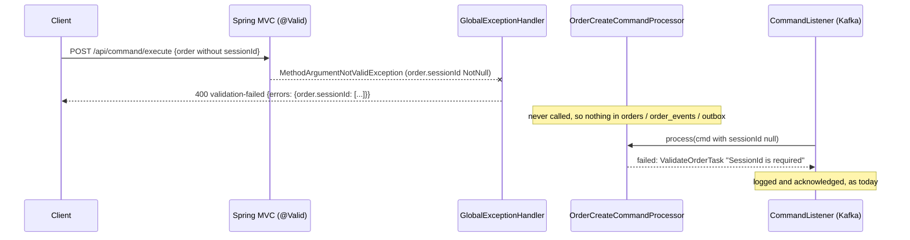

# Design — SPEC-0034: Require sessionId in the order create contract

> **Stage 2 of 3 — how.** Concrete enough that the plan can be written without re-reading the
> code, and checked line by line against the architecture policies. Write "None — <reason>" for a
> section that genuinely does not apply.

## Context

- **Contract.** `oms-contracts/src/main/openapi/oms-cmd-api.yml`, `components.schemas.Order`
  (around line 170). It requires `clOrdId, account, ordType, side, symbol, orderQty`. `sessionId`
  is a plain optional `string`. `Order` is referenced only by `OrderCreateCmd.order`, so no other
  command is affected. `info.version` is `1.0.0`.
- **Generated model.** `oms-contracts` generates `org.example.common.model.cmd.Order` with the
  `spring` generator. Required fields get `@NotNull` (plus `@Size(min = 1)` from `minLength`).
  They also become parameters of the required-args constructor
  `Order(clOrdId, account, orderQty, ordType, side, symbol)`. No production or test code calls
  that constructor; they use the builder or the no-args constructor.
  `OrderCreateCmd.getOrder()` is `@NotNull @Valid`, so bean validation cascades into the order.
- **HTTP path.** `CommandController.executeCommand(@Valid Command command)`
  (`oms-core/.../api/CommandController.java:72`).
  - Today a body without `sessionId` passes bean validation. `OrderCreateCommandProcessor` then runs
    `ValidateOrderTask`, which fails with "SessionId is required". The controller turns that into
    `400` with a `CommandResult{id:"", status:FAILED, message:"Order creation failed: SessionId is required"}`.
  - A body without a field that is *already* contract-required (e.g. `symbol`) fails bean
    validation instead. `GlobalExceptionHandler` extends `ResponseEntityExceptionHandler` but does
    not override `handleMethodArgumentNotValid`, so the client gets Spring's default `ProblemDetail`
    ("Invalid request content."), which does not name the field.
- **Kafka path.** `CommandListener.handleOrderCreate`
  (`oms-core/.../config/CommandListener.java:119`) converts the Avro
  `msg.OrderCreateCmd` to the cmd model and calls the same processor. No bean validation runs on
  this path, so `ValidateOrderTask` is the check, and a rejection is logged and acknowledged
  (not retried, not sent to the DLT). Avro `Order.sessionId` is `["null","string"]`, default
  `null`.
- **Framework specs read.**
  - `oms-framework/error-handling.md` defines the validation error format: `handleValidation`,
    `type urn:oms:error:validation-failed`, title "Validation Failed", `errors` map field →
    messages, `errorCode OMS-VAL-002`.
  - `oms-framework/validation-rules.md` §Required fields.
  - `oms-framework/openapi-contracts.md`.
- **Developer cockpit.**
  - `ApiCatalogService` loads the real contract.
  - `renderer/lib/api-schema.ts` `buildTemplate`/`checkBody` are schema-driven. They fill every
    `required` property (a placeholder for `minLength > 0` strings) and report
    `required property is missing` / `shorter than 1 character`. No cockpit source change is needed.
  - Tests that read the real contract (`ApiCatalogService.test.ts`, `api-schema.test.ts`,
    `api-templates.test.ts`) use `arrayContaining`, so they keep passing.
- **Closest existing examples.**
  - `clOrdId` in the same schema (required + `minLength: 1`) is the model for the contract change.
  - `GlobalExceptionHandler`'s existing handlers are the model for the new validation handler.
  - `CommandControllerWebMvcTest` and `OrderLifecycleIntegrationTest` (MockMvc + Testcontainers +
    repositories) are the models for the tests.

## Approach

1. **Contract.** Add `sessionId` to `Order.required`, add `minLength: 1`, and bump `info.version`
   to `2.0.0`. Regenerate (`cd oms-contracts && ./gradlew build`).
2. **oms-core error body (P-13).** Override `handleMethodArgumentNotValid` in
   `GlobalExceptionHandler` to return the format from `error-handling.md`:
   - status 400;
   - `type urn:oms:error:validation-failed`, title `Validation Failed`;
   - detail `Validation failed for one or more fields`;
   - properties `timestamp`, `errorCode: OMS-VAL-002`, and `errors: {<field path>: [<message>…]}`.

   For a missing session the key is `order.sessionId`. This override is required, not an
   `@ExceptionHandler(MethodArgumentNotValidException.class)`: the base class already maps that
   exception, and a second mapping is ambiguous at startup.

   It changes the body, but not the status, for every bean-validation 400 on the command API.
   That is the intended unification.
3. **Fix what breaks.** `CommandControllerWebMvcTest#executeCommand_withOrderCreateCmd_returnsCreated`
   posts an order without `sessionId`, so it now gets 400. Add `"sessionId":"S1"` to its body.
   No other Java producer omits it. The examples are already compliant:
   - cockpit `api-templates/orders.http`;
   - oms-core `rest.http`;
   - the `CommandController` `@ExampleObject`;
   - `ExchangeWorkflowIntegrationTest`, `EventSourcingIntegrationTest`, the order-generator
     notebook.

   AC-7 adds tests so they stay that way.
4. **Kafka path.** No code change. `ValidateOrderTask` keeps its `sessionId` rule, because it is
   the only guard on the Kafka path and for whitespace-only values.
5. **Cockpit.** No source change. Tests pin the new behaviour (AC-1, AC-6, AC-7).
6. **Docs.** See Knowledge Base Updates.



Mapping of the What-Changes bullets:

| Proposal bullet | Where |
|---|---|
| Contract required + minLength + 2.0.0 | `oms-cmd-api.yml` |
| 400 with validation body naming `sessionId` | `GlobalExceptionHandler#handleMethodArgumentNotValid` |
| Cockpit builds and checks `order.sessionId` | no change; driven by the contract, pinned by tests |
| KB states the rule | see Knowledge Base Updates |

## Contract Changes

`oms-contracts/src/main/openapi/oms-cmd-api.yml`:

```yaml
info:
  title: Digital Assets OMS Command API
  version: 2.0.0            # was 1.0.0 — Order.sessionId became required (SPEC-0034)
...
    Order:
      type: object
      required:
        - clOrdId
        - sessionId         # new
        - account
        - ordType
        - side
        - symbol
        - orderQty
      properties:
        ...
        sessionId:
          type: string
          description: Trading session identifier; with clOrdId it identifies a client order
          minLength: 1      # new
```

- **Compatibility (P-04): BREAKING.** The request schema is narrowed, so a body that used to be
  contract-valid no longer is.
  - The version is bumped and the consumers are listed in the proposal: developer-cockpit and the
    Swagger UI.
  - Wire behaviour is unchanged for working clients, because oms-core already rejected these
    requests.
- **Generated classes that change:** `org.example.common.model.cmd.Order`.
  - `getSessionId()` gains `@NotNull @Size(min = 1)` and loses `@Nullable`.
  - The required-args constructor gains a `String sessionId` parameter. It has no callers.
- **Avro: none.** `Order.avsc`, `CommandMessage.avsc` and `OrderMessage.avsc` are untouched, and
  so are the compat baselines in `oms-contracts/src/test/resources/compat/`.

## Data & Persistence

None. The `orders.session_id` column, the `(session_id, cl_ord_id)` duplicate check and the
entities are unchanged. There is no changelog.

## Events & Messaging

None. A rejected HTTP request never reaches the processor, so nothing is appended to
`order_events` or staged in the outbox. That is the same outcome as today, where the processor
fails in validation before persisting. The commands topic schema and the listener's
reject-and-acknowledge behaviour are unchanged.

## Domain, State & Orchestration

- No state machine or pipeline change. `ValidateOrderTask` keeps its `sessionId` rule (Kafka path,
  blank values).
- Error response (P-13): on the HTTP path, a missing or empty `sessionId` now produces:

  ```json
  {
    "type": "urn:oms:error:validation-failed",
    "title": "Validation Failed",
    "status": 400,
    "detail": "Validation failed for one or more fields",
    "instance": "/api/command/execute",
    "timestamp": "…",
    "errorCode": "OMS-VAL-002",
    "errors": { "order.sessionId": ["must not be null"] }
  }
  ```

  For `""` the message is the `@Size` one ("size must be between 1 and …").
- The handler logs at `warn` with the field names only (not values), consistent with the other
  handlers.

## Alternatives & Decisions

- **Decision: require the field in the contract.** Alternative: default `sessionId` in oms-core.
  Rejected by the requester. A default would also make different clients share one duplicate
  namespace `(sessionId, clOrdId)`, which weakens FR-004.
- **Decision: `info.version` 2.0.0.** Alternative: 1.1.0, because the wire behaviour is unchanged.
  Rejected: P-04 asks for a versioned breaking change, and semver puts narrowing in the major
  number. This was recorded as a resolved assumption in the approved proposal.
- **Decision: implement the `error-handling.md` validation format now** by overriding
  `handleMethodArgumentNotValid`.
  - Alternative 1: keep Spring's default ProblemDetail. Rejected: its detail does not name the
    field, so AC-3 fails, and P-13 points at the framework format.
  - Alternative 2: catch the missing field before bean validation and return the old
    `CommandResult`. Rejected: a special case that the contract cannot describe.
- **Decision: keep `ValidateOrderTask`'s `sessionId` rule.** Alternative: remove it as redundant.
  Rejected: it is the only guard on the Kafka path, and the only one for whitespace-only values.
- **Decision: no Avro change.** Deferred to SPEC-0025, per the proposal.
- **Build changes and new dependencies (P-17): none.** The cockpit tests use `js-yaml`, already a
  cockpit dependency.

## Risks & Mitigations

- **A client that relied on the old `CommandResult` body for this error.**
  - The status is unchanged, and only the body shape changes, to the documented one.
  - In-repo consumers: the cockpit shows any JSON body and keys `orderIdOf` on `status: OK`, so it
    is unaffected. oms-ui does not send commands.
  - Mitigation: AC-3's test pins the new body, and the KB documents it.
- **Other bean-validation 400s change body too** (e.g. missing `symbol`, empty `clOrdId`).
  - This is intended and in line with P-13. No existing test asserts the old default body
    (checked: `CommandControllerWebMvcTest` asserts only the status for its 400 cases).
- **Kafka create mapping.** `CommandListener.handleOrderCreate` uses `objectMapper.convertValue`
  on an Avro record. SPEC-0001 recorded this as a latent defect: Avro's `getSchema()` can break
  Jackson.
  - This ticket does not change that path. AC-5 is therefore proved below the mapping:
    - the listener acknowledges a rejected create;
    - the processor rejects a null `sessionId` without persisting.
  - The real Avro → cmd mapping stays a follow-up, outside this ticket's scope.
- **Generated-code drift.** oms-core consumes the contracts jar, so a stale jar would hide the
  change. Mitigation: the plan regenerates first, and every test runs after `oms-contracts` builds
  (P-18).

## Test Strategy

| AC | Level | Test class#method | What it asserts |
|---|---|---|---|
| AC-1 | unit (cockpit, real contract) | `developer-cockpit/test/main/ApiCatalogService.test.ts` › new `it('requires a non-empty sessionId on Order (SPEC-0034)')` | `schemas.OrderCreateCmd.properties.order.required` contains `sessionId`; its `minLength` is 1; `info.version` read from `oms-cmd-api.yml` with `js-yaml` is `2.0.0` |
| AC-2 | unit (oms-core) | `CommandModelValidationTest#orderCreateCmd_requiresSessionId` and `#orderCreateCmd_rejectsEmptySessionId` (new) | Bean Validation reports a violation on `order.sessionId` for a missing and for an empty `sessionId`; a valid order has none |
| AC-3 | web-mvc + integration | `CommandControllerWebMvcTest#orderCreate_withoutSessionId_returns400ValidationFailed` (new, parameterised: missing / `""`); `OrderLifecycleIntegrationTest#orderCreateWithoutSessionId_isRejectedAndPersistsNothing` (new) | 400, `type` `urn:oms:error:validation-failed`, `errors['order.sessionId']` present, processor never called (web-mvc); `orders`, `order_events`, `outbox` counts unchanged against Postgres (integration) |
| AC-4 | web-mvc | `CommandControllerWebMvcTest#executeCommand_withOrderCreateCmd_returnsCreated` (existing, body gains `sessionId`) | 201, `status` `OK` |
| AC-5 | unit (oms-core) + contracts | `CommandListenerTest#consume_rejectedOrderCreate_isAcknowledgedNotThrown` (new); `ValidateOrderTaskTest#execute_whenSessionIdMissing_returnsFailedValidation` (existing); oms-contracts schema compatibility tests (existing, baselines untouched) | listener returns normally when the processor rejects a create with a null `sessionId`; the task rejects it; Avro schemas match their baselines |
| AC-6 | unit (cockpit, real contract) | `developer-cockpit/test/renderer/api-schema.test.ts` › new `it('OrderCreateCmd template carries sessionId and the check flags it missing (SPEC-0034)')` | `buildTemplate('OrderCreateCmd')` has `order.sessionId` (`<sessionId>` placeholder); `checkBody` on a body without it contains `{path:'order.sessionId', message:'required property is missing'}` |
| AC-7 | unit (cockpit + oms-core) | `api-templates.test.ts` › existing `starter templates … pass the check` (now enforces `sessionId` through the contract) and new `it('oms-core rest.http create examples pass the contract check (SPEC-0034)')`; `CommandControllerWebMvcTest#swaggerOrderCreateExample_isAccepted` (new: reads the `OrderCreateCmd` `@ExampleObject` value by reflection and posts it, expects 201) | every bundled `OrderCreateCmd` example passes the contract check / bean validation |

The AC-3 integration test extends the existing `OrderLifecycleIntegrationTest` setup (MockMvc,
Testcontainers Postgres, repositories), following its `duplicateCommandId_isRefusedOverRest…`
test. Kafka is not needed for it.

## Policy Compliance

| Policy | Title | Status | How / Justification |
|---|---|---|---|
| P-01 | Contracts live only in oms-contracts | comply | The only contract edit is `oms-contracts/src/main/openapi/oms-cmd-api.yml` |
| P-02 | Specification before code, generated models only | comply | The contract changes first and the model is regenerated; no hand-written DTO |
| P-03 | Never edit generated code | comply | `build/generated` is untouched; regenerated by Gradle |
| P-04 | Contracts evolve compatibly | comply | OpenAPI narrowing is marked **BREAKING** in the proposal, versioned (`2.0.0`), with consumers listed (developer-cockpit, Swagger UI); Avro unchanged |
| P-05 | Every state change is recorded in the event log | n/a | No state change; rejected requests change nothing |
| P-06 | Kafka only through the transactional outbox | n/a | No messages produced or changed |
| P-07 | Schema changes through new Liquibase changesets | n/a | No database change |
| P-08 | Concurrency and idempotency are explicit | n/a | Duplicate detection `(sessionId, clOrdId)` and `txNr` untouched; the contract now guarantees the key's first half is present |
| P-09 | Commands and queries stay separate | comply | Only the command contract and command path change; query API untouched |
| P-10 | State transitions go through the state machine and task pipeline | n/a | No transitions; `ValidateOrderTask` unchanged |
| P-11 | Layering and conventions | comply | Error mapping stays in `GlobalExceptionHandler`; the controller is unchanged |
| P-12 | Jackson 3 only | comply | No new Jackson usage; the handler builds a `ProblemDetail` |
| P-13 | Errors and validation follow the framework specs | comply | Implements the `validation-failed` ProblemDetail from `error-handling.md` (type, title, `errors`, `OMS-VAL-002`) |
| P-14 | Test first, every acceptance criterion is proven by an automated test | comply | Every AC maps to a named test above, and the plan writes them before the change |
| P-15 | Observability | comply | Validation failures are logged at `warn` with field names only |
| P-16 | Security | comply | Input validated at the API boundary; no secrets; error body echoes field names, not values |
| P-17 | Simplicity and dependencies | comply | One schema edit, one handler override, tests; no new dependency or build change |
| P-18 | Modules build standalone | comply | oms-contracts, oms-core and developer-cockpit checks run in their own builds; the contracts jar is rebuilt first |
| P-19 | Documentation follows behaviour | comply | The KB pages below are updated in this ticket |

## Knowledge Base Updates

- `oms-knowledge-base/functional-requirements/FR-002-validate-new-orders.md`: `sessionId` is
  required by the contract (`oms-cmd-api.yml` 2.0.0). Over HTTP, a missing or empty value is
  rejected by request validation with the `validation-failed` 400. On Kafka, `ValidateOrderTask`
  still rejects it. Add the new tests to its sources and tests.
- `oms-knowledge-base/oms-framework/openapi-contracts.md`: the create command's `Order` lists
  `sessionId` as required, and the command API version is 2.0.0.
- `oms-knowledge-base/oms-framework/error-handling.md`: mark the `validation-failed` handler as
  implemented in oms-core (it was described but not built). No format change.
