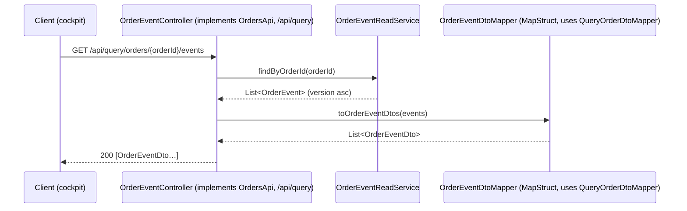

# Design — SPEC-0035: Add order-events endpoint to the query contract

> **Stage 2 of 3 — how.** Concrete enough that the plan can be written without re-reading the
> code, and checked line by line against the architecture policies. Write "None — <reason>" for a
> section that genuinely does not apply.

## Context

- **Today's endpoint.** `oms-core/src/main/java/org/example/oms/api/OrderEventController.java`
  (`@RequestMapping("/api/order-events")`, `GET /orderId/{orderId}`, `@Hidden`) returns
  `List<OrderEvent>`, the JPA entity (`oms-core/.../model/OrderEvent.java`), straight from
  `OrderEventReadService.findByOrderId` (`findByOrderIdOrderByVersionAsc`). The JSON therefore
  carries `id` (database id), `orderId`, `version`, `event` (oms-core enum `model.Event`, 8 values),
  `transaction` (the `Command`, jsonb), `commandId`, `resultingState`, `orderSnapshot` (the
  hand-written `org.example.common.model.Order`, jsonb) and `timeStamp` (`Instant`). Unknown orders
  give `200 []`.
- **Query contract.** `oms-contracts/src/main/openapi/oms-query-api.yml` has one path, `/search`
  (`searchOrders`), plus `OrderDto`, `PagedOrderDto`, `PageMetadata`; enums come from `schema.yml`.
  oms-contracts generates the models into `org.example.common.model.query` (`openApiGenerateQueryModels`);
  oms-core generates only the interfaces (`openApiGenerateQuery`, `apis: ""`, no `useTags`, so the
  interface is named after the first path segment: `/search` → `SearchApi`).
- **Closest existing example.** `QueryController` (`@RequestMapping("/api/query")`, `implements
  SearchApi`) with `QueryOrderDtoMapper` (MapStruct, entity → generated query DTO, `Instant` →
  `OffsetDateTime` via `toOffsetDateTime`). This change is a sibling of it.
- **Consumer.** developer-cockpit only: `src/shared/apiExplorer.ts` `eventsPath`, used by
  `src/main/services/OmsHttpService.ts#followUp`; `toTimeline` reads `version`, `event`,
  `resultingState`, `timeStamp`, `transaction`, `orderSnapshot`. Tests:
  `test/main/OmsHttpService.test.ts`, `test/main/apiExplorer.ipc.test.ts`. oms-ui, oms-mcp-server,
  oms-streaming-service do not call the endpoint (grep for `order-events` in their sources: none).
- **Read:** `oms-knowledge-base/interfaces/{query-api,rest-read-api}.md`,
  `capabilities/{order-query,event-sourcing-and-replay}.md`, `oms-framework/openapi-contracts.md`,
  SPEC-0007 proposal (open question naming this ticket).

## Approach



| Proposal "What Changes" | Where |
|---|---|
| New query operation + entry schema | `oms-query-api.yml`: path `/orders/{orderId}/events`, schemas `OrderEventDto`, `OrderEventType` |
| Event kinds contracted | `OrderEventType` enum in `oms-query-api.yml` |
| oms-core implements it, visible in `/v3/api-docs` | `OrderEventController` rewritten: `@RequestMapping("/api/query")`, `implements OrdersApi` (generated), no `@Hidden`; new `OrderEventDtoMapper` |
| Old path removed (BREAKING, internal) | the old `@RequestMapping("/api/order-events")` and `getOrderEventsByOrderId` disappear with the rewrite |
| Cockpit uses query prefix | `apiExplorer.ts`: `eventsPath = (id) => \`${API_PREFIX.query}/orders/${encodeURIComponent(id)}/events\`` |

`OrderEventReadService` and `OrderEventRepository` are unchanged.

## Contract Changes

`oms-contracts/src/main/openapi/oms-query-api.yml`. Add under `paths` (after `/search`):

```yaml
  /orders/{orderId}/events:
    get:
      operationId: getOrderEvents
      summary: Event log of one order
      description: |
        Every entry of the order's event log, in ascending `version` (the order in which the
        changes happened). Returns an empty array when no events exist for the order id; whether
        the order exists is answered by `searchOrders`.
      tags:
        - Orders
      parameters:
        - name: orderId
          in: path
          required: true
          schema:
            type: string
          description: Business order id (`orderId`, not the database id)
      responses:
        '200':
          description: The order's event log, oldest first
          content:
            application/json:
              schema:
                type: array
                items:
                  $ref: '#/components/schemas/OrderEventDto'
        '500':
          description: Internal server error
```

Add under `components/schemas`:

```yaml
    OrderEventType:
      type: string
      description: The kind of change an event-log entry records.
      enum: [NEW_ORDER, ACK, PARTIAL_FILL, FILL, CXL, REJ, CXL_REQUEST, CXL_REJ]
    OrderEventDto:
      type: object
      description: One entry of an order's event log.
      required: [orderId, version, event]
      properties:
        orderId:
          type: string
        version:
          type: integer
          format: int64
          description: Monotonic per-order sequence, starting at 1.
        event:
          $ref: '#/components/schemas/OrderEventType'
        commandId:
          type: string
          description: The causing command's commandId, when it had one.
        resultingState:
          $ref: 'schema.yml#/components/schemas/State'
        timeStamp:
          type: string
          format: date-time
          x-java-type: java.time.Instant
          description: When the event was recorded, on the OMS clock.
        transaction:
          type: object
          description: >-
            The command that caused the change, as accepted by the command API (a `Command` from
            oms-cmd-api.yml; its `type` property names the command type).
        orderSnapshot:
          $ref: '#/components/schemas/OrderDto'
```

Also extend the `info.description` with one line naming the event-log operation.

- **Compatibility (P-04):** additive. `/search`, `OrderDto`, `PagedOrderDto`, `PageMetadata` are
  untouched. No Avro change.
- **Generated classes:** oms-contracts gains `org.example.common.model.query.OrderEventDto` and
  `OrderEventType`; oms-core gains the interface `org.example.common.api.OrdersApi` with
  `ResponseEntity<List<OrderEventDto>> getOrderEvents(String orderId)`. `SearchApi` is unchanged.
- **Breaking (internal, uncontracted):** `GET /api/order-events/orderId/{orderId}` is removed;
  the only consumer (developer-cockpit) moves in this ticket, as stated in the proposal.

## Data & Persistence

None — read-only use of the existing `order_events` table through the existing repository method.
No entity, changelog or index change (the `(order_id, version)` unique constraint already serves
the ordered lookup).

## Events & Messaging

None — the operation only reads `order_events`; nothing is appended, nothing goes through the
outbox or to Kafka.

## Domain, State & Orchestration

None for state: no transition, no task pipeline involvement. Request handling:

- `orderId` is a required path segment; Spring routing makes an empty one impossible. Any string is
  a valid lookup key (bound as a JPA parameter).
- Unknown order id → `200 []`.
- Unexpected failures go through `GlobalExceptionHandler` (`Exception` → Problem+JSON 500), as for
  `/search`. The removed old path is answered by the framework's `NoResourceFoundException` handling
  in `ResponseEntityExceptionHandler` → `404`.

## Alternatives & Decisions

- **Path `/orders/{orderId}/events` under the query prefix** — rejected: contracting
  `/order-events/orderId/{orderId}` verbatim (the query API is served under `/api/query`, so it
  would still move, and keeps an awkward path); a second controller prefix outside `/api/query`
  (contracted operations would no longer share a base, which the cockpit's `API_PREFIX` relies on).
- **Remove the old path rather than keep a deprecated alias** — the endpoint was `@Hidden` and never
  contracted, its single consumer is migrated here; an alias would keep the entity-shaped response
  alive. Approved with the proposal.
- **`orderSnapshot` typed as the existing `OrderDto`** — rejected: free-form object (loses the
  contract for the most useful field) and a new full `Order` schema (duplicates `OrderDto`, and
  `org.example.common.model.Order` is a hand-written entity, not a contract). Reusing `OrderDto`
  gives one contracted order shape across the query API and lets `OrderEventDtoMapper` reuse
  `QueryOrderDtoMapper.toOrderDto`. `eventVersion` stays unset in snapshots (the entry's own
  `version` is the event version).
- **`transaction` as a documented free-form object** — rejected: `$ref` to
  `oms-cmd-api.yml#/components/schemas/Command`, which would make the query model generation emit a
  second copy of all command classes into `org.example.common.model.query`, and couple the query
  contract to every command change. The generator maps a property-less `type: object` to `Object`;
  the mapper assigns the stored `Command` as is, so the JSON is the same as today (including its
  `type` property). If the generator emits `Map<String, Object>` instead, the mapper converts with
  the Spring-managed Jackson 3 `JsonMapper` (`convertValue`); recorded here so it is not a design
  deviation.
- **Event kinds as a query-contract enum `OrderEventType`, not `schema.yml`** — only the query API
  uses it. Kept in step with oms-core's `model.Event` by MapStruct's enum mapping, which fails
  compilation when a source constant has no target, plus a unit test comparing the value sets.
- **Rewrite `OrderEventController` in place** rather than add a method to `QueryController`: the
  generated interface is a separate `OrdersApi`, and one controller per generated interface keeps
  `QueryController` focused on search. Class name kept to minimise churn.
- **Integration test on plain Testcontainers Postgres with `kafka.enabled=false`**, like
  `QuerySearchIsolationIntegrationTest`, not `AbstractKafkaPostgresIntegrationTest`: the operation
  never touches Kafka, so starting a broker adds time without coverage.
- **No new dependency and no build change** (P-17): the existing generator tasks pick up the new
  path and schemas.
- **Changed during implementation: `transaction` is converted, not assigned.** The generator did
  emit `Object`, but the generated `Command` hides its `type` field (`@JsonIgnoreProperties("type")`)
  and writes it only through `@JsonTypeInfo`, which Jackson does not apply to a value held in an
  `Object` property; AC-2 failed on `transaction.type`. As foreseen in the fallback above, a small
  `CommandJsonConverter` component (`oms-core/.../mapper`) converts the command to a `Map` with the
  Spring-managed Jackson 3 `ObjectMapper` (as `CommandListener` does), and `OrderEventDtoMapper`
  uses it for `transaction` (`qualifiedByName = "toTransaction"`). Same JSON as the old endpoint.
- **Changed during implementation: the integration test creates the order through
  `OrderCreateCommandProcessor`** (as `ExchangeWorkflowIntegrationTest` does) instead of
  `POST /api/command/execute`; the HTTP command path is not under test here.

## Risks & Mitigations

- **Generated interface name differs from `OrdersApi`** (generator grouping) — the plan's first
  oms-core task regenerates and checks the name; a different name is a naming detail recorded here,
  not a design change.
- **`transaction` loses its `type` when serialized as `Object`** — AC-2 asserts
  `transaction.type`; if it fails, convert via `JsonMapper` with the declared `Command` type
  (decision above).
- **Event enum drift** — MapStruct compile error plus `OrderEventDtoMapperTest`.
- **Someone calls the old path by hand** — gets `404`; documented in the knowledge base and cockpit
  spec. No code consumer remains (grep in all modules is part of verification).
- **Snapshot fields not in `OrderDto` disappear from the response** — intended: the contract defines
  the shape. The cockpit renders the snapshot generically.

## Test Strategy

| AC | Level | Test class#method | What it asserts |
|---|---|---|---|
| AC-1 | unit (oms-contracts) | `org.example.common.contracts.OrderEventContractTest#orderEventDtoHasContractedProperties`, `#orderEventTypeHasEightKinds` | generated `OrderEventDto` exposes exactly the 8 contracted JSON properties; `OrderEventType` has exactly the 8 values; `./gradlew check` green |
| AC-1 | unit (oms-core) | `org.example.oms.mapper.OrderEventDtoMapperTest#eventKindsMatchContract`, `#mapsEveryField` | `Event` names == `OrderEventType` names; entity → DTO maps every field (incl. `orderSnapshot` via `OrderDto`, `timeStamp` UTC) |
| AC-1 | integration | `OrderEventQueryIntegrationTest#apiDocsDeclareEventLogOperation` | `/v3/api-docs` path `/api/query/orders/{orderId}/events` has `get.operationId == getOrderEvents` and a required path parameter `orderId`; `/api/query/search` still present |
| AC-2 | integration | `OrderEventQueryIntegrationTest#returnsEventLogInVersionOrder`, `#carriesTheStoredCommandId` | after create + accept, `200`, 2 elements, versions 1,2; `event`, `resultingState`, `commandId`, `timeStamp`, `transaction.type`, `orderSnapshot.orderId` equal the `order_events` rows; a non-null `commandId` (cancel request, added after independent review) is returned |
| AC-3 | integration | `OrderEventQueryIntegrationTest#responseHasOnlyContractedProperties` | each element's keys ⊆ {orderId, version, event, commandId, resultingState, timeStamp, transaction, orderSnapshot}; no `id` |
| AC-4 | integration | `OrderEventQueryIntegrationTest#unknownOrderReturnsEmptyArray` | `200`, body `[]` |
| AC-5 | integration | `OrderEventQueryIntegrationTest#apiDocsDeclareEventLogOperation`, `#oldPathIsGone` | path in `/v3/api-docs`; `GET /api/order-events/orderId/X` → `404` |
| AC-6 | unit (vitest, developer-cockpit) | `test/main/OmsHttpService.test.ts` follow-up tests (paths updated), new `test/shared/apiExplorer.test.ts#eventsPath uses the query prefix` (or the existing shared test file if one exists) | follow-up requests `http://localhost:8090/api/query/orders/O%201/events` and renders the timeline sorted by version; `npm test` green |

`OrderEventQueryIntegrationTest` (`oms-core/src/test/java/org/example/oms/integration/`): Postgres
Testcontainer, `kafka.enabled=false`, MockMvc built from the `WebApplicationContext`; it creates the
order with an `OrderCreateCmd` through `POST /api/command/execute` and accepts it with
`OrderAcceptCommandProcessor`, then reads `order_events` through `OrderEventRepository` for the
expected values.

## Policy Compliance

| Policy | Title | Status | How / Justification |
|---|---|---|---|
| P-01 | Contracts live only in oms-contracts | comply | only `oms-contracts/src/main/openapi/oms-query-api.yml` changes |
| P-02 | Specification before code, generated models only | comply | contract task first; `OrderEventDto`/`OrderEventType`/`OrdersApi` generated, no hand-written DTO |
| P-03 | Never edit generated code | comply | nothing under `build/generated*` edited; regeneration only |
| P-04 | Contracts evolve compatibly | comply | additive path and schemas; the removed endpoint was uncontracted and is marked BREAKING with its consumer in the proposal |
| P-05 | Every state change is recorded in the event log | n/a | read-only operation; no state change |
| P-06 | Kafka only through the transactional outbox | n/a | no messaging |
| P-07 | Schema changes through new Liquibase changesets | n/a | no schema change |
| P-08 | Concurrency and idempotency are explicit | n/a | read-only GET, naturally idempotent; no order updates |
| P-09 | Commands and queries stay separate | comply | the event log becomes a query-API operation with its own query model; no mutation |
| P-10 | State transitions go through the state machine and task pipeline | n/a | no transitions |
| P-11 | Layering and conventions | comply | thin controller implementing generated interface → existing `OrderEventReadService` → repository; MapStruct `OrderEventDtoMapper` like `QueryOrderDtoMapper`; constructor injection via Lombok |
| P-12 | Jackson 3 only | comply | no new Jackson imports; any conversion uses `tools.jackson` `JsonMapper` |
| P-13 | Errors and validation follow the framework specs | comply | unknown order → `200 []` (documented in contract); failures via existing Problem+JSON `GlobalExceptionHandler` |
| P-14 | Test first, every acceptance criterion is proven by an automated test | comply | every AC mapped above; tests written before the controller/mapper changes |
| P-15 | Observability | comply | covered by Spring's `http.server.requests` metrics and existing tracing; no `System.out`; no new flow needing custom metrics |
| P-16 | Security | comply | no secrets; `orderId` bound as a JPA parameter; no entitlements defined for the query API |
| P-17 | Simplicity and dependencies | comply | no new dependency or build change; reuse of `OrderDto` and `QueryOrderDtoMapper` |
| P-18 | Modules build standalone | comply | `./gradlew check` in oms-contracts and every consumer in `impacts`; `npm test` in developer-cockpit |
| P-19 | Documentation follows behaviour | comply | KB pages below updated in this ticket |

## Knowledge Base Updates

- `oms-knowledge-base/interfaces/query-api.md` — add the `getOrderEvents` operation
  (`/api/query/orders/{orderId}/events`), its entry shape and the empty-array rule; add
  `openapi:/orders/{orderId}/events` to `covers` and `OrderEventController` to `sources`.
- `oms-knowledge-base/interfaces/rest-read-api.md` — remove the `/api/order-events` row, `covers`
  entry and source; point to the Query API.
- `oms-knowledge-base/capabilities/order-query.md` — drop `/api/order-events` from the "not in the
  OpenAPI contracts / no tests" gap.
- `oms-knowledge-base/capabilities/event-sourcing-and-replay.md` — link the event log read to the
  Query API operation.
- developer-cockpit `spec/03-features.md` and `spec/04-backend-services.md` — the follow-up uses the
  contracted `/api/query/orders/{orderId}/events`.
