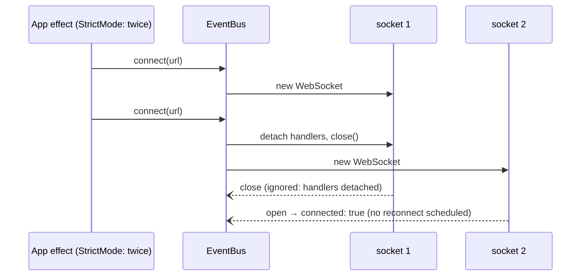

# Design — SPEC-0036: Fix cockpit WebSocket disconnect over IPv4

> **Stage 2 of 3 — how.** Concrete enough that the plan can be written without re-reading the
> code, and checked line by line against the architecture policies. Write "None — <reason>" for a
> section that genuinely does not apply.

## Context

All paths are under `developer-cockpit/`.

- **Server:** `src/main/websocket/server.ts`, class `WebSocketServer`. `start()` calls
  `new WSServer({ port })` from `ws`, so it binds `::`, every interface (dual-stack). It greets
  each client with `connection:status {connected: true}` and broadcasts `CockpitEvent`s.
  `src/main/index.ts` starts it on `WS_PORT` (`COCKPIT_WS_PORT` or 9321) and calls
  `registerEventsIpc(ipcMain, WS_PORT)`.
- **URL:** `src/main/ipc/events.ipc.ts` answers `events:getWebSocketUrl` with
  `ws://localhost:${wsPort}`.
- **Client:** `src/renderer/lib/event-bus.ts`, a singleton `eventBus` instance of the unexported
  class `EventBus`.
  - `doConnect()` closes `this.ws` if it is set, then creates a new `WebSocket` and assigns its
    handlers.
  - `onclose` sets `_connected = false`, emits `connection:status {connected: false}` and calls
    `scheduleReconnect()` (3 s, `doConnect`).
  - `disconnect()` clears the timer and calls `this.ws?.close()`, with the handlers still attached.
- **Caller:** `src/renderer/App.tsx` connects from a `useEffect` and disconnects in its cleanup.
  `src/renderer/main.tsx` wraps the app in `<React.StrictMode>`.
- **UI:** `StatusBar.tsx` shows `useConnectionStatus()` (`hooks/useEventBus.ts`) as
  "Connected" or "Disconnected".
- **CSP:** `src/renderer/index.html` has
  `connect-src 'self' ws://localhost:9321`. `test/renderer/MermaidDiagram.security.test.tsx#keeps
  the CSP unchanged` pins the whole CSP string.
- **Tests:**
  - `test/main/websocket-no-actions.test.ts` starts a real `WebSocketServer` on a free port and
    connects to `ws://localhost:<port>`.
  - The end-to-end fixture `e2e/fixtures.ts` launches the built app with a random
    `COCKPIT_WS_PORT`. The CSP blocks that port today.

**Root cause, measured in proposal → Why.** In dev, StrictMode runs the App effect twice, so
`connect` is called twice. The replaced socket's still-attached `onclose` emits Disconnected and
schedules a reconnect, which replaces the current socket. That repeats every 3 s. `disconnect()`
has the same flaw: its close also schedules a reconnect.

**Closest existing examples:**
- the real-server test in `websocket-no-actions.test.ts` (free port, `ws` client);
- the CSP pinning in `MermaidDiagram.security.test.tsx`;
- `e2e/smoke.spec.ts` with `e2e/fixtures.ts`.

## Approach

1. **`event-bus.ts`**
   - Add a private `release(ws)` helper. It sets the socket's `onopen`, `onmessage`, `onclose` and
     `onerror` to `null`, then calls `close()`.
   - `doConnect()` clears any pending reconnect timer and releases the previous socket, if there is
     one, before creating the new one.
   - Each handler also checks `if (this.ws !== socket) return;`. This guard is defensive: with the
     handlers detached it never fires, but it keeps a late event from a replaced socket harmless.
   - `disconnect()` clears the timer, releases the socket and sets `ws = null` and
     `_connected = false`. It emits nothing and schedules nothing.
   - `onclose` of the *current* socket keeps today's behaviour: emit `connected: false` and
     reconnect after 3 s.
   - Export the class (`export class EventBus`) next to the singleton, so tests can create fresh
     instances.
2. **`server.ts`**
   - Export `WS_HOST = '127.0.0.1'`.
   - `start()` uses `new WSServer({ host: WS_HOST, port })`.
   - The log line names the host.
3. **`events.ipc.ts`** returns `` `ws://${WS_HOST}:${wsPort}` ``, importing `WS_HOST` from
   `../websocket/server`.
4. **`index.html` CSP:** `connect-src 'self' ws://127.0.0.1:*`. The `index.ts` comment that says
   the CSP only allows 9321 is updated to match.
5. **Tests:**
   - New unit tests for the bus and the server.
   - `websocket-no-actions.test.ts` connects to `127.0.0.1`. `localhost` may resolve to `::1`,
     where the server no longer listens.
   - The CSP constant in `MermaidDiagram.security.test.tsx` is updated: that test pins the CSP on
     purpose, and this ticket changes it.
   - New end-to-end spec `e2e/connection.spec.ts`.

| Proposal "What Changes" | Where |
|---|---|
| Stale-socket events ignored, no loop, real close still retries | `event-bus.ts` (item 1) |
| Bind to `127.0.0.1`, URL `ws://127.0.0.1:<port>` | `server.ts`, `events.ipc.ts` (items 2, 3) |
| CSP `ws://127.0.0.1:*` | `index.html`, comment in `index.ts` (item 4) |
| End-to-end Connected check | `e2e/connection.spec.ts` |

## Contract Changes

None. The WebSocket is internal to developer-cockpit (main process ↔ its own renderer), and
neither OpenAPI nor Avro is involved. The message format and event types are unchanged.

## Data & Persistence

None. No storage is involved.

## Events & Messaging

None in OMS: no `order_events`, outbox or Kafka. The cockpit's in-process WebSocket events keep
their types and payloads. Only the client's connection handling changes.

## Domain, State & Orchestration

None. No OMS domain or state machine is involved. The client's connection states stay as they are:
connected or disconnected, with retry every 3 s after an unexpected close.

## Alternatives & Decisions

- **Detach the old socket's handlers before closing it.** Rejected alternatives:
  - remove `<React.StrictMode>`. That hides the bug only in dev; any second `connect` would still
    loop.
  - make `connect` a no-op when a socket already exists. The bus would then never move to a new
    URL, and it would not fix `disconnect()`, whose close also schedules a reconnect.
  - a boolean "closing on purpose" flag. That is more state than an identity check plus detaching.
- **Bind `127.0.0.1` (IPv4 loopback).** Rejected alternatives:
  - `::1`, which is missing when IPv6 is disabled;
  - keeping `::` with the client on `localhost`, which leaves resolution order deciding which
    address is used and exposes the event stream to the network.
  The host lives in one exported constant used by the server and the URL builder.
- **CSP `ws://127.0.0.1:*`.** Rejected alternative: `ws://127.0.0.1:9321` only, which would keep
  end-to-end runs (random port) from connecting, so AC-6 could not be tested. The wildcard is the
  port only; the host stays loopback.
- **Export `EventBus` for tests** instead of resetting the singleton through private fields. It is
  a one-word change and keeps the tests independent of each other.
- **Fake `WebSocket` in the bus tests** (`vi.stubGlobal`, `vi.useFakeTimers`), not a real server.
  The test controls when each socket opens and closes, which is exactly the ordering the bug
  depends on. The real-network behaviour is covered by the AC-4 server tests and the AC-6
  end-to-end test.
- **No new dependency.** It uses `ws`, `vitest` and `@playwright/test`, which are already present.

## Risks & Mitigations

- **A tool or user that connected via `ws://localhost:9321` from elsewhere.** No code does (only
  the renderer connects, and it gets the URL over IPC). `localhost` → `127.0.0.1` still works on
  machines that try IPv4. The cockpit spec page documents the address.
- **The end-to-end run uses the production build, without StrictMode double effects.** AC-1 covers
  the double connect at unit level. AC-6 proves the IPv4 path, the CSP and stability across two
  reconnect intervals in the real app.
- **Port 9321 already taken on `127.0.0.1` by another process.** Behaviour is the same as today: the
  `ws` server emits an error. This ticket does not change it.
- **Changing the pinned CSP test.** The constant changes only in its `connect-src` part. AC-5's
  dedicated test asserts that no wider source slipped in.

## Test Strategy

| AC | Level | Test class#method | What it asserts |
|---|---|---|---|
| AC-1 | unit (vitest, fake WebSocket and timers) | `test/renderer/event-bus.test.ts` › "double connect settles on one open socket" | after `connect` twice, socket 1 closes and socket 2 opens: `connected === true`, the last status emitted is `true`, and `advanceTimersByTime(10_000)` creates no further socket (2 created in total) |
| AC-2 | unit | `test/renderer/event-bus.test.ts` › "a real close reports Disconnected and reconnects after 3 s" | the current socket closes: `connected: false` is emitted; at 2.9 s there is no new socket, at 3 s there is; its open emits `connected: true` |
| AC-3 | unit | `test/renderer/event-bus.test.ts` › "disconnect closes without events or reconnect" | `disconnect()` closes the socket; its close event emits nothing; 10 s later no new socket exists |
| AC-4 | unit (real `ws` server) | `test/main/websocket-server.test.ts` › "binds IPv4 loopback only", "greets a client on 127.0.0.1"; › "getWebSocketUrl returns the loopback URL" | the server's address is `127.0.0.1`; a client on `ws://127.0.0.1:<port>` gets `connection:status {connected: true}`; a client on `ws://[::1]:<port>` fails to connect; `registerEventsIpc` with a fake `ipcMain` resolves to `ws://127.0.0.1:<port>` |
| AC-5 | unit | `test/renderer/csp.test.ts` › "connect-src allows only self and IPv4 loopback WebSockets" | the CSP is parsed from `index.html`; `connect-src` equals `['self', 'ws://127.0.0.1:*']`, with no `localhost` and no `ws:`/`wss:`/`*` host wildcard |
| AC-6 | e2e (Playwright, Electron) | `e2e/connection.spec.ts` › "status bar shows Connected and stays connected" | built app with a random port: `getByText('Connected', { exact: true })` is visible within 10 s and still visible after 7 s, and "Disconnected" is not visible |

For AC-4, "the server's address" is read through a new `address()` method on `WebSocketServer`. It
returns `wss.address()` and is also useful for the log line. The `[::1]` check accepts any connect
error: on a machine without IPv6 it fails as well, which is still "not accepted".

`spec verify` runs `npm run typecheck` and `npm test` (AC-1 to AC-5). AC-6 runs with
`npm run test:e2e -- connection`, and its output is saved as evidence in verification.

## Policy Compliance

| Policy | Title | Status | How / Justification |
|---|---|---|---|
| P-01 | Contracts live only in oms-contracts | n/a | no OpenAPI or Avro involved |
| P-02 | Specification before code, generated models only | n/a | no API or message contract change; the proposal and this design come before the code |
| P-03 | Never edit generated code | comply | no generated code is touched |
| P-04 | Contracts evolve compatibly | n/a | no contract; the internal WebSocket message format is unchanged |
| P-05 | Every state change is recorded in the event log | n/a | no order state |
| P-06 | Kafka only through the transactional outbox | n/a | no Kafka |
| P-07 | Schema changes through new Liquibase changesets | n/a | no database |
| P-08 | Concurrency and idempotency are explicit | n/a | no order updates; the bus's concurrent sockets are resolved by identity (Approach item 1) |
| P-09 | Commands and queries stay separate | n/a | the WebSocket stays push-only and still accepts no commands (`websocket-no-actions.test.ts` keeps passing) |
| P-10 | State transitions go through the state machine and task pipeline | n/a | no order state |
| P-11 | Layering and conventions | comply | the change stays in the existing files and layers (main server, main IPC, renderer lib) and follows the existing test patterns |
| P-12 | Jackson 3 only | n/a | TypeScript module |
| P-13 | Errors and validation follow the framework specs | n/a | no API errors; connect errors keep today's retry behaviour |
| P-14 | Test first, every acceptance criterion is proven by an automated test | comply | every AC is mapped above; tests are written first and seen failing |
| P-15 | Observability | comply | the server log line names its host and port; no new silent failure paths |
| P-16 | Security | comply | improves security: the server binds loopback only (no longer reachable from the network), and the CSP narrows to `127.0.0.1` |
| P-17 | Simplicity and dependencies | comply | no new dependency; the smallest change that fixes the loop, plus one host constant |
| P-18 | Modules build standalone | comply | `npm run typecheck` and `npm test` in developer-cockpit via `spec verify`; no other module is affected |
| P-19 | Documentation follows behaviour | comply | the cockpit spec pages are updated (below) |

## Knowledge Base Updates

None in `oms-knowledge-base/`: the cockpit's internal WebSocket is not an OMS concept. The
cockpit's own spec is updated instead:
- `developer-cockpit/spec/04-backend-services.md` → WebSocket Protocol: the server binds
  `127.0.0.1:<port>` (default 9321, `COCKPIT_WS_PORT`); the renderer gets the URL over IPC; the CSP
  allows `ws://127.0.0.1:*`.
- `developer-cockpit/spec/06-realtime.md` → Connection Lifecycle: a replaced or deliberately
  closed socket is released without reconnecting; only an unexpected close retries, after 3 s.
