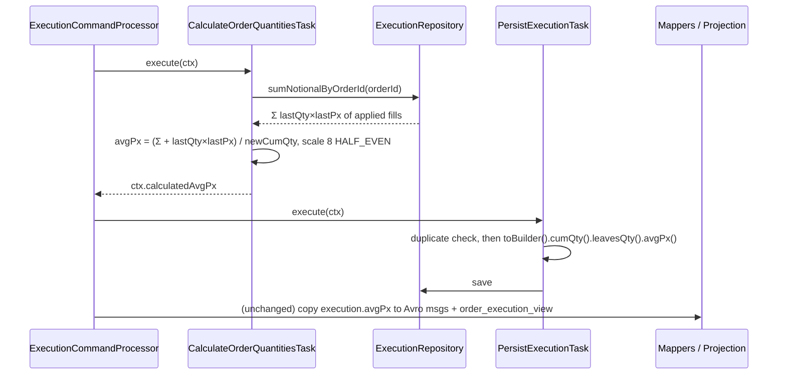

# Design — SPEC-0041: Align executions blotter fields and keys with orders

> **Stage 2 of 3 — how.** Concrete enough that the plan can be written without re-reading the
> code, and checked line by line against the architecture policies. Write "None — <reason>" for a
> section that genuinely does not apply.

## Context

**oms-core: the fill pipeline.** `ExecutionCommandProcessor` runs these tasks in order:
`ValidateExecutionTask` (100), `CalculateOrderQuantitiesTask` (200), `DetermineOrderStateTask`
(300), `PersistExecutionTask` (400), `UpdateOrderTask` (500), `PublishExecutionEventTask` (600) and
`ProjectTask` (700).
- `CalculateOrderQuantitiesTask` puts `calculatedCumQty` and `calculatedLeavesQty` (scale 8) on
  `OrderTaskContext`.
- `PersistExecutionTask` rejects a duplicate `(orderId, execID)` through
  `ExecutionRepository.existsByOrderIdAndExecID`. It then copies the calculated quantities onto
  the `Execution` entity and saves it.
- Downstream, the values are copied from the entity, not recomputed:
  - `ExecutionMessageMapper` builds the `executions` Avro message;
  - `OrderExecutionMessageMapper` builds `OrderExecution`, which feeds the streaming service;
  - `OrderExecutionProjection` writes `order_execution_view`.

  All three already copy `execution.getAvgPx()`, but it is always null:
  `OrderMapper.toExecution` has `@Mapping(target = "avgPx", ignore = true)`, and nothing sets it
  later.

**oms-core: the entity.** `org.example.common.model.Execution` has `Long id` (sequence), `String
executionId` (always null: `@Mapping(target = "executionId", ignore = true)`) and `String execID`
(column `execid`, mapped from the command's `execId`). Unique constraint:
`uq_executions_order_id_execid (order_id, execid)` (changelog 003). `avg_px` is `NUMERIC(18,8)`
(changelog 008).

**oms-core: the REST feed and metamodel.**
- `ExecutionController` (`GET /api/executions`, `@Hidden`) returns `Page<Execution>`, the entity
  serialized by Jackson. Its properties are `id, orderId, executionId, avgPx, cumQty, execID, …`.
- `MetamodelService.buildExecutionMetadata()` reflects over the entity's declared fields, sets
  `primaryKey("id")` and lists default columns
  `id, orderId, executionId, execID, execType, lastQty, lastPx, cumQty, avgPx`.

**oms-streaming-service.**
- `ExecutionDto` has `execId, orderId, executionId (never set), lastQty, lastPx, cumQty, avgPx,
  leavesQty, execType, lastMkt, lastCapacity, transactTime, creationDate, sequenceNumber,
  eventTime, orderVersion, order`.
- `OrderExecutionMapper.toExecutionDto` fills it from the Avro `OrderExecution`. `avgPx` passes
  straight through, so it will be populated once oms-core sends it.
- `MetadataService.getExecutionMetadata()` advertises an `executionId` field.

**oms-ui.**
- Both blotters take their columns from oms-core's `/api/v1/metamodel/Execution`
  (`MetamodelService` → `ColumnConfigService`). `ColumnConfigService.getColumnConfig` silently drops
  default columns that are not in `fields`, and pins the `primaryKey` column.
- `StreamingBlotter` keys rows in two ways:
  - `getRowId` returns `params.data.orderId || params.data.id` for both domain objects, so all
    fills of one order share a row id;
  - `handleExecutionEvent` stores rows in a `Map` keyed by `execId` alone, so fills on two
    orders with the same `execId` overwrite each other.
- `Blotter` (REST) sets no `getRowId`, so AG Grid uses its own index.

**The orders blotter, which is the reference behaviour:**
- identity by business key `orderId`, which is `getRowId` in streaming mode;
- the surrogate `id` is selectable in REST mode but never used as the identity;
- default columns name only fields that are present in the data.

**Closest examples followed:**
- `CalculateOrderQuantitiesTask` for avgPx: a derived value computed onto the context and copied
  onto the entity in `PersistExecutionTask`, the same way as `cumQty`/`leavesQty`.
- `MetamodelServiceTest#orderMetamodelIncludesRejectReason` for the metamodel test.
- `ExecutionViewQueryIntegrationTest` / `AbstractFillFlowIntegrationTest` for fill-flow
  integration tests.

**Knowledge base read:** `domain/execution.md`, `capabilities/execution-processing.md`,
`capabilities/real-time-streaming.md`, `interfaces/avro-messages.md`, `ui/oms-admin-ui_spec.md`.

## Approach



How each What Changes bullet is implemented:

1. **One name for the fill id: `execId`.**
   - oms-core: rename the entity field `execID` to `execId`, with `@Column(name = "execid")` so
     the mapped column is unchanged. Without the annotation, Spring's naming strategy would map
     `execId` to `exec_id`.
     - Rename `ExecutionRepository.existsByOrderIdAndExecID` to `existsByOrderIdAndExecId`.
     - Update every `getExecID()`/`.execID(` call in main and test code (≈ 25 files, mechanical).
     - `OrderMapper.toExecution` loses `@Mapping(target = "execID", source = "execId")`, since the
       names now match.
   - oms-core: remove the field `executionId` from the entity, and its `@Mapping(…ignore = true)`.
     The DB column `execution_id` stays, unmapped. `ddl-auto: validate` tolerates extra columns.
   - With both changes, `/api/executions` JSON carries `execId` and neither `execID` nor
     `executionId`, and the reflection-built metamodel follows automatically.
   - oms-streaming-service: remove `executionId` from `ExecutionDto` and from
     `MetadataService.getExecutionMetadata()`.
   - oms-ui: remove `executionId?` from `StreamingExecutionDto` in `types/streaming.ts`.
2. **Identity follows orders.**
   - oms-core `MetamodelService.buildExecutionMetadata()` sets `.primaryKey("execId")`.
   - oms-ui gets a new `services/rowId.ts` exporting
     `rowIdOf(domainObject: DomainObjectType, row: any): string`:
     - Execution: `` `${row.orderId}|${row.execId}` ``;
     - Order: `row.orderId ?? String(row.id)`, which is today's behaviour.
   - `StreamingBlotter` uses `rowIdOf` in `getRowId`, and as the `dataMap` key in
     `handleExecutionEvent`.
   - `Blotter` (REST) sets `getRowId={p => rowIdOf(domainObject, p.data)}`, so REST and streaming
     key rows the same way.
   - The surrogate `id` stays a field in the metamodel, available in the column selector but not a
     default, as for orders.
3. **Every default column has data.**
   - The Execution default columns become exactly
     `execId, orderId, execType, lastQty, lastPx, cumQty, leavesQty, avgPx, transactTime`.
   - Each of these is both a field of the reflected entity and a property of the streaming
     `ExecutionDto`.
4. **avgPx is computed.**
   - `ExecutionRepository.sumNotionalByOrderId(String orderId)`:
     `@Query("select coalesce(sum(e.lastQty * e.lastPx), 0) from Execution e where e.orderId =
     :orderId")`, returning `BigDecimal`.
   - `CalculateOrderQuantitiesTask`, which gets `ExecutionRepository` by constructor injection:
     - computes `newAvgPx = (sumNotional + lastQty × lastPx) / newCumQty` at scale 8, HALF_EVEN;
     - sets `context.setCalculatedAvgPx(newAvgPx)`, a new field on `OrderTaskContext` next to
       `calculatedCumQty`.
   - `PersistExecutionTask` adds `.avgPx(context.getCalculatedAvgPx())` to the existing
     `toBuilder()` block, after the duplicate check.
   - Everything downstream copies the value unchanged.
   - Summing the stored fills, rather than carrying a running average, keeps the result exact.
     Fills recorded before this change contribute their `lastQty × lastPx`, so a new fill on an
     old order still gets the correct average.
5. **Avro doc text.** The `avgPx` doc in `Execution.avsc` and `OrderExecution.avsc` is corrected.

## Contract Changes

The Avro doc strings change; the schema structure does not:

```json
// oms-contracts/src/main/avro/Execution.avsc  (field "avgPx", type unchanged)
"doc": "Volume-weighted average price of the order's applied fills up to and including this one: sum(lastQty*lastPx)/cumQty, scale 8, HALF_EVEN. Null for fills recorded before SPEC-0041."

// oms-contracts/src/main/avro/OrderExecution.avsc  (field "avgPx", type unchanged)
"doc": "Volume-weighted average price of the order's applied fills up to and including this one: sum(lastQty*lastPx)/cumQty, scale 8, HALF_EVEN. Null for fills recorded before SPEC-0041."
```

- **Compatibility (P-04):** only the `doc` text changes, which Schema Registry ignores. No field is
  added, removed, renamed or retyped. The generated classes change only in their Javadoc.
- **OpenAPI:** none. `ExecutionViewDto` already has `execId` and `avgPx`.
- **Non-contract JSON:**
  - `/api/executions` is `@Hidden`, and not part of oms-query-api.yml. It loses
    `execID`/`executionId` and gains `execId`.
  - The streaming `ExecutionDto` loses `executionId`.
  - oms-ui is the only consumer of both and changes in this ticket. oms-mcp-server uses the query
    API, which is unchanged.

## Data & Persistence

- **No Liquibase changeset.** The column names are unchanged (`execid`, via `@Column`), and
  `avg_px NUMERIC(18,8)` already exists on `executions` and `order_execution_view`.
- `executions.execution_id` stays in the table, unmapped and always null.
  `LiquibaseMigrationIntegrationTest` / `ddl-auto: validate` still pass, because Hibernate's
  validation ignores unmapped columns.
- **New read query:** `ExecutionRepository.sumNotionalByOrderId`. This is an aggregate over one
  order's fills, covered by the index behind `uq_executions_order_id_execid` (leading
  `order_id`).
- **Backfill:** none (deferred in the proposal). Existing rows keep `avg_px = null`.
- **Concurrency (P-08):** the read runs inside the fill transaction, on the same order that
  `UpdateOrderTask` updates under `txNr` optimistic locking. A concurrent fill on the same order
  fails its `txNr` check and is retried, so the sum it re-reads includes the winner's fill.
- **Rollback:** revert the code. No data shape changes.

## Events & Messaging

- No new `order_events` types. The fill's existing event and snapshot are unchanged (P-05). The
  order snapshot has no avgPx, since the order-level average is out of scope.
- Outbox: the `executions` and `OrderExecution` messages are staged exactly as today, through
  `OrderEventAppender` / `ProjectTask` (P-06). `avgPx` is now non-null in them.
- Idempotency: a redelivered fill is rejected in `PersistExecutionTask` before anything is
  persisted. Its avgPx is computed in task 200 but discarded with the context, so stored values
  and messages are unaffected (AC-4).
- The streaming service's dedup on `(orderId, execId, orderVersion)` is unchanged.

## Domain, State & Orchestration

- No state-machine transitions change (P-10).
- One computation is added to the existing `CalculateOrderQuantitiesTask`; there is no new task.
- Division: `newCumQty` is always > 0 here. `ValidateExecutionTask` requires a positive
  `lastQty`, and `newCumQty = previousCumQty + lastQty`. A positive lastPx is required too.
- No new validation or error responses (P-13).

## Alternatives & Decisions

- **Decision: compute avgPx from the sum of stored fills, in `CalculateOrderQuantitiesTask`.**
  - *Rejected: a running average from the previous fill's `avgPx`.* It accumulates rounding error,
    and it is null for orders whose earlier fills predate this change.
  - *Rejected: avgPx on the Order entity.* That needs a migration and changes the orders blotter
    and `OrderDto`, both out of scope.
  - *Rejected: computing it in the read path (projection or query).* It would not appear on the
    `executions` message, and AC-3 needs it there.
- **Decision: rename the entity field `execID` → `execId` (with `@Column(name = "execid")`) and
  remove `executionId`.**
  - *Rejected: `@JsonProperty("execId")` / `@JsonIgnore` on the entity.* The metamodel reflects
    over Java field names, so it would also need annotation-aware naming. Two names for one thing
    would remain in Java, which is the confusion the goal complains about.
  - *Rejected: moving the REST blotter to `/api/query/executions` (`ExecutionViewDto`).* That
    endpoint has no paging, sorting or `id`, so the blotter's paging would break. It is a bigger
    change than the goal needs.
- **Decision: business key `orderId|execId` as the UI row id**, mirroring `orderId` on orders.
  - *Rejected: `execId` alone.* It is unique only per order (AC-6).
  - *Rejected: the surrogate `id`.* Streaming rows don't carry it.
- **Dependencies/build:** none (P-17).

## Risks & Mitigations

- **A missed `execID` reference after the rename.** Compilation catches Java uses. A Spring Data
  derived-query name is checked at context startup, which every integration test exercises.
- **A wrong column name after the rename** (`exec_id` instead of `execid`): `ddl-auto: validate`
  fails at startup, so the integration tests catch it.
- **Stale UI saved state.** `BlotterStateService` may hold `visibleColumns` containing `execID` /
  `executionId` from earlier sessions. `ColumnConfigService` already drops unknown columns, so the
  blotter still renders, just without them. The user can reset columns. Accepted.
- **Rounding of avgPx.** HALF_EVEN at scale 8 is the same quantisation the Avro decimal requires.
  The AC-2 values (10, 10.6) are exact.
- **Cost of the sum query per fill.** It is one indexed aggregate over one order's fills, small
  next to the existing per-fill writes.

## Test Strategy

| AC | Level (unit / web-mvc / integration / e2e) | Test class#method | What it asserts |
|---|---|---|---|
| AC-1 | unit | `oms-core` `MetamodelServiceTest#executionMetamodelUsesExecIdAndResolvableDefaults` (new) | `primaryKey` = `execId`; no field `execID`/`executionId`; every `defaultColumns` entry is in `fields`; defaults equal `execId, orderId, execType, lastQty, lastPx, cumQty, leavesQty, avgPx, transactTime` |
| AC-1 | integration | `oms-core` `ExecutionBlotterIntegrationTest#metamodelEndpointServesExecIdPrimaryKey` (new, extends `AbstractFillFlowIntegrationTest`) | `GET /api/v1/metamodel/Execution` JSON has the same properties over HTTP |
| AC-2 | integration | `ExecutionBlotterIntegrationTest#restExecutionsCarryExecIdAndAvgPx` | order of 100, fills 40@10 and 60@11; `GET /api/executions`: both rows have non-null `id`, `execId`, `orderId`, `avgPx`; no `execID`/`executionId` keys; avgPx 10 then 10.6 |
| AC-2 | unit | `oms-core` `CalculateOrderQuantitiesTaskTest#avgPxIsVolumeWeightedOverAppliedFills` (new) | with a mocked `sumNotionalByOrderId` = 400, a fill of 60@11 on cumQty 40 → `calculatedAvgPx` = 10.60000000; first fill → 10; HALF_EVEN at scale 8 for a repeating quotient |
| AC-3 | integration | `ExecutionBlotterIntegrationTest#avgPxReachesProjectionAndMessages` | same two fills: `GET /api/query/executions?orderId=` returns avgPx 10, 10.6; the `executions` and order-execution Kafka records carry the same values |
| AC-4 | integration | `ExecutionBlotterIntegrationTest#duplicateFillDoesNotChangeAvgPx` | redeliver the second fill with the same execId: still 2 execution rows; avgPx 10 and 10.6 |
| AC-5 | unit (jest) | `oms-ui` `services/rowId.test.ts#fills of one order get distinct row ids` (new) | `rowIdOf('Execution', {orderId:'O-1', execId:'E-1'})` ≠ the same for `E-2` |
| AC-6 | unit (jest) | `oms-ui` `services/rowId.test.ts#same execId on two orders gives two rows` | `O-1/E-1` vs `O-2/E-1` yield different ids; `Order` rows still key by `orderId` |
| AC-5, AC-6 | unit (jest) | `oms-ui` `services/rowId.test.ts#execution map keeps every fill` | applying the `StreamingBlotter` update rule (`map.set(rowIdOf(...))`) to the three fills above leaves 3 entries |
| AC-7 | unit | `oms-streaming-service` `OrderExecutionMapperTest#executionDtoCarriesAllBlotterDefaultColumns` (new) | the JSON of `toExecutionDto(fill)` has non-null `execId, orderId, execType, lastQty, lastPx, cumQty, leavesQty, avgPx, transactTime` (the AC-1 default list) and no `executionId` |
| AC-7 | unit | `oms-streaming-service` `MetadataServiceTest#executionMetadataHasNoExecutionId` (new) | the Execution metadata fields contain `execId` and not `executionId` |

AC-7 is proven in two halves: AC-1 pins oms-core's default list exactly, and the streaming test
asserts the DTO carries every name on that list. The REST half of "every default column resolves"
is AC-1 plus AC-2.

Existing tests that are adjusted only for the rename: `CommandListenerTest`,
`DecimalPrecisionIntegrationTest`, `EventSourcingIntegrationTest`, `ExchangeWorkflowIntegrationTest`,
`OrderExecutionPublicationIntegrationTest`, `OrderLifecycleIntegrationTest`,
`ProjectionRebuildIntegrationTest`, `AvroMessageMapperTest`, `OrderExecutionMessageMapperTest`,
`OrderMapperExecutionTest`, `MessagePublisherTest`, `ProjectTaskTest`.

## Policy Compliance

| Policy | Title | Status | How / Justification |
|---|---|---|---|
| P-01 | Contracts live only in oms-contracts | comply | The only contract edit is the avgPx doc in `oms-contracts/src/main/avro/{Execution,OrderExecution}.avsc` |
| P-02 | Specification before code, generated models only | comply | The doc-only Avro change comes first in the plan. The entity and the streaming `ExecutionDto` are hand-written today, and are not models of a contract |
| P-03 | Never edit generated code | comply | Nothing under `build/generated*` is touched |
| P-04 | Contracts evolve compatibly | comply | Doc text only, no structural Avro or OpenAPI change |
| P-05 | Every state change is recorded in the event log | comply | No new state change. The fill's existing event path through `OrderEventAppender` is unchanged |
| P-06 | Kafka only through the transactional outbox | comply | Messages are still staged by `OrderEventAppender`/`ProjectTask` and relayed by `OutboxRelay`; there is no new publisher |
| P-07 | Schema changes through new Liquibase changesets | n/a | No schema change: the column name is preserved with `@Column(name = "execid")`, and `avg_px` exists |
| P-08 | Concurrency and idempotency are explicit | comply | The duplicate check is unchanged and still precedes the avgPx write (AC-4). The sum is read in the `txNr`-protected fill transaction |
| P-09 | Commands and queries stay separate | comply | avgPx is computed on the command path; the query side only reads it |
| P-10 | State transitions go through the state machine and task pipeline | comply | No transitions change. The computation lives in the existing `CalculateOrderQuantitiesTask` |
| P-11 | Layering and conventions | comply | Repository query, task, MapStruct mapper (one mapping simplified), constructor injection; follows the cumQty/leavesQty pattern |
| P-12 | Jackson 3 only | comply | No Jackson imports added. Tests read JSON with `tools.jackson.databind.ObjectMapper` |
| P-13 | Errors and validation follow the framework specs | n/a | No new validation or error responses |
| P-14 | Test first, every acceptance criterion is proven by an automated test | comply | Every AC is mapped to a test in the table above. The plan writes each one before its implementation |
| P-15 | Observability | comply | The existing `CalculateOrderQuantitiesTask` info log gains `avgPx`, with `orderId`. No new flow, so no new metrics |
| P-16 | Security | n/a | No inputs, secrets or entitlements touched |
| P-17 | Simplicity and dependencies | comply | No new dependency, task or endpoint. One repository query, one context field, a 10-line UI helper |
| P-18 | Modules build standalone | comply | `./gradlew check` in oms-contracts, oms-core and oms-streaming-service, plus contract consumers (oms-mcp-server, oms-exchange-simulator); `npm test` in oms-ui |
| P-19 | Documentation follows behaviour | comply | The KB pages below are updated in this ticket |

## Knowledge Base Updates

- `oms-knowledge-base/domain/execution.md`:
  - identifiers are `orderId` + `execId` (the field is renamed from `execID`);
  - `executionId` is removed (its column is unmapped);
  - `avgPx` is computed by the OMS as the VWAP of applied fills.
- `oms-knowledge-base/capabilities/execution-processing.md`: replace "The OMS does not compute an
  average price" with the avgPx rule computed in `CalculateOrderQuantitiesTask`.
- `oms-knowledge-base/functional-requirements/FR-013-apply-fills.md`: `execID` → `execId`; the
  fill's avgPx.
- `oms-knowledge-base/ui/oms-admin-ui_spec.md`: executions blotter identity is `orderId|execId`,
  and the default columns are listed.
- `oms-knowledge-base/interfaces/avro-messages.md`: the avgPx meaning on `Execution` /
  `OrderExecution`.
