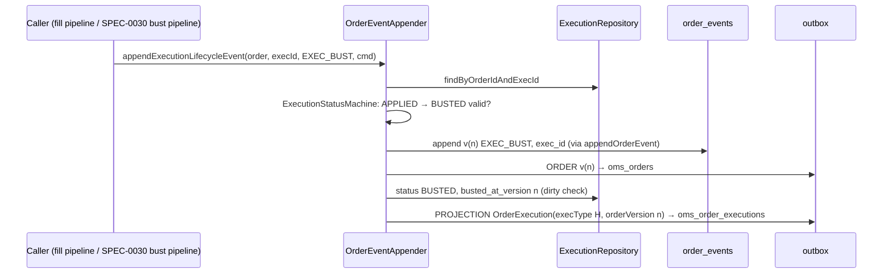

# Design — SPEC-0044: Record execution lifecycle in the order event log

> **Stage 2 of 3 — how.** Concrete enough that the plan can be written without re-reading the
> code, and checked line by line against the architecture policies. Write "None — <reason>" for a
> section that genuinely does not apply.

## Context

A fill runs through `ExecutionCommandProcessor`
(`oms-core/src/main/java/org/example/oms/service/execution/ExecutionCommandProcessor.java`), a
pipeline of seven tasks. The ones that matter here:

- `CalculateOrderQuantitiesTask` (200) computes `avgPx` from
  `ExecutionRepository.sumNotionalByOrderId`, which sums every execution row of the order.
- `PersistExecutionTask` (400) saves the `Execution` entity
  (`org/example/common/model/Execution.java`, table `executions`). Getters only, `toBuilder`.
- `PublishExecutionEventTask` (600) calls `OrderEventAppender.appendExecutionEvent`. That calls
  `appendOrderEvent`, which takes version `txNr + 1`, writes `order_events` with `saveAndFlush`
  (unique `(order_id, version)` becomes `OptimisticLockingFailureException`), and stages an ORDER
  outbox row. It then stages an EXECUTION row.
- `ProjectTask` (700) runs `OrderExecutionProjection`, which writes `order_execution_view` and
  stages an `OrderExecution` on `oms_order_executions` through `OrderEventAppender.stageMessage`.

The event log entity `OrderEvent` has no execution reference. `Event` has no execution lifecycle
values. `OrderStateMachineConfig.product()` has no `FILLED → LIVE`.

`ValidateLifecycleActionTask` (`service/lifecycle/tasks`) checks REJECT, CANCEL, EXPIRE and CLOSE
against the order state machine. It hand-codes `CANCEL_REQUEST` (LIVE, leaves > 0, cancel state
not PCXL) and `CANCEL_REJECT` (cancel state PCXL, state not CLOSED). `CancelState` has no value for
"no cancel activity"; the field is `null` then.

`OrderReplayService.replayAt` reads the snapshot of the latest event at or below a version.
`ProjectionRebuilder` matches fill events to executions by the execId in the stored
`ExecutionCreateCmd`, and by position when there is none. The query endpoint
`GET /api/query/orders/{orderId}/events` is `OrderEventController` → `OrderEventReadService` →
`OrderEventRepository.findByOrderIdOrderByVersionAsc`, mapped by `OrderEventDtoMapper`. That
mapper maps `Event` to the contract's `OrderEventType` by name, so compilation fails if they
differ.

**Closest examples followed.**
- Event recording: `OrderEventAppender.appendExecutionEvent`, extended as a sibling method.
- Migration with backfill and a tag: `006-order-event-command-id.yaml` and
  `CommandIdBackfillMigrationIntegrationTest`.
- State machine configuration: `OrderStateMachineConfig` and `OrderStateMachineConfigTest`.
- Query filter: the optional filters of `getExecutions` in `oms-query-api.yml`.

**Specs read:** `state-machine-framework_spec.md`, `task-orchestration-framework_spec.md`,
`openapi-contracts.md` section 7.2, `testing-patterns.md`, the review document sections 4 to 6,
and target architecture sections 4 and 5.3.

## Approach

The execution stays an entity inside the order aggregate. Every change about it is one order event
carrying `exec_id`. The `executions` row holds the execution's current status, and the log holds
its history.



Where each proposal change lands:

| Change | Where |
|---|---|
| `order_events.exec_id` | `011-execution-lifecycle.yaml`; `OrderEvent.execId`; `appendOrderEvent` gets a private overload taking an execId |
| `EXEC_BUST`, `EXEC_CORRECT`, `EXEC_WHACK` | `Event` enum; `OrderEventType` in `oms-query-api.yml` |
| `FILLED → LIVE` | `OrderStateMachineConfig.product()` |
| Execution columns | changelog; `Execution` fields; new enum `org.example.common.model.ExecutionStatus` |
| New fill sets them | `appendExecutionEvent` calls `execution.recordApplied(version, rootOrderId)` and passes `execution.getExecId()` as the event's execId |
| `appendExecutionLifecycleEvent` | new public method on `OrderEventAppender` |
| avgPx from APPLIED fills only | `ExecutionRepository.sumNotionalByOrderId` JPQL adds `and e.status = APPLIED` |
| `executionsAt` | `OrderReplayService.executionsAt(orderId, version)` over the new `ExecutionRepository.findInForceAt` query |
| `execId` filter | `oms-query-api.yml`; `OrderEventController`; `OrderEventReadService.findByOrderId(orderId, execId)`; `OrderEventRepository.findByOrderIdAndExecIdOrderByVersionAsc` |
| Cancel-state and execution-status machines | new `CancelStateMachineConfig` and `ExecutionStatusMachineConfig` in `org.example.common.state`; `ValidateLifecycleActionTask` consults the first, the appender the second |
| No positional fallback | `ProjectionRebuilder.match` uses `OrderEvent.getExecId()` only; `execIdOf` and the positional branch are deleted |

### `OrderEventAppender.appendExecutionLifecycleEvent`

```java
/**
 * Records a bust, correction or whack of one of the order's executions. The caller has already
 * applied the quantity and state change to the order and saved it.
 * @return the version assigned to the appended event
 * @throws IllegalArgumentException if the event is not an execution lifecycle event, or the order
 *         has no execution with this execId
 * @throws StateTransitionException if the execution's status does not allow it
 */
public long appendExecutionLifecycleEvent(Order order, String execId, Event event, Command command)
```

The steps, all in the caller's transaction:

1. Map `event` to a target status and an execType: `EXEC_BUST` → `BUSTED`, `H`;
   `EXEC_WHACK` → `BUSTED`, `H`; `EXEC_CORRECT` → `CORRECTED`, `G`. Any other event throws
   `IllegalArgumentException`. The mapping lives in a small package-private enum
   `ExecutionLifecycleEffect` next to the appender, so it reads as one table.
2. Load the execution with `executionRepository.findByOrderIdAndExecId(order.getOrderId(), execId)`.
   If it is absent, throw `IllegalArgumentException("No execution <execId> on order <orderId>")`.
3. Check `ExecutionStatusMachineConfig.create().isValidTransition(current, target)`. If it is not
   valid, throw `StateTransitionException(current, target, "<event> not allowed for execution …")`.
4. Call `appendOrderEvent(order, event, command, execId)`. This writes the event and the ORDER
   outbox row, and counts the metric.
5. Call `execution.recordReversal(target, version)`. This sets `status`, and sets
   `bustedAtVersion` only when it is null, so a later bust of a `CORRECTED` execution keeps the
   first value. The managed entity is flushed at commit.
6. Build the record with
   `orderExecutionMessageMapper.toOrderExecutionMessage(execution.toBuilder().execType(<H|G>).build(), order, version, now)`.
   The copy is never saved, so the stored execType stays `F`. Stage it with
   `stageMessage(new StagedMessage(orderExecutionTopic, partitionKey(order), version, record))`.
7. Log at INFO with orderId, execId, event, version and the new status.

Steps 2 and 3 run before any write, so a refusal writes nothing even before rollback.

## Contract Changes

`oms-contracts/src/main/openapi/oms-query-api.yml`. Both changes are additive (P-04).

```yaml
  /orders/{orderId}/events:
    get:
      operationId: getOrderEvents
      description: |
        Every entry of the order's event log, in ascending `version` (the order in which the
        changes happened). With `execId`, only the entries about that execution: its fill and
        any bust, correction or whack of it. Returns an empty array when no events match; whether
        the order exists is answered by `searchOrders`.
      parameters:
        - name: orderId
          # unchanged
        - name: execId
          in: query
          required: false
          schema:
            type: string
          description: >-
            Only entries about this execution (the venue's execId, as on the fill). Matches
            order_events.exec_id.
```

```yaml
    OrderEventType:
      type: string
      description: The kind of change an event-log entry records.
      enum: [NEW_ORDER, ACK, PARTIAL_FILL, FILL, CXL, REJ, CXL_REQUEST, CXL_REJ, EXP, CLOSE,
             EXEC_BUST, EXEC_CORRECT, EXEC_WHACK]
```

**Generated code that changes.**
- The `OrderEventType` model in `org.example.common.model.query` (oms-contracts) gains three values.
- `OrdersApi.getOrderEvents` (oms-core) gains a second `String execId` parameter.
- `OrderEventDto` is unchanged.

**Avro: none.** `execType` is a nullable string on both `OrderExecution.avsc` and `Execution.avsc`,
so `H` and `G` need no schema change.

## Data & Persistence

**New file** `oms-core/src/main/resources/db/changelog/011-execution-lifecycle.yaml`, included last
in `db.changelog-master.yaml`. Files 001 to 010 are not touched. If SPEC-0045 is implemented
first, this file becomes 012, and statement 3 of changeset `025` names
`order_execution_projection`. The plan checks which name exists before writing it.

| Changeset | Content |
|---|---|
| `023-tag-before-execution-lifecycle` | `tagDatabase: before-011-execution-lifecycle`, used by the migration test |
| `024-order-events-exec-id` | `addColumn order_events.exec_id VARCHAR(255)`. Backfill 1 from the stored command, backfill 2 by position. `createIndex idx_order_events_order_id_exec_id (order_id, exec_id)`. Rollback: drop index, drop column |
| `025-executions-lifecycle` | `addColumn executions`: `status VARCHAR(16) NOT NULL DEFAULT 'APPLIED'`, `order_version BIGINT`, `root_order_id VARCHAR(255)`, `exec_ref_id VARCHAR(255)`, `busted_at_version BIGINT`. Three backfills. Indexes `idx_executions_root_order_id`, `idx_executions_transact_time`. Rollback: drop indexes, drop the five columns |

Backfill SQL, in order:

```sql
-- 024 (1) from the stored command
UPDATE order_events SET exec_id = transaction -> 'execution' ->> 'execId'
 WHERE event IN ('PARTIAL_FILL', 'FILL')
   AND transaction -> 'execution' ->> 'execId' IS NOT NULL;

-- 024 (2) fills stored without a command: by position among what is still unmatched, the k-th
-- unmatched fill event ↔ the k-th execution no event names, and only where the two counts agree
-- (changed during verify; see Alternatives & Decisions)
UPDATE order_events o SET exec_id = x.execid
  FROM (SELECT id, order_id, row_number() OVER (PARTITION BY order_id ORDER BY version) AS k,
               count(*) OVER (PARTITION BY order_id) AS n
          FROM order_events WHERE event IN ('PARTIAL_FILL', 'FILL') AND exec_id IS NULL) f
  JOIN (SELECT e.order_id, e.execid, row_number() OVER (PARTITION BY e.order_id ORDER BY e.id) AS k,
               count(*) OVER (PARTITION BY e.order_id) AS n
          FROM executions e
         WHERE NOT EXISTS (SELECT 1 FROM order_events c
                            WHERE c.order_id = e.order_id AND c.exec_id = e.execid)) x
    ON x.order_id = f.order_id AND x.k = f.k AND x.n = f.n
 WHERE o.id = f.id;

-- 025 (3) order_version from the projection table (the goal's source)
UPDATE executions e SET order_version = v.order_version
  FROM order_execution_view v WHERE v.order_id = e.order_id AND v.execid = e.execid;

-- 025 (4) the rest from the fill event now addressable by exec_id
UPDATE executions e SET order_version = o.version
  FROM order_events o
 WHERE e.order_version IS NULL AND o.order_id = e.order_id AND o.exec_id = e.execid
   AND o.event IN ('PARTIAL_FILL', 'FILL');

-- 025 (5) the Kafka key, without a join at read time
UPDATE executions e SET root_order_id = COALESCE(r.root_order_id, r.order_id)
  FROM orders r WHERE r.order_id = e.order_id;
```

`order_version` and `root_order_id` stay nullable. An orphan execution row with no fill event or
order must not fail the upgrade; it simply has no version and `executionsAt` never returns it.

**Entities.**
- `OrderEvent`: add `@Column(name = "exec_id") private String execId;`.
- `Execution`: add these fields.
  - `@Enumerated(STRING) @Column(nullable = false) @Builder.Default ExecutionStatus status = APPLIED`
  - `Long orderVersion`, `String rootOrderId`, `String execRefId`, `Long bustedAtVersion`
  - Two intent-named mutators instead of setters, so status changes have one path:
    `recordApplied(long orderVersion, String rootOrderId)` and
    `recordReversal(ExecutionStatus status, long version)`.
- New enum `org.example.common.model.ExecutionStatus { APPLIED, BUSTED, CORRECTED }`, persisted by
  name.

**Repositories.**
- `ExecutionRepository.sumNotionalByOrderId`:
  `... where e.orderId = :orderId and e.status = org.example.common.model.ExecutionStatus.APPLIED`.
- `ExecutionRepository.findByOrderIdAndExecId(String, String)` returns `Optional<Execution>`.
- `ExecutionRepository.findInForceAt(orderId, version)`, ordered by `orderVersion`:
  ```sql
  select e from Execution e where e.orderId = :orderId and e.orderVersion <= :version
    and (e.bustedAtVersion is null or e.bustedAtVersion > :version) order by e.orderVersion
  ```
- `OrderEventRepository.findByOrderIdAndExecIdOrderByVersionAsc(String, String)`.

**Concurrency and uniqueness (P-08).** Nothing changes. `(order_id, version)` on `order_events` is
still the optimistic lock, and a lifecycle event goes through `appendOrderEvent` like every other
event. `(order_id, execid)` on `executions` is untouched.

## Events & Messaging

- **`order_events` (P-05).** Fill events now carry `exec_id`. `EXEC_BUST`, `EXEC_CORRECT` and
  `EXEC_WHACK` are appended through `appendOrderEvent` with the next version, the command, the
  resulting state and the snapshot. Replay is unchanged: it reads snapshots, and the new events
  have them.
- **Outbox (P-06).** A lifecycle event stages two rows:
  - an ORDER row (`oms_orders`, key = root order id, `aggregate_version` = n);
  - a PROJECTION row (`oms_order_executions`, same key and version) carrying an `OrderExecution`
    with execType `H` or `G`.

  It stages nothing on `oms_executions`, which is SPEC-0030's to define. No `KafkaTemplate` is
  added.
- **Ordering.** Both rows share the order's key and are staged in id order after the event. The
  relay publishes per aggregate in id order, so a consumer sees the reversal after the fill it
  reverses, on the same partition.
- **Consumer idempotency.** The reversal record has the fill's `(orderId, execId)` and a higher
  `orderVersion`. The streaming service's dedup on `(orderId, execId, orderVersion)` therefore lets
  it through once and drops redeliveries
  (`KafkaEventStreamProvider.isRedelivery`). Booking is to use the same key, as `kafka-topics.md`
  already says.
- **Not emitted yet.** Until SPEC-0030 adds a processor, no production path calls the new method, so
  no H or G record reaches a topic.

## Domain, State & Orchestration

**Order state machine.** `OrderStateMachineConfig.product()` adds
`.addTransition(State.FILLED, State.LIVE)`. Its Javadoc diagram gets "FILLED → LIVE (a bust that
reopens quantity, SPEC-0044)". The fill pipeline cannot take this path:
- `DetermineOrderStateTask` only moves to LIVE when leaves is greater than 0;
- `ValidateExecutionTask` refuses fills unless the order is LIVE;
- so a FILLED order never reaches it on a fill.

**Execution-status machine.** New `ExecutionStatusMachineConfig`:

```java
StateMachineConfig.builder(ExecutionStatus.class)
    .addInitialState(ExecutionStatus.APPLIED)
    .addTransitions(ExecutionStatus.APPLIED, ExecutionStatus.BUSTED, ExecutionStatus.CORRECTED)
    .addTransition(ExecutionStatus.CORRECTED, ExecutionStatus.BUSTED)
    .addTerminalState(ExecutionStatus.BUSTED)
    .build();
```

It has `config()` and `create()` returning a `StateMachine<ExecutionStatus>`, as the order config
does.

**Cancel-state machine.** `CancelState` is a contract enum (Avro `CancelState.avsc`, OpenAPI) and
"no cancel activity" is `null`. The machine is therefore over a new internal enum
`CancelStateMachineConfig.Node { NONE, PCXL, CXL, REJ, PMOD }`, with
`Node.of(CancelState)` mapping `null` to `NONE`. No contract changes. The transitions reproduce
today's rules exactly:

```
NONE, REJ, CXL, PMOD → PCXL     (CXL_REQUEST: allowed unless a cancel is already pending)
PCXL → REJ                      (CXL_REJ)
NONE, PCXL → CXL                (venue cancel; documented, not consulted: CANCEL is governed by
                                 the order state machine, as today)
```

`ValidateLifecycleActionTask` becomes:

```java
case CANCEL_REQUEST -> state == State.LIVE && isPositive(order.getLeavesQty())
        && cancelStates.isValidTransition(Node.of(order.getCancelState()), Node.PCXL);
case CANCEL_REJECT -> state != State.CLOSED
        && cancelStates.isValidTransition(Node.of(order.getCancelState()), Node.REJ);
```

The order-state guards stay as order-level conditions, because they are about the order, not the
cancel state. Only the cancel-state rules move into configuration. The task keeps its order (100),
its refusal message and its `markValidationFailed` path, so REST still answers 400 and Kafka still
acknowledges, as today.

**Pipelines.** No pipeline is added or reordered here. The fill pipeline changes only inside
`appendExecutionEvent` (exec_id, `recordApplied`) and the notional query. SPEC-0030 will build the
bust pipeline: validate (consulting `ExecutionStatusMachineConfig` and the order machine),
recalculate, save, then `appendExecutionLifecycleEvent`. The appender's own checks are a safety net
that keeps the method from writing an invalid change whoever calls it.

**Errors (P-13).** The query endpoint gains no error case: an unknown execId is 200 with `[]`.
Refusals from `appendExecutionLifecycleEvent` are exceptions with existing types:
- `IllegalArgumentException` maps to 400 Problem+JSON;
- `StateTransitionException` maps to 409 Problem+JSON;
- `OptimisticLockingFailureException` maps to 409 through the `ConcurrencyFailureException` handler.

`GlobalExceptionHandler` already maps all three, so no handler is added.

## Alternatives & Decisions

- **Decision: executions stay inside the order stream, addressed by `order_events.exec_id`
  (review option B).**
  - Rejected: a separate `execution_events` table. It needs two version sequences per fill in one
    transaction, cannot order a bust against a later fill without timestamps, and duplicates the
    order event a bust needs anyway.
  - Rejected: execution as its own aggregate. It breaks the one-transaction invariant between a
    fill and `cumQty`.
- **Decision: `appendExecutionLifecycleEvent` takes an execId and loads the execution itself.**
  - Rejected: taking an `Execution` as the review sketched. The caller could pass a detached or
    foreign execution, and AC-5's "unknown execId" would have no single place to be refused.
- **Decision: the appender checks the execution-status transition itself.**
  - Rejected: a `ValidateExecutionLifecycleTask` in this ticket. There is no bust pipeline to put it
    in until SPEC-0030; a task with no pipeline would be dead code. The appender check is cheap,
    and SPEC-0030's task adds the pipeline-level check.
- **Decision: the cancel-state machine is over an internal `Node` enum with `NONE`.**
  - Rejected: adding `NONE` to `CancelState`. That changes the Avro and OpenAPI enums and every
    stored null, for a value only the validator needs.
  - Rejected: `StateMachineConfig` accepting null states. That would be a framework change that
    every other machine would have to reason about.
- **Decision: the reversal record is built from a non-persisted `toBuilder` copy with execType H or G.**
  - Rejected: overwriting `executions.exec_type`. The row's execType records what the venue sent
    (`F`); the lifecycle lives in `status`.
- **Decision: `order_version` is backfilled from the projection table first, then from the fill
  event.** The goal names the projection table. The second step covers fills older than the
  projection, so no execution is left without a version when a matching event exists.
- **Decision: `busted_at_version` is also set by a correction and never overwritten.** The column
  then means "version from which this execution no longer counts", which is the only thing
  `executionsAt` needs (proposal open question, resolved).
- **No new dependency, plugin or build change** (P-17).
- **Changed after the independent review: the positional backfill is restricted.** The first version
  numbered all fill events against all executions of an order and filled only null `exec_id`s.
  When an order had an execution without a fill event, an uncommanded fill could be given an
  execution that a commanded fill already named. That would duplicate an `exec_id` and make the
  `order_version` backfill nondeterministic. Matching now ranks only unmatched events against
  unclaimed executions, and only where their counts agree. Anything ambiguous stays null.
  Rejected: failing the changeset on a duplicate. That would block the upgrade on old data that a
  rebuild can report precisely.
  Changeset `024` is new in this ticket and not yet applied anywhere outside test containers, so
  changing it does not touch an applied checksum (P-07).
- **Changed during implementation: `OrderAcceptCommandProcessor` refuses an ACK on a FILLED order
  explicitly.** It asked the machine whether `current → LIVE` is valid. With `FILLED → LIVE` in the
  machine, a late or redelivered ACK would have reopened a filled order. The machine has no event
  labels, so the processor adds `currentState == FILLED` to its refusal condition, with the same
  message. A test was added (`OrderAcceptCommandProcessorTest#process_onFilledOrder_isRefused`).
  The other machine callers were checked:
  - `DetermineOrderStateTask` only runs after `ValidateExecutionTask` has required LIVE;
  - `SetOrderStateTask` targets UNACK;
  - lifecycle actions never target LIVE.

  Rejected: labelling transitions with events in `StateMachineConfig`. It is a framework change for
  one caller, and it is SPEC-0030's bust pipeline that needs the event-specific guard.

## Risks & Mitigations

| Risk | Mitigation |
|---|---|
| The positional backfill mismatches when fill events and executions of an old order differ in count | Position is applied only among unmatched fill events and unclaimed executions, and only where their counts agree per order. An ambiguous fill keeps a null `exec_id`, and the rebuild then fails loudly naming the order and version (AC-12) instead of projecting a wrong row. No execution can be named by two fill events; the migration test seeds an orphan execution to prove it |
| The backfill JSON path does not match how Jackson 3 stores `ExecutionCreateCmd` | The migration test (AC-1) seeds a row in the stored shape and asserts the column. The integration test of AC-2 asserts a live fill, and the review's stored example confirms the `execution.execId` path |
| `UPDATE` on large `order_events` and `executions` tables during upgrade | Today's volumes are development scale. The statements are set-based, with one pass each. Documented in the changelog header next to the stop-old-instances note style of 010 |
| Old instances running during the upgrade write executions without `order_version` | Same upgrade rule as 010: stop old instances first. Stated in the changelog header |
| The `status` filter on `sumNotionalByOrderId` changes avgPx for existing orders | Every existing row is backfilled `APPLIED`, so the sum is unchanged until a bust exists (AC-8 proves the exclusion) |
| Consumers that map `OrderEventType` exhaustively | No such mapping found in oms-ui, developer-cockpit or oms-mcp-server. The contract change is additive, and verification runs every consumer module |
| `FILLED → LIVE` becoming reachable by a non-bust path | Only `appendExecutionLifecycleEvent` callers (SPEC-0030) move FILLED to LIVE. The fill pipeline and lifecycle actions never target LIVE from FILLED, which `OrderStateMachineConfigTest` and the lifecycle tests keep proving |

## Test Strategy

Tests are written first (P-14). The migration test follows `CommandIdBackfillMigrationIntegrationTest`.
Tests that need Kafka extend `AbstractKafkaPostgresIntegrationTest` through
`AbstractFillFlowIntegrationTest`. Tests that only need Postgres use the `kafka.enabled=false`
pattern of `EventSourcingIntegrationTest`.

| AC | Level | Test class#method | What it asserts |
|---|---|---|---|
| AC-1 | integration (migration) | `ExecutionLifecycleMigrationIntegrationTest#legacyFillsAreBackfilled` (new) | Migrate to `before-011-execution-lifecycle` and seed an ACK, a PARTIAL_FILL with a stored command (EX-1), a FILL without a command, two executions and a projection row at version 3, then start the app. Asserts: `exec_id` is EX-1, EX-2, null; every execution is APPLIED with the right `order_version` and `root_order_id`; the index exists in `pg_indexes` |
| AC-2 | integration | `ExecutionLifecycleIntegrationTest#fillRecordsExecIdStatusVersionAndRoot` (new) | After a fill through `ExecutionCommandProcessor`: `order_events.exec_id`, plus `executions.status`, `order_version` (= event version), `root_order_id`, and null `exec_ref_id` and `busted_at_version` |
| AC-3 | integration | `ExecutionLifecycleIntegrationTest#bustRecordsEventStatusAndStagesReversal` (new) | Fills EX-1 and EX-2, then a bust inside `TransactionTemplate`. Asserts the v5 row, EX-1 BUSTED at 5 with EX-2 unchanged, an ORDER outbox row at v5, and a decoded PROJECTION payload with execType H, orderVersion 5, cumQty 60, leavesQty 40 and the root key |
| AC-4 | integration | `ExecutionLifecycleIntegrationTest#correctionMarksCorrectedAndStagesG`, `#whackMarksBustedAndStagesH` (new) | Status, `busted_at_version` and execType of the staged record |
| AC-5 | integration | `ExecutionLifecycleIntegrationTest#bustOfBustedOrUnknownExecutionIsRefusedAndWritesNothing` (new) | Expected `StateTransitionException` and `IllegalArgumentException`. The event count, outbox count, `tx_nr` and EX-1's status are unchanged after rollback |
| AC-6 | integration | `ExecutionLifecycleIntegrationTest#concurrentLifecycleEventsFromSameVersionOneWins` (new) | Two detached copies of the order at the same `txNr`, each appended in its own transaction. The second throws `OptimisticLockingFailureException`, and exactly one EXEC_* event exists |
| AC-7 | unit | `OrderStateMachineConfigTest#productTransitionsAreExactly` (updated to include FILLED → LIVE), `ExecutionStatusMachineConfigTest#transitionsAreExactly` (new) | Exhaustive matrix of all state pairs against the expected set |
| AC-8 | integration | `ExecutionLifecycleIntegrationTest#bustedFillIsExcludedFromAvgPx` (new); unit `CalculateOrderQuantitiesTaskTest` unchanged | An order of 200: EX-1 and EX-2, bust EX-1, then fill EX-3 40 @ 173. Order and EX-3 `avgPx` = 172.40000000 |
| AC-9 | integration | `ExecutionLifecycleIntegrationTest#executionsAtReturnsExecutionsInForce` (new) | `executionsAt` at 2, 4 and 5 returns {}, {EX-1, EX-2} and {EX-2} |
| AC-10 | integration (MockMvc) | `OrderEventQueryIntegrationTest#execIdFilterReturnsOnlyThatExecutionsEvents`, `#unknownExecIdReturnsEmptyArray` (new methods); `#returnsEventLogInVersionOrder` (existing) | With `?execId=EX-1`, versions [3, 5] and events [PARTIAL_FILL, EXEC_BUST]. Without it, all five. Unknown execId gives `[]` |
| AC-11 | unit + integration | `CancelStateMachineConfigTest#transitionsAreExactly` (new); `ValidateLifecycleActionTaskTest#cancelRulesMatchThePreviousPreconditions` (new, parameterised over state × cancel state × action, expected values taken from the old boolean expressions); `OrderLifecycleCommandProcessorTest` and `OrderLifecycleIntegrationTest` unchanged and passing | Same allow or refuse outcome for every combination |
| AC-12 | integration | `ProjectionRebuildIntegrationTest#rebuild_reproducesTheViewWithoutPublishing` (existing), `#unmatchedFillEvent_failsAndLeavesTheViewUnchanged` (existing), `#fillEventWithoutExecId_failsNamingOrderAndVersion` (new: nulls one `exec_id` by JDBC) | Matched by exec_id. A null exec_id gives a 500 whose error names the order and `v<n>`, and the table is unchanged |

## Policy Compliance

| Policy | Title | Status | How / Justification |
|---|---|---|---|
| P-01 | Contracts live only in oms-contracts | comply | Only `oms-contracts/src/main/openapi/oms-query-api.yml` changes |
| P-02 | Specification before code, generated models only | comply | The contract change is the first implementation task, followed by regeneration in oms-contracts and `openApiGenerateQuery`. `OrderEventType` and `OrdersApi` stay generated |
| P-03 | Never edit generated code | comply | Nothing under `build/generated*` is edited |
| P-04 | Contracts evolve compatibly | comply | Optional query parameter and three new enum values, both additive. No Avro change |
| P-05 | Every state change is recorded in the event log | comply | Lifecycle events go through `appendOrderEvent`, with version, command, state and snapshot. Execution status changes only inside the method that appends the event |
| P-06 | Kafka only through the transactional outbox | comply | Reversal records are staged with `stageMessage`. No `KafkaTemplate` is added |
| P-07 | Schema changes through new Liquibase changesets | comply | New `011-execution-lifecycle.yaml` (changesets 023 to 025, with rollback). 001 to 010 untouched. Entities match the migrated schema under `validate` |
| P-08 | Concurrency and idempotency are explicit | comply | Lifecycle events use the `(order_id, version)` lock (AC-6). A repeated bust is refused by the status machine (AC-5). `(order_id, execid)` is unchanged |
| P-09 | Commands and queries stay separate | comply | The query endpoint gains a read-only filter. Writes happen only in the appender, on the command path |
| P-10 | State transitions go through the state machine and task pipeline | comply | `FILLED → LIVE` is in the order configuration. Cancel-state and execution-status rules become `StateMachineConfig` instances, consulted by `ValidateLifecycleActionTask` and the appender. The bust pipeline itself is SPEC-0030 |
| P-11 | Layering and conventions | comply | Thin controller, then service, then repository. Configs sit beside `OrderStateMachineConfig`. Lombok on entities. Mapping reuses `OrderExecutionMessageMapper` and `OrderEventDtoMapper` |
| P-12 | Jackson 3 only | comply | No new JSON code. The backfill is SQL |
| P-13 | Errors and validation follow the framework specs | comply | Existing Problem+JSON handlers cover all three exception types. Lifecycle refusals keep their current path and message |
| P-14 | Test first, every acceptance criterion is proven by an automated test | comply | Each AC maps to a named test above. Each task writes its test first |
| P-15 | Observability | comply | `oms_order_events{event}` counts the new events through `recordEvent`. An INFO log line for each lifecycle event carries orderId, execId, event and version. No new flow needs its own metric before SPEC-0030 |
| P-16 | Security | comply | No secrets. `execId` is a bound parameter in a derived query, never concatenated |
| P-17 | Simplicity and dependencies | comply | No new dependency. One appender method, two small configs, and a positional fallback removed |
| P-18 | Modules build standalone | comply | `spec verify` runs oms-contracts, oms-core and every consumer in `impacts` (streaming service, mcp server, exchange simulator) |
| P-19 | Documentation follows behaviour | comply | Pages listed below |

## Knowledge Base Updates

- `oms-knowledge-base/domain/execution.md`: the new fields `status`, `orderVersion`,
  `rootOrderId`, `execRefId` and `bustedAtVersion`; the status machine; avgPx over `APPLIED` only.
- `oms-knowledge-base/domain/order-event.md`: `exec_id` and its index; the three EXEC_* events; the
  `execId` filter.
- `oms-knowledge-base/domain/order-state.md`: `FILLED → LIVE` for a reopening bust.
- `oms-knowledge-base/oms-concepts/order-lifecycle.md`: the transition table and diagram,
  section 10.1 event types, and cancel-state rules as configuration.
- `oms-knowledge-base/oms-concepts/execution-reporting.md`, section 5: how a bust is recorded (event,
  status, H/G record), with processing deferred to SPEC-0030.
- `oms-knowledge-base/oms-concepts/projections.md`: the rebuild matches by `exec_id`, and the
  positional fallback is gone.
- `oms-knowledge-base/functional-requirements/FR-015-bust-executions.md` and `FR-016-…`: note that
  the recording side exists (SPEC-0044), while command processing remains not implemented
  (SPEC-0030).
