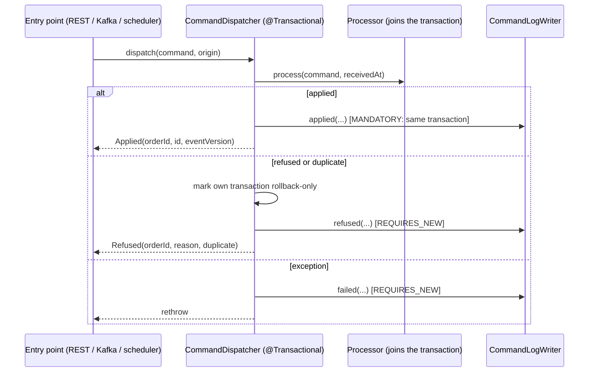

# Design — SPEC-0046: Add command log and refuse duplicates everywhere

> **Stage 2 of 3 — how.** Concrete enough that the plan can be written without re-reading the
> code, and checked line by line against the architecture policies. Write "None — <reason>" for a
> section that genuinely does not apply.

## Context

Commands enter oms-core in three places, and each routes them itself:

| Entry point | Routing today | Processors called |
|---|---|---|
| `api/CommandController.executeCommand` (REST) | `instanceof` chain; builds `CommandResult` per type | `OrderCreateCommandProcessor`, `ExecutionCommandProcessor.process(Execution, Command)`, `OrderAcceptCommandProcessor`, `OrderLifecycleCommandProcessor` |
| `config/CommandListener.handle` (Kafka) | `switch` over Avro records, mapping each to a cmd model through `CommandHeaderMapper`; counts `oms.commands.consumed{type,outcome}` | the same four |
| `service/endofday/EndOfDayService`, `OrderExpiryService` (scheduler) | direct | `OrderLifecycleCommandProcessor` |

Each processor is `@Transactional`. A refusal (unsuccessful result) calls `setRollbackOnly`; a
concurrency conflict is rethrown (`PipelineResults.rethrowConcurrencyFailure`).

- **Lifecycle dedup.** `DeduplicateCommandTask` (order 75) runs after `LoadOrderTask` (50, which
  takes `findLockedByOrderId`). It refuses with the message "Duplicate command …".
- **Accept.** `OrderAcceptCommandProcessor` validates by hand, stamps the market-ack SLA through
  `OrderSlaRecorder.stampMarketAck`, and calls the appender directly. A reused commandId there
  raises a `DataIntegrityViolationException` on `uq_order_events_order_id_command_id`. REST maps it
  to a generic 409; Kafka retries it and then sends it to the dead-letter topic.
- **Fills.** They have no commandId dedup. `ExecutionCommandProcessor.process(Execution)` passes a
  null command.
- **Kafka error handling.** `KafkaConsumerConfig.commandErrorHandler` sends
  `IllegalArgumentException` straight to the dead-letter topic and retries anything else.
- **No authentication.** No security framework is configured.

**Closest examples followed.**
- Event-log query: `OrderEventController`, `OrderEventReadService` and `OrderEventDtoMapper`
  (SPEC-0035) for the command-log query.
- Tasks: `DeduplicateCommandTask`, for reuse on the fill pipeline.
- Cause-chain helper: `PipelineResults.rethrowConcurrencyFailure`, for detecting a duplicate.
- Migration: `011-execution-lifecycle.yaml`.

**Specs read:** `error-handling.md`, `task-orchestration-framework_spec.md`,
`state-machine-framework_spec.md`, `openapi-contracts.md` and target architecture sections 4.2
and 5.4.

## Approach



**New `org.example.oms.service.command.CommandDispatcher`.** It is the one place commands are
routed, replacing the `instanceof` chain in the controller and the processor calls in the listener
and scheduler.

- **Signature.** `CommandDispatch dispatch(Command command, CommandOrigin origin)`, annotated
  `@Transactional`. `CommandOrigin(CommandSource source, String principal, Instant receivedAt)` is
  a record with the factories `rest(receivedAt)`, `kafka(producer, receivedAt)` and
  `scheduler(name, receivedAt)`.
- **Routing.**
  - `OrderCreateCmd` goes to `OrderCreateCommandProcessor`.
  - `ExecutionCreateCmd` goes to `ExecutionCommandProcessor`, which maps the execution itself.
  - Every lifecycle command, `OrderAcceptCmd` included, goes to `OrderLifecycleCommandProcessor`.
  - Any other type gives `Unsupported`, logged `REFUSED` with "not implemented". REST answers 501;
    Kafka throws `IllegalArgumentException` as today, so the record is dead-lettered and logged
    `FAILED`.
- **Applied.** The dispatcher writes the `APPLIED` row in the same transaction, before returning,
  and returns `CommandDispatch.Applied(orderId, resultId, eventVersion, message)`.
- **Refused.** The processor has already marked rollback-only. The dispatcher also calls
  `setRollbackOnly()` on its own transaction status. The outer commit then sees local
  rollback-only and rolls back quietly, instead of throwing `UnexpectedRollbackException` for a
  rollback-only it did not set. It writes the `REFUSED` row through `REQUIRES_NEW` and returns
  `CommandDispatch.Refused(orderId, reason, duplicate)`.
- **Exception.** It writes `FAILED` through `REQUIRES_NEW`, with the exception's most specific
  message, and rethrows. Concurrency failures, a missing order on a fill and decoding problems
  all take this path.
- **Messages.** They are the ones each branch of the controller builds today, moved here:
  - "Order created successfully: <id>";
  - "Execution processed successfully";
  - "Order accepted successfully: <id>";
  - "<ACTION> applied to order <id>".

  The REST answers keep their text.

**Entry points become thin.**
- **REST.** `CommandController` maps `Applied` to 201 (create, fill) or 200 (others), and `Refused`
  to 400 with the same `CommandResult` body as today. `Refused` with `duplicate` throws
  `DuplicateCommandException`, which `GlobalExceptionHandler` answers with 409.
- **Kafka.** `CommandListener` maps the Avro record to the cmd model exactly as today. It
  dispatches with `CommandOrigin.kafka(header.getProducer(), receivedTime)`, counts `applied` or
  `refused` (duplicates included), and returns normally, which acknowledges the record. Exceptions
  propagate as today.
- **Scheduler.** `EndOfDayService` and `OrderExpiryService` dispatch with
  `CommandOrigin.scheduler("oms-core:end-of-day", cutoff)` and `("oms-core:expiry", now)`.
  Their per-order loops already catch and count failures; that does not change.

**`CommandLogWriter`** (`service/commandlog`):
- `applied(Command, CommandOrigin, String orderId, long eventVersion)`, with
  `@Transactional(propagation = MANDATORY)`;
- `refused(...)` and `failed(...)`, with `@Transactional(propagation = REQUIRES_NEW)`.

Each builds a `CommandLogEntry`: the commandId through `OrderEventAppender.commandIdOf`, and the
type from `command.getType()`, falling back to the class's simple name. The orderId comes from the
result, or else from the command (`orderId`, or `execution.orderId` for a fill). The reason is
truncated to 1000 characters. `refused` and `failed` catch any exception from their own write,
log it at ERROR, increment `oms.command_log.write_failures` and return (AC-11). The applied write
is not caught: it is part of the change and must commit or fail with it.

**Duplicates, one typed refusal.**
- **`DuplicateCommandException`** is a new runtime exception in `org.example.oms.service` that
  carries orderId and commandId.
- **The constraint race.** `OrderEventAppender.appendOrderEvent` maps a violation of
  `uq_order_events_order_id_command_id` to `DuplicateCommandException`. It uses the same
  constraint-name check as the version conflict, generalised to a `violatedConstraint(e)` helper.
- **The context flag.** `OrderTaskContext` gains a `duplicateCommand` boolean and a
  `markDuplicate(message)` that also marks validation failed. `DeduplicateCommandTask` calls it,
  and its log line drops the word "Lifecycle".
- **Detection.** `PipelineResults.isDuplicate(PipelineResult, OrderTaskContext)` is true when the
  context is marked, or when any failed task's cause chain holds a `DuplicateCommandException`.
  Each processor's result gains `duplicate` and `eventVersion` fields, set from it and from the
  context's `eventVersion`.
- **The fill pipeline** adds `DeduplicateCommandTask`. Its order (75) sorts before
  `ValidateExecutionTask` (100), and the order is already in the context.
- **Create** is not deduplicated by commandId (proposal, out of scope).

**Accept in the lifecycle pipeline.**
- **The action.** `LifecycleAction.ACCEPT(State.LIVE, null, Event.ACK, false, ReasonEffect.NONE)`,
  the FIX ExecutionReport ExecType 0. `OrderLifecycleCommandProcessor.supports` and `process` accept
  `OrderAcceptCmd`.
- **Validation.** `ValidateLifecycleActionTask` handles ACCEPT with `state == UNACK` and the
  machine's `UNACK → LIVE`. The explicit UNACK keeps SPEC-0044's rule that `FILLED → LIVE` is for
  busts only.
- **SLA stamp.** `ApplyLifecycleActionTask` gains `OrderSlaRecorder`. After building the order for
  ACCEPT, it applies `slaRecorder.stampMarketAck(updated, context.getReceivedTime())`, as the old
  processor did.
- **Removed.** `OrderAcceptCommandProcessor` and its test. Their cases move to
  `OrderLifecycleCommandProcessorTest`, including the FILLED refusal from SPEC-0044.

**The command-less fill overload is removed.** `ExecutionCommandProcessor.process(Execution)` is
deleted. Tests pass an `ExecutionCreateCmd` built from the execution, through a test helper
`TestCommands.fill(Execution)`.

## Contract Changes

`oms-contracts/src/main/openapi/oms-query-api.yml`, version 2.2.0 → **2.3.0**, additive:

```yaml
  /orders/{orderId}/commands:
    get:
      operationId: getOrderCommands
      summary: Command log of one order
      description: |
        Every command received for the order and what became of it: applied, refused or failed,
        oldest first (`receivedAt`, then the order they were logged). A command that failed and was
        retried appears once per attempt. Returns an empty array when nothing was logged for the
        order id.
      tags: [Orders]
      parameters:
        - name: orderId
          in: path
          required: true
          schema: { type: string }
          description: Business order id
      responses:
        '200':
          description: The order's command log, oldest first
          content:
            application/json:
              schema:
                type: array
                items: { $ref: '#/components/schemas/CommandLogEntryDto' }
        '500':
          description: Internal server error
```

```yaml
    CommandSource:
      type: string
      description: Where a command entered the OMS.
      enum: [REST, KAFKA, SCHEDULER]
    CommandOutcome:
      type: string
      description: What became of a command.
      enum: [APPLIED, REFUSED, FAILED]
    CommandLogEntryDto:
      type: object
      description: One command the OMS received and its outcome.
      required: [type, receivedAt, source, outcome]
      properties:
        commandId: { type: string, description: "The command's commandId, when it had one." }
        type: { type: string, description: "The command type, e.g. OrderCancelRequestCmd." }
        orderId: { type: string }
        receivedAt: { type: string, format: date-time, x-java-type: java.time.Instant }
        source: { $ref: '#/components/schemas/CommandSource' }
        principal: { type: string, description: "Who sent it: the Kafka producer or the scheduler; absent on REST until authentication exists." }
        outcome: { $ref: '#/components/schemas/CommandOutcome' }
        reason: { type: string, description: "Why it was refused or failed." }
        eventVersion: { type: integer, format: int64, description: "The event it appended, when applied." }
```

`oms-contracts/src/main/openapi/oms-cmd-api.yml`, version 3.2.0 → **3.3.0**, additive. The
`/execute` operation gains:

```yaml
        '409':
          description: >-
            Conflict: the command's commandId was already applied to the order
            (urn:oms:error:duplicate-command), or the order changed concurrently and the command can
            be retried (urn:oms:error:concurrent-modification). Problem+JSON.
          content:
            application/problem+json:
              schema: { type: object }
```

No Avro change. The generated changes are three new query models and `OrdersApi.getOrderCommands`.

## Data & Persistence

**New file** `oms-core/src/main/resources/db/changelog/013-command-log.yaml`, included last.

| Changeset | Content |
|---|---|
| `028-command-log` | `createSequence command_log_seq`. `createTable command_log` with the columns below. Indexes `idx_command_log_order_id_received_at (order_id, received_at)` and `idx_command_log_command_id (command_id)`. Rollback: drop the table and the sequence |

The `command_log` columns:
- `id BIGINT` (primary key `pk_command_log`);
- `command_id VARCHAR(255)`;
- `type VARCHAR(64) NOT NULL`;
- `order_id VARCHAR(255)`;
- `received_at TIMESTAMPTZ NOT NULL`;
- `source VARCHAR(16) NOT NULL`;
- `principal VARCHAR(255)`;
- `outcome VARCHAR(16) NOT NULL`;
- `reason VARCHAR(1000)`;
- `event_version BIGINT`;
- `logged_at TIMESTAMPTZ NOT NULL`.

**No uniqueness on `command_id`**: one row per attempt (proposal).

**Entity** `org.example.oms.model.CommandLogEntry`. Sequence `command_log_seq` with
`allocationSize = 1`. Enums `CommandSource` and `CommandOutcome` are persisted by name (in
`org.example.oms.model`, separate from the generated query enums and mapped by name).
**Repository** `CommandLogRepository.findByOrderIdOrderByReceivedAtAscIdAsc(String orderId)`.

**Locking and uniqueness on orders** are unchanged (P-08). Accept now takes the lifecycle
pipeline's `findLockedByOrderId`, where the old processor used an unlocked read.

## Events & Messaging

- **`order_events` (P-05).** Unchanged in shape. Accept still appends `ACK`, now through
  `PublishOrderEventTask` in the lifecycle pipeline. Every fill event now stores its command (AC-9).
- **Outbox (P-06).** Unchanged. The command log is not published.
- **Kafka consumption.** A duplicate is now a refusal, acknowledged and counted `refused`, never
  retried or dead-lettered (AC-6). Refusals stay acknowledged; exceptions are still retried or
  dead-lettered as `KafkaConsumerConfig` decides.

## Domain, State & Orchestration

- **State machine.** Unchanged. ACCEPT uses `UNACK → LIVE` and requires UNACK explicitly.
- **Lifecycle pipeline.** Load (50) → Deduplicate (75) → Validate (100) → Apply (300, plus the
  SLA stamp for ACCEPT) → Save (400) → Publish event (500). Accept now runs through it (P-10).
- **Fill pipeline.** Deduplicate (75) is added in front of Validate (100).
- **Errors (P-13).** A new `GlobalExceptionHandler` method maps `DuplicateCommandException` to
  409 Problem+JSON. It has `type: urn:oms:error:duplicate-command`, `title: Duplicate Command`,
  the detail "Command <commandId> was already applied to order <orderId>", and the properties
  `orderId`, `commandId` and `timestamp`. Other refusals keep 400 with the `CommandResult` body,
  and unsupported types keep 501.

## Alternatives & Decisions

- **Decision: one `CommandDispatcher` with its own transaction.**
  - Rejected: logging inside each processor. That makes four places to keep in step, and
    exceptions escape processors before they could log.
  - Rejected: logging in each entry point. That repeats the routing three times; it is already
    repeated twice.
  - Rejected: an AOP aspect. It hides the transaction choreography that matters here.
- **Decision: APPLIED in the command's transaction; REFUSED and FAILED in `REQUIRES_NEW`.**
  Approved in the proposal.
- **Decision: the duplicate is a flag on the result, plus an exception only at the REST edge.**
  - Rejected: throwing out of processors on a duplicate. It would roll back through the Kafka
    error handler, which then needs a not-retryable entry and a recoverer that acknowledges.
    A result is acknowledged by returning normally, as every other refusal is.
- **Decision: accept keeps the explicit `state == UNACK`.** Required by SPEC-0044's `FILLED → LIVE`.
- **Decision: domain enums `CommandSource` and `CommandOutcome` for the entity.** They are kept
  separate from the generated query enums (generated models are contract types; P-02 and P-11
  follow the `Event`/`OrderEventType` precedent).
- No new dependency or build change (P-17).
- **Changed during implementation: unsupported Kafka record types are not logged.** The listener
  maps each Avro record to a command-API model before dispatching. A record type with no such
  model (a quote, a bust before SPEC-0030) has no `Command` to log, so it fails in the listener as
  before. Its trace is the dead-letter topic, the same as an undecodable record. On REST, an
  unsupported type still reaches the dispatcher and is logged `REFUSED` with 501.
- **Changed during implementation: the fill processor keeps `process(Execution, Command)`, with
  the command required** (`Objects.requireNonNull`), instead of taking the command alone. The
  dispatcher does the mapping. Tests that build an `Execution` directly pass
  `TestCommands.fillOf(execution)`. The goal, that every fill event stores its command, holds
  either way.
- **Changed during implementation: `CommandLogWriter` uses a `REQUIRES_NEW` `TransactionTemplate`
  inside a try/catch**, instead of `@Transactional(REQUIRES_NEW)`. An annotated method cannot catch
  a failure of its own commit, and AC-11 needs exactly that failure caught and counted.
- **Changed during implementation: `OrderAcceptCommandProcessor` was deleted with its uncommitted
  SPEC-0044 changes.** Its FILLED guard now lives in `ValidateLifecycleActionTask` (ACCEPT requires
  UNACK), tested by `OrderLifecycleCommandProcessorTest#accept_onAnythingButUnack_refused`.
- **Changed after the independent review: the dispatcher writes the APPLIED row and flushes the
  command's writes inside its guarded block.** A failure there (the APPLIED row itself, or a pending
  insert such as an outbox or projection row) is now logged `FAILED` before the command rolls back.
  Left to the commit, it would have taken the APPLIED row down with the change and left no trace.
  Only a failure of the commit itself, after a successful flush, can still go unlogged; that is
  documented in `domain/command-log.md`. Also from the review: a refused create is reported and
  logged with no order id, as the proposal resolved, instead of the id the pipeline had assigned
  and rolled back.

## Risks & Mitigations

| Risk | Mitigation |
|---|---|
| `UnexpectedRollbackException` when a refused inner transaction meets the outer commit | The dispatcher marks its own status rollback-only before returning. AC-2 and AC-7 run refusals end to end through REST and Kafka |
| A FAILED row for every retried attempt inflates the log | Bounded by the retry budget (four attempts). It is the intended audit of attempts (proposal) |
| The audit write fails and hides the real outcome | Caught, counted, logged; the command result is unchanged (AC-11) |
| REST clients that expect 400 for duplicates | Approved in the proposal. The 409 is declared in the command contract. Only tests in this repository assert it, and they are updated |
| The accept SLA metrics change when accept moves | The same `stampMarketAck(order, receivedTime)` call with the same input. `OrderSlaRecorderTest` and the accept cases in the lifecycle processor test assert the stamp |
| Large test churn from removed classes and overloads | Mechanical; the plan gives it its own task, verified by `compileTestJava` and the touched suites |

## Test Strategy

| AC | Level | Test class#method | What it asserts |
|---|---|---|---|
| AC-1 | integration (MockMvc) | `CommandLogIntegrationTest#appliedRestCommandIsLogged` (new) | The REST cancel request with commandId C-1 is logged: REST, APPLIED, eventVersion = the CXL_REQUEST version, reason null |
| AC-2 | integration (MockMvc) | `CommandLogIntegrationTest#refusedRestCommandIsLoggedAndSurvivesRollback` (new) | 400; no new event; a REFUSED entry with a reason |
| AC-3 | integration (Kafka) | `CommandLogKafkaIntegrationTest#kafkaAcceptIsLoggedWithProducer`, `#refusedKafkaCommandIsAcknowledgedAndLogged` (new) | KAFKA, header commandId and producer, APPLIED with the ACK version; a refused cancel reject is acknowledged (a later sentinel command is processed, and the DLT stays empty for its key) and logged REFUSED |
| AC-4 | integration (Kafka) | `CommandLogKafkaIntegrationTest#fillForUnknownOrderIsDeadLetteredAndLoggedFailed` (new) | The record lands on `commands.DLT`; a FAILED entry with the orderId and "Order not found" |
| AC-5 | integration | `EndOfDayIntegrationTest#scheduledCommandsAreLoggedAsScheduler` (new) | CLOSE logged with SCHEDULER and `oms-core:end-of-day`; an expiry logged with `oms-core:expiry` |
| AC-6 | integration | `DuplicateCommandIntegrationTest#duplicateFillCommandIdOverRestIs409` (new, MockMvc); `CommandLogKafkaIntegrationTest#duplicateFillCommandIdOnKafkaIsAcknowledged` (new) | 409 duplicate-command; acknowledged with the refused counter + 1; no new execution, event or outbox row; a REFUSED entry containing "Duplicate" |
| AC-7 | integration (MockMvc) | `DuplicateCommandIntegrationTest#repeatedLifecycleCommandIs409` (new); `OrderLifecycleIntegrationTest#duplicateCommandId_isRefusedOverRestAndLeavesOrderUnchanged` (updated: 409) | 409 duplicate-command; order unchanged; REFUSED entry |
| AC-8 | integration + unit | `DuplicateCommandIntegrationTest#acceptAppliesOnceAndRefusesRepeatAndNonUnack` (new); `OrderLifecycleCommandProcessorTest` accept cases (ported from `OrderAcceptCommandProcessorTest`: UNACK → LIVE with ACK and the SLA stamp; FILLED, LIVE and NEW refused) | 200 → LIVE, marketAckTime, one ACK; repeat 409; new id on LIVE 400; FILLED 400 |
| AC-9 | integration | `CommandLogKafkaIntegrationTest#everyFillEventStoresItsCommand` (new) | REST and Kafka fills: every fill event's `transaction` is an `ExecutionCreateCmd` |
| AC-10 | integration (MockMvc) | `OrderCommandQueryIntegrationTest#unknownOrderReturnsEmptyArray`, `#entriesHaveOnlyContractedPropertiesInReceivedOrder`, `#apiDocsDeclareTheOperation` (new) | `[]`; the property set; ordering; operationId |
| AC-11 | integration | `CommandLogIntegrationTest#logWriteFailureLeavesTheResultUnchanged` (new; `@MockitoSpyBean CommandLogRepository` throws on a REFUSED save) | The same 400 body as without the failure; `oms.command_log.write_failures` + 1 |

Unit tests: `CommandDispatcherTest` (routing, and mapping results to outcomes);
`CommandListenerTest` and `CommandControllerWebMvcTest` reworked onto a mocked dispatcher.

## Policy Compliance

| Policy | Title | Status | How / Justification |
|---|---|---|---|
| P-01 | Contracts live only in oms-contracts | comply | Both changes are in `oms-contracts/src/main/openapi` |
| P-02 | Specification before code, generated models only | comply | The contract tasks come first; the query models and `OrdersApi` are generated |
| P-03 | Never edit generated code | comply | Nothing generated is edited |
| P-04 | Contracts evolve compatibly | comply | A new operation and schemas; a declared 409. All additive, minor versions bumped. The duplicate status change was approved in the proposal |
| P-05 | Every state change is recorded in the event log | comply | Accept records ACK through the pipeline; fills always store their command; the command log is an audit, not a state change |
| P-06 | Kafka only through the transactional outbox | comply | No publishing added |
| P-07 | Schema changes through new Liquibase changesets | comply | New `013-command-log.yaml` with rollback; 001–012 untouched |
| P-08 | Concurrency and idempotency are explicit | comply | Dedup by commandId on lifecycle, accept and fill; the constraint race maps to the same refusal; accept now takes the row lock |
| P-09 | Commands and queries stay separate | comply | The log is written on the command path and read by a read-only query service |
| P-10 | State transitions go through the state machine and task pipeline | comply | Accept moves into the lifecycle pipeline (F-20) |
| P-11 | Layering and conventions | comply | A thin controller and listener; dispatcher and writer services; repository; MapStruct mapper for the DTO |
| P-12 | Jackson 3 only | comply | No new JSON binding code |
| P-13 | Errors and validation follow the framework specs | comply | Problem+JSON 409 with a typed `type` URN, documented in `error-handling.md` |
| P-14 | Test first, every acceptance criterion is proven by an automated test | comply | Table above |
| P-15 | Observability | comply | The command log itself; `oms.command_log.write_failures`; the existing `oms.commands.consumed` keeps its tags |
| P-16 | Security | comply | No secrets. REST principal is null until authentication exists, as documented |
| P-17 | Simplicity and dependencies | comply | Removes one processor, one overload and duplicated routing; no dependency |
| P-18 | Modules build standalone | comply | `spec verify` runs oms-contracts and every consumer |
| P-19 | Documentation follows behaviour | comply | Pages below |

## Knowledge Base Updates

- New `oms-knowledge-base/domain/command-log.md`: the table, the outcomes, the transaction rule,
  the principal per source, one row per attempt, and the query operation.
- `oms-knowledge-base/oms-concepts/order-lifecycle.md`: ACCEPT as a lifecycle action; the
  pipeline order.
- `oms-knowledge-base/capabilities/execution-processing.md`: commandId dedup on fills; every fill
  stores its command.
- `oms-knowledge-base/oms-framework/error-handling.md`: `urn:oms:error:duplicate-command`, 409.
- `oms-knowledge-base/interfaces/query-api.md`: `getOrderCommands`.
- `oms-knowledge-base/functional-requirements/FR-010-deduplicate-lifecycle-commands.md`: dedup on
  every path, answered 409.
- Added after the independent review (P-19): the pages that still described the removed
  `OrderAcceptCommandProcessor` or the command-less fill call.
  - `capabilities/order-acceptance.md`: accept as the `ACCEPT` lifecycle action, and duplicate
    versus invalid acks.
  - `domain/order-state.md`: the FILLED guard now lives in `ValidateLifecycleActionTask`.
  - `functional-requirements/FR-005` and `FR-006`, `non-functional-requirements/NFR-007`,
    `capabilities/order-sla-monitoring.md`: resource links and test names.
  - `oms-framework/testing-patterns.md`, `oms-concepts/execution-reporting.md`: code examples.
  - `animations/*.py`, `storyboards/order-lifecycle/place-and-fill-order/story.card.yaml`: labels
    and source links.
