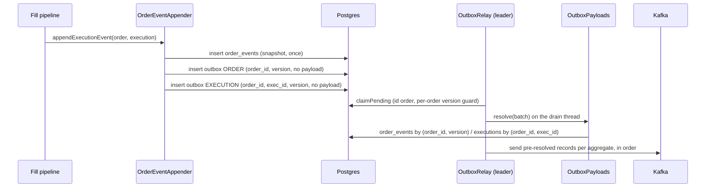

# Design — SPEC-0047: Cut fill write set with pointer outbox rows

> **Stage 2 of 3 — how.** Concrete enough that the plan can be written without re-reading the
> code, and checked line by line against the architecture policies. Write "None — <reason>" for a
> section that genuinely does not apply.

## Context

**What a fill writes today.**
- `OrderEventAppender.appendExecutionEvent` (`oms-core/src/main/java/org/example/oms/service/OrderEventAppender.java`)
  calls `appendOrderEvent`.
- `appendOrderEvent` saves an `OrderEvent` with `order_snapshot` (the order as JSON, `jsonb`) and
  flushes it. It then stages an ORDER outbox row whose `order_payload` serializes the same `order`
  object again.
- `appendExecutionEvent` then stages an EXECUTION row with `order_payload` (the order a third
  time) and `execution_payload`.
- The order-execution projection stages a PROJECTION row (Avro bytes) through `stageMessage`.
- All outbox writes go through the private `stage`, which also nudges the relay (SPEC-0048).

**Ids.** `Order`, `Execution`, `OrderEvent` and `OrderExecutionProjectionRow` use
`@SequenceGenerator(allocationSize = 1)`. Their sequences were created with `incrementBy: 1`
(changelogs 001 and 007). `outbox_seq` and `command_log_seq` are also 1 and stay so.
`spring.jpa.properties` sets no batching.

**Publishing.**
- `OutboxRelay.drainBatch` claims rows with `OutboxRepository.claimPending`:
  - `FOR UPDATE`, waiting rather than skipping (SPEC-0048);
  - ordered by `id`;
  - excluding aggregates (topic, key) held behind a row that exhausted its attempts (SPEC-0026).
- It groups the rows per (topic, key) and chains each group's sends on `sendExecutor` threads.
- `MessagePublisher.publishAsync` maps a row to its Avro record from the payload columns:
  - `OrderMessageMapper.toOrderMessage(order, version)`;
  - `ExecutionMessageMapper.toExecutionMessage(execution, order, version)`, which uses the order
    only for `rootOrderId`;
  - PROJECTION rows through `AvroPayloadCodec`.
- A send failure is transient (Kafka `RetriableException`, I/O, no attempt counted) or definitive
  (`recordFailure`, attempt counted).

**What a pointer can read back.** `executions.root_order_id` and `executions.order_version`
already exist (SPEC-0044, filled by `Execution.recordApplied`). The fill fields the Execution
message carries never change after the fill:
- `lastQty`, `lastPx`, `cumQty`, `leavesQty`, `avgPx`, `execType`, `lastMkt`, `lastCapacity`,
  `transactTime`.

A bust changes only `status` and `busted_at_version`. `order_events` has a unique `(order_id, version)`.

**Several instances (SPEC-0048).**
- One relay leader drains, by advisory lock.
- Fills lock the root order row first, so one order tree's changes are serialized across
  instances.
- Tests start a second context with `SecondInstance`. `TwoInstanceIntegrationTest#contentionLeavesNothingDeadLettered`
  checks per-order version order on all three topics.

**Replay and load (SPEC-0024).**
- `ReplayHarness` (test scope) re-executes stored commands from `order_events ... order by id`.
- `LoadSuiteRunnerTest` drives the compose stack over HTTP and reports throughput and SLA-timer
  percentiles from Prometheus. It has no database access.
- The baseline is `oms-core/docs/load-baseline-2026-11-08.md`. It advises a warm-up run and the
  median of three.

**Closest examples followed.**
- `OutboxClaimIntegrationTest`, for claim behaviour in its own database with Kafka off.
- `OutboxHoldIntegrationTest`, for a held aggregate.
- `TwoInstanceIntegrationTest`, for two contexts.
- `MessagePublisherTest`, for record mapping.

**Specs read.** `oms-knowledge-base/architecture/transactional-outbox.md`, `architecture/event-sourcing.md`,
`domain/outbox-message.md`, `capabilities/event-publication.md`, `oms-framework/oms-state-store.md`,
`oms-framework/testing-patterns.md`, `oms-concepts/exchange-simulator.md` §8, and
`specs/policies/architecture-policies.md`.

## Approach



What Changes, mapped to code:

1. **ORDER rows become pointers.**
   - `appendOrderEvent` stages `aggregate_id` (root key), `order_id`, `aggregate_version`, and no
     `order_payload`.
   - New `OutboxPayloads` in `org.example.oms.service` (`@Component`) reads the snapshot through a
     new `OrderEventRepository.findByOrderIdAndVersion`.
   - It maps it with the existing `OrderMessageMapper.toOrderMessage(snapshot, version)`.
2. **EXECUTION rows become pointers.**
   - `appendExecutionEvent` stages `order_id`, `exec_id`, `aggregate_version`, and no payloads.
   - `OutboxPayloads` reads the execution with `ExecutionRepository.findByOrderIdAndExecId`.
   - It maps it with a new overload `ExecutionMessageMapper.toExecutionMessage(execution, rootOrderId, version)`,
     with `rootOrderId` taken from the row's `aggregate_id`. That is the same key the order
     derived. No order snapshot is read.
   - The existing overload stays for legacy rows.
3. **PROJECTION rows stay self-contained.** `StagedMessage` gains `orderId`, so PROJECTION rows
   carry `order_id` too, for the relay's version guard. The payload is unchanged.
4. **Legacy rows still publish.** A row is legacy when its payload column is set: `order_payload`
   for ORDER, `execution_payload` for EXECUTION. `OutboxPayloads` maps those exactly as
   `MessagePublisher` does today. `ORDER_EXECUTION` rows are unchanged.
5. **Payloads are resolved on the drain thread.**
   - `drainBatch` calls `outboxPayloads.resolve(rows)` in the claiming transaction, before the
     chains start. It reads each pointer row with one indexed query and returns, per row id,
     either the record or the failure.
   - `MessagePublisher.publishAsync(row, record)` only sends.
   - In `OutboxRelay.send`, a row whose resolution failed becomes a failed future with an
     `IllegalStateException`, for example "Outbox row 42: no order_events row for order ORD-1
     version 7". That failure is definitive, not transient, so `recordFailure` counts an attempt.
   - The aggregate's chain stops at that row, so nothing later in the aggregate is sent. After
     `max-attempts`, the existing hold keeps the aggregate back. This is AC-4.
6. **Pooled sequences.** The four entities move to `allocationSize = 50`. The application config
   sets `hibernate.id.optimizer.pooled.preferred: pooled-lo`. Changeset 015 sets each sequence's
   `INCREMENT BY 50`. With pooled-lo, the value `nextval` returns is the low end of the block, so
   new ids continue above every existing id.
7. **JDBC batching.** `spring.jpa.properties.hibernate.jdbc.batch_size: 50`, `order_inserts: true`,
   `order_updates: true`. `appendOrderEvent` keeps `saveAndFlush`, so a version conflict still
   surfaces at once.
8. **Relay ordering.** `claimPending` keeps `ORDER BY o.id` and its other rules, and adds a
   per-order version guard to its WHERE:
   ```sql
   AND NOT EXISTS (SELECT 1 FROM OutboxMessage v
                   WHERE v.topic = o.topic AND v.orderId = o.orderId
                     AND v.aggregateVersion < o.aggregateVersion AND v.id > o.id)
   ```
   - **Effect.** A row is not claimed while an earlier version of the same order, on the same
     topic, sits at a higher id. That earlier row is claimed first, in a later or the same batch,
     and then the guard releases.
   - **Why per order, not per key.** Versions are per order. Orders of one tree share a key but
     have separate version counters. Rows with null `order_id` (legacy) never match, so they keep
     id order as today.
   - **When it matters.** Fills lock the root order first and `outbox_seq` stays at 1, so a single
     order's rows normally get ids in version order. The guard is the safety net the goal asks
     for, and it costs one indexed probe per candidate.
9. **Proof.**
   - AC-8 extends the SPEC-0048 two-instance contention test.
   - AC-9 adds a WAL probe to the load suite and compares runs before and after.
10. **Replay harness.**
    - `ReplayHarness` reads events in `id` order. With pooled ids across instances, one order's v3
      can have a smaller id than its v2.
    - The harness keeps reading in id order but holds back any event whose predecessor version of
      the same order has not been replayed yet. It releases held events as soon as that
      predecessor is replayed.
    - The result is deterministic, needs no clocks, and equals id order whenever id order already
      respects versions.

## Contract Changes

None. No OpenAPI or Avro change: every topic's record content and key stay the same (proposal,
out of scope).

## Data & Persistence

New changelog `oms-core/src/main/resources/db/changelog/015-pointer-outbox-and-pooled-sequences.yaml`,
included last from `db.changelog-master.yaml`. Changesets 001 to 014 are untouched.

```yaml
databaseChangeLog:
  - changeSet:
      id: 015-outbox-pointer-columns
      author: oms
      changes:
        - addColumn:
            tableName: outbox
            columns:
              - column: { name: order_id, type: varchar(255) }
              - column: { name: exec_id, type: varchar(255) }
        - createIndex:
            tableName: outbox
            indexName: idx_outbox_order_version
            columns:
              - column: { name: order_id }
              - column: { name: aggregate_version }
      rollback:
        - dropIndex: { tableName: outbox, indexName: idx_outbox_order_version }
        - dropColumn: { tableName: outbox, columnName: exec_id }
        - dropColumn: { tableName: outbox, columnName: order_id }
  - changeSet:
      id: 015-pooled-sequences
      author: oms
      changes:
        - alterSequence: { sequenceName: order_seq, incrementBy: 50 }
        - alterSequence: { sequenceName: execution_seq, incrementBy: 50 }
        - alterSequence: { sequenceName: order_event_seq, incrementBy: 50 }
        - alterSequence: { sequenceName: order_execution_projection_seq, incrementBy: 50 }
      rollback:
        - alterSequence: { sequenceName: order_seq, incrementBy: 1 }
        - alterSequence: { sequenceName: execution_seq, incrementBy: 1 }
        - alterSequence: { sequenceName: order_event_seq, incrementBy: 1 }
        - alterSequence: { sequenceName: order_execution_projection_seq, incrementBy: 1 }
```

- **No backfill and no data loss.** Existing outbox rows keep their payloads and have null
  `order_id`. They publish through the legacy path. `order_payload` and `execution_payload` stay
  nullable and remain for legacy rows.
- **Entities.**
  - `OutboxMessage` gains `orderId` (`order_id`) and `execId` (`exec_id`).
  - The four entities change `allocationSize` to 50.
  - The real name of the projection's sequence is confirmed in changelog 012 during
    implementation. The annotation already names `order_execution_projection_seq`.
- **Startup check.** Hibernate compares a sequence's increment with `allocationSize` at startup.
  The changeset and the annotations change together, and the integration tests catch any mismatch.
- **Rollback.** Revert the annotations and roll back 015. Ids stay unique because the sequences
  continue from their current value.
- **Locking (P-08).** The `Order` version check (`txNr`) and the `order_events (order_id, version)`
  unique constraint are unchanged.

## Events & Messaging

- **`order_events` (P-05).** Unchanged: one event per state change, with the snapshot. It is now
  the only copy of the snapshot.
- **Outbox (P-06).**
  - The same topics get the same records. Only how the publisher obtains them changes.
  - The relay remains the only publisher. Rows are still written in the state change's
    transaction through `stage`, so the SPEC-0048 nudge is kept.
- **Ordering.**
  - Per-key order is kept by id order plus the per-order version guard (Approach, point 8).
  - SPEC-0048's rules are kept: one leader, a claim that waits, and a leadership re-check per
    batch.
  - Reads of pointer targets happen in the claiming transaction. The target rows were committed
    with the outbox row, so a missing target is a definitive error, not a race.
- **Consumers.** Unchanged. They deduplicate on `(orderId, eventId)` or
  `(orderId, execId, orderVersion)`, as documented.

## Domain, State & Orchestration

None. No state machine transition, task or validation changes. Only the persistence and
publication of existing events change.

## Alternatives & Decisions

- **Decision: resolve pointers on the drain thread, before sending.**
  - Rejected: reading inside `publishAsync`. It runs on `sendExecutor` threads outside the
    claiming transaction, takes extra pool connections, and turns a read failure into a send
    failure that is hard to classify.
- **Decision: the EXECUTION record takes `rootOrderId` from the row's `aggregate_id`, with no
  order snapshot read.**
  - Rejected: reading the snapshot as the proposal sketched. That costs a second read per row for
    one field the row already holds. `executions.root_order_id` holds the same value and serves
    the check in tests.
- **Decision: a per-order version guard in the claim, keeping `ORDER BY id`.**
  - Rejected: `ORDER BY aggregate_version, id`. Version 1 of every new order would always come
    first, starving older orders under load.
  - Rejected: a per-key guard. Versions are per order, not per tree.
- **Decision: pooled-lo, set globally by property.**
  - Rejected: `pooled` (the high end), which returns values that may collide with ids issued
    before the change.
  - Rejected: per-entity `@GenericGenerator`, which is deprecated in Hibernate 7.
  - The setting only affects generators with an allocation size above 1, so `outbox_seq` and
    `command_log_seq` are untouched.
- **Decision: replay respects per-order versions while reading in id order.**
  - Rejected: ordering by `time_stamp`, which relies on clocks.
  - Rejected: ordering by `(order_id, version)`, which loses the cross-order interleaving the
    replay is meant to reproduce.
- **Decision: write volume is measured as WAL bytes.**
  - The load suite gains an optional JDBC probe (`OMS_LOAD_DB_URL`, `OMS_LOAD_DB_USER`,
    `OMS_LOAD_DB_PASSWORD`). The defaults are the compose database
    (`jdbc:postgresql://localhost:5432/postgres`, `postgres` / `changeme`).
  - It reads `pg_current_wal_lsn()` before and after the run, and the report shows WAL bytes per
    order.
  - Rejected: table sizes, which mix in vacuum timing and miss index writes.
- **No new dependency (P-17).** The Postgres JDBC driver is already on the test classpath.
  `StatementInspector` and Hibernate `Statistics` are built in.

## Risks & Mitigations

- **A pointer target is missing or wrong.** That would mean a lost publication or the wrong
  record.
  - AC-2 compares pointer and payload records field by field.
  - AC-4 proves a missing target fails loudly, holds the aggregate and publishes nothing.
  - AC-8 checks the published records against the stored rows under two-instance interleaving.
- **The publisher's DB reads slow the relay.** Each row costs one indexed read in the claiming
  transaction. AC-9 measures throughput, and the relay is off the request path.
- **Mixed legacy and pointer rows during the upgrade.** Detection is per row (payload set or not).
  AC-3 covers it.
- **Sequence increment mismatch at startup.** The changeset and annotations change in one task,
  and every integration test boots against the migrated schema.
- **The newest-first blotter becomes approximate across instances.** The blotters'
  `sort = "id"` default (orders, executions) was newest-first. With pooled ids, ids from two
  instances interleave in blocks.
  - With one instance, ids still rise monotonically.
  - This is cosmetic; the blotter's time columns remain exact. It is recorded in the knowledge
    base, not changed here.
- **Batching changes statement order.** `order_inserts` reorders inserts by entity, not by
  dependency. Hibernate only reorders within its action-queue rules, which keep foreign-key order,
  and the full suite must stay green.
- **Latency may not show at the baseline's load.** The proposal records this as deferred. AC-9
  reports the medians honestly either way.

## Test Strategy

| AC | Level | Test class#method | What it asserts |
|---|---|---|---|
| AC-1 | integration | `PointerOutboxIntegrationTest#aFillStagesPointerRowsAndOneSnapshot` | With the relay idle (Kafka off), the fill's ORDER and EXECUTION rows have null payloads and carry `order_id`, `aggregate_version`, and `exec_id` for EXECUTION. Exactly one `order_events` row with a snapshot exists for the version |
| AC-2 | integration | `PointerOutboxIntegrationTest#pointerRowsPublishTheSameRecordsAsPayloadRows` | For one fill, `OutboxPayloads` resolves the pointer rows and the payload rows built from the same order and execution (the pre-change form) to records that are `equals`, with the same key and version |
| AC-3 | integration | `PointerOutboxIntegrationTest#legacyPayloadRowsStillPublish` | ORDER and EXECUTION rows inserted in the pre-change form (payloads, null `order_id`) resolve and publish exactly as before |
| AC-4 | integration | `PointerOutboxIntegrationTest#aPointerWithNoTargetFailsAndHoldsItsAggregate` | A pointer row to a missing version fails definitively, with `last_error` naming the order and version. After `max-attempts` it is held, and a later row of the same key is not claimed or published |
| AC-5 | integration | `OutboxClaimIntegrationTest#rowsOfAnOrderAreClaimedInVersionOrder` | Rows of one order saved with ids out of version order are claimed in version order; legacy rows keep id order |
| AC-6 | integration | `PooledSequenceIntegrationTest#sixtyRowsCostAtMostTwoSequenceCalls` | Saving 60 of each entity issues at most 2 `nextval` per sequence (counted by a test `StatementInspector`), and ids are unique |
| AC-7 | integration | `FillWriteSetIntegrationTest#oneFillWritesLess` | For one fill, Hibernate `Statistics` prepared statements are at most the baseline minus the saved sequence round trips. Outbox bytes (`sum(pg_column_size(o.*))`) fall by at least twice the event's `pg_column_size(order_snapshot)`. Baselines are measured by this test before the change and recorded in the test and verification.md |
| AC-8 | integration | `TwoInstanceIntegrationTest#contentionLeavesNothingDeadLettered` (extended) | As in SPEC-0048: no DLT, order on three topics. Also: some order's `order_events` ids are out of version order (the interleave happened), and every published `OrderMessage` and `Execution` equals the mapper's output for the stored snapshot or execution of that version |
| AC-9 | e2e (manual run) | `LoadSuiteRunnerTest#runsScriptedFlowAndWritesReport`, `LoadReportWriterTest` | The report includes WAL bytes and WAL bytes per order. Before and after medians of three runs each, plus a warm-up, are recorded in verification.md with the report files |

`ReplayHarnessIntegrationTest` gains `replayHoldsBackAVersionWhoseIdComesFirst`. Rows inserted
with v2 at a smaller id than v1 must still replay to equal snapshots. This keeps SPEC-0024's
harness valid under pooled ids.

## Policy Compliance

| Policy | Title | Status | How / Justification |
|---|---|---|---|
| P-01 | Contracts live only in oms-contracts | n/a | No contract change |
| P-02 | Specification before code, generated models only | n/a | No API or message change; records come from the generated Avro classes as today |
| P-03 | Never edit generated code | comply | Nothing generated is touched |
| P-04 | Contracts evolve compatibly | n/a | Records and keys unchanged |
| P-05 | Every state change is recorded in the event log | comply | The event log is unchanged and is now the single source of the snapshot |
| P-06 | Kafka only through the transactional outbox | comply | Rows are staged in the same transaction; the relay is still the only publisher |
| P-07 | Schema changes through new Liquibase changesets | comply | New changelog 015; 001 to 014 untouched |
| P-08 | Concurrency and idempotency are explicit | comply | Version check and unique `(order_id, version)` kept. Per-order version guard in the claim. SPEC-0048 claim rules kept. Pointer reads in the claiming transaction |
| P-09 | Commands and queries stay separate | comply | No query change |
| P-10 | State transitions go through the state machine and task pipeline | comply | Pipelines unchanged |
| P-11 | Layering and conventions | comply | `OutboxPayloads` in `service`, repository finders in `repository`, constructor injection |
| P-12 | Jackson 3 only | comply | Snapshots are read through the existing Hibernate JSON mapping; the load probe adds no JSON code |
| P-13 | Errors and validation follow the framework specs | comply | API answers unchanged. A publication failure is recorded on the row and logged, as other outbox failures are |
| P-14 | Test first, every acceptance criterion is proven by an automated test | comply | Table above. AC-9 is a scripted, recorded run of the load suite, which by SPEC-0024's design needs the running stack |
| P-15 | Observability | comply | Resolution failures go through the existing outbox failure path (`last_error`, `oms.outbox.stuck`, logs). The load report gains WAL bytes |
| P-16 | Security | comply | No secrets in code. The load probe's password defaults to the compose development value and is overridable by environment |
| P-17 | Simplicity and dependencies | comply | No new library. One new component (`OutboxPayloads`) |
| P-18 | Modules build standalone | comply | oms-core `check` in `spec verify` |
| P-19 | Documentation follows behaviour | comply | Pages below |

## Knowledge Base Updates

- `domain/outbox-message.md`: pointer columns, which row kinds carry payloads, and legacy rows.
- `architecture/transactional-outbox.md` and `capabilities/event-publication.md`: publish-time
  read-back, resolution failures and the hold, and the per-order version guard.
- `architecture/event-sourcing.md` and `oms-framework/oms-state-store.md`: the snapshot is stored
  once; pooled ids and what that means for id order (blotter, replay).
- `oms-framework/domain-model_spec.md`: allocation size 50 with pooled-lo for the four entities.
- `oms-concepts/exchange-simulator.md` §8: the load report's WAL bytes and the `OMS_LOAD_DB_*`
  variables.
- `oms-framework/testing-patterns.md`: replay ordering under pooled ids.

### Changed during implementation: the claim's version guard

The guard in Approach point 8 is not enough. Take rows of one order at increasing ids with versions
2, 1 and 3:
- v2 is held back, because v1 sits at a higher id;
- v3 has no lower version at a higher id, so it is claimed with v1;
- the batch would then publish v3 before v2.

The guard now says: if an order's pending rows on a topic contain any inversion (a lower version
at a higher id), only that order's lowest pending version is claimable. Otherwise its rows are
claimed in id order as before.

```sql
AND (NOT EXISTS (SELECT 1 FROM OutboxMessage v
                 WHERE v.topic = o.topic AND v.orderId = o.orderId
                   AND v.aggregateVersion < o.aggregateVersion)
     OR NOT EXISTS (SELECT 1 FROM OutboxMessage a, OutboxMessage b
                    WHERE a.topic = o.topic AND a.orderId = o.orderId
                      AND b.topic = o.topic AND b.orderId = o.orderId
                      AND a.aggregateVersion < b.aggregateVersion AND a.id > b.id))
```

- **Effect of an inversion.** An order with an inversion drains one row per batch until the
  inversion is gone. Inversions are the rare safety-net case: `outbox_seq` stays at 1, and fills
  lock the root first. Rows with null `order_id` (legacy) match neither subquery, so they keep id
  order.
- **Test.** `OutboxClaimIntegrationTest#rowsOfAnOrderAreClaimedInVersionOrder` uses exactly the
  2, 1, 3 case.
