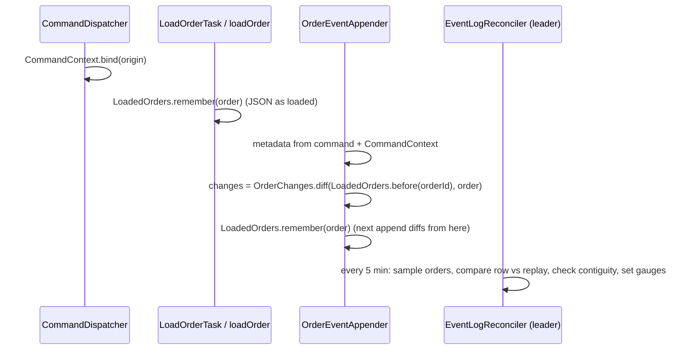

# Design — SPEC-0049: Add event metadata, change diffs and reconciliation

> **Stage 2 of 3 — how.** Concrete enough that the plan can be written without re-reading the
> code, and checked line by line against the architecture policies. Write "None — <reason>" for a
> section that genuinely does not apply.

## Context

**How an event is written today.**
- Every command enters through `CommandDispatcher.dispatch(command, origin)`
  (`oms-core/src/main/java/org/example/oms/service/command/CommandDispatcher.java`), in one
  transaction.
  - `CommandOrigin` carries `source` (`REST`, `KAFKA`, `SCHEDULER`), `principal` (the Kafka
    `producer`, the scheduler job, null on REST) and `receivedAt`. The dispatcher hands it to the
    command log (SPEC-0046), but not to the pipelines.
- The pipelines load the order in two places:
  - `LoadOrderTask` (lifecycle commands);
  - `ExecutionCommandProcessor.loadOrder` (fills).

  Both use `findLockedByOrderId`. A create starts from no order.
- Events are appended only by `OrderEventAppender.appendOrderEvent`, called from
  `PublishOrderEventTask` and `PublishExecutionEventTask`.
  - It writes `OrderEvent` with the command (`transaction`, jsonb), `command_id`, `exec_id`, the
    resulting state, `order_snapshot` (jsonb) and `schema_version` (SPEC-0024).
  - The command model (`org.example.common.model.cmd.Command`) already carries `correlationId`
    and `causationId`. They are copied from the Kafka header by `CommandHeaderMapper`, or sent in
    the REST body, but they live only inside the `transaction` JSON.

**Query side.** `GET /api/query/orders/{orderId}/events` (`OrderEventController`) maps
`OrderEvent` to the generated `OrderEventDto` through `OrderEventDtoMapper`.

**Replay.** `OrderReplayService.replay(orderId)` returns the latest event's snapshot, and
`isContiguous(orderId)` checks that versions run 1..n. Nothing calls either at runtime.

**Scheduling and leadership.** `EndOfDayScheduler` runs its jobs on a `TaskScheduler` and gates
them with `Leadership.holds(Role.SCHEDULER)` (SPEC-0048). `TwoInstanceIntegrationTest` checks this
per instance with counters.

**PROJECTION payloads.**
- `OrderEventAppender.stageMessage` encodes the record with `AvroPayloadCodec.encode`, using the
  class's current schema, and stores `payload_type` and `payload`.
- `OutboxRecordMapper` (SPEC-0047) decodes it with the class's current schema.
- oms-core already talks to the Schema Registry through the Confluent serializer
  (`spring.kafka.producer.properties.schema.registry.url`, `REGISTRY_URL`). Subjects follow the
  default topic-name strategy (`<topic>-value`).

**Closest examples followed.**
- `CommandLogWriter`: origin to a row.
- `EndOfDayScheduler`: a leader-gated scheduled job.
- `OutboxPayloads` and `OutboxRecordMapper`: publish-time decoding.
- `TwoInstanceIntegrationTest`: per-instance counters.
- `OrderEventControllerTest`, if present, or the order-events integration tests.

**Specs read.** `oms-framework/oms-state-store.md`, `domain/order-event.md`,
`capabilities/event-sourcing-and-replay.md`, `oms-concepts/projections.md`,
`capabilities/event-publication.md`, `oms-framework/openapi-contracts.md`, and
`specs/policies/architecture-policies.md`.

## Approach



1. **Command context.** New `CommandContext` (in `service.command`).
   - It binds the dispatcher's `CommandOrigin` to the current transaction as a resource
     (`TransactionSynchronizationManager.bindResource`), and unbinds it in a `finally`.
   - `dispatch` binds it first. The appender reads `CommandContext.current()`, which is null when
     a processor is called directly, as some tests do.
2. **As-loaded copy.** New `LoadedOrders` (same package, transaction-bound).
   - `remember(order)` stores the order's JSON tree (`JsonMapper.valueToTree`, Jackson 3) keyed
     by `orderId`. `before(orderId)` returns it, or null.
   - `LoadOrderTask` and `ExecutionCommandProcessor.loadOrder` call `remember` right after
     loading. A create has no entry.
   - After each append the appender calls `remember(order)` again, so a second event in the same
     transaction diffs from the first one's result.
3. **Diff.** New `OrderChanges` (in `service`), a pure function `diff(JsonNode before, JsonNode
   after) → ObjectNode`.
   - For every top-level field whose values differ it records `{"from": old, "to": new}`.
   - Numbers compare by value (`BigDecimal.compareTo`), so `100` equals `100.0000`. Objects and
     arrays compare whole. A missing field equals `null`.
   - With no `before`, every non-null field is listed with `from: null`.
4. **Appender.** `appendOrderEvent` sets five new fields on `OrderEvent`:
   - `correlationId` and `causationId` from the command;
   - `principal` and `source` from `CommandContext`;
   - `changes`, the diff serialized to a JSON string.

   The snapshot, the version and the outbox are untouched.
5. **Query API.** Five optional properties are added to `OrderEventDto`, and
   `OrderEventDtoMapper` maps them. `changes` is parsed from the stored string into a JSON object.
6. **Reconciliation.** New `EventLogReconciler` in `org.example.oms.service.reconciliation`, a
   `@Component` scheduled with `fixedDelayString = ${oms.reconciliation.interval-ms:300000}`. It
   is off with `oms.reconciliation.enabled=false`, and the shared test configuration sets that.
   - **Gate.** It returns unless `leadership.holds(Role.SCHEDULER)`.
   - **Sample.** The `oms.reconciliation.recent` (50) orders with the newest events, by
     `max(time_stamp)` and not by id since ids are pooled (SPEC-0047). Plus
     `oms.reconciliation.random` (10) orders taken from a random starting id
     (`id >= floor(random() * max(id))`, ordered by id). Duplicates are removed.
   - **Check each order.** Inside one read-only `REPEATABLE_READ` transaction, so the row and its
     events come from one snapshot:
     - **Inconsistent:** the `orders` row's JSON tree and `replay(orderId)`'s differ, by
       `OrderChanges.diff`, outside the ignore list. The ignore list is empty at first; the design
       of AC-6's test proves a healthy log reads zero.
     - **Gap:** `isContiguous` is false. The missing versions are computed from the history.
   - **Report.** It sets the gauges `oms.event_log.inconsistent` and `oms.event_log.gaps` to the
     counts of the latest run. It counts sampled orders in `oms.event_log.sampled` (a counter).
     It logs `WARN Event log inconsistent for order {}: {fields}` and
     `WARN Event log gap for order {}: missing versions {}`.
7. **Writer schema id.**
   - **New `WriterSchemaIds`** (`service`, conditional on `kafka.enabled`), holding a
     `CachedSchemaRegistryClient` built from the producer's `schema.registry.url`.
     - `idFor(topic, schema)` returns a cached id or null; it never blocks.
     - On a miss it schedules a lookup (`getId("<topic>-value", new AvroSchema(schema))`) on its
       own single-thread executor. When `auto.register.schemas` is true, as in docker-compose and
       tests, the lookup registers instead, as the serializer would. Later rows get the id.
     - `schemaById(id)` returns the writer schema, which the client caches.
   - **Staging.** `stageMessage` stores `payload_schema_id = idFor(topic, record.getSchema())`.
   - **Decoding.** `AvroPayloadCodec.decode(type, payload, writer)` takes an optional writer
     schema and reads with `SpecificDatumReader(writer, readerSchemaOfClass)`.
   - **Publishing.** `OutboxRecordMapper` passes `schemaById(row.payloadSchemaId)` when the id is
     set, on the relay's drain thread (SPEC-0047), never on the command path. A registry I/O
     failure is transient by `OutboxRelay.isTransient` (an `IOException` in the cause chain).

## Contract Changes

`oms-contracts/src/main/openapi/oms-query-api.yml`, additive optional properties on
`OrderEventDto`:

```yaml
        correlationId:
          type: string
          description: The causing command's correlationId (Kafka header or REST body), when it had one. SPEC-0049.
        causationId:
          type: string
          description: The causing command's causationId, when it had one. SPEC-0049.
        principal:
          type: string
          description: >-
            Who sent the causing command: the Kafka producer or the scheduler job
            (oms-core:expiry, oms-core:end-of-day); null on REST until authentication exists. SPEC-0049.
        source:
          type: string
          enum: [REST, KAFKA, SCHEDULER]
          description: Where the causing command entered the OMS. SPEC-0049.
        changes:
          type: object
          description: >-
            The fields this event changed, as {"<field>": {"from": <old>, "to": <new>}}, with field
            names and values as in orderSnapshot. A first event lists every field set at creation
            with from null. Null for events recorded before SPEC-0049.
```

- **Compatibility (P-04): additive.** No property is removed, renamed or made required. Existing
  clients ignore unknown fields. Avro: none.
- **Generated code.** `OrderEventDto` in `org.example.common.model.query` gains five fields; it is
  regenerated by `cd oms-contracts && ./gradlew build`. `source` generates an inner enum, which the
  mapper fills from `CommandSource.name()`.

## Data & Persistence

New `oms-core/src/main/resources/db/changelog/016-event-metadata-and-writer-schema.yaml`, included
last. Changesets 001 to 015 are untouched.

```yaml
databaseChangeLog:
  - changeSet:
      id: 016-order-event-metadata
      author: oms
      changes:
        - addColumn:
            tableName: order_events
            columns:
              - column: { name: correlation_id, type: varchar(255) }
              - column: { name: causation_id, type: varchar(255) }
              - column: { name: principal, type: varchar(255) }
              - column: { name: source, type: varchar(16) }
              - column: { name: changes, type: jsonb }
        - createIndex:
            tableName: order_events
            indexName: idx_order_events_correlation_id
            columns:
              - column: { name: correlation_id }
      rollback:
        - dropIndex: { tableName: order_events, indexName: idx_order_events_correlation_id }
        - dropColumn: { tableName: order_events, columnName: changes }
        - dropColumn: { tableName: order_events, columnName: source }
        - dropColumn: { tableName: order_events, columnName: principal }
        - dropColumn: { tableName: order_events, columnName: causation_id }
        - dropColumn: { tableName: order_events, columnName: correlation_id }
  - changeSet:
      id: 016-outbox-payload-schema-id
      author: oms
      changes:
        - addColumn:
            tableName: outbox
            columns:
              - column: { name: payload_schema_id, type: integer }
      rollback:
        - dropColumn: { tableName: outbox, columnName: payload_schema_id }
```

- **No backfill.** All new columns are nullable, and old rows keep null (proposal, out of scope).
- **Entities.**
  - `OrderEvent` gains `correlationId`, `causationId`, `principal`, `source`
    (`@Enumerated(STRING) CommandSource`), and `changes`
    (`@JdbcTypeCode(SqlTypes.JSON) String`, jsonb).
  - `OutboxMessage` gains `Integer payloadSchemaId`.
- **Locking (P-08).** No locking change. `order_events` stays append-only.

## Events & Messaging

- **`order_events` (P-05).** Each event now also records who caused it and what it changed. No
  event is added or removed, and the snapshot stays the source of truth.
- **Outbox (P-06).** Unchanged except `payload_schema_id` on PROJECTION rows. The relay is still
  the only publisher. Published records are unchanged when no schema changed in between. When a
  compatible change happened, the record is resolved to the current schema, which is what a
  consumer on the current schema would expect.
- **Consumers.** Unaffected. Kafka records and keys are unchanged.

## Domain, State & Orchestration

- **No state machine or task changes.**
- **Load points.** `LoadOrderTask` and `ExecutionCommandProcessor.loadOrder` each gain one call
  to `LoadedOrders.remember`.
- **Validation and error responses.** Unchanged.
- **Reconciliation never repairs.** It reports only (proposal, out of scope).

## Alternatives & Decisions

- **Decision: pass origin and the as-loaded copy as transaction-bound resources.**
  - Rejected: adding an `origin` parameter through every processor, context and task (about 15
    signatures). It is the same information with much wider churn.
  - Rejected: a `ThreadLocal`. Transaction resources are already used by `OutboxNudge` (SPEC-0048)
    and are cleaned up with the transaction.
- **Decision: diff against the copy taken at load.**
  - Rejected: reading the previous event's snapshot. That costs one more query per change on the
    hot path. The proposal decided this.
- **Decision: `changes` is stored as a JSON string mapped to jsonb.**
  - Rejected: a `JsonNode` attribute, which ties the entity to the Hibernate format mapper's
    Jackson version.
- **Decision: random sampling from a random starting id.**
  - Rejected: `ORDER BY random()`, which scans the whole table every run.
  - Rejected: `TABLESAMPLE SYSTEM_ROWS`, which needs the `tsm_system_rows` extension.
- **Decision: look up writer schema ids asynchronously and cache them.**
  - Rejected: a lookup on the command path, where a registry outage would delay or fail commands.
  - Rejected: storing a fingerprint and keeping old schemas locally. The registry already keeps
    every version by id, and it is the system of record for schemas (SPEC-0025).
- **Dependencies (P-17).** No new library. `CachedSchemaRegistryClient` and `AvroSchema` come with
  the Confluent serializer oms-core already uses.

## Risks & Mitigations

- **A false positive in reconciliation.** A field the row and the snapshot legitimately disagree
  on would raise the gauge on a healthy system. AC-6's test runs the sampler over normal flows
  first, and requires zero. Any field that differs is either a real P-05 defect to fix, or is
  named in the ignore list with its reason.
- **Reconciliation load.** At most 60 orders every 5 minutes, each with one row read and one
  history read by indexed `order_id`, on the leader only. Sizes and interval are configurable.
- **Diff cost on the hot path.** Two JSON trees of one order (about 1 KB each) per event, in
  memory. The SPEC-0047 write-set test and the load suite would show a regression.
- **First PROJECTION rows after start have no schema id.** They decode as today, which is the
  pre-change behaviour. The window lasts one registry round trip. AC-8 covers the id path and the
  null path.
- **The registry is unreachable at publish time for a row with an id.** The failure is transient,
  so it costs no attempt and the row waits (SPEC-0026), just as a send waits when the registry is
  down.

## Test Strategy

| AC | Level | Test class#method | What it asserts |
|---|---|---|---|
| AC-1 | integration | `EventMetadataIntegrationTest#kafkaCommandCarriesHeaderMetadata` | A Kafka fill whose header has correlationId C, causationId X and producer P is stored with C, X, P and `KAFKA` |
| AC-2 | integration | `EventMetadataIntegrationTest#restAndSchedulerCommandsCarryTheirOrigin` | A REST command with correlationId C is stored with C, `REST` and a null principal. GTD expiry and end-of-day events carry `SCHEDULER` and `oms-core:expiry` / `oms-core:end-of-day` |
| AC-3 | integration | `EventMetadataIntegrationTest#aFillRecordsExactlyTheChangedFields` | A fill of 40 at 170 on a LIVE order of 100: `changes` has `cumQty` 0→40, `leavesQty` 100→60, `txNr`, not `state` (still LIVE), and no field whose value is unchanged (checked against the two snapshots) |
| AC-4 | integration + unit | `EventMetadataIntegrationTest#aCreateListsEveryFieldItSet`, `OrderChangesTest#onlyTheVersionChanged` | The create's `changes` lists every non-null snapshot field with `from` null. A diff of an order against itself with only `txNr` raised holds only `txNr` |
| AC-5 | integration | `EventMetadataIntegrationTest#theEventsEndpointReturnsMetadataAndChanges` | `GET /api/query/orders/{id}/events` returns the five fields as stored; for an event with nulls (written as before the change) they are null and the old fields are unchanged |
| AC-6 | integration | `EventLogReconcilerIntegrationTest#findsAnInconsistencyAndAGapThenClears` | After normal flows both gauges are 0. Then: cumQty edited by SQL on one order and one event deleted on another; one run gives 1 and 1, with WARN logs naming the order, the field and the missing version. After repair, both are 0 |
| AC-7 | integration + unit | `TwoInstanceIntegrationTest#reconcilerRunsOnTheLeaderOnly`, `EventLogReconcilerIntegrationTest#samplesAtMostTheConfiguredOrders` | Of two instances only the scheduler leader's `oms.event_log.sampled` grows. With recent 3 and random 2 and many orders, one run samples at most 5 |
| AC-8 | integration + unit | `ProjectionSchemaEvolutionIntegrationTest#aRowStagedWithAnOlderSchemaStillPublishes`, `AvroPayloadCodecTest#decodesWithWriterAndReaderSchemas` | A PROJECTION row encoded with an older registered schema (OrderExecution without one nullable field) and carrying its id is published with the original values and the field's default; a row without an id decodes as before |

## Policy Compliance

| Policy | Title | Status | How / Justification |
|---|---|---|---|
| P-01 | Contracts live only in oms-contracts | comply | The OpenAPI change is in `oms-contracts/src/main/openapi/oms-query-api.yml` only |
| P-02 | Specification before code, generated models only | comply | Spec first, `OrderEventDto` regenerated; no hand-written DTO |
| P-03 | Never edit generated code | comply | Regenerated by `oms-contracts ./gradlew build` |
| P-04 | Contracts evolve compatibly | comply | Five optional properties, additive; no Avro change |
| P-05 | Every state change is recorded in the event log | comply | Events gain metadata; the reconciler checks P-05 at runtime |
| P-06 | Kafka only through the transactional outbox | comply | Only `payload_schema_id` added on rows; the relay is still the only publisher |
| P-07 | Schema changes through new Liquibase changesets | comply | New changelog 016; 001 to 015 untouched |
| P-08 | Concurrency and idempotency are explicit | comply | No change to versioning or dedup; the reconciler reads in one REPEATABLE_READ snapshot and writes nothing |
| P-09 | Commands and queries stay separate | comply | Query API change is read-only; the reconciler only reads |
| P-10 | State transitions go through the state machine and task pipeline | comply | Unchanged; two load tasks gain a `remember` call |
| P-11 | Layering and conventions | comply | Components in `service` / `service.reconciliation`; MapStruct mapper for the DTO; constructor injection |
| P-12 | Jackson 3 only | comply | Diffs use `tools.jackson.databind` (`JsonMapper`, `JsonNode`) |
| P-13 | Errors and validation follow the framework specs | comply | No new API errors; reconciler failures are logged and never fail commands |
| P-14 | Test first, every acceptance criterion is proven by an automated test | comply | Table above |
| P-15 | Observability | comply | `oms.event_log.inconsistent`, `oms.event_log.gaps`, `oms.event_log.sampled`; WARN logs with order ids; metadata on every event |
| P-16 | Security | comply | No secrets. `principal` records only producer or job names; REST stays null until authentication exists |
| P-17 | Simplicity and dependencies | comply | No new library; four small components |
| P-18 | Modules build standalone | comply | `spec verify` runs oms-contracts and its consumers' `check` |
| P-19 | Documentation follows behaviour | comply | Pages below |

## Knowledge Base Updates

- `domain/order-event.md`: the five new fields and the `changes` format.
- `oms-framework/oms-state-store.md`: the event table's new columns, and that `changes` is computed
  against the order as loaded.
- `capabilities/event-sourcing-and-replay.md`: runtime reconciliation, its gauges, logs and
  configuration.
- `oms-concepts/projections.md`: the deployment note is replaced by writer-schema decoding.
- `capabilities/event-publication.md`: PROJECTION rows carry the writer schema id; what a registry
  outage does.
- `interfaces/` page for the query API, if it lists `OrderEventDto` fields.

### Changed during implementation

- **`LoadedOrders` is a static helper.** It holds its own Jackson 3 `JsonMapper` instead of being an
  injected component. This keeps `LoadOrderTask`'s constructor, built by hand in tests, unchanged,
  and it matches `CommandContext`. Before and after trees are both built by `LoadedOrders.toJson`,
  so they compare like for like.
- **The reconciler compares instants at the database's precision.** AC-4's test showed why:
  - a snapshot keeps the nanoseconds of `Instant.now()`, for example `transactTime` and
    `marketAckTime`;
  - the `orders` row keeps what Postgres stores, which rounds half up to the microsecond (a
    snapshot's `…15.9828316Z` is `…15.982832Z` in the row).

  So the row and its latest snapshot differ below a microsecond on almost every order.
  `EventLogReconciler` therefore rounds every ISO instant in both trees to the microsecond (half
  up) before diffing. Any other difference is still reported. `changes` is unaffected: it diffs
  the order as loaded from the row against the same object after the command, so unchanged fields
  compare equal.

### Changed after the independent review

- **Exact decimals in the API.** `CommandJsonConverter.toChanges` reads `changes` with
  `USE_BIG_DECIMAL_FOR_FLOATS`, so quantities and prices keep every stored digit, as
  `orderSnapshot` does. `EventMetadataIntegrationTest#theEndpointReturnsChangesWithExactDecimals`
  proves it with 1234567890.12345678; it was red with doubles.
- **Bounded sampling.**
  - Changelog 016 gains a third changeset, `016-order-events-time-stamp-index`
    (`idx_order_events_time_stamp`). It is a new changeset; none of the existing ones change.
  - The recent-orders query reads the newest `recent × 20` events by time through that index, then
    their distinct orders. It no longer aggregates the whole log on every run.
- **Registry errors.** A registry 5xx when reading a writer schema is transient, like an
  unreachable registry, and a failed schema-id lookup is not retried for a minute.
- **Scheduler.** `spring.task.scheduling.pool.size: 2`, so a long reconciliation run cannot delay
  the relay's fallback poll.
- **Contract version.** `oms-query-api.yml` is version 2.4.0 (additive).
