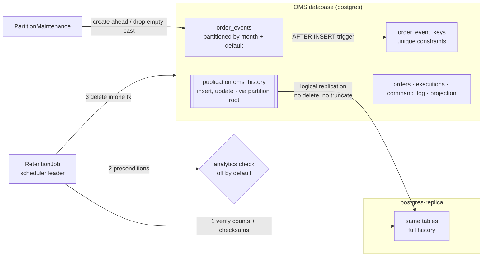

# Design — SPEC-0052: Partition the event log and archive closed orders

> **Stage 2 of 3 — how.** Concrete enough that the plan can be written without re-reading the
> code, and checked line by line against the architecture policies. Write "None — <reason>" for a
> section that genuinely does not apply.

## Context

- **`order_events`** (changelogs 001–016) is a plain table:
  - primary key `pk_order_events (id)`, from a pooled sequence (`order_event_seq`, blocks of 50,
    changelog 015);
  - unique constraints `uq_order_events_order_id_version` and `uq_order_events_order_id_command_id`;
  - indexes `idx_order_events_order_id`, `idx_order_events_order_id_exec_id`,
    `idx_order_events_correlation_id` and `idx_order_events_time_stamp`;
  - `time_stamp TIMESTAMP WITH TIME ZONE`, which is **nullable** in the schema. The appender always
    sets it (`OrderEventAppender.java:157`), but rows from before that may be null.
- **`OrderEventAppender`** (`oms-core/src/main/java/org/example/oms/service/OrderEventAppender.java`)
  inserts with `saveAndFlush` and maps a `DataIntegrityViolationException` **by constraint name**:
  `VERSION_CONSTRAINT` (`uq_order_events_order_id_version`) becomes
  `OptimisticLockingFailureException`, and `COMMAND_ID_CONSTRAINT` becomes
  `DuplicateCommandException` (lines 159–172, 347–348).
  - `DeduplicateCommandTask` asks `OrderEventRepository.existsByOrderIdAndCommandId`.
  - `OrderEventAppenderTest` and `LiquibaseMigrationIntegrationTest` assert those constraint names.
- **The other order-history tables,** all with an `order_id` column and none with foreign keys:
  - `orders` (`pk_orders`);
  - `executions` (`pk_executions`);
  - `command_log` (`pk_command_log`; `order_id` is null for refusals that name no order);
  - `order_execution_projection` (renamed from `order_execution_view` in changelog 012; `id` key).

  The `outbox` has `order_id` too, and its rows are deleted once published.
- **Scheduled leader-only jobs** follow `EventLogReconciler`:
  - `@Scheduled(fixedDelayString=…, initialDelayString=…)`;
  - a guard `leadership.holds(Role.SCHEDULER)`;
  - an `enabled` flag;
  - Micrometer meters;
  - JDBC through `JdbcTemplate`.

  `Leadership` (SPEC-0048) holds session advisory locks.
- **Infrastructure.** The root `docker-compose.yml` runs `postgres:18.6` with `wal_level=logical`
  already. Tests use one shared Testcontainers `postgres:16-alpine`
  (`AbstractKafkaPostgresIntegrationTest`), with `isolatedDatabaseUrl(name)` for tests that need a
  world of their own.
- **The load suite** (SPEC-0024, `src/test/java/org/example/oms/load/LoadSuiteRunnerTest`) runs
  against a running stack when `OMS_LOAD_SUITE=true`. Its baseline shape is 500 orders, concurrency
  8, one fill slice (`architecture/assessments/load-baseline-2026-11-08.md`).
- **KB read:**
  - `architecture/concepts/state-store.md`;
  - `domain/model/order-event.md`;
  - `domain/concepts/post-trade-analytics.md`, line 375: "The OMS stays the system of record";
  - `architecture/context/market-adapter.md`, line 28: the same statement;
  - `capabilities/order-expiry-and-close.md`;
  - `infrastructure/local-docker-stack.md`;
  - target architecture §4.4;
  - the event-sourcing and CQRS review, F-17.
- **Closest examples:**
  - `EventLogReconciler` and `EventLogReconcilerIntegrationTest`, for a leader-only scheduled job;
  - changelog `003-event-sourcing-and-outbox.yaml`, for a raw-SQL changeset that rebuilds a table and
    copies rows;
  - `CommandIdBackfillMigrationIntegrationTest`, for testing a migration over pre-existing rows.

## Approach



### 1. Changelog `017-partition-order-events.yaml` (new)

All raw SQL changesets. Nothing in 001–016 changes (P-07).

1. **`017-order-event-keys`.** Create the side table and backfill it:
   ```sql
   CREATE TABLE order_event_keys (
     order_id   VARCHAR(255) NOT NULL,
     version    BIGINT       NOT NULL,
     command_id VARCHAR(255),
     CONSTRAINT pk_order_event_keys PRIMARY KEY (order_id, version));
   INSERT INTO order_event_keys (order_id, version, command_id)
     SELECT order_id, version, command_id FROM order_events;
   ```
   The primary key gives the table a replica identity for logical replication. The unique
   constraints are added in changeset 4, once the old ones are gone, because their names move here.
2. **`017-partition-order-events`.** Rebuild `order_events` as a partitioned table:
   ```sql
   ALTER TABLE order_events RENAME TO order_events_unpartitioned;
   CREATE TABLE order_events (LIKE order_events_unpartitioned INCLUDING DEFAULTS)
     PARTITION BY RANGE (time_stamp);
   ALTER TABLE order_events ADD CONSTRAINT pk_order_events_v2 PRIMARY KEY (id, time_stamp);  -- see D2
   CREATE TABLE order_events_default PARTITION OF order_events DEFAULT;
   -- one partition per month from the oldest row's month to two months ahead, named order_events_pYYYYMM,
   -- generated by a DO block from min(time_stamp)
   INSERT INTO order_events SELECT * FROM order_events_unpartitioned;
   DROP TABLE order_events_unpartitioned;
   ```
   - The indexes are recreated on the parent, so every partition gets them:
     `idx_order_events_order_id`, `idx_order_events_order_id_exec_id`,
     `idx_order_events_correlation_id`, `idx_order_events_time_stamp`, and a **non-unique**
     `idx_order_events_order_id_command_id` for `existsByOrderIdAndCommandId`.
   - Rows with a null `time_stamp` land in the default partition, with the epoch marker described
     next. That marker is the only value the migration writes.
   - **Primary key and `time_stamp`.** A primary key on a partitioned table must include the
     partition key, and PostgreSQL makes every primary-key column `NOT NULL`. A null time stamp
     can therefore not stay null. So:
     - `time_stamp` stays nullable for this migration's copy;
     - before the primary key is added, legacy nulls get the epoch, `1970-01-01T00:00Z`, as a
       marker that the time is unknown, so they land in the default partition;
     - this is the only value the migration writes. It is recorded in the KB, and none exist in
       rows written since the appender stamped every event.
     - `assertNoNullTimeStamps` in the migration test checks the result.
3. **`017-order-event-keys-trigger`.** An `AFTER INSERT ... FOR EACH ROW` trigger on `order_events`
   inserts `(order_id, version, command_id)` into `order_event_keys` (PL/pgSQL function
   `order_events_record_key()`).
   - On a partitioned table the trigger applies to every partition (PostgreSQL ≥ 13).
   - Logical-replication apply on the replica runs with `session_replication_role = replica`, so
     the trigger **does not fire there**, and the keys arrive by replication instead.
4. **`017-order-event-keys-unique`.** Add the constraints **with the names the appender maps**:
   `uq_order_events_order_id_version UNIQUE (order_id, version)` and
   `uq_order_events_order_id_command_id UNIQUE (order_id, command_id)` on `order_event_keys`.
   - A duplicate version or command now fails inside the event insert, through the trigger, inside
     `saveAndFlush`.
   - The `DataIntegrityViolationException` carries the same constraint name, so
     `OrderEventAppender` is **unchanged** (AC-2).
   - `OrderEvent`'s `@Table(uniqueConstraints…)` annotation is removed, because Hibernate's
     `validate` doesn't check unique constraints. Its Javadoc then points at the key table.
5. **`017-history-publication`** (`context: primary`):
   ```sql
   CREATE PUBLICATION oms_history
     FOR TABLE orders, order_events, order_event_keys, executions, command_log, order_execution_projection
     WITH (publish = 'insert, update', publish_via_partition_root = true);
   ```
   - No `delete`, no `truncate`. Partition DDL isn't replicated anyway.
   - The `outbox` isn't published.
   - `orders` and `executions` are updated, so they need a replica identity; their primary keys
     provide it.

### 2. The replica

- **`docker-compose.yml`** gets a `postgres-replica` service:
  - `postgres:18.6`, a volume `postgres-replica`, port `5433:5432`;
  - its own database, `oms_replica`;
  - `POSTGRES_PASSWORD` from `${REPLICA_DB_PASSWORD:-changeme}`.

  The primary gets `-c max_slot_wal_keep_size=2GB`, so a replica that stays down cannot fill its
  disk with WAL (see Risks).
- **oms-core settings** (`oms.replica.*`, off by default, on in compose):
  - `enabled`, `url`, `username`, `password` (from environment variables, P-16);
  - `primary-conninfo`, the libpq string the replica uses to reach the primary, e.g.
    `host=postgres port=5432 dbname=postgres user=… password=…`, from the environment;
  - `subscription` (default `oms_history`).
- **`org.example.oms.archive.ReplicaConfig`.** When enabled, it creates a separate HikariCP
  `DataSource` and a `JdbcTemplate` qualified `@Replica`:
  - `readOnly=true`, pool size 4;
  - not the primary `@Primary` data source, so JPA and the primary Liquibase are untouched.
- **`ReplicaSchema`** (an `ApplicationRunner`, ordered first). When enabled it does three things:
  1. Runs Liquibase on the replica with the **same master changelog** and
     `contexts = "replica"`, so `017-history-publication` (context `primary`) is skipped and every
     other changeset runs. The replica's schema is therefore always the primary's (D3).
  2. Creates the subscription if `pg_subscription` doesn't have it, outside a transaction:
     `CREATE SUBSCRIPTION oms_history CONNECTION '<primary-conninfo>' PUBLICATION oms_history WITH (copy_data = true)`.
     The initial copy brings existing history over.
  3. Logs `[replica] subscription oms_history active`, or WARNs with the reason. A replica that
     can't be reached doesn't stop oms-core, but archiving then refuses (AC-6).
  - **Ordering with the primary's Liquibase.** Spring Boot migrates the primary before runners run.
    A future changeset that adds a column to a published table could then reach the replica only
    after the primary publishes rows with it. Logical replication then stops with an error until
    the replica has the column. On the next start the runner migrates the replica, and replication
    resumes. This is acceptable for this stack (Risks), and recorded in the KB.
- **Replica partitions.** The replica has the same partitioned `order_events` from the changelog,
  but no maintenance runs there. Replicated rows for months after the migration land in its
  **default partition**, which is correct and only less efficient. Partition layout on the replica
  belongs to SPEC-0021 (D4).

### 3. Partition maintenance: `org.example.oms.archive.PartitionMaintenance` (new)

- **Schedule.** Leader-only (`Role.SCHEDULER`), every `oms.partitions.interval-ms` (default 1 hour;
  `initial-delay-ms` 30 s), `oms.partitions.enabled` (default true). It runs on the primary.
- **`ensureAhead()`.** For the current month and the next `oms.partitions.months-ahead` (default 2),
  it runs `CREATE TABLE IF NOT EXISTS order_events_pYYYYMM PARTITION OF order_events FOR VALUES FROM
  (start) TO (next start)`. Creating a range after rows for it reached the default partition would
  fail; staying two months ahead prevents that, and a failure is logged at ERROR with the month
  (AC-3).
- **`dropEmptyPast(retention)`.** It looks at monthly partitions (never `order_events_default`) whose
  upper bound is before `now - oms.retention.closed-order-days` and before the current month's
  start. For each that `SELECT NOT EXISTS (SELECT 1 FROM <partition>)` shows to be empty, it runs
  `ALTER TABLE order_events DETACH PARTITION … ; DROP TABLE …` and increments
  `oms.retention.partitions_dropped`.
  - A partition with any row, which by then is a retained order's row, stays (AC-8).
  - Partitions only become empty through archiving, so by then the replica holds their rows.
  - DDL isn't replicated, so the replica keeps them.

### 4. Archiving: `org.example.oms.archive.RetentionJob` (new)

- **Schedule.** Leader-only, every `oms.retention.interval-ms` (default 10 min), with
  `oms.retention.enabled`, default `true` but effective only with `oms.replica.enabled`. Otherwise
  it logs once, at INFO, that archiving is off because there is no replica.
- **Each run:**
  1. **Eligible orders**, in a batch of `oms.retention.batch-size` (default 200):
     ```sql
     SELECT o.order_id FROM orders o
     WHERE o.state = 'CLOSED'
       AND EXISTS (SELECT 1 FROM order_events e WHERE e.order_id = o.order_id AND e.event = 'CLOSE'
                   AND e.time_stamp < now() - make_interval(days => ?))
       AND NOT EXISTS (SELECT 1 FROM outbox x WHERE x.order_id = o.order_id)
     ORDER BY o.id LIMIT ?
     ```
  2. **Verify against the replica:** `ReplicaVerifier.verify(orderId)` returns `Match` or
     `Mismatch(table, primarySummary, replicaSummary)`.
     - For each of the six tables it computes, on the primary and on the replica:
       `SELECT count(*), coalesce(md5(string_agg(md5(row_to_json(t)::text), ',' ORDER BY <key>)), '') FROM <table> t WHERE order_id = ?`,
       ordered by `id` (by `version` for `order_event_keys`).
     - Both sides run the same changelog, so the column order and the JSON text match.
     - A replica that can't be reached throws, which counts as a failure with reason
       `replica-unreachable`.
  3. **Preconditions:** `ArchivePreconditions.refuse(orderId)` returns `Optional<String>`.
     - With `oms.retention.require-analytics=true`, it asks the `AnalyticsHistoryCheck` bean (an
       interface: `boolean holds(String orderId)`), and refuses when there is no bean or it answers
       false.
     - The default is `false`, and then it isn't consulted. No implementation ships (AC-7).
  4. **Delete,** in one transaction per order:
     - `SELECT version, state FROM orders WHERE order_id = ? FOR UPDATE`;
     - re-check that the state is `CLOSED` and the version is the one verified, otherwise skip it
       as `changed`;
     - `DELETE FROM` `order_execution_projection`, `command_log`, `executions`, `order_event_keys`,
       `order_events` and `orders` `WHERE order_id = ?`;
     - commit, then `oms.retention.archived++`.
- **Failures** (a mismatch, an unreachable replica, a refused precondition, or an exception in the
  transaction):
  - `oms.retention.failures` is tagged `reason` (`replica-mismatch`, `replica-unreachable`,
    `precondition`, `error`);
  - a WARN names the order and the reason, e.g.
    `[retention] order O-123 not archived: replica-mismatch on executions (primary 2/abc…, replica 1/def…)`;
  - nothing is deleted, and the next run retries (AC-6).
- **Meters:** the counters `oms.retention.archived`, `oms.retention.failures{reason}` and
  `oms.retention.partitions_dropped`, plus a gauge `oms.retention.eligible` (the size of the last
  batch).

### 5. Dedup lookup

`existsByOrderIdAndCommandId` keeps working on the partitioned table, through the non-unique
`(order_id, command_id)` index on each partition. It stays as is, because few partitions are probed
and the unique key table enforces correctness.

### 6. Load measurement (AC-10)

- **`LoadSuiteRunnerTest`** adds a storage section to `LoadReport`. Before and after the run it
  takes `pg_total_relation_size` of each history table, partitions included through
  `pg_partition_tree`, and the WAL position (`pg_current_wal_lsn`). It reports bytes per order and
  WAL per order.
- **A retention pass** with `closed-order-days=0` archives the batch, then
  `VACUUM (VERBOSE) order_events` is timed and reported as vacuum milliseconds per archived order.
- **A small `RetentionProjection` helper** (with a unit test) computes the year projection from
  those per-order figures and the proposal's numbers: 20,000 orders a day, 90-day retention, a
  25 GB hot-storage budget and a 10-minute daily vacuum budget. It writes the projection into the
  report.

The run is manual, against the compose stack, and its report is copied into verification.md.

## Contract Changes

None. No OpenAPI or Avro changes.

## Data & Persistence

- **New changelog:** `017-partition-order-events.yaml`, included from `db.changelog-master.yaml`,
  with changesets `017-order-event-keys`, `017-partition-order-events`,
  `017-order-event-keys-trigger`, `017-order-event-keys-unique` and `017-history-publication`
  (context `primary`).
- **Migration of existing data:**
  - every `order_events` row is copied into its month's partition, or the default;
  - keys are backfilled into `order_event_keys`;
  - legacy null `time_stamp` values become the epoch marker (see §1.2), the only value written.

  On a large table this is a full copy, which needs a maintenance window (recorded in the KB). In
  this stack the tables are small.
- **Constraints:**
  - `pk_order_events_v2 (id, time_stamp)`;
  - on `order_event_keys`: `pk_order_event_keys (order_id, version)` plus
    `uq_order_events_order_id_version` and `uq_order_events_order_id_command_id`.

  P-08's concurrency check and dedup safety net are kept in full (AC-2).
- **Rollback.** Liquibase `rollback` blocks re-create the unpartitioned table from the partitions
  (`CREATE TABLE … AS SELECT`), restore the original constraints and indexes, and drop the
  publication, trigger and key table. Tested only by review; this stack migrates forward.
- **Deletion by design.** Archived orders' rows leave the primary, only after the replica is
  verified, and remain on the replica.

## Events & Messaging

None in the Kafka sense. Archiving publishes nothing, the outbox is not replicated, and an order with
pending outbox rows is never archived. Logical replication is database-level, not part of the event
pipeline.

## Domain, State & Orchestration

- **No state machine change.** Archiving acts only on `CLOSED` orders, which are terminal (SPEC-0029),
  and never changes state. It deletes what is past retention.
- **Concurrency.** The delete transaction locks the order row and re-checks the state and version
  that were verified (P-08).
- **Leadership.** Only the scheduler leader runs maintenance and archiving (AC-9).

## Alternatives & Decisions

- **D1 — Uniqueness through a key table filled by a trigger.** Chosen over unique keys that include
  `time_stamp`.
  - Unique keys with `time_stamp` would let the same `(order_id, version)` exist in two months and
    weaken P-08, which would need an exception.
  - Chosen over keys written by the application: a trigger keeps the event insert and its key
    atomic in one statement, and keeps `OrderEventAppender` and its tests unchanged, because the
    constraint names are reused.
  - The trigger doesn't fire during replication apply, and keys replicate as rows.
  - **Changed during implementation: the keys follow deletes and truncates too.**
    - An insert-only trigger left stale keys whenever events were deleted. The existing suites
      showed it: the reconciler test moves rows out and back in, and the lifecycle tests reuse an
      order id after deleting its events. Both then failed with a false version conflict.
    - Changeset `017-order-event-keys-trigger` therefore also creates an `AFTER DELETE FOR EACH ROW`
      trigger, which removes the key, and an `AFTER TRUNCATE` statement trigger, which truncates
      `order_event_keys`.
    - The keys are now exactly the events' keys, whatever removes events, archiving included.
    - On the replica none of these fire during apply, and deletes aren't published anyway.
- **Changed during implementation: how AC-10 is measured.**
  - **What the suite does.** The load runner writes a separate `retention-<timestamp>.txt` next to
    its report, rather than extending `LoadReport`, so the SPEC-0024 baseline format is unchanged.
    It records storage growth and WAL per order, and, with `OMS_LOAD_RETENTION_PASS=true`, the
    vacuum time per archived order.
  - **Why the growth figure didn't work.** On the real stack, storage measured as table growth
    proved unreliable. The background archiving of other orders, and free space left by earlier
    vacuums, made growth come out at 10.6 KB, −0.2 KB and 0 KB per order in three runs.
  - **The figure of record.** The storage figure is therefore taken from the history tables
    compacted with `VACUUM FULL`, divided by the orders present. Vacuum and WAL figures come from the
    suite. The figures and the method are in verification.md.
- **D2 — `PRIMARY KEY (id, time_stamp)`.** PostgreSQL requires the partition key in a partitioned
  table's primary key. `id` stays unique in practice (one sequence); Hibernate maps `@Id id` and
  doesn't validate primary keys.
  - Rejected: no primary key. Replication needs a replica identity, and FULL identity is costly.
- **D3 — The replica's schema comes from the same changelog.** Liquibase runs on the replica with
  context `replica`.
  - Rejected: a second, hand-written replica changelog. It would drift.
  - Rejected: `pg_dump --schema-only` at set-up. It is not maintained afterwards.
  - Cost: after a schema change, replication pauses until oms-core restarts and migrates the replica
    (Risks).
- **D4 — Partitions on the replica:** the same partitioned table, with new months landing in its
  default partition and no maintenance on the replica. Correct, and enough for archive
  verification.
  - Rejected: running maintenance there. It can't create a month once rows for it are in the
    default partition.
  - A better layout belongs to SPEC-0021's query work.
- **D5 — Verify by counts and content checksums per table and order,** compared on both databases.
  - Rejected: trusting replication lag metrics. They say nothing about one order.
  - Rejected: comparing `max(version)` only. It misses executions, command-log and projection rows.
- **D6 — Partitions are dropped once empty,** rather than when "all rows belong to archived orders".
  Archiving deletes rows; a partition is empty exactly when all its orders are archived. That is
  simpler, and checked by a single `EXISTS`.
- **D7 — The analytics precondition is an interface with no implementation, switched off.** The
  requester decided it; post-trade analytics is only planned.
- **D8 — oms-core manages the subscription,** not a database init script. The tests then exercise
  the same path as compose, and the conninfo comes from the environment (P-16).
- **Dependencies (P-17).** No new library. HikariCP, Liquibase, JdbcTemplate and Testcontainers are
  all present. One new compose service, `postgres-replica`, on the same image the stack already
  uses.

## Risks & Mitigations

- **The migration changes the most important table.**
  - `PartitionMigrationIntegrationTest` migrates a database at 016 that holds events, including a
    null `time_stamp` and rows across three months, to 017.
  - It asserts that every row is present and identical (apart from the epoch marker), that each sits
    in the right partition, and that the keys are backfilled.
  - The full existing event-log suites must pass unchanged (AC-1).
- **A replica that is down retains WAL on the primary** through its replication slot.
  `max_slot_wal_keep_size=2GB` in compose caps it. Beyond that the slot is invalidated, archiving
  refuses (verification fails), and the KB documents how to re-create the subscription.
- **Schema change versus replication order** (D3): replication stops on the first row the replica
  can't hold, until the replica is migrated on oms-core's next start. This is documented. Archiving
  only fails safe, because verification sees the replica behind.
- **Checksum stability.** `row_to_json` text depends on the column order and types (the same
  changelog on both sides) and on numeric formatting (the same server version in compose and in
  tests). A mismatch fails safe: nothing is deleted.
- **Partition creation after rows reach the default partition.** `ensureAhead` keeps two months
  ahead, and an ERROR log names the month if creation fails. Only legacy epoch rows live in the
  default partition by design.
- **Tests need a second database server with logical replication.**
  - The shared test Postgres gets `wal_level=logical` and a Docker network alias `oms-primary`.
  - A replica container joins that network for the archive tests only.
  - The rest of the suite is unaffected, apart from the WAL level, which costs little.
- **Budget realism (AC-10).** The 25 GB figure is a proposal. If the snapshot-per-event design
  exceeds it, verification reports the measured figure and the gap, and does not adjust the numbers.

## Test Strategy

Integration tests extend `AbstractKafkaPostgresIntegrationTest`. Archive tests use
`isolatedDatabaseUrl("retention")` plus a replica container from a new
`ReplicaTestSupport` (`postgres:16-alpine`, wal_level n/a, on the shared network), with
`oms.replica.*` pointed at it. Leadership tests follow the existing two-instance pattern.

| AC | Level | Test class#method | What it asserts |
|---|---|---|---|
| AC-1 | integration | `PartitionMigrationIntegrationTest#migrates existing events into monthly partitions unchanged` | DB at 016 with events in 3 months plus a null-time-stamp row, migrated to 017: `order_events` has `relkind = 'p'` with range on `time_stamp`; every row is present with identical content (null → epoch marker in `order_events_default`); each row is in its month's partition (`tableoid`) |
| AC-1 | integration | existing `OrderLifecycleIntegrationTest`, `OrderVersionIntegrationTest`, `EventMetadataIntegrationTest`, `ProjectionRebuildIntegrationTest`, `EventLogReconcilerIntegrationTest`, `CommandIdBackfillMigrationIntegrationTest`, `LiquibaseMigrationIntegrationTest` | unchanged suites pass on the partitioned table (append, replay, query, reconcile) |
| AC-2 | integration | `PartitionUniquenessIntegrationTest#same version in another month is a version conflict`, `#same command id is a duplicate command` | appending `(order_id, version)` again with a `time_stamp` in another month, through `OrderEventAppender`, throws `OptimisticLockingFailureException`; the same command id throws `DuplicateCommandException`; `OrderEventAppenderTest` unchanged |
| AC-3 | integration | `PartitionMaintenanceIntegrationTest#creates partitions two months ahead`, `#event at a month boundary lands in the new month` | after `ensureAhead()` with a fixed clock, partitions exist for the current and next 2 months; an event at `YYYY-MM-01T00:00:00Z` sits in the new month's partition |
| AC-4 | integration | `ReplicaIntegrationTest#replica receives inserts and updates`, `#replica keeps rows deleted or dropped on the primary` | create, accept, fill and close an order: all six tables match on the replica (awaited, ≤ 10 s); `DELETE` on the primary and `DROP` of a partition leave the replica's rows in place |
| AC-5 | integration | `RetentionJobIntegrationTest#archives an order closed beyond retention` + `#leaves recent, open and outbox-pending orders` | with retention 0 days: the eligible order's rows are gone from the primary, still on the replica, `oms.retention.archived` = 1; an order closed now (retention 1 day), a LIVE order and a CLOSED order with an outbox row are untouched |
| AC-6 | integration | `RetentionJobIntegrationTest#refuses when the replica is behind or different` + `#refuses when the replica is unreachable` | a replica row edited or deleted (subscription disabled) gives `replica-mismatch`: nothing deleted, failures +1, a WARN with the order id (log capture); after re-sync the next run archives it. The replica container paused gives `replica-unreachable`, nothing deleted |
| AC-7 | unit + integration | `ArchivePreconditionsTest#analytics check off by default`, `#refuses without a confirming check when required`; `RetentionJobIntegrationTest#analytics precondition blocks when required` | default: no check consulted; `require-analytics=true` with a stub answering false (and with no bean): refused with reason `precondition` and a WARN; a stub answering true archives |
| AC-8 | integration | `PartitionMaintenanceIntegrationTest#drops an emptied past partition, keeps one with a retained row` | two past-month partitions: one emptied by archiving is detached and dropped (`partitions_dropped` +1) and its rows remain on the replica; one with a retained order's row stays |
| AC-9 | integration | `RetentionLeadershipIntegrationTest#only the scheduler leader archives` | two contexts on an isolated database: only the leader's `oms.retention.archived` rises; the follower's stays 0 |
| AC-10 | load (manual) + unit | `LoadSuiteRunnerTest` storage section (`OMS_LOAD_SUITE=true` against compose) + `RetentionProjectionTest` | bytes and WAL per order and vacuum ms per archived order measured; the projection for 20,000 orders/day × 90 days vs 25 GB and 10 min/day computed, and the report copied to verification.md |
| AC-11 | review | KB pages (below) checked against the AC in verify; `okf-check` | the retention page states each listed point; `domain/concepts/post-trade-analytics.md` and `architecture/context/market-adapter.md` no longer say the OMS stays the system of record |

## Policy Compliance

| Policy | Title | Status | How / Justification |
|---|---|---|---|
| P-01 | Contracts live only in oms-contracts | n/a | No contracts |
| P-02 | Specification before code, generated models only | n/a | No API or message models |
| P-03 | Never edit generated code | comply | None touched |
| P-04 | Contracts evolve compatibly | n/a | No contract changes |
| P-05 | Every state change is recorded in the event log | comply | Archiving changes no order state. It removes history past retention after verifying the replica holds it; the event log stays complete on the replica. No state transition skips the log |
| P-06 | Kafka only through the transactional outbox | comply | Nothing is published. Orders with pending outbox rows are never archived, and the outbox is not replicated |
| P-07 | Schema changes through new Liquibase changesets | comply | New changelog 017 only; 001–016 untouched. The replica runs the same changelog through Liquibase |
| P-08 | Concurrency and idempotency are explicit | comply | `(order_id, version)` and `(order_id, command_id)` uniqueness kept across partitions (key table, same names). The delete transaction locks the order and re-checks the verified version. Archiving is idempotent: a deleted order is no longer eligible. Partition DDL is `IF NOT EXISTS` |
| P-09 | Commands and queries stay separate | comply | No command or query API changes. The replica connection is read-only and is the basis for SPEC-0021's query separation |
| P-10 | State transitions go through the state machine and task pipeline | n/a | No transitions; archiving deletes terminal orders' history |
| P-11 | Layering and conventions | comply | New package `org.example.oms.archive` (config, jobs, verifier), following `EventLogReconciler`'s leader-only job pattern |
| P-12 | Jackson 3 only | n/a | No JSON mapping added (checksums are computed in SQL) |
| P-13 | Errors and validation follow the framework specs | comply | No API errors. Failures are logged with the order id and reason, counted, never swallowed, and retried |
| P-14 | Test first, every acceptance criterion is proven by an automated test | comply | AC-1–AC-9 by integration and unit tests, written first. AC-10 by the load suite (a manual run against the stack, as SPEC-0024 defines) plus a unit-tested projection. AC-11 by review and `okf-check` |
| P-15 | Observability | comply | Counters `oms.retention.archived`, `oms.retention.failures{reason}` and `oms.retention.partitions_dropped`; gauge `oms.retention.eligible`; SLF4J logs with the order id; replica subscription state logged at start |
| P-16 | Security | comply | Replica credentials and the primary conninfo come from environment variables only; the replica connection is read-only |
| P-17 | Simplicity and dependencies | comply | No new library. One new compose service; decisions D1–D8 recorded |
| P-18 | Modules build standalone | comply | Only oms-core (and the KB) change; `./gradlew check` in oms-core covers it. No contracts change, so no consumers need re-verifying |
| P-19 | Documentation follows behaviour | comply | KB updates below |

## Knowledge Base Updates

- **New** `oms-knowledge-base/architecture/concepts/retention-and-archive.md`:
  - the retention period and its setting;
  - partitioning (monthly plus default, the epoch marker, the key table and trigger);
  - the replica (logical, no deletes or truncates, via the partition root, schema by the same
    changelog);
  - the archiving algorithm (eligibility, verify, preconditions, delete);
  - the analytics precondition, off;
  - partition dropping;
  - metrics;
  - operating notes: WAL cap, re-creating the subscription, schema-change ordering;
  - that the OMS serves no history beyond retention.
- `architecture/concepts/state-store.md`: `order_events` is partitioned, keys live in
  `order_event_keys`, and history beyond retention lives on the replica.
- `domain/model/order-event.md`: the uniqueness now sits on `order_event_keys`; partitions; the
  epoch marker for legacy rows.
- `domain/concepts/post-trade-analytics.md` (line 375) and `architecture/context/market-adapter.md`
  (line 28): the OMS keeps the retention window; the replica holds the full history (SPEC-0052).
- `capabilities/order-expiry-and-close.md`: CLOSE now also starts the retention clock.
- **Changed during implementation, KB:**
  - **`architecture/context/market-adapter.md` is not changed.** Its "the OMS stays the system of
    record" is about live order state (the adapter owns none of it), which archiving doesn't touch.
    Editing it would make it wrong.
  - **`okf-conventions.md` no longer retires the term "logical replication".** The November review
    retired it because an archived design described a never-built ReadySet store fed by logical
    replication. It is built now (SPEC-0052); `ReadySet` stays retired.
  - **`architecture/concepts/index.md`** links the new page.
  - **For SPEC-0021:** [ADR-003](../../../oms-knowledge-base/architecture/decisions/ADR-003-shared-table-cqrs.md)
    (queries read the shared `orders` table) still holds after SPEC-0052, which doesn't move
    queries. SPEC-0021 will have to supersede it when it reads from the replica.
- `infrastructure/local-docker-stack.md`: the `postgres-replica` service, port 5433, the WAL cap.
