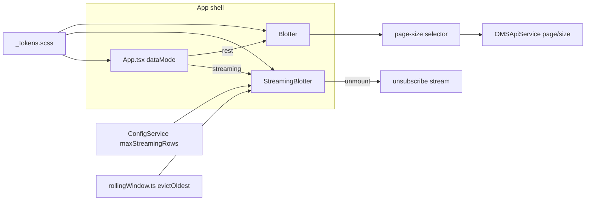

# Design — SPEC-0054: Improve oms-ui look, ergonomics, streaming limits

> **Stage 2 of 3 — how.** Concrete enough that the plan can be written without re-reading the
> code, and checked line by line against the architecture policies. Write "None — <reason>" for a
> section that genuinely does not apply.

## Context

The frontend lives in `oms-ui/frontend/src`. Today:

- **Streaming is unbounded.** `services/RSocketStreamingService.ts` requests
  `sub.request(2147483647)` (unlimited) and `components/StreamingBlotter.tsx` inserts every
  normalized object into a `Map<string, T>` (`dataMap`) that is never evicted. A long session
  grows memory without limit. The toolbar shows `{data.length} records` from that map.
- **Mode switch exists but is shallow.** `App.tsx` holds `dataMode: 'rest' | 'streaming'` and
  swaps between `StreamingOrderBlotter`/`StreamingExecutionBlotter` and `OrderBlotter`/
  `ExecutionBlotter`. Unmounting the streaming blotter unsubscribes (cleanup effect), so the
  switch already works — but it is untested and the streaming blotter offers a "REST Mode" button
  that only calls `onModeChange('rest')`.
- **REST paging is fixed-size.** `components/Blotter.tsx` takes `pageSize = 100` (default prop),
  calls `OMSApiService.getOrders/getExecutions(filters, sort, currentPage - 1, pageSize)`, and
  renders a pagination bar (First/Prev/Next/Last). `BlotterStateService` already persists
  `pageSize`/`currentPage` per domain object in localStorage, but the component never reads
  `pageSize` back and offers no selector. The query API caps `size` at 500
  (`oms-contracts/src/main/openapi/oms-query-api.yml`).
- **Config comes from the oms-ui backend.** `oms-ui/src/main/java/org/example/omsui/controller/
  ConfigController.java` serves `/api/config` from `@Value` properties; the frontend
  `services/ConfigService.ts` consumes it with defaults on failure.
- **Styling is ad-hoc.** `App.scss` is a VS Code-dark clone; each component has its own SCSS;
  toolbars and buttons use emoji glyphs (📡 📋 🔍 📊 ↔️ ⏮ ▶ ⏭ 🟢 🟡 🔴 ⚪). AG Grid is themed
  through `theme/agGridTheme.ts` (Theming API, `themeQuartz`).

Closest existing examples to follow: `StreamingBlotter.test.tsx` (AG Grid stubbed via
`jest.mock('ag-grid-react')`, callbacks captured from the mocked streaming service) and
`Blotter.test.tsx` (mocked `OMSApiService`). Knowledge-base specs read: `ui/oms-admin-ui_spec.md`
(blotter, filters, state indicators), `oms-concepts/streaming-architecture.md` (RSocket protocol),
`oms-framework/state-query-store_spec.md` (paged query API).

## Approach

All changes are frontend-only plus one additive field on the oms-ui `ConfigController`.

1. **Rolling window in `StreamingBlotter`.** A `maxRows` prop (resolved from config) bounds
   `dataMap`. On every event insert, if `dataMap.size >= maxRows` and the key is new, delete the
   oldest entry first. Insertion order of a JS `Map` is preserved, so the first key is the oldest
   row; eviction is `dataMap.delete(firstKey())`. Updates to existing keys never evict. A small
   pure helper `evictOldest(map, maxRows)` in `services/rollingWindow.ts` keeps this testable
   without React.
2. **Config plumbing.** `ConfigController` gains `oms.ui.max-streaming-rows` (default 2000) exposed
   as `maxStreamingRows`. `ConfigService` adds `maxStreamingRows?: number` to `AppConfig` and a
   `getMaxStreamingRows()` accessor that sanitizes (non-number or ≤ 0 → default 2000). The
   streaming blotters resolve it once at init, like `streamingUrl`.
3. **Explicit mode switch.** Keep `App.tsx` as the owner of `dataMode`. The streaming blotter's
   existing cleanup effect (unsubscribe on unmount) is the switch-to-paging path; the REST blotter
   mounts fresh and loads page 1. Add a component test proving unsubscribe-on-unmount and one
   proving the REST blotter fetches with `page`/`size` params. The "REST Mode" button in the
   streaming toolbar is replaced by the header toggle only (single switch, one place).
4. **Page-size selector in `Blotter`.** A `<select>` in the pagination bar with values
   50/100/250/500, initialized from `BlotterStateService` (falling back to 100), persisted on
   change; changing it resets `currentPage` to 1 and triggers reload.
5. **Design-token theme.** New `src/theme/_tokens.scss` defining CSS custom properties
   (`--oms-color-*`, `--oms-space-*`, `--oms-radius-*`, `--oms-font-*`) on `:root`, imported by
   `index.tsx`. `App.scss` and component SCSS files reference tokens instead of raw values. Emoji
   glyphs in toolbars/buttons are replaced with text labels and CSS-styled status dots
   (`.status-dot.connected` etc.). AG Grid theme params read the same token values.

## Contract Changes

None — no OpenAPI or Avro change. `/api/config` is a plain Spring `Map<String, Object>` on the
oms-ui backend (not an OpenAPI contract), and the added `maxStreamingRows` key is additive: the
frontend treats it as optional with a default, so older frontends and the MCP server are
unaffected (P-04).

## Data & Persistence

None — no entity, table or Liquibase change. The only persistence is the existing
`BlotterStateService` localStorage snapshot, which already has a `pageSize` field; the design only
starts reading it back.

## Events & Messaging

None — the streaming protocol (`FILTERED_STREAMING.md`), topics and outbox are untouched. The
client-side `sub.request(2147483647)` stays: backpressure is handled by eviction, not by
throttling the stream, so no events are lost to the audit trail and the server is unchanged.

## Domain, State & Orchestration

None — no order state, command path or task pipeline change. This ticket is read-path only (P-09:
the query API stays read-only; the UI change does not mutate state).

## Alternatives & Decisions

- **Decision** — Evict oldest-by-insertion from a `Map` (insertion-order semantics). *Rejected*:
  LRU via access-order tracking (a `Map` keyed with a doubly-linked list or a third-party LRU) —
  more code and a new dependency for no user-visible benefit; a blotter's oldest rows are the
  natural thing to drop. *Rejected*: dropping newest events when full — silently losing fresh data
  is worse than losing stale rows.
- **Decision** — Window limit served by the oms-ui `/api/config` endpoint. *Rejected*: a build-time
  constant in the frontend — operators could not tune it per deployment; *rejected*: per-blotter
  localStorage override — two sources of truth for one number, and the goal says "configurable
  limit", singular.
- **Decision** — Design tokens in SCSS over the existing components. *Rejected*: adopting a
  component library (MUI, Mantine) — a large new dependency and a rewrite of every modal and
  toolbar for a look-and-feel ticket (P-17); *rejected*: hand-rolled CSS variables without a token
  file — that is what exists today, scattered per component.
- **Decision** — Keep the header as the single mode switch; remove the streaming blotter's
  "REST Mode" button. *Rejected*: keeping both — two controls for one state invites confusion,
  and the button duplicates the header toggle.

No new npm dependency and no build change (P-17).

## Risks & Mitigations

- **Eviction breaks row identity assumptions** — executions are keyed `(orderId, execId)`; evicting
  the oldest row can remove one fill of an order while others remain. Mitigation: eviction is
  tested against the existing row-id semantics (`StreamingBlotter.test.tsx` pattern); the window
  is large (default 2000) so this is a display limit, not a data guarantee — the toolbar states
  "showing N of M events" when the window is full.
- **Config endpoint unavailable** — `ConfigService` already falls back to defaults; the sanitizer
  makes a bad value (0, negative, non-numeric) behave like a missing one.
- **Visual regression across many SCSS files** — the token migration is mechanical
  (raw value → `var(--oms-*)`); component tests assert structure, and the emoji-free AC-6 is a DOM
  assertion, catching the most visible regressions. Manual smoke test of the app shell is part of
  the implement stage.
- **Page-size change mid-session** — changing size resets to page 1 by design; the persisted
  `pageSize` is read on mount only, so a stale snapshot cannot fight the selector.

## Test Strategy

| AC | Level (unit / web-mvc / integration / e2e) | Test class#method | What it asserts |
|---|---|---|---|
| AC-1 | unit + component | `rollingWindow.test.ts#evictsOldestBeyondLimit`, `StreamingBlotter.test.tsx#capsRowsAtMaxStreamingRows` | helper evicts first-inserted key when full; blotter holds exactly N rows and record count shows N after N+1 distinct orders |
| AC-2 | component | `StreamingBlotter.test.tsx#readsMaxStreamingRowsFromConfig`, `StreamingBlotter.test.tsx#fallsBackToDefaultOnBadConfig` | window limit 1500 when config says 1500; default 2000 when config omits or returns ≤ 0 |
| AC-3 | component | `StreamingBlotter.test.tsx#unsubscribesOnUnmount`, `Blotter.test.tsx#fetchesWithPageAndSizeParams` | unmount calls `subscription.unsubscribe()`; REST blotter request carries `page` and `size` |
| AC-4 | component | `Blotter.test.tsx#usesSelectedPageSize`, `Blotter.test.tsx#resetsToFirstPageOnPageSizeChange` | selector value S reaches the API as `size=S` and `page=p-1`; changing S resets to page 1 |
| AC-5 | component | `Blotter.test.tsx#rendersPartialLastPage` | total 7, size 5 → page 2 shows 2 rows |
| AC-6 | component | `App.test.js#noEmojiInControls`, `StreamingBlotter.test.tsx#noEmojiInToolbar` | rendered toolbar/button text contains no emoji code points; status dots use CSS classes |
| AC-7 | component | `StreamingBlotter.test.tsx#resetsWindowOnReconnect` | after disconnect + reconnect, row count ≤ N and event count restarts at 0 |

All are Jest/RTL tests in `oms-ui/frontend/src` (module verify: `npm test -- --watchAll=false`).
No persistence or Kafka is touched, so no `AbstractKafkaPostgresIntegrationTest` extension applies.

## Policy Compliance

| Policy | Title | Status | How / Justification |
|---|---|---|---|
| P-01 | Contracts live only in oms-contracts | comply | no contract change at all; `/api/config` is a Spring controller in oms-ui, not a contract |
| P-02 | Specification before code, generated models only | n/a | no API or message change; nothing to regenerate |
| P-03 | Never edit generated code | comply | no generated code touched |
| P-04 | Contracts evolve compatibly | comply | additive optional JSON field on a non-contract endpoint; no OpenAPI/Avro diff |
| P-05 | Every state change is recorded in the event log | n/a | read-path only; no state change |
| P-06 | Kafka only through the transactional outbox | n/a | no Kafka producer/consumer change |
| P-07 | Schema changes through new Liquibase changesets | n/a | no schema change |
| P-08 | Concurrency and idempotency are explicit | n/a | no command path, no duplicate-delivery surface |
| P-09 | Commands and queries stay separate | comply | UI consumes the read-only query API; no write path added |
| P-10 | State transitions go through the state machine and task pipeline | n/a | no order state touched |
| P-11 | Layering and conventions | comply | follows existing component/service split (`StreamingBlotter` + `rollingWindow.ts` service helper); no new layering |
| P-12 | Jackson 3 only | n/a | frontend TypeScript; no Java serialization change |
| P-13 | Errors and validation follow the framework specs | comply | config sanitization follows the existing fallback pattern in `ConfigService`; no API error shape touched |
| P-14 | Test first, every acceptance criterion is proven by an automated test | comply | test strategy table covers AC-1…AC-7, all Jest/RTL, written before implementation |
| P-15 | Observability | comply | frontend console logging follows the existing `[Component] message` convention; eviction logs at debug level with row counts |
| P-16 | Security | comply | no secrets, no new input surface beyond a numeric config field that is sanitized |
| P-17 | Simplicity and dependencies | comply | no new dependency; smallest change per AC; rejected alternatives recorded above |
| P-18 | Modules build standalone | comply | oms-ui module verify (`npm test`) runs standalone; oms-ui backend change is a one-field `@Value` addition verified by `./gradlew check` |
| P-19 | Documentation follows behaviour | comply | `oms-knowledge-base/ui/oms-admin-ui_spec.md` updated with rolling window, mode switch and page-size behaviour |

## Knowledge Base Updates

- `oms-knowledge-base/ui/oms-admin-ui_spec.md` — document the rolling-window limit
  (`maxStreamingRows`, default 2000), the real-time ↔ paging mode switch semantics, and the
  configurable page size (50/100/250/500).
