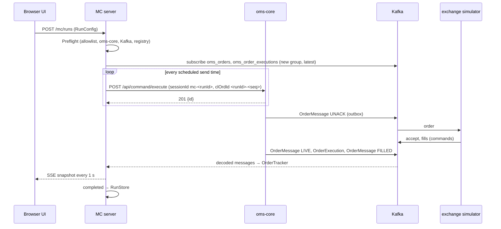

# Design — SPEC-0055: Rebuild mission-control as lightweight load-test tool

> **Stage 2 of 3 — how.** Concrete enough that the plan can be written without re-reading the
> code, and checked line by line against the architecture policies. Write "None — <reason>" for a
> section that genuinely does not apply.

## Context

**What is there today.**
- **`mission-control/`** is a pnpm + Turborepo monorepo:
  - `packages/server` holds Mastra, Hono, LibSQL (with committed `.db` files under
    `src/mastra/public/`), 5 agents, 20 tools and playbooks;
  - `packages/ui` is React 19 + Vite + Zustand;
  - `docs/` holds the v2 design and the implementation guide;
  - there is also an untracked `package-lock.json`.

  None of it is reused (proposal, Open Questions).
- **The closest example of a load run** is `oms-core/src/test/java/org/example/oms/load/LoadSuiteRunnerTest.java`
  (SPEC-0024). Its create body (`OrderCreateCmd`, `version` `1.0.0`, `order{…}`) and its 201
  handling (`{"id": …}`) are the request and response this tool uses.
- **The closest example of an AI agent loop** is developer-cockpit:
  - `developer-cockpit/src/main/ai/AiService.ts`: `streamText` with `tools` and
    `stopWhen: isStepCount(maxSteps)`, steps clamped to 1–20, `ai:*` events with a single
    terminal event, and an abort registry;
  - `developer-cockpit/src/main/ai/adapters.ts`: `forConfig()` maps `anthropic`, `openai` or
    `local` to an AI SDK model, and returns `null` when no provider is configured;
  - its tests drive the loop with a scripted model.

  Mission Control copies this pattern. It does not share code with developer-cockpit (see
  Decisions).

**Interfaces read.** These come from `oms-knowledge-base/interfaces/kafka-topics.md`,
`oms-concepts/exchange-simulator.md`, `capabilities/order-sla-monitoring.md`, `oms-contracts`
and the root `docker-compose.yml`:

| Interface | Fact used |
|---|---|
| `POST /api/command/execute` (oms-core :8090) | 201 with body `{"id": "<orderId>", …}`; 4xx/5xx Problem+JSON |
| `GET /api/query/orders/{orderId}/events` | an order's event history (agent tool) |
| Kafka `localhost:9092` (`PLAINTEXT_HOST`) | `oms_orders` → `OrderMessage`; `oms_order_executions` → `OrderExecution`; keyed by `rootOrderId`; at-least-once |
| Schema Registry `localhost:8081` | `TopicNameStrategy`, `<topic>-value`; Confluent wire format (magic byte + 4-byte schema id) |
| `OrderMessage` | `sessionId`, `clOrdId`, `orderId`, `state` (`NEW, UNACK, LIVE, FILLED, CXL, REJ, CLOSED, EXP`), `eventId` (event-log version), `rejectReason`, and `orderReceivedTime`, `ackTime`, `marketSendTime`, `marketAckTime` (`timestamp-micros`, nullable) |
| `OrderExecution` | `sessionId`, `clOrdId`, `orderId`, `execId`, `orderVersion`, `lastQty`, `lastPx`, `state` |
| Mimir `localhost:9009/prometheus` | Prometheus HTTP API (`/api/v1/query_range`) |
| Loki `localhost:3100` | `/loki/api/v1/query_range` |
| Simulator | MARKET orders fill at the reference price; `SIMULATOR_FILL_SLICES` fills per order |

**Ports.** Port 3100 is Loki, which the old prototype's server collided with. The new server uses
**8097**, next to `grafana-mcp` on 8096. The Vite dev server uses **5181**; developer-cockpit
uses 5180.

## Approach

**Layout.** A single npm package, `mission-control/`, in TypeScript with ESM and Node 22:

```
mission-control/
├── package.json  tsconfig.json  vite.config.ts  vitest.config.ts  README.md  .gitignore (data/, dist/)
├── src/
│   ├── shared/        types.ts (zod schemas: RunConfig, RunSummary, OrderSample, Snapshot, AiEvent)
│   ├── server/
│   │   ├── index.ts                 Hono app on 127.0.0.1:8097, serves dist/ui in production
│   │   ├── config.ts                env → AppConfig (zod)
│   │   ├── log.ts                   JSON-line logger (runId, orderId fields)
│   │   ├── clock.ts                 Clock interface { now(): number /* epoch ms, sub-ms */ }
│   │   ├── run/RunEngine.ts         run lifecycle: preflight → running → draining → completed/stopped
│   │   ├── run/LoadGenerator.ts     open-loop scheduler + OmsClient.create
│   │   ├── run/OrderTracker.ts      correlation, dedupe, per-order timeline + figures
│   │   ├── run/RunStats.ts          counts, exact percentiles, histograms, time series
│   │   ├── run/Preflight.ts         allowlist + reachability checks
│   │   ├── run/RunStore.ts          data/<runId>/{run.json, samples.ndjson}
│   │   ├── oms/OmsClient.ts         REST create + order events (fetch, undici Agent)
│   │   ├── kafka/EventConsumer.ts   kafkajs consumer + schema-registry decode → TrackerEvent
│   │   ├── ai/adapters.ts           forConfig() (pattern from developer-cockpit)
│   │   ├── ai/InvestigationService.ts  bounded streamText loop → AiEvent stream
│   │   ├── ai/tools.ts              runSummary, slowestOrders, orderEvents, queryMetrics, queryLogs
│   │   └── api/routes.ts            REST + SSE
│   └── ui/            main.tsx, App.tsx, api.ts, views/{RunLauncher,LiveRun,RunResult,RunList,Investigate}.tsx,
│                      components/{LatencyChart,ThroughputChart,StateBars,Histogram,FigureTable}.tsx
└── test/  server/…  ui/…  repo/layout.test.ts  fixtures/
```



**Where each What-Changes bullet happens.**
- **Remove the prototype.** Delete `packages/`, `pnpm-*.yaml`, `turbo.json`,
  `tsconfig.base.json`, `docs/`, `node_modules/` and the untracked `package-lock.json`. Then a new
  `package.json` and README.
- **Load generation: `LoadGenerator`.**
  - The schedule is `t_i = start + i × 1000/R` for `i = 0 … R×D−1`.
  - A 5 ms `setInterval` tick sends every request whose `t_i ≤ now()`.
  - Sends are fire-and-forget promises, never awaited by the tick. That makes the schedule open
    loop: a slow response cannot hold back a later send.
  - Each request records `scheduledAt`, `sentAt` (lateness = `sentAt − scheduledAt`) and either
    `ackAt` or the error.
  - `fetch` runs through an undici `Agent` with `connections: 512`, keep-alive, and
    `AbortSignal.timeout(requestTimeoutMs)` (default 5000).
  - The body is the template merged with `sessionId: "mc-<runId>"`, `clOrdId: "<runId>-<seq>"`,
    `exDestination` and `account` from the template.
  - Achieved rate is sends ÷ (last `sentAt` − start + 1000/rate) × 1000: exactly the target on schedule, lower when sends ran late. A run is
    `generatorLimited` when the achieved rate is below 95 % of the target, or when the p99 send
    lateness is above 50 ms.
- **Tracking: `EventConsumer` → `OrderTracker`.**
  - **Correlation** is by `sessionId === "mc-<runId>"`, then `clOrdId` → seq. The `orderId` in
    the 201 is not used, because a Kafka message can arrive before the 201 is handled.
  - **Deduplication.** `OrderMessage` is deduplicated by `(orderId, eventId)`, and
    `OrderExecution` by `(orderId, execId, orderVersion)`, using a `Set` per order.
  - **Figures**, where `seen` is the tracker clock at receipt:

    | Figure | Value |
    |---|---|
    | `toOmsAck` | `ackAt − scheduledAt` |
    | `toMarket` | `seen(first UNACK) − scheduledAt` |
    | `toLive` | `seen(first LIVE) − scheduledAt` |
    | `toFirstFill` | `seen(first OrderExecution) − scheduledAt` |
    | `toFilled` | `seen(first FILLED) − scheduledAt` |

    Each is set once, on first occurrence.
  - **Checkpoint deltas** come from the latest `OrderMessage` with non-null fields, converted
    µs → ms:

    | Delta | Value |
    |---|---|
    | `omsAck` | `ackTime − orderReceivedTime` |
    | `omsToMarket` | `marketSendTime − orderReceivedTime` |
    | `marketRoundTrip` | `marketAckTime − marketSendTime` |

  - **State timeline:** a list of `{state, seenAt, eventId}`, appended only when the state
    changes.
- **Key figures and charts: `RunStats`.**
  - Percentiles are **exact** (nearest-rank on a sorted copy) over the samples of each figure.
    At ≤ 200 orders/s for up to 10 minutes that is ≤ 120 000 values per figure, cheap to sort once
    per second.
  - Histograms use fixed log-spaced buckets (1 ms × 2^(k/4) up to 60 s) for display only.
  - A time series per second holds `{t, submitted, completed, p50/p95/p99 per figure over that
    second's completions}` and `stateCounts`.
- **UI.**
  - React 19 + Vite + Tailwind 4, with Recharts for the line, bar and histogram charts.
  - Views: Run launcher (form → `RunConfig`), Live run (SSE), Run result, Run list, Investigate.
  - In development Vite proxies `/mc` to 8097. In production the server serves `dist/ui`.
- **Persistence: `RunStore`.**
  - `data/<runId>/run.json` holds the config, the summary, the stats and the series.
  - `data/<runId>/samples.ndjson` holds one `OrderSample` per line.
  - Files are written on completion or stop, via a temp file and rename.
  - `list()` reads every `run.json`; `run.json` is checked (format version, `RunConfig` by zod, a summary with a run id). `samples.ndjson` is parsed but not schema-validated; it is only ever written by `RunStore.save`.
    A corrupt run is listed as `unreadable`, never crashes the list.
- **AI investigation: `InvestigationService`.**
  - It is the `AiService.runAgent` pattern: `streamText({model, system, messages, tools,
    stopWhen: isStepCount(maxSteps)})`, with steps clamped to 1–20 (default 8).
  - Prompts are capped at 32 000 characters and tool output is summarized to 4 000 characters.
  - It emits `ai:message`, `ai:tool-call`, `ai:tool-result`, and then exactly one terminal
    `ai:done` or `ai:error`, streamed to the UI over SSE.
  - The system prompt names the run, the figure definitions and the time window.
  - The tools are plain AI SDK tool objects with zod input schemas, each closed over the run:
    - `runSummary()`;
    - `slowestOrders({figure, limit≤50})`;
    - `orderEvents({orderId})`, which calls `GET /api/query/orders/{orderId}/events`;
    - `queryMetrics({promql, stepSeconds})`, a Mimir `query_range` over [run start − 1 min,
      run end + 1 min];
    - `queryLogs({logql, limit≤200})`, a Loki `query_range` over the same window.
  - The provider comes from `MC_AI_PROVIDER` (`anthropic` | `openai` | `local`),
    `MC_AI_MODEL` and `MC_AI_BASE_URL`. The key comes from `ANTHROPIC_API_KEY` or
    `OPENAI_API_KEY`. `forConfig()` returns `null` when it is not configured, and
    `GET /mc/ai/status` reports `{available:false, reason}`.
- **Safety: `Preflight`.**
  - The host of `omsBaseUrl` must be in `MC_ALLOWED_HOSTS` (default `localhost,127.0.0.1`).
  - Then, in parallel with a 3 s timeout each:
    - `GET {omsBaseUrl}/actuator/health` must return 2xx;
    - Kafka admin `describeCluster()` must succeed;
    - `GET {registry}/subjects` must return 2xx.
  - The first failure refuses the run with `422 {check, detail}` before the generator is
    created.
- **Process.** The maintainer adds the `mission-control` entry to `specs/config.json`, then
  `spec set SPEC-0055 modules mission-control,oms-knowledge-base`.

**Run lifecycle (`RunEngine`).** There is one active run per server; a second start answers 409.

| Phase | What happens |
|---|---|
| `PREFLIGHT` | Checks run; a failure moves to `REFUSED` |
| `RUNNING` | The consumer subscribes and joins, then the generator starts |
| `DRAINING` | After the last send, waits until every tracked order is terminal (`FILLED, CXL, REJ, CLOSED, EXP`) or until `completionTimeoutSec` (default 30) has passed |
| `COMPLETED` | Persisted |
| `STOPPED` | `POST /mc/runs/:id/stop` stops sending and goes straight to finalizing; persisted |

The consumer is disconnected after finalizing.

**HTTP API (server, `/mc`).** Request bodies are validated with zod. Errors are Problem+JSON:
`{type, title, status, detail}`.

| Method & path | Purpose |
|---|---|
| `GET /mc/health` | liveness |
| `POST /mc/runs` | start a run (RunConfig) → 201 `{runId}`, 409 a run is active, 422 preflight or validation failure |
| `POST /mc/runs/:id/stop` | stop the active run |
| `GET /mc/runs` | run list (summaries) |
| `GET /mc/runs/:id` | config, summary, stats, series |
| `GET /mc/runs/:id/samples?sort=<figure>&limit=` | per-order samples |
| `GET /mc/runs/:id/stream` | SSE `snapshot` events every 1 s while active, then `done` |
| `GET /mc/ai/status` | provider availability |
| `POST /mc/runs/:id/investigate` | `{prompt, maxSteps?}` → SSE of `ai:*` events |
| `POST /mc/investigations/:invId/stop` | abort |

**`RunConfig`.**

| Field | Default / limits |
|---|---|
| `omsBaseUrl` | `http://localhost:8090` |
| `rate` | 1–200 orders/s |
| `durationSec` | 1–600 |
| `template` | symbol, side, ordType, orderQty, price?, timeInForce, securityId, securityIdSource, account, exDestination, settlCurrency, handlInst, priceType |
| `requestTimeoutMs` | 5000 |
| `completionTimeoutSec` | 30 |
| `label` | optional |

Kafka, the registry, Mimir and Loki come from the environment: `MC_KAFKA_BROKERS`
(`localhost:9092`), `MC_SCHEMA_REGISTRY_URL` (`http://localhost:8081`), `MC_MIMIR_URL`
(`http://localhost:9009/prometheus`), `MC_LOKI_URL` (`http://localhost:3100`), and `MC_DATA_DIR`
(`./data`).

## Contract Changes

None. Mission Control is a client of the existing contracts:
- `oms-cmd-api.yml` `OrderCreateCmd` over REST;
- `oms-query-api.yml` `/orders/{orderId}/events`;
- `OrderMessage.avsc` and `OrderExecution.avsc` over Kafka.

It reads Avro writer schemas from the Schema Registry at runtime by the schema id in each record,
so it follows any compatible schema evolution without a rebuild, and it never registers a schema.
The REST bodies it sends and the fields it reads are typed by its own zod schemas. Those schemas
cover only the fields it uses: TypeScript cannot consume the generated Java models, and
`oms-contracts` publishes no TypeScript artefact.

## Data & Persistence

No OMS tables or Liquibase changes. Mission Control stores runs as files under `MC_DATA_DIR`
(default `mission-control/data/`, git-ignored):
- `run.json` holds `{config, summary, stats, series, startedAt, endedAt, status, generatorLimited}`;
- `samples.ndjson` holds one `OrderSample` per line: `{seq, clOrdId, orderId?, scheduledAt,
  sentAt, ackAt?, error?, timeline[], figures{…}, deltas{…}, finalState?, rejectReason?}`.

Writes go to `*.tmp` and are then renamed. No migration: the format carries `formatVersion: 1`, and
a reader refuses an unknown version as `unreadable`.

## Events & Messaging

Mission Control publishes nothing to Kafka and writes nothing to `order_events`. The orders it
creates go through oms-core's normal command path, which records and publishes them.

**Consumer.**
- kafkajs consumer group `mission-control-<runId>`: a new group per run, `fromBeginning: false`,
  subscribed before the first send. Earlier traffic and other runs are therefore never read, and
  a restart never replays old runs.
- `autoCommit` is on; offsets do not matter because the group is single-use.

**Decoding.**
- `@kafkajs/confluent-schema-registry` `decode(buffer)` resolves the writer schema by id. It only
  reads, and caches each schema.
- A record that fails to decode is counted in `stats.decodeErrors` and logged with its topic,
  partition and offset, and the run continues.

**Ordering and idempotency.**
- Within a topic, one order's records arrive in order, because the key is `rootOrderId`. Across
  the two topics there is no ordering, so the tracker never assumes it: each figure is set on its
  first occurrence, whichever topic delivers it.
- Redelivery is absorbed by the deduplication keys `(orderId, eventId)` and
  `(orderId, execId, orderVersion)` (AC-3).
- A message whose `sessionId` is not `mc-<runId>` is dropped before any parsing beyond those two
  fields.

## Domain, State & Orchestration

No OMS state machine or task pipeline changes. The order states the tracker reads follow the OMS
state machine: UNACK → LIVE → FILLED, plus REJ, CXL, CLOSED and EXP as terminal states.

The tool's own run lifecycle (above) is a small explicit state field in `RunEngine`. Illegal moves
(stop when not running, start while active) answer Problem+JSON 409.

Validation of `RunConfig` is a zod schema; failures answer 422 with the zod issue paths in
`detail`. Venue and OMS refusals are not validated by the tool: they arrive as REST errors or REJ
and are reported (AC-5).

## Alternatives & Decisions

- **D1 — Agent: Vercel AI SDK (`ai` 7, `@ai-sdk/anthropic`, `@ai-sdk/openai`,
  `@ai-sdk/openai-compatible`), copying developer-cockpit's `AiService` and `forConfig` pattern.**
  - **Rejected: Mastra** (requester's call; brings LibSQL storage and a studio, more than one tool
    loop needs).
  - **Rejected: importing developer-cockpit's module directly.** It is an Electron app with its own
    config and IPC types; a cross-package import couples two independently built tools.
  - **Rejected: the raw Anthropic SDK.** It loses provider choice and the step-bounded loop the
    AI SDK provides.
  - Copying about 150 lines is cheaper than coupling.
- **D2 — Web app: a Hono server (`hono`, `@hono/node-server`) plus a Vite React UI.**
  - **Rejected: Electron**, unneeded desktop integration.
  - **Rejected: Express.** Hono is smaller and has typed routes and `streamSSE` built in.
  - **Rejected: plain `node:http`**, more hand-written routing and SSE.
  - **Rejected: WebSocket** (developer-cockpit uses `ws`). The live stream is one-way, so SSE is
    enough and needs no client library.
- **D3 — Kafka: `kafkajs` + `@kafkajs/confluent-schema-registry`.**
  - **Rejected: `@confluentinc/kafka-javascript`**, native librdkafka builds that are fragile on
    Windows (the maintainer's platform).
  - **Rejected: hand-decoding with `avsc`**, which reimplements the wire format and the schema
    cache.
  - kafkajs is in maintenance mode but stable for a plain consumer. The decoder is the only place
    that touches it, so swapping it later is contained.
- **D4 — Correlation by `sessionId` + `clOrdId`, not by the 201's `orderId`.**
  - The outbox can publish UNACK before the HTTP response is handled. Keying by `orderId` would
    need a buffer for unknown ids and would mis-time `toMarket`. Both fields are on
    `OrderMessage` and `OrderExecution`.
  - `(sessionId, clOrdId)` is unique in the OMS (FR-004), so the key is safe.
- **D5 — Exact percentiles over stored samples.**
  - **Rejected: HDR histograms (`hdr-histogram-js`).** Exact is simpler and fast enough at the
    proposal's ≤ 200 orders/s bound (deferred item), and it makes AC-4's "agree with a reference
    computation" an equality.
- **D6 — Charts: `recharts`.**
  - **Rejected: `uPlot`**, faster but imperative and needing a React wrapper.
  - **Rejected: `chart.js`**, canvas-based and needing its own wrapper.
  - Series are small (one point per second).
- **D7 — Open-loop scheduler on a 5 ms tick with fire-and-forget sends.**
  - **Rejected: one `setTimeout` per order**, which means timer churn at 200/s and no batching
    when the event loop lags.
  - **Rejected: a closed-loop worker pool**, the coordinated-omission problem SPEC-0024's
    concurrency-8 burst has.
- **D8 — File-based run store.**
  - **Rejected: SQLite or LibSQL**, a native or extra dependency for append-once data.
  - **Rejected: Postgres**, which would couple the tool to the system under test's database.
- **D9 — npm, a single package, Node 22.**
  - **Rejected: pnpm + Turborepo**, a workspace for one package. developer-cockpit uses npm.
- **Other dependencies:**
  - `zod` 4: validation, as in developer-cockpit;
  - `undici`: the `Agent` connection pool for `fetch`;
  - `tailwindcss` 4 and `@tailwindcss/vite`: styling, as in developer-cockpit.
  - Dev dependencies: `vitest`, `@testing-library/react`, `jsdom`, `typescript`, `vite`,
    `@vitejs/plugin-react`, `concurrently`, `tsx` (to run the server in development).
  - No state library: React state and one `useRunStream` hook.

### Changed during implementation

- **`MockLanguageModelV3` → a hand-rolled fake model**
  (`test/support/fakeModel.ts`). `ai` 7 ships no mock model. developer-cockpit's `AiService`
  tests use the same kind of fake v4 model. Test-only; the AC-8 assertions are unchanged.
- **`@kafkajs/confluent-schema-registry` 4.x instead of 3.x.** 3.x pulls in an `ajv` with a
  ReDoS advisory (GHSA-2g4f-4pwh-qvx6). The `decode` and `encode` API is unchanged.
- **`@hono/node-server` 2.x.** 1.19.x has a `serveStatic` path-decoding advisory
  (GHSA-rmxm-3fg6-px4f), and the server uses `serveStatic` for the built UI.
- **`avsc` as an explicit dev dependency.** It is the schema-registry client's own Avro library.
  Tests use it to build the registry's inlined schemas from `oms-contracts/src/main/avro`.
- **Known dev-only advisories accepted: vitest 3.2.7 (`@vitest/mocker`, `tinypool`).** The fix
  is vitest 5, a breaking upgrade. developer-cockpit pins the same 3.2.7. These are test-runner
  dependencies only; the runtime dependencies audit clean.
- **Histogram overflow bucket is `le: null` rather than `Infinity`.** `Infinity` does not
  survive JSON, so a saved run did not read back equal (caught by the AC-7 test).
- **AI routes in `src/server/ai/routes.ts`.** They are mounted onto the app through
  `createApp({extend})`, so the AI wiring stays in one folder.
  - `POST /mc/runs/:id/investigate` first sends an SSE `start` event carrying the `invId` the UI
    needs in order to stop the investigation, then the `ai` events.
  - It also works on the active run, using its live samples.
- **`npm test` runs `LoadGenerator.test.ts` in a separate, second vitest pass.** Its AC-1
  bound (every send ≤ 50 ms late, with real timers) failed once in four full-suite runs, because
  of CPU contention from the parallel jsdom workers. Alone it passes consistently. developer-cockpit
  isolates its perf tests the same way. The bound itself is unchanged.
- **Chart components share one file, `src/ui/components/charts.tsx`.** It holds
  `ThroughputChart`, `LatencyChart`, `StateBars` and `Histogram`, instead of one file each; they
  share the panel, axis and colour setup.
- **AC-4 component tests assert that the chart containers are mounted, not that SVG is drawn.**
  jsdom has no layout, so recharts draws nothing there. The values themselves are asserted
  through each panel's numeric readout.

- **Changed after the independent review:**
  - **Cross-origin guard.** Binding to 127.0.0.1 does not stop a web page in the user's browser
    from sending a CORS "simple request" (text/plain POST, no preflight) that starts a run or an
    investigation. Every `POST /mc/*` must now carry `Content-Type: application/json` (415
    otherwise), and an `Origin`, when present, must be one of the UI's own origins: the server
    and the Vite dev server on localhost/127.0.0.1 (403 otherwise). CLI clients send no Origin.
    Test: `api.test.ts#refuses cross-origin and non-JSON POSTs…`.
  - **A failed create contributes nothing, even when its events came first.** The outbox can
    publish before the HTTP response, so an order's figures and completion are held until its 201
    arrives. A 4xx, 5xx or timeout discards them (AC-5). Tests:
    `OrderTracker.test.ts#a create that fails after its events arrived contributes nothing`,
    `#events that arrive before the 201 count once the 201 arrives`.
  - **Investigations recheck the host allowlist** before their tools may call a stored run's
    oms-core (422 `allowlist`).
  - **No "order count" option.** The proposal's What Changes mentions "a configured duration or
    order count". Only rate × duration is implemented: the count is always `round(rate × duration)`
    and no AC covers a separate count. Adding one is additive.

## Risks & Mitigations

| Risk | Mitigation |
|---|---|
| The tool's own event loop cannot hold the schedule, and the numbers blame the OMS | Lateness is measured on every send; `generatorLimited` is flagged at < 95 % achieved rate or p99 lateness > 50 ms and shown on the result (AC-1). Rate capped at 200/s |
| Consumer not yet joined when the first UNACK is published, so early orders look incomplete | The engine awaits the consumer's `GROUP_JOIN` event (10 s timeout → `REFUSED` with check `kafka`) before starting the generator |
| `timestamp-micros` values exceed `Number.MAX_SAFE_INTEGER` | They don't: epoch µs ≈ 1.8 × 10¹⁵ < 9 × 10¹⁵. The decoder maps long to number and the tracker divides by 1000; a fixture test pins it |
| Pointing the tool at a shared or production OMS | Host allowlist checked first (AC-6); the server binds to 127.0.0.1 only |
| Load from a run disturbs another session's work on the shared compose stack | Same exposure as SPEC-0024's suite. The README says to run against an otherwise idle stack; nothing persists in the OMS beyond the orders created |
| AI provider costs or runaway loops | Step cap 1–20, prompt and tool-output caps, abort endpoint; nothing runs without an explicit question |
| An agent tool accepts arbitrary PromQL/LogQL | Read-only APIs, limited to the run's window, results truncated; queries go only to the configured Mimir and Loki URLs |
| Deleting the prototype loses something useful | Git history keeps it; the proposal decided to start over |

## Test Strategy

vitest, run by `npm test`. Server tests run under Node; UI tests run under jsdom with Testing
Library. External systems are faked as follows:
- oms-core, Mimir and Loki: a local `node:http` stub server per test;
- Kafka: an in-memory `TrackerEvent` source, the same interface `EventConsumer` implements;
- the Schema Registry: a stub serving `OrderMessage.avsc` and `OrderExecution.avsc` read from
  `../oms-contracts/src/main/avro`, with records encoded by the same library;
- AI: `MockLanguageModelV3` from `ai/test` (developer-cockpit's approach);
- time: an injected `Clock` (`FakeClock`).

The real Kafka path is exercised by AC-10.

| AC | Level | Test class#method | What it asserts |
|---|---|---|---|
| AC-1 | unit (real timers, stub HTTP) | `test/server/LoadGenerator.test.ts#sends rate×duration requests on schedule despite slow responses` | R=50, D=2 against a stub that delays every 201 by 1 s: 100 (±1) POSTs to `/api/command/execute`, unique `clOrdId`s, body = template + `sessionId mc-<runId>`, every lateness ≤ 50 ms, summary has target and achieved rate |
| AC-1 | unit (FakeClock) | `test/server/LoadGenerator.test.ts#flags generator-limited below 95 percent` | a stalled tick sequence yielding 90 % of the target sets `generatorLimited: true`; 100 % leaves it false |
| AC-2 | unit (FakeClock) | `test/server/OrderTracker.test.ts#builds timeline, figures and checkpoint deltas` | scripted 201 → UNACK → LIVE → OrderExecution → FILLED at known clock times gives the exact timeline, `toOmsAck/toMarket/toLive/toFirstFill/toFilled`, and the µs→ms deltas from the `OrderMessage` fields |
| AC-2 | unit | `test/server/OrderTracker.test.ts#ignores messages of other sessions` | a message with another `sessionId`, or an unknown `clOrdId`, changes nothing |
| AC-2 | unit (stub registry) | `test/server/EventConsumer.test.ts#decodes OrderMessage and OrderExecution from the wire format` | Confluent-framed records decode to `TrackerEvent`s with correct `state`, `eventId`, `orderVersion` and µs timestamps |
| AC-3 | unit | `test/server/OrderTracker.test.ts#redelivered messages change nothing` | replaying the same `OrderMessage (orderId,eventId)` and `OrderExecution (orderId,execId,orderVersion)` leaves the timeline, figures, counts and percentiles equal (deep equality before and after) |
| AC-4 | unit | `test/server/RunStats.test.ts#percentiles equal the reference computation` | for fixed and random samples, p50/p95/p99/max equal a nearest-rank reference; histogram counts sum to n |
| AC-4 | server | `test/server/api.test.ts#stream pushes a snapshot at least once per second` | during an active run (stub OMS + in-memory events) the SSE stream yields ≥ 3 `snapshot` events in 3.2 s, then `done` |
| AC-4 | component | `test/ui/LiveRun.test.tsx#renders throughput, percentiles over time and state counts` | given snapshots, the throughput chart, a latency chart per figure and the state bars render with the snapshot's values |
| AC-4 | component | `test/ui/RunResult.test.tsx#renders figure table, histograms, errors and incomplete orders` | the table shows count/p50/p95/p99/max per figure, one histogram per figure, and the error and incomplete lists |
| AC-5 | unit (stub HTTP, FakeClock) | `test/server/RunEngine.test.ts#counts create errors, venue rejects and incomplete orders and continues` | stub answers 400, 503 and one timeout among 201s; one order goes to REJ with a `rejectReason`; one stays LIVE past the completion timeout. The summary lists each with status/body, reason or last state; the other orders complete; the errored orders contribute no samples to any figure, and the REJ order none to `toFilled` |
| AC-6 | server | `test/server/api.test.ts#refuses a run when a preflight check fails` | for each case (host not allowlisted, oms-core health 503, Kafka unreachable, registry unreachable) `POST /mc/runs` answers 422 naming the check, and the stub oms-core received zero `/api/command/execute` requests |
| AC-7 | unit (temp dir) | `test/server/RunStore.test.ts#a saved run reads back identically from a new store` | save a finished run, create a new `RunStore` on the same directory, `list()` contains it, `get()` deep-equals config, summary, stats and samples |
| AC-8 | unit (MockLanguageModelV3, stub OMS/Mimir/Loki) | `test/server/InvestigationService.test.ts#agent calls every tool and streams the answer` | a scripted model calls `runSummary`, `slowestOrders`, `orderEvents`, `queryMetrics`, `queryLogs` in turn; each tool hits the expected URL with the run's window; events are tool-call/tool-result pairs, text, then exactly one `ai:done`; step cap clamps 50 → 20 |
| AC-8 | unit + component | `test/server/InvestigationService.test.ts#not configured yields a configuration error`, `test/ui/Investigate.test.tsx#shows not-configured and leaves the rest usable` | no key → `ai:error` kind `configuration` and `/mc/ai/status` `available:false`; the view shows the reason, the run result still renders |
| AC-9 | repo | `test/repo/layout.test.ts#no prototype remains and the module is registered` | no `packages/`, `pnpm-workspace.yaml`, `turbo.json`; no `@mastra/*` in package.json; `../specs/config.json` has `modules["mission-control"]` with `npm run typecheck` and `npm test`. The verify stage runs those commands |
| AC-10 | e2e (manual, compose stack) | `scripts/e2e-run.mjs` (`npm run e2e -- --rate 20 --duration 60`) | starts a run through the API against the live stack, waits for completion and prints the summary; it exits 0 only if 1200 orders are FILLED, every figure has 1200 samples, there are no errors or incomplete orders, and the run is not generator-limited. The summary JSON is saved as evidence |

## Policy Compliance

| Policy | Title | Status | How / Justification |
|---|---|---|---|
| P-01 | Contracts live only in oms-contracts | comply | No OpenAPI or Avro files in mission-control. Schemas come from the Schema Registry at runtime; tests read the `.avsc` files from `oms-contracts/src/main/avro` |
| P-02 | Specification before code, generated models only | comply | No contract changes. The tool's zod types describe only the fields it sends and reads from existing contracts; no `org.example.common.model.*` classes are involved (TypeScript cannot consume them) |
| P-03 | Never edit generated code | n/a | No generated code is produced or touched |
| P-04 | Contracts evolve compatibly | n/a | No contract changes. Decoding by writer schema keeps the tool working across compatible evolution |
| P-05 | Every state change is recorded in the event log | n/a | The tool changes no OMS state itself; orders are created through the command API, which records them |
| P-06 | Kafka only through the transactional outbox | n/a | Mission Control only consumes; it produces nothing to Kafka |
| P-07 | Schema changes through new Liquibase changesets | n/a | No database schema changes |
| P-08 | Concurrency and idempotency are explicit | comply | Consumer deduplicates on `(orderId, eventId)` and `(orderId, execId, orderVersion)` (AC-3); one active run per server (409); unique `clOrdId` per order |
| P-09 | Commands and queries stay separate | comply | Writes only via `POST /api/command/execute`; the agent's order history uses the read-only query API |
| P-10 | State transitions go through the state machine and task pipeline | n/a | No OMS state transitions are added or changed |
| P-11 | Layering and conventions | comply | Thin Hono routes → services (`RunEngine`, `InvestigationService`) → adapters (`OmsClient`, `EventConsumer`, `RunStore`); the agent follows developer-cockpit's `AiService`/`forConfig` pattern. Java conventions (MapStruct, Lombok) do not apply to TypeScript |
| P-12 | Jackson 3 only | n/a | No Java code |
| P-13 | Errors and validation follow the framework specs | comply | Mission Control's API answers errors as RFC 7807 Problem+JSON; `RunConfig` and every request body are validated with zod; OMS Problem+JSON bodies are recorded as received; no swallowed errors (decode, send and store failures are counted and logged) |
| P-14 | Test first, every acceptance criterion is proven by an automated test | comply | Every AC has a vitest test (Test Strategy), written before its implementation; AC-10 is an end-to-end script with an exit code. Testcontainers does not apply to a TypeScript module; Kafka is covered by the wire-format decode test and AC-10 |
| P-15 | Observability | comply | Structured JSON-line logs with `runId`, plus `orderId`/`clOrdId` where present; no stray `console.log`. Run metrics are the product itself (summary, series). Exporting the tool's own telemetry to Grafana is out of scope (proposal) |
| P-16 | Security | comply | API keys only from environment variables (`ANTHROPIC_API_KEY`, `OPENAI_API_KEY`), never stored in run files or config; zod validation at the API boundary; Kafka records are decoded by writer schema and reduced field by field with type checks (`str`/`num`), never trusted as a whole; target host allowlist (rechecked before an investigation); server bound to 127.0.0.1, and POSTs only from the UI's own origins with `application/json` (see Changed during implementation) |
| P-17 | Simplicity and dependencies | comply | Every dependency recorded with rejected alternatives in D1–D9; single package, file store, exact percentiles, no state library |
| P-18 | Modules build standalone | comply | `mission-control` builds and tests on its own (`npm run typecheck`, `npm test`); no Gradle module is touched |
| P-19 | Documentation follows behaviour | comply | New knowledge-base page plus links (below); README rewritten |

## Knowledge Base Updates

- **New `oms-knowledge-base/oms-concepts/mission-control.md`:**
  - purpose and scope;
  - figure definitions (the AC-2 table) and how correlation and deduplication work;
  - how to run it (env vars, ports 8097/5181, `npm run dev`, `npm run e2e`);
  - the run lifecycle and `generatorLimited`;
  - AI investigation and its tools;
  - limitations: ≤ 200 orders/s, create-only scenarios, a client-clock measurement.
- **`oms-knowledge-base/oms-concepts/index.md`:** add the page.
- **`oms-knowledge-base/oms-concepts/exchange-simulator.md` §8 (Load Suite):** a one-line pointer
  to Mission Control for configurable-rate runs with live charts. The JUnit suite stays.
