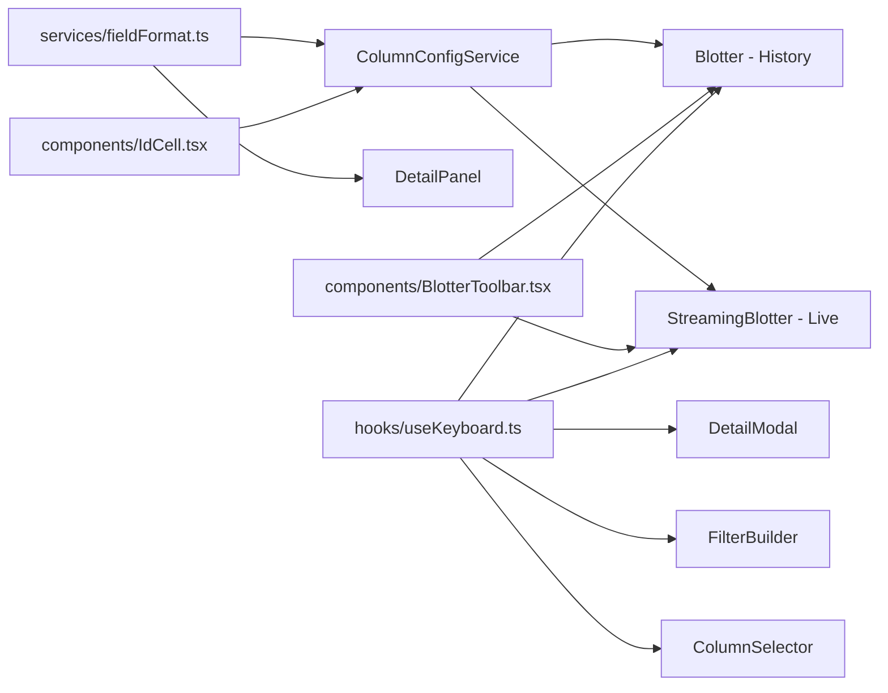

# Design — SPEC-0059: Improve trader ergonomics in oms-ui blotters

> **Stage 2 of 3 — how.** Concrete enough that the plan can be written without re-reading the
> code, and checked line by line against the architecture policies. Write "None — <reason>" for a
> section that genuinely does not apply.

## Context

All code is in `oms-ui/frontend/src` (React 19, TypeScript, AG Grid 36, tests with Jest and React
Testing Library through `react-app-rewired test`).

- **Column definitions.** `services/ColumnConfigService.ts#createColumnDef` builds every grid
  column for both blotters from the metamodel: `Blotter.tsx` (History, REST) and
  `StreamingBlotter.tsx` (Live, RSocket). Numbers get `valueFormatter = value.toLocaleString()` with
  no alignment. Enums get the metamodel label and `EnumCellRenderer` (a badge). Strings default to
  150 px (oms-core `MetamodelService.determineColumnWidth`).
- **Detail panel.** `components/DetailPanel.tsx#formatValue` has its own rules:
  - quantities: `toLocaleString()`;
  - fields named `*price*` and `stopPx`: `toFixed(2)`;
  - `avgPx`, `lastPx`: printed raw;
  - enums in `BADGE_FIELDS`: shown as badges.
- **ExecType.** `execType` is a `String` in `Execution` and `OrderExecutionProjectionRow` (the FIX
  code), so the metamodel types it `string` with no labels.
- **Sort.** `Blotter.tsx#loadData` sends `sort` only when the grid has a sort model. Executions go to
  `OMSApiService.getExecutions` → `GET /api/executions`, whose controller defaults to
  `@PageableDefault(sort = "id")` ascending.
- **Dialogs.** `DetailModal`, `FilterBuilder` and `ColumnSelector` each render a
  `modal-overlay` / dialog pair with `onClose`. None handles keys.
- **Toolbars.** Both blotters inline a `div.blotter-toolbar`, with the same left side (title,
  record count) and the same Filters, Columns and Auto-Size buttons.
  - History adds Refresh and Auto-refresh.
  - Live adds the connection status, Pause/Resume, Connect/Disconnect and Include Snapshot.
- **Mounting.** Both blotters can be mounted at once (`App.tsx` keeps views mounted) and take an
  `active` prop.
- **Mode toggle.** `App.tsx` renders the "REST" and "Streaming" buttons over a `DataMode` of
  `'rest' | 'streaming'`.

Closest examples: the SPEC-0058 work in the same components, for example the badge labels in
`DetailPanel#enumLabel` and the `EnumCellRenderer` tests. The streaming info bar already formats
counts with `toLocaleString('en-US')`.

## Approach

1. **`services/fieldFormat.ts` (new): one place for display rules**
   - `isPriceField(name)`: `price`, `stopPx`, and any name ending in `Px` (`lastPx`, `avgPx`, …).
   - `isQuantityField(name)`: names ending in `Qty`.
   - `isIdField(name)`: `orderId`, `execId`, `clOrdId`, `origClOrdId`, `rootOrderId`,
     `parentOrderId`, `quoteId`, `quoteReqId`, `sessionId`.
   - `formatPrice(v)`: `Intl.NumberFormat('en-US', { minimumFractionDigits: 2, maximumFractionDigits: 8 })`.
   - `formatNumber(v)`: `Intl.NumberFormat('en-US', { maximumFractionDigits: 8 })` (separators, no
     forced decimals).
   - Both formatters return `''` for null or undefined. The locale is `en-US`, as the streaming
     info bar already uses.
   - `EXEC_TYPE_LABELS` maps the FIX 4.4 ExecType codes:
     - `0` New, `3` Done for Day, `4` Canceled, `5` Replaced, `6` Pending Cancel, `7` Stopped,
       `8` Rejected, `9` Suspended;
     - `A` Pending New, `B` Calculated, `C` Expired, `D` Restated, `E` Pending Replace, `F` Trade,
       `G` Trade Correct, `H` Trade Cancel, `I` Order Status.
   - `execTypeLabel(code)` returns the label, or the code when unknown.
2. **`ColumnConfigService.createColumnDef`**
   - `number` columns: `type: 'rightAligned'` (AG Grid's built-in column type, right-aligning cell
     and header), with `valueFormatter` = `formatPrice` for price fields and `formatNumber` otherwise.
   - Field `execType`: `valueFormatter` = `execTypeLabel`, `cellRenderer` = `EnumCellRenderer`, so it
     shows as a badge like the other codes.
   - ID fields: `width = max(field.width ?? 0, 220)`, `minWidth = 220`, `cellRenderer = IdCell`.
   - Everything else is unchanged.
3. **`components/IdCell.tsx` (new)** renders
   `<bdi>{value}</bdi>`.
   - SCSS `.id-cell { direction: rtl; text-align: left; overflow: hidden; text-overflow: ellipsis; white-space: nowrap; display: block }`
     and `.id-cell bdi { direction: ltr; unicode-bidi: isolate }`.
   - The ellipsis therefore falls at the start and the end (`…-F1`) stays visible.
   - The native `title` is the tooltip, so no AG Grid tooltip module is needed (SPEC-0060 trims
     modules).
4. **`DetailPanel.formatValue`** uses `formatPrice`, `formatNumber` and, for `execType`, a badge
   with `execTypeLabel`, replacing its own number rules.
5. **Default sort.** In `Blotter.tsx#loadData`, when `sortModel` is empty and
   `domainObject === 'Execution'`, it sends `{ field: 'id', direction: 'desc' }`. Orders are
   unchanged.
6. **`hooks/useKeyboard.ts` (new)**
   - `useEscape(onClose)`: a `keydown` listener on `document` while mounted, calling `onClose` on
     `Escape`. Used by `DetailModal`, `FilterBuilder` and `ColumnSelector`.
   - `useShortcuts(enabled, map)`: on `document`, when `enabled`, runs `map[key.toLowerCase()]`.
     - It ignores events with Ctrl, Meta or Alt held.
     - It ignores events whose target is an `input`, `textarea`, `select` or contentEditable
       element.
     - It ignores events while a `.modal-overlay` is in the document.
     - It calls `preventDefault()` when it handles a key.
7. **Blotters**
   - Each blotter calls `useShortcuts(active, { f, c, r | p })`: `r` refresh in History, `p` pause
     in Live.
   - Each passes AG Grid `onCellKeyDown`: Enter opens the detail modal for `event.data`.
   - The buttons' `title` attributes name their shortcut, e.g. "Filters (F)".
8. **`components/BlotterToolbar.tsx` (new)**
   - Props: `mode: 'live' | 'history'`, `title`, `recordCount`, `filterCount`, `onFilters`,
     `onColumns`, `onAutoSize`, `status?: ReactNode` (left side, Live connection status), and
     `actions?: ReactNode` (mode-specific buttons, rendered after Auto-Size).
   - Renders `div.blotter-toolbar[data-testid="blotter-toolbar"][data-mode]` with the existing
     class names, so the SCSS keeps applying.
   - Both blotters replace their inline toolbar with it.
9. **`App.tsx` mode toggle.** Labels become "Live" and "History", ordered Live first. Each button
   gets `aria-pressed`. `DataMode` values and saved-state keys are unchanged (proposal OQ 4).

What Changes → where:

| Proposal item | Where |
|---|---|
| Numbers aligned and formatted | 1, 2, 4 |
| ExecType labels | 1, 2, 4 |
| ID columns | 1, 2, 3 |
| Newest-first executions | 5 |
| Keyboard | 6, 7 |
| Live / History | 9 |
| One toolbar | 8 |

## Contract Changes

None. No OpenAPI or Avro change. The `sort=id,DESC` parameter is already accepted by
`/api/executions` (Spring `Pageable`).

## Data & Persistence

None — UI only.

## Events & Messaging

None — UI only.

## Domain, State & Orchestration

None. The ExecType labels are display text for FIX codes. No state, quantity or price value is
changed, only how it is shown.

## Alternatives & Decisions

- **ExecType labels in the UI** (decided at the proposal).
  - Rejected: typing `execType` as an enum in oms-core so the metamodel supplies labels. That adds
    a backend module and an entity change for display text.
- **Start-truncation with CSS and `<bdi>`.**
  - Rejected: a JavaScript middle-ellipsis, which needs measuring text and breaks on resize.
  - Rejected: AG Grid tooltips, which need the tooltip module that SPEC-0060 is trimming.
- **`Intl.NumberFormat('en-US')`**, consistent with the streaming info bar.
  - Rejected: the browser locale, which would make tests and screenshots machine-dependent. A
    locale setting can come later.
- **Document-level key listeners in small hooks.**
  - Rejected: AG Grid's keyboard API alone, because the dialogs are not in the grid.
  - Rejected: a shortcut library. That would be a new dependency for six keys (P-17).
- **Toolbar via props plus `status` and `actions` slots.** Rejected: one boolean prop per action,
  which would grow with every mode-specific button.
- No new dependencies.

- **Changed after the independent review: `useDialog` replaces `useEscape`.** Attached to the dialog
  element of all four dialogs (details, filters, columns, and also authorization), it closes on
  Escape, moves focus into the dialog on open and gives it back on close, and ignores a dialog in a
  hidden view (`[hidden]` ancestor, the kept-mounted views of SPEC-0056). The dialogs are
  `role="dialog"` with `aria-modal` and a label. Moving focus into the dialog also keeps Enter and the
  arrow keys from acting on the grid behind it.
- **Changed after review: `useShortcuts`** treats only text-like inputs (text, number, date, …) as
  typing, so a focused checkbox (Auto-refresh, Include Snapshot) no longer swallows shortcuts. A
  dialog only blocks shortcuts when it is visible. Shortcut buttons carry `aria-keyshortcuts`.
- **Changed after review:** `strikePrice` is a price field everywhere (it was a price in the detail
  panel only). The detail panel's Execution group now lists `execId`, `execType`, `lastQty`,
  `lastPx` and `avgPx`, which previously fell into "Other"; `id` and `txNr` stay unformatted.
- In the History toolbar, Refresh now follows Auto-Size (the shared buttons come first); the UI
  specification's diagram shows the new order.
- The start-truncation of ids is asserted on `IdCell.scss` itself, because jsdom does not lay out
  text.

## Risks & Mitigations

| Risk | Mitigation |
|---|---|
| Both blotters are mounted at once, so a shortcut fires twice | `useShortcuts` only listens while `active`; a test mounts both and checks one handler fires |
| A shortcut steals typing in the filter field or the AG Grid filter popup | Ignore events from inputs, selects, textareas and contentEditable, and while a modal is open; tested |
| RTL truncation garbles punctuation in ids | `<bdi>` with `unicode-bidi: isolate` keeps the id left-to-right; a test checks the rendered text equals the value |
| Existing tests depend on the toolbar markup or "REST"/"Streaming" text | Class names are kept; tests asserting the old labels are updated in the same task |

## Test Strategy

| AC | Level | Test class#method | What it asserts |
|---|---|---|---|
| AC-1 | unit | `services/ColumnConfigService.test.ts#right-aligns number columns only` | `type: 'rightAligned'` on number columns, not on others |
| AC-2 | unit | `services/fieldFormat.test.ts#formats prices with 2 to 8 decimals`, `#formats quantities with separators`; `ColumnConfigService.test.ts#uses the price and quantity formatters` | The exact strings of the AC; null gives `''` |
| AC-3 | unit + component | `fieldFormat.test.ts#labels FIX exec types`; `ColumnConfigService.test.ts#labels execType`; `components/DetailPanel.test.tsx#shows the exec type label` | `F` → Trade, the listed codes, `Z` → Z, in the grid and the detail panel |
| AC-4 | unit + component | `ColumnConfigService.test.ts#id columns are at least 220 px and use IdCell`; `components/IdCell.test.tsx#keeps the end visible and shows the full id on hover` | Width ≥ 220; `id-cell` class (start-truncation CSS), `title` = full value, text = value |
| AC-5 | component | `components/Blotter.test.tsx#executions load newest first by default`, `#a chosen sort replaces the default`, `#orders keep their request` | `getExecutions` sort argument `{ field: 'id', direction: 'desc' }`; replaced after a sort; orders call unchanged |
| AC-6 | component | `components/DetailModal.test.tsx#Escape closes`; `components/FilterBuilder.test.tsx#Escape closes`; `components/ColumnSelector.test.tsx#Escape closes` | `onClose` called on Escape, not on another key |
| AC-7 | component | `Blotter.test.tsx#keyboard shortcuts`; `StreamingBlotter.test.tsx#P pauses and resumes`, `#Enter opens the detail modal`, `#shortcuts are ignored in inputs`, `#an inactive blotter ignores shortcuts` | F, C, R, P, Enter as specified; nothing fires from an input or an inactive blotter |
| AC-8 | component | `App.test.js#mode toggle reads Live and History` | Buttons "Live" (pressed) and "History"; no "REST" or "Streaming" |
| AC-9 | component | `components/BlotterToolbar.test.tsx#renders shared and mode actions`; `Blotter.test.tsx#uses the shared toolbar`; `StreamingBlotter.test.tsx#uses the shared toolbar` | One `blotter-toolbar` with `data-mode`; Live-only and History-only actions where they belong |
| AC-10 | suite | oms-ui verify: `npm test -- --watchAll=false --passWithNoTests`, `gradlew check` | Everything green, existing tests included |

## Policy Compliance

| Policy | Title | Status | How / Justification |
|---|---|---|---|
| P-01 | Contracts live only in oms-contracts | n/a | No contract files |
| P-02 | Specification before code, generated models only | comply | No models hand-written; the UI consumes the existing APIs |
| P-03 | Never edit generated code | comply | None touched |
| P-04 | Contracts evolve compatibly | n/a | No contract change; `sort` is an existing parameter |
| P-05 | Every state change is recorded in the event log | n/a | UI display only |
| P-06 | Kafka only through the transactional outbox | n/a | No messaging |
| P-07 | Schema changes through new Liquibase changesets | n/a | No schema |
| P-08 | Concurrency and idempotency are explicit | n/a | No commands |
| P-09 | Commands and queries stay separate | n/a | Read-only UI changes |
| P-10 | State transitions go through the state machine and task pipeline | n/a | No transitions |
| P-11 | Layering and conventions | comply | Formatting in `services/`, presentational components in `components/`, hooks in `hooks/`, following the existing SPEC-0058 layout |
| P-12 | Jackson 3 only | n/a | No Java |
| P-13 | Errors and validation follow the framework specs | n/a | No API errors change |
| P-14 | Test first, every AC proven by an automated test | comply | Every AC maps to a named test above, written first |
| P-15 | Observability | n/a | No server behaviour |
| P-16 | Security | comply | No new inputs; `title` and text render through React escaping |
| P-17 | Simplicity and dependencies | comply | No new dependencies; one formatter module and one toolbar replace duplicated code |
| P-18 | Modules build standalone | comply | oms-ui only |
| P-19 | Documentation follows behaviour | comply | `ui/admin-ui.md` updated (formatting, ExecType labels, shortcuts, Live/History, toolbar); `log.md` entry |

## Knowledge Base Updates

- `oms-knowledge-base/ui/admin-ui.md`: new section "Formatting and keyboard":
  - number alignment and decimals;
  - ExecType labels;
  - ID columns;
  - the default sort;
  - the shortcut table;
  - the Live / History names and the shared toolbar.

  Set `updated`.
- `oms-knowledge-base/capabilities/admin-ui.md`: mention the ergonomics and link the section.
- `oms-knowledge-base/log.md`: entry for SPEC-0059.
