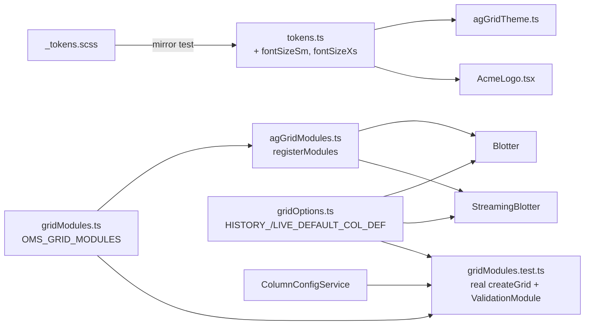

# Design — SPEC-0060: Finish design tokens and trim AG Grid modules

> **Stage 2 of 3 — how.** Concrete enough that the plan can be written without re-reading the
> code, and checked line by line against the architecture policies. Write "None — <reason>" for a
> section that genuinely does not apply.

## Context

All paths are under `oms-ui/frontend/src/`.

- **Tokens.** `theme/_tokens.scss` holds every colour and font size as `--oms-*` custom properties.
  - `theme/tokens.ts` (`omsTokens`) mirrors the ones JavaScript needs: colours only, today.
  - `theme/styleRules.test.ts#tokens.ts mirrors _tokens.scss` maps each camelCase key to its
    kebab-case token and fails on a mismatch.
  - The type scale: `--oms-font-size-xs: 0.75rem` (12 px) and `--oms-font-size-sm: 0.8125rem`
    (13 px).
- **Grid theme.** `theme/agGridTheme.ts` builds `omsGridTheme` with `themeQuartz.withParams`.
  Colours come from `omsTokens`, but `fontSize: 13` and `headerFontSize: 12` are number literals.
- **Logo.** `components/AcmeLogo.tsx`:
  - The `color` prop defaults to `'#0f172a'`. It feeds the "A" outline (`stroke`), the gradient
    (`stopColor`) and the two `<text>` `fill`s.
  - The chart line is `stroke="#22c55e"`.
  - `App.tsx` renders it with `color="currentColor"`.
- **Style rules.** `theme/styleRules.test.ts` scans stylesheets only, through `offenders()`. It
  already collects `sources` (non-test `.ts`/`.tsx`), but uses them only for the dead-class check.
- **Grid modules.** `theme/agGridModules.ts` registers `AllCommunityModule` as a side effect.
  `components/Blotter.tsx` and `components/StreamingBlotter.tsx` import it. Each blotter has its own
  `DEFAULT_COL_DEF`; Live adds `enableCellChangeFlash: true`. Both use `FIT_COLUMNS_TO_WIDTH` and
  `fitColumnsOnResize` from `theme/gridSizing.ts`.
  - **Features used:**
    - client-side row model with `rowData` and `getRowId`;
    - `applyTransaction` (Live);
    - `getColumnState` and `getFilterModel` (History sort and filter events);
    - `autoSizeAllColumns`, `sizeColumnsToFit` and `autoSizeStrategy: fitGridWidth`;
    - `type: 'rightAligned'`, `valueFormatter` and `cellRenderer`;
    - `pinned: 'left'`;
    - sorting;
    - text, number and date filters;
    - `enableCellChangeFlash`;
    - `onRowDoubleClicked` and `onCellKeyDown`.
  - The blotter tests mock `ag-grid-react`, so no test runs a real grid today.
- **Boolean filter.** `services/ColumnConfigService.ts#getFilterType` returns `agSetColumnFilter` for
  booleans. That is an Enterprise filter. The column renders "Yes"/"No" through a `cellRenderer` and
  has no `valueFormatter`.
- **Detail panel.**
  - `components/DetailPanel.tsx#formatValue` formats numbers with `formatPrice`/`formatNumber` from
    `services/fieldFormat.ts`, and dates with `dateTimeService.formatForDisplay`.
  - `ColumnConfigService` uses the same functions in its `valueFormatter`s. They are the same code,
    but no test ties the two together.
- **Spike.** A real `createGrid` in jsdom, with `ValidationModule` registered, logs
  `AG Grid: error #200 … is not registered` through `console.error` on the next tick when a used
  module is missing. Without `ValidationModule`, it logs nothing.
- **Read before designing:** `oms-knowledge-base/ui/design-system.md`, `ui/admin-ui.md`, and the
  SPEC-0058 and SPEC-0059 designs.

## Approach

1. **Grid font sizes (AC-1).**
   - Add `fontSizeSm: '0.8125rem'` and `fontSizeXs: '0.75rem'` to `omsTokens`. The existing mirror
     test checks them against `--oms-font-size-sm` and `--oms-font-size-xs`, with no test change.
   - `agGridTheme.ts` sets `fontSize: omsTokens.fontSizeSm` and
     `headerFontSize: omsTokens.fontSizeXs`. AG Grid's `LengthValue` accepts a CSS length string,
     and `rem` resolves against the same root as the rest of the app.
   - A new test in `theme/agGridTheme.test.ts` asserts the two params are the token values.
2. **Logo (AC-2).**
   - `color` defaults to `'currentColor'`, so the explicit prop in `App.tsx` becomes redundant (kept
     as is).
   - The chart line becomes `stroke={omsTokens.accent}`, the TS mirror of `--oms-accent`, which is
     documented as the logo green. A JS value works in an SVG presentation attribute;
     `var(--oms-accent)` would not do so reliably there.
   - The header comment that calls the default "Slate-900" goes.
   - New `components/AcmeLogo.test.tsx` checks:
     - rendered without `color`, the text `fill`s, the outline `stroke` and the `stopColor`s are
       `currentColor`;
     - the chart line's `stroke` equals `omsTokens.accent`.
3. **TSX token rule (AC-3).** In `styleRules.test.ts`, add pure detector functions over source text,
   which return `line: text` hits:
   - `colourLiterals(src)`: any string literal (`'…'`, `"…"`, `` `…` ``) that contains a hex colour
     (`#[0-9a-fA-F]{3,8}` not followed by a word character) or a colour function (`rgb(`, `rgba(`,
     `hsl(`, `hsla(`, `hwb(`, `lab(`, `lch(`, `oklab(`, `oklch(`, `color-mix(`). This covers inline
     `style` values, SVG attributes given as strings, and colours set from JS anywhere.
   - `svgColourAttributes(src)`: a JSX attribute `fill|stroke|stopColor|color|floodColor|lightingColor`
     with a string value (`="…"` or `={'…'}`) that is not `none`, `currentColor`, `transparent`,
     `inherit` or `url(#…)`. This catches named colours (`fill="red"`) that the first rule cannot
     tell from text.
   - `inlineFontSizes(src)`: inside a `style={{ … }}` object, a `fontSize:` whose value is a number or
     a string that does not start with `var(--oms-font-size-`.
   - **What is scanned:** `sources` minus `theme/tokens.ts` (the mirror). Test files are already
     excluded. Comments are stripped first with the existing `stripComments`, extended to TS line
     comments.
   - **Not scanned:** SVG `fontSize="42"` is a JSX attribute in viewBox units, not a CSS
     `fontSize:` in a style object, so it is out of scope as agreed.
   - **Tests:** two new tests, one asserting no offenders, and one fixture test that feeds a literal
     of each kind (hex in a style object, an `rgba()` string, `stroke="#fff"`, `fill="red"`,
     `fontSize: 12`, `fontSize: '14px'`) and expects each to be reported. It also feeds the allowed
     forms (`fill="none"`, `stroke={omsTokens.accent}`, `fontSize: 'var(--oms-font-size-sm)'`,
     `fill="url(#g)"`) and expects none.
   - Any existing offender that the new rule finds is fixed with a token, not exempted.
4. **Grid modules (AC-4, AC-5).**
   - **New `theme/gridModules.ts`** exports `OMS_GRID_MODULES: Module[]`, with no side effect. The
     expected list is below; the test decides the exact one, and each entry carries a comment naming
     the feature it serves:
     - `ClientSideRowModelModule`;
     - `ClientSideRowModelApiModule` (`applyTransaction`);
     - `ColumnApiModule` (`getColumnState`);
     - `ColumnAutoSizeModule` (`autoSizeAllColumns`, `sizeColumnsToFit`, `autoSizeStrategy`);
     - `HighlightChangesModule` (`enableCellChangeFlash`);
     - `TextFilterModule`, `NumberFilterModule`, `DateFilterModule`;
     - `CellStyleModule` and `RowStyleModule` if the column definitions need them.
   - **`theme/agGridModules.ts`** registers `OMS_GRID_MODULES`. In non-production builds it also
     registers `ValidationModule`, so a developer sees error #200 in the console. In a production
     build, CRA's `process.env.NODE_ENV` replacement removes that branch and its import from the
     bundle.
   - **New `theme/gridOptions.ts`** exports `HISTORY_DEFAULT_COL_DEF` and `LIVE_DEFAULT_COL_DEF` (the
     two existing `DEFAULT_COL_DEF`s). Both blotters import them, so the module test uses exactly
     what the blotters use.
   - **New `theme/gridModules.test.ts`** builds real grids with
     `createGrid(div, options, { modules: [...modules, ValidationModule] })` and collects
     `console.error`. It imports only `gridModules.ts`, never `agGridModules.ts`, so the global
     registry cannot mask a missing module. It runs two scenarios:
     - **History:** column definitions from `ColumnConfigService.getAllColumnConfig('Order')` and
       `('Execution')`, with the metamodel fixture loaded the way `ColumnConfigService.test.ts`
       loads it. Then `HISTORY_DEFAULT_COL_DEF`, `FIT_COLUMNS_TO_WIDTH`, `fitColumnsOnResize`,
       `getRowId`, `pagination: false`, `rowData` and a row per type. The test calls:
       - `setFilterModel`/`getFilterModel` on a text, a number and a date column;
       - `applyColumnState` with a sort, then `getColumnState`;
       - `autoSizeAllColumns` and `sizeColumnsToFit`.
     - **Live:** the same, with `LIVE_DEFAULT_COL_DEF`, `animateRows: false`, no `rowData`, and an
       `applyTransaction` add, then an update that changes a value (cell flash).

     After each step it awaits a tick and expects no `console.error` containing `#200`. A third test
     runs the History scenario once per module, each time with that one module left out, and
     expects `#200` every time.
     - If leaving out a module produces no `#200`, the module is unused and is removed from the
       list, so every listed module is proven needed.
     - The same loop shows that the check bites.
     - `AC-4` is a static assertion that `agGridModules.ts` does not import `AllCommunityModule`.
5. **Boolean filter (AC-6).**
   - `getFilterType` returns `agTextColumnFilter` for booleans.
   - The boolean column gets `valueFormatter: v => (v ? 'Yes' : 'No')`, replacing the
     `cellRenderer`, so the text filter matches what the user sees.
   - A filter value getter (`filterValueGetter`) returns the same label, because AG Grid's text filter
     filters on the raw value by default. It is covered by a test in `ColumnConfigService.test.ts`.
6. **Bundle size (AC-7).**
   - **Baseline:** before any code change, `npm run build`, then record the gzipped size of
     `build/static/js/main.*.js` (Node `zlib.gzipSync`, level 9).
   - **After:** the same measurement once the change is complete.
   - The commands live in a small script, `scripts/bundle-size.js` (prints the gzipped kB). Both
     numbers go into verification.md.
7. **Detail panel vs grid (AC-8).** A new test in `components/DetailPanel.test.tsx`:
   - it renders an execution with `lastPx`, `lastQty` and `transactTime`;
   - it reads the grid's `valueFormatter` for those columns from
     `ColumnConfigService.getAllColumnConfig('Execution')`;
   - it expects the panel to show exactly those strings.

   Any divergence the test finds is fixed in `DetailPanel` by calling the shared function.
8. **Knowledge base.** Update `ui/design-system.md`: font sizes reach the grid, the logo uses
   tokens, the TSX rules, the module list and its check, and the ValidationModule in development.
   Add an entry to `log.md`.

## Contract Changes

None. This is a UI-only change, with no OpenAPI or Avro change.

## Data & Persistence

None. No entities, tables or migrations.

## Events & Messaging

None. No order events, outbox or topics.

## Domain, State & Orchestration

None. No state machine, task pipeline or validation change.

## Alternatives & Decisions

- **Font sizes as rem strings mirrored in `tokens.ts`.**
  - Alternative: numbers in px (13, 12) derived from rem. That needs a conversion and an assumed
    root size, and the mirror test compares the CSS values literally.
  - Alternative: AG Grid `{ ref }` or `var()` values. That couples the theme to the CSS being
    loaded first.
- **Logo line via `omsTokens.accent`, not `var(--oms-accent)`.** Support for CSS variables in SVG
  presentation attributes is inconsistent, and an inline `style` would be the only alternative. The
  TS mirror is the established way to get a token into JS.
- **One string-literal colour rule instead of a JSX parser.** Regex detectors with fixture tests
  are consistent with the existing stylesheet rules and add no dependency (P-17).
  - A Babel or TypeScript AST walk would be more precise, but heavier.
  - Named colours are checked in colour-valued positions only (style properties and SVG colour
    attributes), where they are unambiguous; text such as "red" in a label is not a colour.
    Revised after the review: see "Changed during implementation".
- **A module list proven by leave-one-out.** Every module in the list must cause `#200` when it is
  removed, so the list is minimal and the check is shown to bite. A manually written list without
  that loop could keep dead modules.
- **ValidationModule in development only.** Production stays small; developers still get the
  run-time error that SPEC-0057's empty grid lacked.
- **Shared default column definitions in `theme/gridOptions.ts`.** The module test must not copy
  the blotters' options, or it would drift. The rest of the options (`getRowId`, `autoSizeStrategy`,
  events) already come from shared helpers or are trivial, and are restated in the test.
- **Boolean filter: text filter on the "Yes"/"No" label.** The decision was approved in the
  proposal. A custom filter would be more code for two values.
- **No new dependency.** `scripts/bundle-size.js` uses Node's `zlib`.

**Changed during implementation.** All of these are reversible and within the approved scope.
- **Real `AgGridReact` with its `modules` prop, not `createGrid`.** The column definitions use
  React cell renderers (`IdCell`, `EnumCellRenderer`), which only work in the React grid. The test
  is therefore `theme/gridModules.test.tsx`.
- **`ClientSideRowModelModule` is not listed.** AG Grid 36's core module depends on it, so it is
  always registered. The leave-one-out test showed that removing it changes nothing.
- **`CellStyleModule` is listed.** The test found it: the `rightAligned` column type sets
  `cellClass`.
- **The module test also checks behaviour.** A text filter and a sort must take effect, read from
  the rendered rows, because a missing module could fail silently instead of raising `#200`.
  Thrown `#200` errors count as well as logged ones.
- **The font-size rule covers every `fontSize:` object property in the sources,** not only those
  inside `style={{…}}`. A style object built outside JSX is caught too. SVG `fontSize="…"`
  attributes are still out of scope.
- **The AC-8 test is in `components/DetailPanel.gridParity.test.tsx`.** It needs a typed metamodel
  mock, while `DetailPanel.test.tsx` mocks one with enum labels only.
- **The AC-1 test reads the source of `agGridTheme.ts`.** The built theme does not expose its
  params.
- **The source scanner after the independent review.** Step 3 limited named colours to SVG
  attributes, but the approved proposal covers named colours in inline `style` objects too, so the
  scanner was extended:
  - `namedColourValues` checks colour-valued style properties as well as SVG colour attributes.
    Their values may be quoted (`"…"` or `'…'`), sit inside `{…}` expressions, follow spaces around
    `=`, or be conditionals.
  - Colour functions are matched case-insensitively.
  - Sources are read by a string-aware scanner. A `//` inside a string is not a comment, and an
    apostrophe in JSX text (`Don't`) does not open a string.
  - Each miss the reviewer reported is now a fixture case.
- **The module test after the review.**
  - It runs the Order and the Execution configurations; the Order one includes an `object` field.
  - It fails on any exception, not only on `#200`, so a run that proves nothing cannot pass.

## Risks & Mitigations

- **AG Grid in jsdom lacks layout** (zero widths), so auto-size and fit may be no-ops.
  - That does not matter: the API call still requires its module, and `#200` is raised on the
    call, not on the effect.
  - The leave-one-out test proves each module is detected.
- **A feature used later without its module.**
  - The development ValidationModule shows it at once.
  - The module test covers the configured features; adding a new grid feature means adding it to
    the test, which the design-system page states.
- **The new detector reports false positives** (for example a `#` id in a string).
  - The hex rule needs 3 to 8 hex digits and no following word character.
  - Fixture tests pin the behaviour, and any real false positive is handled by narrowing the
    pattern, not by exempting a file.
- **The bundle shrinks less than expected,** because the used modules pull in shared code. AC-7
  only requires smaller, and the numbers are recorded honestly.
- **Text filter on a boolean.** With the `filterValueGetter`, "Yes" and "No" match what the cell
  shows.

## Test Strategy

| AC | Level | Test class#method | What it asserts |
|---|---|---|---|
| AC-1 | unit | `theme/agGridTheme.test.ts#takes its font sizes from the type-scale tokens`; `theme/styleRules.test.ts#tokens.ts mirrors _tokens.scss` | Theme params `fontSize`/`headerFontSize` equal `omsTokens.fontSizeSm`/`fontSizeXs`, and the source has no numeric literal for them; the mirror test fails on a changed font-size token |
| AC-2 | unit | `components/AcmeLogo.test.tsx#defaults to currentColor and draws the line in the accent token`; `theme/styleRules.test.ts#uses no colour literals in TS/TSX sources` | Rendered attributes; the scan covers AcmeLogo.tsx |
| AC-3 | unit | `theme/styleRules.test.ts#uses no colour literals in TS/TSX sources`, `#uses no literal font sizes in inline styles`, `#the source rules detect each kind of literal` | No offenders in the sources; every fixture literal is reported, and every allowed form is not |
| AC-4 | unit | `theme/gridModules.test.ts#registers named modules, not AllCommunityModule` | `agGridModules.ts` source has no `AllCommunityModule`; `OMS_GRID_MODULES` is non-empty and contains no `AllCommunityModule` |
| AC-5 | unit (real AG Grid in jsdom) | `theme/gridModules.test.ts#the history configuration needs no other module`, `#the live configuration needs no other module`, `#every listed module is needed` | No `#200` with the list; `#200` whenever one listed module is left out |
| AC-6 | unit | `services/ColumnConfigService.test.ts#boolean columns use a Community text filter on Yes/No` | `filter === 'agTextColumnFilter'`; the formatter and filter value getter give "Yes"/"No" |
| AC-7 | build measurement | `scripts/bundle-size.js` before and after | Gzipped main bundle after < before; both numbers in verification.md |
| AC-8 | unit | `components/DetailPanel.test.tsx#shows the same price, quantity and time text as the grid` | Panel text equals the grid `valueFormatter` output for `lastPx`, `lastQty`, `transactTime` |
| AC-9 | suite | `spec verify` (oms-ui: `npm test`, gradle `check`) | All suites pass |

## Policy Compliance

| Policy | Title | Status | How / Justification |
|---|---|---|---|
| P-01 | Contracts live only in oms-contracts | n/a | No contract files touched |
| P-02 | Specification before code, generated models only | n/a | UI-only; no models are written by hand |
| P-03 | Never edit generated code | comply | No generated files touched |
| P-04 | Contracts evolve compatibly | n/a | No contract change |
| P-05 | Every state change is recorded in the event log | n/a | No state change |
| P-06 | Kafka only through the transactional outbox | n/a | No messaging |
| P-07 | Schema changes through new Liquibase changesets | n/a | No schema change |
| P-08 | Concurrency and idempotency are explicit | n/a | No commands |
| P-09 | Commands and queries stay separate | n/a | Display-only change |
| P-10 | State transitions go through the state machine and task pipeline | n/a | No transitions |
| P-11 | Layering and conventions | comply | Theme and grid setup in `theme/`, formatting stays in `services/`, components in `components/` |
| P-12 | Jackson 3 only | n/a | No Java |
| P-13 | Errors and validation follow the framework specs | n/a | No API errors |
| P-14 | Test first, every acceptance criterion is proven by an automated test | comply | Each AC has a named test, written red first; AC-7 is a recorded build measurement by a script |
| P-15 | Observability | n/a | No server behaviour |
| P-16 | Security | comply | No new inputs; fewer shipped modules |
| P-17 | Simplicity and dependencies | comply | No new dependencies; one module list replaces the catch-all; the shared default column definitions remove a duplicate |
| P-18 | Modules build standalone | comply | oms-ui verify runs on its own |
| P-19 | Documentation follows behaviour | comply | `ui/design-system.md` and `log.md` updated in this ticket |

## Knowledge Base Updates

- `oms-knowledge-base/ui/design-system.md`:
  - the grid's font sizes come from tokens, and the logo uses tokens;
  - the TS/TSX source rules;
  - the AG Grid module list, its leave-one-out check, and ValidationModule in development;
  - a new grid feature must be added to the module test.
- `oms-knowledge-base/ui/admin-ui.md`: boolean column filters are text filters on Yes/No.
- `oms-knowledge-base/log.md`: an entry for SPEC-0060.
