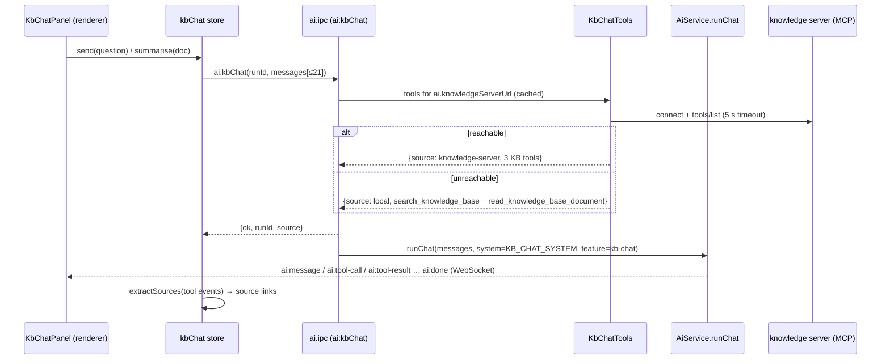

# Design — SPEC-0062: Add knowledge base chat to developer cockpit

> **Stage 2 of 3 — how.** Concrete enough that the plan can be written without re-reading the
> code, and checked line by line against the architecture policies. Write "None — <reason>" for a
> section that genuinely does not apply.

## Context

All of the work is in `developer-cockpit/`, an Electron app with a sandboxed React renderer.
Nothing in `oms-*` or the contracts changes.

- **AI stack (SPEC-0042).**
  - `src/main/ai/AiService.ts` has two entry points: `complete()`, a one-shot completion, and
    `runAgent()`, a bounded `streamText` tool loop that sends a single user message.
    - Both stream `ai:message` / `ai:tool-call` / `ai:tool-result` / `ai:error` / `ai:done` over
      the WebSocket. Every event is keyed by a renderer-minted `runId`.
    - Usage is recorded once per run, under `options.feature`.
    - The model is injectable through `deps.model`, which is the test seam.
  - `src/main/ai/McpToolRegistry.ts` builds the tool set:
    - a local `search_knowledge_base` tool backed by `KbService.search`, which returns titles and
      paths only;
    - one wrapped tool per tool of each server in `ai.mcpServers` (streamable HTTP,
      5 s connect timeout, `name:tool` keys).
  - `src/main/ipc/ai.ipc.ts` registers `ai:available` / `ai:run` / `ai:stop` / `ai:usage`. It keeps
    a `runId → AiService` map for stop, and caches the tool set per config key.
  - `src/main/index.ts:119-126` wires these to a dedicated `KbService` (`assistantKb`).
- **Renderer.**
  - `src/renderer/stores/assistant.ts` is a zustand store. It holds the active run, filters events
    by `runId` and builds the transcript.
  - `src/renderer/views/assistant/AssistantView.tsx` is the single-turn UI.
  - `src/renderer/views/knowledge-base/KnowledgeBaseView.tsx` has three columns: the category tree
    with `KbSearchBar`, the `DocumentViewer`, and the `TableOfContents`. Its store,
    `stores/knowledgeBase.ts`, provides `selectDocument(path)`.
- **Knowledge server.**
  - `oms-mcp-server` serves streamable-HTTP MCP at `http://localhost:8091/mcp`; `.mcp.json` uses the
    same URL.
  - Its `KnowledgeBaseTools.java` exposes three KB tools:
    - `searchKnowledgeBase(query, topK, category, status, type, tag)` returns Markdown with
      citations `` `oms-knowledge-base/<rel>.md#anchor` ``;
    - `readKnowledgeBase(path, anchor, offset, limit)`;
    - `getKnowledgeBaseOverview`.
  - The server also exposes `searchOrders`.
- **Closest example.** This change is a sibling of the SPEC-0042 assistant. It follows the
  `ai:run` IPC, `AiService.runAgent`, the `McpToolRegistry` wrapping, the assistant store, and their
  tests (`test/main/ai.ipc.test.ts`, `test/main/McpToolRegistry.test.ts` with its stub HTTP MCP
  server, `test/main/AiService.test.ts`, `test/renderer/AssistantView.test.tsx`).
- **KB pages read:** `tools/developer-cockpit.md`, `tools/knowledge-server.md`,
  `capabilities/use-cases/UC-016-browse-knowledge.md`.
- **Specs that don't apply:** the framework specs (state machine, validation, task orchestrator)
  cover oms-core order processing and play no part here.

## Approach

### Main process

1. **`AiService.runChat({ runId, messages, system, options })`** (new). It has the same loop as
   `runAgent`, but takes a message array (`{ role: 'user' | 'assistant', content }[]`) and a
   system prompt.
   - `runAgent` is refactored to call a shared private `loop(messages, system, …)`, so its behaviour
     and tests stay unchanged.
   - Inputs are bounded: each message's content is sliced to `MAX_PROMPT_CHARS`, and only the last
     `MAX_CHAT_MESSAGES = 21` messages are kept (10 turns plus the new question).
   - `KB_CHAT_SYSTEM` tells the model to:
     - answer only from the knowledge base;
     - use the search and read tools before answering;
     - cite document paths as `oms-knowledge-base/<path>`;
     - say so when nothing relevant is found.
   - What Changes → "Usage tracking": usage is recorded under `options.feature = 'kb-chat'` by the
     existing `pump()`.
2. **`src/main/ai/KbChatTools.ts`** (new).
   `KbChatTools.build(url, kb, log): Promise<{ tools, source: 'knowledge-server' | 'local', close }>`.
   - The allowlist is `KB_TOOL_NAMES = ['searchKnowledgeBase', 'readKnowledgeBase', 'getKnowledgeBaseOverview']`.
   - **Knowledge server reachable:** the builder connects with `McpToolRegistry.connect(url)` and
     keeps only the listed tools whose names are in the allowlist. Their keys are unprefixed. Each is
     wrapped with `McpToolRegistry.wrapMcpTool`, so a call goes to the server's `tools/call`.
     - Covers What Changes → "uses knowledge-server tools over MCP" (AC-2).
   - **Fallback:** the builder falls back to local tools when the URL is invalid (not http/https),
     the connect fails or times out, or no allowlisted tool is listed. It logs
     `[kb-chat] knowledge server <url> unavailable, using local tools: <reason>`. The local tools are:
     - `search_knowledge_base`: the existing tool, extracted from `McpToolRegistry.build` into an
       exported `kbSearchTool(kb)` so both registries share it;
     - `read_knowledge_base_document({ path })` (new). It strips an optional leading
       `oms-knowledge-base/` (the KB folder's basename) and an optional `#anchor`. It rejects
       absolute paths and any `..` segment with `Error: path must be inside the knowledge base.`
       Otherwise it returns `KbService.getDocument(path)`'s title, path and `content` sliced to
       `MAX_READ_CHARS = 20_000`, or `Error: no document at <path>.` (AC-3).
   - `McpToolRegistry.connect` and `wrapMcpTool` change from `private static` to exported statics.
     Their behaviour does not change.
3. **`ai.ipc.ts` → new channel `ai:kbChat(runId, messages, options?)`.**
   - **Validation.** `runId` must be a non-empty string. `messages` must be a non-empty array of at
     most 21 `{ role: 'user' | 'assistant', content: non-empty string ≤ 32 000 }`, and the last
     message must be from the user. Anything else is answered with
     `{ ok: false, code: 'invalid', message }`, as the `ai:run` checks are.
   - **Tool set.** It is cached in `runtime.kbChat` per `knowledgeServerUrl` plus the KB key.
     - A `knowledge-server` set is kept until the config changes.
     - A `local` set is rebuilt at most every `KB_CHAT_RETRY_MS = 60_000`, so a knowledge server that
       comes back up is picked up without a 5 s delay on every run.
   - **Run start.** The channel registers the service in `runtime.services`, so the existing
     `ai:stop` works, and fires `service.runChat(...)` with feature `kb-chat` and the
     fire-and-forget pattern of `ai:run`.
   - **Response.** `{ ok: true, runId, source }`.
   - `AiIpcDeps.kb` widens to `Pick<KbService, 'search' | 'getDocument'>`, which `assistantKb`
     already satisfies.
   - `AiIpcDeps` gets an optional `model?: LanguageModel` that is passed to `AiService`. It is a test
     seam like `AiService`'s, and production does not set it.
   - `dispose()` also closes the KB-chat tools.
4. **Config.** `AiConfig.knowledgeServerUrl?: string` in `src/shared/types/config.ts`, with the
   default `'http://localhost:8091/mcp'` in the defaults.
   - The Settings → AI section gets one text input, "Knowledge server MCP URL", next to the existing
     AI fields.
5. **Preload and IPC typing.** `ai.kbChat(runId, messages, options)` goes in `src/main/preload.ts`
   and `src/shared/types/ipc.ts`. The shared types `KbChatMessage` and `KbChatStartResult`
   (`source`) go in `src/shared/types/ai.ts`.

### Renderer

6. **`src/renderer/lib/kbChatSources.ts`** (new, pure).
   `extractSources(events: { type; name?; input?; output? }[]): string[]` returns KB-relative
   document paths, de-duplicated and in first-seen order. It finds them in three places:
   - tool-call inputs with a `path` field (`readKnowledgeBase`, `read_knowledge_base_document`);
   - `oms-knowledge-base/…​.md` citations inside tool-result text (`searchKnowledgeBase`, and
     `readKnowledgeBase` headers);
   - `"path":"….md"` entries in the local search tool's JSON output.

   Each path is normalised: the `oms-knowledge-base/` prefix and `#anchor` are stripped, and only
   `.md` / `.mdx` paths are kept (AC-4).
7. **`src/renderer/stores/kbChat.ts`** (new). It is a sibling of `assistant.ts`.
   - **State.** `turns: { id, role, text, sources: string[] }[]`, plus `status`, `activeRunId`,
     `running`, `error`, `incomplete` and `source: 'knowledge-server' | 'local' | null`.
   - **`send(text)`**:
     1. appends a user turn and an empty assistant turn;
     2. builds `messages` from all completed turns, keeping the last 10 question/answer pairs plus
        the new question (AC-6);
     3. calls `ai.kbChat` and stores `source` from the result.
   - **`summarise(path, title)`** calls `send` with the prompt
     ``Summarise the knowledge base document `oms-knowledge-base/<path>` ("<title>"). Read it first.`` (AC-5).
   - **`handleEvent`** filters events by `activeRunId`:
     - `ai:message` text is appended to the assistant turn;
     - tool events are collected, and `extractSources` sets that turn's `sources`;
     - `ai:done` and `ai:error` end the run, and an error is kept on `error` (AC-8).
   - **`clear()`** empties `turns` (AC-6).
   - **`stop()`** calls `ai.stop`.
8. **`src/renderer/views/knowledge-base/KbChatPanel.tsx`** (new).
   - **Layout.** A header with a fallback notice when `source === 'local'`: "Knowledge server
     unavailable — using local search". Then the turns: Markdown answers through `MarkdownContent`,
     with a "Sources" list of buttons under each answer. Each button calls
     `useKnowledgeBaseStore.selectDocument(path)` (AC-4).
   - **Input row.** An input with Send, plus Stop while a run is in progress.
   - **Not configured.** The input and Send are disabled, the hint "Configure the AI provider under
     Settings → AI" is shown, and no run starts (AC-7).
   - **Events.** The panel subscribes to the `ai:*` events on `eventBus`, as `AssistantView` does.
9. **`KnowledgeBaseView.tsx`.**
   - A "Chat" toggle button sits above the document column. When it is on, `KbChatPanel` replaces
     the right-hand TOC column, at width `w-96`.
   - When a document is selected, a "Summarise this document" button calls
     `useKbChatStore.summarise(doc.relativePath, doc.title)` and opens the panel (AC-5).

What Changes → location: the chat panel is covered by 7–9, MCP tools and fallback by 2–4, source
links by 6 and 8, the summarise action by 7 and 9, and usage tracking by 1 and 3. The assistant
view is unchanged.

## Contract Changes

None. No OpenAPI or Avro contract is involved.
- The only interface changes are the cockpit's internal Electron IPC: a new channel, `ai:kbChat`,
  and a new optional config field, `ai.knowledgeServerUrl`.
- Both are additive. Existing channels and their argument shapes are unchanged.

## Data & Persistence

None. There are no database tables or migrations.
- Cockpit config gains an optional field, `ai.knowledgeServerUrl`, with a default. Existing
  config files without it load with the default through the existing defaults merge.
- Chat history is held only in memory, in the renderer store.
- Usage entries append to the existing `~/.developer-cockpit/ai-usage.json` with
  `feature: 'kb-chat'`, in the existing format.

## Events & Messaging

None in the OMS sense. The change has no `order_events`, outbox or Kafka.
- The chat reuses the cockpit's in-process `ai:*` WebSocket events unchanged. A run is identified
  by its `runId`.
- A duplicate `runId` is rejected (`code: 'invalid'`), matching `ai:run`.

## Domain, State & Orchestration

None. No order state, state machine or task pipeline is touched.
- Input validation sits at the IPC boundary (step 3) and inside the local read tool (path
  containment).
- Failures are values, never rejected promises:
  - `{ ok: false, code, message }` from the IPC;
  - `ai:error` with `code: 'configuration' | 'provider'` from a run, always followed by `ai:done`.

## Alternatives & Decisions

- **D1 — Where the chat lives.** Chosen: a panel inside the Knowledge Base view.
  - Rejected: extending the AI Assistant view, because source links and "summarise this document"
    need the open document and the KB viewer.
  - Rejected: a separate "KB Chat" route, for the same reason, and because it would add another
    nav item.
- **D2 — Which tools.** Chosen: the knowledge server's three read-only KB tools, as an allowlist.
  - Rejected: all tools of the server, because `searchOrders` would let a KB chat reach order data,
    and the proposal fixed this.
  - Rejected: reusing `ai.mcpServers`, because it is empty by default and is the Assistant's
    general extension point.
  - The allowlist is a constant, so widening it later is a one-line change.
- **D3 — Fallback.** Chosen: local `search_knowledge_base` plus a new `read_knowledge_base_document`.
  - Rejected: failing the run when the server is down, because the chat should work without
    Docker running.
  - Rejected: search-only fallback, because without a read tool the model cannot summarise (the
    gap noted in the proposal).
- **D4 — Multi-turn.** Chosen: a new `AiService.runChat(messages)` that shares the loop with
  `runAgent`.
  - Rejected: concatenating history into one prompt string for `runAgent`, because it loses roles
    and makes the 10-turn bound untestable at the model boundary.
  - Rejected: a new service class, because it would duplicate the stream/usage/terminal-event
    logic.
- **D5 — Source extraction.** Chosen: in the renderer, from the tool events already broadcast, as a
  pure function.
  - Rejected: a new `ai:sources` event from the main process, which needs a new event type and
    changes to `pump()`.
  - The trade-off is that tool outputs are summarised to 4 000 characters before broadcast. The
    knowledge server's search output, with a default topK, fits within that. A read result names its
    path in its first line and in the call input, so no source is lost.
- **D6 — Retrying the knowledge server.** Chosen: cache a local fallback for 60 s.
  - Rejected: reconnecting on every run, which adds up to 5 s per question while the server is down.
  - Rejected: never retrying, which would need a restart after starting Docker.
- **Changed during implementation: provider errors in the stream.**
  - `AiService.pump()` now turns the AI SDK's `error` stream part into `ai:error` (code
    `provider`), followed as before by the single `ai:done`.
  - Before this change the part was ignored. A failing provider produced a bare `ai:done`, so
    AC-8's "the panel shows the error" could not hold. The fix is in the shared service, so the
    Assistant view benefits too.
  - Its existing tests stay green.
- **Changed during implementation: Summarise button location.** "Summarise this document" sits in
  the `KbChatPanel` header, shown when a document is open, rather than in `KnowledgeBaseView`.
  - The panel already reads the selected document from the KB store, so AC-5 is testable at the
    panel level.
  - `KnowledgeBaseView` adds only the Chat toggle.
- **Changed during verification: knowledge-server parameter filling.** Checking against the real
  oms-mcp-server showed a problem the stub could not.
  - **The problem.** The server's Spring AI schemas declare every parameter required: `topK`,
    `category`, `status`, `type` and `tag` for search, and `anchor`, `offset` and `limit` for read.
    It refuses a call that omits any of them, and `limit: 0` returns 0 characters. A model that
    honours that schema must invent values.
  - **The fix.** `KbChatTools` shows the model only `query` / `path` as required (`KB_TOOL_REQUIRED`)
    and fills the omitted parameters with neutral values. Those are `''`, `topK 0` (the server
    default) and `offset 0`, plus a bounded `limit` (`DEFAULT_READ_LIMIT` = `MAX_READ_CHARS` =
    20 000). A `limit <= 0` from the model also counts as unset. This matches the server's own null /
    `hasText` / `<= 0` checks.
  - **Why the limit is bounded.** The delta review pointed out that a whole-document default would
    break the design's context-growth bound. Longer documents end with the server's
    "call again with offset" hint, so the model can page.
  - **Rejected alternatives.**
    - Changing oms-mcp-server (`@ToolParam(required = false)`) is the proper fix, but the approved
      proposal excludes server changes. It is filed as a follow-up.
    - Passing the schema through unchanged leaves summaries of whole documents to chance.
  - **The stub** in `test/main/stubMcpServer.ts` now lists the real schemas and refuses missing
    required parameters, as the server does.
- **Changed during verification: run state independent of the panel.** The `kbChat` store
  subscribes to `ai:*` itself (once, at module load) instead of the panel subscribing on mount, so
  a run that ends while the panel is closed still finishes cleanly.
- **Changed during verification: Stop while starting.** `ai:kbChat` records runs whose tools are
  still being built. An `ai:stop` in that window makes the run end with `ai:done{aborted:true}`
  without calling the model.
- **Dependencies (P-17).** None are added. The change uses `ai`, `@modelcontextprotocol/sdk`,
  `zustand` and `react-markdown`, all already in `developer-cockpit/package.json`.

## Risks & Mitigations

- **The model ignores the tools and answers from general knowledge.**
  - `KB_CHAT_SYSTEM` tells it to search first and to cite paths.
  - Source links make uncited answers visible.
  - Answer quality is a judgement call, so it is not an AC. Manual check in verify: one real
    question against the running knowledge server.
- **Path mismatch between the knowledge server and the cockpit's KB.** The server uses
  `oms-knowledge-base/<rel>` and the cockpit uses `<rel>`.
  - Prefix-stripping lives in one function, `normaliseKbPath`, shared by the local read tool and
    `extractSources`, and is unit-tested.
  - A source link whose document is unknown opens the viewer's existing "not found" handling, so
    nothing crashes.
- **Context growth.** History is bounded to 21 messages of at most 32 000 characters each, and the
  local read is bounded to 20 000 characters. Server-side reads paginate.
- **Path traversal through the local read tool.**
  - It rejects absolute paths and `..` segments.
  - It resolves only documents already indexed by `KbService`, so it never reads arbitrary files.
  - Both are tested.
- **Stale MCP connection** after the knowledge server restarts. A failed `tools/call` surfaces as a
  tool error to the model, and the run still ends with `ai:done`. A config change or `dispose`
  rebuilds the connection. This is acceptable for a dev tool and is noted as a follow-up if it shows
  up in practice.

## Test Strategy

All tests are vitest, in `developer-cockpit/test/`.
- MCP tests use a stub streamable-HTTP MCP server, the same pattern as
  `McpToolRegistry.test.ts`.
- Model tests use a scripted `MockLanguageModelV3`-style model through the `model` seam, the same
  pattern as `AiService.test.ts`.
- Renderer tests mock `window.cockpit.ai` and emit through `eventBus`, the same pattern as
  `AssistantView.test.tsx`.

| AC | Level | Test class#method | What it asserts |
|---|---|---|---|
| AC-1 | unit (main) | `test/main/kbChat.ipc.test.ts#starts a kb-chat run and streams the answer` | `ai:kbChat` with a scripted model returns `{ok:true, runId}`; broadcasts `ai:message` with the scripted text then exactly one `ai:done` |
| AC-1 | component | `test/renderer/KbChatPanel.test.tsx#sends a question and shows the streamed answer` | typing and Send calls `ai.kbChat` with the question; `ai:message` events render as the assistant turn; the input is disabled while running and enabled after `ai:done` |
| AC-2 | unit (main) | `test/main/KbChatTools.test.ts#keeps only the knowledge-server KB tools` | stub server lists `searchKnowledgeBase`, `readKnowledgeBase`, `getKnowledgeBaseOverview`, `searchOrders` → tool keys are exactly the three KB names; `source === 'knowledge-server'` |
| AC-2 | unit (main) | `test/main/KbChatTools.test.ts#forwards a tool call to the server` | executing `readKnowledgeBase` sends `tools/call` with the arguments to the stub and returns its text |
| AC-3 | unit (main) | `test/main/KbChatTools.test.ts#falls back to local tools when the server is unreachable` | unreachable URL (and an invalid URL) → `source === 'local'`, tools are `search_knowledge_base` + `read_knowledge_base_document` |
| AC-3 | unit (main) | `test/main/KbChatTools.test.ts#local read returns document content` / `#local read refuses paths outside the KB` | `oms-knowledge-base/domain/x.md#a` returns x's content; `../secret.md` and an absolute path return the refusal text |
| AC-3 | unit (main) | `test/main/kbChat.ipc.test.ts#completes with local tools when the server is down` | with an unreachable URL the start result has `source: 'local'` and the run ends with `ai:done` |
| AC-3 | component | `test/renderer/KbChatPanel.test.tsx#shows the fallback notice` | `source: 'local'` → "Knowledge server unavailable — using local search" is visible |
| AC-4 | unit | `test/renderer/kbChatSources.test.ts#extracts and de-duplicates sources` | citations from search Markdown, `path` inputs and local JSON output → normalised, de-duplicated paths in first-seen order; non-`.md` ignored |
| AC-4 | component | `test/renderer/KbChatPanel.test.tsx#lists sources and opens one in the viewer` | after tool events plus `ai:done`, each source is shown once; clicking it calls `selectDocument` with the path |
| AC-5 | component | `test/renderer/KbChatPanel.test.tsx#summarises the open document` | with a selected document, "Summarise this document" calls `ai.kbChat` whose last user message contains `oms-knowledge-base/<relativePath>`; the scripted answer renders |
| AC-6 | unit | `test/renderer/kbChatStore.test.ts#follow-up carries earlier turns, bounded to 10` / `#clear starts fresh` | the 2nd send passes [q1, a1, q2] in order; after 12 turns, 21 messages are sent (oldest dropped); after `clear()` only the new question is sent |
| AC-6 | unit (main) | `test/main/kbChat.ipc.test.ts#passes the conversation to the model in order` / `#rejects malformed messages` | the scripted model receives the user/assistant messages in order; empty, oversized or wrong-role arrays → `{ok:false, code:'invalid'}` |
| AC-7 | component | `test/renderer/KbChatPanel.test.tsx#is disabled when AI is not configured` | `available: false` → input and Send are disabled, the hint is shown, and `ai.kbChat` is never called |
| AC-8 | unit (main) | `test/main/kbChat.ipc.test.ts#provider failure ends the run and records usage once` | a throwing scripted model → `ai:error` then one `ai:done`; a completed run → exactly one usage entry with `feature: 'kb-chat'` |
| AC-8 | unit (main) | `test/main/kbChat.ipc.test.ts#stop aborts a kb-chat run` | `ai:stop(runId)` → `ai:done{aborted:true}` |
| AC-8 | component | `test/renderer/KbChatPanel.test.tsx#shows an error and re-enables input` | `ai:error` then `ai:done` → the error is shown and the input is enabled; the Stop button calls `ai.stop(runId)` |

Regression: the existing `AiService.test.ts`, `ai.ipc.test.ts`, `McpToolRegistry.test.ts` and
`AssistantView.test.tsx` must stay green, since `runAgent` and `McpToolRegistry.build` are
refactored. The module's verify commands are `npm run typecheck` and `npm test`.

## Policy Compliance

| Policy | Title | Status | How / Justification |
|---|---|---|---|
| P-01 | Contracts live only in oms-contracts | n/a | No OpenAPI or Avro contracts are touched. The change is cockpit-internal IPC only |
| P-02 | Specification before code, generated models only | n/a | No API or message models are involved. The cockpit's TypeScript IPC types are hand-written by design (SPEC-0042) |
| P-03 | Never edit generated code | comply | No generated code is touched |
| P-04 | Contracts evolve compatibly | n/a | No OMS contracts are involved. The cockpit IPC and config changes are additive anyway (new channel, optional field with a default) |
| P-05 | Every state change is recorded in the event log | n/a | No order state changes |
| P-06 | Kafka only through the transactional outbox | n/a | No Kafka |
| P-07 | Schema changes through new Liquibase changesets | n/a | No database |
| P-08 | Concurrency and idempotency are explicit | comply | Runs are keyed by `runId`, a duplicate `runId` is rejected, stop is idempotent, and every run ends with exactly one `ai:done` |
| P-09 | Commands and queries stay separate | n/a | No OMS command or query API is involved. The chat is read-only over the KB |
| P-10 | State transitions go through the state machine and task pipeline | n/a | No order state transitions |
| P-11 | Layering and conventions | comply | Follows the cockpit layering: main-process service and IPC (`ai/`, `ipc/`), shared types, renderer store and view. A sibling of the SPEC-0042 assistant |
| P-12 | Jackson 3 only | n/a | TypeScript module, no Jackson |
| P-13 | Errors and validation follow the framework specs | comply | The IPC validates its input and answers `{ok:false, code, message}`, never a rejection. Run failures are `ai:error` plus `ai:done`, as in SPEC-0042. Nothing is swallowed: fallbacks are logged |
| P-14 | Test first, every acceptance criterion is proven by an automated test | comply | Every AC maps to vitest tests in the Test Strategy, written before the implementation |
| P-15 | Observability | comply | Fallback and connect failures are logged with the `[kb-chat]` prefix, and runs are recorded in the AI usage log (`feature: kb-chat`). Micrometer and Kafka trace propagation don't apply to an Electron dev tool |
| P-16 | Security | comply | The API key stays in the main process (the existing `apiKeyEnvVar`), and no secret is added. IPC input is validated. The local read tool is confined to indexed KB documents (no absolute or `..` paths), and the MCP tool allowlist excludes order data |
| P-17 | Simplicity and dependencies | comply | No new dependency. Reuses `AiService`, `McpToolRegistry` and `KbService`; decisions are in D1–D6 |
| P-18 | Modules build standalone | comply | Only developer-cockpit code changes. Its own verify commands (`npm run typecheck`, `npm test`) gate it |
| P-19 | Documentation follows behaviour | comply | `tools/developer-cockpit.md` is updated (see below) |

## Knowledge Base Updates

- `oms-knowledge-base/tools/developer-cockpit.md`: a new "KB Chat" subsection under the
  Knowledge Base view. It covers what the chat does, the knowledge-server MCP connection and its
  `ai.knowledgeServerUrl` setting, the local fallback, source links, and summarising a document.
- `oms-knowledge-base/tools/knowledge-server.md`: one line noting that the developer cockpit's KB
  chat is a consumer of `searchKnowledgeBase`, `readKnowledgeBase` and `getKnowledgeBaseOverview`.
