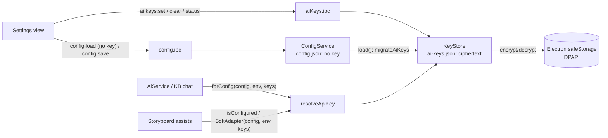

# Design — SPEC-0063: Store AI provider keys encrypted per provider

> **Stage 2 of 3 — how.** Concrete enough that the plan can be written without re-reading the
> code, and checked line by line against the architecture policies. Write "None — <reason>" for a
> section that genuinely does not apply.

## Context

All of the work is in `developer-cockpit/`, the Electron app. Nothing in `oms-*` changes.

- **Key resolution today.** `src/main/ai/adapters.ts:17` resolves the key as
  `config.apiKey || env[config.apiKeyEnvVar]`, for every provider. `forConfig()` is the single
  provider-resolution seam (SPEC-0042 D5). Its callers are:
  - `AiService.resolveModel()` (`AiService.ts:143`), which serves the assistant and the KB chat;
  - `SdkAdapter` (`storyboards/ai/AiAdapter.ts:46`), which serves the storyboard assists.

  `isConfigured()` (`AiAdapter.ts:18`) decides storyboard availability from the environment
  variable only, through `aiAvailable()` (`StoryboardAiService.ts:21`) and
  `storyboards.ipc.ts:75-77`.
- **Config.** `ConfigService` (`src/main/services/ConfigService.ts`) loads `config.json`, merges it
  with the defaults, and runs `migrateConfig()`. It saves when a migration changed something.
  `save()` writes whatever object it is given.
  - `config:load` returns the whole config to the renderer, and `config:save` writes the
    renderer's object back (`src/main/ipc/config.ipc.ts`).
  - The renderer's `stores/config.ts` keeps the loaded config and sends it back on every settings
    save.
  - `initServices()` runs inside `app.whenReady()` (`src/main/index.ts:86,165`), so Electron
    `safeStorage` is usable while the config loads.
- **Settings.** `SettingsView.tsx:209-235`:
  - the `apiKey` field (shown only for `local`, since commit 98cc43d) edits `draft.ai.apiKey`,
    which is saved in `config.json`;
  - the env-var-name field accepts any text.
- **Closest examples.**
  - `ConfigService` + `migrateConfig()` + `test/main/ConfigService.test.ts` for the
    load-time migration;
  - `ai.ipc.ts` for an IPC module whose channels answer with values, never rejections;
  - `AiUsageTracker` for a small JSON file in the config directory.
- **Specs that don't apply:** the KB framework specs (state machine, validation, task
  orchestrator) cover oms-core and play no part here. `tools/developer-cockpit.md` describes Settings
  → AI.

## Approach

### Main process

1. **`src/main/ai/KeyStore.ts`** (new).

   **Types.** `AiProvider = 'anthropic' | 'openai' | 'local'`, plus an injected crypto seam:
   `KeyCrypto = { isAvailable(): boolean; encrypt(s: string): Buffer; decrypt(b: Buffer): string }`.
   - Production: `electronKeyCrypto(safeStorage)`. It uses `isEncryptionAvailable()`; on Linux it
     treats the `basic_text` backend (`getSelectedStorageBackend()`) as unavailable, because that
     backend is plain-text equivalent.
   - Tests pass a fake that reverses and base64-encodes, so the plain text never appears in the
     file.

   **File.** `<configDir>/ai-keys.json`, shaped
   `{ "version": 1, "keys": { "<provider>": "<base64 ciphertext>" } }`.
   - It is written atomically (temp file plus rename) with mode `0o600`, best-effort on Windows.
   - It is read on every `get`, so a clear in one place is seen everywhere. It is a tiny file.

   **API.** It never throws and never logs a key value.
   - `set(provider, key) → { ok: true } | { ok: false, code: 'encryption-unavailable' | 'invalid', message }`.
     A set when encryption is unavailable is refused and nothing is written (AC-8). The key is
     trimmed and must be 1–4 096 characters without line breaks.
   - `clear(provider) → { ok: true }` (AC-6).
   - `has(provider): boolean`, for status, without decrypting.
   - `get(provider): string | undefined`. It decrypts; a decryption failure (e.g. a profile copied
     from another machine) returns `undefined` and logs `[keys] could not decrypt the <provider>
     key; set it again`.
   - `isAvailable(): boolean`.
2. **`src/main/ai/keys.ts`** (new). Key resolution, shared by every AI feature (AC-2, AC-5):
   - `type SavedKeys = { get(p: AiProvider): string | undefined }`, and `NO_SAVED_KEYS`.
   - `resolveApiKey(config, keys, env) → { key?: string; source: 'saved' | 'env' | 'legacy' | 'none' }`.
     The order is:
     1. `keys.get(config.provider)`, source `saved`;
     2. `env[config.apiKeyEnvVar]`, if the name is valid, source `env`;
     3. for `local` only, a leftover plain-text `config.apiKey` (it exists only when encryption
        was unavailable at migration, AC-8), source `legacy`;
     4. otherwise `none`.
   - `isValidEnvVarName(name)`: `/^[A-Za-z_][A-Za-z0-9_]*$/` (AC-9).
   - `CONVENTIONAL_ENV_VAR: Record<AiProvider, string>`: `ANTHROPIC_API_KEY`, `OPENAI_API_KEY`,
     and `''` for `local`.
3. **`adapters.ts`.** `forConfig(config, env, keys = NO_SAVED_KEYS)` uses `resolveApiKey`.
   - `anthropic` and `openai` need a key, as now.
   - `local` needs a base URL, and its key stays optional (`'local'` placeholder), as now.
   - The `config.apiKey || …` line is removed.
   - `AiService.notConfiguredReason()` names both options: "AI not configured: no
     <Provider> API key is saved in Settings → AI and the <VAR> environment variable is not set."
4. **Threading `keys` through.** This is an optional dependency everywhere, defaulting to
   `NO_SAVED_KEYS`, so existing tests and callers keep compiling.
   - `AiServiceDeps.keys` is passed to `forConfig`.
   - `AiIpcDeps.keys` is passed by `makeService`.
   - `isConfigured(config, env, keys)` and `aiAvailable(config, env, keys)` use
     `resolveApiKey(...).source !== 'none'` for `anthropic` / `openai`. `local` still needs a base
     URL.
   - `SdkAdapter(config, env, keys)`.
   - `StoryboardsIpcDeps.keys` is passed at `storyboards.ipc.ts:75-77`.
   - `ai.ipc.ts`: `configKey()` is unchanged, because keys are read per run.
5. **`src/main/ai/keyMigration.ts`** (new).
   `migrateAiKeys(config, store, log) → { config, changed }` is a pure function over the store
   (AC-7):
   - **`ai.apiKey`** is non-empty and `store.isAvailable()`:
     - when `!store.has('local')`, it becomes the `local` key (`store.set`); otherwise the value is
       discarded with the warning `[keys] a plain-text key in config.json was not migrated: a local
       key is already saved`;
     - either way `ai.apiKey` is deleted.
   - **`ai.apiKeyEnvVar`** is non-empty, not a valid name, and `store.isAvailable()`:
     - the target is `config.provider`. If the target is `local` and an `ai.apiKey` existed, or the
       target already has a saved key, the value is discarded with a warning naming the provider.
       Otherwise it is stored for the target.
     - `apiKeyEnvVar` is set to `CONVENTIONAL_ENV_VAR[config.provider]`, or to
       `DEFAULT_CONFIG.ai.apiKeyEnvVar` for `local`.
   - **Encryption unavailable:** nothing changes, and the function logs `[keys] OS encryption is
     unavailable; a plain-text key in config.json was left in place` (AC-8).
   - **Idempotent:** a second run finds nothing to migrate and returns `changed: false`.
   - No log line contains a key value.
6. **`ConfigService.load(options?: { migrateKeys?: (c) => { config; changed } })`.** The hook runs
   after `migrateConfig()` and *before* any save, so a contract-path migration save cannot write a
   plain-text key again or drop it. The service saves once if either migration changed something.
   - `index.ts` `initServices()` creates the `KeyStore` (with `electronKeyCrypto(safeStorage)`)
     before `configService.load({ migrateKeys: (c) => migrateAiKeys(c, keyStore, console.warn) })`.
   - The same `keyStore` is passed to `registerAiIpc`, `registerStoryboardsIpc` and
     `registerAiKeysIpc`.
7. **`config.ipc.ts`** (AC-3, AC-4, AC-9).
   - `config:load` returns the config with `ai.apiKey` removed (`withoutSecrets(config)`).
   - `config:save`:
     - it takes the renderer's object but forces `ai.apiKey` to the main process's current value.
       That value is normally absent; it is the leftover only in the AC-8 case. So the renderer
       can neither set nor remove a key through it.
     - an `ai.apiKeyEnvVar` that fails `isValidEnvVarName` (and is not empty) is replaced by the
       current value, and the handler returns `{ ok: false, code: 'invalid', message }`.
       Otherwise it saves and returns `{ ok: true }`. Today it returns `undefined`; callers ignore
       the result, so this change is additive.
8. **`src/main/ipc/aiKeys.ipc.ts`** (new). Channels answer with values, never rejected promises:
   - `ai:keys:status` → `{ available: boolean; saved: Record<AiProvider, boolean>; active: { provider; source } }`;
   - `ai:keys:set(provider, key)` → `KeyStore.set` result, or `{ ok:false, code:'invalid' }` for an
     unknown provider or a non-string key;
   - `ai:keys:clear(provider)` → `{ ok: true }`.

   No channel returns a key value (AC-3). Preload: `cockpit.ai.keys.{status,set,clear}`, typed in
   `src/shared/types/ipc.ts`. Shared types go in `src/shared/types/ai.ts`: `AiKeyStatus`,
   `AiKeySource`, `AiProviderId`.

### Renderer

9. **`SettingsView.tsx` → an "API keys" block** in the AI card, replacing the local-only `apiKey`
   field.
   - One row per provider (Anthropic, OpenAI, Local), each showing "Saved" or "Not set".
   - Each row has a `type=password` input that always starts empty and is never filled from the
     store; the window has no key to fill it with. Next to it are **Save** and **Clear** buttons.
     - Save calls `ai.keys.set`, then refreshes the status and clears the input.
     - Clear calls `ai.keys.clear`.
     - A refusal (e.g. encryption unavailable) shows its message under the row (AC-8).
   - Under the block: "Keys are encrypted with your OS account and never shown again. The active
     provider uses: saved key / <VAR> environment variable / nothing."
   - The env-var-name field shows a validation error for an invalid name and blocks Settings Save
     while the error stands (AC-9). Its help text says the variable is a fallback used only when no
     key is saved.
   - The false "never sent to the renderer" sentence goes away with the old field.
   - A small hook, `useAiKeyStatus()` in `src/renderer/stores/aiKeys.ts`, loads the status on mount
     and after each set or clear.

What Changes → location:
- per-provider key: steps 1, 2, 4 and 9;
- encrypted at rest: step 1;
- write-only from the window: steps 7, 8 and 9;
- settings saves keep keys: step 7;
- clear precedence: steps 2–4;
- migration: steps 5 and 6;
- env-var-name validation: steps 7 and 9;
- encryption unavailable: steps 1, 5 and 9.

## Contract Changes

None. No OpenAPI or Avro contract is involved. The cockpit's internal IPC changes are additive:
- new channels `ai:keys:status`, `ai:keys:set` and `ai:keys:clear`;
- `config:save` now returns a result object instead of `undefined`;
- `config:load` no longer includes `ai.apiKey`. Its only renderer consumer, the field being
  replaced, goes away.

## Data & Persistence

There is no database. The data involved is the cockpit's local files in `~/.developer-cockpit/`:
- **New `ai-keys.json`.** Holds only ciphertext per provider (base64), and is written atomically
  with mode `0o600`.
- **`config.json`.** `ai.apiKey` is removed by the one-time migration in step 5, which moves the
  value into `ai-keys.json` and does not lose it, except for the discards AC-7 names, each with a
  warning. A key pasted into `ai.apiKeyEnvVar` is moved the same way, and the field is reset.
- **Rollback.** An older cockpit build ignores `ai-keys.json`. It then falls back to the
  environment variable and does not see the saved keys; it does not crash. Re-entering a key in an
  old build works as before.

## Events & Messaging

None. There is no `order_events`, outbox or Kafka. No WebSocket event carries a key.

## Domain, State & Orchestration

None. No order state, state machine or task pipeline is touched.
- Validation happens at the IPC boundary: provider ids, key shape, env-var names.
- Failures are values (`{ ok: false, code, message }`).

## Alternatives & Decisions

- **D1 — Encrypt with Electron `safeStorage`.** It uses OS DPAPI or Keychain, tied to the user's
  login, and needs no new dependency.
  - Rejected: `keytar` / a native keychain module. It is a new native dependency, which P-17
    discourages, and it adds build complexity for Electron. `safeStorage` is the Electron-endorsed
    successor.
  - Rejected: our own encryption with a key stored nearby. That key would sit next to the
    ciphertext and protect nothing.
- **D2 — A separate `ai-keys.json`, not encrypted fields in `config.json`.** Settings round-trip
  through the renderer, and AC-4 requires that a save cannot touch keys. With a separate file and
  separate channels, that holds structurally rather than by merge logic. The rejected alternative
  was encrypted values in `config.json`, preserved on save: more fragile, because any future
  `config:save` path would have to remember to preserve them.
- **D3 — The renderer is write-only.** It sets, clears and gets status, but never reads.
  - Rejected: sending a masked key such as `sk-…1234`. There is no need for it, and every byte sent
    widens exposure.
- **D4 — Key resolution in one function (`resolveApiKey`) used by all three features.** It closes
  the storyboard gap (env-only) and fixes the cross-provider leak of the `local` key.
- **D5 — The environment variable stays as a fallback,** per the proposal. A valid name is required
  (AC-9).
- **D6 — Migration attribution** (from the re-approved AC-7): `ai.apiKey` goes to `local`, and a
  pasted key goes to the configured provider. Existing saved keys win. Discards are logged without
  values.
- **D7 — `basic_text` on Linux counts as unavailable.** That backend stores keys effectively in
  plain text, so treating it as encryption would defeat the goal.
- **Changed during implementation: env-var-name validation in Settings.**
  - **The change.** `SettingsView` checks the *draft's* `apiKeyEnvVar` itself, with
    `isAcceptableEnvVarField` from the new `src/shared/envVarName.ts`, which the main process's
    `isValidEnvVarName` re-exports.
  - **Why.** The design had the key section report validity through a callback. But Radix unmounts
    inactive tabs, so the callback would not run while another tab was open, and Save would be
    enabled with an invalid draft.
  - **Result.** Save is disabled, with a message, from any tab. The section's callback is optional.
- **Changed during implementation: the key UI is its own component,** `AiKeysSection.tsx`, so it
  can be tested without the whole Settings view.
- **Changed during verification** (the independent review's findings 1–8, tasks T-11 to T-15):
  - **No cross-provider environment fallback.**
    - `resolveApiKey` ignores a variable that is *another* provider's conventional name. So `local`
      never reads `ANTHROPIC_API_KEY` (the default name) or `OPENAI_API_KEY`, and `anthropic` /
      `openai` never read each other's.
    - The migration resets the name to `''` for `local`.
    - This closes the path where switching to a local or remote vLLM provider sent the Anthropic
      key to that host.
  - **The key store fails safe.**
    - A missing `ai-keys.json` is an empty store. A file that exists but cannot be read or parsed
      is never overwritten: `set` / `clear` refuse with the new code `storage-failed` and log
      `[keys]`.
    - Write errors are caught, so `set` / `clear` never throw.
  - **The migration never loses a key.**
    - A value leaves `config.json` only once it is stored, or deliberately discarded because a
      *decryptable* saved key already wins. A store failure leaves it in place with a warning.
    - An undecryptable saved entry no longer blocks migrating a working plain-text key.
  - **A pasted key in `apiKeyEnvVar` never crosses to the renderer.** It is redacted to `''` in
    `config:load` and in `ai:keys:status`, and `notConfiguredReason` no longer echoes it.
    - *Corrected after the delta re-review (T-17):* the redacted `''` the renderer sends back
      would have erased a pasted key that the migration deliberately kept. A key is kept when OS
      encryption is unavailable or its store failed, and erasing it is the loss AC-8 forbids.
    - `config:save` now keeps the current invalid value when the renderer sends `''`, mirroring how
      `ai.apiKey` is protected. A real name the user types still replaces it.
    - `notConfiguredReason` says when the named variable belongs to another provider, instead of
      claiming it is not set.
  - **The renderer's key store catches IPC rejections** and shows them as the row's error.
- **Dependencies (P-17).** None are added. `safeStorage` is part of `electron`, which is already a
  dependency.

## Risks & Mitigations

- **Losing a user's key during migration.**
  - The migration runs before any save (step 6).
  - It never overwrites a saved key.
  - It deletes the plain text only after `store.set` succeeds, and only when encryption is
    available (AC-8).
  - Tests cover each path, including idempotency.
- **A key leaking into logs or IPC.**
  - No log line formats a key value; log messages use provider names only.
  - `config:load` strips `ai.apiKey`.
  - The status channel carries booleans and source names only.
  - Tests assert that serialised IPC results and log calls never contain the test key string.
- **A profile copied to another machine, or a changed Windows credential.** DPAPI ciphertext
  won't decrypt there. `get` returns `undefined`, the provider becomes not configured (or falls
  back to the environment variable), and a `[keys]` warning says to set the key again. Nothing
  crashes.
- **Concurrent writes** (two windows). The cockpit has one main process, so all writes are
  serialised there.
- **Residual risk, accepted and documented.** A process running as the same Windows user can call
  DPAPI and decrypt `ai-keys.json`. This is stated in the proposal's out-of-scope section and in the
  KB page.

## Test Strategy

All tests are vitest in `developer-cockpit/test/`. The crypto seam is a fake
(`fakeCrypto({ available })`) that encrypts reversibly, so tests never depend on the OS. IPC tests
use the `fakeIpcMain` pattern from `ai.ipc.test.ts`.

| AC | Level | Test class#method | What it asserts |
|---|---|---|---|
| AC-1 | unit (main) | `test/main/KeyStore.test.ts#stores keys encrypted, never in plain text` | after `set('anthropic', K)`, `get` returns K; every file in the config dir (including `ai-keys.json`) does not contain K; `ai-keys.json` holds base64 ciphertext that decrypts with the fake to K |
| AC-2 | unit (main) | `test/main/KeyStore.test.ts#keys are independent per provider` | set anthropic and local; clearing or replacing one leaves the other unchanged |
| AC-2 | unit (main) | `test/main/aiKeyResolution.test.ts#each provider resolves its own saved key` | `resolveApiKey` for provider anthropic → the anthropic key; for local → the local key, never the other |
| AC-3 | unit (main) | `test/main/aiKeys.ipc.test.ts#no IPC result contains a key` | with a saved key K (and a leftover `ai.apiKey`), `JSON.stringify` of `config:load`, `ai:keys:status`, `ai:keys:set` and `ai:keys:clear` results does not contain K; status reports `saved` booleans and `active.source` |
| AC-4 | unit (main) | `test/main/aiKeys.ipc.test.ts#config:save never changes saved keys` | `config:save` with an object carrying `ai.apiKey: 'X'` → the saved key is unchanged, `config.json` contains neither `X` nor K, and the in-memory config has no `apiKey` |
| AC-5 | unit (main) | `test/main/aiKeyResolution.test.ts#saved key wins over env, env is the fallback, none is not configured` | precedence saved > env > none; `forConfig` returns null for none; `notConfiguredReason` names Settings and the variable; `isConfigured` / `aiAvailable` agree with `resolveApiKey` in each case |
| AC-6 | unit (main) | `test/main/KeyStore.test.ts#clear removes the key` + `aiKeyResolution.test.ts#after clear the source is env or none` | after `clear`, `has` is false and the file has no entry; resolution falls back to `env` when set, else `none` |
| AC-7 | unit (main) | `test/main/keyMigration.test.ts` (`#moves ai.apiKey to the local key`, `#moves a pasted key to the configured provider and resets the variable name`, `#never overwrites a saved key and logs without the value`, `#a pasted key loses to ai.apiKey for local`, `#is idempotent`) | each AC-7 rule; the log mock is called with messages that do not contain the values |
| AC-7 | unit (main) | `test/main/ConfigService.test.ts#load runs the key migration before saving` | a `config.json` with legacy contract paths and `ai.apiKey` → after `load({ migrateKeys })` the file has migrated paths, no `apiKey`, and the store has the local key |
| AC-8 | unit (main) | `test/main/KeyStore.test.ts#refuses to save when encryption is unavailable` + `keyMigration.test.ts#leaves a plain-text key when encryption is unavailable` + `aiKeys.ipc.test.ts#set reports encryption-unavailable` | `set` → `{ok:false, code:'encryption-unavailable'}` and no file is written; migration keeps `ai.apiKey` and logs; the IPC result carries the message |
| AC-9 | unit (main) | `test/main/aiKeys.ipc.test.ts#config:save rejects an invalid variable name` | `apiKeyEnvVar: 'sk-ant-abc'` → `{ok:false, code:'invalid'}` and the saved name is unchanged; a valid name is saved |
| AC-9 | component | `test/renderer/SettingsAiKeys.test.tsx#flags an invalid variable name and blocks save` | typing `sk-ant-x` shows the error and Save is disabled |
| AC-3, AC-6, AC-8 | component | `test/renderer/SettingsAiKeys.test.tsx#key inputs are write-only` / `#save and clear call the key channels` / `#shows a refusal message` | inputs start empty and stay empty after save; Save calls `ai.keys.set(provider, value)` and Clear calls `ai.keys.clear(provider)`; a status of `saved: true` shows "Saved"; a refusal message is rendered |

Regression: the existing `AiService.test.ts`, `ai.ipc.test.ts`, `kbChat.ipc.test.ts`,
`aiAdapters.test.ts`, `StoryboardAiService.test.ts` and `ConfigService.test.ts` must stay green,
with `keys` defaulting to `NO_SAVED_KEYS`. Any test that relied on `config.apiKey` for a non-local
provider is updated, because that behaviour is the bug being removed. Verify commands:
`npm run typecheck`, `npm test`.

## Policy Compliance

| Policy | Title | Status | How / Justification |
|---|---|---|---|
| P-01 | Contracts live only in oms-contracts | n/a | No OpenAPI or Avro. Cockpit-internal IPC only |
| P-02 | Specification before code, generated models only | n/a | No API or message models. Cockpit IPC types are hand-written (SPEC-0042 pattern) |
| P-03 | Never edit generated code | comply | No generated code touched |
| P-04 | Contracts evolve compatibly | n/a | No OMS contracts. The cockpit IPC changes are additive, and the removal of `ai.apiKey` from `config:load` has no remaining consumer |
| P-05 | Every state change is recorded in the event log | n/a | No order state |
| P-06 | Kafka only through the transactional outbox | n/a | No Kafka |
| P-07 | Schema changes through new Liquibase changesets | n/a | No database. The local config file migration is a one-time, idempotent, tested function that does not lose the key |
| P-08 | Concurrency and idempotency are explicit | comply | The migration is idempotent (tested). Key writes are atomic and serialised in the single main process |
| P-09 | Commands and queries stay separate | n/a | No OMS API |
| P-10 | State transitions go through the state machine and task pipeline | n/a | No order state |
| P-11 | Layering and conventions | comply | Main-process `ai/` services, an `ipc/` module, shared types, and a renderer store and view, following `ai.ipc.ts`, `AiUsageTracker` and `migrateConfig` |
| P-12 | Jackson 3 only | n/a | TypeScript |
| P-13 | Errors and validation follow the framework specs | comply | IPC validates its input and answers `{ok:false, code, message}`. Decryption failures and migration discards are logged, not swallowed |
| P-14 | Test first, every acceptance criterion is proven by an automated test | comply | Every AC maps to tests in the Test Strategy, written before the implementation |
| P-15 | Observability | comply | `[keys]` log lines for migration, discards, unavailable encryption and decryption failures, all without values. No metrics apply to the dev tool |
| P-16 | Security | comply | This ticket implements P-16 for the cockpit: no secret in config, keys encrypted at rest, no key across the IPC boundary, input validated, no key in logs. Residual same-user DPAPI risk documented |
| P-17 | Simplicity and dependencies | comply | No new dependency (`safeStorage` ships with `electron`). Decisions D1–D7 recorded |
| P-18 | Modules build standalone | comply | Only developer-cockpit code changes, verified by its own `npm run typecheck` and `npm test` |
| P-19 | Documentation follows behaviour | comply | `tools/developer-cockpit.md` gets an "AI keys" section (below) |

## Knowledge Base Updates

- `oms-knowledge-base/tools/developer-cockpit.md`: a new "AI provider keys" section. It covers:
  - one key per provider, encrypted with the OS account (`safeStorage` / DPAPI) in `ai-keys.json`;
  - the window can never read a key back;
  - precedence: saved key, then environment variable;
  - the one-time migration and its attribution rules;
  - what this protects against (reading files or the environment), and what it does not (a
    process running as the same user that calls DPAPI).
