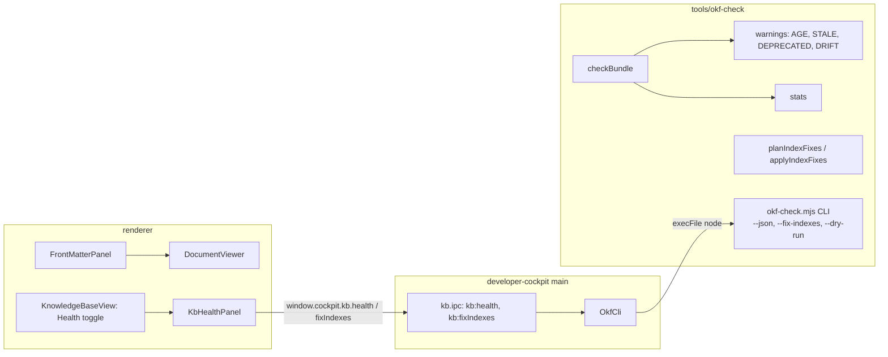

# Design — SPEC-0064: Add knowledge base health tools to cockpit

> **Stage 2 of 3 — how.** Concrete enough that the plan can be written without re-reading the
> code, and checked line by line against the architecture policies. Write "None — <reason>" for a
> section that genuinely does not apply.

## Context

- **Checker.**
  - `tools/okf-check/okf-check.mjs` (ESM, depends on `js-yaml`) exports `checkBundle(bundleDir,
    { repo })`, which returns `{ concepts, errors, warnings }`. `warnings` is always empty today.
  - Its CLI prints `ERROR <file> [<rule>]: <message>` lines and a summary, and exits 1 on errors.
  - Rules include `OKF-INDEX`: every folder with concepts needs an `index.md` that links each
    concept in the folder and each sub-folder index.
  - Settings come from the front matter of `oms-knowledge-base/okf-conventions.md`
    (`reviewed_since`, `retired_terms`, `type_vocabulary`).
  - Tests: `tools/okf-check/test/*.test.mjs` (`node --test`). They copy `fixtures/valid/` to a
    temp dir and edit it (`variant()`).
- **Index pages.** They are hand-written: a `# Title`, a sentence, a back link, then
  `## Documents` with `- [Title](file.md) — description` entries. Folders with sub-folders also
  have `## Sections` with `- [Title](sub/index.md) — description`.
- **Cockpit knowledge base.**
  - `src/main/services/KbService.ts` scans the bundle with `gray-matter` and keeps each document's
    `frontmatter`, but `src/renderer/views/knowledge-base/DocumentViewer.tsx` shows only the title,
    `category` and the file date.
  - `KnowledgeBaseView.tsx` has the tree, the search, the document, and a Chat toggle for the
    right panel.
  - IPC: `src/main/ipc/kb.ipc.ts` (`kb:getCategories|getDocuments|getDocument|search`), with a
    lazily scanned module-level `KbService`.
  - Preload: `src/main/preload.ts`. Types: `src/shared/types/ipc.ts` and `src/shared/types/kb.ts`.
  - Store: `src/renderer/stores/knowledgeBase.ts` (zustand).
- **Closest example.** `src/main/services/SpecCli.ts` runs the repository's
  `specs/tools/spec.mjs`. It uses `process.execPath` with `ELECTRON_RUN_AS_NODE=1`, a `json()`
  helper, and treats non-zero exit codes as results. The cockpit never reimplements spec rules,
  and this ticket follows the same pattern for the knowledge base.
- **Tests.** Vitest: `test/main/*.test.ts` (node), and `test/renderer/*.test.tsx` with
  `// @vitest-environment jsdom` and a mocked `window.cockpit`, for example
  `CategoryTree.test.tsx` and `KbChatPanel.test.tsx`.
- **Read before designing:** `oms-knowledge-base/okf-conventions.md`,
  `semantic-layer/knowledge-base-strategy.md`, `tools/developer-cockpit.md`,
  `tools/okf-check/README.md`, and the SPEC-0061 design.

## Approach



### Checker (`tools/okf-check/okf-check.mjs`)

1. **Warnings (AC-4).** Add `warn(p, rule, message)` next to `err` in `checkBundle`, and a
   `checkFreshness(bundle, repoRoot, concepts, parsed, warn, settings, now)` step. `now` defaults
   to `Date.now()` and is injectable through `checkBundle(dir, { repo, now })` for tests.
   - `OMS-AGE`: the document is not in `archive/`, has a parseable `updated`, and
     `now - updated > review_after_days` days. The setting is a positive integer in
     `okf-conventions.md`; without it, the rule is off.
   - `OMS-STALE`: `stale_after` is parseable and earlier than `now`. This applies everywhere,
     because the author asked for it.
   - `OMS-DEPRECATED`: `status: deprecated` outside `archive/`. The message points at moving the
     document to `archive/`.
   - `OMS-DRIFT`: a non-archived document with `updated` and at least one `repo:` source whose
     newest git commit is later than `updated`. The message names the source and both dates.
     Commit dates come from one `git -C <repo> log --format=%x00%cI --name-only -- <paths…>` call
     (`spawnSync`) over the union of all `repo:` paths.
     - Each path maps to its newest commit date, the first occurrence in the log.
     - A directory source uses the newest date of any file under it.
     - If git is missing or the repo is no git repository, there are no drift warnings and
       `stats.drift = 'unavailable'`.
     - Uncommitted changes do not count.
2. **Statistics (AC-3).** `checkBundle` also returns `stats`, computed over the concepts
   (`index.md` and `log.md` excluded), with a parseable front matter or not:

   ```js
   {
     documents, byType: { [type|'(none)']: n }, byStatus: {...}, byFolder: { [topFolder|'root']: n },
     requirements: { total, byImplementation: {...}, byPriority: {...} },   // type === 'Requirement'
     reviewAge: { reviewAfterDays|null, current, due, unknown },            // archive excluded
     drift: 'checked' | 'unavailable'
   }
   ```

   Keys are sorted, so the output is stable.
3. **JSON report (AC-2).** With `--json`, the CLI prints
   `JSON.stringify({ concepts, errors, warnings, stats })` and nothing else. The exit code is the
   same as in text mode (1 on errors). Text mode is unchanged apart from the existing `WARN` lines,
   which now appear when warnings exist.
4. **Index fix (AC-5).** These are new exports:
   - `planIndexFixes(bundleDir)` returns `[{ index, created, documents: [line…], sections: [line…] }]`.
     For each folder that needs an index (the same rule as `checkIndexes`), it lists the missing
     entries:
     - a concept: `- [<title>](<file>.md) — <description>`, from its front matter, or the file name
       when the front matter is missing;
     - a sub-folder index: `- [<# heading>](<sub>/index.md) — <first paragraph line>`.

     Links are relative to the index, and entries are sorted by title.
   - `applyIndexFixes(bundleDir, plan)` writes the plan:
     - It inserts document entries at the end of the `## Documents` section, before the next `## `
       heading or the end of the file. Section entries go at the end of `## Sections`.
     - It adds the section heading at the end of the file when it is missing.
     - A missing `index.md` is created as `# <Folder name>` and
       `Back to the [<parent title>](../index.md).`, plus the sections. The root index is never
       created, because it carries `okf_version` and must exist anyway.
     - Existing text is kept byte for byte, apart from the inserted lines. The file's line ending
       (LF or CRLF) is kept.

   CLI: `okf-check <bundle> --fix-indexes [--dry-run] [--json]`.
   - It prints the planned or applied changes (`FIX <index> + <entry>`), or JSON
     `{ applied, changes }`.
   - It exits 0, or 2 on usage errors.
   - The plan is idempotent: after an apply, a new plan is empty.

### Cockpit

5. **`src/main/services/OkfCli.ts` (AC-8).** It is modelled on `SpecCli`:
   - `run(args)` executes `<workspace>/tools/okf-check/okf-check.mjs` with `process.execPath` and
     `ELECTRON_RUN_AS_NODE=1`, through `execFile` with an argument array, never a shell;
   - `report(kbPath)` runs `[kbPath, '--repo', workspace, '--json']`;
   - `fixIndexes(kbPath, apply)` runs `[kbPath, '--fix-indexes', '--json', …(apply ? [] : ['--dry-run'])]`.

   Non-zero exit codes are results. Missing JSON, or a missing script, rejects with a readable
   message, for example that `tools/okf-check` is not found or that its dependencies need
   installing (`npm install`).
6. **IPC.**
   - `kb.ipc.ts` adds `kb:health`, which returns a `KbHealthReport`, and `kb:fixIndexes(apply:
     boolean)`, which returns a `KbIndexFixResult`. Both use the configured workspace root and
     knowledge base path (`ConfigService`).
   - After an applied fix, the module-level `KbService` rescans, so the tree shows created indexes.
   - The new types live in `src/shared/types/kb.ts`, and the API in `ipc.ts` and `preload.ts`
     (`window.cockpit.kb.health()`, `.fixIndexes(apply)`).
7. **Front matter (AC-1).** A new `views/knowledge-base/FrontMatterPanel.tsx`, rendered by
   `DocumentViewer` under the title when `frontmatter` has keys:
   - A badge row: type, status (`deprecated` in a destructive style, `draft` in an outline style),
     and `updated` as a date.
   - The description, the tags as small badges, and the sources as a list. A `repo:` prefix is
     shown as a code path; other resources are shown as given.
   - Aliases and `superseded_by`, when present.
   - A "More" definition list for every other key (for example `priority`, `implementation`,
     `capability`), with values rendered by type: scalars as text, arrays joined, objects as
     compact JSON.
   - Keys already shown are not repeated. `title` is the heading.
   - The existing category badge and file date stay.
8. **Health panel (AC-6, AC-7).** A new `views/knowledge-base/KbHealthPanel.tsx`, opened by a
   "Health" toggle next to "Chat" in `KnowledgeBaseView`. It replaces the centre document area
   while open.
   - It loads `window.cockpit.kb.health()` on open, and on a "Re-check" button. While loading it
     shows the spinner, and on a rejection an error alert.
   - **Summary:** documents, errors, warnings. Then stat tables: by type, by status, by folder,
     requirements by implementation and priority, and review age.
   - **Findings:** grouped by rule with counts, errors first. Each row shows the file and the
     message.
     - Clicking a row calls `selectDocument(<bundle-relative path>)`, closes the panel and shows
       the document.
     - For an `index.md` finding, it opens that index when it is a scanned document.
   - **"Fix indexes":** enabled when there are `OKF-INDEX` errors, or always as a dry run.
     1. It calls `fixIndexes(false)` and shows the planned entries per index in a confirm dialog.
     2. "Apply" calls `fixIndexes(true)`, then re-runs the health check and
        `loadCategories()`. "Cancel" writes nothing.
     3. "No changes needed" is shown when the plan is empty.
9. **Knowledge base.**
   - `okf-conventions.md` gets `review_after_days: 180` and a short paragraph on the warnings.
   - Run the index fix once on the real bundle. Today the check is clean, so no change is
     expected.

## Contract Changes

None. No OpenAPI or Avro change. The new IPC channels and the checker's JSON output are internal
tool interfaces, typed in `src/shared/types/kb.ts` and documented in the checker README.

## Data & Persistence

None. No database. The only files written are `index.md` files inside the configured knowledge
base, by the index fix, after a dry run and an explicit confirmation.

## Events & Messaging

None. No events, outbox or topics.

## Domain, State & Orchestration

None. No state machine or task pipeline.

## Alternatives & Decisions

- **The checker owns the rules; the cockpit calls the CLI.** The alternative was to reimplement
  checks in `KbService` with gray-matter, but two implementations would drift. The decision follows
  `SpecCli`.
  - The alternative of importing `okf-check.mjs` into the Electron main process is rejected. The
    module is ESM with its own `node_modules`, while the main bundle is built separately, so a
    child process is simpler and isolates failures.
- **Warnings, not errors, for freshness.** Age and drift call for a human review, not a broken
  build. Making them errors would make the checker unusable as a gate.
- **Drift from git commit dates, not file mtimes.** Mtimes change on checkout, so they are
  meaningless in a clone. Uncommitted edits are ignored so the result is reproducible. One git call
  for all paths keeps it fast: the knowledge base has roughly 200 concepts and a few hundred
  sources.
- **The index fix only appends.** Rewriting or regenerating index pages would destroy their
  hand-written prose and ordering. Appending to the existing `## Documents` and `## Sections`
  sections matches the current layout, and humans can reorder afterwards.
- **`review_after_days` in `okf-conventions.md`.** It is consistent with `reviewed_since` and
  `retired_terms`, and can be changed without code. Without the setting, the rule is off.
- **Health panel in the centre area, with a toggle like Chat.** No new route or view is needed,
  and findings open documents in place.
**Changed during implementation.** All of these are reversible and within the approved proposal.
- **OMS-DRIFT compares against the later of `updated` and the document's own last commit.**
  Against `updated` alone, the real bundle reported 112 warnings, mostly pages committed in the
  same commit as their code a few hours after the `updated` stamp. The documents' paths are dated
  in the same single git call. Now there is 1 warning, a real one. Test:
  `report.test.mjs#OMS-DRIFT counts a document committed with its code as up to date`.
- **Where the index fix inserts.** An entry goes after the last existing entry of its kind (a
  concept link, or a `*/index.md` link). Without one, it goes at the end of a section named
  `Documents` or `Concepts` (`Sections` or `Folders` for sub-folders), and otherwise into a new
  `## Documents` or `## Sections` section at the end. The test fixture uses `Concepts`/`Folders`,
  the real bundle `Documents`/`Sections`; both work.
- **The confirmation is inline.** The planned entries appear in a "Planned index changes" region
  of the Health panel with Apply and Cancel, not a modal dialog. Same behaviour, simpler, and
  testable without portals.
- **`OkfCli.report(kbPath, repoRoot = workspace)`.** The repository root is a parameter, so tests
  can run the checker's fixture, whose `repo:` sources sit inside the bundle copy.
- **`registerKbIpc(ipcMain, configService, { createOkfCli })`.** The checker runner is injectable
  for tests. Registering also resets the cached `KbService`.
- **Documentation.** `semantic-layer/schema-and-constraints.md` (the rule table) is updated too, and
  the new cockpit files are added to the `sources` of `tools/developer-cockpit.md`.

**After the first independent review.**
- **AC-4 drift wording.** The proposal is amended to the rule above and is awaiting re-approval.
- **The index fix escapes entries.** In link text `\`, `[` and `]` are escaped; in targets `(`,
  `)` and spaces are percent-encoded. The checker's link parser now accepts escaped characters in
  link text, so a title like `Foo [beta]` or a file `bar(1).md` is linked once, and a second run
  adds nothing. Test: `fix-indexes.test.mjs#titles and file names are escaped…`.
- **Drift git calls.**
  - They run in batches of at most 8,000 characters of paths, under the Windows command-line
    limit. Tested with 600 long paths.
  - They use `-c core.quotePath=false`, so non-ASCII paths match. Tested.
  - Folder sources and the archive exemption also have tests now.
- **Drift messages give UTC minutes,** not just days.
- **A created index carries a description line, `Documents in <folder>/.`,** and the parent's new
  entry uses it.
- **The Health panel** says when the applied index changes differ from the confirmed preview. The
  CLI plans again from disk.
- **The Knowledge Base view:**
  - picking a document in the tree or the search closes the Health panel;
  - a finding opens its document only if the explorer has it, and otherwise the panel explains
    that the file is not a document yet.
- **`developer-cockpit/spec/04-backend-services.md` documents OkfCli** and the two IPC channels.

- **No new dependencies** (P-17): `node:child_process` in the checker; existing UI components
  (Badge, Button, ScrollArea, dialog) in the cockpit.

## Risks & Mitigations

- **Drift warnings flood the real bundle**, because many sources changed after the review on
  2026-11-14. This is acceptable: they are warnings, grouped by rule in the panel. The count is
  reported in verification, and reviewing the pages is out of scope.
- **Git is slow or missing.** There is one call, with a timeout. On failure the drift rule is
  skipped and reported as `unavailable`.
- **The index fix writes files.** Mitigations:
  - a dry run first, and an explicit confirmation in the cockpit;
  - append only, with fixture tests that assert byte-for-byte preservation and idempotence;
  - writes stay under the bundle directory, because paths come from the walk, never from input.
- **`tools/okf-check/node_modules` is missing on a fresh clone.** The cockpit shows the CLI's
  error, saying to run `npm install` in `tools/okf-check`.
- **Front matter values of unexpected types,** such as Dates from unquoted YAML or nested objects.
  The renderer formats by type, and a test covers a Date, an array and an object.

## Test Strategy

| AC | Level | Test class#method | What it asserts |
|---|---|---|---|
| AC-1 | renderer (jsdom) | `test/renderer/FrontMatterPanel.test.tsx#shows type, status, description, updated, tags and sources`, `#marks deprecated and draft`, `#lists every other key`, `#renders nothing without front matter` | All listed fields are rendered; the status marker is present; extra keys appear once; there is no block without front matter |
| AC-2 | CLI | `tools/okf-check/test/report.test.mjs#--json prints errors, warnings and stats with the text exit code`, `#text output is unchanged` | The JSON parses with the keys; the exit code matches the text mode for a clean and a broken fixture; the text has no JSON |
| AC-3 | unit | `report.test.mjs#stats count documents by type, status, folder, requirements and review age` | Exact counts on a fixture; index and log files are not counted |
| AC-4 | unit | `report.test.mjs#OMS-AGE …`, `#OMS-STALE …`, `#OMS-DEPRECATED …`, `#OMS-DRIFT …` (drift with a temp git repo and fixed commit dates), `#warnings do not change the exit code` | Each rule fires on its trigger and not on its counter-example |
| AC-5 | unit + CLI | `tools/okf-check/test/fix-indexes.test.mjs#dry run lists entries and writes nothing`, `#apply adds entries, keeps text, creates a missing index, clears OKF-INDEX`, `#second run changes nothing`, `#keeps CRLF` | File contents before and after; `checkBundle` has no OKF-INDEX error after the apply |
| AC-6 | renderer (jsdom) | `test/renderer/KbHealthPanel.test.tsx#shows stats and findings grouped by rule`, `#opens the document of a finding`, `#shows loading and error states` | The rendered counts and groups; `selectDocument` is called with the path; spinner and alert |
| AC-7 | renderer (jsdom) | `KbHealthPanel.test.tsx#fix indexes previews, applies on confirm and refreshes`, `#cancel writes nothing` | `fixIndexes(false)` then `(true)` only after confirm; health and categories reloaded; cancel makes no apply call |
| AC-8 | main | `test/main/OkfCli.test.ts#report runs the repository CLI on the configured bundle`, `#fixIndexes dry run and apply`, `#missing script rejects with a readable message`; `test/main/kb.ipc.test.ts#health and fixIndexes use the configured paths` | The real CLI runs against a copy of the checker's valid fixture; IPC handlers pass the config paths |
| AC-9 | suite | `spec verify` (developer-cockpit typecheck + tests), `npm test` in `tools/okf-check`, `okf-check oms-knowledge-base` | All pass, 0 errors |

## Policy Compliance

| Policy | Title | Status | How / Justification |
|---|---|---|---|
| P-01 | Contracts live only in oms-contracts | n/a | No OpenAPI or Avro contracts touched |
| P-02 | Specification before code, generated models only | n/a | Tooling; no generated models |
| P-03 | Never edit generated code | comply | No generated files touched |
| P-04 | Contracts evolve compatibly | n/a | No service contract; the checker text output and exit codes stay compatible, and JSON is opt-in |
| P-05 | Every state change is recorded in the event log | n/a | No order state |
| P-06 | Kafka only through the transactional outbox | n/a | No messaging |
| P-07 | Schema changes through new Liquibase changesets | n/a | No database |
| P-08 | Concurrency and idempotency are explicit | comply | The index fix is idempotent (tested); it re-plans from disk on apply, so a stale preview cannot add duplicates |
| P-09 | Commands and queries stay separate | n/a | No OMS commands or queries |
| P-10 | State transitions go through the state machine and task pipeline | n/a | No transitions |
| P-11 | Layering and conventions | comply | Rules live in the checker; the cockpit main process runs the CLI (service + IPC); the renderer only displays; types are in `shared/` |
| P-12 | Jackson 3 only | n/a | No Java |
| P-13 | Errors and validation follow the framework specs | n/a | No OMS API errors; CLI failures surface as readable messages |
| P-14 | Test first, every acceptance criterion is proven by an automated test | comply | Each AC maps to named tests above, written red first |
| P-15 | Observability | n/a | Desktop tooling; CLI runs are logged like `SpecCli` (`console.info` with exit code and duration) |
| P-16 | Security | comply | `execFile` with an argument array (no shell); written paths come from the bundle walk only; the renderer gets no file-system access |
| P-17 | Simplicity and dependencies | comply | No new dependencies; reuses the checker and existing UI components |
| P-18 | Modules build standalone | comply | The cockpit builds and tests on its own; the checker is called at run time, and its absence is handled |
| P-19 | Documentation follows behaviour | comply | Knowledge base pages updated in this ticket (below) |

## Knowledge Base Updates

- `oms-knowledge-base/okf-conventions.md`: `review_after_days: 180`, and the warning rules and what
  to do about each.
- `oms-knowledge-base/tools/developer-cockpit.md`: the front matter in the explorer, the Health
  panel and Fix indexes.
- `oms-knowledge-base/semantic-layer/knowledge-base-strategy.md`: how health is checked (the
  checker's JSON and warnings, the cockpit panel).
- `tools/okf-check/README.md`: the new options and rules. It is not part of the bundle, but it is
  the checker's documentation.
- `oms-knowledge-base/log.md`: an entry for SPEC-0064.
