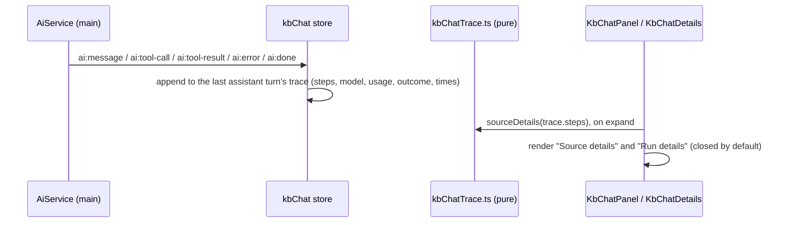

# Design — SPEC-0065: Show chat source details and run trace

> **Stage 2 of 3 — how.** Concrete enough that the plan can be written without re-reading the
> code, and checked line by line against the architecture policies. Write "None — <reason>" for a
> section that genuinely does not apply.

## Context

How the KB chat (SPEC-0062) works today:

- **`developer-cockpit/src/main/ai/AiService.ts`.** The `loop()` method streams one run and
  broadcasts these `ai:*` events (`shared/types/ai.ts`) over the cockpit WebSocket:
  - `ai:message` (text deltas);
  - `ai:tool-call` (`toolCallId`, `name`, `input`);
  - `ai:tool-result` (`toolCallId`, `name`, `output`, bounded by `summarize()` to 4,000
    characters plus "… (truncated)");
  - `ai:error`;
  - `ai:done` (`aborted`, `incomplete`, `model?: {provider, model}`, `usage?: {inputTokens,
    outputTokens}`).
- **`developer-cockpit/src/renderer/stores/kbChat.ts`.** The zustand store `useKbChatStore`:
  - `handleEvent` filters events by `activeRunId`;
  - it appends `ai:message` text to the last assistant turn;
  - it collects tool events in a run-scoped `toolEvents` array (reset per `send`), and turns them
    into `turn.sources` with `extractSources` (`renderer/lib/kbChatSources.ts`);
  - `ai:done` clears `running`; `model` and `usage` are ignored;
  - `ai:error` sets the store-level `error`.
- **`developer-cockpit/src/renderer/views/knowledge-base/KbChatPanel.tsx`.** `Turn` renders the
  answer as Markdown, then a "Sources" list of buttons named `Open source <path>`.
- **Tool outputs the trace reads:**
  - **Knowledge server `searchKnowledgeBase`** (`oms-mcp-server/.../kb/KnowledgeBaseTools.java`):
    Markdown. Per hit:

    ```
    ### <n>. `<citation>`
    **<breadcrumb>** (lines <a>-<b>)[ — <type> · <status> · <trust>]

    > <excerpt>
    ```

    The citation is `oms-knowledge-base/<path>#<anchor>`.
    `KnowledgeIndexService.SearchHit` already carries `score`, `keywordRank` and `vectorRank`; they
    are not printed.
  - **Knowledge server `readKnowledgeBase`:** the input is `{path, anchor?, offset?}`.
  - **Local `search_knowledge_base`** (`main/ai/McpToolRegistry.ts`, `kbSearchTool`): it returns
    a `KbSearchToolResult` object, JSON-stringified by `summarize()`:
    `{query, count, results:[{title, path, category}]}`. `KbService.search` already returns a
    `score` per result and the tool drops it.
  - **Local `read_knowledge_base_document`** (`main/ai/KbChatTools.ts`): the input is `{path}`.
- **Closest examples:**
  - `extractSources` is a pure parser over tool events, unit-tested in
    `test/renderer/kbChatSources.test.ts`; the new parser is its sibling.
  - The collapsible pattern is a `<button aria-expanded>` that renders its content only when open,
    as in `renderer/views/dashboard/Signals.tsx`.
- **Knowledge base pages read:** `oms-knowledge-base/tools/developer-cockpit.md` (KB chat) and
  `tools/knowledge-server.md`.

## Approach



**1. The trace per answer (store).** `KbChatTurn` gains an optional `trace?: KbChatTrace`, set
only on assistant turns:

```ts
type KbChatStep =
  | { kind: 'text'; text: string }
  | { kind: 'tool'; toolCallId: string; name: string; input: Record<string, unknown>; output?: string };
type KbChatOutcome = 'running' | 'complete' | 'stopped' | 'step-limit' | 'failed';
interface KbChatTrace {
  steps: KbChatStep[];
  startedAt: number;          // Date.now() at send
  endedAt?: number;           // at ai:done, or when the start fails
  model?: { provider: string; model: string };
  usage?: { inputTokens: number; outputTokens: number };
  outcome: KbChatOutcome;
  error?: string;
}
```

`send` creates the assistant turn with `trace: { steps: [], startedAt: Date.now(), outcome:
'running' }`. Then `handleEvent` (same run filter as today) updates the last turn's trace:
- **`ai:message`:** appends the text to the last step if it is a `text` step, otherwise pushes a
  new `text` step. The turn's `text` is appended as today.
- **`ai:tool-call`:** pushes a `tool` step.
- **`ai:tool-result`:** sets `output` on the `tool` step with the same `toolCallId`. With no such
  step, it pushes one with `input: {}`.
- **`ai:error`:** sets `trace.error = message`; the store `error` is set as today.
- **`ai:done`:** sets `endedAt`, `model`, `usage` and the outcome:
  - `aborted` → `stopped`;
  - `incomplete` → `step-limit`;
  - `trace.error` set → `failed`;
  - otherwise `complete`.
- **Failed start:** when `ai.kbChat` rejects or returns `ok:false`, the trace gets
  `outcome: 'failed'`, `error` and `endedAt`.

`toolEvents`, `extractSources` and `turn.sources` stay exactly as they are (AC-8). Earlier turns
keep their own trace because each run writes only to the last turn (AC-7). `clear` empties `turns`
and so the traces too.

**2. The parser (`renderer/lib/kbChatTrace.ts`, new, pure).**
- `parseServerSearch(output: string): ServerHit[]`:
  - splits on `^### <n>. \`<citation>\``;
  - takes `path` and `anchor` from the citation, normalised with the existing `normaliseKbPath`;
  - takes the rank `n`, the breadcrumb (`**…**`) and the lines;
  - takes the facets: the text after ` — ` up to an optional ` — score`;
  - takes `score`, `keywordRank` and `semanticRank` from `score <x>`, `keyword #<n>` and
    `semantic #<n>`;
  - takes the excerpt: the `> ` lines, without the marker.

  A hit cut off by the 4,000-character bound keeps whatever fields were parsed.
- `parseLocalSearch(output: string): LocalHit[]`:
  - `JSON.parse`, then `results[i]` → `{path, title, category, score?, rank: i + 1}`;
  - truncated or invalid JSON gives `[]`.
- `sourceDetails(steps): { path; matches: SourceMatch[] }[]`:
  - **Paths and order:** first-seen order, filtered and normalised exactly like `extractSources`,
    using `isKbDocumentPath` and `normaliseKbPath`.
  - **Search matches:**
    - `searchKnowledgeBase` gives one match per hit:
      `{kind:'search', tool, query: input.query, rank, score?, keywordRank?, semanticRank?, anchor?, breadcrumb?, lines?, facets?, excerpt?}`;
    - `search_knowledge_base` gives `{kind:'search', tool, query, rank, score?, category}`.
  - **Read matches:** `readKnowledgeBase` and `read_knowledge_base_document` give
    `{kind:'read', tool, anchor?: input.anchor}`.
  - Other tools are ignored.
- `summarise(trace): { toolCalls, durationMs?, totalTokens? }` covers the summary line's
  arithmetic.

**3. UI (`renderer/views/knowledge-base/KbChatDetails.tsx`, new).**
- **Components.** `SourceDetails({ trace, onOpen })` and `RunDetails({ trace })`. Each is a header
  button (`aria-expanded`, closed by default) that renders its content only when open.
- **Rendering.** `Turn` in `KbChatPanel.tsx` renders the two components after the existing
  Sources list:
  - `SourceDetails` only when `sourceDetails` returns at least one entry;
  - `RunDetails` whenever there is a trace.
- **Source details:** one block per document, holding:
  - a path button that opens it, like the existing links but named `Open details source <path>`,
    so it does not clash with `Open source <path>`;
  - a list of its matches:
    - **search:** `#<rank> for "<query>" · score <x> · keyword #<k> · semantic #<s>`, then
      breadcrumb `#anchor` (lines a–b) · facets, then the excerpt in muted text;
    - **read:** `read` [`#anchor`].
- **Run details:**
  - **The summary line:** `<provider> / <model> · <in> in + <out> out = <total> tokens · <n> tool
    calls · <d> s · <outcome>`. Tokens are "not reported" without usage. The outcome reads
    complete, stopped, step limit, or failed: `<error>`. "running" is shown while the run goes on.
  - **An ordered list of steps:**
    - text steps in muted text, first 300 characters, full text on expand;
    - tool steps as `<name>(<compact JSON input>)` with a "Result" toggle button. The toggle
      (`aria-expanded`) shows the output in a `<pre>` as received.
- **Styling:** existing tokens only (`text-muted-foreground`, `border-border`, `text-xs`); no new
  component library.

**4. Scores in the search output.**
- **Knowledge server.** In `KnowledgeBaseTools.searchKnowledgeBase`, after the facets, append
  ` — score <x.xxxx>`, then ` · keyword #<k>` when `keywordRank` is not null, then
  ` · semantic #<s>` when `vectorRank` is not null. The score uses `String.format(Locale.ROOT,
  "%.4f", hit.score())`. Nothing else in the output changes.
- **Local search.** `kbSearchTool` adds `score` (from `KbSearchResult.score`) to each result.
  `KbSearchToolResult.results[]` gains `score: number`.

**5. Amended after the requester tried it (proposal re-approved 2026-11-16).**

- **5a. The cause.** The running knowledge server returns each tool's text as a JSON string
  literal, for example `"## Knowledge base search: \"x\"\n…"`. This is Spring AI's
  `DefaultToolCallResultConverter`, which serialises every return value, a `String` included, with
  Jackson. `wrapMcpTool` passes that text on unchanged.
  - `parseServerSearch` looks for `^### n.` lines, so it found nothing.
  - Run details showed one escaped line.
  - The tests used clean Markdown.
- **5b. The server returns plain text.** A new `org.example.mcp.kb.PlainTextResultConverter
  implements ToolCallResultConverter`:
  - a `String` result is returned unchanged;
  - anything else goes to `DefaultToolCallResultConverter`;
  - `searchKnowledgeBase`, `readKnowledgeBase` and `getKnowledgeBaseOverview` set
    `@Tool(resultConverter = PlainTextResultConverter.class)`;
  - `searchOrders` is unchanged.
- **5c. The cockpit decodes encoded text.** A new `developer-cockpit/src/shared/mcpText.ts` with
  `decodeToolText(text)`:
  - when the trimmed text starts and ends with `"` and `JSON.parse` gives a string, it returns that
    string;
  - otherwise it returns the text unchanged.

  It is called in `McpToolRegistry.wrapMcpTool` on the joined text content, so the model, the
  `ai:tool-result` event and therefore Run details all get the decoded Markdown. As a second guard,
  `kbChatTrace.parseServerSearch` calls it too.
- **5d. Details move into the source list.** `Turn` keeps the existing "Sources" list, and its
  link buttons (`Open source <path>`) are unchanged. For each source, it looks up
  `sourceDetails(trace.steps)` by path and renders a new `SourceEntry` (in `KbChatDetails.tsx`):
  - **The link**, as before.
  - **A muted summary of the best match.** That is the search match with the lowest rank, or else
    the first read. A server search reads `#1 · score 0.0325 · Summary (lines 18-28) · Capability ·
    draft · unverified`, using the last breadcrumb segment. A local search reads `#1 · distance
    0.123 (lower is better)`. A read reads `read #anchor`.
  - **A toggle button** (`aria-expanded`, named `Show matches for <path>`, closed by default) that
    lists every match with `matchLine`, the per-match rendering of section 3. `SourceDetails` and
    its separate section are removed.
  - A source with no details, for example one cited by an unknown tool, shows only the link, as
    before.

| What Changes (proposal) | Where |
|---|---|
| Source details | `kbChatTrace.sourceDetails`, `KbChatDetails.SourceEntry` in the "Sources" list (5d) |
| Readable tool output | `PlainTextResultConverter` (5b), `shared/mcpText.decodeToolText` in `wrapMcpTool` and `parseServerSearch` (5c) |
| Run details | `kbChat` store trace, `kbChatTrace.summarise`, `KbChatDetails.RunDetails` |
| Per answer | `KbChatTurn.trace` written only by the active run |
| Scores in the search output | `KnowledgeBaseTools.searchKnowledgeBase`; `kbSearchTool` and `KbSearchToolResult` |

## Contract Changes

None to OpenAPI or Avro. Two additive changes to tool outputs, which are not formal contracts:

- **`searchKnowledgeBase` (MCP text).** The hit line gains a trailing
  ` — score 0.0164 · keyword #1[ · semantic #3]`. The existing text before it is byte-identical.
  AI clients read this output as prose, so they are unaffected.
- **Local `search_knowledge_base` (cockpit-internal JSON):**
  `results[]: { title, path, category, score }`, adding `score`.

## Data & Persistence

None. The trace lives in renderer memory for the session, like the conversation. Nothing is
stored.

## Events & Messaging

None. No order events, outbox or Kafka. The cockpit's internal `ai:*` WebSocket events keep their
shape; the renderer keeps fields it already receives (`model`, `usage`, tool inputs and outputs).

## Domain, State & Orchestration

None. No order state machine, tasks or validation. The run outcome is a display value derived from
`ai:done` and `ai:error`.

## Alternatives & Decisions

- **D1. The trace is built in the renderer from the existing events.**
  - Rejected: a new `ai:trace` event, or per-step events from `AiService`. They would change the
    main process and the event contract for data the renderer already receives, against the
    goal's "not changing the existing stuff too much".
- **D2. Parse the knowledge server's Markdown.**
  - Rejected: making the MCP tool return structured JSON. That would change what every AI client
    sees and the server's contract.
  - The parser tolerates missing or truncated fields, and its tests pin the format. The format is
    documented in `tools/knowledge-server.md`.
- **D3. The score is appended to the hit line, not printed on a separate line.**
  - Rejected: a separate line. That adds lines to every hit and would push more hits past the
    cockpit's 4,000-character bound.
- **D4. A button with `aria-expanded` and conditional rendering, not `<details>`.**
  - This matches existing cockpit code (`Signals.tsx`).
  - It renders nothing until opened, which keeps the DOM of long conversations small.
  - It is reliably testable in jsdom.
- **D5. Keep `extractSources`, `toolEvents` and `turn.sources` unchanged.** The new source details
  are computed separately from the trace. That keeps AC-8's existing behaviour, and its tests,
  untouched.
- **D6. Text steps show the model's visible working notes, not extended thinking** (proposal, out
  of scope).
- **No new dependencies or build changes.**

## Risks & Mitigations

- **The server's Markdown format changes.** The parser yields fewer fields, never an error. Unit
  tests cover a full hit, a hit without facets, a hit without semantic rank, and a hit cut off by
  "… (truncated)". The format is pinned on the server side by `KnowledgeBaseToolsTest`.
- **Memory over a long session.** Each trace holds tool outputs that are already bounded to 4,000
  characters. The chat sends at most 5 steps per run by default (max 20), and Clear frees
  everything.
- **Duplicated answer text in text steps.** Text steps hold the same text as the answer. They are
  collapsed and truncated to 300 characters until expanded.
- **Locale-dependent number formatting on the server.** `Locale.ROOT` gives a `.` decimal point
  regardless of the JVM locale.

## Test Strategy

| AC | Level | Test class#method | What it asserts |
|---|---|---|---|
| AC-1 | unit + component | `kbChatTrace.test.ts#parses knowledge server hits`; `#source details per document from searches (AC-1)`; `KbChatPanel.test.tsx#each source shows its best match, and its toggle lists every match (AC-1)` | Parsed rank, query, score and ranks, breadcrumb, anchor, lines, facets and excerpt. In the Sources list: the link is unchanged, the summary shows rank, score, section, lines and facets, and the toggle lists both matches with the excerpt. There is no "Source details" section |
| AC-2 | unit + component | `kbChatTrace.test.ts#parses local search results`; `KbChatPanel.test.tsx#local sources show rank and distance, and a read document shows read (AC-2)` | The local search entry shows `#1 · distance 0.123 (lower is better)`, and its toggle adds the query and category. The read-only document shows "read" |
| AC-3 | unit + component | `kbChatTrace.test.ts#a knowledge server read is a read match with its anchor (AC-3)`; `KbChatPanel.test.tsx#each answer keeps its own run details; clear removes them (AC-7)` | `readKnowledgeBase {path, anchor}` gives a read match. The source entry shows `read #states` |
| AC-4 | unit (JUnit) | `oms-mcp-server KnowledgeBaseToolsTest#searchHitsShowScoreAndRanks`; existing `#searchHitsShowTypeStatusAndTrust` and `#searchReturnsMarkdownWithCitationsAndHint` | Hit lines contain `score 0.0164 · keyword #1` (the RRF score of rank 1, with embeddings off) and no `semantic #`. The existing assertions are unchanged |
| AC-4 (local) | unit | `test/main/McpToolRegistry.test.ts#local search results carry their score` | `kbSearchTool` results include `score` |
| AC-5 | store + component | `test/renderer/kbChatTrace.test.ts#steps keep text and tool calls in order`; `KbChatPanel.test.tsx#run details show model, tokens, tool calls, duration and steps`; `#run details without usage say not reported` | Order text → tool → text. Results collapse and expand. The summary line has the provider and model, in/out/total tokens, the tool-call count, the duration and "complete". Without usage it says "not reported" |
| AC-6 | component | `KbChatPanel.test.tsx#run details show stopped, step limit and failed outcomes` | Outcomes after `aborted`, `incomplete`, and `ai:error` + `ai:done`, with the error message; the earlier steps are listed |
| AC-7 | component | `KbChatPanel.test.tsx#each answer keeps its own run details; clear removes them` | The first answer's details show the first run's tool and model after a second run. After Clear, no details |
| AC-8 | component (existing) | all SPEC-0062 tests in `KbChatPanel.test.tsx`, `kbChatStore.test.ts` and `kbChatSources.test.ts` unedited; `KbChatPanel.test.tsx#details are closed by default (AC-8)` | The existing tests pass without edits. Run details and each source toggle have `aria-expanded="false"`, with no content rendered |
| AC-10 | unit (JUnit + Vitest) + component | `oms-mcp-server PlainTextResultConverterTest#kbToolsReturnTheirMarkdownAsIs` (through Spring AI tool callbacks); `test/shared/mcpText.test.ts#decodes a JSON-encoded tool text, leaves other text alone`; `McpToolRegistry.test.ts#an MCP tool returning JSON-encoded text is decoded`; `KbChatPanel.test.tsx#details from the server text as it was JSON-encoded (AC-10)` | The KB tool callbacks return Markdown that starts with `## `, not a quote. Decoding: a quoted string becomes its text; plain text, JSON objects and malformed text are unchanged. The registry decodes through a stub MCP server. With the old server output, the parser finds the hits, and Run details shows several lines |
| AC-9 | gate | `spec verify` (developer-cockpit typecheck and test; oms-mcp-server `./gradlew check`); `node tools/okf-check/okf-check.mjs oms-knowledge-base` | All pass; 0 KB errors |

## Policy Compliance

| Policy | Title | Status | How / Justification |
|---|---|---|---|
| P-01 | Contracts live only in oms-contracts | n/a | No OpenAPI or Avro contract is touched |
| P-02 | Specification before code, generated models only | comply | The proposal and design come first. The cockpit's AI and IPC types are hand-written TypeScript in `shared/types` (no generated model covers them) |
| P-03 | Never edit generated code | comply | No generated file is edited |
| P-04 | Contracts evolve compatibly | comply | Only additive: a trailing fragment on the MCP hit line and a `score` field in the local JSON. The `ai:*` events are unchanged |
| P-05 | Every state change is recorded in the event log | n/a | No order state |
| P-06 | Kafka only through the transactional outbox | n/a | No Kafka |
| P-07 | Schema changes through new Liquibase changesets | n/a | No database |
| P-08 | Concurrency and idempotency are explicit | comply | Events are filtered by `runId` as today. A result is matched to its call by `toolCallId`, and an orphan result is tolerated |
| P-09 | Commands and queries stay separate | n/a | No OMS command or query API |
| P-10 | State transitions go through the state machine and task pipeline | n/a | No order state |
| P-11 | Layering and conventions | comply | Pure parsing in `renderer/lib` (sibling of `kbChatSources.ts`), state in the store, display in a view component. The server change stays inside the existing tool method |
| P-12 | Jackson 3 only | n/a | No JSON mapping added in Java (string formatting only) |
| P-13 | Errors and validation follow the framework specs | comply | Unparseable or truncated tool output gives fewer fields, never an exception. A run error shows as the "failed" outcome with its message |
| P-14 | Test first, every acceptance criterion is proven by an automated test | comply | Tests are written before the code, per the plan; Test Strategy covers every AC |
| P-15 | Observability | n/a | No service metrics or logs change. The existing usage log is untouched |
| P-16 | Security | comply | Tool output is rendered as text (React-escaped, `<pre>`), never as HTML or Markdown. No key or secret reaches the renderer, as today |
| P-17 | Simplicity and dependencies | comply | No new dependencies. Data already received is reused (D1, D2) |
| P-18 | Modules build standalone | comply | The cockpit and oms-mcp-server changes are independent. Each module's own checks prove it |
| P-19 | Documentation follows behaviour | comply | KB pages updated (below) |

## Knowledge Base Updates

- `oms-knowledge-base/tools/developer-cockpit.md` (KB chat): the "Source details" and "Run details"
  sections, what they show, and that they are closed by default and kept per answer for the
  session.
- `oms-knowledge-base/tools/knowledge-server.md`: each `searchKnowledgeBase` hit states its fused
  score and its keyword and semantic ranks.
- `oms-knowledge-base/log.md`: an entry for SPEC-0065.
