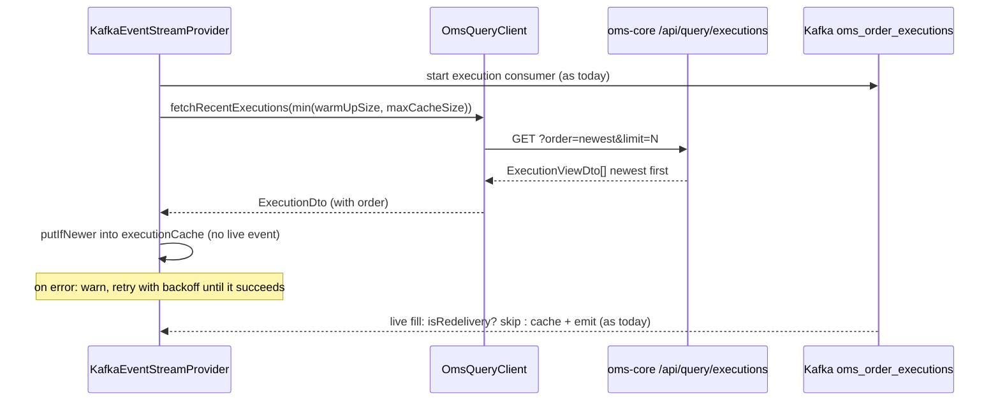

# Design — SPEC-0067: Keep streaming executions across service restarts

> **Stage 2 of 3 — how.** Concrete enough that the plan can be written without re-reading the
> code, and checked line by line against the architecture policies. Write "None — <reason>" for a
> section that genuinely does not apply.

## Context

- **`oms-streaming-service/.../service/KafkaEventStreamProvider.java`:**
  - `@PostConstruct startConsuming()` starts the order and execution Kafka consumers.
  - `startExecutionConsumer()` maps each `OrderExecution` record with
    `OrderExecutionMapper.toExecutionDto`, then skips redeliveries. `isRedelivery` compares against
    the cached fill under the key `orderId/execId`: same or higher `orderVersion` means a
    redelivery.
  - Otherwise it puts the fill in `executionCache` (bounded by `streaming.buffer.max-size`, default
    10,000, through `evictOldExecutions`) and emits it on `executionEventSink`.
  - `getExecutionEventStream` builds the snapshot from `executionCache` only: filtered by
    `FilterService`, newest first by `transactTime`, cut to the client's limit, followed by
    `SNAPSHOT_END`. After a restart the consumer resumes from its committed offset, so the cache
    starts empty.
- **`oms-streaming-service/.../client/OmsQueryClient.java`.** A WebClient on the oms-core query
  API. For orders it calls `/api/query/search` and maps JSON nodes by hand (`toOrderDto`,
  `getBigDecimal`, …). `OmsQueryClientTest` serves canned JSON through a stub `ExchangeFunction`.
- **oms-core:**
  - `GET /api/query/executions` (`ExecutionViewController implements ExecutionsApi`, generated
    from `oms-query-api.yml`) returns `ExecutionViewDto[]`. That is the order-execution projection:
    each fill with its order as of that fill, the same shape as the `OrderExecution` Avro record.
  - `OrderExecutionProjectionQueryService.find` orders by
    `coalesce(transactTime, projectedAt) ASC, id ASC`, with `limit` from 1 to 5,000.
  - Tests: `ExecutionViewQueryIntegrationTest` (SPEC-0020).
- **Errors.** `GlobalExceptionHandler` extends `ResponseEntityExceptionHandler`, so a parameter
  type mismatch gives 400. `IllegalArgumentException` gives 400 `urn:oms:error:bad-request`.
- **Closest examples.**
  - The **order** snapshot: `OmsQueryClient.fetchOrderSnapshot` and its use in
    `getOrderEventStream`, with `KafkaEventStreamProviderTest`'s mocked `OmsQueryClient` and the
    `fillRecords` sink.
  - The query API's existing filter parameters, for the new one.
- **Knowledge base read:**
  - `architecture/context/streaming-service.md`;
  - `domain/interfaces/query-api.md`;
  - `domain/model/order-execution-projection.md`;
  - `capabilities/functional-requirements/FR-054-serve-fills-with-order.md`.

## Approach



**1. Query API: newest first (oms-contracts, oms-core).**
- **Contract.** `getExecutions` gains the `order` parameter (see Contract Changes).
- **Controller.** `ExecutionViewController` passes it through as `ExecutionOrder`, a new enum in
  `org.example.oms.service` with values `OLDEST` and `NEWEST`. `ExecutionOrder.of(String)` maps
  null to `OLDEST`, and throws `IllegalArgumentException("order must be oldest or newest")` for an
  unknown value, which gives 400. If the generator produces an enum type instead of a String, the
  controller maps that enum, and a bad value is a type mismatch, also 400.
- **Query service.** `OrderExecutionProjectionQueryService.find` gains `ExecutionOrder order`.
  - `NEWEST`: `desc(coalesce(transactTime, projectedAt)), desc(id)`.
  - `OLDEST`: today's ascending order, unchanged.

**2. Streaming service: warm the cache at startup.**
- **`OmsQueryClient.fetchRecentExecutions(int limit): Flux<ExecutionDto>`:**
  - calls `GET /api/query/executions?order=newest&limit={limit}`;
  - maps each JSON node with a new `toExecutionDto(JsonNode)`;
  - the execution fields are `execId`, `orderId`, `lastQty`, `lastPx`, `cumQty`, `leavesQty`,
    `avgPx`, `execType`, `lastMkt`, `lastCapacity`, `transactTime` and `orderVersion`;
    `sequenceNumber` is set to `orderVersion`;
  - a nested `OrderDto` is built from the order fields (`orderId`, `rootOrderId`, `parentOrderId`,
    `clOrdId`, `account`, `symbol`, `side`, `ordType`, `state`, `orderQty`, `cumQty`, `leavesQty`,
    `price`, `avgPx`, `securityId`, `exDestination`, `eventId` = `orderVersion`), the same fields
    as `OrderExecutionMapper.toOrderDto`;
  - it reuses the existing `getText`, `getBigDecimal` and `getLong` helpers.
- **`KafkaEventStreamProvider.startConsuming()`** also calls `warmUpExecutions()` after starting
  the execution consumer:
  - it calls `fetchRecentExecutions(Math.min(warmUpSize, maxCacheSize))`;
  - it puts each fill into `executionCache` with `putIfNewer`: insert when absent, or replace when
    the cached `orderVersion` is lower. A live fill that arrived first is never overwritten by
    older data;
  - it then runs `evictOldExecutions()` and does not emit anything on the sink: these are stored
    fills, not new ones;
  - it retries with `Retry.backoff(Long.MAX_VALUE, Duration.ofSeconds(2)).maxBackoff(
    Duration.ofMinutes(1))`, logging a warning on every failure (`doBeforeRetry`);
  - it runs on `Schedulers.boundedElastic()`. Its `Disposable` is kept and disposed in
    `shutdown()`. It logs `Warmed execution cache: {n} fills` on success.
- **Configuration.** `@Value("${streaming.executions.warm-up-size:5000}") int warmUpSize`, also
  added to `application.yml` with a comment.
- **Duplicates (AC-2).** These need no new code. A Kafka record for a loaded fill has the same key
  and `orderVersion`, so `isRedelivery` skips it before it is emitted. A new subscriber's snapshot
  includes the loaded fills, and the existing `snapshotVersions` filter keeps any live replay from
  counting twice.
- **Filters (AC-6).** These need no new code either: the snapshot already filters
  `executionCache` with `FilterService`, so loaded fills are filtered exactly like live ones,
  using the nested order for order fields.

| What Changes (proposal) | Where |
|---|---|
| Streaming warm-up | `OmsQueryClient.fetchRecentExecutions` and `toExecutionDto`; `KafkaEventStreamProvider.warmUpExecutions`; `streaming.executions.warm-up-size` |
| Query API `order` | `oms-query-api.yml`; `ExecutionViewController`; `ExecutionOrder`; `OrderExecutionProjectionQueryService` |
| Resilience | the retry with backoff in `warmUpExecutions` |
| Knowledge base | see Knowledge Base Updates |

## Contract Changes

`oms-contracts/src/main/openapi/oms-query-api.yml`, `GET /executions`. The new parameter goes after
`limit`:

```yaml
        - name: order
          in: query
          required: false
          schema:
            type: string
            enum: [oldest, newest]
            default: oldest
          description: >-
            Sort direction: `oldest` (default) or `newest` first, by transactTime (the projection
            time for fills without one), then storage order. With `newest`, `limit` keeps the most
            recent fills.
```

- **Compatibility (P-04): additive.** The parameter is optional, and its default keeps today's
  order and response.
- **Generated code.** The generated `ExecutionsApi.getExecutions` gains a parameter. oms-core is
  its only implementer, and nothing else generates it. No Avro change.

## Data & Persistence

None. The change reads the existing `order_execution_projection` table and adds no changelog.
Today's ascending order sorts on the same `coalesce` expression; the descending sort has the same
cost on the same row set and is bounded by `limit`. There is no index on the expression today, and
none is added (P-17). Measuring it on the local database (about 10,000 rows) is part of
verification.

## Events & Messaging

None. Topics, consumer groups and offsets are unchanged. Loaded fills go into the in-memory cache
only; nothing goes through the outbox or Kafka, and no `order_events` are written. On the consumer
side, idempotency is handled as today by `isRedelivery` (P-08).

## Domain, State & Orchestration

None: no order state changes. The only new validation is on the query API's `order` parameter,
where an unknown value gives 400 `urn:oms:error:bad-request` through `IllegalArgumentException`, or
a type mismatch (P-13).

## Alternatives & Decisions

- **D1. Load from the query API, not by re-reading Kafka.** Rejected: seeking the execution
  consumer to the beginning on startup.
  - Kafka retention would silently drop older fills.
  - Every restart would replay the whole topic.
  - The database is the record, as for the order snapshot.
- **D2. Load once at startup into the existing cache, not per subscription.** Rejected: fetching
  per subscription, as the order snapshot does. The query API cannot filter executions by
  `symbol` or `side`, so a per-request fetch would need the same in-memory filtering anyway, and
  every subscription would hit oms-core. With one load at startup, the snapshot, filter and
  duplicate logic stay untouched.
- **D3. A sort parameter, not a new endpoint.** It is the smallest compatible change. A
  `/executions/recent` endpoint would duplicate the filters.
- **D4. Unbounded retry with a capped backoff.** Rejected: giving up after N attempts, which would
  leave the cache empty until the next restart if oms-core starts later. The retry is cheap, one
  request per minute at most, and stops on success.
- **D5. No new dependencies.** WebClient, Reactor and the JSON helpers already exist (P-17).

**Changed during implementation:**
- **The `order` parameter is a String.** The generator produced `String order`, so the controller
  validates it with `ExecutionOrder.of`. An unknown value gives 400
  `urn:oms:error:bad-request` (design option a).
- **Execution filters use execution fields only.** `FilterService` filters executions on their own
  fields (`orderId`, `execType`, `lastMkt`, …), not on the nested order's `account` or `symbol`.
  AC-6 ("as supported today") is therefore tested with `orderId` and `lastMkt`. Filtering
  executions by order fields would be a separate change.
- **A warm-up size of 0 turns the load off.** Outside Spring, `@Value` fields are 0, so the
  provider tests set `warmUpSize` explicitly. A plain mock query client is stubbed to load
  nothing.
- **`warmUpBackoff` is a field** (default 2 s), so the retry test can shorten it.
- **Build change: oms-core's test heap is raised to 2 GB** (`maxHeapSize = '2g'` in
  `oms-core/build.gradle`). The full `./gradlew check` failed twice with `OutOfMemoryError: Java
  heap space` in `TwoInstanceIntegrationTest` and `UnifiedOrderVersionMigrationIntegrationTest`,
  taking 83 minutes instead of the usual 5–8. The cause is Gradle's default 512 MB test heap:
  - the suite caches many Spring contexts, each with Kafka producers;
  - both classes pass on their own (5/5 and 1/1);
  - none of the failing tests touches this ticket's code.

  This adds no dependency and weakens no check (P-17). It is a test-infrastructure fix that every
  later ticket's oms-core gate needs too.

**After the independent review:**
- **Stored fills get an `eventTime`** (their `transactTime`). The cache evicts by `eventTime` and put
  fills without one first, in arbitrary order. Now stored fills are evicted as the oldest
  (`fullCacheEvictsStoredFillsBeforeNewerLiveOnes`).
- **The consumer's redelivery check and cache write are one step** (`cacheUnlessSeen`, an
  `executionCache.compute`; it replaces `isRedelivery` and the separate `put`). The startup load on
  another thread can no longer let a fill it has just stored through as a live event.
- **The test helper no longer calls the mock.** It used to, which consumed the first stubbed
  answer, so the retry test exercised only one failure. Now it checks the stubbings.
- **Test coverage.** The newest-first fallback for fills without `transactTime` and the `id DESC`
  tie-break get an oms-core test. The 200 response description of `GET /executions` mentions
  `order=newest`.

## Risks & Mitigations

- **A live fill arrives during the warm-up.** `putIfNewer` keeps the higher `orderVersion`, and a
  later Kafka redelivery is caught by `isRedelivery`. Tested by AC-2.
- **oms-core is slow or down at startup.** The warm-up runs off the startup thread, so the service
  starts and Kafka streaming begins immediately. Tested by AC-3.
- **A snapshot is requested before the warm-up finishes.** It returns what the cache holds then,
  as today. A client that re-subscribes later gets the full set. This is accepted for now, and the
  warm-up log line makes it visible.
- **Memory.** At most `min(warmUpSize, maxCacheSize)` extra DTOs, within the existing cache bound.
- **Two fills with the same timestamp.** `id DESC` breaks ties, so the order is deterministic.
  Tested.

## Test Strategy

| AC | Level | Test class#method | What it asserts |
|---|---|---|---|
| AC-1 | unit (Reactor) + client | `KafkaEventStreamProviderTest#snapshotAfterStartIncludesStoredFills`; `OmsQueryClientTest#fetchRecentExecutions_mapsFillsWithTheirOrder` | With the mocked `OmsQueryClient` returning 3 stored fills, a snapshot subscription on a fresh provider gives them newest first with `SNAPSHOT_END 3`. The client maps every execution field and the nested order (`symbol`, `side`, `orderQty`, `price`, `account`, `state`) from canned JSON |
| AC-2 | unit | `KafkaEventStreamProviderTest#storedFillDeliveredAgainByKafkaIsNotEmitted` | After the warm-up, `emitFill` for the same order, execId and version emits no live event. A newer version, or another fill, is emitted |
| AC-3 | unit | `KafkaEventStreamProviderTest#warmUpRetriesUntilQueryApiAnswers` | The first `fetchRecentExecutions` call errors and the second succeeds. Meanwhile live fills are emitted, and after the retry the snapshot includes the stored fills. Uses a short backoff set through `ReflectionTestUtils` (`warmUpBackoff`) |
| AC-4 | integration (oms-core) | `ExecutionViewQueryIntegrationTest#orderNewestReturnsNewestFirst`; `#orderOldestIsTheDefault`; `#unknownOrderIs400` | `order=newest` gives a2, b1, a1; the default and `order=oldest` give a1, b1, a2 as today; `limit` with newest keeps the newest; `order=sideways` gives 400 |
| AC-5 | unit + client | `KafkaEventStreamProviderTest#warmUpRequestsTheSmallerOfWarmUpSizeAndCacheSize`; `OmsQueryClientTest#fetchRecentExecutions_asksForNewestWithTheLimit` | With `maxCacheSize` 100 and `warmUpSize` 5000, the call asks for 100, and with `warmUpSize` 50 for 50. The request carries `order=newest&limit=N` |
| AC-6 | unit | `KafkaEventStreamProviderTest#snapshotFiltersStoredFillsLikeLiveOnes` | A snapshot with an `account` filter (and one on `symbol`) contains only the matching stored fills |
| AC-7 | gate | `spec verify` (oms-contracts, oms-core and oms-streaming-service `./gradlew check`; and the other configured modules); `okf-check oms-knowledge-base` | All pass; 0 knowledge base errors |

## Policy Compliance

| Policy | Title | Status | How / Justification |
|---|---|---|---|
| P-01 | Contracts live only in oms-contracts | comply | The parameter is added in `oms-contracts/src/main/openapi/oms-query-api.yml` only |
| P-02 | Specification before code, generated models only | comply | The spec changes first, and `ExecutionsApi` is regenerated. The streaming service maps JSON with its existing hand mapping, as for orders, because it does not generate API models (CLAUDE.md) |
| P-03 | Never edit generated code | comply | Only the spec changes; the generated interface is rebuilt |
| P-04 | Contracts evolve compatibly | comply | An optional parameter whose default keeps current behaviour (AC-4 tests the default) |
| P-05 | Every state change is recorded in the event log | n/a | No state changes; read only |
| P-06 | Kafka only through the transactional outbox | n/a | Nothing is published |
| P-07 | Schema changes through new Liquibase changesets | n/a | No schema change |
| P-08 | Concurrency and idempotency are explicit | comply | `putIfNewer` by `orderVersion` during the warm-up; Kafka redeliveries skipped by `isRedelivery` (AC-2) |
| P-09 | Commands and queries stay separate | comply | The streaming service reads through the query API, not the command API or the database |
| P-10 | State transitions go through the state machine and task pipeline | n/a | No state transitions |
| P-11 | Layering and conventions | comply | Controller → service → repository in oms-core. In the streaming service, client → provider, as for orders |
| P-12 | Jackson 3 only | comply | The streaming service's existing `JsonNode` handling (Jackson 3) is reused; no `com.fasterxml.jackson.databind` |
| P-13 | Errors and validation follow the framework specs | comply | An unknown `order` gives 400 through the existing handlers. Warm-up failures are logged and retried, not thrown into startup |
| P-14 | Test first, every acceptance criterion is proven by an automated test | comply | Test Strategy covers AC-1 to AC-7, tests written first |
| P-15 | Observability | comply | Warning logs on each failed attempt and an info log with the count on success |
| P-16 | Security | comply | The new parameter is an enum with no free text in queries (JPA criteria). No new endpoint is exposed |
| P-17 | Simplicity and dependencies | comply | No new dependencies, index or endpoint (D3, D5) |
| P-18 | Modules build standalone | comply | oms-core and the streaming service each build against the contracts jar; the streaming service only calls HTTP |
| P-19 | Documentation follows behaviour | comply | Knowledge base pages below |

## Knowledge Base Updates

- `architecture/context/streaming-service.md`: the execution snapshot. On startup the service loads
  the newest stored fills (`streaming.executions.warm-up-size`, default 5,000) from
  `/api/query/executions?order=newest`, retrying until oms-core answers; live fills come from
  Kafka.
- `domain/interfaces/query-api.md`: the `order` parameter on `GET /api/query/executions`.
- `capabilities/functional-requirements/FR-054-serve-fills-with-order.md`: newest-first reading,
  if the page lists the parameters.
- `log.md`: an entry for SPEC-0067.
